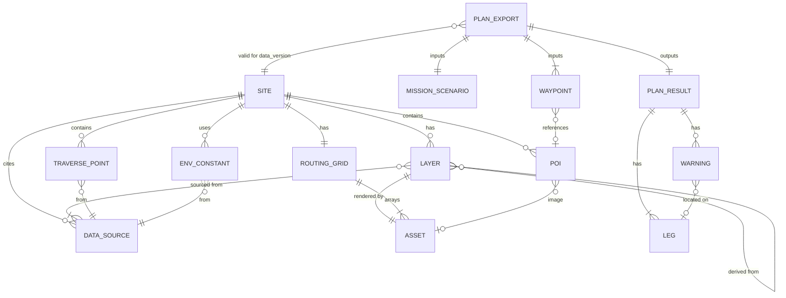

# 05 — Backend and Database Schema

*("Background Schema" in the brief is interpreted as Backend and Database Schema.)*

| | |
|---|---|
| **Owner** | Data (this file owns data structures and persistence) |
| **Date** | 2026-11-02 |
| **Status** | Draft v1 — proposed |
| **Behavior** | [02 Technical](02_Technical_Requirements_Document.md) · **Requirements** [01 PRD](01_Product_Requirements_Document.md) |

---

## A. Domain model

| Entity | Purpose | Kind | Requirements |
|---|---|---|---|
| **Site** | The one mapped excursion area; root of the manifest | Static, versioned | FR-01 |
| **DataSource** | A cited external product (dataset, paper, image) | Static | FR-15 |
| **Layer** | A displayable data layer (raster tiles or vector) | Static | FR-02, FR-17, FR-18 |
| **Asset** | A file on disk (tiles root, grid array, image, GeoJSON) with checksum | Static | NFR-06, NFR-10 |
| **RoutingGrid** | Aligned arrays used for sampling and routing | Static, derived | FR-03, FR-07 |
| **POI** | Curated science point of interest with ground image | Static, curated | FR-04 |
| **TraversePoint** | Historical Curiosity position (sol) | Static, observed | FR-17 |
| **EnvConstant** | Measured or reported constant used in estimates (e.g., RAD dose rate) | Static | FR-12 |
| **MissionScenario** | User-set constraints and start time | Runtime, user input | FR-05 |
| **Waypoint** | Start or stop placed by the user | Runtime, user input | FR-06 |
| **PlanResult** | Computed legs, totals, conditions, warnings | Runtime, computed | FR-07–FR-12 |
| **Leg** / **Warning** | Parts of PlanResult | Runtime, computed | FR-07, FR-10 |
| **PlanExport** | Serialised scenario + waypoints + result + provenance | File, exported | FR-14 |

Not modelled (out of scope): users, accounts, teams, sharing, billing, telemetry.

---

## B. Persistence strategy

**No database** (Proposed D-02). Equivalent stores:

| Store | Contents | Format | Lifetime |
|---|---|---|---|
| **Static files** (`web/public/sites/<site_id>/`) | Site manifest, DataSources, Layers, Assets, RoutingGrid arrays, POIs, traverse, EnvConstants, tiles, images | JSON, GeoJSON, raw little-endian binary arrays, JPEG/PNG/WebP tiles | Per `data_version`; immutable once released |
| **Pipeline workspace** (`pipeline/work/`, git-ignored) | Downloaded source rasters, intermediate GeoTIFFs | GeoTIFF/COG, PDS labels | Developer machine only |
| **Browser memory** | MissionScenario, Waypoints, PlanResult, UI state | JS objects | Session |
| **Browser storage** (FR-20, optional) | Last PlanExport | JSON string under key `mwp:lastPlan:v1` | Until cleared; failures ignored |
| **Exported file** | PlanExport | `.json` download | User-controlled |
| **External sources** | USGS, PDS, NASA image archives | Original products | Contacted only by the pipeline, pre-event |

Large rasters are **never embedded in JSON**: the manifest references them by relative path + SHA-256 + dimensions.

---

## C. Entity definitions

Conventions: coordinates `x_m`, `y_m` are in the site's **working projection** (local Mars equirectangular, metres, origin at the AOI's projection centre, x east, y north). Geographic values are `lat` (planetocentric °, −90…90) and `lon_e` (east-positive °, −180…180). Elevations `*_m` are metres in the DEM's MOLA-tied datum. Times are ISO-8601 UTC strings; Mars local times are strings `HH:MM` LTST.

### Site
| Field | Type | Req | Default | Rules / units | Example |
|---|---|---|---|---|---|
| `schema_version` | string | ✓ | — | SemVer; app checks major | `"1.0.0"` |
| `site_id` | string (PK) | ✓ | — | `^[a-z0-9_]+$`, unique | `"gale_boxwork"` |
| `name` | string | ✓ | — | ≤ 80 chars | `"Mount Sharp boxwork, Gale crater"` |
| `body` | enum | ✓ | `"mars"` | `mars` | `"mars"` |
| `data_version` | string | ✓ | — | `<site_id>-YYYY.MM.DD[.n]` | `"gale_boxwork-2026.11.05"` |
| `crs.proj4` | string | ✓ | — | Must equal pipeline string exactly | see example |
| `crs.base` | string | ✓ | — | IAU code of geographic base | `"IAU_2015:49900"` |
| `aoi.extent_m` | number[4] | ✓ | — | `[minx, miny, maxx, maxy]` | `[-3000,-3000,3000,3000]` |
| `aoi.bbox_geo` | number[4] | ✓ | — | `[min_lon_e, min_lat, max_lon_e, max_lat]`, inside DEM extent | illustrative |
| `default_start` | `{x_m, y_m, label}` | ✓ | — | Passable cell | — |
| `known_offsets_m` | object | | `{}` | Measured layer-to-ortho offsets | `{"traverse": 2.1}` |
| `layers` | Layer[] | ✓ | — | ≥ 1 | — |
| `sources` | DataSource[] | ✓ | — | — | — |
| `grid` | RoutingGrid | ✓ | — | — | — |
| `env_constants` | EnvConstant[] | ✓ | — | — | — |
| `pois_asset` / `traverse_asset` | asset_id | ✓ | — | FK → Asset | — |

### DataSource
| Field | Type | Req | Rules | Example |
|---|---|---|---|---|
| `source_id` (PK) | string | ✓ | unique, kebab-case | `"usgs-gale-dem-1m-v3"` |
| `title` | string | ✓ | | `"Mars MSL Gale Merged DEM 1m"` |
| `publisher` | string | ✓ | | `"USGS Astrogeology Science Center"` |
| `authors` | string | | | `"Parker, T.; Calef III, F. J."` |
| `missions` / `instruments` | string[] | ✓ | | `["MRO","Mars Express","MGS"]` / `["HiRISE","CTX","HRSC","MOLA"]` |
| `version` | string | ✓ | | `"v3"` |
| `url` | string | ✓ | https | Astropedia page |
| `doi` | string | | | — |
| `credit` | string | ✓ | Shown in UI | `"Please credit authors"` |
| `licence` | string | ✓ | | `"Use constraints: none (USGS/PDS)"` |
| `accessed` | date | ✓ | | `"2026-11-02"` |
| `native_resolution_m` | number | | | `1` |
| `accuracy_note` | string | | | `"Controlled to MOLA: ~100 m horizontal, ~1 m vertical"` |

### Layer
| Field | Type | Req | Default | Rules | Example |
|---|---|---|---|---|---|
| `layer_id` (PK) | string | ✓ | | unique | `"slope"` |
| `title` | string | ✓ | | | `"Slope"` |
| `category` | enum | ✓ | | `optical \| topographic \| thermal \| spectral \| hazard \| mission` | `"topographic"` |
| `kind` | enum | ✓ | | `raster_tiles \| vector \| image_static` | `"raster_tiles"` |
| `provenance` | enum | ✓ | | `measured \| derived \| modelled \| assumed` | `"derived"` |
| `source_ids` | string[] | ✓ | | FK → DataSource, ≥ 1 | `["usgs-gale-dem-1m-v3"]` |
| `derived_from` | string[] | | `[]` | FK → Layer | `["elevation"]` |
| `units` | string | | | | `"deg"` |
| `legend` | object | ✓ | | ramp/classes with values | see example |
| `native_resolution_m` | number | ✓ | | | `1` |
| `display_resolution_m` | number | ✓ | | | `2` |
| `asset_id` | string | ✓ | | FK → Asset (tiles root) | `"tiles-slope"` |
| `tile_grid` | object | cond. | | Required when `kind=raster_tiles`: `origin_m`, `resolutions_m`, `tile_size_px`, `format` | — |
| `default_visible` | bool | ✓ | `false` | | `false` |
| `optional` | bool | ✓ | `true` | `false` only for basemap | `true` |
| `limitations` | string | ✓ | | Shown in legend/methods | `"1 m posts; effective resolution coarser"` |

### Asset
| Field | Type | Req | Rules | Example |
|---|---|---|---|---|
| `asset_id` (PK) | string | ✓ | unique | `"grid-elevation"` |
| `path` | string | ✓ | relative to site folder | `"grid/elevation.f32"` |
| `format` | enum | ✓ | `f32 \| u8 \| geojson \| jpg \| png \| webp \| tiles` | `"f32"` |
| `sha256` | string | ✓ (files) | 64 hex; tiles roots store hash of index file | — |
| `bytes` | int | ✓ (files) | | `5760000` |
| `width` / `height` | int | cond. | arrays/images | `1200` / `1200` |
| `nodata` | number \| null | cond. | arrays: `NaN` for f32, `255` for u8 | `null` |
| `byte_order` | enum | cond. | `little` | `"little"` |

### RoutingGrid
| Field | Type | Req | Rules | Example |
|---|---|---|---|---|
| `cell_m` | number | ✓ | > 0 | `5` |
| `width` / `height` | int | ✓ | `width*height ≤ 4e6` | `1200` / `1200` |
| `origin_m` | number[2] | ✓ | top-left corner (x, y) | `[-3000, 3000]` |
| `row_order` | enum | ✓ | `north_up` | `"north_up"` |
| `elevation_asset` | FK | ✓ | f32, metres, bilinear-resampled mean of 1 m DEM | `"grid-elevation"` |
| `slope_p90_asset` | FK | ✓ | u8, degrees × 4 (0.25° steps, 0–63.75°, 255 = no data) | `"grid-slope-p90"` |
| `slope_max_asset` | FK | ✓ | same encoding | `"grid-slope-max"` |
| `flags_asset` | FK | ✓ | u8 bitfield (below) | `"grid-flags"` |
| `ti_asset` | FK | | f32 tiu at 100 m, own small grid with `ti_cell_m: 100` | `"grid-ti"` |

**Flag bits**

| Bit | Name | Meaning | Source |
|---|---|---|---|
| 0 | `NO_DATA` | DEM no-data | derived |
| 1 | `HARD_HAZARD` | Team-digitised impassable feature (e.g., scarp) | assumed/interpreted |
| 2 | `LOW_TI` | TI below threshold (possible loose fines) | derived, interpretive |
| 3 | `TI_UNKNOWN` | No TI coverage | derived |
| 4 | `LOW_RES_DEM` | Cell filled by CTX/HRSC/MOLA rather than HiRISE | derived from DEM source map (if obtainable) |
| 5–7 | reserved | | |

### POI
GeoJSON Feature in working-projection metres; properties:

| Field | Type | Req | Rules | Example |
|---|---|---|---|---|
| `poi_id` (PK) | string | ✓ | unique | `"poi-boxwork-ridge"` |
| `name` | string | ✓ | | `"Boxwork ridge"` |
| `lat`, `lon_e` | number | ✓ | inside AOI | — |
| `science_objective` | string | ✓ | ≤ 300 chars | `"Examine mineral-cemented ridges formed by groundwater in fractures"` |
| `why_it_matters` | string | ✓ | ≤ 300 chars | — |
| `image_asset` | FK | | jpg | `"img-boxwork-ridge"` |
| `image_credit` | string | cond. | required if image | `"NASA/JPL-Caltech"` |
| `image_source_url` | string | cond. | required if image | NASA page |
| `image_sol` / `image_date` / `image_camera` | int / date / string | | | `4611` / `"2025-07-27"` / `"Navcam"` |
| `position_source` | string | ✓ | how coordinates were obtained | `"Traverse waypoint at sol 4611 (PLACES)"` |
| `position_uncertainty_m` | number | ✓ | ≥ 0 | `10` |
| `provenance` | enum | ✓ | usually `assumed` for curated positions | `"assumed"` |

### TraversePoint
GeoJSON Point features (+ one LineString). Properties: `sol` (int, ✓), `site_drive` (string), `lat`, `lon_e`, `elevation_m` (if provided), `source_id` (FK, ✓). Provenance: `measured` (rover localization).

### EnvConstant
| Field | Type | Req | Example |
|---|---|---|---|
| `const_id` (PK) | string | ✓ | `"rad-gale-dose-eq-solar-max"` |
| `quantity` | string | ✓ | `"surface dose equivalent rate"` |
| `value` | number | ✓ | `0.64` |
| `low` / `high` | number | ✓ | `0.52` / `0.76` |
| `unit` | string | ✓ | `"mSv/day"` |
| `conditions` | object | ✓ | `{"solar_phase":"max","location":"Gale crater floor","period":"2012-2013"}` |
| `provenance` | enum | ✓ | `"measured"` |
| `source_id` | FK | ✓ | `"hassler-2014-rad"` |

Second record: `rad-gale-dose-eq-solar-min`, value `0.925` (midpoint, display as range), low `0.85`, high `1.0`, provenance `"measured"` with note "reported range, Simonsen et al. 2024".

### MissionScenario (user input)
| Field | Type | Req | Default | Range (see [02 §E.3](02_Technical_Requirements_Document.md#e3-input-validation-rules)) |
|---|---|---|---|---|
| `eva_start_utc` | ISO string | ✓ | site default | 2000–2100 |
| `max_eva_duration_h` | number | ✓ | 6.0 | 0.5–10 |
| `dwell_min_per_stop` | number | ✓ | 20 | 0–180 |
| `hard_slope_limit_deg` | number | ✓ | 15 | 5–35, > caution |
| `caution_slope_deg` | number | ✓ | 10 | 2–30 |
| `walkback_limit_km` | number | ✓ | 5.0 | 0.5–20 |
| `suited_flat_speed_kmh` | number | ✓ | 3.3 | 0.5–6 |
| `solar_phase` | enum | ✓ | `"max"` | `max \| min` |
| `loop` | bool | ✓ | `true` | — |

All defaults carry provenance `assumed` in the UI.

### Waypoint (user input)
| Field | Type | Req | Rules |
|---|---|---|---|
| `id` (PK within plan) | string | ✓ | `wp-<n>` |
| `role` | enum | ✓ | exactly one `start`; ≤ 10 `stop` |
| `x_m`, `y_m` | number | ✓ | inside AOI, passable after snapping |
| `poi_id` | FK | | → POI |
| `snapped_from` | `{x_m,y_m}` | | present if snapped |
| `label` | string | | ≤ 40 chars |

### PlanResult (computed)
| Field | Type | Notes |
|---|---|---|
| `status` | enum | `OK \| OVER_LIMITS \| PARTIAL \| ERROR` |
| `legs` | Leg[] | one per consecutive waypoint pair (+ return leg if `loop`) |
| `totals` | object \| null | null when `PARTIAL`: `distance_m, walk_time_min, dwell_time_min, eva_total_min, eva_margin_min, climb_m, descent_m, max_slope_deg, max_walkback_km` |
| `stops_timeline` | array | per waypoint: `arrive_utc, depart_utc, arrive_ltst, sun_elevation_deg` |
| `conditions` | object | `mars_year, ls_deg, sunrise_ltst, sunset_ltst, sunrise_utc, sunset_utc` (flat horizon) |
| `radiation` | object | `dose_mSv, dose_low_mSv, dose_high_mSv, solar_phase, const_id` |
| `warnings` | Warning[] | |
| `computed_utc` | ISO | |
| `timing_ms` | object | diagnostics |

**Leg:** `from`, `to`, `status` (`OK \| NO_ROUTE`), `reason` (if NO_ROUTE), `distance_m`, `walk_time_min`, `climb_m`, `descent_m`, `max_slope_deg`, `geometry` (array of `[x_m,y_m]`, simplified for display), `cell_path_length`, `nearest_reachable` (if NO_ROUTE), `profile` (arrays `dist_m[]`, `elev_m[]`, `slope_class[]` sampled every 5 m).

**Warning:** `code` (`OVER_HARD_SLOPE`, `CAUTION_SLOPE`, `LOW_TI`, `TI_UNKNOWN`, `LOW_RES_DEM`, `NO_ROUTE`, `EVA_DURATION_EXCEEDED`, `WALKBACK_EXCEEDED`, `DARKNESS`), `severity` (`caution \| blocked \| unknown`), `leg` (index or null), `from_m`, `to_m` (along-leg distance), `at_utc` (for time warnings), `message`.

### PlanExport
| Field | Type | Req |
|---|---|---|
| `export_schema_version` | string | ✓ |
| `app_version` | string | ✓ |
| `site_id`, `data_version` | string | ✓ |
| `plan_hash` | string | ✓ — first 12 hex of SHA-256 over canonical JSON of `{data_version, scenario, waypoints}` (sorted keys, numbers as written) |
| `scenario` | MissionScenario | ✓ |
| `waypoints` | Waypoint[] | ✓ |
| `result` | PlanResult | ✓ |
| `provenance_summary` | array of `{value_path, provenance, source_ids}` | ✓ |
| `disclaimer` | string | ✓ |

---

## D. Relationships and diagrams



### Distinctions the schema enforces

| Distinction | How |
|---|---|
| Source observations vs. derived values | `Layer.provenance` + `derived_from`; elevation/ortho/TI are `measured` products, slope/flags `derived`, LOW_TI and HARD_HAZARD are explicitly *interpretive* |
| User inputs vs. computed outputs | `MissionScenario`/`Waypoint` vs. `PlanResult` — separate objects in the export; outputs never edited by the UI |
| Historical data vs. scenario assumptions | `TraversePoint`, `EnvConstant` (historical/measured) vs. scenario defaults (`assumed`) |
| Data versions vs. analysis runs | `data_version` (immutable static bundle) vs. `plan_hash` + `computed_utc` (one run) |

---

## E. Integrity and access patterns

### E.1 Access patterns ("queries") and indexes

| Access | Implementation | "Index" |
|---|---|---|
| Value at (x, y) | `i = floor((origin_y − y)/cell)`, `j = floor((x − origin_x)/cell)` → array offset `i*width + j` | O(1) array addressing |
| Neighbors in A* | offset ± 1, ± width | implicit grid |
| POI by id | `Map<poi_id, POI>` built at boot | in-memory hash |
| POIs/traverse near view | ≤ a few hundred features → linear filter | none needed |
| Layer by id / source by id | `Map` at boot | in-memory hash |

### E.2 Ownership and access
Single-user, local; no access control. Static bundle is public (Space Apps requires a public repository).

### E.3 Referential integrity (validated by `pipeline/validate_manifest.py` and at app boot in dev builds)
- Every `*_asset`/`asset_id` resolves to an Asset whose file exists and whose SHA-256 matches.
- Every `source_ids` entry resolves to a DataSource.
- All grids share `width`, `height`, `cell_m`, `origin_m`.
- All POIs and the default start lie inside `aoi.extent_m` and on passable cells.
- `crs.proj4` string is byte-identical to the pipeline constant.

### E.4 Versioning and migration
- `schema_version` (manifest structure) and `export_schema_version` (plan files) use SemVer; the app refuses a different **major** with a clear message.
- `data_version` changes whenever any asset changes; old exports remain readable but show "computed with data_version X; current Y — results may differ" and can be recomputed.
- No migrations beyond that are needed in MVP.

### E.5 Provenance required to reproduce a result
`data_version` + `scenario` + `waypoints` + `app_version` → deterministic `PlanResult` (NFR-06). The export stores all four plus `plan_hash`. The pipeline commits `pipeline/sources.lock.json` with source URLs, versions, checksums and the exact GDAL/rasterio versions used.

### E.6 Unavailable or replaced source data
- Optional layer asset missing → Layer status `unavailable`; dependent flags (e.g., `LOW_TI`) treated as `TI_UNKNOWN`, producing `unknown`-severity warnings rather than silence.
- Upstream product replaced (e.g., USGS v4 DEM) → new `data_version`; never overwrite assets in place.
- Rover image unavailable → POI still valid; image fields null; UI shows placeholder with source link.

---

## F. Representative records

### F.1 Site manifest (abridged; AOI values illustrative until TASK-01)

```json
{
  "schema_version": "1.0.0",
  "site_id": "gale_boxwork",
  "name": "Mount Sharp boxwork, Gale crater",
  "body": "mars",
  "data_version": "gale_boxwork-2026.11.05",
  "crs": {
    "base": "IAU_2015:49900",
    "proj4": "+proj=eqc +lat_ts=-4.70 +lat_0=-4.70 +lon_0=137.38 +x_0=0 +y_0=0 +R=3396190 +units=m +no_defs"
  },
  "aoi": {"extent_m": [-3000, -3000, 3000, 3000], "bbox_geo": [137.3292, -4.7506, 137.4308, -4.6494]},
  "default_start": {"x_m": -1800, "y_m": -1500, "label": "Habitat / rover"},
  "known_offsets_m": {"traverse": null},
  "grid": {
    "cell_m": 5, "width": 1200, "height": 1200, "origin_m": [-3000, 3000], "row_order": "north_up",
    "elevation_asset": "grid-elevation", "slope_p90_asset": "grid-slope-p90",
    "slope_max_asset": "grid-slope-max", "flags_asset": "grid-flags", "ti_asset": "grid-ti", "ti_cell_m": 100
  },
  "layers": [
    {
      "layer_id": "slope", "title": "Slope", "category": "topographic", "kind": "raster_tiles",
      "provenance": "derived", "source_ids": ["usgs-gale-dem-1m-v3"], "derived_from": ["elevation"],
      "units": "deg", "native_resolution_m": 1, "display_resolution_m": 2,
      "legend": {"type": "classes", "breaks_follow_scenario": true,
                 "classes": [[0,5,"flat"],[5,10,"gentle"],[10,15,"caution"],[15,25,"over limit"],[25,90,"steep"]]},
      "asset_id": "tiles-slope",
      "tile_grid": {"origin_m": [-3000, 3000], "resolutions_m": [32, 16, 8, 4, 2], "tile_size_px": 256, "format": "png"},
      "default_visible": false, "optional": true,
      "limitations": "Horn slope on 1 m posts; effective DTM resolution is coarser; artifacts possible."
    }
  ],
  "env_constants": [
    {"const_id": "rad-gale-dose-eq-solar-max", "quantity": "surface dose equivalent rate",
     "value": 0.64, "low": 0.52, "high": 0.76, "unit": "mSv/day",
     "conditions": {"solar_phase": "max", "location": "Gale crater floor", "period": "2012-2013"},
     "provenance": "measured", "source_id": "hassler-2014-rad"}
  ],
  "sources": [
    {"source_id": "usgs-gale-dem-1m-v3", "title": "Mars MSL Gale Merged DEM 1m",
     "publisher": "USGS Astrogeology Science Center", "authors": "Parker, T.; Calef III, F. J.",
     "missions": ["MRO", "Mars Express", "MGS"], "instruments": ["HiRISE", "CTX", "HRSC", "MOLA"],
     "version": "v3", "url": "https://astrogeology.usgs.gov/search/map/mars_msl_gale_merged_dem_1m",
     "credit": "Please credit authors", "licence": "Use constraints: none",
     "accessed": "2026-11-02", "native_resolution_m": 1,
     "accuracy_note": "HRSC controlled to MOLA (~100 m horizontal, ~1 m vertical)"}
  ],
  "pois_asset": "vec-pois",
  "traverse_asset": "vec-traverse"
}
```

(The illustrative `bbox_geo` is consistent with the extent: 3000 m / (59,274.7 m/° × cos 4.70°) ≈ 0.0508° in longitude; 3000 / 59,274.7 ≈ 0.0506° in latitude.)

### F.2 POI feature

```json
{
  "type": "Feature",
  "geometry": {"type": "Point", "coordinates": [410.0, 325.0]},
  "properties": {
    "poi_id": "poi-boxwork-ridge",
    "name": "Boxwork ridge",
    "lat": -4.6945, "lon_e": 137.3869,
    "science_objective": "Examine a mineral-cemented ridge and the sandy hollow beside it.",
    "why_it_matters": "Ridges record groundwater moving through fractures as Mars dried.",
    "image_asset": "img-boxwork-ridge",
    "image_credit": "NASA/JPL-Caltech",
    "image_source_url": "https://science.nasa.gov/ (exact page recorded at curation)",
    "image_sol": 4611, "image_date": "2025-07-27", "image_camera": "Navcam",
    "position_source": "Nearest Curiosity waypoint to the imaged ridge (to be confirmed in TASK-04)",
    "position_uncertainty_m": 15,
    "provenance": "assumed"
  }
}
```
*(Coordinates illustrative.)*

### F.3 Plan export (abridged, status OK)

```json
{
  "export_schema_version": "1.0.0",
  "app_version": "0.1.0",
  "site_id": "gale_boxwork",
  "data_version": "gale_boxwork-2026.11.05",
  "plan_hash": "3f9a1c07be42",
  "scenario": {"eva_start_utc": "2026-11-14T08:00:00Z", "max_eva_duration_h": 6.0, "dwell_min_per_stop": 20,
               "hard_slope_limit_deg": 15, "caution_slope_deg": 10, "walkback_limit_km": 5.0,
               "suited_flat_speed_kmh": 3.3, "solar_phase": "max", "loop": true},
  "waypoints": [
    {"id": "wp-0", "role": "start", "x_m": -1800, "y_m": -1500},
    {"id": "wp-1", "role": "stop", "x_m": 410, "y_m": 325, "poi_id": "poi-boxwork-ridge"}
  ],
  "result": {
    "status": "OK",
    "totals": {"distance_m": 6120, "walk_time_min": 128, "dwell_time_min": 20, "eva_total_min": 148,
               "eva_margin_min": 212, "climb_m": 74, "descent_m": 74, "max_slope_deg": 12.6, "max_walkback_km": 3.06},
    "radiation": {"dose_mSv": 0.066, "dose_low_mSv": 0.053, "dose_high_mSv": 0.078,
                  "solar_phase": "max", "const_id": "rad-gale-dose-eq-solar-max"},
    "warnings": [{"code": "CAUTION_SLOPE", "severity": "caution", "leg": 0, "from_m": 1210, "to_m": 1290,
                  "message": "Slope 12.6° exceeds caution 10° for 80 m"}]
  },
  "provenance_summary": [
    {"value_path": "result.radiation.dose_mSv", "provenance": "modelled", "source_ids": ["hassler-2014-rad"]},
    {"value_path": "result.totals.walk_time_min", "provenance": "modelled", "source_ids": ["tobler-1993", "apollo17-planning"]}
  ],
  "disclaimer": "Exploratory planning prototype — not validated for operations."
}
```
*(Metric values illustrative; the radiation numbers are internally consistent: 148 min × 0.64/1440 = 0.066 mSv, range 0.053–0.078.)*

## Unresolved items owned by this document

| ID | Item | Recommendation |
|---|---|---|
| U-10 | Can a per-pixel DEM source map (HiRISE vs. fill) be obtained for `LOW_RES_DEM`? | Try stereo-pair footprints from the DEM metadata list; else hand-digitise coverage from hillshade texture and label it interpreted |
| U-11 | Store profile arrays in export or recompute on import? | Store (small) — simplifies briefing rendering |
