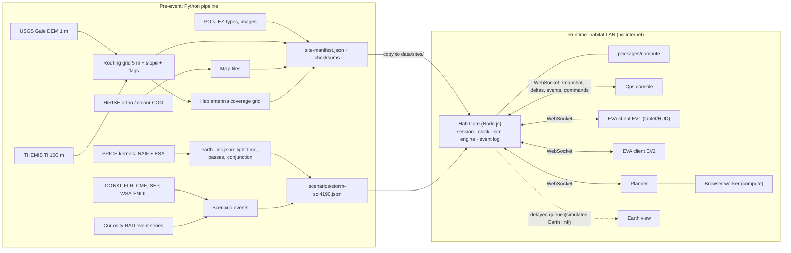
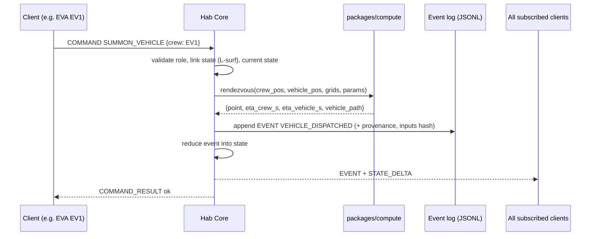

# 02 — Technical Requirements Document

| | |
| --- | --- |
| **Owner** | Architecture (this file owns architecture, data handling and system behavior) |
| **Date** | 2026-11-05 |
| **Status** | Draft v2 — supersedes v1 (2026-11-02). Sections marked *(v1, unchanged)* are carried over verbatim; *Spike* items must be verified in TASK-01/02/03 before the event |
| **Related** | Scope source: [01 PRD](01_Product_Requirements_Document.md) (FR-xx, tiers T0–T2) · Data structures: [05 Schema](05_Backend_and_Database_Schema.md) · [Docs index](../README.md) |

## Change log v1 → v2

| Area | v1 | v2 |
| --- | --- | --- |
| Runtime | Static SPA, compute in a Web Worker, no backend (D-02) | Static SPA **plus Hab Core**, a local Node.js server on the habitat LAN. **D-02 reversed** |
| Compute | `web/src/compute` | `packages/compute`: same pure TypeScript functions, imported by both the browser worker and the Hab Core |
| Clients | One app | One web app with role routes: `#/planner`, `#/eva`, `#/hud`, `#/ops`, `#/earth` |
| Network | None at runtime | Habitat LAN (real, for the demo) + **simulated** surface radio and Earth links |
| New science/compute | — | Time to haven, rendezvous, comm coverage, Earth link geometry (SPICE, precomputed), space-weather replay, simulation engine, contingency options |
| New data | — | DONKI, RAD event time series, SPICE kernels (NAIF + ESA), optional REMS/CRISM/orbiter weather |

---

## A. Architecture

### A.1 System boundary

The product is a **local surface operations system**: an offline Python preprocessing pipeline, a shared TypeScript compute package, a **Hab Core** server and one web app serving five role views. There is **no internet dependency at runtime**. The only network is the habitat LAN (for the demo, a travel router with no WAN uplink).

| Component | Runs where | Responsibility |
| --- | --- | --- |
| **Preprocessing pipeline** (`pipeline/`, Python) | Developer laptop, before the event | v1 raster/vector work **plus**: hab-antenna coverage grid, SPICE geometry tables, DONKI event extraction, RAD event series, scenario assembly |
| **Compute package** (`packages/compute/`, TypeScript) | Imported by Hab Core (Node) and by the browser worker | Pure, deterministic, unit-tested: sampling, routing, time model, Mars24, radiation, haven fields, rendezvous, viewshed, link availability, consumables |
| **Protocol package** (`packages/protocol/`, TypeScript) | Imported by all | Message and entity types + JSON Schemas; one source of truth for the wire format |
| **Hab Core** (`apps/hab-core/`, Node.js) | Habitat laptop | Serves the web app and site assets; session state; mission clock and simulation engine; command validation; event log; WebSocket fan-out; persistence |
| **Web app** (`apps/web/`, TypeScript + Vite) | Browsers on laptops, phones, tablets | Role views: Planner (v1 UI), EVA tablet, HUD, Ops console, Earth view |
| **Static site data** (`data/sites/gale_boxwork/`, large files git-ignored) | Served by Hab Core | Tiles, routing grid, vectors, images, manifest (v1 contract, §E.1) + new grids/tables (§C.5) |
| **Scenarios** (`scenarios/*.json`) | Hab Core disk | Start time, plan, crew, assets, scheduled events, seed |
| **External sources** | Internet, pre-event only | USGS, PDS, NAIF/ESA SPICE, DONKI, NASA image sites — never contacted at runtime |

The **`packages/compute` boundary** is the one the organizer guide recommends pointing at during judging: "the model never computes a number; tested functions do."

### A.2 Architecture diagram



### A.3 Why a habitat server now (Proposed — reverses v1 D-02)

| Need | Why a static app is no longer enough | Hab Core answer |
| --- | --- | --- |
| Several people see one mission state | Each browser would have its own state | Single authoritative state, broadcast to clients |
| Mission clock and simulation | Must keep running when a phone sleeps | Clock and engine run server-side |
| Commands between roles (summon, approve) | Needs routing between devices | Commands validated and logged centrally |
| Realism | A Mars habitat would host local compute; Earth is minutes away | The server *is* the habitat edge computer; its absence from the internet is the point |

The planner keeps its **browser worker** so interactive editing stays fast and the planner still works if the Hab Core is down (degraded mode, FR-16).

### A.4 Why Node.js + TypeScript for Hab Core (Proposed, D-12)

| Option | For | Against |
| --- | --- | --- |
| **Node.js 20 LTS + TypeScript (Fastify + `ws`)** | Same `packages/compute` code in server and browser: one implementation, one test suite; one language for 4 of 6 roles | Raster work stays in Python (fine — it is pre-event) |
| FastAPI (organizer guide default) | Matches guide; numpy for grids | Compute duplicated in Python and TS, or the planner loses its worker and every edit goes over HTTP |

Choose FastAPI only if the team's TypeScript capacity is < 2 people (U-13).

### A.5 Network model

Three layers are kept strictly separate so the demo never confuses real networking with simulated radio.

| Layer | Real or simulated | Model |
| --- | --- | --- |
| **L-net: demo LAN** | **Real** | Travel router, WAN disconnected. Hab Core binds `0.0.0.0:8080`; ops console shows a QR code with the join URL and role. Reconnect with exponential backoff (0.5 s → 5 s) |
| **L-surf: surface radio** | **Simulated** | Nodes = hab mast, suits, rovers. An edge exists when line of sight holds (§D.11) and range ≤ node limit. A suit is "linked" when any path to the hab exists (direct, via buddy suit, or via relay rover). An unlinked suit's commands are queued on the device and its telemetry freezes on ops with a `STALE` badge |
| **L-earth: Earth link** | **Simulated, geometry real** | Delivery time from precomputed SPICE tables (§D.12): light time + wait for relay pass; blackout near conjunction |

**Rule:** L-surf and L-earth effects are applied by the Hab Core to messages *logically*; the physical LAN always stays up. When L-surf says EV1 is unlinked, EV1's device still receives a single `LINK_STATE` event so its UI can switch to "No hab link — operating on cached plan," which is what a real suit would do.

### A.6 State model: commands → events → state



- **Event-sourced:** state = fold of the event log over the scenario's initial state. Persistence = append-only `session.jsonl` + periodic snapshot.
- **Deterministic:** the engine uses sim time only, never wall-clock, and a seeded PRNG (`mulberry32`) if any randomness is enabled (none by default). Replay hash = SHA-256 of the canonical event log.
- **Live session** *(added 2026-11-10, Proposed)*: a presenter presses buttons at wall-clock moments, but a command takes effect at a whole sim second, and the event it produces records that sim second. The log, and the **recorded command list** a headless run replays (`{sim_time, role, kind, args}`, applied in list order, §D.17), therefore reproduce the run without any wall-clock input. Same scenario + seed + data version + command list ⇒ same log hash (NFR-06).

---

## B. Technology choices

| Area | Choice (Proposed) | Why it fits | Limitations | Alternative |
| --- | --- | --- | --- | --- |
| Map rendering | **OpenLayers** + proj4 local Mars projection *(v1)* | Arbitrary projections, correct metric scale | Learning curve | Leaflet `CRS.Simple`. **Not MapLibre** (Web-Mercator only; organizer guide suggests it, but Mars distances would be wrong) |
| Web app | **TypeScript + Vite**, Preact (or vanilla) with hash routes per role. **2026-11-06: React chosen** (D-14, [ADR-012](../decisions/ADR-012-react-vite-web-app.md)); still Vite, no Next.js | One build, five views, small bundle | — | React if the team knows it |
| Charts | uPlot *(v1)* | Fast | Manual a11y | Plain SVG |
| Hab Core | **Node.js 20 LTS, Fastify** (static + REST), **`ws`** (WebSocket) | Shares compute package; tiny dependency set | Single process (fine for a habitat of 4) | FastAPI (A.4) |
| Shared compute | **`packages/compute`**, pure TS, **Vitest** | One implementation, tested once | Re-implementing A*, Dijkstra, viewshed in TS | — |
| Message types | **`packages/protocol`**: TypeScript types + JSON Schema (generated with `ts-json-schema-generator` or hand-written) | Wire format checked in CI and at runtime | — | zod schemas |
| Persistence | Append-only JSONL log + JSON snapshots on disk | Inspectable, replayable, no DB to install | Not concurrent-safe across processes (one process only) | SQLite |
| Pipeline | Python 3.11+, GDAL ≥ 3.6, rasterio, numpy, pyproj *(v1)* **+ SpiceyPy, requests, pandas** | SPICE geometry is deterministic and citable ("computed from kernels, never estimated" — organizer guide) | Kernel management | Online WebGeocalc (light use only; not for the demo) |
| Monorepo | **npm workspaces** (`apps/*`, `packages/*`; already used by the repo) + Python `pipeline/` in the conda env `marswalk-pipeline` | Shared packages without publishing; no new tool to install | `npm ci` needs internet once | pnpm |
| Demo network | Own travel router (no WAN), static IP for the Hab Core laptop | Venue Wi-Fi independent | Phones must join the router | Single-laptop mode: all role views as windows on one machine |
| Hosting (public link) | GitHub Pages: planner + **replay mode** (a recorded event log played back in the browser without Hab Core) | Satisfies "public link" for judges | No live multi-device on Pages | Release asset with a run script |

**Cost:** $0. No paid APIs or keys at runtime. Pre-event: optional free `api.nasa.gov` key for DONKI (DEMO_KEY limits: 30/h, 50/day — organizer guide).

**Spikes (Track P, before 8 Nov):** TASK-02 projection (v1); **TASK-20 Hab Core skeleton** (two phones receive a broadcast within 500 ms over the travel router); **TASK-05b full-grid Dijkstra time field in Node ≤ 2 s** on the weakest laptop.

---

## C. Mars data and geospatial handling

C.1–C.4 *(v1, unchanged)*; C.5 is new.

### C.1 Coordinate reference conventions (applies to every layer)

| Item | Convention | Label |
| --- | --- | --- |
| Body and datum | Mars sphere, radius **3,396,190 m** (IAU_2015:49900 "Mars (2015) – Sphere") | **Confirmed** (USGS DEM metadata Radius A = C = 3396190; spatialreference.org) |
| Latitude | Planetocentric (identical to planetographic on a sphere) | **Confirmed** (DEM metadata) |
| Longitude | **East-positive**, domain −180…180 in USGS products; Gale ≈ 137.4°E is identical in 0–360 domain | **Confirmed** (DEM metadata) |
| Source DEM projection | Equirectangular with standard parallel 0° — verified by arithmetic: lon span 0.556392° × 59,274.7 m/° = 32,980 m = column count at 1 m | **Confirmed** (computed) |
| Working projection (Proposed) | `+proj=eqc +lat_ts=<AOI centre lat> +lat_0=<AOI centre lat> +lon_0=<AOI centre lon> +x_0=0 +y_0=0 +R=3396190 +units=m +no_defs` | Proposed — true scale along the AOI's central parallel; origin (0, 0) at the AOI centre |
| Why reproject | At ~4.75°S the source x-scale overstates ground east–west distance by 0.343 % (1 − cos 4.75°); small but systematic in slope and distance | **Confirmed** (computed) |
| Elevation | Metres; DEM "tied to a MOLA DEM" (Confirmed). Interpreted as heights relative to the MOLA areoid | **Assumed** — verify in the PDS3 label during TASK-01 |
| Display format | `−4.71234°, 137.38765°E` (5 decimals ≈ 0.6 m) plus local x/y metres from AOI origin | Proposed |
| Never | Do not pass Mars coordinates through EPSG:3857 / WGS84 code paths | Rule |

### C.2 Data layers

AOI (Proposed): a ~6 × 6 km box around Curiosity's 2025 boxwork campaign, **inside** the DEM extent (lat −5.098652…−4.129605, lon 137.124167…137.680559 °E). Exact bounds are **Resolved 2026-11-07** ([feasibility.md](../ops/feasibility.md#aoi-bounds-u-01-context-02-c2)) — chosen in TASK-01 from the traverse (sols ≈ 4,450–4,750; boxwork campaign confirmed for 2025 by NASA mission blog posts and photojournal).

#### L1 — Optical basemap (FR-01)

| Field | Value |
| --- | --- |
| Source | USGS *Mars MSL Gale Merged Orthophoto Mosaic 25 cm* v3 (Calef & Parker 2016), grayscale 23 GB lossless GeoTIFF; colour HiRISE LRGB COG (~1 GB) also published — **Confirmed** |
| Type / format | Raster, 8-bit; COG for colour |
| Resolution | 25 cm/px native; **downsample to 0.5 m** for the app (Proposed, keeps tiles ≈ tens of MB for the AOI) |
| Preprocessing | `gdalwarp` window read (no full download needed for the COG via `/vsicurl/`; the 23 GB file needs range reads or a full download — prefer the colour COG if coverage suffices) → reproject to working eqc → tiles |
| Missing data | Transparent; manifest stores coverage polygon |
| Attribution | "NASA/JPL-Caltech/University of Arizona; USGS Astrogeology (Calef & Parker 2016)"; use constraints: none, credit authors — **Confirmed** |
| Fallback | Mars Trek WMTS HiRISE tiles cached pre-event (product-specific endpoint from GetCapabilities) |

*Ortho outside the source mask* *(2026-11-12)*: the ortho stays JPEG without alpha. Tiles are clipped to `aoi.extent_m`, and pixels outside the source mask are written as the 04 map background colour; the layer record's `limitations` says so, and the manifest has no coverage polygon field *(Proposed 2026-11-12; decided by the orchestrator (Claude) under Sadman Shaharier Mahim's authority, 12 Nov 2026; BD-18)*

#### L2 — Topography: elevation, hillshade (FR-02, FR-03, FR-08)

| Field | Value |
| --- | --- |
| Source | USGS *Mars MSL Gale Merged DEM 1 m* v3 (Parker & Calef 2016), 3.6 GB, 32-bit, 57,440 rows × 32,980 columns — **Confirmed** |
| Composition | HiRISE DEMs where stereo exists; otherwise CTX, HRSC, then MOLA 128 ppd fill; HRSC controlled to MOLA (~100 m horizontal, ~1 m vertical accuracy) — **Confirmed** |
| Key risk | Unknown which source fills the boxwork AOI → **TASK-01** compares DEM texture/hillshade and HiRISE stereo-pair footprints; if not HiRISE, either find a University of Arizona HiRISE DTM covering the AOI or switch site (Jezero: *Mars 2020 TRN HiRISE DTM Mosaic*, USGS) |
| Effective resolution | Post spacing 1 m; effective resolution of photogrammetric DTMs is coarser than post spacing — features of a few metres (e.g., boxwork ridges ~1–2 m tall) may be smoothed (**Assumed**; state in methods panel) |
| Artifacts | HiRISE DTM READMEs warn of "boxes", CCD seams and faceted low-contrast areas — inspect hillshade before use (**Confirmed** source: HiRISE DTM README) |
| Derived | Hillshade (azimuth 315°, altitude 45°, Proposed for display), elevation colour ramp |
| Fallback | Mars Trek elevation tiles (visual only, no routing) |

#### L3 — Slope (FR-02, FR-07, FR-10)

| Field | Value |
| --- | --- |
| Derivation | Horn method on the 1 m reprojected DEM → `slope_1m` (degrees). Aggregated to the 5 m routing grid as **p90** (used for hard limit) and **max** (used for caution flag "micro-relief") |
| Units | Degrees, 0–90 |
| Validation | Synthetic ramp test (known 10° plane → 10.0° ± 0.05°) and comparison with Mars Trek slope where available |
| Limitations | Slope at 1 m is noisy where DTM artifacts exist; p90 reduces single-pixel spikes but can hide short steps |

#### L4 — Thermal inertia (FR-02, FR-10)

| Field | Value |
| --- | --- |
| Source | USGS *THEMIS Thermal Inertia Mosaic, Quantitative (32-bit), 100 m/px*, tile covering 0…30°S, 120…180°E (file name to confirm, pattern `30S120E`) — product family **Confirmed** (Fergason et al. 2006 method; absolute accuracy ~20 %) |
| Units | tiu = J m⁻² K⁻¹ s⁻½ |
| Use | Display layer + coarse caution flag: cells below a threshold flagged "possible loose fines" (threshold **Unresolved**, set from the AOI histogram and published interpretation; label as interpretive) |
| Resampling | Bilinear for display; nearest for flags; footprint is 100 m, so one TI pixel covers 400 routing cells — say so in the legend |
| Gaps | Mosaic has gaps where coverage/quality was poor → "unknown", never zero |
| Fallback | THEMIS Day IR 100 m mosaic (ASU) as qualitative thermal layer |

#### L5 — Spectral (FR-18, desirable)

| Field | Value |
| --- | --- |
| Source | CRISM MTRDR (Map-projected Targeted RDR) summary parameters / browse products, PDS Geosciences Node — product **Confirmed**; AOI coverage **Resolved 2026-11-07** ([feasibility.md](../ops/feasibility.md#crism-coverage-u-05)) |
| Resolution | ~18–20 m/px for FRT observations |
| Labelling | "Spectral summary parameter — indicative, not a mineral identification" (wording follows CRISM label guidance) |
| Fallback | Omit; three data types are already met without it |

#### L6 — Mission vectors (FR-04, FR-17)

| Field | Value |
| --- | --- |
| Traverse source (preferred) | PDS PLACES archive (doi:10.17189/1520397), used by the PDS MSL Analyst's Notebook map — **Confirmed** as archive; field layout to verify |
| Traverse source (fallback) | MMGIS JSON (`mars.nasa.gov/mmgis-maps/...`) — publicly reachable for M20; MSL path **unverified**; not an official API — cache once |
| POIs | Curated by the team from NASA mission blog/photojournal descriptions; each POI stores the position source and confidence |
| POV images | Curiosity Navcam/Mastcam images saved locally with credit "NASA/JPL-Caltech" (MSSS for Mastcam). **Do not depend on the api.nasa.gov Mars Rover Photos API — archived (Confirmed, nasa/api-docs PR, Oct 2025; upstream repo archived 8 Oct 2025)** |
| Alignment tolerance | Traverse vs. ortho visual tracks: ≤ 5 m (Proposed; record measured offset) |

#### L7 — Environmental values (FR-11, FR-12, FR-13)

| Value | Source | Type |
| --- | --- | --- |
| Surface dose rate, solar max 2012–13 | Curiosity RAD at Gale: 0.21 ± 0.04 mGy/day; **0.64 ± 0.12 mSv/day** (Hassler et al. 2014, via [*Mars Scientific Context* §9](../reference/mars-scientific-context.md#9-radiation-and-space-environment)) | **Measured** |
| Surface dose rate, solar min (~2019) | ~0.85–1.0 mSv/day (Simonsen et al. 2024, via [*Mars Scientific Context* §9](../reference/mars-scientific-context.md#9-radiation-and-space-environment)) | Reported range |
| Solar time, L_s, sun elevation | Mars24 algorithm | **Computed** |
| Seasonal temperature/pressure (desirable) | REMS RDR via PDS Atmospheres Node (sols covered to at least 3778 in RDR volume listing) | Measured, aggregated by team |

### C.3 Data volume budget (Proposed)

| Asset | Approx. size for 6 × 6 km AOI |
| --- | --- |
| Ortho tiles @0.5 m (JPEG) | 30–80 MB |
| Hillshade/slope/TI tiles @2 m (PNG/WebP) | 10–30 MB each |
| Routing grid 1200 × 1200: elevation Float32 + slope_p90 UInt8 + slope_max UInt8 + flags UInt8 | 5.76 + 1.44 + 1.44 + 1.44 ≈ 10 MB |
| POI images (8 × ~400 KB) | ~3 MB |

### C.4 Mars-specific pitfalls to test explicitly

1. **Longitude sign in Mars24.** Many Mars24 implementations take *west* longitude (planetographic convention). Convert `west = (360 − east) mod 360`. Unit test at Gale.
2. **Earth defaults.** No `ol/proj` EPSG:3857 view, no Earth radius in distance helpers (`ol/sphere` uses Earth radius by default — do not use it; compute distances in projected metres).
3. **Raster orientation.** Row 0 = north; verify with a known feature after reprojection.
4. **No-data values.** DEM no-data (check label; e.g., −3.4e38 or −32767) must become `NaN` before slope computation, or slopes explode at edges.

### C.5 New data for v2

#### L8 — Space weather records (FR-37)

| Field | Value |
| --- | --- |
| Source | NASA CCMC **DONKI** (via `api.nasa.gov/DONKI/*` or the CCMC DONKI webservice): `FLR` (flares), `CME` + `CMEAnalysis`, `SEP`, `IPS`, `WSAEnlilSimulations` |
| What we use | Event times, flare class, and the **WSA-ENLIL predicted shock arrival time at Mars**. DONKI simulation records list Mars among "other location impacts" with an estimated arrival time (**Confirmed**: e.g., the 15 May 2024 CME record predicts Mars arrival 2024-05-18T01:36Z) |
| Caveat | DONKI products are labelled experimental research information by CCMC; we show them as `replayed` forecasts, never as truth |
| Access | Pre-event fetch through the organizer guide's `fetch_json` wrapper → `pipeline/cache/donki/*.json` → committed `demo_fixtures/` |

#### L9 — RAD event time series (FR-37)

| Field | Value |
| --- | --- |
| Event | 20 May 2024 (sol 4190): largest surge measured by RAD since landing; about **8,100 µGy** total for a person next to the rover (NASA, June 2024, via secondary reports — **Confirmed**) |
| Preferred source | MSL RAD E-detector dose-rate series curated by the RAD team at Kiel (Zenodo, doi:10.5281/zenodo.20536564, CC BY 4.0), cross-checked against the PDS PPI RAD RDR / NASA SPDF level-2 files for sol 4190 — sources **Confirmed** 2026-11-05; sol-4190 coverage and detector choice still to verify (U-15, U-45; [ops/data-downloads.md](../ops/data-downloads.md) D8–D9) |
| Fallback A | Digitise the dose-rate curve from NASA's published figure; label `replayed — digitised from published figure` |
| Fallback B | Scale a stated onset/peak/decay template so its integral equals the published total; label `replayed (shape assumed)` |
| Units | Absorbed dose **µGy** (event). Do **not** convert the event to Sv: the quality factor for SEP spectra differs from GCR and we would be inventing it. Background (v1) stays in mSv from Hassler et al. 2014 |

#### L10 — SPICE geometry (FR-43)

| Kernel type | File (verify names in TASK-04) | Source |
| --- | --- | --- |
| Leap seconds | `naif0012.tls` | NAIF generic |
| Planetary ephemeris | `de440s.bsp` | NAIF generic |
| Planetary constants | `pck00011.tpc` | NAIF generic |
| MRO trajectory | reconstructed `mro_psp*.bsp` covering the scenario window | NAIF MRO archive |
| MAVEN trajectory | `maven_orb_rec_*.bsp` | NAIF MAVEN archive |
| TGO trajectory | `em16_tgo_*` SPK | **ESA** SPICE service — counts as partner-agency data |

Outputs (pipeline, 1-min resolution over the scenario window ±2 days): one-way light time, Sun–Earth–Mars angle (conjunction proximity), Earth elevation at the site, and each orbiter's elevation at the site → pass windows. Stored as `scenarios/<id>/earth_link.json`. No SPICE at runtime.

#### L11 — Hab antenna coverage grid (FR-42)

| Field | Value |
| --- | --- |
| Derivation | Line-of-sight viewshed from the hab mast over the 1 m DEM aggregated to 5 m, with curvature drop d² / 2R (R = 3,396,190 m) |
| Heights | Hab mast 10 m, suit antenna 2 m, rover mast 3 m (**Assumed**) |
| Output | `grid/comm_hab.u8` (0 = no LOS, 1 = LOS) aligned to the routing grid |
| Limitation | Binary LOS only: no Fresnel zone, diffraction, multipath or link budget. Stated in legend |

#### L12 — Optional context (Tier 2)

| Data | Use | Label |
| --- | --- | --- |
| REMS RDR climatology (v1 L7) | Temperature/pressure for the scenario L_s | `measured` (aggregated) |
| CRISM MTRDR (v1 L5) | Resource layer: hydrated-mineral indicators | `derived`, "indicative, not a mineral identification" |
| MRO MARCI daily global maps / orbiter weather reports | Qualitative dust advisory replay (FR-49) | `replayed`, qualitative only |

#### Partner-agency data (NASA data usage criterion)

State on the project page and in the video: **ESA Mars Express HRSC** (inside the USGS Gale merged DEM) and **ESA TGO** trajectory (relay geometry). Solar Orbiter (ESA/NASA) is the source of the 20 May 2024 flare-class estimate.

---

## D. Core processing and simulation behavior

D.1–D.6 *(v1, unchanged)*; D.7 revised; D.8–D.16 new. All functions live in `packages/compute/` as pure functions (no DOM, no fetch, no wall-clock), unit-tested with Vitest. v1 numbers were checked in Python on 2026-11-02; v2 numbers on 2026-11-04.

### D.1 Point sampling (FR-03, FR-08)

- **Input:** working-projection x, y (m).
- **Output:** `{lat, lon_e, elevation_m, slope_p90_deg, ti_tiu|null, cell:{i,j}}` (field names as in §E.2 SAMPLE_RESULT).
- **Algorithm:** nearest routing-grid cell for slope/flags; bilinear interpolation of elevation for profiles; TI nearest from a 100 m sidecar array.
- **Failure:** outside AOI or NaN → `null` values with reason `OUTSIDE_AOI` / `NO_DATA`.

### D.2 Route planning (FR-06, FR-07, FR-10)

| Item | Definition |
| --- | --- |
| Graph | 8-connected 5 m grid; step length d = 5 m (orthogonal) or 7.071 m (diagonal) |
| Impassable | `flags & NO_DATA`, `flags & HARD_HAZARD`, or `slope_p90 > hard_slope_limit_deg` |
| Directional gradient | S = Δz / d between cell centres (signed; uphill positive) |
| Speed model | v(S) = v₀ · exp(−3.5·\|S + 0.05\|) / exp(−0.175) — Tobler's hiking function normalised so that v(0) = v₀ (suited flat speed, default 3.3 km/h) |
| Step cost | t = √(d² + Δz²) / v(S) × m, where m = 1.5 if `slope_max > caution_slope_deg` and 1.3 if `flags & LOW_TI` (multipliers **Assumed**, configurable) |
| Search | A* with heuristic h = straight-line distance / v_max, v_max = v₀ · 6 / 5.037 ≈ 3.93 km/h at v₀ = 3.3 → admissible, so the result is least-time on the grid |
| Objective | Minimise walking time per leg; legs computed independently between consecutive waypoints (stop order is user-defined; no TSP) |
| Post-processing | Douglas–Peucker simplification for display only (2 m tolerance); metrics computed on the unsimplified cell path |
| No feasible route | Return `status: "NO_ROUTE"`, `reason` ∈ {`START_BLOCKED`, `END_BLOCKED`, `DISCONNECTED_BY_SLOPE`, `DISCONNECTED_BY_HAZARD`, `DISCONNECTED_BY_NODATA`}, plus `nearest_reachable` (the explored cell with minimal Euclidean distance to the target) |
| Snapping | A waypoint on an impassable cell snaps to the nearest passable cell within 50 m; otherwise rejected |
| Limits | ≤ 10 stops; search aborts after 3 × 10⁶ node expansions (`TIMEOUT`) |
| Validation | (1) Synthetic grid with a wall containing one gap → route passes through the gap. (2) Uniform 20° ramp with 15° limit → `NO_ROUTE / DISCONNECTED_BY_SLOPE`. (3) Re-sample every returned step: no step violates the hard limit. (4) Determinism: identical output for repeated runs (tie-break by cell index) |
| Along-leg distances | *(Proposed 2026-11-12, decided by the orchestrator (Claude) under Sadman Shaharier Mahim's authority, 12 Nov 2026; FD-082)* `Leg.profile.dist_m` and `Warning.from_m`/`to_m` are along-leg; the UI maps them to positions by interpolating `Leg.geometry` in projected metres |
| Known limitations | Grid-aligned paths (8 directions); micro-relief below effective DTM resolution invisible; rocks/boulders not mapped; caution multipliers are judgement, not physiology |

A no-data slope code (255) is impassable for the suit and for the vehicle, in addition to the rule in the Impassable row *(Proposed 2026-11-12; decided by the orchestrator (Claude) under Sadman Shaharier Mahim's authority, 12 Nov 2026; BD-57)*

### D.3 Walking time model (FR-09)

Reference values (v₀ = 3.3 km/h), computed:

| Slope | Tobler (unsuited, km/h) | Suited-scaled (km/h) |
| --- | --- | --- |
| 0° | 5.04 | 3.30 |
| +5° | 3.71 | 2.43 |
| +10° | 2.72 | 1.78 |
| +15° | 1.97 | 1.29 |
| −5° | 5.26 | 3.45 |
| −10° | 3.86 | 2.53 |

Test cases: 1 km flat → 18.18 min; 1 km at constant +10° gradient (horizontal distance 1 km) → 3D length 1015.4 m / 1.78 km/h ≈ 34.2 min.

- **EVA timeline:** start time + Σ(leg walk time) + Σ(dwell). Output per stop: arrival/departure in UTC and LTST.
- **Walkback distance at a route point:** min(distance travelled back along the route to start, remaining route distance to the end if the route is a loop). Max over the route is compared to the walkback limit.
- **Label:** *modelled — Earth hiking function scaled to an Apollo lunar planning speed; not validated for Mars suits or 0.38 g.* (Tobler 1993; Apollo 17 planning used 3.3 km/h walking at 1,200 BTU/h — NASA ALSJ document.)

### D.4 Radiation estimate (FR-12)

- **Model:** `dose_mSv = rate_mSv_per_day × duration_h / 24`.
- **Rates:** solar max 0.64 (±0.12) mSv/day → 7 h = 0.187 (range 0.152–0.222) mSv. Solar min range 0.85–1.0 mSv/day → 7 h = 0.248–0.292 mSv.
- **Output:** `{dose_mSv, dose_low_mSv, dose_high_mSv, solar_phase, const_id}` (05 PlanResult.radiation).
- **Excluded (stated on card):** solar energetic particle events, suit/habitat shielding, terrain sky-blocking, altitude differences within AOI.
- **Label:** *measured background rate × planned duration (simplified)*.

### D.5 Solar conditions (FR-11)

- **Model:** Mars24 (Allison & McEwen 2000; GISS Mars24 technical notes): Mars Sol Date, L_s, equation of time, LTST, solar declination, solar elevation/azimuth for the site's planetocentric latitude and longitude.
- **Outputs:** per stop arrival time: LTST, sun elevation; EVA window sunrise/sunset (horizon = 0°, flat).
- **Validation:** cross-check ≥ 3 timestamps against the Python `marstime` package (BSD, implements the same algorithm) — tolerance 0.1° elevation, 1 min LTST.
- **Limitation:** no terrain shadowing; no atmospheric refraction; dust opacity not modelled.

### D.6 Illustrative consumables (FR-19, desirable)

- Metabolic rate while walking = 1,200 BTU/h = **351.7 W** (Apollo 17 planning value; 1,440 BTU/h = 422.0 W with a 20 % walkback pad).
- O₂ ≈ metabolic power / energy equivalent of O₂ (≈ 20.4 kJ/L at RER 0.85 using the Weir relation — **Assumed** physiology constant) → ≈ 1.03 L/min at 351.7 W.
- Shown only as "illustrative"; never used to block a route.

### D.7 AI

**Not in Tier 0–2** (D-06 retained). No requirement needs it, and both the challenge and the organizer guide reward deterministic science. If added post-MVP: narration of the event log only, input = logged events, output blocked if it contains any number absent from the log; fallback = template text. Coding assistants used to build the system are disclosed in `docs/AI_USE.md` from day one.

### D.8 Time to safe haven (FR-39)

Definitions (all times in seconds of sim time):

- `T_hab(x)`: suited walking time from cell *x* to the hab entrance cell = **reverse Dijkstra** from the hab over the suited cost (v1 D.2 step cost, but with gradient sign flipped because travel is *toward* the hab). One full-grid field per plan/scenario (data or limits change ⇒ recompute).
- `T_veh(x)`: pressurized-rover driving time from its current position to *x* (forward Dijkstra over the vehicle cost, §D.9). Computed on a **10 m** aggregate grid (360 k cells for 6 × 6 km) for speed.
- `t_ingress`: 5 min to enter hab or vehicle (**Assumed**; suitport-style).
  - Hab ingress lives in the suit ParamSet as `hab_ingress_min` with this value (`t_ingress`, `assumed`, source "02 §D.8"); no constant in code carries it. *(Proposed 2026-11-12; decided by the orchestrator (Claude) under Sadman Shaharier Mahim's authority, 12 Nov 2026; BD-57)*

**Live (exact, 1–2 crew positions):**

```text
haven_hab(p)  = T_hab(p) + t_ingress
haven_veh(p)  = min over q reachable by both of max(T_crew_p(q), T_veh(q)) + t_ingress
haven(p)      = min(haven_hab(p), haven_veh(p), haven_refuge(p) [T2])
```

`T_crew_p` is a **bounded** Dijkstra from *p*, stopped at 30 min (the haven rule), so it costs ~50 k expansions.

**Planning (approximate, every 50 m along the route):** `haven_veh(p) ≈ min over q within 300 m of p of max(dist_walk(p,q), T_veh(q))`, with `dist_walk` = straight-line distance / v₀ for cells whose straight segment is passable. Labelled `modelled (approximation)`; live mode uses the exact form.

**Validation:** synthetic grid: hab at origin, vehicle 2 km away on flat ground, crew 1 km from hab → hand-computed values; blocked wall forcing detour; vehicle slower than walking (must choose hab).

**Engine tick** *(Proposed 2026-11-12, T23.03; decided by the orchestrator (Claude) under Sadman Shaharier Mahim's authority, 12 Nov 2026; BD-57)*: each tick, for every crew member on EVA (walking, at a stop or going to a haven, and not waiting out `start_offset_s`), the Hab Core evaluates the live form for their position and writes `crew[].haven` (`minutes`, `kind`, `target_*`, `modelled`); a crew member in the hab, sheltered or waiting has 0 minutes, and a haven that cannot be reached is `Infinity` minutes (null on the wire), kind `hab`. The hab field is the one at the plan's start waypoint and is rebuilt only when the grid, the slope limits, the suited speed, `max_haven_min`, the data version or the chosen hab candidate change; the rover's field only when the rover or its ParamSet changes. `HAVEN_TIME_EXCEEDED` is a `caution` for that crew member, raised once when `minutes` exceeds the plan's `max_haven_min` and cleared when it is at or under it or the crew member is no longer out. A no-data slope code (255) is impassable for the suit and the vehicle.

### D.9 Crew and vehicle parameter sets (FR-40, FR-41) — **Assumed** unless cited, shown in the UI (05 ParamSet)

| Parameter | Suited crew | Pressurized rover | Robotic utility rover |
| --- | --- | --- | --- |
| Flat speed | 3.3 km/h (v1) | 10 km/h (**cited**: NASA Space Exploration Vehicle concept top speed) | 2 km/h |
| Speed vs. slope | Tobler-scaled (v1 D.3) | v = v_max · max(0.3, 1 − \|θ\| / θ_lim) | same form |
| Hard slope limit | 15° | 20° (assumed operating limit; the SEV chassis is reported to climb 40° slopes, a secondary source — we keep a conservative margin for loose Martian regolith) | 25° |
| Caution slope | 10° | 15° | 20° |
| Low-TI cells | ×1.3 cost | ×2.0 cost (sinkage risk) | ×1.5 cost |
| Capacity | — | 2 crew, 4 in an emergency (**cited**: SEV concept) | 50 kg payload |
| Consumable | O₂ 8 h nominal (A-10) | Not limiting in demo | Battery 5 kWh |
| Energy model | Metabolic (v1 D.6) | Not modelled | E = P_base · t + m · g · Δh⁺ / η, P_base 200 W, m 300 kg, g 3.721 m/s², η 0.5 |
| Antenna height | 2 m | 3 m | 3 m |

The robotic-rover energy form matches the organizer guide's route-cost snippet (`climb_cost_j_per_m_kg = 3.72` = Mars g) so judges recognise it.

### D.10 Rendezvous (FR-40)

```text
input: crew position p, vehicle position v, grids, parameter sets, time limit L
T_c = bounded Dijkstra from p (suited cost), limit L
T_v = Dijkstra from v (vehicle cost, 10 m grid; sample to 5 m)
candidates = cells with both finite and vehicle-passable
q* = argmin over candidates of max(T_c(q), T_v(q)); tie-break: min T_c, then cell index
output: q*, eta_crew = T_c(q*), eta_vehicle = T_v(q*), paths by back-pointers
```

- If no candidate exists within L: return `NO_RENDEZVOUS` and fall back to hab.
- Two crew, driving: the second meeting of a two-crew summon is driven after the first crew member is sheltered; the vehicle then drives to the second point of the pair and shelters the second member. *(Proposed 2026-11-12; decided by the orchestrator (Claude) under Sadman Shaharier Mahim's authority, 12 Nov 2026; BD-58)*
- Two crew: run with each crew member, then choose the **vehicle path visiting both** in the order that minimises the later arrival (2 permutations — exhaustive, deterministic).
- Validation: crew on a ridge the vehicle cannot climb ⇒ rendezvous at the ridge foot; vehicle blocked entirely ⇒ `NO_RENDEZVOUS`.

### D.11 Line-of-sight comm coverage (FR-42)

- **Static (pipeline):** hab mast viewshed on the 5 m grid (§C.5 L11), ray-cast from mast to every cell; the target is visible if no intermediate sample's terrain height + curvature drop exceeds the sight line.
- **Dynamic (Hab Core):** relay rover viewsheds on a **20 m** grid (90 k cells) within 4 km of the rover; ≤ 1 s in Node (TASK-05b benchmark).
- **Link graph (each sim tick for crew/rovers only, not every cell):** nodes = hab, suits, rovers; edge if mutual LOS and distance ≤ range (hab–suit 10 km, suit–suit 2 km, rover–any 5 km, **Assumed**). Linked = path to hab exists (BFS).
- **Live use in the Hab Core** *(Proposed 2026-11-12; decided by the orchestrator (Claude) under Sadman Shaharier Mahim's authority, 12 Nov 2026; BD-128)*: the nodes are the hab mast of the chosen candidate, each crew member on EVA and each utility rover parked as a relay; crew in the hab or sheltered are linked and off the graph. A change of `linked` is logged as `LINK_LOST` / `LINK_RESTORED` and sent as `LINK_STATE` to that suit's `eva:` and `hud:` sockets only, with `link_hops` and `link_via` (no signal strength). `COMM_SHADOW` is a `caution` alert per crew member while a stretch of the remaining route has neither the static `comm_hab` nor a linked relay's viewshed (data `distance_m` along the route to it, `derived`), and is cleared when none is left
- **Curvature check:** horizon distance √(2Rh): 2 m → 3.69 km, 10 m → 8.24 km (computed); a unit test asserts these.
- **Validation:** flat synthetic plane with a single wall: shadow begins exactly behind the wall; curvature test on a perfect sphere-sampled grid.

### D.12 Earth link model (FR-43)

Precomputed table rows (1 min): `t_utc, light_time_s, sep_angle_deg, earth_elev_deg, {mro,maven,tgo}_elev_deg`.

- **Relay pass:** orbiter elevation at the site ≥ 10° (**Assumed** minimum elevation).
- **Conjunction blackout:** Sun–Earth–Mars angle < 3° (**Assumed** threshold).
- **Mars → Earth delivery:** `t_deliver = next_pass_start(t_send) + light_time` (orbiter store-and-forward; orbiter-to-Earth downlink scheduling simplified to "at the pass"). Labelled *simplified DTN model*.
- **Earth → Mars delivery:** `t_deliver = next_pass_start(t_send_earth + light_time)`.
- **Direct-to-Earth from hab:** disabled by default; optional toggle uses `earth_elev_deg ≥ 10°`.
- **Live use in the Hab Core** *(Proposed 2026-11-12; decided by the orchestrator (Claude) under Sadman Shaharier Mahim's authority, 12 Nov 2026; BD-129)*: `SEND_MESSAGE` from `eva:*` or `ops` goes to Earth, from `earth` to Mars, each queued (`EARTH_MSG_QUEUED`) with the delivery time above and delivered (`EARTH_MSG_DELIVERED`) at it. A message the rule cannot deliver because of a conjunction blackout is held and delivered as if sent at the first table time at which the rule can deliver it; if there is none it is refused (`BUSY`). A scenario `EARTH_MESSAGE` and a library event's `EARTH_MESSAGE` input are Earth to Mars messages sent at `payload.sent_earth_utc`, else when they fire, and arrive by the same rule. The SNAPSHOT `earth` block is the table's light time, next pass start and blackout at sim time, and the link state (`AVAILABLE` with its carrier `link_via` and, for a relay pass, `link_until_utc`; `WAITING` between passes; `BLACKOUT` in conjunction; null before the table starts), `derived` by compute `earthLinkState` from the same three inputs as the delivery rule: the conjunction angle, the DTE elevation limit when enabled, and the active pass *(Proposed 2026-11-13; decided by the orchestrator (Claude) under Sadman Shaharier Mahim's authority, 13 Nov 2026; BD-156)*.
- **Validation:** light time for the scenario date matches a WebGeocalc or `spiceypy` spot check within 1 s; a message sent mid-pass is delivered immediately + light time; one sent between passes waits.

### D.13 Space-weather event model (FR-37, FR-38)

**Timeline construction (pipeline, from DONKI + RAD):**

| Event | Time | Basis |
| --- | --- | --- |
| Flare photons reach Mars | t_flare + d_Sun–Mars / c (11.5–13.9 min for 1.38–1.67 AU, computed) | Geometry |
| Earth learns of the flare | t_flare + d_Sun–Earth / c (~8.3 min) **if** the region is visible from Earth or a relay observer (the 20 May 2024 X-class estimate came from Solar Orbiter — Confirmed) | DONKI FLR record time |
| Earth forecast reaches Mars | Earth issue time + D.12 delivery rule | Geometry + scenario |
| SEP onset at Gale | First RAD sample above threshold | RAD series (L9) |
| CME shock at Mars | WSA-ENLIL predicted arrival (forecast) | DONKI |

**Key behaviour to demonstrate:** for fast SEPs the **local trigger fires before or close to the Earth forecast**, so the habitat must act on its own sensors. This is a property of the geometry, not a scripted effect.

**Dose integration:** `dose_i = Σ_t r(t) · s(loc_i(t)) · Δt`, with r = replayed surface rate (µGy/h), s = shielding factor: EVA suit 1.0, pressurized rover 0.6, hab 0.4 (**Assumed**, A-11; physical shielding not modelled), terrain refuge = sky-view factor (D.16, T2). Output per crew: received, and the counterfactual "if unsheltered", both labelled.

**Trigger:** `RADIATION_ALERT` when r(t) > k · r_bg for 2 consecutive samples, k = 10 (**Assumed**). Cleared when r(t) < 2 · r_bg for 30 min.

### D.14 Simulation engine (FR-34, FR-35)

| Item | Definition |
| --- | --- |
| Clock | Fixed step Δt = 1 s sim time; speed multipliers 1×, 10×, 60×; pause; jump-to-next-event; jump-to-next-stop (presenter, §D.17) |
| Crew motion | Position interpolated along the planned cell path by cumulative leg time (v1 D.3); dwell at stops; on re-plan, follow the new path from the current cell |
| Consumables | O₂ fraction decreases at `rate = P_met / P_ref / 8 h` with P_met 351.7 W walking, 250 W at stops (**Assumed**), P_ref 300 W; dose per D.13 |
| Vehicles/rovers | Move along their computed paths at parameter-set speed; arrive ⇒ event |
| Alerts | Evaluated each tick in fixed order: radiation → consumables → haven time → comm link → buddy distance |
| O₂ and buddy alerts *(decided 2026-11-07)* | `CONSUMABLES_LOW` per crew member on EVA: margin = O₂ time left at the walking rate ÷ time to the nearest haven (D.8). Caution at margin ≤ `o2_caution_margin`, warning (replacing the caution) at ≤ `o2_warning_margin` (alert ParamSet). The message says where to go: return to the hab, or restock at the pressurized rover when that is the nearest haven. Cleared when the margin is above `o2_clear_margin` (a little above the caution margin, so the alert cannot flicker at the threshold; decided 2026-11-07) or the crew member is in the hab. `BUDDY_SEPARATION` when two crew on EVA are more than `buddy_max_m` apart; cleared when they are within it again or fewer than two are out |
| Broadcast | State deltas coalesced to ≤ 10 Hz per client; semantic events sent immediately |
| Determinism | No wall-clock, no unseeded randomness; floating point kept in compute functions with fixed iteration order |

**Module order** *(2026-11-12)*: after the per-crew step, the engine runs its modules in this order: vehicles, rovers, conditions, earth, tasks, then the fixed alert order above (radiation, consumables, haven time, comm link, buddy distance), and the contingency module last. Motion runs before link and haven evaluation so alerts see current positions *(Proposed 2026-11-12; decided by the orchestrator (Claude) under Sadman Shaharier Mahim's authority, 12 Nov 2026; BD-70)*

### D.15 Contingency options (FR-44)

For each crew member on alert: candidate actions = {abort to hab, vehicle rendezvous, terrain refuge (T2), continue with remaining stops skipped}. For each: ETA to shelter, expected event dose until sheltered (D.13 with the projected path), stops dropped, constraint violations. Rank by expected dose, then ETA. Shown to EVA and ops; executing one emits `PLAN_REVISED` with a new `plan_revision` and, when stops or the route change, the revised waypoints and legs, which every view's map then shows *(decided 2026-11-07)*.

**Revised-leg metrics** *(2026-11-12)*: the new leg's climb, descent, max slope and profile are computed by `toLeg` and `sampleProfile`, never typed. A cell path (abort, rendezvous) goes to `toLeg` directly; the CONTINUE_SKIP route is a display polyline, so compute's `cellsAlongPath(grid, polyline)` first lists the cells it passes through, in order, with consecutive repeats collapsed (8-neighbour steps, as the router; a line through an exact cell corner steps diagonally; it stops at the first vertex outside the grid). A hab-bound leg ends on the start waypoint, so the start waypoint's cell is appended when the path stops in the neighbouring cell, and the hop's time is added to the leg's walk time. A polyline that does not lie wholly on the grid is not measured in part: its climb, descent and max slope stay 0, `assumed`, and its profile stays `derived` *(Proposed 2026-11-12; decided by the orchestrator (Claude) under Sadman Shaharier Mahim's authority, 12 Nov 2026; BD-59, BD-125)*

### D.16 Sky-view factor refuge (FR-47, T2)

For each cell, horizon elevation angles in 16 azimuths (max over 2 km); SVF ≈ mean over azimuths of cos²(h_az) (isotropic, horizontal-surface approximation). Refuge dose factor = SVF / SVF_flat. Labelled *simplified isotropic model; real SEP fluxes are anisotropic*. Candidate refuges = local SVF minima reachable within the haven rule.

### D.17 Live session: next stop, event on demand, reset (FR-51, FR-52, FR-53) *(added 2026-11-10, Proposed)*

Behaviour of the presenter commands (§E.4). Command and event names and payloads are **Proposed**. All of it uses sim time only (NFR-06).

| Command | Behaviour |
| --- | --- |
| `JUMP_NEXT_STOP {}` | Runs the engine tick (§D.14) repeatedly, without waiting for wall-clock time, until every crew member on EVA has arrived at the next stop. The **next stop** is the lowest-index stop of the current plan that not every crew member on EVA has reached yet (a stop is reached by a crew member when `ARRIVED_STOP` is logged for them; Proposed: one target for the crew, not one per crew member). Crew keep walking along the planned route; consumables, dose, dwell, alerts, link state and task auto-completion accrue normally, and every event raised on the way is logged at its own sim second. It is a fast-forward, not a teleport. It also ends when a `PLAN_REVISED`, `EVA_ENDED` or `CREW_SHELTERED` event is logged, and at the first `ALERT_RAISED` of level `warning` (01 U-63, resolved *(Proposed 2026-11-12; decided by the orchestrator (Claude) under Sadman Shaharier Mahim's authority, 12 Nov 2026; BD-97)*). The speed and pause state of the clock are unchanged after it. Rejected with `INVALID` when no EVA is running or no stop remains, and with `BUSY` while a warning-level alert is latched (raised and not yet cleared). The jump also runs while the clock is paused; a jump that reaches no end condition within the plan's maximum EVA duration is rejected with `INVALID` and changes nothing *(Proposed 2026-11-12; decided by the orchestrator (Claude) under Sadman Shaharier Mahim's authority, 12 Nov 2026; BD-113)*. Logs `CLOCK_JUMPED {reason: "next_stop", from_sim_time, to_sim_time, stop_id, ended_by: "arrival" \| "alert" \| "plan_revised" \| "eva_ended" \| "sheltered"}` |
| `START_EVENT {event_id}` | Starts a library event (05 Scenario `event_library`) at the current sim time `t0`. For the storm: the dose rate at sim time `t ≥ t0` is the recorded series sampled at `series_start_utc + (t − t0)` (binary search, step-hold, 05 §E.7); before `t0` it is `DoseSeries.background_rate`. The event's scheduled inputs (DONKI records, Earth messages) fire at `t0 + t_offset_s`. Everything else reads sim time directly: Mars24 sun and LTST (§D.5), light time and relay passes (§D.12), so they stay true whenever the press happens. Rejected with `INVALID` for an unknown `event_id` and `BUSY` if that event already started in this session. Also `BUSY` while another space-weather event is in progress (one dose series) and after the EVA has ended *(Proposed 2026-11-12; decided by the orchestrator (Claude) under Sadman Shaharier Mahim's authority, 12 Nov 2026; BD-114)*. Logs `EVENT_STARTED {event_id, t0_sim_time, series_start_utc, source_id}`; the app labels the curve `replayed — Curiosity RAD measurements` and Sources & Methods says it is time-shifted |
| `RESET_SESSION {}` | Appends `SESSION_RESET` to the current log, then starts a new session `s-<n+1>` of the same scenario and seed in `LOADED`, as `LOAD_SCENARIO` does: clock at the scenario start, mission-setup defaults from the scenario, library events available again. The earlier log stays on disk, with `SESSION_RESET` as its last line and nothing written after it. Allowed in every status. Clients stay connected and receive the `SESSION_RESET` event, the commander its result, then a fresh `SNAPSHOT` of the new session *(Proposed 2026-11-12; decided by the orchestrator (Claude) under Sadman Shaharier Mahim's authority, 12 Nov 2026; BD-115, BD-118)* |
| `SELECT_HAB_SITE {candidate_id}` | **Ops only.** Allowed in `LOADED`, before a plan is published. Loads that candidate's `comm_hab` grid and hab mast (05 Site `hab_candidates`) and recomputes the haven fields (§D.8; NFR-02). Logs `SITE_SELECTED {candidate_id}`. A candidate is chosen from the manifest list only; free placement is out of scope (01 §C.4). `BUSY` once a plan exists; the crew in the hab stand at the candidate's `default_start`; with no plan the haven field uses the first crew member's suit ParamSet speed and slope limits *(Proposed 2026-11-12; decided by the orchestrator (Claude) under Sadman Shaharier Mahim's authority, 12 Nov 2026; BD-116)* |
| `SET_MISSION_SETUP {…}` | **Ops only.** Allowed in `LOADED`. Sets the Proposed mission settings of 01 FR-53 (`crew_count`, `vehicle_available`, `vehicle_param_set`, `solar_phase`, `max_haven_min`; ranges as §E.3). They are the defaults the planner's scenario parameters start from; once a plan is published, the plan's values win and a later `SET_MISSION_SETUP` does not change that plan. Rejected with `INVALID` when `crew_count` differs from the number of scenario `crew[]` entries, or when `vehicle_available` is true and no `vehicle_param_set` is given or already set; also for an empty argument set, an unknown key, a value outside §E.3, or a `vehicle_param_set` that is not a pressurized-rover ParamSet of the scenario *(Proposed 2026-11-12; decided by the orchestrator (Claude) under Sadman Shaharier Mahim's authority, 12 Nov 2026; BD-117)*. Logs `MISSION_SETUP_SET` with the keys set |

**Series start and simulated inputs** *(2026-11-12)*: `series_start_utc` is the time of the last sample whose rate is below `rad_clear_k × background_rate` (the clear level of the scenario's alert ParamSet, the level below which the alert counts the series as quiet) before the first sample whose compute `triggerState` (with the same ParamSet) is not nominal; the scenario builder prints the rule and the value *(Proposed 2026-11-12; decided by the orchestrator (Claude) under Sadman Shaharier Mahim's authority, 12 Nov 2026; BD-98; revised 13 Nov 2026 under the same authority, BD-143: the first form, "at or below `background_rate`", selects a noise sample ten hours before the onset when the real series is measured, because `background_rate` is a median and about half the quiet samples lie above it; the two forms give the same sample on a series whose quiet samples equal the background)* A simulated input of an event takes the `t_offset_s` of the replayed record it answers (for example the Earth forecast takes the offset of the DONKI record it reports); the pipeline writes the pairing in the input's `payload.answers`, and a simulated input that answers no record is not allowed in the library *(Proposed 2026-11-12; decided by the orchestrator (Claude) under Sadman Shaharier Mahim's authority, 12 Nov 2026; BD-99)*

**Headless run.** `npm run hab:replay` accepts a recorded command list (`--commands <file>`, a `CommandList`, below *(Proposed 2026-11-12; decided by the orchestrator (Claude) under Sadman Shaharier Mahim's authority, 12 Nov 2026; BD-93)*) and applies the commands as the named role in **list order** (the order of the log `seq`), not sorted by `sim_time`. A command recorded at sim second `t` is applied before the tick at `t`. A list covers **one session**: a live run with `RESET_SESSION` is exported as one list per session, split at the reset. A live session can export the list it ran from its log. The reference run (01 §E.1) is one such list.

**Command list file** *(2026-11-12)*: a live session writes `commands.jsonl` beside `session.jsonl` (05 Command journal; not part of `log_hash`); export is that file split per session. The reference list is `scenarios/storm-sol4190/reference_commands.json` with the shape `{"$comment", "scenario_id", "seed", "commands": [{"sim_time", "role", "kind", "args"}]}` *(Proposed 2026-11-12; decided by the orchestrator (Claude) under Sadman Shaharier Mahim's authority, 12 Nov 2026; BD-93)*

**Command list details** *(2026-11-12)*: each command may carry the `command_id` and `client_id` it was sent with (an exported list always does, because the hashed `command_ref` holds them; a hand-written list may leave them out and the replay uses `replay-<n>` and `replay`); the list may carry `session_id` (the replay starts under that id) and `until_sim_time` (where the run ends; without it the run ends at `EVA_ENDED` or at the plan's maximum EVA duration). A command is applied when the clock reads its `sim_time`; one whose time has passed is applied at once. Without a list the run is `START_EVA` and the first library event pressed at its `series_start_utc`. `replay --record <file>` writes the run as a `Recording` (a `SNAPSHOT`, then every `EVENT` and one `STATE_DELTA` per sim second, canonical JSON, labelled `replayed recording`) *(Proposed 2026-11-12; decided by the orchestrator (Claude) under Sadman Shaharier Mahim's authority, 12 Nov 2026; BD-105, BD-121)*

**Time-shift caveat.** Shifting the series changes the UTC at which the real event is replayed. Its shape, integral and the trigger rule (§D.13) are unchanged. Earth light time and the relay pass at the shifted time come from the tables at the new time, so values such as those in 01 §E.1 hold for the reference run only.

---

## E. Interfaces and contracts

Contracts are (1) static files served by the Hab Core, (2) planner worker messages *(v1, unchanged)*, (3) Hab Core HTTP and WebSocket messages (§E.5–E.6), (4) scenario files (§E.7) and (5) export JSON. Field definitions are in [05](05_Backend_and_Database_Schema.md) (v1) and §E.8 (v2 entities).

### E.1 Static asset contract

| Path (relative to `sites/<site_id>/`) | Purpose | Consumer |
| --- | --- | --- |
| `site-manifest.json` | Site, projection, layers, assets, sources, checksums, data version | UI on boot |
| `tiles/<layer_id>/{z}/{x}/{y}.{ext}` | Map tiles in the working projection | OpenLayers |
| `grid/elevation.f32`, `grid/slope_p90.u8`, `grid/slope_max.u8`, `grid/flags.u8`, `grid/ti_100m.f32` | Routing/sampling arrays (row-major, north-up) | Worker |
| `vectors/traverse.geojson`, `vectors/pois.geojson` | Vectors in **working-projection metres** with lat/lon kept as properties | UI |
| `images/<poi_id>.jpg` | POV images | UI |

Boot validation: manifest `schema_version` must equal the app's expected major version; each asset's SHA-256 is checked in development builds (skipped in production for speed). Failure → error screen listing the missing asset (see [03 §D](03_App_Flow_and_Diagrams.md#d-error-and-recovery-flows)).

### E.2 Worker message protocol

All requests carry `request_id`; the worker processes only the **latest** `plan_revision`. A newer request cancels an older one (cooperative check every 50,000 expansions).

**Grid delivery and cancellation** *(2026-11-12)*: the main thread sends `LOAD_GRID` (the grid arrays transferred as `ArrayBuffer`s, with the grid meta including the working-projection `proj4`), and the worker answers `GRID_LOADED` or `ERROR`; until then every request is answered `GRID_NOT_LOADED` *(Proposed 2026-11-12; decided by the orchestrator (Claude) under Sadman Shaharier Mahim's authority, 12 Nov 2026; BD-40)* Cancellation is cooperative: the search runs as an async loop that yields to the event loop every 50,000 expansions, and a newer `COMPUTE_PLAN` sets the cancel flag the search reads; the cancelled request is answered `ERROR` `CANCELLED`. No `SharedArrayBuffer` is used, because it needs cross-origin isolation, which GitHub Pages cannot give *(Proposed 2026-11-12; decided by the orchestrator (Claude) under Sadman Shaharier Mahim's authority, 12 Nov 2026; BD-41)*

**PLAN_RESULT assembly** *(2026-11-12)*: the worker fills `stops_timeline` (one entry per waypoint plus the loop return; arrival LTST and sun elevation), `conditions` (flat-horizon sunrise and sunset, L_s, Mars Year, and `sol`, the MSL mission sol of the EVA start, `derived` by compute `mslSol`) and `radiation` (the EnvConstant for the scenario's solar phase over the routed EVA total, D.4). The site coordinate is the start waypoint (the habitat) converted by the inverse working projection. A PARTIAL plan has no totals, so it has no timeline and no `radiation`; its `conditions` are still returned. The EnvConstant records reach the worker in the optional `env_constants` field of `LOAD_GRID`; without them `radiation` is omitted. `timing_ms` carries `total`, `routing` (time inside the leg searches) and `estimates` (timeline, conditions, radiation and warnings), measured by the worker adapter, never by `packages/compute` *(Proposed 2026-11-12; decided by the orchestrator (Claude) under Sadman Shaharier Mahim's authority, 12 Nov 2026; BD-50, BD-122)*

#### Request/response — sample point

Used by the inspector and by waypoint validation/snapping (FR-03, FR-06).

```json
{"type": "SAMPLE_POINT", "request_id": "r-0041", "x_m": 2990.0, "y_m": -2595.0, "snap_radius_m": 50}
```

```json
{"type": "SAMPLE_RESULT", "request_id": "r-0041",
 "inside_aoi": true, "passable": false, "reason": "SLOPE_OVER_LIMIT",
 "lat": -4.74378, "lon_e": 137.43061, "elevation_m": -3912.4, "slope_p90_deg": 21.75,
 "ti_tiu": 312.0, "flags": ["LOW_RES_DEM"],
 "snap": {"x_m": 2982.5, "y_m": -2612.5, "distance_m": 19.0}}
```

`reason` ∈ {`OUTSIDE_AOI`, `NO_DATA`, `HARD_HAZARD`, `SLOPE_OVER_LIMIT`, `null`}; `snap` is `null` when no passable cell lies within `snap_radius_m`.

#### Request — compute plan

```json
{
  "type": "COMPUTE_PLAN",
  "request_id": "r-0042",
  "plan_revision": 17,
  "site_id": "gale_boxwork",
  "data_version": "gale_boxwork-2026.11.05",
  "scenario": {
    "eva_start_utc": "2026-11-14T08:00:00Z",
    "max_eva_duration_h": 6.0,
    "dwell_min_per_stop": 20,
    "hard_slope_limit_deg": 15,
    "caution_slope_deg": 10,
    "walkback_limit_km": 5.0,
    "suited_flat_speed_kmh": 3.3,
    "solar_phase": "max",
    "loop": true
  },
  "waypoints": [
    {"id": "wp-0", "role": "start", "x_m": 1520.0, "y_m": -2210.0},
    {"id": "wp-1", "role": "stop", "x_m": 2410.5, "y_m": -1875.0, "poi_id": "poi-boxwork-ridge"},
    {"id": "wp-2", "role": "stop", "x_m": 2980.0, "y_m": -2600.0}
  ]
}
```

#### Response — plan result (abridged)

```json
{
  "type": "PLAN_RESULT",
  "request_id": "r-0042",
  "plan_revision": 17,
  "status": "PARTIAL",
  "legs": [
    {"from": "wp-0", "to": "wp-1", "status": "OK", "distance_m": 1184.2,
     "walk_time_min": 26.1, "max_slope_deg": 11.4, "climb_m": 38.0, "descent_m": 4.5,
     "cell_path_length": 241},
    {"from": "wp-1", "to": "wp-2", "status": "NO_ROUTE",
     "reason": "DISCONNECTED_BY_SLOPE", "nearest_reachable": {"x_m": 2905.0, "y_m": -2410.0}}
  ],
  "totals": null,
  "warnings": [
    {"code": "CAUTION_SLOPE", "severity": "caution", "leg": 0, "from_m": 610, "to_m": 690}
  ],
  "timing_ms": {"routing": 412, "estimates": 3}
}
```

Rule: if any leg is `NO_ROUTE`, `status = "PARTIAL"` and `totals = null` (no misleading totals). Full example with totals in [05 §plan export](05_Backend_and_Database_Schema.md#planexport).

#### Error response

```json
{"type": "ERROR", "request_id": "r-0042", "code": "GRID_NOT_LOADED", "message": "Routing grid failed checksum or did not load."}
```

Error codes: `GRID_NOT_LOADED`, `INVALID_INPUT`, `TIMEOUT`, `CANCELLED`, `INTERNAL`.

### E.3 Input validation rules

| Field | Rule |
| --- | --- |
| `eva_start_utc` | ISO-8601 UTC; year 2000–2100 (Mars24 fit range covers this). *(Proposed 2026-11-12, decided by the orchestrator (Claude) under Sadman Shaharier Mahim's authority, 12 Nov 2026; FD-042)* Default: the loaded scenario's `eva_start_utc` (Hab Core `GET /api/session`); with no Hab Core, no default: the field is required |
| `max_eva_duration_h` | 0.5–10 |
| `dwell_min_per_stop` | 0–180 |
| `hard_slope_limit_deg` | 5–35, and > `caution_slope_deg` |
| `caution_slope_deg` | 2–30 |
| `walkback_limit_km` | 0.5–20 |
| `suited_flat_speed_kmh` | 0.5–6 |
| `solar_phase` | `max` \| `min` |
| waypoints | 2–11 (start + ≤ 10 stops), all inside AOI |
| `max_haven_min` (v2) | 5–120, default 30 |
| `crew_count` (v2) | 1–2 |
| `vehicle_available` (v2) | boolean |
| `clock_speed` (v2) | 1 \| 10 \| 60 |

Validation runs in the UI (inline messages) **and** in the worker and Hab Core (defence in depth → `INVALID_INPUT`).

Ranges are inclusive at both ends. *(Proposed 2026-11-12; decided by the orchestrator (Claude) under Sadman Shaharier Mahim's authority, 12 Nov 2026; BD-52)*

### E.4 Authentication and roles

No accounts. A client joins with a **role** and a display name; the Hab Core trusts the LAN (the router has no WAN and a WPA2 password). Role permissions (`presenter` added 2026-11-10, **Proposed**):

| Command | planner | eva:EVn | ops | earth | presenter |
| --- | --- | --- | --- | --- | --- |
| `LOAD_SCENARIO`, `SET_CLOCK`, `JUMP_NEXT_EVENT` | — | — | ✓ | — | ✓ |
| `JUMP_NEXT_STOP`, `START_EVENT`, `RESET_SESSION` (FR-51, FR-52) | — | — | — | — | ✓ |
| `SELECT_HAB_SITE`, `SET_MISSION_SETUP` (FR-53) | — | — | ✓ | — | — |
| `PUBLISH_PLAN` | ✓ | — | ✓ | — | — |
| `START_EVA`, `APPROVE_OPTION` | — | — | ✓ | — | — |
| `SUMMON_VEHICLE`, `ABORT`, `ACK_ALERT` | — | ✓ (self) | ✓ (any crew) | — | — |
| `TASK_ROVER` | — | ✓ | ✓ | — | — |
| `RIDE_VEHICLE` (*added 2026-11-13, Proposed*) | — | ✓ (self) | ✓ (any crew) | — | — |
| `SEND_MESSAGE` | — | ✓ | ✓ | ✓ (delayed) | — |
| `UPDATE_STOP_TASK` (FR-50; the undo form, `undo: true`, only by the role that is the `actor` of the change, *added 2026-11-11, Proposed*) | — | ✓ (own tasks) | ✓ (any crew) | — | — |
| `ADD_STOP_TASK` (FR-50) | — | — | ✓ | — | — |
| `INJECT_EVENT` | — | — | ✓ | — | — |

**`RIDE_VEHICLE`** *(added 2026-11-13, Proposed; decided by Sadman Shaharier Mahim, QoL Q3)*: `RIDE_VEHICLE {crew_id, vehicle_id, to_stop_id}` lets a crew member who stands in the same routing-grid cell as the parked pressurized rover ride it to a later stop of the plan: the Hab Core logs `CREW_BOARDED` and the `VEHICLE_DISPATCHED` of the drive, the rover drives the compute vehicle route at its ParamSet speed with the crew member `RIDING` at its position, and on `VEHICLE_ARRIVED` it logs `CREW_DISMOUNTED` (and `ARRIVED_STOP`) and the crew member is `AT_STOP`; a utility rover is `INVALID`, a vehicle that is not `PARKED` is `BUSY`.

The presenter panel is read-only for crew actions: a presenter cannot approve options, abort or summon on a crew member's behalf (those stay in story). Every row is checked per command (05 §E.2).

**Role take-over: newest wins** *(added 2026-11-12, Proposed; decision of the product & systems lead, Sadman Shaharier Mahim)*: a role is held by one connected client at a time. When a client sends `HELLO` for a role that a different connected client (another `client_id`) holds, the Hab Core accepts the new client, sends the old one a `TAKEN_OVER` message (§E.6), closes the old socket and logs `ROLE_TAKEN_OVER` (05 LogEvent), actor `system`. The take-over is a server-layer action on connection state: it takes no wall-clock input into the engine, and the event's `sim_time` is the session's current sim time (NFR-06). A `HELLO` whose `client_id` already holds the role on a stale socket (the same page reconnecting) replaces that socket silently: no notice, no event. The old client does not reconnect by itself; it shows "Taken over by another device" and offers the join screen (03 SCR-10), where taking the role back is a deliberate act that takes it from the new holder in turn. The Hab Core remembers the `client_id` it displaced from a role: a later `HELLO` from that `client_id` for that role (a reconnect of the displaced page) gets `TAKEN_OVER` and close code 4001 and does not displace the new holder; the page therefore uses a new `client_id` for the deliberate take-back. Newest wins per role: a second `hud:EV1` takes over the first HUD only, and a second `eva:EV1` takes over the first tablet only.

**HUD role `hud:EVn`** *(added 2026-11-12, Proposed; decision of the product & systems lead, Sadman Shaharier Mahim)*: the EVA HUD (SCR-13) joins as its own read-only role `hud:EV1` or `hud:EV2`, a viewer that sends no commands: its column in the table above is empty (every command is rejected `FORBIDDEN_ROLE`). It never displaces and is never displaced by the tablet `eva:EVn`, so one crew member can have a tablet and a HUD on two devices at once. In the web app a browser tab keeps one connection: moving a tab from `#/eva/EVn` to `#/hud/EVn` closes the tablet connection and opens the HUD's.

**Expected, not a fault** *(added 2026-11-12)*: the client id is new on every page load, so a page that reloads while its old socket is still open on the Hab Core is logged as taking over that socket (`ROLE_TAKEN_OVER`); nobody is affected.

### E.5 Hab Core HTTP endpoints

| Method + path | Purpose |
| --- | --- |
| `GET /` and `/assets/*` | Web app |
| `GET /sites/<site_id>/*` | Site data (v1 §E.1 contract) |
| `GET /api/health` | `{status, data_version, session_id, sim_time, uptime_s}` |
| `GET /api/session` | Full snapshot (same body as WS `SNAPSHOT`) |
| `POST /api/session` | Load scenario `{scenario_id, seed?}` (ops or presenter, via header `X-Role`) |
| `GET /api/log?after=<seq>` | Event log page (JSON lines) |
| `GET /api/report` | Post-EVA report data (FR-46) |
| `GET /api/join-qr?role=` | SVG QR code for the join URL |
| `GET /api/session/summary` *(2026-11-12)* | `{session_id, scenario_id, status, sim_time, speed, paused, eva_start_utc \| null, hab_candidate_id \| null, plan_published}`; `GET /api/session` stays the full snapshot *(Proposed 2026-11-12; decided by the orchestrator (Claude) under Sadman Shaharier Mahim's authority, 12 Nov 2026; BD-112)* |
| `GET /api/relay-coverage/<vehicle_id>` *(2026-11-12)* | u8 grid in the `comm_hab` layout for a utility rover parked as `RELAY`; 404 otherwise; `ETag` is `Vehicle.relay_coverage_rev` *(Proposed 2026-11-12; decided by the orchestrator (Claude) under Sadman Shaharier Mahim's authority, 12 Nov 2026; BD-112)* |
| `GET /api/scenario-meta` *(2026-11-13)* | The loaded scenario's own metadata for SCR-09: its ParamSets (values, provenance, source ids), the replayed dose series (`source_id`, the event library's `title` and `label` for it, method, unit, span, sample count) and the Earth-link table's span and kernel source ids; every value is copied from a loaded file, none is computed; 404 with no session *(Proposed 2026-11-13; decided by the orchestrator (Claude) under Sadman Shaharier Mahim's authority, 13 Nov 2026; BD-158)* |
| `GET /api/hab-time-field` *(2026-11-13)* | The walking time to the hab for every cell of the routing grid (the field of §D.10 `habTimeField` that the haven tick uses): little-endian float32 seconds, Infinity where unreachable, row 0 = north; headers `X-Grid-Width`, `X-Grid-Height`, `X-Grid-Origin-M`, `X-Grid-Cell-M`, `X-Unit: s`, `X-Provenance: modelled`, `X-Data-Version`; `ETag`; 404 with no session, plan, grid or start Waypoint *(Proposed 2026-11-13; decided by the orchestrator (Claude) under Sadman Shaharier Mahim's authority, 13 Nov 2026; BD-159)* |
| `GET /api/earth-view` *(2026-11-13)* | What the Earth console sees: the crew and alerts one light time old (`as_of_utc` = sim time minus the Earth table's light time; each crew member's last 30 s trace point at or before it; the alerts raised and not cleared by then), with `link_state`; `simulated` state, `derived` delay; a store-and-forward wait for a relay pass is not added; 404 with no session *(Proposed 2026-11-13; decided by the orchestrator (Claude) under Sadman Shaharier Mahim's authority, 13 Nov 2026; BD-157)* |
| `GET /api/log` *(2026-11-12)* | Without `after`: the whole current log as JSON lines; `?download=1` adds `Content-Disposition: attachment; filename=session-<id>.jsonl` *(Proposed 2026-11-12; decided by the orchestrator (Claude) under Sadman Shaharier Mahim's authority, 12 Nov 2026; BD-112)* |

### E.6 WebSocket protocol (`/ws`)

Every message: `{"v": 1, "type": "...", ...}`. Server messages carry `seq` (monotonic) and `sim_time`, except `COMMAND_RESULT`, which carries the `event_seq` it produced. Entity shapes are the 05 §C.2 runtime entities; the examples below are abbreviated.

```json
{"v":1,"type":"HELLO","role":"eva:EV1","client_id":"c-7f3a","display_name":"…","last_seq":0}
```

```json
{"v":1,"type":"SNAPSHOT","seq":412,"sim_time":"2024-05-20T13:05:00Z",
 "session":{"session_id":"s-0007","scenario_id":"storm-sol4190","data_version":"gale_boxwork-2026.11.08","clock":{"speed":60,"paused":false}},
 "plan":{"plan_revision":3,"legs":["…"]},
 "crew":[{"crew_id":"EV1","x_m":2410.5,"y_m":-1875.0,"o2_frac":0.71,"dose_event_ugy":0,"linked":true,"haven":{"minutes":18.4,"kind":"vehicle","target_x_m":"…","target_y_m":"…"}}],
 "vehicles":[{"vehicle_id":"PR1","kind":"pressurized_rover","x_m":-1800,"y_m":-1500,"state":"PARKED"}],
 "alerts":[],"options":[],"tasks":[],"earth":{"light_time_s":"…","next_pass_utc":"…","blackout":false,"link_state":"WAITING","link_via":null,"link_until_utc":null,"queue":[]},"clients":[],
 "provenance":{"crew.o2_frac":"simulated","crew.haven.minutes":"modelled","earth.light_time_s":"derived"}}
```

`SNAPSHOT` additions *(2026-11-12)*: the fields below are added to the message above (05 Snapshot additions, Crew). *(Proposed 2026-11-12; decided by the orchestrator (Claude) under Sadman Shaharier Mahim's authority, 12 Nov 2026; BD-90, BD-104, BD-75, BD-95, BD-103)*

```json
{"task_library":[{"library_task_id":"…","poi_id":"…","crew_id":null,"kind":"image","text":"…"}],
 "event_library":[{"event_id":"storm","title":"…","kind":"SPACE_WEATHER","label":"…","source_id":"rad-sol4190","provenance":"replayed"}],
 "next_stop_target":{"stop_id":"wp-2","stop_index":1},
 "conditions":{"ltst":"…","sun_elevation_deg":"…","sol":"…","dose_rate_background_ugy_h":"…","dose_rate_event_ugy_h":"…","event_series_utc":null,"source_ids":{},"provenance":{}},
 "crew":[{"crew_id":"EV1","o2_remaining_min":"…","next_stop_bearing_deg":"…","next_stop_distance_m":"…","next_stop_eta_s":"…",
          "link_hops":1,"link_via":"direct","last_linked_sim_time":"…"}]}
```

```json
{"v":1,"type":"STATE_DELTA","seq":413,"sim_time":"2024-05-20T13:05:01Z",
 "changes":[{"path":"crew/EV1/x_m","value":2411.2},{"path":"crew/EV1/o2_frac","value":0.7099}]}
```

```json
{"v":1,"type":"EVENT","seq":420,"sim_time":"2024-05-20T13:12:00Z",
 "event":{"seq":420,"sim_time":"2024-05-20T13:12:00Z","kind":"ALERT_RAISED","actor":"system",
 "data":{"code":"RADIATION_ALERT","level":"warning","rate_ugy_h":"…","threshold_ugy_h":"…","source":"replayed:rad-sol4190"},
 "provenance":{"data.rate_ugy_h":"replayed"}}}
```

```json
{"v":1,"type":"COMMAND","command_id":"k-0091","role":"eva:EV1",
 "command":{"kind":"SUMMON_VEHICLE","args":{"crew":["EV1","EV2"]}}}
```

```json
{"v":1,"type":"COMMAND_RESULT","command_id":"k-0091","ok":true,"event_seq":421}
```

`PUBLISH_PLAN` carries the tasks beside the plan *(2026-11-12)*: *(Proposed 2026-11-12; decided by the orchestrator (Claude) under Sadman Shaharier Mahim's authority, 12 Nov 2026; BD-91)*

```json
{"v":1,"type":"COMMAND","command_id":"k-0010","role":"planner",
 "command":{"kind":"PUBLISH_PLAN","args":{"plan":"<PlanExport>",
   "stop_tasks":[{"task_id":"t-p-01","stop_id":"wp-2","crew_id":null,"kind":"image","text":"…"}]}}}
```

The Hab Core logs one `TASK_ADDED` per seed at publish (05 Command), after the `PLAN_REVISED`, actor `system`, origin `plan`. A seed is a full `StopTaskSeed`; the command is `INVALID` when `stop_tasks` is not an array, a `task_id` is empty, contains `/`, repeats or names a task of the session, a `stop_id` is not a stop Waypoint of the published plan, a text is empty or over 60 characters, a `kind` or `crew_id` is not a 05 value, or a stop has more than 4 tasks *(Proposed 2026-11-12; decided by the orchestrator (Claude) under Sadman Shaharier Mahim's authority, 12 Nov 2026; BD-120)*. A published list is the planner's whole set of drafts while the session is `LOADED`: the session's tasks of origin `plan` are replaced by it (a task equal to its draft is kept with no event; a changed one is added again under its id; an open draft the list no longer names is dropped, `TASK_DROPPED`, actor `system`; the tasks of a removed stop are dropped as for any plan revision); a `task_id` that names a task ops added is `INVALID`; the tasks ops added count towards the 4 of their stop; with no `stop_tasks` no task changes *(Proposed 2026-11-13; decided by the orchestrator (Claude) under Sadman Shaharier Mahim's authority, 13 Nov 2026; BD-155)*. `ADD_STOP_TASK` is `INVALID` once the stop has 4 tasks that are not dropped (the limit is per stop, BD-109).

```json
{"v":1,"type":"TAKEN_OVER","seq":430,"sim_time":"2024-05-20T13:14:00Z","role":"eva:EV1"}
```

`TAKEN_OVER` *(added 2026-11-12, Proposed)* is sent once to the displaced client just before the Hab Core closes its socket with close code 4001 (reason `taken over`); see §E.4. `role` is the role it lost. It carries no other client's id.

```json
{"v":1,"type":"COMMAND","command_id":"k-0102","role":"eva:EV1",
 "command":{"kind":"UPDATE_STOP_TASK","args":{"task_id":"t-s2-02","state":"DONE"}}}
```

The resulting `EVENT` is `TASK_UPDATED` with `{task_id, stop_id, crew_id, state, reason}` (+ optional `undo`, below); ops and the HUD count read it from the event, never from the command (FR-50).

**Stop-task undo** *(added 2026-11-11, Proposed; decision of the product & systems lead, Sadman Shaharier Mahim)*: the tablet sends a tick or skip at once (`state` `DONE` or `SKIPPED`, `reason` for `SKIPPED`) and, for 5 s after the tap, offers Undo, which sends `{"kind":"UPDATE_STOP_TASK","args":{"task_id":"t-s2-02","state":"TODO","undo":true}}`. The 5-s window is a UI affordance on the client's wall clock; the engine applies no wall-clock rule (NFR-06) and judges the reversal from the log alone. The Hab Core accepts `DONE → TODO` or `SKIPPED → TODO` only when all hold: `undo` is `true`; the sender is the same role as the `actor` of the task's last `TASK_UPDATED` (05 defines `actor` as role \| `system`, so ops may undo its own change and a `system` actor, such as auto-complete, cannot be undone); that event is the last change to the task (no `TASK_UPDATED` or `TASK_DROPPED` since); and the change is not stale: the task's `stop_id` is still a stop of the current plan revision and no `PLAN_REVISED` has been logged since that change (`TASK_DROPPED` never touches a `DONE` or `SKIPPED` task, so without this rule an undo could revive a task on a dropped stop). The checks run in this order: `NO_LINK` (a suit with no link, as for every command); `FORBIDDEN_ROLE` (the sender's role is not the `actor` of the last change, or that actor is `system`); then `INVALID` for everything else: `undo: true` with any target other than `TODO`, `TODO` without `undo: true`, any other reversal (from `TODO` or `DROPPED`), another change since, or a stale change as above. **Reason revision:** `SKIPPED → SKIPPED` with a different `reason` (one of the four) is accepted under the same actor and staleness rules as an undo (the sender is the actor of the SKIP, it is the task's last change, no `PLAN_REVISED` since, the stop still in the plan); another sender is `FORBIDDEN_ROLE`; the same reason, an invalid reason or a stale SKIP is `INVALID`. It logs one more `TASK_UPDATED` (state `SKIPPED`, new `reason`, no `undo`), so the log keeps every reason *(Proposed 2026-11-13; decided by the orchestrator (Claude) under Sadman Shaharier Mahim's authority, 13 Nov 2026; BD-153)*.

*Queue and reconnect (Proposed).* Queued commands resend in queue order on `LINK_STATE linked=true`. A resent undo with the same `command_id` is answered by the dedupe rule below, not run twice. An undo with a new `command_id` after one has succeeded is rejected with `INVALID` (the task is already `TODO`). While the suit is unlinked the tablet cancels a queued tap and its undo as a pair, locally: neither is sent.

The accepted reversal is logged as `TASK_UPDATED` with `{task_id, stop_id, crew_id, state: "TODO", reason: null, undo: true}`; clients and the report reduce it like any other `TASK_UPDATED` (05 StopTask).

`SNAPSHOT` also carries `tasks` (05 StopTask[]; FR-50, added 2026-11-06), so a client that joins or reconnects mid-EVA gets the current task list without replaying the log.

- Rejections: `{"ok":false,"code":"FORBIDDEN_ROLE"|"NO_LINK"|"INVALID"|"NO_RENDEZVOUS"|"BUSY","message":"…"}`.
- `NO_LINK`: the issuing suit is unlinked on L-surf; the client keeps the command queued and resends on `LINK_STATE linked=true`.
- Reconnect *(changed 2026-11-07)*: client sends `last_seq`; server always sends a fresh `SNAPSHOT` first, then the `EVENT`s after `last_seq` (none if the gap is > 1,000). The SNAPSHOT makes state changed only by `STATE_DELTA` during the gap correct (NFR-13); the replayed EVENTs, all at or below the SNAPSHOT's `seq`, only fill the client's event feed and do not change state.
- Take-over *(added 2026-11-12, Proposed)*: a client that received `TAKEN_OVER` does not reconnect and sends nothing more; a client whose socket merely dropped keeps the backoff reconnect above. A reloaded page that reconnects while its old socket is still open on the server is treated as a take-over of that socket, which is expected (§E.4).
- Command dedupe *(added 2026-11-07)*: a repeated `command_id` from the same client that was accepted is answered with the first `COMMAND_RESULT` and not run again; a rejected one may be retried (05 Command).
- Heartbeat: server `PING` every 2 s; client shows "HAB LINK LOST" after 3 s without one (FR-32).

### E.7 Scenario file (`scenarios/<id>/scenario.json`)

| Field | Content |
| --- | --- |
| `scenario_id`, `title`, `seed` | Identity and determinism |
| `site_id`, `data_version` | Must match the loaded site |
| `start_utc` | Default `2024-05-20T…Z` (D-10; exact LTST chosen in TASK-21) |
| `mission_setup` *(2026-11-10)* | Defaults for the setup screen (SCR-20): `hab_candidate_id` (preselected candidate, 05 Site `hab_candidates`) and the **Proposed** mission settings (FR-53) |
| `plan` | PlanExport (05) produced by the planner. *(2026-11-10)* Optional: in a live session the plan arrives with `PUBLISH_PLAN`; a scenario that carries one is the **reference plan** for the headless reference run |
| `stop_tasks` | Optional initial stop tasks (05 Scenario, FR-50): authored fields only, beside `plan` so `plan_hash` is unchanged |
| `task_library` *(2026-11-10)* | Suggested tasks per POI (05 TaskLibraryEntry, FR-54); the planner copies a POI's entries into the plan when the stop is added |
| `crew` | `[{id, start_offset_s, suit_params}]` |
| `vehicles` | `[{vehicle_id, kind, param_set, start_x_m, start_y_m}]` |
| `events` | Scheduled inputs (05 ScenarioEvent): `t_utc`, `kind` ∈ {`EARTH_MESSAGE`, `DONKI_RECORD`, `ADVISORY`, `INJECT`}, `payload`, `provenance`, `source_id`; the dose curve is a table, not an event. *(2026-11-10)* Inputs that belong to the storm move into `event_library`; `events` keeps any input that is not tied to a library event |
| `event_library` *(2026-11-10)* | Events a presenter can start with `START_EVENT` (05 EventLibraryEntry): the storm, with its dose series, its scheduled inputs as offsets from the press, and its labels (FR-52) |
| `tables` | Paths to `earth_link.json`, `dose_series.json` |
| `provenance` | Source IDs for every table (05 DataSource) |

### E.8 New entities (field definitions: [05 §C.2](05_Backend_and_Database_Schema.md#c2-runtime-entities-hab-core-v2))

`Session`, `ClientConnection`, `Crew` (id, position, consumables, dose, link state), `Vehicle` (kind ∈ {pressurized_rover, utility_rover}, params, state, path; named Vehicle because 05 already uses Asset for files), `Alert` (code, severity, raised/acked/cleared times), `Command`, `Event` (seq, sim_time, kind, actor, data, provenance, inputs_hash), `ContingencyOption`, `EarthMessage` (direction, sent_utc, deliver_utc, body), `Scenario`, `LinkState`; *(2026-11-10)* `HabCandidate` (a Site list entry), `EventLibraryEntry`, `TaskLibraryEntry`.

---

## F. Nonfunctional requirements and validation

| ID | Requirement | Target (Proposed) | Verification |
| --- | --- | --- | --- |
| NFR-01 | No internet at runtime | 100 % of features work on a router with WAN unplugged | Rehearsal; devtools network log shows only the Hab Core host |
| NFR-02 | Performance | v1 targets **plus**: full-grid haven field ≤ 2 s; rendezvous ≤ 1 s; relay viewshed ≤ 1 s; engine tick at 60× uses ≤ 30 % of one core | Diagnostics timings on the weakest laptop |
| NFR-03 | Devices | Desktop Chrome/Edge/Firefox (planner, ops); **Android Chrome and iOS Safari** on phones ≥ 360 px (EVA/HUD) | Device matrix with the team's own phones |
| NFR-04 | Accessibility | v1 WCAG 2.2 AA targets; HUD contrast ≥ 7 : 1; EVA touch targets ≥ 56 px | axe scan; glove test (thick gloves on a touchscreen-compatible phone) |
| NFR-05 | Scientific transparency | Every value has `data-provenance` ∈ {measured, derived, modelled, assumed, replayed, simulated} + source id | DOM test on all role views |
| NFR-06 | Determinism | Same scenario + seed + data version ⇒ identical event-log hash; same plan inputs ⇒ identical plan hash (v1) | CI test runs the scenario headless twice |
| NFR-07 | Licensing/attribution | v1, plus DONKI/CCMC, NAIF, ESA SPICE credits | TASK-30 checklist |
| NFR-08 | Security/privacy | No accounts, analytics or third-party requests; LAN-only; CSP `default-src 'self'; connect-src 'self'` *(changed 2026-11-12, Proposed; decision of Sadman Shaharier Mahim: `ws:` would allow a WebSocket to any host, and CSP3 `'self'` covers the same-host WebSocket; Safari and Firefox on the venue devices are checked in the rehearsal)* | Header check |
| NFR-09 | Size budget | Site bundle ≤ 250 MB (v1); JS ≤ 600 KB gzipped (all roles) | Build report |
| NFR-10 | Reliability | Missing optional layer never breaks routing (v1); Hab Core crash → clients degrade (FR-32) and session resumes from disk on restart | Fault injection |
| NFR-11 | Debuggability | `?debug=1` (v1) plus engine tick time, connected clients, last seq | Manual |
| NFR-12 **(new)** | Latency | Event emitted → visible on all clients ≤ 500 ms on the demo LAN | Timestamped screen recording of 3 devices |
| NFR-13 **(new)** | Recovery | Client reconnect restores correct state ≤ 2 s | Toggle phone Wi-Fi mid-scenario |
| NFR-14 **(new)** | Headless replay | Scenario can run with no clients and write the event log (CI and video fallback) | `npm run hab:replay -- scenarios/storm-sol4190` |

**Secrets/deployment:** no runtime secrets. Pipeline needs none (USGS/PDS are public). Deployment (v2): `npm run build` → `apps/web/dist` served by the Hab Core (`npm run hab:start -- --site gale_boxwork --scenario storm-sol4190`); public link = GitHub Pages build of the planner + replay mode.

**External limits/costs:** none at runtime. Pre-event: the 23 GB ortho and 3.6 GB DEM need ~30 GB disk and a stable connection — download on campus network, not venue Wi-Fi.

### F.1 Test plan

| Area | Tests |
| --- | --- |
| Data alignment | Overlay traverse on ortho at 5 checkpoints; DEM hillshade vs. ortho edge alignment; measured offset recorded in manifest `known_offsets_m` |
| Projection | Round-trip lat/lon ↔ x/y within 1 mm; scale bar vs. DEM-measured feature within 2 % |
| Slope | Synthetic planes (0°, 10°, 30°) ± 0.05°; NaN edges produce NaN, not spikes |
| Routing | Cases in D.2; performance on the real grid (20 random pairs, report p50/p95 time) |
| Time model | Table D.3 values exact to 0.01 km/h |
| Radiation | 7 h examples in D.4 |
| Mars24 | 3 timestamps vs. `marstime`; longitude-sign test |
| UI | Keyboard path through core scenario; print preview one page; offline mode |
| Recovery | Missing TI layer; corrupted grid checksum; worker exception; impossible stop placement |

### F.2 Test plan additions (v2)

| Area | Tests |
| --- | --- |
| Haven / rendezvous | D.8 and D.10 synthetic cases; 5 real-grid positions vs. an independent Python (`scikit-image` MCP) computation |
| Comm | D.11 wall and curvature tests; 5 real points vs. a GDAL `gdal_viewshed` run |
| Earth link | Light time vs. spot check; queued vs. immediate delivery cases |
| Space weather | Timeline table reproduces source times; trigger fires on the right sample; dose integral matches hand calculation for a 3-step series |
| Engine | 60× run of the full scenario finishes; event-log hash stable across two runs and two machines |
| Network | 3 devices on the travel router; Wi-Fi toggle; Hab Core kill/restart; single-laptop mode |
| Usability | 3 non-team users: HUD 3-s glance test; "summon vehicle" without instruction |

---

## Sources (accessed 2026-11-02)

- USGS Astrogeology — Mars MSL Gale Merged DEM 1 m: <https://astrogeology.usgs.gov/search/map/mars_msl_gale_merged_dem_1m>
- USGS Astrogeology — Mars MSL Gale Merged Orthophoto Mosaic 25 cm: <https://astrogeology.usgs.gov/search/map/mars_msl_gale_merged_orthophoto_mosaic_25cm>
- USGS Astrogeology — THEMIS Thermal Inertia Mosaic Quantitative (example tile 30S060E): <https://astrogeology.usgs.gov/search/map/themis_thermal_inertia_mosaic_quantitative_30s060e_100mpp>
- ASU Mars Global Data Sets (THEMIS Day/Night IR 100 m): <https://www.mars.asu.edu/data>
- CRISM MTRDR bundle readme (PDS): <https://pds.nasa.gov/data/pds4/releases/geo/mro_crism_mtrdr-20250413/readme.txt>
- HiRISE DTM README (artifact warnings): <https://hirise.lpl.arizona.edu/PDS/EXTRAS/DTM/ESP/ORB_012800_012899/ESP_012873_2045_PSP_004052_2045/README.TXT>
- IAU_2015:49900 Mars sphere WKT: <https://spatialreference.org/ref/iau_2015/49900/prettywkt2.txt>
- Mars Trek WMTS documentation: <https://trek.nasa.gov/tiles/apidoc/trekAPI.html?body=mars>
- OpenLayers COG projection example: <https://openlayers.org/en/latest/examples/cog-projection.html>
- Mars24 credits/algorithm references: <https://www.giss.nasa.gov/tools/mars24/help/credits.html> ; Allison & McEwen 2000, doi:10.1016/S0032-0633(99)00092-6
- marstime library (Mars24 implementation): <https://marstime.readthedocs.io/en/latest/marstime.html>
- Tobler's hiking function (formula): <https://arxiv.org/pdf/2303.16065v6>
- Apollo 17 traverse planning consumables (walking 1,200 BTU/h at 3.3 km/h; 3.1 km walking radius): <https://www.nasa.gov/wp-content/uploads/static/history/alsj/19790073512_1979073512.pdf>
- NASA lunar 10 km walkback test (summary): <https://corpora.tika.apache.org/base/docs/govdocs1/515/515870.pdf>
- Mars Rover Photos API archived: <https://github.com/nasa/api-docs/pull/243.patch>
- PDS Atmospheres Node — MSL REMS: <https://atmos.nmsu.edu/data_and_services/atmospheres_data/MARS/curiosity/rems.html>
- PDS MSL Analyst's Notebook map tool / PLACES: <https://pds-geosciences.wustl.edu/workshops/LPSC2023/2166.pdf>
- Radiation values: [*Mars Scientific Context* §9](../reference/mars-scientific-context.md#9-radiation-and-space-environment) (Hassler et al. 2014; Simonsen et al. 2024)

### Sources added in v2 (accessed 2026-11-04)

- NASA CCMC DONKI — WSA-ENLIL simulation record listing Mars arrival (example, 15 May 2024 CME): <https://webtools.ccmc.gsfc.nasa.gov/DONKI/view/WSA-ENLIL/30907/1>
- 20 May 2024 solar event at Mars (RAD 8,100 µGy; X12 estimate from Solar Orbiter; MAVEN largest SEP event; cliffsides/lava tubes as shielding): NASA release mirrored at <https://phys.org/news/2024-06-nasa-mars-epic-solar-storm.html> — **replace with the nasa.gov URL in TASK-04**
- NASA release on the 20 May 2024 event (original of the phys.org mirror above): <https://www.nasa.gov/solar-system/planets/mars/nasa-watches-mars-light-up-during-epic-solar-storm> (accessed 2026-11-05)
- MSL/RAD dose rates, Kiel University / SPEARHEAD (Zenodo): <https://zenodo.org/records/20536564> (accessed 2026-11-05)
- Full download list with exact file URLs: [ops/data-downloads.md](../ops/data-downloads.md)
- NAIF SPICE toolkit and generic kernels: <https://naif.jpl.nasa.gov/naif/> ; ESA SPICE service (TGO kernels): <https://www.cosmos.esa.int/web/spice>
- SpiceyPy: <https://spiceypy.readthedocs.io/>
- Organizer Build Guide, Space Apps 2026 Bangladesh (score sheet, architecture rules, challenge 11 page) — team copy in Claude artifact; cite as "Local organizer build guide"
- `gdal_viewshed` (validation of D.11): <https://gdal.org/programs/gdal_viewshed.html>

- NASA Space Exploration Vehicle concept — NASA fact sheet FS-2011-08-045-JSC: <https://www.nasa.gov/wp-content/uploads/2015/08/464826main_sev_factsheet_508.pdf>; specifications summary (10 km/h, 125 km range, 2 crew / 4 emergency): <https://en.wikipedia.org/wiki/Space_Exploration_Vehicle>

## Unresolved decisions owned by this document

| ID | Item | Resolution path |
| --- | --- | --- |
| D-02 | Static vs. backend | **Resolved 2026-11-04: Hab Core (local server) added**; planner keeps its worker |
| D-03 | OpenLayers tiles vs. ImageStatic fallback | TASK-02 spike (v1) |
| D-12 | Hab Core language | Node.js + TS unless TS capacity < 2 people (U-13) |
| D-14 | Web UI library | React + Vite chosen 2026-11-06 by the product & systems lead ([ADR-012](../decisions/ADR-012-react-vite-web-app.md)); kickoff sign-off |
| U-01 | DEM quality inside AOI | **Resolved 2026-11-07** on the data lead's method ([feasibility.md](../ops/feasibility.md#dem-quality-check-u-01-a-01), [ADR-001](../decisions/ADR-001-site-selection.md#outcome-2026-11-07)); TASK-01 (v1) |
| U-02 | Elevation datum wording | TASK-01 (v1). **Resolved 2026-11-12**: taken from the PDS3 label recorded in [dem-label.md](../ops/feasibility/dem-label.md) *(Proposed 2026-11-12; decided by the orchestrator (Claude) under Sadman Shaharier Mahim's authority, 12 Nov 2026; BD-27)* |
| U-03 | TI "loose fines" threshold | TASK-04 (v1). **Resolved 10 Nov** in [ti-threshold.md](../ops/ti-threshold.md); recorded 2026-11-12 *(Proposed 2026-11-12; decided by the orchestrator (Claude) under Sadman Shaharier Mahim's authority, 12 Nov 2026; BD-30)* |
| U-04 | Traverse source | **Proposed 2026-11-09**: PDS PLACES, data lead to confirm ([DataSource](../../pipeline/sites/gale_boxwork/sources/pds-msl-places-localizations.json), [T04.01 row](../tasks/status.md)); TASK-04 (v1). **Resolved 2026-11-12**: PDS PLACES, confirmed by the data lead on 10 Nov *(Proposed 2026-11-12; decided by the orchestrator (Claude) under Sadman Shaharier Mahim's authority, 12 Nov 2026; BD-30)* |
| U-05 | CRISM coverage of AOI | **Resolved 2026-11-07** ([feasibility.md](../ops/feasibility.md#crism-coverage-u-05)); TASK-01 (v1) |
| U-15 | RAD sol-4190 time series — sources found 2026-11-05 ([ops/data-downloads.md](../ops/data-downloads.md) D8–D9); coverage of sol 4190 to verify on download | TASK-04; fallbacks in §C.5 L9 |
| U-18 | Exact SPICE kernel files covering May 2024 for MRO, MAVEN, TGO | TASK-04. **Resolved 2026-11-12**: `pipeline/spice/kernels.lock.json` *(Proposed 2026-11-12; decided by the orchestrator (Claude) under Sadman Shaharier Mahim's authority, 12 Nov 2026; BD-30)* |
| U-19 | Shielding factors (A-11), alert threshold k, relay min elevation, conjunction angle, O₂ alert margins `o2_caution_margin` / `o2_warning_margin` / `o2_clear_margin` (added 2026-11-07) | Keep as labelled assumptions; ask mentor; cite any found value |
| U-20 | Pressurized rover speed/slope values (D.9) | **Partly resolved 2026-11-04**: speed 10 km/h, range 125 km, 2 crew (4 emergency) and suitport ingress taken from the NASA SEV concept (NASA fact sheet FS-2011-08-045-JSC; Wikipedia "Space Exploration Vehicle"). Slope limit and ingress time remain assumptions |
