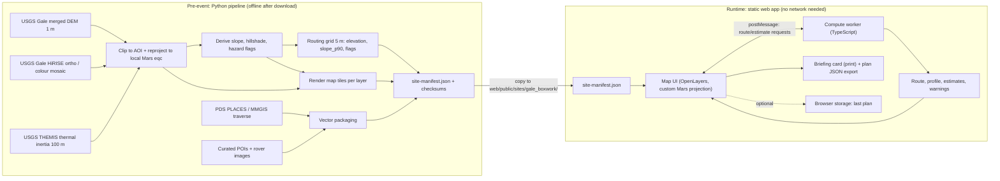

# 02 — Technical Requirements Document

| | |
| --- | --- |
| **Owner** | Architecture (this file owns architecture, data handling and system behavior) |
| **Date** | 2026-11-02 |
| **Status** | Draft v1 — proposed; items marked *Spike* must be verified in TASK-01/TASK-02 before the event |
| **Related** | Scope source: [01 PRD](01_Product_Requirements_Document.md) (requirement IDs FR-xx) · Data structures: [05 Schema](05_Backend_and_Database_Schema.md) · [Docs index](../README.md) |

---

## A. Architecture

### A.1 System boundary

The product is a **static single-page web application** plus an **offline Python preprocessing pipeline**. There is **no runtime backend and no database** (Proposed, decision D-02). All science computation that depends on user input runs in the browser inside a Web Worker; all heavy raster work runs once, before the demo, on a team laptop.

| Component | Runs where | Responsibility |
| --- | --- | --- |
| **Preprocessing pipeline** (`pipeline/`, Python) | Developer laptop, once per data version | Download/clip/reproject source rasters, derive slope and hazard grids, render map tiles, build routing grid, package POIs/traverse, write `site-manifest.json` with provenance and checksums |
| **Static assets** (`web/public/sites/<site_id>/`) | Any static host or `localhost` | Tiles, routing grid binaries, GeoJSON, images, manifest |
| **Map UI** (`web/src/ui`, TypeScript) | Browser main thread | Map rendering, layer control, waypoints, panels, briefing card |
| **Compute worker** (`web/src/compute`, TypeScript) | Browser Web Worker | Routing, profile sampling, time/walkback model, warnings, radiation estimate, Mars24 solar functions |
| **External sources** | Internet, pre-event only | USGS Astrogeology, PDS nodes, NASA image sites — never contacted at runtime |

### A.2 Architecture diagram



### A.3 Why no backend (Proposed)

| Need | Satisfied by | Why a server is unnecessary |
| --- | --- | --- |
| Raster processing | Pre-event pipeline | AOI is fixed; nothing is recomputed per user |
| Routing | Worker on a 5 m grid (~1.44 M cells for 6 × 6 km) | A* on this size completes in well under 2 s in modern browsers (target NFR-02; verify in TASK-05) |
| Persistence | JSON export + optional browser storage | No accounts or sharing in scope |
| Offline demo | Static files on `localhost` | Fewer moving parts than a FastAPI process |

**Alternative (if the team is Python-only):** FastAPI serving `/route` and `/estimate`, using `scikit-image` `MCP_Geometric` for least-cost paths. Cost: an extra process to keep alive during the demo and duplicated validation; benefit: reuse of numpy code. Switch only if TASK-05 shows the browser router is too slow.

---

## B. Technology choices

| Area | Choice (Proposed) | Why it fits | Limitations | Alternative |
| --- | --- | --- | --- | --- |
| Map rendering | **OpenLayers** with a proj4-registered local Mars projection | Supports arbitrary projections and custom tile grids; scale line uses projection metres (Confirmed: OL custom-projection and COG examples) | Learning curve; no built-in 3D | **Leaflet + `CRS.Simple`** with tiles in AOI metres (simpler, but manual coordinate handling). **Not MapLibre GL**: it renders Web Mercator only, so Mars distances and scale bars would be wrong without hacks |
| Projection math | **proj4js** | Mars sphere definitions are plain PROJ strings | Must keep the same string in pipeline and UI | Hand-written equirectangular formulas (trivial for eqc; acceptable fallback) |
| UI framework | **TypeScript + Vite**, lightweight components (Preact or vanilla) | Small bundle; offline build | — | React if the team already knows it |
| Charts | **uPlot** or Chart.js for the profile | Fast line charts; keyboard handling added manually | Accessibility work needed | Plain SVG |
| Compute | **TypeScript in a Web Worker**, pure functions, **Vitest** unit tests | Keeps UI responsive; testable; deterministic | Re-implementing A* and Mars24 | Python/FastAPI (A.3) |
| Solar time | Port of **Mars24 algorithm** (Allison & McEwen 2000) | Published, citable; JS/Python implementations exist (marstime, BSD) for cross-checking | Longitude-sign convention pitfall (§C.4) | Use the `marstime` Python package in the pipeline to precompute a lookup table for the demo dates |
| Pipeline | **Python 3.11+, GDAL ≥ 3.6, rasterio, numpy, pyproj ≥ 3.4** | Standard planetary GIS toolchain; IAU_2015 CRS codes available in recent PROJ (verify version) | GDAL install friction on Windows | Conda environment file committed |
| Hosting | Local static server for the demo; GitHub Pages for the public link | Free; satisfies "public repository/link" scoring item | Large tiles may exceed comfortable Pages repo size → keep tiles < 500 MB or use Git LFS / release asset (release asset: **Decision (team confirmed 2026-11-03)**, see [docs/ops/feasibility.md](../ops/feasibility.md#large-tiles-in-the-repo)) | Netlify/Vercel static |

**Cost:** $0 runtime; no paid APIs or keys.

**Spike (TASK-02):** confirm OpenLayers renders XYZ tiles produced by the pipeline in the custom projection with correct scale bar, using a custom `TileGrid` whose origin and resolutions match the pipeline output. If the spike fails within 2 hours, use the fallback: one pre-rendered PNG per layer at 2 m/px displayed with `ol/source/ImageStatic` in the same projection (≈ 3000 × 3000 px each for a 6 km AOI) plus a 0.5 m tiled basemap only for the ortho.

---

## C. Mars data and geospatial handling

### C.1 Coordinate reference conventions (applies to every layer)

| Item | Convention | Label |
| --- | --- | --- |
| Body and datum | Mars sphere, radius **3,396,190 m** (IAU_2015:49900 "Mars (2015) – Sphere") | **Confirmed** (USGS DEM metadata Radius A = C = 3396190; spatialreference.org) |
| Latitude | Planetocentric (identical to planetographic on a sphere) | **Confirmed** (DEM metadata) |
| Longitude | **East-positive**, domain −180…180 in USGS products; Gale ≈ 137.4°E is identical in 0–360 domain | **Confirmed** (DEM metadata) |
| Source DEM projection | Equirectangular with standard parallel 0° — verified by arithmetic: lon span 0.556392° × 59,274.7 m/° = 32,980 m = column count at 1 m | **Confirmed** (computed) |
| Working projection (Proposed) | `+proj=eqc +lat_ts=<AOI centre lat> +lat_0=<AOI centre lat> +lon_0=<AOI centre lon> +x_0=0 +y_0=0 +R=3396190 +units=m +no_defs` | Proposed — true scale along the AOI's central parallel; origin (0, 0) at the AOI centre |
| Why reproject | At ~4.75°S the source x-scale overstates ground east–west distance by 0.343 % (1 − cos 4.75°); small but systematic in slope and distance | **Confirmed** (computed) |
| Elevation | Metres; DEM "tied to a MOLA DEM" (Confirmed). Interpreted as heights relative to the MOLA areoid | **Assumed** — verify in the PDS3 label during TASK-01 |
| Display format | `−4.71234°, 137.38765°E` (5 decimals ≈ 0.6 m) plus local x/y metres from AOI origin | Proposed |
| Never | Do not pass Mars coordinates through EPSG:3857 / WGS84 code paths | Rule |

### C.2 Data layers

AOI (Proposed): a ~6 × 6 km box around Curiosity's 2025 boxwork campaign, **inside** the DEM extent (lat −5.098652…−4.129605, lon 137.124167…137.680559 °E). Exact bounds are **Unresolved** — chosen in TASK-01 from the traverse (sols ≈ 4,450–4,750; boxwork campaign confirmed for 2025 by NASA mission blog posts and photojournal).

#### L1 — Optical basemap (FR-01)

| Field | Value |
| --- | --- |
| Source | USGS *Mars MSL Gale Merged Orthophoto Mosaic 25 cm* v3 (Calef & Parker 2016), grayscale 23 GB lossless GeoTIFF; colour HiRISE LRGB COG (~1 GB) also published — **Confirmed** |
| Type / format | Raster, 8-bit; COG for colour |
| Resolution | 25 cm/px native; **downsample to 0.5 m** for the app (Proposed, keeps tiles ≈ tens of MB for the AOI) |
| Preprocessing | `gdalwarp` window read (no full download needed for the COG via `/vsicurl/`; the 23 GB file needs range reads or a full download — prefer the colour COG if coverage suffices) → reproject to working eqc → tiles |
| Missing data | Transparent; manifest stores coverage polygon |
| Attribution | "NASA/JPL-Caltech/University of Arizona; USGS Astrogeology (Calef & Parker 2016)"; use constraints: none, credit authors — **Confirmed** |
| Fallback | Mars Trek WMTS HiRISE tiles cached pre-event (product-specific endpoint from GetCapabilities) |

#### L2 — Topography: elevation, hillshade (FR-02, FR-03, FR-08)

| Field | Value |
| --- | --- |
| Source | USGS *Mars MSL Gale Merged DEM 1 m* v3 (Parker & Calef 2016), 3.6 GB, 32-bit, 57,440 rows × 32,980 columns — **Confirmed** |
| Composition | HiRISE DEMs where stereo exists; otherwise CTX, HRSC, then MOLA 128 ppd fill; HRSC controlled to MOLA (~100 m horizontal, ~1 m vertical accuracy) — **Confirmed** |
| Key risk | Unknown which source fills the boxwork AOI → **TASK-01** compares DEM texture/hillshade and HiRISE stereo-pair footprints; if not HiRISE, either find a University of Arizona HiRISE DTM covering the AOI or switch site (Jezero: *Mars 2020 TRN HiRISE DTM Mosaic*, USGS) |
| Effective resolution | Post spacing 1 m; effective resolution of photogrammetric DTMs is coarser than post spacing — features of a few metres (e.g., boxwork ridges ~1–2 m tall) may be smoothed (**Assumed**; state in methods panel) |
| Artifacts | HiRISE DTM READMEs warn of "boxes", CCD seams and faceted low-contrast areas — inspect hillshade before use (**Confirmed** source: HiRISE DTM README) |
| Derived | Hillshade (azimuth 315°, altitude 45°, Proposed for display), elevation colour ramp |
| Fallback | Mars Trek elevation tiles (visual only, no routing) |

#### L3 — Slope (FR-02, FR-07, FR-10)

| Field | Value |
| --- | --- |
| Derivation | Horn method on the 1 m reprojected DEM → `slope_1m` (degrees). Aggregated to the 5 m routing grid as **p90** (used for hard limit) and **max** (used for caution flag "micro-relief") |
| Units | Degrees, 0–90 |
| Validation | Synthetic ramp test (known 10° plane → 10.0° ± 0.05°) and comparison with Mars Trek slope where available |
| Limitations | Slope at 1 m is noisy where DTM artifacts exist; p90 reduces single-pixel spikes but can hide short steps |

#### L4 — Thermal inertia (FR-02, FR-10)

| Field | Value |
| --- | --- |
| Source | USGS *THEMIS Thermal Inertia Mosaic, Quantitative (32-bit), 100 m/px*, tile covering 0…30°S, 120…180°E (file name to confirm, pattern `30S120E`) — product family **Confirmed** (Fergason et al. 2006 method; absolute accuracy ~20 %) |
| Units | tiu = J m⁻² K⁻¹ s⁻½ |
| Use | Display layer + coarse caution flag: cells below a threshold flagged "possible loose fines" (threshold **Unresolved**, set from the AOI histogram and published interpretation; label as interpretive) |
| Resampling | Bilinear for display; nearest for flags; footprint is 100 m, so one TI pixel covers 400 routing cells — say so in the legend |
| Gaps | Mosaic has gaps where coverage/quality was poor → "unknown", never zero |
| Fallback | THEMIS Day IR 100 m mosaic (ASU) as qualitative thermal layer |

#### L5 — Spectral (FR-18, desirable)

| Field | Value |
| --- | --- |
| Source | CRISM MTRDR (Map-projected Targeted RDR) summary parameters / browse products, PDS Geosciences Node — product **Confirmed**; AOI coverage **Unresolved** |
| Resolution | ~18–20 m/px for FRT observations |
| Labelling | "Spectral summary parameter — indicative, not a mineral identification" (wording follows CRISM label guidance) |
| Fallback | Omit; three data types are already met without it |

#### L6 — Mission vectors (FR-04, FR-17)

| Field | Value |
| --- | --- |
| Traverse source (preferred) | PDS PLACES archive (doi:10.17189/1520397), used by the PDS MSL Analyst's Notebook map — **Confirmed** as archive; field layout to verify |
| Traverse source (fallback) | MMGIS JSON (`mars.nasa.gov/mmgis-maps/...`) — publicly reachable for M20; MSL path **unverified**; not an official API — cache once |
| POIs | Curated by the team from NASA mission blog/photojournal descriptions; each POI stores the position source and confidence |
| POV images | Curiosity Navcam/Mastcam images saved locally with credit "NASA/JPL-Caltech" (MSSS for Mastcam). **Do not depend on the api.nasa.gov Mars Rover Photos API — archived (Confirmed, nasa/api-docs PR, Oct 2025; upstream repo archived 8 Oct 2025)** |
| Alignment tolerance | Traverse vs. ortho visual tracks: ≤ 5 m (Proposed; record measured offset) |

#### L7 — Environmental values (FR-11, FR-12, FR-13)

| Value | Source | Type |
| --- | --- | --- |
| Surface dose rate, solar max 2012–13 | Curiosity RAD at Gale: 0.21 ± 0.04 mGy/day; **0.64 ± 0.12 mSv/day** (Hassler et al. 2014, via [*Mars Scientific Context* §9](../reference/mars-scientific-context.md#9-radiation-and-space-environment)) | **Measured** |
| Surface dose rate, solar min (~2019) | ~0.85–1.0 mSv/day (Simonsen et al. 2024, via [*Mars Scientific Context* §9](../reference/mars-scientific-context.md#9-radiation-and-space-environment)) | Reported range |
| Solar time, L_s, sun elevation | Mars24 algorithm | **Computed** |
| Seasonal temperature/pressure (desirable) | REMS RDR via PDS Atmospheres Node (sols covered to at least 3778 in RDR volume listing) | Measured, aggregated by team |

### C.3 Data volume budget (Proposed)

| Asset | Approx. size for 6 × 6 km AOI |
| --- | --- |
| Ortho tiles @0.5 m (JPEG) | 30–80 MB |
| Hillshade/slope/TI tiles @2 m (PNG/WebP) | 10–30 MB each |
| Routing grid 1200 × 1200: elevation Float32 + slope_p90 UInt8 + slope_max UInt8 + flags UInt8 | 5.76 + 1.44 + 1.44 + 1.44 ≈ 10 MB |
| POI images (8 × ~400 KB) | ~3 MB |

### C.4 Mars-specific pitfalls to test explicitly

1. **Longitude sign in Mars24.** Many Mars24 implementations take *west* longitude (planetographic convention). Convert `west = (360 − east) mod 360`. Unit test at Gale.
2. **Earth defaults.** No `ol/proj` EPSG:3857 view, no Earth radius in distance helpers (`ol/sphere` uses Earth radius by default — do not use it; compute distances in projected metres).
3. **Raster orientation.** Row 0 = north; verify with a known feature after reprojection.
4. **No-data values.** DEM no-data (check label; e.g., −3.4e38 or −32767) must become `NaN` before slope computation, or slopes explode at edges.

---

## D. Core processing and simulation behavior

All functions live in `web/src/compute/` as pure functions (no DOM, no fetch), unit-tested with Vitest. Numbers below were checked in Python on 2026-11-02.

### D.1 Point sampling (FR-03, FR-08)

- **Input:** working-projection x, y (m).
- **Output:** `{lat, lon_e, elevation_m, slope_p90_deg, ti_tiu|null, cell:{i,j}}` (field names as in §E.2 SAMPLE_RESULT).
- **Algorithm:** nearest routing-grid cell for slope/flags; bilinear interpolation of elevation for profiles; TI nearest from a 100 m sidecar array.
- **Failure:** outside AOI or NaN → `null` values with reason `OUTSIDE_AOI` / `NO_DATA`.

### D.2 Route planning (FR-06, FR-07, FR-10)

| Item | Definition |
| --- | --- |
| Graph | 8-connected 5 m grid; step length d = 5 m (orthogonal) or 7.071 m (diagonal) |
| Impassable | `flags & NO_DATA`, `flags & HARD_HAZARD`, or `slope_p90 > hard_slope_limit_deg` |
| Directional gradient | S = Δz / d between cell centres (signed; uphill positive) |
| Speed model | v(S) = v₀ · exp(−3.5·\|S + 0.05\|) / exp(−0.175) — Tobler's hiking function normalised so that v(0) = v₀ (suited flat speed, default 3.3 km/h) |
| Step cost | t = √(d² + Δz²) / v(S) × m, where m = 1.5 if `slope_max > caution_slope_deg` and 1.3 if `flags & LOW_TI` (multipliers **Assumed**, configurable) |
| Search | A* with heuristic h = straight-line distance / v_max, v_max = v₀ · 6 / 5.037 ≈ 3.93 km/h at v₀ = 3.3 → admissible, so the result is least-time on the grid |
| Objective | Minimise walking time per leg; legs computed independently between consecutive waypoints (stop order is user-defined; no TSP) |
| Post-processing | Douglas–Peucker simplification for display only (2 m tolerance); metrics computed on the unsimplified cell path |
| No feasible route | Return `status: "NO_ROUTE"`, `reason` ∈ {`START_BLOCKED`, `END_BLOCKED`, `DISCONNECTED_BY_SLOPE`, `DISCONNECTED_BY_HAZARD`, `DISCONNECTED_BY_NODATA`}, plus `nearest_reachable` (the explored cell with minimal Euclidean distance to the target) |
| Snapping | A waypoint on an impassable cell snaps to the nearest passable cell within 50 m; otherwise rejected |
| Limits | ≤ 10 stops; search aborts after 3 × 10⁶ node expansions (`TIMEOUT`) |
| Validation | (1) Synthetic grid with a wall containing one gap → route passes through the gap. (2) Uniform 20° ramp with 15° limit → `NO_ROUTE / DISCONNECTED_BY_SLOPE`. (3) Re-sample every returned step: no step violates the hard limit. (4) Determinism: identical output for repeated runs (tie-break by cell index) |
| Known limitations | Grid-aligned paths (8 directions); micro-relief below effective DTM resolution invisible; rocks/boulders not mapped; caution multipliers are judgement, not physiology |

### D.3 Walking time model (FR-09)

Reference values (v₀ = 3.3 km/h), computed:

| Slope | Tobler (unsuited, km/h) | Suited-scaled (km/h) |
| --- | --- | --- |
| 0° | 5.04 | 3.30 |
| +5° | 3.71 | 2.43 |
| +10° | 2.72 | 1.78 |
| +15° | 1.97 | 1.29 |
| −5° | 5.26 | 3.45 |
| −10° | 3.86 | 2.53 |

Test cases: 1 km flat → 18.18 min; 1 km at constant +10° gradient (horizontal distance 1 km) → 3D length 1015.4 m / 1.78 km/h ≈ 34.2 min.

- **EVA timeline:** start time + Σ(leg walk time) + Σ(dwell). Output per stop: arrival/departure in UTC and LTST.
- **Walkback distance at a route point:** min(distance travelled back along the route to start, remaining route distance to the end if the route is a loop). Max over the route is compared to the walkback limit.
- **Label:** *modelled — Earth hiking function scaled to an Apollo lunar planning speed; not validated for Mars suits or 0.38 g.* (Tobler 1993; Apollo 17 planning used 3.3 km/h walking at 1,200 BTU/h — NASA ALSJ document.)

### D.4 Radiation estimate (FR-12)

- **Model:** `dose_mSv = rate_mSv_per_day × duration_h / 24`.
- **Rates:** solar max 0.64 (±0.12) mSv/day → 7 h = 0.187 (range 0.152–0.222) mSv. Solar min range 0.85–1.0 mSv/day → 7 h = 0.248–0.292 mSv.
- **Output:** `{dose_mSv, dose_low_mSv, dose_high_mSv, solar_phase, const_id}` (05 PlanResult.radiation).
- **Excluded (stated on card):** solar energetic particle events, suit/habitat shielding, terrain sky-blocking, altitude differences within AOI.
- **Label:** *measured background rate × planned duration (simplified)*.

### D.5 Solar conditions (FR-11)

- **Model:** Mars24 (Allison & McEwen 2000; GISS Mars24 technical notes): Mars Sol Date, L_s, equation of time, LTST, solar declination, solar elevation/azimuth for the site's planetocentric latitude and longitude.
- **Outputs:** per stop arrival time: LTST, sun elevation; EVA window sunrise/sunset (horizon = 0°, flat).
- **Validation:** cross-check ≥ 3 timestamps against the Python `marstime` package (BSD, implements the same algorithm) — tolerance 0.1° elevation, 1 min LTST.
- **Limitation:** no terrain shadowing; no atmospheric refraction; dust opacity not modelled.

### D.6 Illustrative consumables (FR-19, desirable)

- Metabolic rate while walking = 1,200 BTU/h = **351.7 W** (Apollo 17 planning value; 1,440 BTU/h = 422.0 W with a 20 % walkback pad).
- O₂ ≈ metabolic power / energy equivalent of O₂ (≈ 20.4 kJ/L at RER 0.85 using the Weir relation — **Assumed** physiology constant) → ≈ 1.03 L/min at 351.7 W.
- Shown only as "illustrative"; never used to block a route.

### D.7 AI

**Not in MVP** (Proposed D-06). No requirement needs it, and the scoring guide rewards deterministic, explainable science. If added post-MVP: narration only, input = the plan JSON, output blocked if it contains any number absent from the JSON; fallback = static template text.

---

## E. Interfaces and contracts

There is no HTTP API. Contracts are (1) static files, (2) worker messages, (3) export JSON. Full field definitions are in [05](05_Backend_and_Database_Schema.md); this section defines behavior.

### E.1 Static asset contract

| Path (relative to `sites/<site_id>/`) | Purpose | Consumer |
| --- | --- | --- |
| `site-manifest.json` | Site, projection, layers, assets, sources, checksums, data version | UI on boot |
| `tiles/<layer_id>/{z}/{x}/{y}.{ext}` | Map tiles in the working projection | OpenLayers |
| `grid/elevation.f32`, `grid/slope_p90.u8`, `grid/slope_max.u8`, `grid/flags.u8`, `grid/ti_100m.f32` | Routing/sampling arrays (row-major, north-up) | Worker |
| `vectors/traverse.geojson`, `vectors/pois.geojson` | Vectors in **working-projection metres** with lat/lon kept as properties | UI |
| `images/<poi_id>.jpg` | POV images | UI |

Boot validation: manifest `schema_version` must equal the app's expected major version; each asset's SHA-256 is checked in development builds (skipped in production for speed). Failure → error screen listing the missing asset (see [03 §D](03_App_Flow_and_Diagrams.md#d-error-and-recovery-flows)).

### E.2 Worker message protocol

All requests carry `request_id`; the worker processes only the **latest** `plan_revision`. A newer request cancels an older one (cooperative check every 50,000 expansions).

#### Request/response — sample point

Used by the inspector and by waypoint validation/snapping (FR-03, FR-06).

```json
{"type": "SAMPLE_POINT", "request_id": "r-0041", "x_m": 2990.0, "y_m": -2595.0, "snap_radius_m": 50}
```

```json
{"type": "SAMPLE_RESULT", "request_id": "r-0041",
 "inside_aoi": true, "passable": false, "reason": "SLOPE_OVER_LIMIT",
 "lat": -4.74378, "lon_e": 137.43061, "elevation_m": -3912.4, "slope_p90_deg": 21.75,
 "ti_tiu": 312.0, "flags": ["LOW_RES_DEM"],
 "snap": {"x_m": 2982.5, "y_m": -2612.5, "distance_m": 19.0}}
```

`reason` ∈ {`OUTSIDE_AOI`, `NO_DATA`, `HARD_HAZARD`, `SLOPE_OVER_LIMIT`, `null`}; `snap` is `null` when no passable cell lies within `snap_radius_m`.

#### Request — compute plan

```json
{
  "type": "COMPUTE_PLAN",
  "request_id": "r-0042",
  "plan_revision": 17,
  "site_id": "gale_boxwork",
  "data_version": "gale_boxwork-2026.11.05",
  "scenario": {
    "eva_start_utc": "2026-11-14T08:00:00Z",
    "max_eva_duration_h": 6.0,
    "dwell_min_per_stop": 20,
    "hard_slope_limit_deg": 15,
    "caution_slope_deg": 10,
    "walkback_limit_km": 5.0,
    "suited_flat_speed_kmh": 3.3,
    "solar_phase": "max",
    "loop": true
  },
  "waypoints": [
    {"id": "wp-0", "role": "start", "x_m": 1520.0, "y_m": -2210.0},
    {"id": "wp-1", "role": "stop", "x_m": 2410.5, "y_m": -1875.0, "poi_id": "poi-boxwork-ridge"},
    {"id": "wp-2", "role": "stop", "x_m": 2980.0, "y_m": -2600.0}
  ]
}
```

#### Response — plan result (abridged)

```json
{
  "type": "PLAN_RESULT",
  "request_id": "r-0042",
  "plan_revision": 17,
  "status": "PARTIAL",
  "legs": [
    {"from": "wp-0", "to": "wp-1", "status": "OK", "distance_m": 1184.2,
     "walk_time_min": 26.1, "max_slope_deg": 11.4, "climb_m": 38.0, "descent_m": 4.5,
     "cell_path_length": 241},
    {"from": "wp-1", "to": "wp-2", "status": "NO_ROUTE",
     "reason": "DISCONNECTED_BY_SLOPE", "nearest_reachable": {"x_m": 2905.0, "y_m": -2410.0}}
  ],
  "totals": null,
  "warnings": [
    {"code": "CAUTION_SLOPE", "severity": "caution", "leg": 0, "from_m": 610, "to_m": 690}
  ],
  "timing_ms": {"routing": 412, "estimates": 3}
}
```

Rule: if any leg is `NO_ROUTE`, `status = "PARTIAL"` and `totals = null` (no misleading totals). Full example with totals in [05 §plan export](05_Backend_and_Database_Schema.md#planexport).

#### Error response

```json
{"type": "ERROR", "request_id": "r-0042", "code": "GRID_NOT_LOADED", "message": "Routing grid failed checksum or did not load."}
```

Error codes: `GRID_NOT_LOADED`, `INVALID_INPUT`, `TIMEOUT`, `CANCELLED`, `INTERNAL`.

### E.3 Input validation rules

| Field | Rule |
| --- | --- |
| `eva_start_utc` | ISO-8601 UTC; year 2000–2100 (Mars24 fit range covers this) |
| `max_eva_duration_h` | 0.5–10 |
| `dwell_min_per_stop` | 0–180 |
| `hard_slope_limit_deg` | 5–35, and > `caution_slope_deg` |
| `caution_slope_deg` | 2–30 |
| `walkback_limit_km` | 0.5–20 |
| `suited_flat_speed_kmh` | 0.5–6 |
| `solar_phase` | `max` \| `min` |
| waypoints | 2–11 (start + ≤ 10 stops), all inside AOI |

Validation runs in the UI (inline messages) **and** in the worker (defence in depth → `INVALID_INPUT`).

### E.4 Authentication

None. No user data leaves the browser.

---

## F. Nonfunctional requirements and validation

| ID | Requirement | Target (Proposed) | Verification |
| --- | --- | --- | --- |
| NFR-01 | Offline operation | 100 % of demo features work with network disabled | Rehearsal with Wi-Fi off; browser devtools "Offline" |
| NFR-02 | Performance | First map paint ≤ 5 s from localhost; 3-stop route ≤ 2 s; layer toggle ≤ 300 ms; UI never blocks > 100 ms | Timing logged in diagnostics; test on the weakest team laptop |
| NFR-03 | Browser/device | Latest Chrome, Edge, Firefox on desktop ≥ 1366 × 768 (primary); tablet ≥ 768 px wide (secondary: view + add/delete stops, drag only if time permits — 03 U-07; layouts per 04 §E); < 768 px view-only | Manual matrix |
| NFR-04 | Accessibility | WCAG 2.2 AA targets: contrast ≥ 4.5:1 text, keyboard operation of all controls, non-colour cues, text alternative for map content (stops table, warnings list) | axe-core scan + keyboard-only run-through |
| NFR-05 | Scientific transparency | Every displayed value carries `data-provenance` ∈ {measured, derived, modelled, assumed} and a source id | Automated DOM test |
| NFR-06 | Determinism/reproducibility | Same scenario + waypoints + `data_version` ⇒ identical results and identical `plan_hash` | Unit test runs plan twice; cross-browser check |
| NFR-07 | Licensing/attribution | All data credits in UI and README; code Apache-2.0 (Space Apps default) | Checklist in TASK-16 |
| NFR-08 | Security/privacy | No accounts, no analytics, no third-party requests at runtime; Content-Security-Policy `default-src 'self'` | CSP header in hosting config; devtools network check |
| NFR-09 | Size budget | Total site bundle ≤ 250 MB; JS bundle ≤ 500 KB gzipped | Build report |
| NFR-10 | Reliability | Missing optional layer never breaks routing; worker crash shows retry | Fault-injection tests (delete layer folder; throw in worker) |
| NFR-11 | Debuggability | `?debug=1` shows FPS, worker timings, grid cell under cursor, data version | Manual |

**Secrets/deployment:** no runtime secrets. Pipeline needs none (USGS/PDS are public). Deployment: `npm run build` → `dist/` + `sites/` copied to static host; demo via `npx serve dist` (or `python -m http.server`, which suffices because tiles are plain files).

**External limits/costs:** none at runtime. Pre-event: the 23 GB ortho and 3.6 GB DEM need ~30 GB disk and a stable connection — download on campus network, not venue Wi-Fi.

### F.1 Test plan

| Area | Tests |
| --- | --- |
| Data alignment | Overlay traverse on ortho at 5 checkpoints; DEM hillshade vs. ortho edge alignment; measured offset recorded in manifest `known_offsets_m` |
| Projection | Round-trip lat/lon ↔ x/y within 1 mm; scale bar vs. DEM-measured feature within 2 % |
| Slope | Synthetic planes (0°, 10°, 30°) ± 0.05°; NaN edges produce NaN, not spikes |
| Routing | Cases in D.2; performance on the real grid (20 random pairs, report p50/p95 time) |
| Time model | Table D.3 values exact to 0.01 km/h |
| Radiation | 7 h examples in D.4 |
| Mars24 | 3 timestamps vs. `marstime`; longitude-sign test |
| UI | Keyboard path through core scenario; print preview one page; offline mode |
| Recovery | Missing TI layer; corrupted grid checksum; worker exception; impossible stop placement |

---

## Sources (accessed 2026-11-02)

- USGS Astrogeology — Mars MSL Gale Merged DEM 1 m: <https://astrogeology.usgs.gov/search/map/mars_msl_gale_merged_dem_1m>
- USGS Astrogeology — Mars MSL Gale Merged Orthophoto Mosaic 25 cm: <https://astrogeology.usgs.gov/search/map/mars_msl_gale_merged_orthophoto_mosaic_25cm>
- USGS Astrogeology — THEMIS Thermal Inertia Mosaic Quantitative (example tile 30S060E): <https://astrogeology.usgs.gov/search/map/themis_thermal_inertia_mosaic_quantitative_30s060e_100mpp>
- ASU Mars Global Data Sets (THEMIS Day/Night IR 100 m): <https://www.mars.asu.edu/data>
- CRISM MTRDR bundle readme (PDS): <https://pds.nasa.gov/data/pds4/releases/geo/mro_crism_mtrdr-20250413/readme.txt>
- HiRISE DTM README (artifact warnings): <https://hirise.lpl.arizona.edu/PDS/EXTRAS/DTM/ESP/ORB_012800_012899/ESP_012873_2045_PSP_004052_2045/README.TXT>
- IAU_2015:49900 Mars sphere WKT: <https://spatialreference.org/ref/iau_2015/49900/prettywkt2.txt>
- Mars Trek WMTS documentation: <https://trek.nasa.gov/tiles/apidoc/trekAPI.html?body=mars>
- OpenLayers COG projection example: <https://openlayers.org/en/latest/examples/cog-projection.html>
- Mars24 credits/algorithm references: <https://www.giss.nasa.gov/tools/mars24/help/credits.html> ; Allison & McEwen 2000, doi:10.1016/S0032-0633(99)00092-6
- marstime library (Mars24 implementation): <https://marstime.readthedocs.io/en/latest/marstime.html>
- Tobler's hiking function (formula): <https://arxiv.org/pdf/2303.16065v6>
- Apollo 17 traverse planning consumables (walking 1,200 BTU/h at 3.3 km/h; 3.1 km walking radius): <https://www.nasa.gov/wp-content/uploads/static/history/alsj/19790073512_1979073512.pdf>
- NASA lunar 10 km walkback test (summary): <https://corpora.tika.apache.org/base/docs/govdocs1/515/515870.pdf>
- Mars Rover Photos API archived: <https://github.com/nasa/api-docs/pull/243.patch>
- PDS Atmospheres Node — MSL REMS: <https://atmos.nmsu.edu/data_and_services/atmospheres_data/MARS/curiosity/rems.html>
- PDS MSL Analyst's Notebook map tool / PLACES: <https://pds-geosciences.wustl.edu/workshops/LPSC2023/2166.pdf>
- Radiation values: [*Mars Scientific Context* §9](../reference/mars-scientific-context.md#9-radiation-and-space-environment) (Hassler et al. 2014; Simonsen et al. 2024)

## Unresolved decisions owned by this document

| ID | Item | Resolution path |
| --- | --- | --- |
| D-02 | Static app vs. FastAPI backend | Keep static unless TASK-05 router benchmark > 2 s p95 |
| D-03 | OpenLayers tiles vs. ImageStatic fallback | TASK-02 spike result |
| U-01 | DEM source quality inside AOI | TASK-01 |
| U-02 | Elevation datum wording (areoid) | Read PDS3 label in TASK-01 |
| U-03 | Thermal-inertia "loose fines" threshold | Histogram + literature check in TASK-04; label interpretive |
| U-04 | Traverse source (PLACES vs. MMGIS) | TASK-04 |
| U-05 | CRISM coverage of AOI | TASK-01 |
