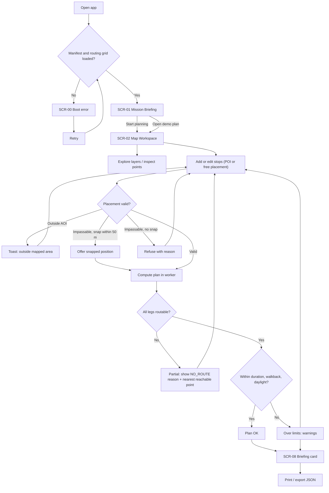
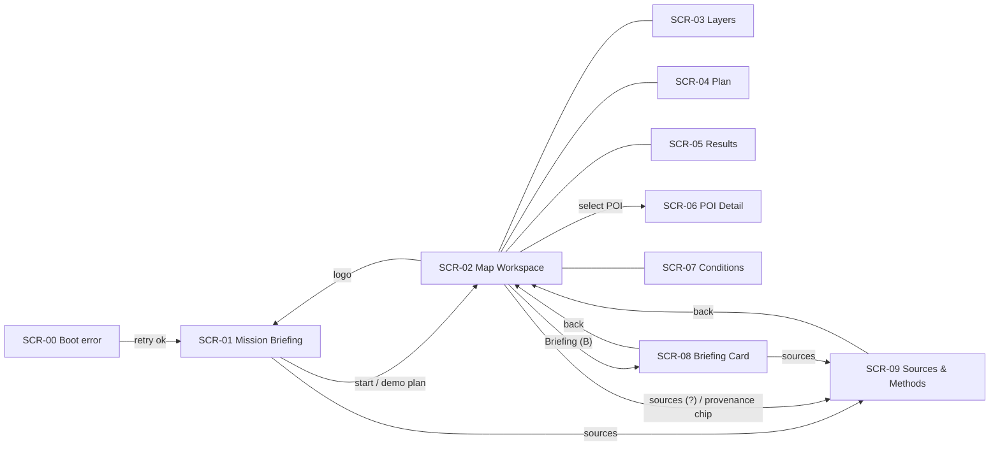
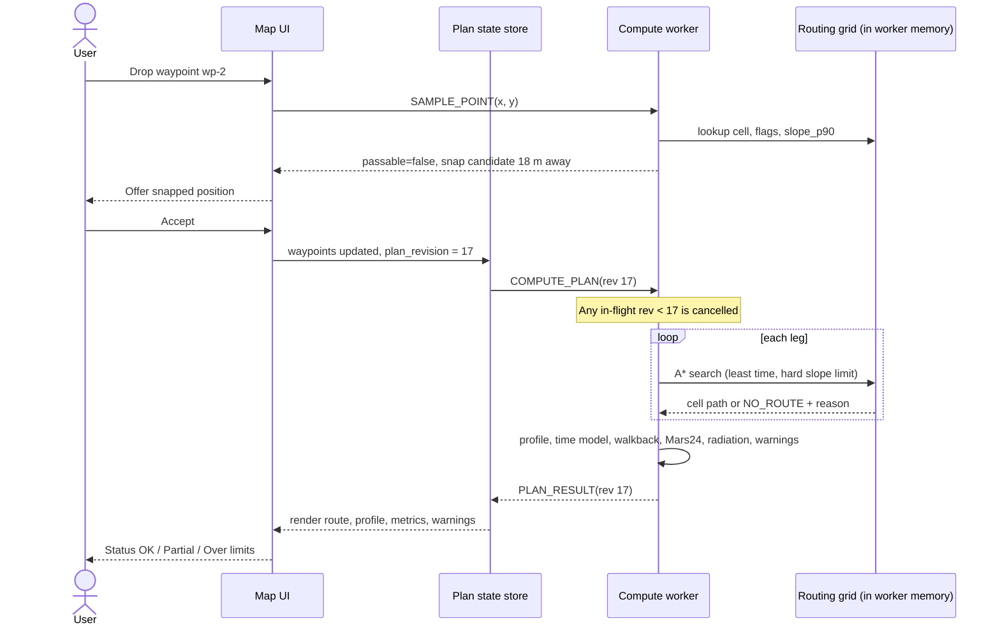
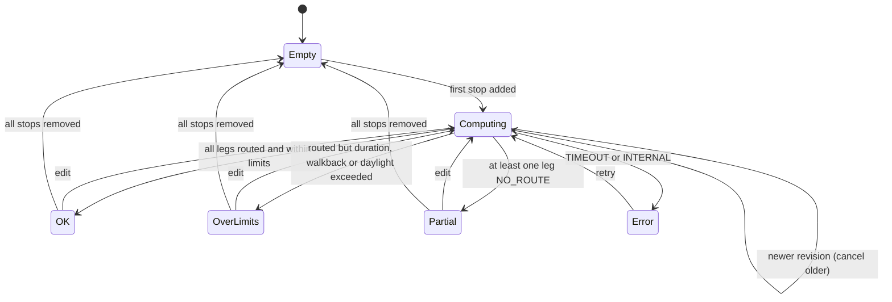
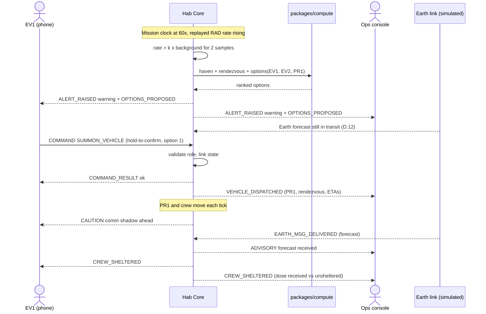
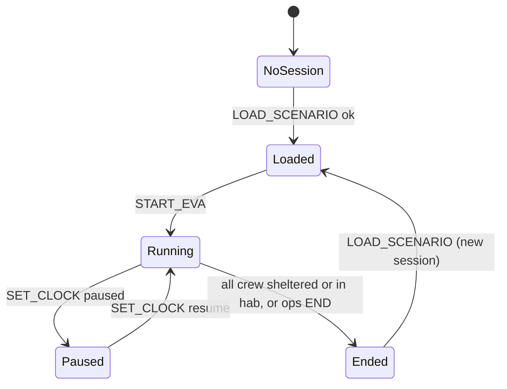
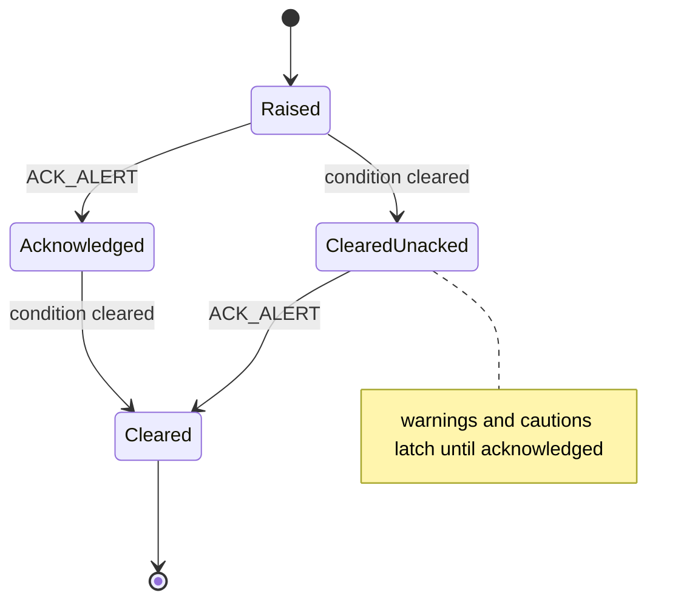
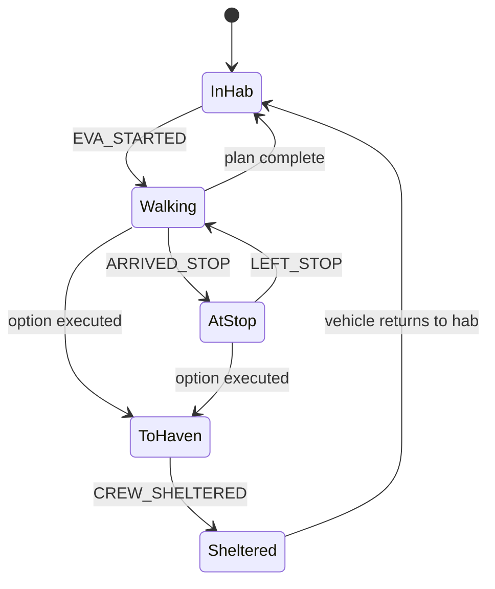
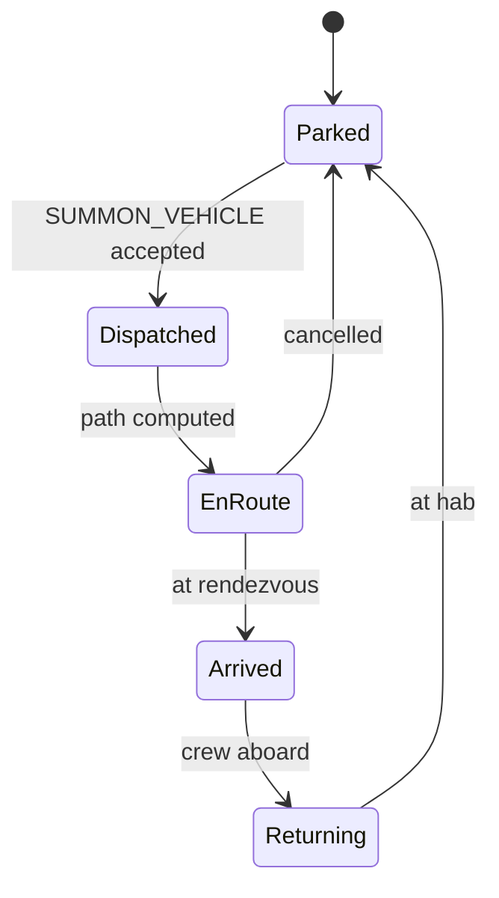
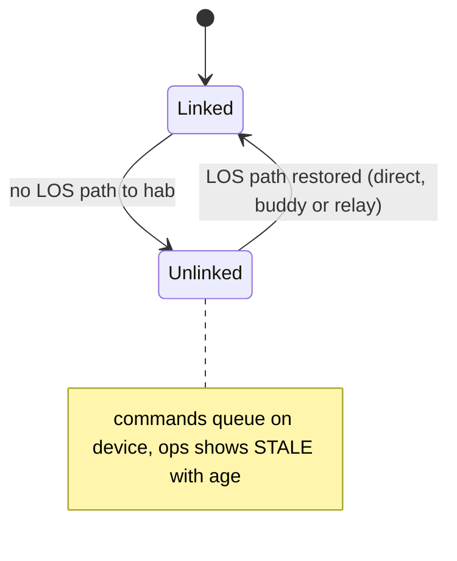

# 03 — App Flow, Diagrams, and Flowcharts

| | |
| --- | --- |
| **Owner** | UX flow (this file owns navigation and interaction sequences) |
| **Date** | 2026-11-04 |
| **Status** | Draft v2 — supersedes v1 (2026-11-02). SCR-00–SCR-09 are v1 with marked changes; SCR-10–SCR-18 are new |
| **Related** | Requirements: [01 PRD](01_Product_Requirements_Document.md) · Behavior: [02 Technical](02_Technical_Requirements_Document.md) · Visuals: [04 Design](04_Design_Brief.md) · Data: [05 Schema](05_Backend_and_Database_Schema.md) · [Docs index](../README.md) |

## Change log v1 → v2

One app, five roles. New screens for ops, EVA, HUD, alerts, rover tasking, Earth view, report and connection loss; new journeys for the killer demo; new state machines for session, alerts, crew, vehicles and links. The v1 planner flow is unchanged apart from route names and the publish step.

---

## A. Information architecture

```text
Marswalk Surface Ops (one web app, served by Hab Core; mode per 04 §B.2)
├── SCR-01 Mission Briefing                 #/              BRIEF
├── SCR-10 Join / role select               #/join          BRIEF
├── PLANNER role                            #/planner       OPS
│   ├── SCR-02 Map Workspace (main)
│   ├── SCR-03 Layers panel · SCR-04 Plan panel · SCR-05 Route Results
│   ├── SCR-06 POI Detail · SCR-07 Conditions · point inspector
│   └── SCR-08 Briefing Card                #/briefing      PRINT  (+ Publish to Hab Core)
├── OPS role                                #/ops           OPS
│   ├── SCR-11 Ops console
│   ├── SCR-14 Options panel (on alert)
│   ├── SCR-15 Rover tasking (T2)
│   └── SCR-17 Post-EVA report              #/report        PRINT
├── EVA role                                #/eva/EV1 · #/eva/EV2   OPS
│   ├── SCR-12 EVA tablet
│   ├── SCR-13 HUD                          #/hud/EV1 · #/hud/EV2   HUD
│   ├── SCR-14 Options sheet (on alert)
│   └── SCR-15 Rover tasking (T2)
├── EARTH role (T2)                         #/earth         OPS
│   └── SCR-16 Earth view
├── SCR-09 Sources & Methods                #/sources       BRIEF (from every screen)
├── SCR-18 Hab link lost / connecting       (overlay state, all live roles)
├── SCR-00 Boot error                       (boot failure only)
└── Replay mode (GitHub Pages)              #/replay        plays a recorded log; no Hab Core
```

Hash routing (`#/…`) so any static host works. `#/map` (v1) redirects to `#/planner`.

---

## B. Screen specification

SCR-00–SCR-09 are v1 (planner); SCR-10–SCR-18 are new.

### SCR-00 — Boot error

| Field | Spec |
| --- | --- |
| Purpose | Explain why the app cannot start and what to do |
| Entry | Manifest missing/invalid, routing grid failed, browser lacks Web Worker/WebGL-free fallback |
| Content | Plain-language cause, missing asset name, "Retry", link to README run instructions |
| States | Single |
| Exit | Retry → boot |
| Requirements | FR-16, NFR-10 |

### SCR-01 — Mission Briefing

| Field | Spec |
| --- | --- |
| Purpose | Set context in < 30 s: site, science objective, what the tool does, prototype disclaimer |
| Entry | App launch (`#/`), "About mission" link |
| Main content | Site name and context thumbnail; science objective (boxwork — groundwater history); data badges (HiRISE, MOLA-tied DEM, THEMIS, RAD, Curiosity); disclaimer (PRD F.1) |
| Primary action | **Start planning** → SCR-02 with default scenario |
| Secondary | **Open demo plan** (preloaded 3-stop plan) → SCR-02; **Sources & methods** → SCR-09 |
| Inputs | None |
| States | Loading (manifest), ready, boot error → SCR-00 |
| Requirements | FR-01, FR-15 |

### SCR-02 — Map Workspace

| Field | Spec |
| --- | --- |
| Purpose | Central planning surface |
| Entry | From SCR-01; back from SCR-08/09 |
| Main content | Map (basemap + layers + traverse + POIs + waypoints + route), scale bar (m), north arrow, coordinate readout, data-version chip |
| Primary actions | Click map: inspect point; **Add stop mode** (toggle, key `A`): click places waypoint; drag waypoints |
| Secondary | Open drawers (Layers/Plan/Conditions), open briefing, open sources |
| Inputs / validation | Waypoint placement validated (inside AOI, passable or snappable ≤ 50 m) |
| States | Loading tiles · Idle · Add-stop mode · Computing (non-blocking spinner on results panel) · Results OK · Results partial (NO_ROUTE leg) · Error (worker) |
| Exit | Briefing (`B`), Sources (`?`), Mission briefing (logo) |
| Requirements | FR-01–FR-10, FR-16, FR-17 |

### SCR-03 — Layers panel

| Field | Spec |
| --- | --- |
| Purpose | Control data layers and understand them |
| Content per row | Toggle, name, opacity slider, legend (units, ramp, classes), native resolution, provenance chip, info link → SCR-09 anchor |
| Layers | Orthoimage (on), Hillshade (on), Elevation, Slope, Thermal inertia, Spectral (only if built), Curiosity traverse (on), POIs (on), Hazard flags |
| States | Default · Loading · Unavailable (asset missing — row disabled with reason) · Out of range (zoom too far out for tile set — hint) |
| Requirements | FR-02, FR-15, FR-16, FR-17, FR-18 |

### SCR-04 — Plan panel

| Field | Spec |
| --- | --- |
| Purpose | Mission inputs and stop list |
| Content | **Inputs** (start time UTC with LTST preview, max EVA duration, dwell per stop, hard/caution slope, walkback limit, suited speed, solar phase, loop toggle) with "Defaults are assumptions" badge and "Reset defaults"; **Stops list** (number, name/POI, coordinates, arrival LTST, reorder ↑/↓, delete), "Undo" |
| Validation | Ranges per [02 §E.3](02_Technical_Requirements_Document.md#e3-input-validation-rules); inline error, field keeps last valid value until corrected |
| Actions | Edit → debounced (300 ms) recompute; reorder/delete → immediate recompute |
| States | Empty (only start) · Editing · Invalid input · Computing |
| Requirements | FR-05, FR-06, FR-09 |

### SCR-05 — Route Results panel

| Field | Spec |
| --- | --- |
| Purpose | Show whether the plan works and why |
| Content | Status banner (OK / Partial / Over limits); metrics row (distance, walk time, EVA total vs. limit, max slope, climb/descent, max walkback, dose); elevation profile with slope-class patterns and stop markers; warnings list (severity, text, location; click → zoom) |
| States | Empty ("Add at least one stop") · Computing · OK · Partial (NO_ROUTE legs; totals hidden) · Error (retry) |
| Linking | Hover/focus on profile ↔ map marker |
| Requirements | FR-07–FR-12 |

### SCR-06 — POI Detail panel

| Field | Spec |
| --- | --- |
| Purpose | Science context and ground view |
| Content | Name; science objective; why it matters; rover image (credit, sol, date, camera); position source + confidence; "Add as stop" / "Remove stop" |
| States | Image loading · Image missing (placeholder with explanation, still usable) |
| Requirements | FR-04 |

### SCR-07 — Conditions panel

| Field | Spec |
| --- | --- |
| Purpose | Environmental context for the EVA window |
| Content | Mars date (MY, L_s, sol date), LTST at start/end, sunrise/sunset (flat horizon), sun elevation per stop; radiation estimate with range and phase; seasonal weather (if FR-13 built, else "not included in this build") |
| States | Computed · Daylight warning · Not available (feature not built) |
| Requirements | FR-11, FR-12, FR-13 |

### SCR-08 — Briefing Card

| Field | Spec |
| --- | --- |
| Purpose | One-page excursion summary for print/PDF |
| Entry | "Briefing" button (enabled when status is OK, Over limits or Partial; disabled with no stops or after Error) |
| Content | Header (site, plan name, data version, plan hash, generated time); route map snapshot; stops/timeline table; profile; metrics; warnings; conditions; assumptions; sources; disclaimer |
| Actions | Print (browser), **Export plan JSON**, Back to map |
| States | Partial plan → red banner "Plan incomplete — not valid for use" and totals omitted · Over limits → banner listing the exceeded limits |
| Requirements | FR-14, FR-15 |

### SCR-09 — Sources & Methods

| Field | Spec |
| --- | --- |
| Purpose | Credibility: what each value is and where it comes from |
| Content | Datasets table (name, version, mission/instrument, resolution, licence/credit, link); processing steps; models (speed, radiation, solar) with equations and labels; known limitations; AI-use statement ("No AI computes or generates values in this app"); diagnostics (data version, checksums status) |
| Entry | From any screen; deep links from provenance chips (`#/sources#layer-slope`) |
| Requirements | FR-15 |

**v2 changes to v1 screens:** SCR-01 becomes the BRIEF-mode landing (04 §E.1) with "Start planning", "Run demo" (→ SCR-10) and "Sources". SCR-02 route is `#/planner`. SCR-04 adds haven rule, crew count and vehicle inputs (05 MissionScenario). SCR-05 adds haven and comm bands under the profile. SCR-06 shows `stop_type` and evidence. SCR-08 adds **Publish to Hab Core** (`PUBLISH_PLAN`). SCR-09 adds ParamSets and replay sources.

### SCR-10 — Join / role select *(v2)*

| Field | Spec |
| --- | --- |
| Purpose | Put each device in the right role in < 10 s |
| Entry | `#/join`; scanning an ops QR code (`#/join?role=eva:EV1`) |
| Content | Five role tiles (Planner, Ops, EV1, EV2, Earth (T2)) with what each can do; Hab Core status (session, scenario, clock) |
| Primary action | Tap a tile → role route |
| States | Connecting · Ready · Role taken (EV1 already connected — "Take over?" for demo resets) · Hab Core unreachable → SCR-18 |
| Requirements | FR-30, FR-31 |

### SCR-11 — Ops console *(v2)*

| Field | Spec |
| --- | --- |
| Purpose | One screen to run and watch the whole EVA |
| Entry | `#/ops` |
| Content | Top bar with clock control and metadata strip; alert bar; crew cards; vehicle cards; map (route, crew, vehicles, comm shadow, haven isochrones); conditions; Earth link widget; options panel (on alert); event log; join QR codes (drawer) |
| Primary actions | Load scenario, Start EVA, set clock speed, jump to next event, acknowledge alert, approve option, summon on behalf of crew, inject event (T2) |
| States | No session · Loaded (ready) · Running · Paused · Alerting · Ended (→ report) |
| Requirements | FR-30–FR-38, FR-40, FR-42–FR-46 |

### SCR-12 — EVA tablet *(v2)*

| Field | Spec |
| --- | --- |
| Purpose | Tell one crew member where to go, how much margin is left, and how to get safe |
| Entry | `#/eva/EV1` or `#/eva/EV2` |
| Content | Alert bar; haven and O₂ (largest); next stop with bearing/distance/ETA; mini-map; metadata strip (EVA time, dose, link); action row: Summon rover, Abort, Task rover (T2), HUD |
| Primary actions | Summon rover (hold), Abort to hab (hold), Acknowledge alert, Open HUD |
| States | Waiting for EVA start · Walking · At stop (dwell countdown) · Alerting (→ SCR-14) · To haven · Sheltered · No hab link (cached plan; commands queued) · EVA ended |
| Requirements | FR-32, FR-35, FR-39, FR-40, FR-44 |

### SCR-13 — HUD *(v2)*

| Field | Spec |
| --- | --- |
| Purpose | Visor-style glance view while walking |
| Entry | `#/hud/EV1` or HUD button on SCR-12 |
| Content | Up to five values: haven, bearing + distance to next target, O₂, alert line, link; provenance glyphs |
| Actions | None on screen (read-only). Exit by tap-and-hold anywhere (2 s) back to SCR-12 |
| States | Nominal (quiet) · Caution · Warning · No link (stale ages) |
| Requirements | FR-33 |

### SCR-14 — Options sheet (EVA) / options panel (ops) *(v2)*

| Field | Spec |
| --- | --- |
| Purpose | Choose the safest response to an alert in seconds |
| Entry | Automatically on a warning; manually from the alert bar |
| Content | Alert text; ranked option cards (kind, ETA to shelter, expected dose, stops dropped, violations); rendezvous preview on map |
| Actions | EVA: "Go — option N" (hold). Ops: Approve option N; Override for crew |
| Rules | Abort to hab and vehicle rendezvous never need ops approval (crew safety first); "continue with skipped stops" does |
| States | Computing options · Ready · Executing (shows dispatched vehicle + ETAs) · Superseded (a newer alert) |
| Requirements | FR-40, FR-44 |

### SCR-15 — Rover tasking *(v2, T2)*

| Field | Spec |
| --- | --- |
| Purpose | Send the utility rover to scout, carry, relay or return |
| Entry | "Task rover" on SCR-12 or a vehicle card on SCR-11 |
| Content | Task type tiles; target picked on map (or "nearest ridge for relay" suggestion); ETA, battery after task |
| States | Choosing · Confirm · Queued · En route · Done · Failed (reason, e.g., `NO_ROUTE`) |
| Requirements | FR-41 |

### SCR-16 — Earth view *(v2, T2)*

| Field | Spec |
| --- | --- |
| Purpose | Show what mission control on Earth sees and can do |
| Entry | `#/earth` |
| Content | Delayed crew and alert summary with "as of HH:MM (X min ago)" stamps; message composer; outgoing queue with delivery estimates |
| States | Link available · Waiting for relay pass · Conjunction blackout |
| Requirements | FR-43, FR-48 |

### SCR-17 — Post-EVA report *(v2)*

| Field | Spec |
| --- | --- |
| Purpose | What happened, what it cost, and how sure we are |
| Entry | Ops "End EVA" or `#/report` |
| Content | Stat slabs (dose received vs. unsheltered, time to shelter, stops completed, revisions); planned vs. actual timeline; alerts table with response times; map trace; event log; sources; `log_hash`; disclaimer |
| Actions | Print, Export log JSON, Back |
| Requirements | FR-46 |

### SCR-18 — Hab link lost / connecting *(v2, overlay)*

| Field | Spec |
| --- | --- |
| Purpose | Never leave a live screen frozen without saying so |
| Trigger | No server heartbeat for 3 s (real LAN loss) — distinct from a *simulated* comm shadow (FR-42), which shows a caution bar instead |
| Content | EVA: banner "HAB SERVER UNREACHABLE — showing cached plan" + reconnect counter; cached plan and last values with ages. Ops: full-screen notice with retry |
| Exit | Reconnect → snapshot/replay of missed events (02 §E.6) |
| Requirements | FR-16, FR-32, NFR-13 |

---

## C. User journeys

### C.1 Primary end-to-end journey (matches PRD §E)

1. Open → SCR-01 → **Start planning**.
2. SCR-02 loads with start marker and POIs; user opens Layers, turns on Slope and Thermal inertia.
3. Clicks POI → SCR-06 → views image → **Add as stop** (×3).
4. Worker computes; SCR-05 shows OK, profile, metrics.
5. Opens Conditions → checks daylight and dose.
6. Opens Briefing → prints / exports JSON → **Publish to Hab Core** (v2).

### C.2 Alternative paths

| Path | Description |
| --- | --- |
| Free placement | User enables Add-stop mode and clicks anywhere instead of POIs |
| Demo plan | From SCR-01 "Open demo plan" — preloaded waypoints for a judged walkthrough |
| Point inspection only | User explores layers and inspector without planning (no results panel content) |
| One-way excursion | Loop toggle off → no return leg; walkback check uses distance back along the route |

### C.3 Editing and recalculating

| Edit | Effect |
| --- | --- |
| Drag waypoint | On drop: validate → snap or refuse → new `plan_revision` → recompute; in-flight computation cancelled |
| Reorder/delete stop | Immediate recompute |
| Change input | 300 ms debounce, then recompute; invalid value never sent |
| Undo | Restores previous waypoint list and recomputes |

### C.4 Returning to an earlier step

- Logo → SCR-01 keeps the current plan in memory (and in browser storage if FR-20 built).
- Briefing/Sources → Back returns to SCR-02 with drawers in previous state.

### C.5 Saving / exporting (in scope: export; storage desirable)

- **Export plan JSON** from SCR-08 (always available).
- **Last plan restore** on reload if FR-20 built; silently skipped if storage throws.

### C.6 Killer demo journey — "Storm at sol 4190" *(v2; 01 §E.1)*

| # | Ops (projector) | EV1 (phone) | EV2 (phone or ops-only) | System |
| --- | --- | --- | --- | --- |
| 1 | Loads `storm-sol4190`; shows QR codes | Scans QR → SCR-12 | Scans QR → SCR-12 | Session LOADED |
| 2 | Start EVA, clock 60× | Waiting → Walking | Walking | Crew follow plan |
| 3 | Jump to next event | Arrives at stop 2 (resource stop) | At stop 2 | `ARRIVED_STOP` |
| 4 | Warning bar; options panel opens | Warning bar + sound + haptic; SCR-14 opens | Same | Local trigger on replayed RAD rate |
| 5 | Earth widget: forecast "in transit / waiting for pass" | — | — | D.12 delivery rule |
| 6 | Sees option 1 rendezvous 14 min vs. abort 41 min | Holds "Go — option 1" | Included in the same dispatch | `VEHICLE_DISPATCHED` |
| 7 | Map: PR1 path, rendezvous reticle, comm-shadow caution on the way | Mini-map shows the same; caution "Comm shadow ahead — stay with EV2" | — | Link graph |
| 8 | Earth forecast advisory arrives (after the local alert) | Advisory | Advisory | `EARTH_MSG_DELIVERED` |
| 9 | Crew cards turn SHELTERED; dose received vs. unsheltered | "Sheltered — PR1" | Same | `CREW_SHELTERED` |
| 10 | End EVA → SCR-17 report | EVA ended | EVA ended | `EVA_ENDED` |

### C.7 Rover tasking (T2)

EV1 taps Task rover → Relay → accepts suggested ridge → UR1 drives → comm-shadow caution clears on the remaining route.

### C.8 Hab server lost mid-EVA

Hab Core process killed → SCR-18 banner on all clients within 3 s → EVA keeps cached plan and last margins (aged) → Hab Core restarts and resumes from `session.jsonl` → clients reconnect and replay missed events.

---

## D. Error and recovery flows

| Case | Detection | What the user sees | What they can do |
| --- | --- | --- | --- |
| Location outside AOI | Click/drop outside coverage polygon | Toast "Outside mapped area"; waypoint not added | Place inside highlighted AOI boundary |
| No-data cell / impassable cell | Grid lookup | "Not walkable here (slope 22° > 15° limit)"; snapped position offered if ≤ 50 m | Accept snap or place elsewhere |
| Optional layer unavailable | Tile 404 / asset missing at boot | Layer row disabled "Unavailable in this build"; sand warnings show "unknown" | Continue; routing unaffected |
| Invalid input | UI validation | Inline field error with allowed range | Correct value; last valid value stays in effect |
| No feasible route | Worker `NO_ROUTE` | Leg drawn dashed grey to nearest reachable point; banner with reason; totals hidden | Move stop, relax slope limit (with warning), or delete stop |
| Over limits (duration, walkback, darkness) | Estimates | Status "Over limits" (amber/red) with list | Reduce stops, shorten dwell, change start time |
| Partial results | Some legs OK, some not | Status "Partial"; briefing marked "not valid" | Fix failing legs |
| Worker timeout/crash | `TIMEOUT`/`INTERNAL`/onerror | Results panel error "Computation failed" + Retry; map stays usable | Retry; reduce stops |
| Lost internet | N/A at runtime | Nothing changes — no internet is used | — |
| Boot asset failure | Manifest/grid checksum | SCR-00 with missing file name | Fix deployment; retry |
| *(v2)* Hab Core unreachable at load | HTTP/WS connect fails | SCR-18 "Connecting to hab…" with the address being tried | Check router; retry; single-laptop mode |
| *(v2)* Hab Core lost during EVA | No heartbeat 3 s | SCR-18 banner; cached plan, aged values | Wait for reconnect; ops restarts Hab Core |
| *(v2)* Simulated comm shadow | Link graph: suit not linked | Caution bar "No hab link — operating on cached plan"; commands "Queued" | Move to coverage; stay with buddy; rover relay (T2) |
| *(v2)* Command rejected | `COMMAND_RESULT ok:false` | Inline message with reason (`FORBIDDEN_ROLE`, `NO_LINK`, `INVALID`, `NO_RENDEZVOUS`, `BUSY`) | Follow the reason |
| *(v2)* No rendezvous possible | `NO_RENDEZVOUS` | Option removed with reason; abort to hab becomes option 1 | Abort to hab |
| *(v2)* Role already taken | HELLO with an occupied role | SCR-10 "EV1 is connected on another device — take over?" | Take over (demo) or pick another role |
| *(v2)* Scenario/data mismatch | `LOAD_SCENARIO` validation | Ops error naming the mismatched `data_version` or checksum | Rebuild scenario (TASK-21) |
| *(v2)* Ops approval pending too long | Option needs approval > 60 s sim time | EVA shows "Ops hasn't approved — abort to hab is always available" | Abort or wait |

---

## E. Diagrams

E.1–E.4 are the v1 planner diagrams (planner only; v2 role routes are in §A). E.5–E.10 are new.

### E.1 Overall user flow



### E.2 Screen navigation



(Undirected links = panels embedded in SCR-02.)

### E.3 Sequence — compute plan



### E.4 State — plan computation (asynchronous, cancellable)



### E.5 Sequence — storm alert to shelter *(v2)*



### E.6 State — session *(v2)*



### E.7 State — alert lifecycle *(v2)*



### E.8 State — crew activity *(v2)*



### E.9 State — pressurized rover *(v2)*



### E.10 State — surface link (per crew) *(v2)*



## Unresolved items owned by this document

| ID | Item | Recommendation |
| --- | --- | --- |
| U-06 | Should free placement be allowed in the demo, or POIs only? | Allow both; demo uses the scenario's precomputed plan |
| U-07 | Tablet editing depth | View + stop add/delete only in MVP; drag on tablet if time permits — **resolved 2026-11-02** (01 Clarifications) |
| U-28 | Do vehicle-rendezvous options need ops approval? | No (crew safety first); only "continue with skipped stops" does — confirm with team |
| U-29 | Should judges be able to join as EV2 from their own phone during judging? | Yes if the router allows guests; keep a spare phone |
