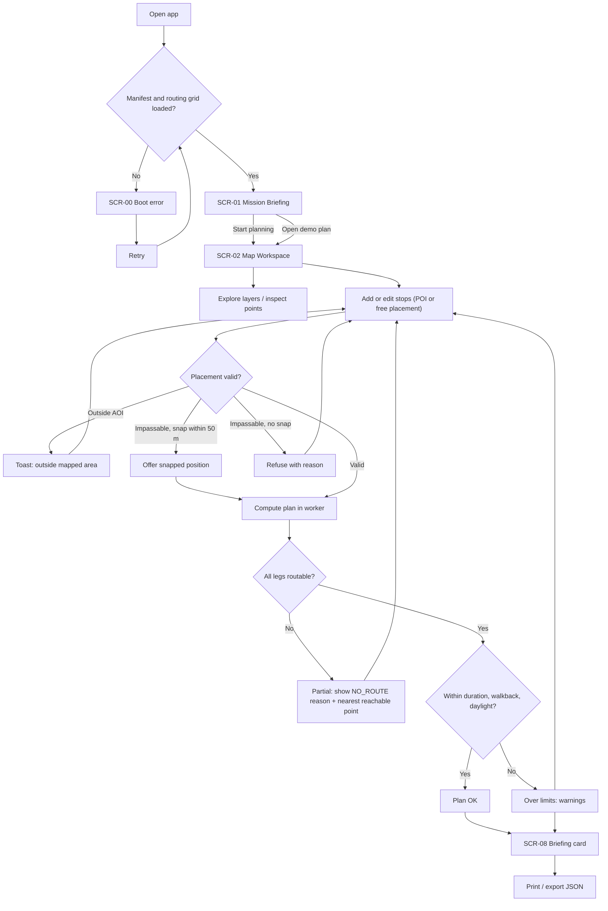
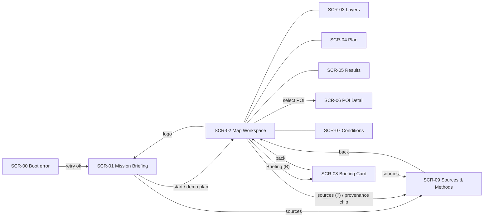
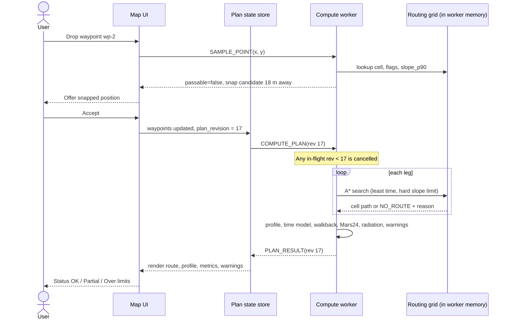
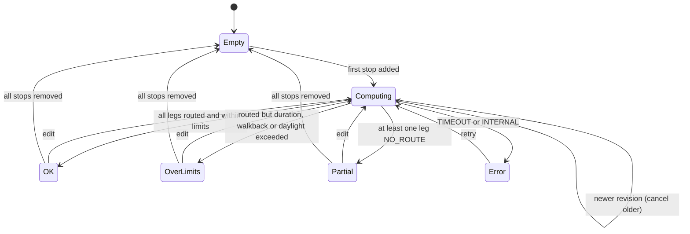

# 03 — App Flow, Diagrams, and Flowcharts

| | |
| --- | --- |
| **Owner** | UX flow (this file owns navigation and interaction sequences) |
| **Date** | 2026-11-02 |
| **Status** | Draft v1 — proposed |
| **Related** | Requirements: [01 PRD](01_Product_Requirements_Document.md) · Behavior: [02 Technical](02_Technical_Requirements_Document.md) · Visuals: [04 Design](04_Design_Brief.md) · [Docs index](../README.md) |

---

## A. Information architecture

```text
Marswalk Planner
├── SCR-01 Mission Briefing (entry)
├── SCR-02 Map Workspace (main)
│   ├── SCR-03 Layers panel          (left drawer, tab "Layers")
│   ├── SCR-04 Plan panel            (left drawer, tab "Plan": inputs + stops)
│   ├── SCR-05 Route Results panel   (bottom: profile + metrics + warnings)
│   ├── SCR-06 POI Detail panel      (right drawer, on POI selection)
│   ├── SCR-07 Conditions panel      (right drawer, tab "Conditions")
│   └── Point inspector popover      (on map click; part of SCR-02)
├── SCR-08 Briefing Card (print view, separate route #/briefing)
├── SCR-09 Sources & Methods (overlay, reachable from every screen)
└── SCR-00 Error / Unsupported screen (boot failure only)
```

Routing is hash-based (`#/`, `#/map`, `#/briefing`, `#/sources`) so the static host needs no rewrites.

---

## B. Screen specification

### SCR-00 — Boot error

| Field | Spec |
| --- | --- |
| Purpose | Explain why the app cannot start and what to do |
| Entry | Manifest missing/invalid, routing grid failed, browser lacks Web Worker/WebGL-free fallback |
| Content | Plain-language cause, missing asset name, "Retry", link to README run instructions |
| States | Single |
| Exit | Retry → boot |
| Requirements | FR-16, NFR-10 |

### SCR-01 — Mission Briefing

| Field | Spec |
| --- | --- |
| Purpose | Set context in < 30 s: site, science objective, what the tool does, prototype disclaimer |
| Entry | App launch (`#/`), "About mission" link |
| Main content | Site name and context thumbnail; science objective (boxwork — groundwater history); data badges (HiRISE, MOLA-tied DEM, THEMIS, RAD, Curiosity); disclaimer (PRD F.1) |
| Primary action | **Start planning** → SCR-02 with default scenario |
| Secondary | **Open demo plan** (preloaded 3-stop plan) → SCR-02; **Sources & methods** → SCR-09 |
| Inputs | None |
| States | Loading (manifest), ready, boot error → SCR-00 |
| Requirements | FR-01, FR-15 |

### SCR-02 — Map Workspace

| Field | Spec |
| --- | --- |
| Purpose | Central planning surface |
| Entry | From SCR-01; back from SCR-08/09 |
| Main content | Map (basemap + layers + traverse + POIs + waypoints + route), scale bar (m), north arrow, coordinate readout, data-version chip |
| Primary actions | Click map: inspect point; **Add stop mode** (toggle, key `A`): click places waypoint; drag waypoints |
| Secondary | Open drawers (Layers/Plan/Conditions), open briefing, open sources |
| Inputs / validation | Waypoint placement validated (inside AOI, passable or snappable ≤ 50 m) |
| States | Loading tiles · Idle · Add-stop mode · Computing (non-blocking spinner on results panel) · Results OK · Results partial (NO_ROUTE leg) · Error (worker) |
| Exit | Briefing (`B`), Sources (`?`), Mission briefing (logo) |
| Requirements | FR-01–FR-10, FR-16, FR-17 |

### SCR-03 — Layers panel

| Field | Spec |
| --- | --- |
| Purpose | Control data layers and understand them |
| Content per row | Toggle, name, opacity slider, legend (units, ramp, classes), native resolution, provenance chip, info link → SCR-09 anchor |
| Layers | Orthoimage (on), Hillshade (on), Elevation, Slope, Thermal inertia, Spectral (only if built), Curiosity traverse (on), POIs (on), Hazard flags |
| States | Default · Loading · Unavailable (asset missing — row disabled with reason) · Out of range (zoom too far out for tile set — hint) |
| Requirements | FR-02, FR-15, FR-16, FR-17, FR-18 |

### SCR-04 — Plan panel

| Field | Spec |
| --- | --- |
| Purpose | Mission inputs and stop list |
| Content | **Inputs** (start time UTC with LTST preview, max EVA duration, dwell per stop, hard/caution slope, walkback limit, suited speed, solar phase, loop toggle) with "Defaults are assumptions" badge and "Reset defaults"; **Stops list** (number, name/POI, coordinates, arrival LTST, reorder ↑/↓, delete), "Undo" |
| Validation | Ranges per [02 §E.3](02_Technical_Requirements_Document.md#e3-input-validation-rules); inline error, field keeps last valid value until corrected |
| Actions | Edit → debounced (300 ms) recompute; reorder/delete → immediate recompute |
| States | Empty (only start) · Editing · Invalid input · Computing |
| Requirements | FR-05, FR-06, FR-09 |

### SCR-05 — Route Results panel

| Field | Spec |
| --- | --- |
| Purpose | Show whether the plan works and why |
| Content | Status banner (OK / Partial / Over limits); metrics row (distance, walk time, EVA total vs. limit, max slope, climb/descent, max walkback, dose); elevation profile with slope-class patterns and stop markers; warnings list (severity, text, location; click → zoom) |
| States | Empty ("Add at least one stop") · Computing · OK · Partial (NO_ROUTE legs; totals hidden) · Error (retry) |
| Linking | Hover/focus on profile ↔ map marker |
| Requirements | FR-07–FR-12 |

### SCR-06 — POI Detail panel

| Field | Spec |
| --- | --- |
| Purpose | Science context and ground view |
| Content | Name; science objective; why it matters; rover image (credit, sol, date, camera); position source + confidence; "Add as stop" / "Remove stop" |
| States | Image loading · Image missing (placeholder with explanation, still usable) |
| Requirements | FR-04 |

### SCR-07 — Conditions panel

| Field | Spec |
| --- | --- |
| Purpose | Environmental context for the EVA window |
| Content | Mars date (MY, L_s, sol date), LTST at start/end, sunrise/sunset (flat horizon), sun elevation per stop; radiation estimate with range and phase; seasonal weather (if FR-13 built, else "not included in this build") |
| States | Computed · Daylight warning · Not available (feature not built) |
| Requirements | FR-11, FR-12, FR-13 |

### SCR-08 — Briefing Card

| Field | Spec |
| --- | --- |
| Purpose | One-page excursion summary for print/PDF |
| Entry | "Briefing" button (enabled when status is OK, Over limits or Partial; disabled with no stops or after Error) |
| Content | Header (site, plan name, data version, plan hash, generated time); route map snapshot; stops/timeline table; profile; metrics; warnings; conditions; assumptions; sources; disclaimer |
| Actions | Print (browser), **Export plan JSON**, Back to map |
| States | Partial plan → red banner "Plan incomplete — not valid for use" and totals omitted · Over limits → banner listing the exceeded limits |
| Requirements | FR-14, FR-15 |

### SCR-09 — Sources & Methods

| Field | Spec |
| --- | --- |
| Purpose | Credibility: what each value is and where it comes from |
| Content | Datasets table (name, version, mission/instrument, resolution, licence/credit, link); processing steps; models (speed, radiation, solar) with equations and labels; known limitations; AI-use statement ("No AI computes or generates values in this app"); diagnostics (data version, checksums status) |
| Entry | From any screen; deep links from provenance chips (`#/sources#layer-slope`) |
| Requirements | FR-15 |

---

## C. User journeys

### C.1 Primary end-to-end journey (matches PRD §E)

1. Open → SCR-01 → **Start planning**.
2. SCR-02 loads with start marker and POIs; user opens Layers, turns on Slope and Thermal inertia.
3. Clicks POI → SCR-06 → views image → **Add as stop** (×3).
4. Worker computes; SCR-05 shows OK, profile, metrics.
5. Opens Conditions → checks daylight and dose.
6. Opens Briefing → prints / exports JSON.

### C.2 Alternative paths

| Path | Description |
| --- | --- |
| Free placement | User enables Add-stop mode and clicks anywhere instead of POIs |
| Demo plan | From SCR-01 "Open demo plan" — preloaded waypoints for a judged walkthrough |
| Point inspection only | User explores layers and inspector without planning (no results panel content) |
| One-way excursion | Loop toggle off → no return leg; walkback check uses distance back along the route |

### C.3 Editing and recalculating

| Edit | Effect |
| --- | --- |
| Drag waypoint | On drop: validate → snap or refuse → new `plan_revision` → recompute; in-flight computation cancelled |
| Reorder/delete stop | Immediate recompute |
| Change input | 300 ms debounce, then recompute; invalid value never sent |
| Undo | Restores previous waypoint list and recomputes |

### C.4 Returning to an earlier step

- Logo → SCR-01 keeps the current plan in memory (and in browser storage if FR-20 built).
- Briefing/Sources → Back returns to SCR-02 with drawers in previous state.

### C.5 Saving / exporting (in scope: export; storage desirable)

- **Export plan JSON** from SCR-08 (always available).
- **Last plan restore** on reload if FR-20 built; silently skipped if storage throws.

---

## D. Error and recovery flows

| Case | Detection | What the user sees | What they can do |
| --- | --- | --- | --- |
| Location outside AOI | Click/drop outside coverage polygon | Toast "Outside mapped area"; waypoint not added | Place inside highlighted AOI boundary |
| No-data cell / impassable cell | Grid lookup | "Not walkable here (slope 22° > 15° limit)"; snapped position offered if ≤ 50 m | Accept snap or place elsewhere |
| Optional layer unavailable | Tile 404 / asset missing at boot | Layer row disabled "Unavailable in this build"; sand warnings show "unknown" | Continue; routing unaffected |
| Invalid input | UI validation | Inline field error with allowed range | Correct value; last valid value stays in effect |
| No feasible route | Worker `NO_ROUTE` | Leg drawn dashed grey to nearest reachable point; banner with reason; totals hidden | Move stop, relax slope limit (with warning), or delete stop |
| Over limits (duration, walkback, darkness) | Estimates | Status "Over limits" (amber/red) with list | Reduce stops, shorten dwell, change start time |
| Partial results | Some legs OK, some not | Status "Partial"; briefing marked "not valid" | Fix failing legs |
| Worker timeout/crash | `TIMEOUT`/`INTERNAL`/onerror | Results panel error "Computation failed" + Retry; map stays usable | Retry; reduce stops |
| Lost connection | N/A at runtime (all local) | Nothing changes — demo is offline by design | — |
| Boot asset failure | Manifest/grid checksum | SCR-00 with missing file name | Fix deployment; retry |

---

## E. Diagrams

### E.1 Overall user flow



### E.2 Screen navigation



(Undirected links = panels embedded in SCR-02.)

### E.3 Sequence — compute plan



### E.4 State — plan computation (asynchronous, cancellable)



## Unresolved items owned by this document

| ID | Item | Recommendation |
| --- | --- | --- |
| U-06 | Should free placement be allowed in the demo, or POIs only? | Allow both; demo uses POIs for reliability |
| U-07 | Tablet editing depth | View + stop add/delete only in MVP; drag on tablet if time permits — **resolved 2026-11-02** (01 Clarifications) |
