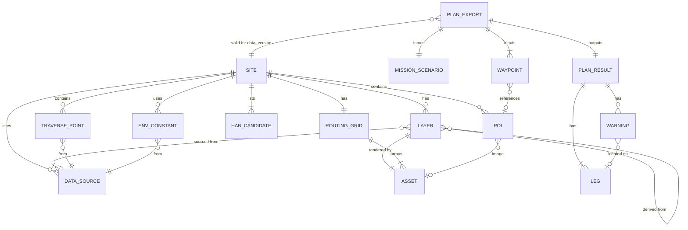
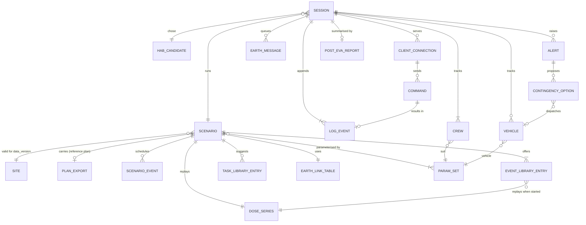

# 05 — Backend and Database Schema

*("Background Schema" in the brief is interpreted as Backend and Database Schema.)*

| | |
| --- | --- |
| **Owner** | Data (this file owns data structures and persistence) |
| **Date** | 2026-11-04 |
| **Status** | Draft v2 — supersedes v1 (2026-11-02). Static site entities (§C.1) are v1 with marked additions; Hab Core runtime entities (§C.2) are new |
| **Related** | Behavior: [02 Technical](02_Technical_Requirements_Document.md) · Requirements: [01 PRD](01_Product_Requirements_Document.md) · Screens: [03 App Flow](03_App_Flow_and_Diagrams.md) · [Docs index](../README.md) |

## Change log v1 → v2

| Area | Change |
| --- | --- |
| Persistence | Still no database. Hab Core adds an append-only event log, snapshots and scenario folders on disk (§B) |
| Provenance enum | `measured \| derived \| modelled \| assumed` **+ `replayed \| simulated`** everywhere a provenance field exists |
| Static entities | POI gains `stop_type`, `evidence`; MissionScenario gains haven, crew and vehicle fields; RoutingGrid gains `comm_hab_asset`; new Warning codes; new `ParamSet` |
| Runtime entities | Scenario, ScenarioEvent, DoseSeries, EarthLinkTable, Session, ClientConnection, Crew, Vehicle, Alert, ContingencyOption, Command, LogEvent, EarthMessage, LinkState, PostEvaReport |
| Naming | v1 **Asset** stays "a file on disk". Rovers and the pressurized vehicle are **Vehicle** (02 uses the same names) |

---

## A. Domain model

| Entity | Purpose | Kind | Requirements |
| --- | --- | --- | --- |
| **Site** | The one mapped excursion area; root of the manifest | Static, versioned | FR-01 |
| **DataSource** | A cited external product (dataset, paper, image) | Static | FR-15 |
| **Layer** | A displayable data layer (raster tiles or vector) | Static | FR-02, FR-17, FR-18 |
| **Asset** | A file on disk (tiles root, grid array, image, GeoJSON) with checksum | Static | NFR-06, NFR-10 |
| **RoutingGrid** | Aligned arrays used for sampling and routing | Static, derived | FR-03, FR-07 |
| **POI** | Curated science point of interest with ground image | Static, curated | FR-04 |
| **TraversePoint** | Historical Curiosity position (sol) | Static, observed | FR-17 |
| **EnvConstant** | Measured or reported constant used in estimates (e.g., RAD dose rate) | Static | FR-12 |
| **MissionScenario** | User-set constraints and start time | Runtime, user input | FR-05 |
| **Waypoint** | Start or stop placed by the user | Runtime, user input | FR-06 |
| **PlanResult** | Computed legs, totals, conditions, warnings | Runtime, computed | FR-07–FR-12 |
| **Leg** / **Warning** | Parts of PlanResult | Runtime, computed | FR-07, FR-10 |
| **PlanExport** | Serialised scenario + waypoints + result + provenance | File, exported | FR-14 |
| **HabCandidate** *(2026-11-10)* | One pre-checked candidate hab site in the manifest, with its comm grid and default start | Static, curated | FR-53 |
| **ParamSet** *(v2)* | A named set of assumed or cited parameters (suit, vehicle, link, alert, shielding) | Static | FR-35, FR-38–FR-42 |
| **Scenario** *(v2)* | A reproducible EVA run, or *(2026-11-10)* a live session's mission setup and event library: start time, plan, crew, vehicles, scheduled inputs, seed | File, curated | FR-34 |
| **EventLibraryEntry** / **TaskLibraryEntry** *(2026-11-10)* | An event a presenter can start on demand (the storm); a suggested task for a POI | File, curated | FR-52, FR-54 |
| **ScenarioEvent** *(v2)* | A scheduled input (dose series, Earth message, DONKI record, advisory) | File | FR-37, FR-43 |
| **DoseSeries** / **EarthLinkTable** *(v2)* | Time tables built by the pipeline (replayed dose; SPICE link geometry) | File, derived | FR-37, FR-43 |
| **Session** *(v2)* | One running instance of a scenario on the Hab Core | Runtime | FR-30 |
| **ClientConnection** *(v2)* | A connected device and its role | Runtime | FR-31 |
| **Crew** *(v2)* | EV1/EV2 state: position, consumables, dose, link, haven | Runtime, simulated | FR-35, FR-39 |
| **Vehicle** *(v2)* | Pressurized rover or utility rover: position, state, path, battery | Runtime, simulated | FR-40, FR-41 |
| **Alert** *(v2)* | Raised condition with lifecycle (raised → acked → cleared) | Runtime, computed | FR-37, FR-38, FR-10 |
| **ContingencyOption** *(v2)* | A ranked response to an alert | Runtime, computed | FR-44 |
| **Command** / **LogEvent** *(v2)* | Requested action / immutable record of what happened | Runtime | FR-30, FR-46 |
| **EarthMessage** *(v2)* | A message on the delayed Earth link | Runtime, simulated | FR-43 |
| **LinkState** *(v2)* | Surface-radio connectivity per node | Runtime, derived + simulated | FR-42 |
| **PostEvaReport** *(v2)* | Planned vs. actual summary built from the log | Runtime, computed | FR-46 |

Not modelled (out of scope): users, accounts, teams, sharing, billing, real telemetry.

---

## B. Persistence strategy

**No database** (v2: still none — the Hab Core persists an append-only event log and snapshots as files; 02 §A.6). Equivalent stores:

| Store | Contents | Format | Lifetime |
| --- | --- | --- | --- |
| **Static files** (`data/sites/<site_id>/`, served by the Hab Core; v1 path was `web/public/sites/`) | Site manifest, DataSources, Layers, Assets, RoutingGrid arrays, POIs, traverse, EnvConstants, tiles, images | JSON, GeoJSON, raw little-endian binary arrays, JPEG/PNG/WebP tiles | Per `data_version`; immutable once released |
| **Pipeline workspace** (`pipeline/work/`, git-ignored) | Downloaded source rasters, intermediate GeoTIFFs | GeoTIFF/COG, PDS labels | Developer machine only |
| **Browser memory** | MissionScenario, Waypoints, PlanResult, UI state | JS objects | Session |
| **Browser storage** (FR-20, optional) | Last PlanExport | JSON string under key `mwp:lastPlan:v1` | Until cleared; failures ignored |
| **Exported file** | PlanExport | `.json` download | User-controlled |
| **Scenario folders** *(v2)* (`scenarios/<scenario_id>/`) | `scenario.json`, `dose_series.json`, `earth_link.json`, provenance | JSON | Per `scenario_id` + `data_version`; immutable once released |
| **Session store** *(v2)* (`apps/hab-core/var/sessions/<session_id>/`, git-ignored) | `session.jsonl` (append-only LogEvents), `snapshot-<seq>.json` every 500 events, `meta.json` | JSON Lines / JSON | Until deleted; replayable |
| **Published plans** *(v2)* | PlanExport received via `PUBLISH_PLAN` | JSON in session folder | Per session |
| **External sources** | USGS, PDS, NASA image archives, NAIF/ESA SPICE, DONKI | Original products | Contacted only by the pipeline, pre-event |

Large rasters are **never embedded in JSON**: the manifest references them by relative path + SHA-256 + dimensions.

---

## C. Entity definitions

Conventions: coordinates `x_m`, `y_m` are in the site's **working projection** (local Mars equirectangular, metres, origin at the AOI's projection centre, x east, y north). Geographic values are `lat` (planetocentric °, −90…90) and `lon_e` (east-positive °, −180…180). Elevations `*_m` are metres in the DEM's MOLA-tied datum. Times are ISO-8601 UTC strings; Mars local times are strings `HH:MM` LTST.

## C.1 Static site entities

### Site

| Field | Type | Req | Default | Rules / units | Example |
| --- | --- | --- | --- | --- | --- |
| `schema_version` | string | ✓ | — | SemVer; app checks major | `"1.0.0"` |
| `site_id` | string (PK) | ✓ | — | `^[a-z0-9_]+$`, unique | `"gale_boxwork"` |
| `name` | string | ✓ | — | ≤ 80 chars | `"Mount Sharp boxwork, Gale crater"` |
| `body` | enum | ✓ | `"mars"` | `mars` | `"mars"` |
| `data_version` | string | ✓ | — | `<site_id>-YYYY.MM.DD[.n]` | `"gale_boxwork-2026.11.05"` |
| `crs.proj4` | string | ✓ | — | Must equal pipeline string exactly | see example |
| `crs.base` | string | ✓ | — | IAU code of geographic base | `"IAU_2015:49900"` |
| `aoi.extent_m` | number[4] | ✓ | — | `[minx, miny, maxx, maxy]` | `[-3000,-3000,3000,3000]` |
| `aoi.bbox_geo` | number[4] | ✓ | — | `[min_lon_e, min_lat, max_lon_e, max_lat]`, inside DEM extent | illustrative |
| `default_start` | `{x_m, y_m, label}` | ✓ | — | Passable cell. *(2026-11-10)* When `hab_candidates` is present, equals the `default_start` of its rank-1 entry | — |
| `hab_candidates` *(2026-11-10, Proposed)* | HabCandidate[] | | absent | Optional until the pipeline produces candidates; absent = the single `default_start` / `hab_mast` site, so current manifests and the validator stay valid. When present: ≥ 1, a short list of pre-checked sites (two today); exactly one has `rank` 1 | — |
| `known_offsets_m` | object | | `{}` | Measured layer-to-ortho offsets | `{"traverse": 2.1}` |
| `layers` | Layer[] | ✓ | — | ≥ 1 | — |
| `sources` | DataSource[] | ✓ | — | — | — |
| `grid` | RoutingGrid | ✓ | — | — | — |
| `env_constants` | EnvConstant[] | ✓ | — | — | — |
| `assets` | Asset[] | ✓ | — | Every file the site uses; target of all `*_asset` / `asset_id` FKs | — |
| `pois_asset` / `traverse_asset` | asset_id | ✓ | — | FK → Asset | — |

### DataSource

| Field | Type | Req | Rules | Example |
| --- | --- | --- | --- | --- |
| `source_id` (PK) | string | ✓ | unique, kebab-case | `"usgs-gale-dem-1m-v3"` |
| `title` | string | ✓ | | `"Mars MSL Gale Merged DEM 1m"` |
| `publisher` | string | ✓ | | `"USGS Astrogeology Science Center"` |
| `authors` | string | | | `"Parker, T.; Calef III, F. J."` |
| `missions` / `instruments` | string[] | ✓ | | `["MRO","Mars Express","MGS"]` / `["HiRISE","CTX","HRSC","MOLA"]` |
| `version` | string | ✓ | | `"v3"` |
| `url` | string | ✓ | https | Astropedia page |
| `doi` | string | | | — |
| `credit` | string | ✓ | Shown in UI | `"Please credit authors"` |
| `licence` | string | ✓ | | `"Use constraints: none (USGS/PDS)"` |
| `accessed` | date | ✓ | | `"2026-11-02"` |
| `native_resolution_m` | number | | | `1` |
| `accuracy_note` | string | | | `"Controlled to MOLA: ~100 m horizontal, ~1 m vertical"` |

### Layer

| Field | Type | Req | Default | Rules | Example |
| --- | --- | --- | --- | --- | --- |
| `layer_id` (PK) | string | ✓ | | unique | `"slope"` |
| `title` | string | ✓ | | | `"Slope"` |
| `category` | enum | ✓ | | `optical \| topographic \| thermal \| spectral \| hazard \| mission` | `"topographic"` |
| `kind` | enum | ✓ | | `raster_tiles \| vector \| image_static` | `"raster_tiles"` |
| `provenance` | enum | ✓ | | `measured \| derived \| modelled \| assumed` (+ `replayed \| simulated` in v2, never used by static layers) | `"derived"` |
| `source_ids` | string[] | ✓ | | FK → DataSource, ≥ 1 | `["usgs-gale-dem-1m-v3"]` |
| `derived_from` | string[] | | `[]` | FK → Layer | `["elevation"]` |
| `units` | string | | | | `"deg"` |
| `legend` | object | ✓ | | ramp/classes with values | see example |
| `native_resolution_m` | number | ✓ | | | `1` |
| `display_resolution_m` | number | ✓ | | | `2` |
| `asset_id` | string | ✓ | | FK → Asset (tiles root) | `"tiles-slope"` |
| `tile_grid` | object | cond. | | Required when `kind=raster_tiles`: `origin_m`, `resolutions_m`, `tile_size_px`, `format` | — |
| `default_visible` | bool | ✓ | `false` | | `false` |
| `optional` | bool | ✓ | `true` | `false` only for basemap | `true` |
| `limitations` | string | ✓ | | Shown in legend/methods | `"1 m posts; effective resolution coarser"` |

### Asset

| Field | Type | Req | Rules | Example |
| --- | --- | --- | --- | --- |
| `asset_id` (PK) | string | ✓ | unique | `"grid-elevation"` |
| `path` | string | ✓ | relative to site folder | `"grid/elevation.f32"` |
| `format` | enum | ✓ | `f32 \| u8 \| geojson \| jpg \| png \| webp \| tiles` | `"f32"` |
| `sha256` | string | ✓ (files) | 64 hex; tiles roots store hash of index file | — |
| `bytes` | int | ✓ (files) | | `5760000` |
| `width` / `height` | int | cond. | arrays/images | `1200` / `1200` |
| `nodata` | number \| null | cond. | arrays: `NaN` for f32, `255` for u8 | `null` |
| `byte_order` | enum | cond. | `little` | `"little"` |

A static image asset lives at `images/<layer_id>.png` *(Proposed 2026-11-12; decided by the orchestrator (Claude) under Sadman Shaharier Mahim's authority, 12 Nov 2026; BD-23)*

### RoutingGrid

| Field | Type | Req | Rules | Example |
| --- | --- | --- | --- | --- |
| `cell_m` | number | ✓ | > 0 | `5` |
| `width` / `height` | int | ✓ | `width*height ≤ 4e6` | `1200` / `1200` |
| `origin_m` | number[2] | ✓ | top-left corner (x, y) | `[-3000, 3000]` |
| `row_order` | enum | ✓ | `north_up` | `"north_up"` |
| `elevation_asset` | FK | ✓ | f32, metres, bilinear-resampled mean of 1 m DEM | `"grid-elevation"` |
| `slope_p90_asset` | FK | ✓ | u8, degrees × 4 (0.25° steps, 0–63.5°, 255 = no data) | `"grid-slope-p90"` |
| `slope_max_asset` | FK | ✓ | same encoding | `"grid-slope-max"` |
| `flags_asset` | FK | ✓ | u8 bitfield (below) | `"grid-flags"` |
| `ti_asset` | FK | | f32 tiu at 100 m, own small grid with `ti_cell_m: 100` | `"grid-ti"` |
| `ti_cell_m` | number | cond. | Required with `ti_asset`; TI grid cell size, metres | `100` |
| `comm_hab_asset` *(v2)* | FK | ✓ | u8, 1 = line of sight to the hab mast, 0 = none, 255 = no data (02 §C.5 L11) | `"grid-comm-hab"` |
| `hab_mast` *(v2)* | `{x_m, y_m, height_m}` | ✓ | Mast used for `comm_hab`. *(2026-11-10)* When `hab_candidates` is present, `comm_hab_asset` and `hab_mast` here are those of the rank-1 candidate, so a consumer that ignores candidates still works | `{"x_m":-1800,"y_m":-1500,"height_m":10}` |

**TI sidecar dimensions** *(2026-11-12)*: the TI array's width and height are its own shape, as the pipeline grid writer takes them (`pipeline/src/marswalk_pipeline/grid.py`: rows × columns of the TI array, width × height at most the cell limit above), and the file length is width × height × 4 bytes (f32). The loader checks the same formula *(Proposed 2026-11-12; decided by the orchestrator (Claude) under Sadman Shaharier Mahim's authority, 12 Nov 2026; BD-78)*

#### Flag bits

| Bit | Name | Meaning | Source |
| --- | --- | --- | --- |
| 0 | `NO_DATA` | DEM no-data | derived |
| 1 | `HARD_HAZARD` | Team-digitised impassable feature (e.g., scarp) | assumed/interpreted |
| 2 | `LOW_TI` | TI below threshold (possible loose fines) | derived, interpretive |
| 3 | `TI_UNKNOWN` | No TI coverage | derived |
| 4 | `LOW_RES_DEM` | Cell filled by CTX/HRSC/MOLA rather than HiRISE | derived from DEM source map (if obtainable) |
| 5–7 | reserved | | |

### HabCandidate *(2026-11-10, Proposed)*

A candidate hab site, prepared on Earth by the pipeline and chosen at mission setup (01 FR-53). Free placement is out of scope for now. Haven fields are **not** stored: the Hab Core recomputes them for the chosen candidate at runtime (NFR-02).

| Field | Type | Req | Rules / units | Example |
| --- | --- | --- | --- | --- |
| `candidate_id` (PK) | string | ✓ | `^[a-z0-9-]+$`, unique in the Site | `"hab-first"` |
| `label` | string | ✓ | ≤ 80 chars | `"First choice"` |
| `rank` | int | ✓ | ≥ 1, unique; 1 is the default | `1` |
| `hab_mast` | `{x_m, y_m, height_m}` | ✓ | Passable cell inside the AOI | see §F.1 |
| `lat`, `lon_e` | number | ✓ | planetocentric °, east-positive; consistent with `hab_mast` | — |
| `comm_hab_asset` | FK | ✓ | Same encoding and shape as `grid.comm_hab_asset`, computed from this candidate's mast. *(2026-11-11)* Asset id: the rank-1 candidate uses `grid.comm_hab_asset` itself (`grid-comm-hab`, file `grid/comm_hab.u8`); any other candidate `grid-comm-<candidate_id>` (file `grid/comm_<candidate_id>.u8`) | `"grid-comm-hab"` |
| `default_start` | `{x_m, y_m, label}` | ✓ | The planner's start waypoint when this candidate is chosen | — |
| `note` | string | | Why it is on the list (for example the trade-off in [hab-site.md](../ops/feasibility/hab-site.md)) | — |
| `provenance`, `source_ids` | enum, string[] | ✓ | `assumed` for a curated choice; sources of the checks | `"assumed"` |

### POI

GeoJSON Feature in working-projection metres; properties:

| Field | Type | Req | Rules | Example |
| --- | --- | --- | --- | --- |
| `poi_id` (PK) | string | ✓ | unique | `"poi-boxwork-ridge"` |
| `name` | string | ✓ | | `"Boxwork ridge"` |
| `lat`, `lon_e` | number | ✓ | inside AOI | — |
| `science_objective` | string | ✓ | ≤ 300 chars | `"Examine mineral-cemented ridges formed by groundwater in fractures"` |
| `why_it_matters` | string | ✓ | ≤ 300 chars | — |
| `image_asset` | FK | | jpg | `"img-boxwork-ridge"` |
| `image_credit` | string | cond. | required if image | `"NASA/JPL-Caltech"` |
| `image_source_url` | string | cond. | required if image | NASA page |
| `image_sol` / `image_date` / `image_camera` | int / date / string | | | `4611` / `"2025-07-27"` / `"Navcam"` |
| `position_source` | string | ✓ | how coordinates were obtained | `"Traverse waypoint at sol 4611 (PLACES)"` |
| `position_uncertainty_m` | number | ✓ | ≥ 0 | `10` |
| `provenance` | enum | ✓ | usually `assumed` for curated positions | `"assumed"` |
| `stop_type` *(v2)* | enum | ✓ | `science \| resource \| engineering` (01 §A.4) | `"resource"` |
| `ez_theme` *(v2)* | string | ✓ | short label shown as the POI's kicker | `"Hydrated sulfates — ISRU water"` |
| `evidence` *(v2)* | array of `{text, source_id}` | ✓ | ≥ 1 item; each cites a DataSource | `[{"text":"Sulfate-bearing unit identified by Curiosity", "source_id":"msl-sulfate-unit"}]` |

### TraversePoint

GeoJSON Point features (+ one LineString). Properties: `sol` (int, ✓), `site_drive` (string), `lat`, `lon_e`, `elevation_m` (if provided), `source_id` (FK, ✓). Provenance: `measured` (rover localization).

### EnvConstant

| Field | Type | Req | Example |
| --- | --- | --- | --- |
| `const_id` (PK) | string | ✓ | `"rad-gale-dose-eq-solar-max"` |
| `quantity` | string | ✓ | `"surface dose equivalent rate"` |
| `value` | number | ✓ | `0.64` |
| `low` / `high` | number | ✓ | `0.52` / `0.76` |
| `unit` | string | ✓ | `"mSv/day"` |
| `conditions` | object | ✓ | `{"solar_phase":"max","location":"Gale crater floor","period":"2012-2013"}` |
| `provenance` | enum | ✓ | `"measured"` |
| `source_id` | FK | ✓ | `"hassler-2014-rad"` |
| `note` | string | | `"reported range, Simonsen et al. 2024"` |

Second record: `rad-gale-dose-eq-solar-min`, value `0.925` (midpoint, display as range), low `0.85`, high `1.0`, provenance `"measured"` with note "reported range, Simonsen et al. 2024".

### MissionScenario (user input)

| Field | Type | Req | Default | Range (see [02 §E.3](02_Technical_Requirements_Document.md#e3-input-validation-rules)) |
| --- | --- | --- | --- | --- |
| `eva_start_utc` | ISO string | ✓ | *(Proposed 2026-11-12, decided by the orchestrator (Claude) under Sadman Shaharier Mahim's authority, 12 Nov 2026; FD-042)* the loaded scenario's `eva_start_utc` (Hab Core `GET /api/session`); with no Hab Core, no default: the field is required | 2000–2100 |
| `max_eva_duration_h` | number | ✓ | 6.0 | 0.5–10 |
| `dwell_min_per_stop` | number | ✓ | 20 | 0–180 |
| `hard_slope_limit_deg` | number | ✓ | 15 | 5–35, > caution |
| `caution_slope_deg` | number | ✓ | 10 | 2–30 |
| `walkback_limit_km` | number | ✓ | 5.0 | 0.5–20 |
| `suited_flat_speed_kmh` | number | ✓ | 3.3 | 0.5–6 |
| `solar_phase` | enum | ✓ | `"max"` | `max \| min` |
| `loop` | bool | ✓ | `true` | — |
| `max_haven_min` *(v2)* | number | ✓ | 30 | 5–120 |
| `crew_count` *(v2)* | int | ✓ | 2 | 1–2 |
| `vehicle_available` *(v2)* | bool | ✓ | `true` | — |
| `vehicle_param_set` *(v2)* | FK → ParamSet | cond. | `"pr1-assumed"` | required when `vehicle_available` |

All defaults carry provenance `assumed` in the UI.

### Waypoint (user input)

| Field | Type | Req | Rules |
| --- | --- | --- | --- |
| `id` (PK within plan) | string | ✓ | `wp-<n>` |
| `role` | enum | ✓ | exactly one `start`; ≤ 10 `stop` |
| `x_m`, `y_m` | number | ✓ | inside AOI, passable after snapping |
| `poi_id` | FK | | → POI |
| `snapped_from` | `{x_m,y_m}` | | present if snapped |
| `label` | string | | ≤ 40 chars |

### PlanResult (computed)

| Field | Type | Notes |
| --- | --- | --- |
| `status` | enum | `OK \| OVER_LIMITS \| PARTIAL \| ERROR` |
| `legs` | Leg[] | one per consecutive waypoint pair (+ return leg if `loop`) |
| `totals` | object \| null | null when `PARTIAL`: `distance_m, walk_time_min, dwell_time_min, eva_total_min, eva_margin_min, climb_m, descent_m, max_slope_deg, max_walkback_km` |
| `stops_timeline` | array | per waypoint: `arrive_utc, depart_utc, arrive_ltst, sun_elevation_deg` |
| `conditions` | object | `mars_year, ls_deg, sunrise_ltst, sunset_ltst, sunrise_utc, sunset_utc` (flat horizon) |
| `radiation` | object | `dose_mSv, dose_low_mSv, dose_high_mSv, solar_phase, const_id` |
| `warnings` | Warning[] | |
| `computed_utc` | ISO | |
| `timing_ms` | object | diagnostics |

**Leg:** `from`, `to`, `status` (`OK \| NO_ROUTE`), `reason` (if NO_ROUTE), `distance_m`, `walk_time_min`, `climb_m`, `descent_m`, `max_slope_deg`, `geometry` (array of `[x_m,y_m]`, simplified for display), `cell_path_length`, `nearest_reachable` (if NO_ROUTE), `profile` (arrays `dist_m[]`, `elev_m[]`, `slope_class[]` sampled every 5 m; `slope_class` ∈ `ok \| caution \| over_limit` against the scenario's current limits, 01 FR-08). v2 adds `comm[]` (0/1 LOS per sample) and `haven_min[]` (planning approximation, 02 §D.8).

**Leg metric definitions** *(2026-11-12)*: `distance_m` is the horizontal distance along the cell centres of the unsimplified cell path; `walk_time_min` is summed from the step time of 02 §D.3; `climb_m` and `descent_m` are summed from the cell path; `max_slope_deg` is the maximum decoded slope over the path. A `NO_ROUTE` leg carries only `status, reason, from, to` and `nearest_reachable` when there is one *(Proposed 2026-11-12; decided by the orchestrator (Claude) under Sadman Shaharier Mahim's authority, 12 Nov 2026; BD-43)* The `profile` is sampled every 5 m **and at the leg end**, so the warnings see the full leg *(Proposed 2026-11-12; decided by the orchestrator (Claude) under Sadman Shaharier Mahim's authority, 12 Nov 2026; BD-44)*

**`conditions.sol`** *(2026-11-12)*: `PlanResult.conditions` also carries `sol`, the MSL mission sol of the EVA start, `derived` by compute `mslSol`; the SNAPSHOT `conditions.sol` is the same value at sim time *(Proposed 2026-11-12; decided by the orchestrator (Claude) under Sadman Shaharier Mahim's authority, 12 Nov 2026; BD-112)*

**Warning:** `code` (`OVER_HARD_SLOPE`, `CAUTION_SLOPE`, `LOW_TI`, `TI_UNKNOWN`, `LOW_RES_DEM`, `NO_DATA_ADJACENT`, `NO_ROUTE`, `EVA_DURATION_EXCEEDED`, `WALKBACK_EXCEEDED`, `DARKNESS`; v2: `COMM_SHADOW`, `HAVEN_TIME_EXCEEDED`, `RADIATION_ALERT`, `CONSUMABLES_LOW`), `severity` (`caution \| blocked \| unknown`), `leg` (index or null), `from_m`, `to_m` (along-leg distance; null when the warning has no location, e.g. `EVA_DURATION_EXCEEDED`), `at_utc` (for time warnings), `message`.

**Route warnings** *(2026-11-12)*: `LOW_RES_DEM` and `NO_DATA_ADJACENT` have severity `caution`, one warning per contiguous run of route cells per leg (`from_m`, `to_m` along the unsimplified cell path); `NO_DATA_ADJACENT` marks a route cell with a no-data cell (NO_DATA flag, NaN elevation or slope 255) among its 8 neighbours. `LOW_TI` is never emitted (U-03). `DARKNESS` has severity `caution`, `from_m` and `to_m` null, `at_utc` the first instant the sun is below the flat horizon at a timeline instant (each leg's departure and arrival, each dwell's end), `leg` the leg that ends or starts there; when every instant is lit but the sol's sunset lies between two of them, `at_utc` is that sunset *(Proposed 2026-11-12; decided by the orchestrator (Claude) under Sadman Shaharier Mahim's authority, 12 Nov 2026; BD-49)*

### PlanExport

| Field | Type | Req |
| --- | --- | --- |
| `export_schema_version` | string | ✓ |
| `app_version` | string | ✓ |
| `site_id`, `data_version` | string | ✓ |
| `plan_hash` | string | ✓ — first 12 hex of SHA-256 over canonical JSON of `{data_version, scenario, waypoints}` (sorted keys, numbers as written). *Canonical JSON is RFC 8785 (JCS), decided 2026-11-07*: keys sorted by UTF-16 code units, no whitespace, numbers as ECMAScript `Number::toString` writes them (`1.0` → `1`, `1e21` → `1e+21`). *(Proposed 2026-11-12, decided by the orchestrator (Claude) under Sadman Shaharier Mahim's authority, 12 Nov 2026; FD-134)* The `plan_hash` input is canonicalised with RFC 8785 (JCS), as `log_hash`; the web client and the Hab Core use the same rule |
| `scenario` | MissionScenario | ✓ |
| `waypoints` | Waypoint[] | ✓ |
| `result` | PlanResult | ✓ |
| `provenance_summary` | array of `{value_path, provenance, source_ids}` | ✓ |
| `disclaimer` | string | ✓ |

### ParamSet *(v2)*

Every number the simulation uses that is not data. Shown in the UI next to whatever it drives.

| Field | Type | Req | Rules | Example |
| --- | --- | --- | --- | --- |
| `param_set_id` (PK) | string | ✓ | unique | `"pr1-assumed"` |
| `kind` | enum | ✓ | `suit \| pressurized_rover \| utility_rover \| link \| alert \| shielding` | `"pressurized_rover"` |
| `title` | string | ✓ | | `"Pressurized rover (SEV-class concept)"` |
| `values` | object | ✓ | keys per kind (table below) | `{"flat_speed_kmh": 10, "hard_slope_deg": 20}` |
| `provenance` | enum | ✓ | `assumed` unless every value is cited | `"assumed"` |
| `source_ids` | string[] | | cited sources for any value | `[]` |
| `note` | string | | | `"Values from 02 §D.9; replace with cited figures (U-20)"` |

| `kind` | Required `values` keys (02 reference) |
| --- | --- |
| `suit` | `flat_speed_kmh, hard_slope_deg, caution_slope_deg, o2_nominal_h, p_walk_w, p_rest_w, p_ref_w, antenna_m` (§D.3, §D.14); `hab_ingress_min` *(2026-11-12)*: minutes to enter the hab and be sheltered, 02 §D.8 `t_ingress`, `assumed` (source "02 §D.8"), read by the haven module and the contingency options *(Proposed 2026-11-12; decided by the orchestrator (Claude) under Sadman Shaharier Mahim's authority, 12 Nov 2026; BD-57)* |
| `pressurized_rover` | `flat_speed_kmh, hard_slope_deg, caution_slope_deg, low_ti_cost, min_speed_frac, capacity, ingress_min, antenna_m` (§D.9) |
| `utility_rover` | as above + `battery_wh, p_base_w, mass_kg, climb_eff` |
| `link` | `range_hab_suit_m, range_suit_suit_m, range_rover_m, hab_mast_m, relay_min_elev_deg, conjunction_deg, dte_enabled` (§D.11–D.12) |
| `alert` | `rad_k_background, rad_clear_k, rad_clear_min, buddy_max_m, o2_caution_margin, o2_warning_margin, o2_clear_margin` (§D.13–D.14; `o2_clear_margin` ≥ `o2_caution_margin` is where an open O₂ alert clears; the O₂ margins replaced `o2_caution_frac, o2_warning_frac` on 2026-11-07: O₂ time left ÷ time to the nearest haven) |
| `shielding` | `suit, pressurized_rover, hab` factors (§D.13) |

## C.2 Runtime entities (Hab Core) *(v2)*

Conventions as §C. In addition: `sim_time` is ISO-8601 UTC of the **mission clock** (never wall-clock); `seq` is the Hab Core's monotonic event number; every computed or simulated number travels with a provenance entry (`provenance` map keyed by field path, as in 02 §E.6).

### Scenario

| Field | Type | Req | Rules | Example |
| --- | --- | --- | --- | --- |
| `scenario_schema_version` | string | ✓ | SemVer | `"1.0.0"` |
| `scenario_id` (PK) | string | ✓ | `^[a-z0-9-]+$` | `"storm-sol4190"` |
| `title` | string | ✓ | | `"Storm at sol 4190"` |
| `site_id`, `data_version` | string | ✓ | must equal the loaded Site | `"gale_boxwork"` |
| `seed` | int | ✓ | 32-bit | `4190` |
| `start_utc` | ISO | ✓ | | `"2024-05-20T…Z"` (TASK-21) |
| `mission_setup` *(2026-11-10, Proposed)* | `{hab_candidate_id?, crew_count?, vehicle_available?, vehicle_param_set?, solar_phase?, max_haven_min?}` | ✓ | Defaults for the setup screen (SCR-20): `hab_candidate_id` (omitted when the Site has no `hab_candidates`) must be a `candidate_id` in the Site's `hab_candidates`; the other keys use the [MissionScenario](#missionscenario-user-input) names and ranges. They are the defaults the planner's scenario parameters start from; when a published plan exists, the plan's [MissionScenario](#missionscenario-user-input) values win. `crew_count` must equal the length of `crew[]`; `vehicle_available: true` requires `vehicle_param_set`. The chosen values are copied to the Session | `{"hab_candidate_id": "hab-first"}` |
| `plan` | PlanExport | — | *(2026-11-10)* Optional: the **reference plan** for a headless reference run; in a live session the plan arrives with `PUBLISH_PLAN`. When present, `plan_hash` must verify | — |
| `stop_tasks` *(FR-50, added 2026-11-06, Proposed)* | array of `{task_id, stop_id, crew_id, kind, text}` | — | *(2026-11-10)* requires `plan`, so it is for the reference run only; in a live session the tasks arrive with `PUBLISH_PLAN`, beside the plan. The authored [StopTask](#stoptask-fr-50-added-2026-11-05) fields only; `stop_id` must be the `id` of a stop Waypoint in `plan` (U-61); 1–4 per stop (FR-50), checked by the Hab Core loader; kept beside `plan`, not inside it, so `plan_hash` is unchanged (U-48) | — |
| `crew` | array of `{crew_id, suit_param_set, start_offset_s}` | ✓ | 1–2 entries, ids `EV1`/`EV2` | — |
| `vehicles` | array of `{vehicle_id, kind, param_set, start_x_m, start_y_m}` | ✓ | start on a passable cell for its kind | — |
| `param_sets` | FK[] → ParamSet | ✓ | must include one `link`, `alert`, `shielding` | — |
| `events` | ScenarioEvent[] | — | sorted by `t_utc`. *(2026-11-10)* Optional: inputs tied to a library event move into `event_library`; `events` keeps any other scheduled input | — |
| `event_library` *(2026-11-10, Proposed)* | [EventLibraryEntry](#eventlibraryentry-2026-11-10-proposed)[] | ✓ | ≥ 1 (the storm); each started on demand by `START_EVENT` | — |
| `task_library` *(2026-11-10, Proposed)* | [TaskLibraryEntry](#tasklibraryentry-2026-11-10-proposed)[] | — | Suggested tasks per POI (FR-54); `poi_id` must resolve to a POI of the Site | — |
| `tables` | `{dose_series, earth_link}` | ✓ | relative paths + SHA-256 | — |
| `source_ids` | string[] | ✓ | every source the scenario draws on | `["rad-sol4190", "donki-2024-05", "naif-de440s"]` |

### ScenarioEvent

| Field | Type | Req | Rules |
| --- | --- | --- | --- |
| `event_id` | string | ✓ | unique in scenario |
| `t_utc` | ISO | ✓ | Mars-side time at which the event *exists* (e.g., Earth issue time for an Earth message) |
| `kind` | enum | ✓ | `EARTH_MESSAGE \| DONKI_RECORD \| ADVISORY \| INJECT` |
| `payload` | object | ✓ | per kind; `EARTH_MESSAGE`: `{body, sent_earth_utc}`; `DONKI_RECORD`: `{donki_type, donki_id, summary, predicted_mars_arrival_utc?}` |
| `provenance` | enum | ✓ | `replayed` for DONKI and published records; `simulated` for `INJECT` and invented messages |
| `source_id` | FK | cond. | required unless `simulated` |

### EventLibraryEntry *(2026-11-10, Proposed)*

An event the presenter starts at the current sim time with `START_EVENT {event_id}` (01 FR-52, 02 §D.17). It replaces the fixed timeline: nothing in it has a UTC of its own except the recorded `series_start_utc`.

| Field | Type | Req | Rules |
| --- | --- | --- | --- |
| `event_id` (PK) | string | ✓ | unique in the scenario, e.g. `"storm"` |
| `title` | string | ✓ | e.g. `"Solar particle event"` |
| `kind` | enum | ✓ | `SPACE_WEATHER` |
| `dose_series` | string | ✓ | key in `tables` (e.g. `"dose_series"`) of the [DoseSeries](#doseseries-dose_seriesjson) to replay |
| `series_start_utc` | ISO | ✓ | the sample time in that series where playback begins: the start of the pre-onset rise. Played at the press `t0`, so the rate at sim time `t ≥ t0` is the series at `series_start_utc + (t − t0)`. The value is the time of the last sample whose rate is at or below `background_rate` before the first sample whose compute `triggerState` (with the scenario's alert ParamSet) is not nominal; the scenario builder prints the rule and the value *(Proposed 2026-11-12; decided by the orchestrator (Claude) under Sadman Shaharier Mahim's authority, 12 Nov 2026; BD-98)* |
| `label` | string | ✓ | shown on the curve: `"replayed — Curiosity RAD measurements"` |
| `source_id`, `provenance` | FK, enum | ✓ | `rad-sol4190`; `replayed` |
| `inputs` | array of `{input_id, t_offset_s, kind, payload, provenance, source_id}` | | scheduled inputs of this event (DONKI record, Earth message, advisory), as [ScenarioEvent](#scenarioevent) but timed at `t0 + t_offset_s`, `t_offset_s` ≥ 0, computed by the pipeline from the recorded time minus `series_start_utc` for replayed inputs. A `simulated` input has no recorded time: it takes the `t_offset_s` of the replayed record it answers, and the pipeline writes the pairing in `payload.answers`; a simulated input that answers no record is not allowed in the library *(Proposed 2026-11-12; decided by the orchestrator (Claude) under Sadman Shaharier Mahim's authority, 12 Nov 2026; BD-99)*. The old `payload.sent_earth_utc` of an `EARTH_MESSAGE` is not stored in a library input: the Earth issue time is the input's shifted time `t0 + t_offset_s`, from which §D.12 computes delivery. `TODO(verify)`: whether any recorded input precedes `series_start_utc` (it would fire at the press) |

The Earth-link tables are **not** shifted: light time, relay passes, Sun position and LTST are read at the current sim time. Whether `earth_link.json` covers the whole EVA day of a live session is checked by the headless live-session verification; the SPICE window is widened if it does not *(Proposed 2026-11-12; decided by the orchestrator (Claude) under Sadman Shaharier Mahim's authority, 12 Nov 2026; BD-108)*.

### TaskLibraryEntry *(2026-11-10, Proposed)*

A suggested task for a POI (01 FR-54). When the planner adds a stop at a POI, its entries are copied into the plan as [StopTask](#stoptask-fr-50-added-2026-11-05) authored fields with the new stop's Waypoint `id`; the planner may edit, delete or add before publishing.

| Field | Type | Rules |
| --- | --- | --- |
| `library_task_id` | string | unique in the library |
| `poi_id` | string | FK → POI of the Site |
| `crew_id` | `EV1 \| EV2 \| null` | default assignment, as StopTask; editable |
| `kind` | enum | as StopTask |
| `text` | string | ≤ 60 characters, as StopTask; any number cites its source |
| `source_id` | FK | required when `text` states a number |

The drafted tasks in `scenarios/storm-sol4190/stop_tasks.json` (keyed there by `stop_id` `wp-1…wp-3`) become the library entries for the demo plan's three POIs, re-keyed to `poi_id` through that plan's Waypoint `poi_id`. 1–4 entries per POI (as FR-50).

### DoseSeries (`dose_series.json`)

| Field | Type | Req | Rules |
| --- | --- | --- | --- |
| `series_id` | string | ✓ | `"rad-sol4190"` |
| `quantity` | string | ✓ | `"surface absorbed dose rate"` |
| `unit` | string | ✓ | `"uGy/h"` — absorbed dose; never Sv for the event (02 §C.5 L9) |
| `samples` | array of `[t_utc, rate]` | ✓ | strictly increasing time; gaps allowed (rate = null) |
| `background_rate` | number | ✓ | same unit; used for the trigger |
| `method` | enum | ✓ | `archive \| digitised \| template_scaled` |
| `provenance` | enum | ✓ | `replayed` |
| `source_id` | FK | ✓ | |
| `integral_check` | `{expected_ugy, computed_ugy}` | ✓ | for `digitised`/`template_scaled`, expected = published total (8,100 µGy) |

### EarthLinkTable (`earth_link.json`)

| Field | Type | Req | Rules |
| --- | --- | --- | --- |
| `step_s` | int | ✓ | 60 |
| `rows` | array of `{t_utc, light_time_s, sep_angle_deg, earth_elev_deg, orbiters: {mro, maven, tgo}}` | ✓ | orbiter values = elevation in degrees at the site |
| `passes` | array of `{orbiter, start_utc, end_utc, max_elev_deg}` | ✓ | precomputed with `link.relay_min_elev_deg` |
| `kernels` | array of `{file, sha256, source_id}` | ✓ | SPICE files used |
| `provenance` | enum | ✓ | `derived` |

**Sampled-pass convention** *(2026-11-12)*: a pass is a maximal run of consecutive table rows whose elevation is at or above `link.relay_min_elev_deg`; its `start_utc` and `end_utc` are the first and last qualifying rows, including the first and last row of the table, and there is no interpolation between samples, so a boundary is accurate to `step_s` *(Proposed 2026-11-12; decided by the orchestrator (Claude) under Sadman Shaharier Mahim's authority, 12 Nov 2026; BD-24)*

### Session

| Field | Type | Notes |
| --- | --- | --- |
| `session_id` (PK) | string | `s-<n>` |
| `scenario_id`, `data_version`, `seed` | — | copied from Scenario |
| `hab_candidate_id` *(2026-11-10, Proposed)* | string | the chosen HabCandidate; initial value from Scenario `mission_setup`; changed only by `SELECT_HAB_SITE` (ops only) in `LOADED` |
| `mission_setup` *(2026-11-10, Proposed)* | object | the settings in force (`crew_count`, `vehicle_available`, `vehicle_param_set`, `solar_phase`, `max_haven_min`), from Scenario `mission_setup`, changed by `SET_MISSION_SETUP` (ops only) |
| `started_events` *(2026-11-10, Proposed)* | `{event_id, t0_sim_time}[]` | library events started so far; reduced from `EVENT_STARTED` |
| `status` | enum | `LOADED \| RUNNING \| PAUSED \| ENDED` |
| `clock` | `{sim_time, speed: 1\|10\|60, paused}` | a loaded session starts at `speed` 1, not paused, until `SET_CLOCK` *(decided 2026-11-07)* |
| `plan_revision` | int | increments on every `PLAN_REVISED` |
| `last_seq` | int | |
| `log_hash` | string | running SHA-256 over canonical LogEvents (NFR-06); canonical JSON is RFC 8785 (JCS), as for `plan_hash` *(decided 2026-11-07)* |

### ClientConnection

`client_id`, `role` (`planner \| eva:EV1 \| eva:EV2 \| hud:EV1 \| hud:EV2 \| ops \| earth \| presenter`; `presenter` added 2026-11-10; `hud:EV1` and `hud:EV2` added 2026-11-12, Proposed: read-only viewers, 02 §E.4), `display_name`, `connected_since` (wall-clock, diagnostics only — never logged into `session.jsonl`), `last_seq_acked`. Not persisted.

#### Snapshot additions *(2026-11-12, Proposed)*

The `SNAPSHOT` message (02 §E.6) carries these fields besides the entities above. The static ones are sent to every role, so there is one SNAPSHOT shape *(Proposed 2026-11-12; decided by the orchestrator (Claude) under Sadman Shaharier Mahim's authority, 12 Nov 2026; BD-90)*

| Field | Type | Provenance | Notes |
| --- | --- | --- | --- |
| `task_library` | [TaskLibraryEntry](#tasklibraryentry-2026-11-10-proposed)[] | `assumed` (team-authored text) | The scenario's task library, `[]` when it has none; static scenario data *(Proposed 2026-11-12; decided by the orchestrator (Claude) under Sadman Shaharier Mahim's authority, 12 Nov 2026; BD-90)* |
| `event_library` | `{event_id, title, kind, label, source_id, provenance}[]` | `replayed` | Summaries of the [EventLibraryEntry](#eventlibraryentry-2026-11-10-proposed) list; started events are in `Session.started_events` *(Proposed 2026-11-12; decided by the orchestrator (Claude) under Sadman Shaharier Mahim's authority, 12 Nov 2026; BD-104)* |
| `next_stop_target` | `{stop_id, stop_index}` \| null | `derived` | The crew-wide next stop of 02 §D.17, computed by the engine; null with no plan or no stop left *(Proposed 2026-11-12; decided by the orchestrator (Claude) under Sadman Shaharier Mahim's authority, 12 Nov 2026; BD-104)* |
| `conditions` | object | per key | The FR-36 conditions feed: `ltst` (`derived`), `sun_elevation_deg` (`derived`), `sol` (MSL mission sol, `derived`), `dose_rate_background_ugy_h`, `dose_rate_event_ugy_h` (`replayed`), `event_series_utc`, `source_ids`, `provenance`; changes travel as `STATE_DELTA` paths `conditions/<key>` *(Proposed 2026-11-12; decided by the orchestrator (Claude) under Sadman Shaharier Mahim's authority, 12 Nov 2026; BD-75)* |

### Crew

| Field | Type | Provenance | Notes |
| --- | --- | --- | --- |
| `crew_id` | `EV1 \| EV2` | — | |
| `x_m`, `y_m` | number | `simulated` | |
| `activity` | enum | `simulated` | `IN_HAB \| WALKING \| AT_STOP \| TO_HAVEN \| SHELTERED` |
| `stop_index` | int \| null | `simulated` | |
| `o2_frac` | 0–1 | `simulated` (rate `modelled`) | |
| `eva_elapsed_s` | int | `simulated` | |
| `dose_event_ugy` | number | `simulated` (from `replayed` rate × `assumed` shielding) | |
| `dose_event_unsheltered_ugy` | number | same | counterfactual |
| `haven` | `{minutes, kind: hab\|vehicle\|refuge, target_x_m, target_y_m}` | `modelled` | 02 §D.8 |
| `linked` | bool | `simulated` (from `derived` LOS) | |
| `link_path` | string[] | `simulated` | e.g. `["EV1","EV2","HAB"]` |
| `stale` | bool | — | true when unlinked: ops shows last known values with age |
| `o2_remaining_min` *(2026-11-12)* | number \| null | `simulated` | Minutes of O₂ left at the current activity, from compute `o2RemainingS` *(Proposed 2026-11-12; decided by the orchestrator (Claude) under Sadman Shaharier Mahim's authority, 12 Nov 2026; BD-95)* |
| `next_stop_bearing_deg` *(2026-11-12)* | number \| null | `derived` | 0–360, clockwise from grid north (+y of the working projection), to this crew member's next stop *(Proposed 2026-11-12; decided by the orchestrator (Claude) under Sadman Shaharier Mahim's authority, 12 Nov 2026; BD-95)* |
| `next_stop_distance_m` *(2026-11-12)* | number \| null | `derived` | Straight-line horizontal distance in projected metres to that stop *(Proposed 2026-11-12; decided by the orchestrator (Claude) under Sadman Shaharier Mahim's authority, 12 Nov 2026; BD-95)* |
| `next_stop_eta_s` *(2026-11-12)* | number \| null | `modelled` | Seconds until arrival at that stop along the planned route, **including** the remaining dwell at the current stop, from the engine's own motion model *(Proposed 2026-11-12; decided by the orchestrator (Claude) under Sadman Shaharier Mahim's authority, 12 Nov 2026; BD-95)* |
| `link_hops` *(2026-11-12)* | int \| null | `simulated` (from `derived` LOS) | Radio hops to HAB along `link_path`; null when unlinked. No signal-strength value exists: 02 §D.11 models line of sight only *(Proposed 2026-11-12; decided by the orchestrator (Claude) under Sadman Shaharier Mahim's authority, 12 Nov 2026; BD-103)* |
| `link_via` *(2026-11-12)* | `direct \| relay \| crew` \| null | `simulated` | The kind of the first hop of `link_path`; null when unlinked *(Proposed 2026-11-12; decided by the orchestrator (Claude) under Sadman Shaharier Mahim's authority, 12 Nov 2026; BD-103)* |
| `last_linked_sim_time` *(2026-11-12)* | ISO \| null | `simulated` | Sim time of the last tick this crew member was linked *(Proposed 2026-11-12; decided by the orchestrator (Claude) under Sadman Shaharier Mahim's authority, 12 Nov 2026; BD-112)* |

The next stop is **per crew member**: that member's lowest-index stop without their `ARRIVED_STOP`, for the HUD. `JUMP_NEXT_STOP` keeps the crew-wide target of 02 §D.17. The three `next_stop_*` fields and `o2_remaining_min` are null with no plan or no stop left *(Proposed 2026-11-12; decided by the orchestrator (Claude) under Sadman Shaharier Mahim's authority, 12 Nov 2026; BD-95)*. Refined: the three `next_stop_*` fields are null with no plan, no stop left, or a crew member not on EVA (WALKING or AT_STOP); `next_stop_eta_s` is also null when the planned route cannot be walked to that stop; `o2_remaining_min` is a number whenever the suit is consuming O₂ (walking, resting) and null in the hab, while waiting out a start offset and when sheltered in a vehicle or the hab; bearing is 0 for two coincident points *(Proposed 2026-11-12; decided by the orchestrator (Claude) under Sadman Shaharier Mahim's authority, 12 Nov 2026; BD-119)*

### Vehicle

| Field | Type | Notes |
| --- | --- | --- |
| `vehicle_id` | string | `PR1` (pressurized), `UR1` (utility) |
| `kind` | `pressurized_rover \| utility_rover` | |
| `param_set` | FK → ParamSet | |
| `x_m`, `y_m` | number | `simulated` |
| `state` | enum | `PARKED \| DISPATCHED \| EN_ROUTE \| ARRIVED \| RETURNING \| TASKED` |
| `task` | `{kind: SUMMON\|SCOUT\|CARRY\|RELAY\|RETURN, target, crew_ids?, item?}` \| null | `item`: CARRY only, a free-text label (FR-41 names no item list; decided 2026-11-07). `TASK_ROVER` args are `{vehicle_id, task: SCOUT\|CARRY\|RELAY\|RETURN, target?, item?}` with the same rule (`target` absent for RETURN) |
| `path` | `[x_m,y_m][]` | display-simplified |
| `eta_s` | int \| null | `modelled` |
| `battery_wh` | number \| null | utility rover only, `simulated` |
| `task_id` *(2026-11-12)* | string \| null | Id of the active task (the head of the queue), utility rover only *(Proposed 2026-11-12; decided by the orchestrator (Claude) under Sadman Shaharier Mahim's authority, 12 Nov 2026; BD-102)* |
| `queue` *(2026-11-12)* | `QueuedRoverTask[]` | Tasks after the head, `[]` for the pressurized rover. `QueuedRoverTask` = `{task_id, kind, target {x_m, y_m} \| null, item?, eta_s, battery_wh_after}`; `eta_s` (cumulative, seconds from now) and `battery_wh_after` are `modelled` *(Proposed 2026-11-12; decided by the orchestrator (Claude) under Sadman Shaharier Mahim's authority, 12 Nov 2026; BD-102)* |
| `relay_coverage_rev` *(2026-11-12)* | int \| null | A utility rover parked as `RELAY`: increments when its coverage grid changes (02 §E.5 `GET /api/relay-coverage/<vehicle_id>`); null otherwise *(Proposed 2026-11-12; decided by the orchestrator (Claude) under Sadman Shaharier Mahim's authority, 12 Nov 2026; BD-112)* |

**Rover queue** *(2026-11-12)*: `TASK_ROVER` appends to a FIFO queue per utility rover; the head is `Vehicle.task` and the rest is `Vehicle.queue`. An accepted task logs `VEHICLE_DISPATCHED` with `task_id`; `VEHICLE_ARRIVED` pops the head. `RETURN` is a normal queued task. A task whose predicted battery (02 §D.9 energy form, ParamSet values) would go below 0 is rejected with `INVALID` *(Proposed 2026-11-12; decided by the orchestrator (Claude) under Sadman Shaharier Mahim's authority, 12 Nov 2026; BD-102)*

### Alert

| Field | Type | Rules |
| --- | --- | --- |
| `alert_id` | string | `a-<seq>` |
| `code` | enum | `RADIATION_ALERT \| HAVEN_TIME_EXCEEDED \| CONSUMABLES_LOW \| COMM_SHADOW \| LINK_LOST \| BUDDY_SEPARATION \| EARTH_FORECAST \| ADVISORY \| INJECTED` |
| `level` | enum | `warning \| caution \| advisory` (04 §C alert hierarchy) |
| `subjects` | string[] | crew/vehicle ids |
| `raised_seq` / `acked_seq` / `cleared_seq` | int \| null | lifecycle |
| `acked_by` | role \| null | |
| `message` | string | action-first, ≤ 60 chars (04 §D.4) |
| `data` | object | values + provenance map |

### ContingencyOption

`option_id`, `alert_id`, `kind` (`ABORT_TO_HAB \| VEHICLE_RENDEZVOUS \| TERRAIN_REFUGE \| CONTINUE_SKIP`), `crew_ids`, `eta_shelter_min` (`modelled`), `expected_dose_ugy` (`modelled`), `stops_dropped` (int[]), `violations` (Warning codes), `rank` (1 = best), `path_preview` (`[x_m,y_m][]`), `rendezvous` (`{x_m, y_m, eta_crew_s, eta_vehicle_s}` \| null).

### Command

| Field | Type | Rules |
| --- | --- | --- |
| `command_id` | string | client-generated, unique per client |
| `role` | role | must have permission (02 §E.4) |
| `kind` | enum | `LOAD_SCENARIO \| SET_CLOCK \| JUMP_NEXT_EVENT \| START_EVA \| PUBLISH_PLAN \| SUMMON_VEHICLE \| ABORT \| ACK_ALERT \| APPROVE_OPTION \| TASK_ROVER \| SEND_MESSAGE \| INJECT_EVENT \| UPDATE_STOP_TASK \| ADD_STOP_TASK \| JUMP_NEXT_STOP \| START_EVENT \| RESET_SESSION \| SELECT_HAB_SITE \| SET_MISSION_SETUP` (the last five added 2026-11-10, **Proposed**, 02 §D.17) |
| `args` | object | per kind |
| `queued_offline` | bool | set by an EVA client that resends after `LINK_STATE linked=true` |

Commands are **not** logged themselves; the LogEvent they produce (or a `COMMAND_REJECTED` event) is.

**Command journal** *(2026-11-12)*: besides `session.jsonl`, each session directory has `commands.jsonl` with one line per command the Hab Core evaluated (accepted or rejected), in evaluation order: `{sim_time, after_seq, role, kind, args, command_id, client_id}`. It is not part of `log_hash` and the engine never reads it. A live session exports it, split per session, as the command list that `--commands <file>` replays (02 §D.17); exact replay needs the rejected commands too, because they write the hashed `COMMAND_REJECTED` *(Proposed 2026-11-12; decided by the orchestrator (Claude) under Sadman Shaharier Mahim's authority, 12 Nov 2026; BD-93)*

**`PUBLISH_PLAN` args** *(2026-11-12)*: `{plan: PlanExport, stop_tasks?: StopTaskSeed[]}`. `StopTaskSeed` is the element of Scenario `stop_tasks` (`{task_id?, stop_id, crew_id, kind, text}`). The Hab Core seeds one `TASK_ADDED` (`origin` `plan`) per task at publish. `plan_hash` is computed over `plan` alone, so the seeds do not change it *(Proposed 2026-11-12; decided by the orchestrator (Claude) under Sadman Shaharier Mahim's authority, 12 Nov 2026; BD-91)*

**Repeated `command_id`** *(decided 2026-11-07)*: a command whose `command_id` the same client already sent and the Hab Core accepted is answered with the first `COMMAND_RESULT` (same `event_seq`) and not run again. A rejected `command_id` may be retried and is evaluated afresh. The LogEvent's `command_ref` keeps the rule true after a Hab Core restart: on load, the accepted `command_id`s are rebuilt from the log.

### StopTask *(FR-50, added 2026-11-05)*

One thing to do at one planned stop. Initial tasks come from the plan in `scenario.json` (authored by the team from the POI objective); ops may add more at runtime.

| Field | Type | Rules |
| --- | --- | --- |
| `task_id` | string | unique per session, e.g. `t-s2-02` |
| `stop_id` | string | the `id` of the plan stop (Waypoint, e.g. `wp-2`) it belongs to; the POI, if any, is reached through the Waypoint's `poi_id` *(changed 2026-11-06 from "POI id", U-61)* |
| `crew_id` | `EV1 \| EV2 \| null` | `null` = either crew member |
| `kind` | enum | `observe \| image \| sample \| measure \| deploy \| other` |
| `text` | string | ≤ 60 characters, imperative ("Image the ridge crest"); any number cites its source |
| `state` | enum | `TODO \| DONE \| SKIPPED \| DROPPED` |
| `reason` | enum \| null | for SKIPPED: `time \| terrain \| alert \| other`; DROPPED is set by `system` on plan revision |
| `origin` | `plan \| ops` | `ops` shows the "added by ops" tag |
| `updated_sim_time`, `updated_by` | ISO, role | from the event that last changed it |
| `provenance` | — | state `simulated`; text `assumed` (team-authored content) with the POI source id |

State is reduced from `TASK_ADDED`, `TASK_UPDATED` and `TASK_DROPPED` events; it is never stored outside the log and snapshots.

**`UPDATE_STOP_TASK` args** *(2026-11-11, **Proposed**; behaviour in 02 §E.6)*: `{task_id, state, reason?, undo?}`.

| Arg | Type | Rules |
| --- | --- | --- |
| `task_id` | string | an existing StopTask |
| `state` | `DONE \| SKIPPED \| TODO` | `DONE` and `SKIPPED` from `TODO`; `TODO` only with `undo: true` |
| `reason` | enum | for `SKIPPED` only (`time \| terrain \| alert \| other`) |
| `undo` | bool, optional | `true` = reversal to `TODO` (`DONE \| SKIPPED → TODO`) of the last change to this task, by the sender's role as the `actor` of that `TASK_UPDATED` (a `system` actor cannot be undone), accepted only while that change is the task's last event and not stale (the task's stop is still in the current plan and no `PLAN_REVISED` since). Any `state` other than `TODO` with `undo: true` is `INVALID`. The 5-s window is enforced on the tablet, not by the Hab Core |

### LogEvent (one line of `session.jsonl`)

| Field | Type | Rules |
| --- | --- | --- |
| `seq` | int | monotonic, gap-free |
| `sim_time` | ISO | |
| `kind` | enum | `SESSION_LOADED, EVA_STARTED, ARRIVED_STOP, LEFT_STOP, ALERT_RAISED, ALERT_ACKED, ALERT_CLEARED, OPTIONS_PROPOSED, PLAN_REVISED, VEHICLE_DISPATCHED, VEHICLE_ARRIVED, CREW_SHELTERED, LINK_LOST, LINK_RESTORED, EARTH_MSG_QUEUED, EARTH_MSG_DELIVERED, COMMAND_REJECTED, CLOCK_CHANGED, EVA_ENDED, TASK_ADDED, TASK_UPDATED, TASK_DROPPED, CLOCK_JUMPED, EVENT_STARTED, SESSION_RESET, SITE_SELECTED, MISSION_SETUP_SET, ROLE_TAKEN_OVER` (the five before the last added 2026-11-10; `ROLE_TAKEN_OVER` added 2026-11-12, Proposed) |
| `actor` | role \| `system` | |
| `data` | object | values needed to reduce state without recomputation |
| `provenance` | object | field path → class |
| `inputs_hash` | string | SHA-256 of the compute inputs when the event carries a computed value |
| `command_ref` *(added 2026-11-07)* | `{client_id, command_id}` \| null | required (decided 2026-11-07: never absent, so `log_hash` has one form). The command that produced the event (including `COMMAND_REJECTED`); `null` for `system` events. Lets the Hab Core rebuild the accepted `command_id`s after a restart (see Command) |

#### LogEvent `data` by kind *(added 2026-11-07)*

Source column: where the fields are stated. **Proposed** fields are not stated in 02, 03, 05 or the T20.02 fixtures (`apps/web/tests/fixtures/ws/`) and may change in TASK-22 without a spec change; their names follow the 05 entity they describe.

| `kind` | `data` fields | Source |
| --- | --- | --- |
| `SESSION_LOADED` | `session_id, scenario_id, data_version, seed, plan_hash` (`plan_hash` is null for a plan-less session *(Proposed 2026-11-12; decided by the orchestrator (Claude) under Sadman Shaharier Mahim's authority, 12 Nov 2026; BD-96)*) | **Proposed** (Session fields) |
| `EVA_STARTED` | `crew_ids, plan_revision` | **Proposed** |
| `ARRIVED_STOP`, `LEFT_STOP` | `crew_id, stop_id, stop_index` | **Proposed** (Crew, StopTask) |
| `ALERT_RAISED` | `alert_id, code, level, subjects, message`, plus the code's values (`RADIATION_ALERT`: `rate_ugy_h, threshold_ugy_h, source`; `CONSUMABLES_LOW`: `o2_remaining_min, haven_min, haven_kind, margin, threshold_margin`; `BUDDY_SEPARATION`: `distance_m, threshold_m`; `COMM_SHADOW`: `distance_m`, along the remaining route to the first uncovered stretch, `derived`) | §F.6, fixtures `radiation-alert`, `comm-shadow`, 02 §E.6; `CONSUMABLES_LOW`, `BUDDY_SEPARATION` and `COMM_SHADOW` values **Proposed** (02 §D.14 rule decided 2026-11-07) |
| `ALERT_ACKED` | `alert_id, acked_by` | **Proposed** (Alert) |
| `ALERT_CLEARED` | `alert_id` | **Proposed** (Alert) |
| `OPTIONS_PROPOSED` | `alert_id, options` (ContingencyOption[]) | §F.6, fixture `options-proposed` |
| `PLAN_REVISED` | `plan_revision` (02 §D.13); `option_id \| null, stops_dropped`; `waypoints` (Waypoint[]) and `legs` (Leg[]) of the revised plan, which replace the current ones so the map shows the new route; `plan` (PlanExport) only when the planner publishes a new plan | `plan_revision`: 02; `waypoints`, `legs` and `plan` decided 2026-11-07; rest **Proposed** |
| `VEHICLE_DISPATCHED` | summon: `vehicle_id, option_id, rendezvous`; `TASK_ROVER`: `vehicle_id, task, target`, plus `item` for CARRY and `task_id` (`rt-<seq>` of this event *(Proposed 2026-11-12; decided by the orchestrator (Claude) under Sadman Shaharier Mahim's authority, 12 Nov 2026; BD-102)*) | summon: §F.6, fixture `summon-accepted`; rover: decided 2026-11-06 (T20.01) |
| `VEHICLE_ARRIVED` | `vehicle_id, x_m, y_m` | **Proposed** (Vehicle) |
| `CREW_SHELTERED` | `crew_id, haven_kind, dose_event_ugy, dose_event_unsheltered_ugy` | dose received vs. unsheltered: 03 §C; names from Crew; `haven_kind` **Proposed**; `haven_kind "hab"` sets the crew activity to `IN_HAB` only when the crew member was `WALKING` or `AT_STOP` (03 §E.8 "plan complete"); otherwise (`TO_HAVEN`, or any other kind) it sets `SHELTERED` (03 §E.8 "ToHaven → Sheltered") (**Proposed** 2026-11-07, T22.09) |
| `LINK_LOST`, `LINK_RESTORED` | `node_id` | fixture `link-lost-restored` |
| `EARTH_MSG_QUEUED` | `message_id, direction, body, sent_utc, deliver_utc, via` | **Proposed** (EarthMessage) |
| `EARTH_MSG_DELIVERED` | `message_id` | **Proposed** (EarthMessage) |
| `COMMAND_REJECTED` | `code, message` (the 02 §E.6 rejection codes) | **Proposed** (02 §E.6 rejection shape) |
| `CLOCK_CHANGED` | `speed, paused` | **Proposed** (Session `clock`) |
| `EVA_ENDED` | `crew_ids` | **Proposed** |
| `TASK_ADDED` | `task_id, stop_id, crew_id, kind, text, origin` | **Proposed** (StopTask) |
| `TASK_UPDATED` | `task_id, stop_id, crew_id, state, reason`; optional `undo` (bool, `true` for a reversal to `TODO`, *added 2026-11-11*) | 02 §E.6, fixture `stop-task-ticked`; `undo` **Proposed** |
| `TASK_DROPPED` | `task_id, stop_id, plan_revision` | **Proposed** (StopTask: DROPPED is set on plan revision) |
| `CLOCK_JUMPED` | `reason` (`next_stop`), `from_sim_time, to_sim_time, stop_id, ended_by` (`arrival \| alert`; the five values of 02 §D.17 are `arrival \| alert \| plan_revised \| eva_ended \| sheltered` *(Proposed 2026-11-12; decided by the orchestrator (Claude) under Sadman Shaharier Mahim's authority, 12 Nov 2026; BD-92)*) | **Proposed** (02 §D.17); events raised during the jump are logged at their own sim seconds, and `CLOCK_JUMPED` itself is logged after the events of the jump, because its `to_sim_time` is known only then *(Proposed 2026-11-12; decided by the orchestrator (Claude) under Sadman Shaharier Mahim's authority, 12 Nov 2026; BD-92)* |
| `EVENT_STARTED` | `event_id, t0_sim_time, series_start_utc, source_id` | **Proposed** (EventLibraryEntry) |
| `SESSION_RESET` | `session_id, next_session_id` | **Proposed** (02 §D.17); last line of the old log |
| `SITE_SELECTED` | `candidate_id` | **Proposed** (HabCandidate) |
| `MISSION_SETUP_SET` | the settings set (`crew_count, vehicle_available, solar_phase, max_haven_min`, and `vehicle_param_set` when it is set *(Proposed 2026-11-12; decided by the orchestrator (Claude) under Sadman Shaharier Mahim's authority, 12 Nov 2026; BD-96)*) | **Proposed** (Session `mission_setup`) |
| `ROLE_TAKEN_OVER` | `role, crew_id?, old_client_id, new_client_id` | **Proposed** (02 §E.4, decision of Sadman Shaharier Mahim, 2026-11-12); `actor` `system`, `command_ref` `null`; `crew_id` only for an `eva:EVn` or `hud:EVn` role; client ids are the HELLO `client_id`s (random per page load, no personal data); changes no state |

Per-tick position updates are **not** logged; they are re-derived on replay from the plan and the logged events (determinism, NFR-06).

### EarthMessage

`message_id`, `direction` (`to_earth \| to_mars`), `body`, `sent_utc` (sender's clock), `deliver_utc` (02 §D.12), `via` (`mro \| maven \| tgo \| dte`), `state` (`QUEUED \| IN_TRANSIT \| DELIVERED`), `provenance` (`simulated`; delivery time `derived`).

### LinkState

`node_id` (`HAB`, `EV1`, `EV2`, `PR1`, `UR1`), `neighbors` (node ids with LOS and in range), `linked_to_hab` (bool), `since_sim_time`. Recomputed each tick for mobile nodes; LOS uses `comm_hab` (static) and relay viewsheds (dynamic).

### PostEvaReport

Built from the log on demand (`GET /api/report`): planned vs. actual per stop (arrive/depart), alerts with response time (raised → acked → sheltered), dose received vs. unsheltered vs. planned background, stops completed/dropped, stop tasks done/skipped/dropped per stop (FR-50), plan revisions, provenance summary, `log_hash`, disclaimer.

**Fields** *(2026-11-12; the type is `packages/protocol/src/report.ts`)*: *(Proposed 2026-11-12; decided by the orchestrator (Claude) under Sadman Shaharier Mahim's authority, 12 Nov 2026; BD-76)*

| Field | Type | Notes |
| --- | --- | --- |
| `session_id`, `scenario_id`, `data_version`, `seed`, `generated_at`, `log_hash` | string, string, string, int, ISO, string | `generated_at` is the log's last sim time (empty for an empty log), so one log gives one report |
| `eva_duration_s` | int \| null | null without both `EVA_STARTED` and `EVA_ENDED` |
| `stops` | `{completed, dropped, not_reached, incomplete, in_progress, pending, details[]}` | `details[]`: `{stop_id, stop_index?, status, crew[]}`; per crew member arrival and dwell, actual (`simulated`) against planned (`derived`) and their differences |
| `alerts` | `{total, details[]}` | `details[]`: raise, ack and clear times, `ack_s`, and per crew member `shelter_response_s` |
| `tasks` | `{total, done, skipped, dropped, per_stop}` | `per_stop` keyed by `stop_id` |
| `dose` | `{per_crew[], headline, planned_background_ugy, planned_background_reason, provenance}` | `headline` is the highest individual `dose_event_ugy`, never a crew total. `planned_background_ugy` = compute `estimateDose(EnvConstant for the scenario's solar phase, planned EVA duration from the plan totals)`, `modelled`; null with `planned_background_reason` when either input is missing |
| `trace` | `{crew_id, points: {sim_time, x_m, y_m}[]}[]` | 30 s decimated crew positions, `simulated`, sampled from engine state and rebuilt on resume by re-deriving |
| `plan_revisions`, `provenance_summary`, `disclaimer` | int, map, string | |

---

## D. Relationships and diagrams



### Distinctions the schema enforces

| Distinction | How |
| --- | --- |
| Source observations vs. derived values | `Layer.provenance` + `derived_from`; elevation/ortho/TI are `measured` products, slope/flags `derived`, LOW_TI and HARD_HAZARD are explicitly *interpretive* |
| User inputs vs. computed outputs | `MissionScenario`/`Waypoint` vs. `PlanResult` — separate objects in the export; outputs never edited by the UI |
| Historical data vs. scenario assumptions | `TraversePoint`, `EnvConstant` (historical/measured) vs. scenario defaults (`assumed`) |
| Data versions vs. analysis runs | `data_version` (immutable static bundle) vs. `plan_hash` + `computed_utc` (one run) |

### Runtime relationships *(v2)*



| Distinction (v2) | How |
| --- | --- |
| Replayed history vs. simulation | `DoseSeries`, DONKI `ScenarioEvent`s → `replayed`; crew/vehicle state, invented messages, injects → `simulated` |
| Assumptions vs. data | Every non-data number lives in a `ParamSet` with `provenance` and optional `source_ids` |
| Requests vs. facts | `Command` (may be rejected) vs. `LogEvent` (immutable) |
| Library vs. session *(2026-11-10)* | `EventLibraryEntry` and `TaskLibraryEntry` are authored offers; what was started or copied is the `EVENT_STARTED` and `TASK_ADDED` events |

---

## E. Integrity and access patterns

### E.1 Access patterns ("queries") and indexes

| Access | Implementation | "Index" |
| --- | --- | --- |
| Value at (x, y) | `i = floor((origin_y − y)/cell)`, `j = floor((x − origin_x)/cell)` → array offset `i*width + j` | O(1) array addressing |
| Neighbors in A* | offset ± 1, ± width | implicit grid |
| POI by id | `Map<poi_id, POI>` built at boot | in-memory hash |
| POIs/traverse near view | ≤ a few hundred features → linear filter | none needed |
| Layer by id / source by id | `Map` at boot | in-memory hash |

### E.2 Ownership and access

v1: single-user, local; no access control. v2: Hab Core enforces **role** permissions per command (02 §E.4) on a LAN without WAN; still no accounts. Static bundle is public (Space Apps requires a public repository).

### E.3 Referential integrity (validated by the `validate-manifest` command and at app boot in dev builds)

- Every `*_asset`/`asset_id` resolves to an Asset whose file exists and whose SHA-256 matches.
- Every `source_ids` entry resolves to a DataSource.
- All grids share `width`, `height`, `cell_m`, `origin_m`.
- All POIs and the default start lie inside `aoi.extent_m` and on passable cells.
- *(2026-11-10)* When `hab_candidates` is present, every mast and `default_start` lies inside `aoi.extent_m` on a passable cell; `candidate_id`s and ranks are unique; the rank-1 candidate matches `default_start`, `grid.comm_hab_asset` and `grid.hab_mast`.
- `crs.proj4` string is byte-identical to the pipeline constant.

### E.4 Versioning and migration

- `schema_version` (manifest structure) and `export_schema_version` (plan files) use SemVer; the app refuses a different **major** with a clear message.
- `data_version` changes whenever any asset changes; old exports remain readable but show "computed with data_version X; current Y — results may differ" and can be recomputed.
- No migrations beyond that are needed in MVP.

### E.5 Provenance required to reproduce a result

`data_version` + `scenario` + `waypoints` + `app_version` → deterministic `PlanResult` (NFR-06). The export stores all four plus `plan_hash`. The pipeline commits `pipeline/sources.lock.json` with source URLs, versions, checksums and the exact GDAL/rasterio versions used.

### E.6 Unavailable or replaced source data

- Optional layer asset missing → Layer status `unavailable`; dependent flags (e.g., `LOW_TI`) treated as `TI_UNKNOWN`, producing `unknown`-severity warnings rather than silence.
- Upstream product replaced (e.g., USGS v4 DEM) → new `data_version`; never overwrite assets in place.
- Rover image unavailable → POI still valid; image fields null; UI shows placeholder with source link.

### E.7 Runtime integrity and access *(v2)*

| Rule | Enforced by |
| --- | --- |
| Scenario `site_id`/`data_version` equal the loaded Site; `plan_hash` verifies when `plan` is present; table SHA-256s match | Hab Core on `LOAD_SCENARIO` (reject with reason) |
| Every vehicle and crew start is passable for its kind | Hab Core on load |
| *(2026-11-10)* `mission_setup.hab_candidate_id` exists in the Site's `hab_candidates`; each `event_library` entry's `dose_series` resolves in `tables` and its `series_start_utc` is a sample time of that series; each `task_library` `poi_id` resolves to a POI | Hab Core on `LOAD_SCENARIO` (reject with reason) |
| `seq` gap-free; `session.jsonl` append-only; snapshot `seq` ≤ last line | Hab Core writer; checked on resume |
| Replay: snapshot + events after it reproduce state; full log reproduces `log_hash` | `npm run hab:replay` / CI (NFR-06, NFR-14) |
| Role permissions | 02 §E.4 matrix, checked per Command |
| No wall-clock in logged data | Lint rule + test (no `Date.now()` in `apps/hab-core/src/engine`) |

| Access | Implementation |
| --- | --- |
| Current state | In-memory reducer state; `SNAPSHOT` on connect |
| Events after `seq` | Offset index (`seq → byte offset`) built while appending |
| Next scenario event | Pointer into the sorted `events` array |
| Earth link at time t | Binary search on `rows` (60 s step); `passes` linear (few dozen) |
| Dose rate at time t | Binary search on `samples`; step-hold between samples (no interpolation across `null` gaps) |

### E.8 Versioning *(v2)*

`scenario_schema_version` and `protocol` version `v` (02 §E.6) follow the same major-version refusal rule as §E.4. A scenario is valid only for one `data_version`; regenerate it when the site bundle changes.

---

## F. Representative records

### F.1 Site manifest (abridged; AOI values illustrative until TASK-01)

```json
{
  "schema_version": "1.0.0",
  "site_id": "gale_boxwork",
  "name": "Mount Sharp boxwork, Gale crater",
  "body": "mars",
  "data_version": "gale_boxwork-2026.11.05",
  "crs": {
    "base": "IAU_2015:49900",
    "proj4": "+proj=eqc +lat_ts=-4.70 +lat_0=-4.70 +lon_0=137.38 +x_0=0 +y_0=0 +R=3396190 +units=m +no_defs"
  },
  "aoi": {"extent_m": [-3000, -3000, 3000, 3000], "bbox_geo": [137.3292, -4.7506, 137.4308, -4.6494]},
  "default_start": {"x_m": -1800, "y_m": -1500, "label": "Habitat / rover"},
  "hab_candidates": [
    {"candidate_id": "hab-first", "label": "First choice", "rank": 1,
     "hab_mast": {"x_m": null, "y_m": null, "height_m": 10}, "comm_hab_asset": "grid-comm-hab",
     "default_start": {"x_m": null, "y_m": null, "label": "Habitat / rover"},
     "note": "Ridges around it cast comm shadows on the track (hab-site.md)", "provenance": "assumed", "source_ids": []},
    {"candidate_id": "hab-alternative", "label": "Alternative", "rank": 2,
     "hab_mast": {"x_m": null, "y_m": null, "height_m": 10}, "comm_hab_asset": "grid-comm-hab-alternative",
     "default_start": {"x_m": null, "y_m": null, "label": "Habitat / rover"},
     "note": "Open plain next to the track; the safer site (hab-site.md)", "provenance": "assumed", "source_ids": []}
  ],
  "known_offsets_m": {"traverse": null},
  "grid": {
    "cell_m": 5, "width": 1200, "height": 1200, "origin_m": [-3000, 3000], "row_order": "north_up",
    "elevation_asset": "grid-elevation", "slope_p90_asset": "grid-slope-p90",
    "slope_max_asset": "grid-slope-max", "flags_asset": "grid-flags", "ti_asset": "grid-ti", "ti_cell_m": 100
  },
  "layers": [
    {
      "layer_id": "slope", "title": "Slope", "category": "topographic", "kind": "raster_tiles",
      "provenance": "derived", "source_ids": ["usgs-gale-dem-1m-v3"], "derived_from": ["elevation"],
      "units": "deg", "native_resolution_m": 1, "display_resolution_m": 2,
      "legend": {"type": "classes", "breaks_follow_scenario": true,
                 "classes": [[0,5,"flat"],[5,10,"gentle"],[10,15,"caution"],[15,25,"over limit"],[25,90,"steep"]]},
      "asset_id": "tiles-slope",
      "tile_grid": {"origin_m": [-3000, 3000], "resolutions_m": [32, 16, 8, 4, 2], "tile_size_px": 256, "format": "png"},
      "default_visible": false, "optional": true,
      "limitations": "Horn slope on 1 m posts; effective DTM resolution is coarser; artifacts possible."
    }
  ],
  "env_constants": [
    {"const_id": "rad-gale-dose-eq-solar-max", "quantity": "surface dose equivalent rate",
     "value": 0.64, "low": 0.52, "high": 0.76, "unit": "mSv/day",
     "conditions": {"solar_phase": "max", "location": "Gale crater floor", "period": "2012-2013"},
     "provenance": "measured", "source_id": "hassler-2014-rad"}
  ],
  "sources": [
    {"source_id": "usgs-gale-dem-1m-v3", "title": "Mars MSL Gale Merged DEM 1m",
     "publisher": "USGS Astrogeology Science Center", "authors": "Parker, T.; Calef III, F. J.",
     "missions": ["MRO", "Mars Express", "MGS"], "instruments": ["HiRISE", "CTX", "HRSC", "MOLA"],
     "version": "v3", "url": "https://astrogeology.usgs.gov/search/map/mars_msl_gale_merged_dem_1m",
     "credit": "Please credit authors", "licence": "Use constraints: none",
     "accessed": "2026-11-02", "native_resolution_m": 1,
     "accuracy_note": "HRSC controlled to MOLA (~100 m horizontal, ~1 m vertical)"}
  ],
  "pois_asset": "vec-pois",
  "traverse_asset": "vec-traverse",
  "assets": [
    {"asset_id": "tiles-slope", "path": "tiles/slope", "format": "tiles"}
  ]
}
```

(The illustrative `bbox_geo` is consistent with the extent: 3000 m / (59,274.7 m/° × cos 4.70°) ≈ 0.0508° in longitude; 3000 / 59,274.7 ≈ 0.0506° in latitude.)

### F.2 POI feature

```json
{
  "type": "Feature",
  "geometry": {"type": "Point", "coordinates": [410.0, 325.0]},
  "properties": {
    "poi_id": "poi-boxwork-ridge",
    "name": "Boxwork ridge",
    "lat": -4.6945, "lon_e": 137.3869,
    "science_objective": "Examine a mineral-cemented ridge and the sandy hollow beside it.",
    "why_it_matters": "Ridges record groundwater moving through fractures as Mars dried.",
    "image_asset": "img-boxwork-ridge",
    "image_credit": "NASA/JPL-Caltech",
    "image_source_url": "https://science.nasa.gov/ (exact page recorded at curation)",
    "image_sol": 4611, "image_date": "2025-07-27", "image_camera": "Navcam",
    "position_source": "Nearest Curiosity waypoint to the imaged ridge (to be confirmed in TASK-04)",
    "position_uncertainty_m": 15,
    "provenance": "assumed"
  }
}
```

*(Coordinates illustrative.)*

### F.3 Plan export (abridged, status OK)

```json
{
  "export_schema_version": "1.0.0",
  "app_version": "0.1.0",
  "site_id": "gale_boxwork",
  "data_version": "gale_boxwork-2026.11.05",
  "plan_hash": "3f9a1c07be42",
  "scenario": {"eva_start_utc": "2026-11-14T08:00:00Z", "max_eva_duration_h": 6.0, "dwell_min_per_stop": 20,
               "hard_slope_limit_deg": 15, "caution_slope_deg": 10, "walkback_limit_km": 5.0,
               "suited_flat_speed_kmh": 3.3, "solar_phase": "max", "loop": true},
  "waypoints": [
    {"id": "wp-0", "role": "start", "x_m": -1800, "y_m": -1500},
    {"id": "wp-1", "role": "stop", "x_m": 410, "y_m": 325, "poi_id": "poi-boxwork-ridge"}
  ],
  "result": {
    "status": "OK",
    "totals": {"distance_m": 6120, "walk_time_min": 128, "dwell_time_min": 20, "eva_total_min": 148,
               "eva_margin_min": 212, "climb_m": 74, "descent_m": 74, "max_slope_deg": 12.6, "max_walkback_km": 3.06},
    "radiation": {"dose_mSv": 0.066, "dose_low_mSv": 0.053, "dose_high_mSv": 0.078,
                  "solar_phase": "max", "const_id": "rad-gale-dose-eq-solar-max"},
    "warnings": [{"code": "CAUTION_SLOPE", "severity": "caution", "leg": 0, "from_m": 1210, "to_m": 1290,
                  "message": "Slope 12.6° exceeds caution 10° for 80 m"}]
  },
  "provenance_summary": [
    {"value_path": "result.radiation.dose_mSv", "provenance": "modelled", "source_ids": ["hassler-2014-rad"]},
    {"value_path": "result.totals.walk_time_min", "provenance": "modelled", "source_ids": ["tobler-1993", "apollo17-planning"]}
  ],
  "disclaimer": "Exploratory planning prototype — not validated for operations."
}
```

*(Metric values illustrative; the radiation numbers are internally consistent: 148 min × 0.64/1440 = 0.066 mSv, range 0.053–0.078.)*

### F.4 Scenario (abridged) *(v2; times illustrative until TASK-21; live-session shape 2026-11-10)*

```json
{
  "scenario_schema_version": "1.0.0",
  "scenario_id": "storm-sol4190",
  "title": "Storm at sol 4190",
  "site_id": "gale_boxwork",
  "data_version": "gale_boxwork-2026.11.08",
  "seed": 4190,
  "start_utc": "2024-05-20T00:00:00Z",
  "mission_setup": {"hab_candidate_id": "hab-first"},
  "plan": {"plan_hash": "…", "scenario": {"max_haven_min": 30, "crew_count": 2, "vehicle_available": true, "vehicle_param_set": "pr1-assumed"}},
  "crew": [{"crew_id": "EV1", "suit_param_set": "suit-assumed", "start_offset_s": 0},
           {"crew_id": "EV2", "suit_param_set": "suit-assumed", "start_offset_s": 0}],
  "vehicles": [{"vehicle_id": "PR1", "kind": "pressurized_rover", "param_set": "pr1-assumed", "start_x_m": -1800, "start_y_m": -1500}],
  "param_sets": ["suit-assumed", "pr1-assumed", "link-assumed", "alert-assumed", "shielding-assumed"],
  "events": [],
  "event_library": [
    {"event_id": "storm", "title": "Solar particle event", "kind": "SPACE_WEATHER", "dose_series": "dose_series",
     "series_start_utc": null, "label": "replayed — Curiosity RAD measurements", "source_id": "rad-sol4190", "provenance": "replayed",
     "inputs": [
       {"input_id": "i1", "t_offset_s": null, "kind": "DONKI_RECORD", "provenance": "replayed", "source_id": "donki-2024-05",
        "payload": {"donki_type": "FLR", "donki_id": "…", "summary": "X-class flare (far side from Earth; class estimated from Solar Orbiter)"}},
       {"input_id": "i2", "t_offset_s": null, "kind": "EARTH_MESSAGE", "provenance": "simulated",
        "payload": {"body": "SEP event in progress. Recommend shelter."}}
     ]}
  ],
  "task_library": [{"library_task_id": "lib-…", "poi_id": "poi-…", "crew_id": null, "kind": "observe", "text": "…"}],
  "tables": {"dose_series": {"path": "dose_series.json", "sha256": "…"}, "earth_link": {"path": "earth_link.json", "sha256": "…"}},
  "source_ids": ["rad-sol4190", "donki-2024-05", "naif-de440s", "esa-tgo-spk"]
}
```

### F.5 ParamSet *(v2)*

```json
{"param_set_id": "pr1-assumed", "kind": "pressurized_rover", "title": "Pressurized rover (SEV-class concept)",
 "values": {"flat_speed_kmh": 10, "hard_slope_deg": 20, "caution_slope_deg": 15, "low_ti_cost": 2.0,
            "min_speed_frac": 0.3, "capacity": 4, "ingress_min": 5, "antenna_m": 3},
 "provenance": "assumed", "source_ids": ["nasa-sev-factsheet-2011"], "note": "Speed and capacity from the NASA SEV concept; slope limit and ingress are assumptions (02 §D.9, U-20)"}
```

### F.6 LogEvent lines *(v2; numeric values left `null` until TASK-21 fixes the scenario)*

```json
{"seq": 420, "sim_time": "2024-05-20T…Z", "kind": "ALERT_RAISED", "actor": "system",
 "data": {"alert_id": "a-420", "code": "RADIATION_ALERT", "level": "warning", "subjects": ["EV1", "EV2"],
          "message": "Shelter now — radiation surge", "rate_ugy_h": null, "threshold_ugy_h": null},
 "provenance": {"data.rate_ugy_h": "replayed", "data.threshold_ugy_h": "assumed"}, "inputs_hash": "…", "command_ref": null}
{"seq": 421, "sim_time": "2024-05-20T…Z", "kind": "OPTIONS_PROPOSED", "actor": "system",
 "data": {"alert_id": "a-420", "options": [{"option_id": "o1", "kind": "VEHICLE_RENDEZVOUS", "rank": 1},
                                           {"option_id": "o2", "kind": "ABORT_TO_HAB", "rank": 2}]},
 "provenance": {"data.options[].eta_shelter_min": "modelled"}, "inputs_hash": "…", "command_ref": null}
{"seq": 422, "sim_time": "2024-05-20T…Z", "kind": "VEHICLE_DISPATCHED", "actor": "eva:EV1",
 "data": {"vehicle_id": "PR1", "option_id": "o1", "rendezvous": {"x_m": null, "y_m": null, "eta_crew_s": null, "eta_vehicle_s": null}},
 "provenance": {"data.rendezvous": "modelled"}, "inputs_hash": "…",
 "command_ref": {"client_id": "c-7f3a", "command_id": "k-0091"}}
```

## Unresolved items owned by this document

| ID | Item | Recommendation |
| --- | --- | --- |
| U-10 | Can a per-pixel DEM source map (HiRISE vs. fill) be obtained for `LOW_RES_DEM`? | **Resolved 2026-11-07**: no per-pixel source map obtainable; low-resolution areas interpreted and labelled so ([evidence](../ops/feasibility/dem-quality.md#u-10-evidence), [low_res_dem.geojson](../../pipeline/sites/gale_boxwork/low_res_dem.geojson)). Original recommendation: Try stereo-pair footprints from the DEM metadata list; else hand-digitise coverage from hillshade texture and label it interpreted |
| U-11 | Store profile arrays in export or recompute on import? | Store (small) — simplifies briefing rendering. **Resolved 2026-11-12**: store; exporters always write `profile`, and the schema keeps it optional so older exports still validate (05 §E.4, additive) *(Proposed 2026-11-12; decided by the orchestrator (Claude) under Sadman Shaharier Mahim's authority, 12 Nov 2026; BD-64)* |
| U-23 | Snapshot cadence vs. demo restart time | 500 events; measure resume time in TASK-22 |
| U-24 | Store per-tick crew positions for the post-EVA map trace? | No — re-derive on replay; store only a 30 s-decimated trace in the report. **Resolved 2026-11-12**: no per-tick positions are stored; the report carries a 30 s decimated crew trace (PostEvaReport `trace`) *(Proposed 2026-11-12; decided by the orchestrator (Claude) under Sadman Shaharier Mahim's authority, 12 Nov 2026; BD-76)* |
| U-48 | Do initial stop tasks live in `scenario.json` (plan) or in `pois.geojson` (site data)? | `scenario.json`: tasks belong to a plan, not to the place; update `schemas/scenario.schema.json` in TASK-31 |
| U-61 | StopTask `stop_id` is "the plan stop (POI id)", but a plan Waypoint's `poi_id` is optional. Key tasks on the POI id or on the Waypoint `id`? | **Resolved 2026-11-06** by the product & systems lead: the Waypoint `id`, which every stop has. TASK-31 confirms that a plan revision keeps the surviving stops' Waypoint ids unchanged |
