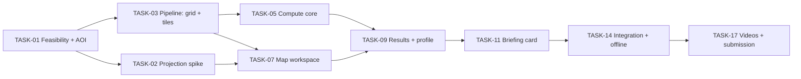

# 06 — High-Level Implementation Plan

| | |
| --- | --- |
| **Owner** | Delivery (this file owns order, dependencies and cut decisions) |
| **Date** | 2026-11-02 (Monday) |
| **Status** | Draft v1 — proposed |
| **Related** | Inputs: [01 PRD](01_Product_Requirements_Document.md) · [02 Technical](02_Technical_Requirements_Document.md) · [03 Flow](03_App_Flow_and_Diagrams.md) · [04 Design](04_Design_Brief.md) · [05 Schema](05_Backend_and_Database_Schema.md) · [Docs index](../README.md) |

---

## A. Planning assumptions

| Item | Value | Label |
| --- | --- | --- |
| Team size | 4 (rules allow 1–6) | **Assumed** |
| Roles | Data/GIS lead (Python, GDAL) · Compute engineer (TypeScript algorithms + tests) · Frontend engineer (OpenLayers/UI) · Design & story lead (UX, visuals, video, submission) | **Assumed** |
| Calendar | Pre-event: 2–12 Nov. Bangladesh hackathon: Fri 13 Nov 07:00 – Sat 14 Nov. 240-s local-judging video due **13 Nov 18:30**; final 30-s video upload **14 Nov 09:00** (run of show) with hard cut-off **12:00**; local judging from **11:00** | **Confirmed** (Participants Guide) |
| Event working time | ≈ 16–20 focused hours per person (ceremonies, mentor rounds, meals, sleep removed) → ≈ 70 person-hours | **Assumed** |
| Budget / infrastructure | $0; team laptops; ≥ 40 GB free disk on the data laptop; campus internet for downloads before the event | **Assumed** |
| Pre-event work allowed | Participants Guide explicitly recommends downloading datasets offline, setting up and testing the environment, preparing a public repository, slide template and demo script before day one. Whether application **code** may be written before 13 Nov is **Unresolved** — check spaceappschallenge.org/legal and ask the Local Lead | **Confirmed** / **Unresolved** |

Because of the unresolved rule, the plan has two tracks:

- **Track S (strict):** before 13 Nov only data acquisition, data preprocessing outputs, environment setup, design, and documentation; all app code written during the event.
- **Track P (permissive):** if allowed, the TASK-02 spike and TASK-05 compute core are also done before the event.

Effort ranges are person-hours, not promises.

---

## B. Milestones

| Milestone | Window | Exit criteria | Tasks |
| --- | --- | --- | --- |
| **M0 Feasibility & rules** | 2–5 Nov | AOI chosen inside DEM extent; DEM quality inside AOI judged (HiRISE vs. fill); site decision D-01 locked (Gale or Jezero); rules question answered | TASK-00, TASK-01, TASK-02 (Track P) |
| **M1 Data ready** | 5–10 Nov | `site-manifest.json` validates; tiles, grid, vectors, images in place; checksums recorded; offline load of assets verified with a static server | TASK-03, TASK-04 |
| **M2 Setup** | 10–12 Nov | Public repo with licence, environment files, design tokens, wireframe sketches, demo script draft; everyone can run the pipeline outputs locally | TASK-13 (tokens only), TASK-16 (skeleton) |
| **M3 Walking skeleton** | Day 1, by 12:30 | Map renders AOI in correct projection; clicking two points draws a routed line and an elevation profile (end-to-end slice) | TASK-07 (min), TASK-05 (min), TASK-09 (min) |
| **M4 MVP features** | Day 1, by 18:00 | All M-priority FRs functional at least roughly; 240-s video recorded with live demo by 18:30 | TASK-05…TASK-12 |
| **M5 Design integration & validation** | Day 1 19:00 → Day 2 06:00 | Visual system applied; accessibility pass; offline rehearsal ×2; usability test ×3 people | TASK-13, TASK-14, TASK-15 |
| **M6 Demo freeze & submission** | Day 2, 06:00 → 11:00 | Freeze at 06:00; 30-s video uploaded by 09:00; NASA page complete; repo public and tested in private window | TASK-16, TASK-17 |

Uncertain, high-impact dependencies (DEM quality, projection rendering, router speed) are all scheduled in M0–M3.

---

## C. Work packages

| Task | Objective | Related reqs | Deliverable | Depends on | Owner | Effort | Done when | Main risk → fallback |
| --- | --- | --- | --- | --- | --- | --- | --- | --- |
| **TASK-00** | Resolve rules + register | — | Written answer from rules page / Local Lead; team registered on NASA site and Bangladesh form | — | Story lead | 1–2 h | Answer recorded in repo `docs/ops/rules.md` | No answer → follow Track S |
| **TASK-01** | Feasibility: AOI, DEM quality, coverage checks | FR-01–03, FR-18, A-01 | `docs/ops/feasibility.md`: AOI bounds, DEM source assessment, THEMIS tile id, CRISM coverage yes/no, DEM datum from PDS3 label, decision D-01 | — | Data lead | 4–8 h | AOI inside DEM extent; hillshade shows HiRISE-scale texture across ≥ 80 % of AOI | DEM is CTX-quality → switch to Jezero (USGS M2020 TRN HiRISE DTM mosaic) same day |
| **TASK-02** | Spike: OpenLayers custom Mars projection + custom tile grid | FR-01, D-03 | Minimal page showing test tiles + correct scale bar | TASK-01 (projection string) | Frontend | 2–4 h | Scale bar matches a DEM-measured feature within 2 % | Fails in 2 h → ImageStatic fallback (02 §B) |
| **TASK-03** | Preprocessing pipeline | FR-01–03, FR-07, NFR-06 | `pipeline/` scripts → tiles (ortho 0.5 m; hillshade/slope/elevation/TI 2 m), routing grid 5 m (elevation, slope_p90, slope_max, flags, TI), `site-manifest.json`, `sources.lock.json`, `validate_manifest.py` | TASK-01 | Data lead | 8–14 h | Validator passes; sampled values match source rasters; total bundle ≤ 250 MB | Slow tiling → lower max zoom; grid too big → 10 m cells |
| **TASK-04** | Vectors, POIs and images | FR-04, FR-17 | `traverse.geojson`, `pois.geojson` (5–8 POIs), `images/`, credits list | TASK-01 | Story lead + Data lead | 4–8 h | Traverse aligns with tracks at ≥ 3 checkpoints; every POI has credit + position source | PLACES parsing slow → MMGIS JSON (cached, labelled unofficial) |
| **TASK-05** | Compute core: grid loader, sampling, A*, profile, time model, walkback, warnings | FR-03, FR-06–FR-10, NFR-02, NFR-06 | `web/src/compute/*` + Vitest suite (cases in 02 §D) | TASK-03 grid (synthetic grid OK for tests) | Compute | 8–12 h | Tests green; real-grid p95 3-stop route ≤ 2 s | Too slow → coarser grid / FastAPI alternative (02 §A.3) |
| **TASK-06** | Mars24 solar functions + radiation estimate | FR-11, FR-12 | `compute/mars24.ts`, `compute/radiation.ts` + tests vs. `marstime` | — | Compute | 3–5 h | 3 reference timestamps within tolerance; radiation examples exact | Port bug → precompute LTST/sun table for demo dates in pipeline with `marstime` |
| **TASK-07** | App shell + map workspace + layers panel + inspector | FR-01–03, FR-15–17, NFR-11 | Routes `#/`, `#/map`; SCR-01, SCR-02, SCR-03, inspector | TASK-02, TASK-03 | Frontend | 6–10 h | All layers toggle; inspector values match grid | Projection issues → ImageStatic |
| **TASK-08** | Plan panel + waypoint editing | FR-05, FR-06 | SCR-04 with validation, snapping, reorder, undo | TASK-05 (sample API) | Frontend | 4–6 h | All E.3 validation rules enforced in UI | Drag complex → buttons only |
| **TASK-09** | Results panel + profile | FR-07–FR-10 | SCR-05, profile ↔ map linking | TASK-05 | Frontend + Compute | 4–6 h | Partial/over-limit states render per 03 §D | Linking slips → profile without linking |
| **TASK-10** | POI detail + Conditions panel | FR-04, FR-11, FR-12 | SCR-06, SCR-07 | TASK-04, TASK-06 | Frontend | 3–5 h | Images with credits; daylight warning appears for pre-dawn start | — |
| **TASK-11** | Briefing card + JSON export | FR-14 | SCR-08 print CSS, export | TASK-09 | Design lead + Frontend | 3–5 h | One-page print in Chrome; export reproduces `plan_hash` | Map snapshot hard → static AOI thumbnail with route drawn as SVG |
| **TASK-12** | Sources & Methods + provenance attributes | FR-15, NFR-05 | SCR-09; `data-provenance` on every metric; DOM test | TASK-03 (sources), TASK-07 | Story lead | 2–4 h | Automated check finds no unlabelled metric | — |
| **TASK-13** | Visual system + accessibility | NFR-04 | Tokens (04 §C), patterns, focus styles, keyboard map controls, axe scan | TASK-07 | Design lead | 3–6 h | axe: 0 serious issues; keyboard-only run of core scenario | Time short → keep tokens + focus + patterns, drop coach marks |
| **TASK-14** | Integration + offline hardening + fault tests | FR-16, NFR-01, NFR-10, NFR-03, NFR-08, NFR-09 | Offline rehearsal log; fault-injection results | TASK-07…12 | Compute | 3–5 h | Two clean offline rehearsals; fault cases in 02 §F.1 pass | — |
| **TASK-15** | Usability test | PRD §B | Notes from 3 non-team users; fixes | TASK-14 | Design lead | 2–3 h | ≥ 2 of 3 finish briefing in ≤ 5 min | — |
| **TASK-16** | Submission package | Scoring items, NFR-07 | README, Apache-2.0 LICENSE, `docs/AI_USE.md`, credits, NASA project page fields, repo public | TASK-12 | Story lead | 2–4 h | Repo link opens in a private window; every page field filled | — |
| **TASK-17** | Videos | Judging | 240-s (Day 1 18:30) and 30-s (Day 2 09:00) with English subtitles, datasets named on camera, no under-18 likeness | M4 / M6 | Story lead | 3–5 h | Uploaded; links tested | Live demo fails → screen recording from rehearsal |
| **TASK-18** | Desirables (only after freeze criteria met early) | FR-13, FR-18–20 | Any of: CRISM layer, REMS context, O₂ estimate, local save | Freeze criteria | Any | 2–6 h each | Feature labelled and tested | Skip |

---

## D. Delivery strategy

### D.1 Critical path

### D.2 Concurrent work

| Stream | Can run in parallel with |
| --- | --- |
| TASK-04 POIs/images | TASK-03 pipeline |
| TASK-06 Mars24/radiation | Everything (no data dependency) |
| TASK-05 compute on a **synthetic grid** | TASK-03 (swap in real grid later) |
| TASK-13 design tokens, TASK-16 docs skeleton | All build tasks |

### D.3 Integration checkpoints

| When | Checkpoint |
| --- | --- |
| 5 Nov | D-01 site decision; AOI frozen |
| 10 Nov | Manifest validates; assets load from static server offline |
| 12 Nov | Full pipeline re-run from clean checkout reproduces checksums |
| Day 1 12:30 | **Walking skeleton** (M3) — go/no-go on auto-routing |
| Day 1 17:30 | Demo path works end-to-end for the 240-s recording |
| Day 2 06:00 | **Freeze** |

### D.4 Cut list (cut in this order when behind)

1. All desirables (TASK-18).
2. Coach marks, light theme, tablet drag.
3. Free placement → POIs-only stops.
4. `LOW_TI` warnings → keep TI as a display layer only.
5. Live Mars24 → precomputed sun table for the demo date.
6. **Auto-routing → manual polyline + validation** (user draws legs; tool checks slope/hazards and computes profile and time). *Keep this fallback implementable in < 2 h by reusing the profile and warning code.*
7. Tiled layers → ImageStatic images.

Never cut: provenance labels, disclaimer, offline mode, briefing card.

### D.5 Data and service fallbacks

| Primary | Fallback |
| --- | --- |
| Gale merged DEM (HiRISE-quality in AOI) | Jezero M2020 TRN HiRISE DTM mosaic (USGS) |
| Colour HiRISE COG | Grayscale 25 cm ortho window / Mars Trek HiRISE tiles cached |
| THEMIS quantitative TI | THEMIS Day IR 100 m (qualitative) |
| PDS PLACES traverse | MMGIS JSON cached once (labelled unofficial) |
| Mars Rover Photos API | **Not used** (archived) — images saved manually from NASA raw-image/photojournal pages |
| Browser router | FastAPI + scikit-image least-cost path |

### D.6 Demo freeze criteria (Day 2 06:00)

- Core scenario (PRD §E) runs offline twice in a row without intervention.
- All Vitest suites green; manifest validator green.
- No console errors on the demo path.
- Briefing prints on one page.
- Repo builds from a clean clone with documented commands.

### D.7 Definition of done (per feature)

Requirement's acceptance criteria met · unit tests (compute) or manual test note (UI) committed · provenance label present · keyboard reachable · works offline · credited sources listed in SCR-09.

---

## E. First concrete actions (today → 5 Nov)

1. **TASK-00:** read spaceappschallenge.org/legal for pre-event building rules; message the Dhaka Local Lead; confirm all members registered (NASA + Bangladesh form).
2. **TASK-01 (data lead):** download the 1 m Gale DEM (3.6 GB) on campus internet and open its PDS3 label; generate a hillshade of the boxwork area and compare texture with the listed HiRISE stereo pairs; propose AOI bounds from Curiosity's 2025 traverse.
3. **TASK-01:** check whether the colour HiRISE COG and a THEMIS quantitative TI tile cover the AOI (read windows via GDAL `/vsicurl/` to avoid full downloads).
4. **Decide D-01 by 5 Nov:** Gale boxwork if DEM passes, else Jezero.
5. **Design lead:** sketch SCR-02 and SCR-08 on paper from 04 §F; draft the 240-s demo script around PRD §E.
6. **Compute engineer (Track P only):** implement A* + time model against a synthetic grid with the test cases in 02 §D.

## Unresolved items owned by this document

| ID | Item | Owner | Due |
| --- | --- | --- | --- |
| U-12 | Pre-event code allowed? (Track S vs. P) | Story lead | 4 Nov |
| U-13 | Actual team size and skills | Team | 3 Nov |
| U-14 | Physical venue vs. virtual (affects Wi-Fi assumptions only; demo is offline regardless) | Story lead | 10 Nov |
