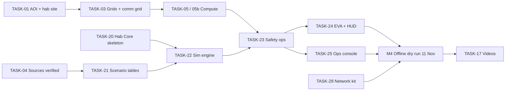

# 06 — High-Level Implementation Plan

| | |
| --- | --- |
| **Owner** | Delivery (this file owns order, dependencies and cut decisions) |
| **Date** | 2026-11-05 (Thursday) |
| **Status** | Draft v2.2 — 8–10 h/day capacity, extra dry run on 10 Nov (2026-11-05); v2.1 re-dated for an 11 Nov dry run; v2 superseded v1 (2026-11-02) |
| **Related** | [01 PRD](01_Product_Requirements_Document.md) (tiers T0–T2, killer demo §E.1) · [02 Technical](02_Technical_Requirements_Document.md) · [03 Flow](03_App_Flow_and_Diagrams.md) · [04 Design](04_Design_Brief.md) · [05 Schema](05_Backend_and_Database_Schema.md) · [Docs index](../README.md) |

## Change log v1 → v2

Team 4 → **6**; scope = surface operations system in three tiers; new tasks TASK-20…TASK-30; milestone added for the organizer guide's **12 Nov full offline dry run**; cut list rewritten around the killer demo.

**v2 → v2.1 (2026-11-05).** Coding starts Fri 6 Nov (planning review on 5 Nov). The team's own target for the full offline dry run (M4) moves from 12 Nov to **Wed 11 Nov**, and 12 Nov becomes a buffer day (M4b: fixes, second dry run, fallback recording). Scope is not cut: the team decided on 5 Nov not to cut anything, so §D.4 is a contingency list only. Added the same day: **TASK-31** stop task list (FR-50, 6–9 person-hours), TASK-11 briefing card moved from the event to pre-event, and per-person assignments in §A.2. Later the same day the full-screen EVA map and shared map controls became Tier 1 (product & systems lead's decision): +3–4 h on TASK-24 and +2–3 h on TASK-07 (Proposed estimates, confirm at kickoff). Rover tasking (TASK-29, 4–8 h) also moved from Tier 2 into the pre-event plan (Mishkat + Saba), so the relay moment is in the dry run and the 240-s video. Task windows in §C, the checkpoints in §D.3 and the schedule in §F are re-dated to match; the capacity check is in §A.

**v2.1 → v2.2 (2026-11-05).** The team committed to **8–10 h/day each**. Capacity rises from about 180 to **288–360 person-hours** over the 6 build days, which covers the pre-event plan with 68–217 person-hours spare. The spare time goes, in order, to: a first dry run on the evening of **Tue 10 Nov** (M3b), so 11 Nov is the second attempt and 12 Nov the third; the usability test (TASK-15) moved from the event to 10–11 Nov; and Tier 2 (TASK-18) allowed before the event, but only after M3 passes. The binding constraints are now the dependencies in §D.3, not hours.

---

## A. Planning assumptions

| Item | Value | Label |
| --- | --- | --- |
| Team | 6: Obidit Islam (owner), Sadman Shaharier Mahim, Saba Atharique, Mishkat Ahmed Khan, Anjim Hossain, Ridita Alam ([ops/team.md](../ops/team.md)) | **Confirmed** |
| Roles | Six owned roles R1–R6 (§A.1), proposed from the skills in [ops/team.md](../ops/team.md); sign-off at the 6 Nov kickoff | **Proposed** (`TODO(decision)`) |
| Calendar | Today Thu 5 Nov (final plan review). Coding starts Fri 6 Nov. Pre-event build: 6–11 Nov; **team dry run Wed 11 Nov**; 12 Nov buffer. Bangladesh hackathon: Fri 13 Nov 07:00 → Sat 14 Nov. 240-s local video **13 Nov 18:30**; 30-s global video **14 Nov 09:00** (hard cut-off 12:00); local judging from 11:00 | **Confirmed** (Participants Guide; organizer Build Guide) |
| Pre-event capacity | 6 build days (6–11 Nov) × 6 people × **8–10 h/day = 288–360 person-hours**; the 12 Nov buffer adds 48–60. Total effort in §C excluding Tier 2 (TASK-18) is **160–245 person-hours** (TASK-00, TASK-29 and TASK-31 included); §A.2 assigns **145–223** to the pre-event days, leaving **≈ 65–215 person-hours** of slack before the buffer (worst case: lowest capacity against highest effort). Per person the heaviest load (Ridita, 28–41) takes 2.8–5.1 working days. Caveats: §C ranges are estimates, not measurements, and output per hour drops over 6 long days, so treat the slack as an upper bound. Hours no longer limit the plan; the dependencies in §D.3 do (DEM and AOI, protocol freeze on 7 Nov, scenario data on 9 Nov, all-hands integration) | **Assumed** — 8–10 h/day committed by the team on 5 Nov; classes and exams may reduce it for some people |
| Event capacity | ≈ 16–18 focused h/person ≈ **100 person-hours** | **Assumed** |
| Pre-event building | **Track P**: the Dhaka Local Lead allowed pre-event application code on 2026-11-04 ([ops/rules.md](../ops/rules.md)); the organizer Build Guide expects a full offline dry run by 12 Nov; the team targets 11 Nov (M4). Re-check against the 2026 guides on 13 Nov | **Confirmed** |
| Hardware | ≥ 3 laptops (one ≥ 16 GB RAM for the Hab Core + data), ≥ 2 phones (one Android, one iOS if possible), **one travel router owned by the team** (U-21) | **Assumed** |
| Budget | $0 runtime; router if not owned (~BDT 2–3k) | **Assumed** |

### A.1 Roles

**Leadership (Proposed — sign-off at kickoff, `TODO(decision)`):**

| Position | Person | Responsibilities |
| --- | --- | --- |
| **Team lead** | Obidit Islam | Overall lead and team owner: registration, rules and Local Lead contact, final calls, submission, data pipeline (R1) |
| **Product & systems lead** | Sadman Shaharier Mahim | Conceived and directed the v2 surface-ops reframe (Hab Core, EVA tablet/HUD, rover and vehicle tasking, replayed solar storm, Exploration Zone framing, design direction); owns the killer-demo story and the coherence of specs 01–06; architecture calls between packages; leads the Hab Core (R4) |

| Role | Proposed lead (support) | Owns | Packages / folders | Primary tasks |
| --- | --- | --- | --- | --- |
| **R1 Data & GIS** | Obidit (Mishkat) | Every byte of site data and scenario tables | `pipeline/`, `data/sites/`, `scenarios/*/` | TASK-01, 03, 21 (data half) |
| **R2 Compute** | Mishkat (Anjim) | All numbers | `packages/compute/` + tests | TASK-05, 05b, 06 |
| **R3 Map & Planner UI** | Saba | The map component (shared by planner, ops, EVA) and the planner | `apps/web/src/map`, `apps/web/src/ui/screens/scr0*` | TASK-02, 07–11 |
| **R4 Hab Core** | Sadman (Anjim) | Server, protocol, engine, network kit | `apps/hab-core/`, `packages/protocol/` | TASK-20, 22, 23, 26, 28 |
| **R5 EVA & Ops UI** | Ridita (Saba) | Suit tablet, HUD, ops console, report view | `apps/web/src/ui/screens/scr1*`, `apps/web/src/net/` | TASK-24, 25, 27 (UI) |
| **R6 Science, Story & Design** | Sadman for the demo story and script; Obidit for submission and the project page; Ridita for the design system | POI science content, EZ framing, design system, usability, videos, submission | `docs/`, `data/sites/*/vectors`, `apps/web/src/ui/styles/` | TASK-00 (done), 04 (content), 12, 13, 15, 16, 17, 30 |

Anjim floats between R2 and R4 because compute v2 (TASK-05b) and the engine (TASK-22) are the two heaviest packages.

Pairing rule: R2↔R4 own `packages/protocol` jointly; R3↔R5 share the map component; R1↔R6 co-own POIs (R1 geometry, R6 content).

### A.2 Assignment by person *(Proposed 2026-11-05 — sign-off at the 6 Nov kickoff)*

Each task's effort comes from §C; where two people share a task, the range is split between them. Pre-event load per person is 22–41 person-hours, about 2.2–5.1 working days at 8–10 h/day, so everyone's pre-event tasks can be finished before the 11 Nov dry run (capacity row in §A). "Coding agent" records each person's tool (Claude Code, Codex, Gemini CLI or more than one); the shared rules for every tool are in [ops/agentic-workflow.md](../ops/agentic-workflow.md).

| Person | Position | Pre-event tasks (person-hours) | Pre-event total | Event tasks | Event total | Coding agent |
| --- | --- | --- | --- | --- | --- | --- |
| Obidit Islam | Team lead · R1 Data & GIS | TASK-01 5–8, TASK-03 10–16, TASK-21 (data) 6–9, TASK-30 1–2 | 22–35 | TASK-16 3–4, TASK-17 (helper) 1–2 | 4–6 | `TODO(decision)` |
| Mishkat Ahmed Khan | R2 Compute lead · R1 support | TASK-05 8–12, TASK-06 3–5, TASK-05b (half) 6–9, TASK-04 (data half) 3–5, TASK-12 3–4, TASK-29 (compute + engine) 2–4 | 25–39 | — | 0–0 | `TODO(decision)` |
| Anjim Hossain | R2/R4 float · integration lead | TASK-05b (half) 6–9, TASK-23 (compute half) 3–5, TASK-26 4–6, TASK-28 3–4, TASK-14 (lead) 4–6, TASK-31 (engine) 2–3 | 22–33 | — | 0–0 | `TODO(decision)` |
| Sadman Shaharier Mahim | Product & systems lead · R4 Hab Core · demo story | TASK-20 6–8, TASK-22 10–14, TASK-23 (Hab Core half) 3–5, TASK-21 (script) 2–3, TASK-04 (content half) 3–5, TASK-31 (task content) 1–2 | 25–37 | TASK-17 3–4 | 3–4 | `TODO(decision)` |
| Saba Atharique | R3 Map & Planner UI | TASK-02 2–4, TASK-07 8–13, TASK-08 4–6, TASK-09 4–6, TASK-11 3–5, TASK-29 (UI) 2–4 | 23–38 | TASK-10 3–4, TASK-27 (half) 2–3 | 5–7 | `TODO(decision)` |
| Ridita Alam | R5 EVA & Ops UI · design system | TASK-13 4–6, TASK-24 11–16, TASK-25 8–12, TASK-31 (UI) 3–4, TASK-15 2–3 | 28–41 | TASK-27 (half) 2–3 | 2–3 | `TODO(decision)` |
| **Team** | | | **145–223** | | **14–20** | |

TASK-14 (integration) and the M4 dry runs are all-hands on 11–12 Nov even though Anjim leads TASK-14. TASK-18 (Tier 2) has no owner: whoever has finished their own tasks picks up an item, and only after M3 passes on 10 Nov.

---

## B. Milestones

| Milestone | Window | Exit criteria | Gate for |
| --- | --- | --- | --- |
| **M0 Kickoff & feasibility** | 5–6 Nov | Roles signed off; v2 restructure merged; U-12 ✓ (Track P, 4 Nov); AOI and **hab position** chosen inside DEM extent; source checks started (U-15, U-18) | Everything |
| **M1 Spikes** | 6–7 Nov | TASK-02 projection renders with correct scale; **TASK-20** two phones receive a Hab Core broadcast ≤ 500 ms on the travel router; **TASK-05b** full-grid Dijkstra ≤ 2 s on the weakest laptop | Architecture locked (else fallbacks in §D.5) |
| **M2 Data & scenario ready** | 6–9 Nov | Manifest validates; grids incl. `comm_hab`; `earth_link.json`, dose series and `scenario.json` for sol 4190 built and checksummed | Tier 1 build |
| **M3 Walking skeleton (pre-event)** | by 10 Nov | Headless replay of the storm scenario writes a stable event log; planner computes a 3-stop route; ops map shows crew moving; EVA shows margins | Tier 1 polish |
| **M3b First dry run** | 10 Nov, evening | Killer demo once end to end on 3 devices over the router; every failure logged as an issue for 11 Nov | M4 |
| **M4 Offline dry run** | **11 Nov** | Killer demo (01 §E.1) runs on 3 devices over the travel router, WAN unplugged, **3 times in a row**; fallback screen recording saved | Event plan |
| **M4b Buffer** | 12 Nov | M4 regressions fixed; dry run repeated twice; final fallback recording; network kit packed (organizer's 12 Nov dry-run deadline met with a day to spare) | Event plan |
| **M5 Event: demo path green** | Day 1 by 12:30 | Same as M4 at the venue on the team's router; any regressions fixed | 240-s recording |
| **M6 Event: 240-s video** | Day 1 by 18:30 | Video uploaded with datasets named on camera | — |
| **M7 Polish & Tier 2** | Day 1 19:00 → Day 2 05:00 | Tier 1 exit criteria met before any Tier 2 work; design pass; 3-person usability test | — |
| **M8 Freeze & submit** | Day 2 06:00 → 09:00 | Freeze 06:00; 30-s video by 09:00; project page complete; repo tested in a private window | Judging 11:00 |

**Tier gates (from 01 §C):** Tier 1 work starts only after Tier 0 routing works on the real grid (M1/M2). Tier 2 work starts only after M4 passes.

---

## C. Work packages

Effort is person-hours (ranges, not promises). **P** = pre-event (Track P), **E** = event.

### C.1 Retained from v1 (planning spine, Tier 0)

| Task | Objective | Owner | When | Effort | Done when | Risk → fallback |
| --- | --- | --- | --- | --- | --- | --- |
| **TASK-00** | Rules, registration, U-12 in writing | R6 | **Done 4 Nov** (T00.06 venue still open) | 1–2 | Answer in `docs/ops/rules.md`; all 6 registered | — |
| **TASK-01** | Feasibility: AOI, DEM quality, coverage; **choose hab site** (flat, passable, near science + resource stops, with interesting comm shadows behind ridges) | R1 | P 6–7 Nov | 5–8 | `docs/ops/feasibility.md` with AOI bounds, hab position, DEM assessment | DEM poor → Jezero data fallback (keep design) |
| **TASK-02** | OpenLayers Mars projection spike | R3 | P 6–7 Nov | 2–4 | Scale bar within 2 % | ImageStatic fallback |
| **TASK-03** | Pipeline: tiles, routing grid, **`comm_hab` viewshed grid** | R1 | P 6–9 Nov | 10–16 | Validator passes; viewshed matches `gdal_viewshed` at 5 points | Grid too big → 10 m |
| **TASK-04** | POIs, images, **EZ content**, source verification (U-15 RAD series, U-16 EZ citation, U-17 dust record, U-18 SPICE kernels) | R1 + R6 | P 6–9 Nov | 6–10 | 6–8 POIs with `stop_type`, objective, evidence, credit; sources table complete | RAD series missing → digitise figure (02 §C.5 L9) |
| **TASK-05** | Compute core v1: sampling, A*, profile, time model, walkback, warnings | R2 | P 6–9 Nov | 8–12 | v1 tests green; 3-stop p95 ≤ 2 s | Coarser grid |
| **TASK-06** | Mars24 + background radiation | R2 | P 7–9 Nov | 3–5 | 3 reference timestamps vs. `marstime` | Precomputed sun table |
| **TASK-07** | App shell, map workspace, layers, inspector; shared map controls (+ / − / FIT, drag, wheel) for planner and ops (added 5 Nov, +2–3 h) | R3 | P 7–9 Nov | 8–13 | Layers toggle; inspector matches grid | ImageStatic |
| **TASK-08** | Plan panel + waypoint editing (+ haven rule input) | R3 | P 8–10 Nov | 4–6 | Validation rules enforced | Buttons only |
| **TASK-09** | Results panel + profile (+ haven and comm bands) | R3 + R2 | P 9–10 Nov / E | 4–6 | Partial/over-limit states render | No linking |
| **TASK-10** | POI detail (stop types) + conditions panel | R3 | E | 3–4 | Images with credits | — |
| **TASK-11** | Briefing card + export → **`PUBLISH_PLAN` to Hab Core** | R3 | P 10–11 Nov | 3–5 | Plan appears in ops; `plan_hash` stable; each stop lists its tasks (FR-50) | Static thumbnail |
| **TASK-12** | Sources & methods + provenance (6 classes) | R6 | P/E | 3–4 | DOM test: no unlabelled number in any role view | — |
| **TASK-13** | Design system + **HUD tokens** + a11y | R6 | P 6–9 Nov | 4–6 | Tokens applied; HUD contrast ≥ 7 : 1 | Keep tokens + focus + patterns only |
| **TASK-14** | Integration, offline hardening, fault tests | R4 (lead) + all | P 10–12 Nov / E | 4–6 | 02 §F.1 + §F.2 fault cases pass | — |
| **TASK-15** | Usability test (3 non-team users) incl. HUD glance + summon without instruction | R6 | P 10–11 Nov (moved from the event, v2.2) | 2–3 | ≥ 2 of 3 pass each criterion (01 §B.2) | — |
| **TASK-16** | Submission package: README, LICENSE, AI_USE, credits, project page fields | R6 | P/E | 3–4 | Private-window check passes | — |
| **TASK-17** | Videos: 240 s and 30 s (§G) | R6 + one helper | E | 4–6 | Uploaded, subtitled, datasets named, no under-18 likeness | Use M4 recording |
| **TASK-18** | Tier 2 desirables (CRISM, REMS, dust, SVF refuge, Earth view) | Any | After M3 passes (P 10–12 Nov), cheapest first (REMS, dust); otherwise E after the M7 gate | 2–6 each | Labelled and tested | Skip |

### C.2 New in v2 (surface ops, Tier 1 unless marked)

| Task | Objective | Owner | When | Effort | Done when | Risk → fallback |
| --- | --- | --- | --- | --- | --- | --- |
| **TASK-05b** | Compute v2: haven fields, rendezvous, dynamic viewshed, link graph, Earth delivery rule, event dose integral, contingency ranking (02 §D.8–D.15) | R2 | P 6–10 Nov | 12–18 | Synthetic tests green; benchmarks within NFR-02 | Planning approximation everywhere; static hab coverage only |
| **TASK-20** | Hab Core skeleton: Fastify static + `/ws`, `packages/protocol`, HELLO/SNAPSHOT/DELTA/EVENT, reconnect, heartbeat | R4 | P 6–7 Nov | 6–8 | **Spike:** 2 phones + 1 laptop get broadcasts ≤ 500 ms on the router | Single-laptop multi-window mode |
| **TASK-21** | Scenario builder: SPICE `earth_link.json`, DONKI timeline, RAD dose series, `scenario.json`; final EVA start time and demo numbers | R1 (data) + R6 (script) | P 6–9 Nov | 8–12 | Scenario loads; timeline table reproduces source times; final script numbers written into 01 §E.1 | Digitised dose curve; fixed light time for the date |
| **TASK-22** | Simulation engine: clock, crew motion, consumables, alert evaluation, event log, persistence, headless replay | R4 | P 7–10 Nov | 10–14 | Two runs ⇒ same log hash; 60× full run completes | Drop consumables detail to O₂ only |
| **TASK-23** | Safety ops in Hab Core: haven per tick, `SUMMON_VEHICLE` + rendezvous, contingency options, `APPROVE_OPTION`, `ABORT` | R4 + R2 | P 8–10 Nov / E | 6–10 | Killer demo steps 0:30–1:10 work headless | Rendezvous = vehicle drives to crew's nearest vehicle-passable cell |
| **TASK-24** | EVA client + HUD mode (01 FR-32/33), including the full-screen map (04 §E.5; added 5 Nov, +3–4 h) | R5 | P 7–11 Nov / E | 11–16 | 3-s glance test passes; actions ≤ 2 taps + confirm; link-lost state | HUD only, no map |
| **TASK-25** | Ops console: shared map with crew/assets/coverage, alerts, options approval, clock control, join QR | R5 (+ R3 map) | P 8–11 Nov / E | 8–12 | Ops can run the whole demo without a terminal | Clock control via keyboard shortcuts |
| **TASK-26** | Links: L-surf link graph + `LINK_STATE`, comm-shadow warnings, Earth link widget and delayed queue | R4 + R2 | P 9–11 Nov / E | 4–6 | Shadow on the demo route appears and clears; forecast arrives at the computed time | Static hab coverage + fixed delay |
| **TASK-27** | Event log view, post-EVA report, **replay mode** for GitHub Pages | R5 + R3 | E | 4–6 | Report ≤ 2 pages; Pages link replays the recorded log | Report = printed log table |
| **TASK-31** | Stop task list (FR-50): `StopTask` in protocol and scenario schema, `UPDATE_STOP_TASK`/`ADD_STOP_TASK`, auto-complete for simulated crew, drop on plan revision; EVA list + ops progress; task text per stop | R5 (UI) + R4 (engine) + R6 (content) | P 8–10 Nov | 6–9 | Tap on tablet shows on ops ≤ 500 ms; abort drops open tasks; report counts match the log | Ops view-only (no `ADD_STOP_TASK`) |
| **TASK-28** | Network kit & rehearsal: router config, static IP, QR join, device matrix, venue checklist | R4 | P 8–11 Nov | 3–4 | M4 passes; checklist in `docs/ops/demo-kit.md` | Single-laptop mode |
| **TASK-29** | Robotic rover tasking: SCOUT, CARRY, RELAY, RETURN (moved to Tier 1 on 5 Nov) | R2 (rover routing, relay coverage, Hab Core handlers with R4) + R3 (SCR-15 tasking on the map, EVA and ops entry points) | P 9–10 Nov | 4–8 | RELAY closes the demo shadow; queue shows ETA and battery | RELAY only |
| **TASK-30** | Score-sheet single points on day one of the build: challenge named, repo public, page drafted; `docs/AI_USE.md` kept current | R6 | P 5–6 Nov, then continuous | 1–2 | All three single points verifiable | — |

---

## D. Delivery strategy

### D.1 Critical path

The **planner (TASK-07…11) is off the critical path** for the killer demo: the scenario file carries a precomputed plan, so the storm demo works even if the planner UI is late. The planner remains essential for the E.2 segment and for Tier 0 scoring.

### D.2 Parallel streams

| Stream | Starts on | Unblocked by |
| --- | --- | --- |
| R2 compute on **synthetic grids** | 6 Nov | Nothing (swap real grid in on 9 Nov) |
| R4 Hab Core on a **fake scenario** (straight-line route, stepped dose curve) | 6 Nov | Nothing |
| R5 EVA/ops on **mock WebSocket fixtures** from `packages/protocol` | 7 Nov | Protocol types (TASK-20, 7 Nov) |
| R3 map/planner | 6 Nov | Projection string (TASK-01) |
| R1 data | 5 Nov (DEM download tonight) | — |
| R6 content, design, video script | 5 Nov | — |

### D.3 Integration checkpoints

| When | Checkpoint |
| --- | --- |
| Thu 5 Nov | Final plan review; DEM download started; repo branch pushed |
| Fri 6 Nov | Kickoff: roles signed off, AOI and hab site proposal; coding starts |
| Sat 7 Nov | `packages/protocol` v0 frozen (types for SNAPSHOT/DELTA/EVENT/COMMAND); **M1 spikes** go/no-go in the evening: projection, LAN broadcast, Dijkstra speed |
| Mon 9 Nov | **M2** manifest + scenario tables validated |
| Tue 10 Nov | **M3** headless replay stable; all role views connected. Evening: **M3b** first dry run; usability test (TASK-15) starts |
| Wed 11 Nov | **M4** offline dry run ×3 on 3 devices (second attempt); record fallback video; usability test findings fixed |
| Thu 12 Nov | **M4b** buffer: fix regressions, dry run ×2, final fallback recording, pack the network kit |
| Day 1 12:30 | **M5** demo path green at venue |
| Day 1 17:30 | Rehearse and record 240 s |
| Day 2 06:00 | **Freeze** |

### D.4 Cut list (cut in this order when behind)

Mirrors the organizer guide's rule — drop scope before the killer moment.

**Not planned.** On 5 Nov the team decided not to cut scope (6 people, 6 build days). This list is a contingency only: it is invoked jointly by the team lead and the product & systems lead if M3 (10 Nov) is missed, starting from item 1.

1. All Tier 2 (TASK-18): terrain refuge, Earth view, CRISM, REMS, dust.
2. Rover tasking down to RELAY only (TASK-29 fallback), keeping the relay moment.
3. Second crew device (EV2 stays simulated and visible on ops only).
4. Planner polish: coach marks, drag, free placement → POI-only stops.
5. Dynamic relay viewshed → static hab coverage only.
6. Exact rendezvous → vehicle drives to the crew's nearest vehicle-passable cell.
7. Live planner routing in the demo → scenario's precomputed plan.
8. Multi-device → single-laptop multi-window demo.
9. Live engine in the video → headless replay rendered on ops.

**Never cut:** the storm moment (alert → options → summon → shelter), real replayed event data, provenance labels, prototype disclaimer, no-internet operation, the three single score points.

### D.5 Data and service fallbacks

**Data (v1, retained):**

| Primary | Fallback |
| --- | --- |
| Gale merged DEM (HiRISE-quality in AOI) | Jezero M2020 TRN HiRISE DTM mosaic (USGS) |
| Colour HiRISE COG | Grayscale 25 cm ortho window / Mars Trek HiRISE tiles cached |
| THEMIS quantitative TI | THEMIS Day IR 100 m (qualitative) |
| PDS PLACES traverse | MMGIS JSON cached once (labelled unofficial) |
| Mars Rover Photos API | **Not used** (archived) — images saved manually from NASA raw-image/photojournal pages |
| Browser router | FastAPI + scikit-image least-cost path |

**Spikes (v2):**

| Spike fails | Fallback | Cost |
| --- | --- | --- |
| Projection (TASK-02) | ImageStatic per layer (v1) | Lower zoom detail |
| LAN broadcast (TASK-20) | Single-laptop mode; phones only shown in video via screen mirroring | Less physical demo |
| Dijkstra ≤ 2 s (TASK-05b) | 10 m grid for all fields; precompute `T_hab` in the pipeline | Coarser haven values |
| RAD series (U-15) | Digitised published figure | Label changes to "digitised" |
| SPICE kernels (U-18) | Light time from DE ephemeris only; relay passes from a published MRO pass schedule pattern, labelled assumed | Weaker validity on passes |

### D.6 Demo freeze criteria (Day 2 06:00)

- Killer demo runs offline on the router 2× consecutively at the venue.
- Headless replay hash matches the committed reference.
- All Vitest suites and the manifest validator green.
- No console errors on any role view along the demo path.
- Briefing card and post-EVA report print correctly.
- Repo builds from a clean clone with the README commands.

### D.7 Definition of done (per feature)

Acceptance criteria met · compute tests or UI test note committed · provenance class present on every number · works with WAN unplugged · keyboard (planner/ops) or ≤ 2-tap (EVA) operable · sources listed in Sources & methods · AI use (if any) logged in `docs/AI_USE.md`.

### D.8 Track S (kept for reference — not needed: Track P confirmed 4 Nov)

If the 13 Nov guides restrict pre-event code after all, pre-event becomes: data pipeline outputs, scenario tables, POI content, design files, docs, network kit, demo script. At the event, build in this order: Hab Core + engine on precomputed plan → ops console → EVA HUD → alert + summon (rendezvous fallback) → planner last. Tier 0 planner shrinks to "show the precomputed plan + profile + briefing card."

---

## E. First concrete actions (today → 6 Nov)

1. **R4 (Sadman), tonight:** push `v2-surface-ops` to GitHub and open the PR into `main`; everyone clones it and runs `make setup` before the kickoff ([ops/agentic-workflow.md](../ops/agentic-workflow.md) §B).
2. **R1, tonight:** start the downloads in [ops/data-downloads.md](../ops/data-downloads.md) §B (the 3.6 GB DEM first) on campus internet; open the PDS3 label; propose AOI and hab position at the kickoff.
3. **Everyone, kickoff Fri 6 Nov:** sign off roles (§A.1), confirm the 8–10 h/day commitment and who has classes or exams that week (§A), agree which task each person runs through the ECC pipeline first.
4. **R4:** Hab Core skeleton (TASK-20); confirm someone owns or can borrow a travel router (U-21).
5. **R2:** port the v1 A* test cases to `packages/compute` on a synthetic grid; write the Dijkstra benchmark.
6. **R5 + R6:** HUD, EVA tablet and ops console start from the design prototype in [`docs/design/prototype/`](../design/mockup-handoff.md) (U-25: handoff landed 5 Nov; task list still to add, U-47); agree the three HUD numbers (time to haven, O₂ margin, next stop). Run `/impeccable init` once so the design skill reads 01 and 04.
7. **Everyone:** read 01 §E.1 (killer demo) — every task should serve that 90 seconds first.

---

## F. Pre-event schedule (5–12 Nov)

| Day | R1 Data | R2 Compute | R3 Map/Planner | R4 Hab Core | R5 EVA/Ops | R6 Science/Story |
| --- | --- | --- | --- | --- | --- | --- |
| **Thu 5** | Start downloads ([data-downloads.md](../ops/data-downloads.md)) | Read 02 §D | Read 03/04 v2 | Final plan review; push branch | Read 04; prototype review | TASK-30; kickoff agenda |
| **Fri 6** | AOI + hab site proposal; pipeline: clip, reproject | A* on synthetic grid | Projection spike start; `apps/web` builds | Hab Core skeleton (TASK-20) | HUD wireframe from the prototype | Kickoff; POI shortlist (science/resource); source checks U-15–U-18 |
| **Sat 7** | Slope, grids + tiles | Dijkstra field + benchmark | Projection spike done; map workspace | Protocol v0 frozen; LAN spike with phones | EVA screens on mock fixtures | Design + HUD tokens; **M1 go/no-go** |
| **Sun 8** | `comm_hab` viewshed; SPICE tables | Haven + rendezvous | Layers + inspector | Engine: clock, crew motion | EVA actions + link-lost state; ops console map | Demo script v1; POI content |
| **Mon 9** | DONKI + RAD tables; `scenario.json` + validator (**M2**) | Viewshed + link graph; Earth delivery + dose integral | Plan panel | Engine: alerts, log, persistence; stop-task events (TASK-31) | Ops alerts + options; stop task list on EVA + ops (TASK-31) | Sources & methods content |
| **Tue 10** | Fix data issues | Contingency ranking; real-grid tests; perf | Results + profile | Safety ops wiring; headless replay (**M3**) | Clock control, QR join; usability test (TASK-15) | Video storyboard; venue checklist |
| **Tue 10 evening** | All hands: **M3b** first dry run on 3 devices; log every failure | | | | | |
| **Wed 11** | All hands: **M4 offline dry run ×3**, fix, record fallback video | | Briefing + `PUBLISH_PLAN` | Network kit | Report view | |
| **Thu 12** | All hands: **M4b** buffer — fixes, dry run ×2, final fallback recording, pack the network kit | | | | | |

---

## G. Video plan (TASK-17)

### G.1 240-s local judging video (Day 1, 18:30)

| Time | Segment | Content |
| --- | --- | --- |
| 0:00–0:20 | Team & problem | Team name, all six members by name, challenge name; "Earth is 3–22 light-minutes away" |
| 0:20–1:00 | Planning (01 §E.2) | Science + resource stops, routing, time-to-haven band, briefing card |
| 1:00–2:30 | **Killer demo** (01 §E.1) | Three devices on screen; storm alert; options; summon; comm shadow; shelter; report |
| 2:30–3:20 | Data & validity | Datasets named aloud: HiRISE, MOLA/HRSC (ESA) DEM, THEMIS, RAD, DONKI, SPICE (NAIF + ESA TGO); `packages/compute` boundary and tests; provenance classes |
| 3:20–4:00 | Impact & close | Works for any site with a DEM; habitat-local by design; disclaimer |

### G.2 30-s global video (Day 2, 09:00)

Team → problem (one line) → storm alert on the HUD → summon → crew sheltered → "NASA HiRISE, RAD, DONKI + ESA data" on screen → impact line. English subtitles. No under-18 likeness.

## Unresolved items owned by this document

| ID | Item | Owner | Due |
| --- | --- | --- | --- |
| U-12 | Pre-event code allowed? — **Resolved 2026-11-04: Track P** ([ops/rules.md](../ops/rules.md)) | R6 | 4 Nov |
| U-13 | Team size and skills — **Resolved 2026-11-04** ([ops/team.md](../ops/team.md)); role sign-off and Node vs. FastAPI (02 D-12) at kickoff. Four members list TypeScript/JavaScript, so Node stands | Team | 5 Nov |
| U-14 | Venue details (power, table space, projector input) | R6 | 10 Nov |
| U-21 | Travel router availability | R4 | 7 Nov |
| U-22 | Phone models for the device matrix (Android/iOS) | R5 | 7 Nov |
