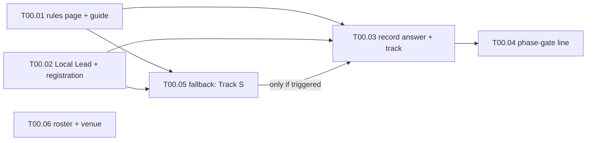

# TASK-00 — Resolve rules + register

| Field | Value |
| --- | --- |
| Objective | Resolve rules + register |
| Requirements | None listed in 06 §C; serves U-12 (06), and U-13, U-14 (06 Unresolved items, placed here by the coordination map) |
| Lane / owner role | story — Design & story lead (06 §C owner: Story lead); T00.04 is integration — Compute engineer |
| Milestone | M0 (2–5 Nov); T00.06 runs to M2 (U-14 due 10 Nov) |
| Window | pre-event-allowed |
| Effort (doc 06) | 1–2 h |
| Done when (doc 06) | Answer recorded in repo `docs/ops/rules.md` |
| Main risk → fallback | No answer → follow Track S |
| Spec sections | [06 §A Planning assumptions](../specs/06_High_Level_Implementation_Plan.md#a-planning-assumptions) · [06 §C Work packages](../specs/06_High_Level_Implementation_Plan.md#c-work-packages) · [06 §E First concrete actions](../specs/06_High_Level_Implementation_Plan.md#e-first-concrete-actions-today--5-nov) · [06 Unresolved items](../specs/06_High_Level_Implementation_Plan.md#unresolved-items-owned-by-this-document) · [01 §F.3 Risks](../specs/01_Product_Requirements_Document.md#f3-risks) · [Rules check](../ops/rules.md) · [Map §a.2 windows and phase gate](_coordination.md#a2-field-vocabulary) |

TASK-00 has no upstream subtasks. Its output lifts the phase gate: no `test` or `implement` subtask starts before T00.03 records the track ([map §a.2](_coordination.md#a2-field-vocabulary)).

## Inputs this task consumes

| Input | Kind | Owner | Dependency |
| --- | --- | --- | --- |
| Space Apps rules page — 01 §F.3 and 06 §E name "spaceappschallenge.org/legal"; exact page `TODO(verify)` | external source | — | hard (T00.01) |
| Bangladesh Participants Guide (team copy; not in this repo) | external source | — | hard (T00.01) |
| Reply from the Dhaka Local Lead | external source | — | hard (T00.02) |
| Rules-check template: Question, Sources to check, Answer, Registration, Consequence | repo file `docs/ops/rules.md` | T00.03 | — (filled by its owner) |
| Phase-gate paragraphs in `CLAUDE.md` §3 and `AGENTS.md` | repo files | T00.04 | — (edited by their owner) |
| Lanes and role names | [map §b](_coordination.md#b-lanes) | this plan | soft (T00.06) |

## Outputs this task provides

| Output | Path | Consumers |
| --- | --- | --- |
| Rules answer and the recorded track (lifts the phase gate) | `docs/ops/rules.md` | T00.04, T16.02; every `test` and `implement` subtask (phase gate); every `pre-event-if-permitted` subtask (Track P only) |
| Registration status of every member | `docs/ops/rules.md` | T16.06 |
| Phase-gate line for the recorded track | `CLAUDE.md`, `AGENTS.md` | Every person and agent |
| Team roster, skills and venue type | `docs/ops/team.md` | Lane owners ([map §b](_coordination.md#b-lanes)), T16.02 |

## Subtasks

### T00.01 — Check the Space Apps rules page and Participants Guide for the pre-event code rule

- **Type:** human
- **Tag:** human-required · core
- **Window:** pre-event-allowed
- **Estimate:** 0.5–1 h
- **Owns (writes):** none — the quotes and URLs go to T00.03, which records them in `docs/ops/rules.md`
- **Reads:** `docs/ops/rules.md` (Question, Sources to check); [06 §A](../specs/06_High_Level_Implementation_Plan.md#a-planning-assumptions); [01 §F.3](../specs/01_Product_Requirements_Document.md#f3-risks); the Space Apps rules page; the Bangladesh Participants Guide
- **Depends on:** none
- **Parallel with:** T00.02, T00.06
- **Steps:**
  1. Open the rules page that 01 §F.3 and 06 §E name ("spaceappschallenge.org/legal"); find the exact page (`TODO(verify)` in `docs/ops/rules.md`) and note its URL and access date.
  2. Read the team's copy of the Bangladesh Participants Guide for anything about work done before the event (06 §A summarises what it recommends; check the original text).
  3. Copy verbatim every passage about building or coding before the event, with its URL or page number.
  4. For each passage, note which cases it covers: application code, test code, type and stub files, data-preprocessing scripts (map Open point 1).
  5. Hand the quotes to T00.03, and to T00.05 if they give no answer.
- **Acceptance:**
  - Serves: U-12 · [06 §A](../specs/06_High_Level_Implementation_Plan.md#a-planning-assumptions)
  - Given the rules page and the Participants Guide, when they are read, then every passage on pre-event building is quoted verbatim with its URL or page and the access date.
  - The exact rules-page URL is known, so T00.03 can replace the `TODO(verify)` in "Sources to check".
  - The hand-over contains quotes only, no paraphrase; unclear text is marked unclear.
- **Verify:** Manual checklist — each quote is verbatim; each has a URL or page and a date; the four cases of step 4 are marked covered, not covered or unclear.
- **Agent brief:** Human: read the Space Apps rules page and the Bangladesh Participants Guide and copy, word for word, every sentence about building before the event, with URL or page and date. An agent may search saved copies of the pages for words such as "before", "prior" or "pre-event" and list candidate passages; it must not paraphrase, interpret or decide.
- **Conflict notes:** Owns nothing, so no PR (map §h.1); the output reaches the repo only through T00.03.

### T00.02 — Ask the Dhaka Local Lead; confirm every member is registered (NASA site + Bangladesh form)

- **Type:** human
- **Tag:** human-required · core
- **Window:** pre-event-allowed
- **Estimate:** 0.5 h
- **Owns (writes):** none — the reply and the registration status go to T00.03, which records them in `docs/ops/rules.md`
- **Reads:** `docs/ops/rules.md` (Question, Registration); [06 §A](../specs/06_High_Level_Implementation_Plan.md#a-planning-assumptions); [06 §E](../specs/06_High_Level_Implementation_Plan.md#e-first-concrete-actions-today--5-nov) item 1; [06 Unresolved items](../specs/06_High_Level_Implementation_Plan.md#unresolved-items-owned-by-this-document) (U-12, U-14)
- **Depends on:** none
- **Parallel with:** T00.01, T00.06
- **Steps:**
  1. Draft one message to the Dhaka Local Lead with the U-12 question from `docs/ops/rules.md` ("Question"), naming the four cases from T00.01 step 4 so the answer covers the map's windows.
  2. Add the U-14 question for T00.06 (physical venue or virtual) to the same message.
  3. Send it before the U-12 due date (4 Nov) and note the date sent.
  4. Ask each member to confirm their registration on the NASA Space Apps site and on the Bangladesh form; note yes or no per member, not their email addresses.
  5. Hand the reply, verbatim, and the registration status to T00.03; if there is no reply by 4 Nov, hand "no reply" to T00.05.
- **Acceptance:**
  - Serves: U-12 (and the U-14 question for T00.06) · [06 §E](../specs/06_High_Level_Implementation_Plan.md#e-first-concrete-actions-today--5-nov)
  - The message is sent before the U-12 due date (4 Nov) and asks about application code, tests, type and stub files, data-preprocessing scripts, and the venue type.
  - Every member's registration on the NASA site and the Bangladesh form is confirmed yes or no (06 §C deliverable: "team registered on NASA site and Bangladesh form").
  - No personal data (email addresses, screenshots of confirmations) enters the repository.
- **Verify:** Manual checklist — date sent noted; reply quoted verbatim or "no reply by 4 Nov" noted; yes or no for every member on both registrations.
- **Agent brief:** Human: message the Dhaka Local Lead asking whether code may be written before 13 Nov (covering the four cases and the venue question), and check that every member is registered on the NASA site and the Bangladesh form. An agent may draft the message from `docs/ops/rules.md` and 06 §A; the human sends it.
- **Conflict notes:** Owns nothing, so no PR (map §h.1). Keep confirmation emails and screenshots out of git; the repository is public.

### T00.03 — Record the answer, registration status and Track S or P in `docs/ops/rules.md`

- **Type:** human
- **Tag:** human-required · core
- **Window:** pre-event-allowed
- **Estimate:** 0.5 h
- **Owns (writes):** `docs/ops/rules.md`
- **Reads:** `docs/ops/rules.md`; the hand-overs of T00.01, T00.02 and, when triggered, T00.05; [06 §A](../specs/06_High_Level_Implementation_Plan.md#a-planning-assumptions) (Track S and Track P); [06 §C](../specs/06_High_Level_Implementation_Plan.md#c-work-packages) TASK-00 row
- **Depends on:** T00.01 (hard: needs the verbatim quotes from the written sources), T00.02 (hard: needs the Local Lead reply or its no-reply outcome)
- **Parallel with:** T00.06
- **Steps:**
  1. Collect T00.01's quotes and T00.02's reply or no-reply outcome. If neither source answers by 4 Nov, wait for T00.05's Track S decision.
  2. Fill the Answer table: verbatim quote, source (URL or person), date obtained, recorded by.
  3. Tick the sources checked under "Sources to check"; leave sources not yet available (the 2026 Project Submission and Judging guides, due 13 Nov) as `TODO(verify)`.
  4. Tick both registration boxes once T00.02 confirms every member.
  5. Under "Consequence", state the track taken (Track S or Track P as defined in 06 §A); for Track P, quote what the answer permits. Update the header Date and Status.
  6. Run `make lint docs-check` and open the PR.
- **Acceptance:**
  - Serves: U-12 · [06 §C](../specs/06_High_Level_Implementation_Plan.md#c-work-packages)
  - 06 §C done when: "Answer recorded in repo `docs/ops/rules.md`".
  - Given an answer exists, when the Answer table is read, then it holds a verbatim quote, the source, the date obtained and the recorder — no paraphrase.
  - Given no answer by 4 Nov, then `docs/ops/rules.md` records "No answer → follow Track S" (06 §C TASK-00) with the date of T00.05's decision.
  - The recorded track is exactly one of Track S or Track P (06 §A), and both registration boxes are ticked.
- **Verify:** `make lint docs-check`; manual — no `TODO` is left in the Answer table; the track is stated; both registration boxes are ticked.
- **Agent brief:** Human: fill `docs/ops/rules.md` from the hand-overs of T00.01 and T00.02 (or T00.05): verbatim quote, source, date and recorder; tick the sources and registrations; state Track S or Track P as defined in 06 §A. An agent may format the tables and run `make lint docs-check`; it must not choose the track or reword the quote.
- **Conflict notes:** Only writer of `docs/ops/rules.md` (map §c.2); a later change, such as a new answer after 4 Nov, needs a `follow-up:` subtask added through a `coord:` PR (map §h.5). Merging this PR lifts the phase gate (map §a.2); merge it before T00.04 starts. When T00.05 is triggered, this subtask also waits for it — that conditional wait is not listed under *Depends on*, because T00.05 may never start.

### T00.04 — Update the phase-gate line in `CLAUDE.md` and `AGENTS.md` for the recorded track

- **Type:** integrate
- **Tag:** agent-ready · core
- **Window:** pre-event-allowed
- **Estimate:** 0.5 h
- **Owns (writes):** `CLAUDE.md`, `AGENTS.md`
- **Reads:** `docs/ops/rules.md` (Answer, Consequence); `CLAUDE.md` §3 Phase gate; `AGENTS.md` (Phase gate); [06 §A](../specs/06_High_Level_Implementation_Plan.md#a-planning-assumptions); [map §a.2](_coordination.md#a2-field-vocabulary)
- **Depends on:** T00.03 (hard: needs the recorded track)
- **Parallel with:** T00.06
- **Steps:**
  1. Read the track recorded in `docs/ops/rules.md`.
  2. Rewrite the paragraph under `CLAUDE.md` "## 3. Phase gate" to state the recorded track and what may start before 13 Nov, using the map's windows (§a.2): `pre-event-allowed` on both tracks, `pre-event-if-permitted` only under Track P. Link `docs/ops/rules.md` and `docs/tasks/_coordination.md`.
  3. Make the same change under `AGENTS.md` "## Phase gate".
  4. Keep both headings, and every other line of both files, unchanged.
  5. Run `make lint docs-check`.
- **Acceptance:**
  - Serves: U-12 · [06 §A](../specs/06_High_Level_Implementation_Plan.md#a-planning-assumptions); `docs/ops/rules.md` Consequence ("Either way, update the phase-gate line in `CLAUDE.md` and `AGENTS.md`")
  - Given Track P is recorded, then both files say the TASK-02 spike and TASK-05 compute core may start before the event (06 §A Track P).
  - Given Track S is recorded, then both files say that before 13 Nov only data acquisition, data preprocessing outputs, environment setup, design and documentation happen, and all app code is written during the event (06 §A Track S).
  - Both files state the same track and link `docs/ops/rules.md`; their headings are unchanged.
- **Verify:** `make lint docs-check`; `git diff --stat main` lists only `CLAUDE.md` and `AGENTS.md`; manual read: both paragraphs state the same track.
- **Agent brief:** After T00.03 merges, rewrite the phase-gate paragraph in `CLAUDE.md` §3 and in `AGENTS.md` for the track recorded in `docs/ops/rules.md`, using the 06 §A wording for Track S or Track P and the map's §a.2 windows. Link `docs/ops/rules.md` and `docs/tasks/_coordination.md`, keep the headings, change nothing else, and run `make lint docs-check`.
- **Conflict notes:** Single owner of `CLAUDE.md` and `AGENTS.md` (map §c.2). Do not edit other files that mention the gate: `README.md` belongs to T16.03, `docs/README.md` to T16.02, the PR template to T14.02, and the `web/src/main.ts` comment to T07.03.

### T00.05 — Fallback — start only if no answer by 4 Nov (U-12 due date): declare Track S

- **Type:** fallback
- **Tag:** human-required · core
- **Window:** pre-event-allowed
- **Estimate:** 0.5 h
- **Owns (writes):** none — the decision and its date go to T00.03, which records them in `docs/ops/rules.md`
- **Reads:** [06 §C](../specs/06_High_Level_Implementation_Plan.md#c-work-packages) TASK-00 row; `docs/ops/rules.md` (Consequence); [06 Unresolved items](../specs/06_High_Level_Implementation_Plan.md#unresolved-items-owned-by-this-document) (U-12 due date)
- **Depends on:** T00.01 (hard: shows the written sources give no answer), T00.02 (hard: shows there was no reply by the due date)
- **Parallel with:** T00.06
- **Steps:**
  1. On 4 Nov, check the outcomes of T00.01 and T00.02: no clear written answer and no reply from the Local Lead.
  2. Tell the team that Track S applies (06 §C TASK-00: "No answer → follow Track S"; `docs/ops/rules.md` Consequence).
  3. Hand the decision and its date to T00.03 to record.
  4. If an answer arrives later, the team decides whether to change track; recording that needs a new `follow-up:` subtask (map §h.5).
- **Acceptance:**
  - Serves: U-12 · [06 §C](../specs/06_High_Level_Implementation_Plan.md#c-work-packages)
  - Given no answer by 4 Nov, when the fallback runs, then every member knows Track S applies and T00.03 has the decision and its date.
  - Given an answer arrived by 4 Nov, then this subtask does not start.
- **Verify:** Manual checklist — the team was told (date noted); T00.03's Answer table carries "No answer → follow Track S".
- **Agent brief:** Human: on 4 Nov, if neither the written sources nor the Local Lead answered, tell the team that Track S applies (06 §C TASK-00) and pass the decision and date to T00.03. An agent is not needed.
- **Conflict notes:** Owns nothing, so no PR; T00.03 records the outcome.

### T00.06 — Record team roster and skills (U-13) and venue type (U-14)

- **Type:** human
- **Tag:** human-required · core
- **Window:** pre-event-allowed
- **Estimate:** 0.5–1 h
- **Owns (writes):** `docs/ops/team.md`
- **Reads:** [06 §A](../specs/06_High_Level_Implementation_Plan.md#a-planning-assumptions) (team size, roles); [06 Unresolved items](../specs/06_High_Level_Implementation_Plan.md#unresolved-items-owned-by-this-document) (U-13, U-14); [01 §F.2](../specs/01_Product_Requirements_Document.md#f2-key-assumptions) (A-07); [map §b](_coordination.md#b-lanes); `docs/ops/rules.md` (header-table style)
- **Depends on:** none
- **Parallel with:** T00.01–T00.05
- **Steps:**
  1. Create `docs/ops/team.md` with the header table the other ops docs use (Owner, Date, Status, Related).
  2. List each member: name or handle (only what each person agrees to publish), 06 §A role, lane or lanes from map §b, and skills.
  3. Record the actual team size next to the 06 §A assumption (4, Assumed), and flag any role or lane without a person.
  4. Record the venue type, physical or virtual (U-14), with its source and date; the question can travel in T00.02's message to the Local Lead.
  5. Note any difference from 06 §A and 01 A-07 for T16.02 (spec sync); do not edit the specs.
  6. Run `make lint docs-check`.
- **Acceptance:**
  - Serves: U-13, U-14 · [06 Unresolved items](../specs/06_High_Level_Implementation_Plan.md#unresolved-items-owned-by-this-document)
  - Every lane in map §b has a named person, or is flagged as unstaffed.
  - The team size and each member's skills are recorded (U-13, due 3 Nov).
  - The venue type is recorded with its source and date (U-14, due 10 Nov); if it is still unknown on 10 Nov, it reads `TODO(verify)` with the reason.
  - No personal data beyond what each member agreed to publish.
- **Verify:** `make lint docs-check`; manual — each map §b lane has a person or a flag; the venue type is recorded or marked `TODO(verify)`.
- **Agent brief:** Human: write `docs/ops/team.md` listing each member's name or handle (with their consent), 06 §A role, map lanes (§b) and skills, plus the venue type with its source. An agent may create the file skeleton and run `make lint docs-check`; the people details come only from the team.
- **Conflict notes:** Only writer of `docs/ops/team.md` (map §c.2). Merge by 10 Nov (U-14 due date). Spec status rows for U-13 and U-14 are updated by T16.02, not here.

## Internal dependency graph

Solid arrows are hard dependencies. The labelled arrow from T00.05 applies only when the fallback is triggered, so it is not listed under T00.03's *Depends on*.

## Definition of done (task level)

- 06 §C done when: "Answer recorded in repo `docs/ops/rules.md`".
- 06 §C deliverable: written answer from the rules page or the Local Lead; team registered on the NASA site and the Bangladesh form.
- `CLAUDE.md` §3 and `AGENTS.md` state the recorded track (`docs/ops/rules.md` Consequence).
- U-13 and U-14 are recorded in `docs/ops/team.md` by 10 Nov.
- [06 §D.7](../specs/06_High_Level_Implementation_Plan.md#d7-definition-of-done-per-feature): the acceptance criteria above are met. Its other items (unit tests or UI test note, provenance label, keyboard reachable, works offline, sources in SCR-09) do not apply, because this task writes no app code and displays no values.
- `make lint docs-check` passes; every AI-assisted PR adds a `docs/AI_USE.md` log row.

## Spec questions

1. **What the answer must cover** (map Open point 1). U-12 asks only about "application code", but the map's windows also depend on whether type and stub files, tests and data-preprocessing scripts may be written before 13 Nov. T00.01 and T00.02 ask about all four cases; the team decides how the answer maps to the windows — `TODO(decision)`.
2. **TASK-06 under Track P** (map Open point 2). 06 §A Track P names only the TASK-02 spike and the TASK-05 compute core. If the answer permits code in general, whether TASK-06 may also start early is `TODO(decision)`; T00.03 quotes the answer's exact scope so the team can decide.
3. **Sources not in the repo.** The Participants Guide is not in this repository, and the exact rules page is `TODO(verify)` (`docs/ops/rules.md`). Quotes depend on the team's copies.
4. **Late guidance.** The 2026 Project Submission and Judging guides are due 13 Nov, after T00.03. No subtask re-checks the rules answer against them; if they change it, a `follow-up:` subtask on `docs/ops/rules.md` is needed.
5. **Map change proposed — T00.06 bundles two due dates.** U-13 is due 3 Nov and U-14 is due 10 Nov, but one subtask means one PR, so the roster waits for the venue answer. If the venue answer is late, split T00.06 into roster and venue subtasks.
6. **Map change proposed — later `CLAUDE.md` edits.** T00.04 is the only owner of `CLAUDE.md`, but its §4 row "`make data` … not implemented yet (TASK-03)" goes stale once T14.01 wires `make data` and T03.15 adds the entry point. A `follow-up:` subtask on `CLAUDE.md` will be needed. The same applies to the `README.md` Status line, which names TASK-00 as open until T16.03 (M6).
7. **Effort.** 06 §C budgets 1–2 h for the rules answer and registration. The map also places T00.04 (phase-gate line) and T00.06 (U-13, U-14 from 06's Unresolved table) here, so this file's estimates exceed that range.
