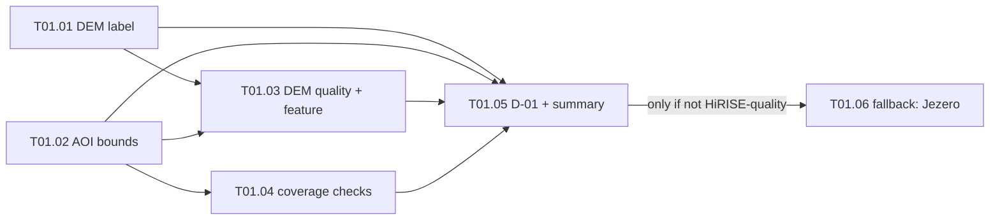

# TASK-01 — Feasibility: AOI, DEM quality, coverage checks

| Field | Value |
| --- | --- |
| Objective | Feasibility: AOI, DEM quality, coverage checks |
| Requirements | FR-01–03, FR-18, A-01 (06 §C); U-01, U-02, U-05, U-09, U-10, D-01 |
| Lane / owner role | data — Data/GIS lead (06 §C owner: Data lead) |
| Milestone | M0 (2–5 Nov); D-01 checkpoint 5 Nov ([06 §D.3](../specs/06_High_Level_Implementation_Plan.md#d3-integration-checkpoints)) |
| Window | pre-event-allowed |
| Effort (doc 06) | 4–8 h |
| Done when (doc 06) | AOI inside DEM extent; hillshade shows HiRISE-scale texture across ≥ 80 % of AOI |
| Main risk → fallback | DEM is CTX-quality → switch to Jezero (USGS M2020 TRN HiRISE DTM mosaic) same day |
| Spec sections | [06 §C](../specs/06_High_Level_Implementation_Plan.md#c-work-packages) · [06 §E](../specs/06_High_Level_Implementation_Plan.md#e-first-concrete-actions-today--5-nov) · [02 §C.1](../specs/02_Technical_Requirements_Document.md#c1-coordinate-reference-conventions-applies-to-every-layer) · [02 §C.2](../specs/02_Technical_Requirements_Document.md#c2-data-layers) · [02 §C.4](../specs/02_Technical_Requirements_Document.md#c4-mars-specific-pitfalls-to-test-explicitly) · [01 §F.2](../specs/01_Product_Requirements_Document.md#f2-key-assumptions) · [05 §C Site](../specs/05_Backend_and_Database_Schema.md#site) · [feasibility.md](../ops/feasibility.md) · [ADR-001](../decisions/ADR-001-site-selection.md) |

## Inputs this task consumes

| Input | Kind | Owner | Dependency |
| --- | --- | --- | --- |
| USGS Mars MSL Gale Merged DEM 1 m v3 and its PDS3 label (02 §C.2 L2) | upstream output (external, USGS Astrogeology) | — | hard for T01.01, T01.03 |
| Curiosity 2025 traverse, viewed in PDS PLACES or MMGIS (02 §C.2 L6) | upstream output (external) | — (T04.01 chooses and caches it later) | hard for T01.02 |
| Colour HiRISE LRGB COG, THEMIS quantitative TI tile, CRISM MTRDR index (02 §C.2 L1, L4, L5) | upstream output (external) | — | hard for T01.04 |
| Working-projection template (02 §C.1; mirrored as `WORKING_PROJ_TEMPLATE` in `pipeline/src/marswalk_pipeline/config.py`) | spec convention | 02 (read-only) | none — spec text |
| GDAL ≥ 3.6, PROJ, pyproj ≥ 3.4 from the existing `pipeline/environment.yml` (02 §B) | setup on the data laptop | data lane | none |

No subtask of this task depends on another task (map §f).

## Outputs this task provides

| Output | Path | Consumers |
| --- | --- | --- |
| DEM label facts: datum statement (U-02), no-data value, checksum | `docs/ops/feasibility/dem-label.md` | T01.03, T01.05; T03.08 through T01.05 (no-data → NaN) |
| AOI centre, working projection string, `extent_m`, `bbox_geo` | `docs/ops/feasibility/aoi.md` | T01.03, T01.04, T01.05; T03.07 and T03.16 through T01.05 |
| DEM-quality verdict, artifacts, U-10 evidence, reference feature | `docs/ops/feasibility/dem-quality.md` | T01.05, T02.04 (reference feature), T03.18 (U-10) |
| Coverage of the colour COG, THEMIS tile id, CRISM observations | `docs/ops/feasibility/coverage.md`, `docs/ops/verification-log.md` | T01.05; T03.07, T03.19 (product URLs); T03.26, T03.27 (fallback triggers); T18.01 (CRISM trigger) |
| D-01 decision and feasibility summary; AOI frozen | `docs/ops/feasibility.md`, `docs/decisions/ADR-001-site-selection.md` | T03.07, T03.16, T16.02 (hard, map §f); T01.06 (trigger) |
| Jezero spec-change and re-plan request, only if triggered | `docs/specs/` files, a `coord:` PR | All lanes |

## Subtasks

### T01.01 — Download the 1 m Gale DEM; record its PDS3 label datum and no-data value

- **Type:** human
- **Tag:** human-required · core
- **Window:** pre-event-allowed
- **Estimate:** 1–2 h
- **Owns (writes):** `docs/ops/feasibility/dem-label.md`
- **Reads:** [02 §C.2 L2](../specs/02_Technical_Requirements_Document.md#l2--topography-elevation-hillshade-fr-02-fr-03-fr-08), [02 §C.1](../specs/02_Technical_Requirements_Document.md#c1-coordinate-reference-conventions-applies-to-every-layer) (elevation row), [02 §C.4](../specs/02_Technical_Requirements_Document.md#c4-mars-specific-pitfalls-to-test-explicitly) item 4, [02 §F](../specs/02_Technical_Requirements_Document.md#f-nonfunctional-requirements-and-validation) (external limits), [02 Sources](../specs/02_Technical_Requirements_Document.md#sources-accessed-2026-11-02), [06 §A](../specs/06_High_Level_Implementation_Plan.md#a-planning-assumptions), [06 §E](../specs/06_High_Level_Implementation_Plan.md#e-first-concrete-actions-today--5-nov) item 2, [feasibility.md — Elevation datum](../ops/feasibility.md#elevation-datum-u-02)
- **Depends on:** none
- **Parallel with:** T01.02, T02.01, T03.01, T03.02
- **Steps:**
  1. Check the data laptop has the free disk 06 §A assumes (≥ 40 GB) and use the campus network, not venue Wi-Fi (02 §F external limits).
  2. Download the USGS Mars MSL Gale Merged DEM 1 m v3 from its Astropedia page (02 Sources) into `pipeline/work/` (git-ignored, 05 §B). Record the exact file URL as read from the page (`TODO(verify)` until then) and the access date.
  3. Record `sha256sum` and the `gdalinfo` summary (size, CRS radius, extent, NoData value) for the downloaded file.
  4. Open the PDS3 label and quote verbatim, with line references, the elevation datum statement (U-02) and the no-data value (02 §C.4 item 4).
  5. Compare rows × columns and the lat/lon extent with 02 §C.2 (L2 dimensions; DEM extent); list any difference as a spec question.
  6. Write `docs/ops/feasibility/dem-label.md` with the repo's header table (Owner, Date, Status, Related) and the facts above.
- **Acceptance:**
  - Serves: FR-01–FR-03, U-02 · [02 §C.2 L2](../specs/02_Technical_Requirements_Document.md#l2--topography-elevation-hillshade-fr-02-fr-03-fr-08), [02 §C.4](../specs/02_Technical_Requirements_Document.md#c4-mars-specific-pitfalls-to-test-explicitly)
  - The datum statement and the no-data value are verbatim label quotes with line references; nothing is paraphrased into a new claim.
  - The note says whether the label confirms heights relative to the MOLA areoid (U-02): yes, no or unclear.
  - Dimensions and extent match 02 §C.2, or the difference is listed for T16.02.
  - The DEM stays in `pipeline/work/`; `git status` shows no dataset file.
- **Verify:**
  - `gdalinfo pipeline/work/<DEM file>` — NoData value, size, sphere radius 3396190.
  - `sha256sum pipeline/work/<DEM file>`
  - `git status --short` shows no dataset; `make docs-check` passes.
- **Agent brief:** The data lead downloads the 3.6 GB DEM on campus and reads its PDS3 label. An agent may run `gdalinfo` and `sha256sum` and draft `docs/ops/feasibility/dem-label.md` from pasted label text, quoting verbatim and leaving anything unread as `TODO(verify)`.
- **Conflict notes:** Writes only its own note. Never commit the DEM. T01.05 copies the values into `docs/ops/feasibility.md`; do not edit that file here.

### T01.02 — Propose AOI bounds from Curiosity's 2025 traverse, inside the DEM extent

- **Type:** human
- **Tag:** human-required · core
- **Window:** pre-event-allowed
- **Estimate:** 1–2 h
- **Owns (writes):** `docs/ops/feasibility/aoi.md`
- **Reads:** [02 §C.1](../specs/02_Technical_Requirements_Document.md#c1-coordinate-reference-conventions-applies-to-every-layer), [02 §C.2](../specs/02_Technical_Requirements_Document.md#c2-data-layers) (AOI, DEM extent), [02 §C.2 L6](../specs/02_Technical_Requirements_Document.md#l6--mission-vectors-fr-04-fr-17), [02 §C.3](../specs/02_Technical_Requirements_Document.md#c3-data-volume-budget-proposed), [05 §C Site](../specs/05_Backend_and_Database_Schema.md#site), [05 §C RoutingGrid](../specs/05_Backend_and_Database_Schema.md#routinggrid), [05 §E.3](../specs/05_Backend_and_Database_Schema.md#e3-referential-integrity-validated-by-the-validate-manifest-command-and-at-app-boot-in-dev-builds), [05 §F.1](../specs/05_Backend_and_Database_Schema.md#f1-site-manifest-abridged-aoi-values-illustrative-until-task-01), `pipeline/src/marswalk_pipeline/config.py`, [feasibility.md — AOI bounds](../ops/feasibility.md#aoi-bounds-u-01-context-02-c2)
- **Depends on:** none
- **Parallel with:** T01.01, T03.01, T03.02
- **Steps:**
  1. View Curiosity's 2025 traverse (sols ≈ 4,450–4,750, 02 §C.2) in PDS PLACES or the MMGIS map (02 §C.2 L6). View only: T04.01 chooses and caches the source.
  2. Choose the AOI centre (lat, lon_e) so that a box of the size 02 §C.2 proposes (~6 × 6 km) covers the 2025 boxwork campaign and stays inside the DEM extent given in 02 §C.2.
  3. Fill the 02 §C.1 working-projection template with that centre and record the exact string once; the number of decimals is `TODO(decision)`.
  4. Set `extent_m` around the origin (0, 0) at the AOI centre (02 §C.1); compute `bbox_geo` from the corners with PROJ (`invproj`), never by hand.
  5. Check with a tool that a 5 m grid over `extent_m` respects `width*height ≤ 4e6` (05 §C RoutingGrid).
  6. Write `docs/ops/feasibility/aoi.md`: centre, projection string, `extent_m`, `bbox_geo`, the traverse source and sols covered, and every command with its output.
- **Acceptance:**
  - Serves: FR-01, U-01 · [02 §C.1](../specs/02_Technical_Requirements_Document.md#c1-coordinate-reference-conventions-applies-to-every-layer), [02 §C.2](../specs/02_Technical_Requirements_Document.md#c2-data-layers), [05 §C Site](../specs/05_Backend_and_Database_Schema.md#site)
  - Given the recorded `bbox_geo`, when compared with the DEM extent in 02 §C.2, then it lies inside it (06 TASK-01 done-when, first part).
  - Running the recorded `proj` / `invproj` commands reproduces `extent_m` and `bbox_geo`.
  - The string is `+proj=eqc` with `lat_ts` = `lat_0` = centre latitude, `lon_0` = centre east longitude and `R=3396190` (02 §C.1).
  - Every number is a human reading or a tool output shown in the note; no agent-typed coordinates.
- **Verify:**
  - `echo "<lon_e> <lat>" | proj -f "%.3f" <working proj string>` and `echo "<x_m> <y_m>" | invproj -f "%.6f" <working proj string>` for each corner (`proj` in the pipeline environment is `TODO(verify)`).
  - Manual: compare `bbox_geo` with the DEM extent in 02 §C.2; `make docs-check` passes.
- **Agent brief:** A human chooses the AOI (map §a.2). An agent may run the PROJ commands on the human's chosen centre and extent and format `docs/ops/feasibility/aoi.md`; it never proposes coordinates itself.
- **Conflict notes:** Writes only its own note. After T01.05 freezes the AOI (5 Nov), T03.07 copies the projection string byte-for-byte into `config.py` and T03.16 copies the AOI into `site.json`; a later change needs a new subtask (§h.5).

### T01.03 — Judge DEM quality in the AOI from a hillshade; measure one reference feature

- **Type:** human
- **Tag:** human-required · core
- **Window:** pre-event-allowed
- **Estimate:** 2–3 h
- **Owns (writes):** `docs/ops/feasibility/dem-quality.md`
- **Reads:** `docs/ops/feasibility/dem-label.md`, `docs/ops/feasibility/aoi.md`, [02 §C.2 L2](../specs/02_Technical_Requirements_Document.md#l2--topography-elevation-hillshade-fr-02-fr-03-fr-08), [02 §C.4](../specs/02_Technical_Requirements_Document.md#c4-mars-specific-pitfalls-to-test-explicitly) item 2, [01 §F.2](../specs/01_Product_Requirements_Document.md#f2-key-assumptions) A-01, [01 FR-01](../specs/01_Product_Requirements_Document.md#fr-01--load-site-and-optical-basemap-offline), [05 Unresolved](../specs/05_Backend_and_Database_Schema.md#unresolved-items-owned-by-this-document) U-10, [06 §E](../specs/06_High_Level_Implementation_Plan.md#e-first-concrete-actions-today--5-nov) item 2, [feasibility.md — DEM quality](../ops/feasibility.md#dem-quality-check-u-01-a-01)
- **Depends on:** T01.01 (hard: needs the downloaded DEM), T01.02 (hard: needs the AOI bounds)
- **Parallel with:** T01.04
- **Steps:**
  1. Cut a 1 m DEM window around the AOI with `gdal_translate -projwin … -projwin_srs "<working proj string>"` into `pipeline/work/`.
  2. Make a hillshade with azimuth 315° and altitude 45° (02 §C.2 L2) using `gdaldem hillshade`.
  3. Compare its texture with the HiRISE stereo-pair footprints listed in the DEM metadata (06 §E item 2, U-10). Outline areas that look CTX/HRSC/MOLA-filled or show artifacts (boxes, CCD seams, faceted low-contrast areas; 02 §C.2 L2) as rough polygons in `pipeline/work/`.
  4. Let GDAL/OGR or QGIS compute the share of the AOI with HiRISE-scale texture from those polygons; record pass or fail against ≥ 80 % (06 TASK-01 done-when).
  5. Pick one feature visible in both hillshade and ortho (e.g. a crater, 01 FR-01) and measure its length in metres in the working projection, or as a great-circle distance on the 3,396,190 m sphere with pyproj — never with Earth-radius tools (02 §C.4 item 2). Record both endpoints (lat, lon_e, 5 decimals per 02 §C.1) and the method.
  6. Write `docs/ops/feasibility/dem-quality.md`: verdict, share, artifacts, U-10 evidence and the reference feature. Screenshots go in the PR description, not the repo.
- **Acceptance:**
  - Serves: FR-01, A-01, U-01, U-10 · [02 §C.2 L2](../specs/02_Technical_Requirements_Document.md#l2--topography-elevation-hillshade-fr-02-fr-03-fr-08), [01 §F.2](../specs/01_Product_Requirements_Document.md#f2-key-assumptions)
  - Given the AOI hillshade, the note states the share of the AOI with HiRISE-scale texture, computed by a tool from the drawn polygons, and the verdict against "hillshade shows HiRISE-scale texture across ≥ 80 % of AOI".
  - Artifacts are listed with locations, or "none seen".
  - The reference feature has both endpoints, its length in metres and the method, so T02.04 can repeat the measurement.
  - U-10 is answered: a per-pixel DEM source map is obtainable (source named), or hand-digitising is needed (T03.18).
  - No raster, polygon file or screenshot is committed.
- **Verify:**
  - `gdaldem hillshade -az 315 -alt 45 pipeline/work/<window>.tif pipeline/work/<hillshade>.tif`, then `gdalinfo pipeline/work/<hillshade>.tif` (CRS, size).
  - Area share: `ogrinfo -dialect SQLite -sql "SELECT SUM(ST_Area(geometry)) FROM <layer>" pipeline/work/<polygons>.geojson` on polygons drawn in the working projection (exact syntax `TODO(verify)`), or the QGIS area tool.
  - Manual: re-measure the reference feature once and compare; `make docs-check` passes.
- **Agent brief:** The data lead judges the texture and draws the polygons; this is a judgement call (map §a.2). An agent may run `gdal_translate`/`gdaldem`, compute the area share and the great-circle length with pyproj from the human's polygons and endpoints, and draft the note.
- **Conflict notes:** Writes only its own note. Rough polygons stay in `pipeline/work/`; T03.18 may reuse them for `low_res_dem.geojson`. T02.04 hard-depends on the reference feature (map §f).

### T01.04 — Check THEMIS TI tile, colour HiRISE COG and CRISM coverage of the AOI by window reads

- **Type:** verify
- **Tag:** agent-ready · core
- **Window:** pre-event-allowed
- **Estimate:** 1–2 h
- **Owns (writes):** `docs/ops/feasibility/coverage.md`, `docs/ops/verification-log.md` (append-only)
- **Reads:** `docs/ops/feasibility/aoi.md`, [02 §C.2 L1](../specs/02_Technical_Requirements_Document.md#l1--optical-basemap-fr-01), [02 §C.2 L4](../specs/02_Technical_Requirements_Document.md#l4--thermal-inertia-fr-02-fr-10), [02 §C.2 L5](../specs/02_Technical_Requirements_Document.md#l5--spectral-fr-18-desirable), [02 Sources](../specs/02_Technical_Requirements_Document.md#sources-accessed-2026-11-02), [01 FR-18](../specs/01_Product_Requirements_Document.md#fr-18--spectral-crism-layer--s), [04 Unresolved](../specs/04_Design_Brief.md#unresolved-items-owned-by-this-document) U-09, [06 §E](../specs/06_High_Level_Implementation_Plan.md#e-first-concrete-actions-today--5-nov) item 3
- **Depends on:** T01.02 (hard: window reads need the AOI bounds)
- **Parallel with:** T01.03
- **Steps:**
  1. Take the AOI bounds and the working projection string from `docs/ops/feasibility/aoi.md`.
  2. Find the exact product URLs on the pages named in 02 Sources: the colour HiRISE LRGB COG (02 §C.2 L1), the THEMIS quantitative TI tile covering 0…30°S, 120…180°E (pattern `30S120E`, 02 §C.2 L4) and the CRISM MTRDR bundle (02 §C.2 L5). Never guess a URL; if one is not found, write `TODO(verify)` and continue.
  3. For each raster: `gdalinfo /vsicurl/<url>`, a window read clipped to the AOI with `gdal_translate -projwin … -projwin_srs "<working proj string>"` into `pipeline/work/`, then `gdalinfo -stats` for the valid-pixel share.
  4. For CRISM, list the MTRDR observations whose footprints intersect the AOI, using the index the bundle readme describes (method `TODO(verify)`).
  5. Write `docs/ops/feasibility/coverage.md` (per product: URL, version, tile or observation ids, CRS, native resolution, AOI coverage, gaps, commands and outputs) and append a `## T01.04 — …` section summarising the results to `docs/ops/verification-log.md`.
- **Acceptance:**
  - Serves: FR-02, FR-18, U-05, U-09 · [02 §C.2 L1](../specs/02_Technical_Requirements_Document.md#l1--optical-basemap-fr-01), [02 §C.2 L4](../specs/02_Technical_Requirements_Document.md#l4--thermal-inertia-fr-02-fr-10), [02 §C.2 L5](../specs/02_Technical_Requirements_Document.md#l5--spectral-fr-18-desirable)
  - Each of the three products has a result — covered, partial, not covered, or `TODO(verify)` with the reason — so T01.05 is never blocked.
  - The THEMIS tile id is recorded exactly as published (06 TASK-01 deliverable).
  - Coverage figures come from `gdalinfo -stats` or the footprint index, not estimates; TI gaps are reported as gaps ("unknown", never zero, 02 §C.2 L4).
  - Every coordinate passed to GDAL is in the Mars working projection; no EPSG:4326 or EPSG:3857 path (02 §C.1, §C.4 item 2).
  - Only AOI window extracts are written, under `pipeline/work/`; nothing is committed.
- **Verify:**
  - `gdalinfo /vsicurl/<url>` per raster; `gdal_translate -projwin <ulx> <uly> <lrx> <lry> -projwin_srs "<working proj string>" /vsicurl/<url> pipeline/work/<product>_aoi.tif`; `gdalinfo -stats pipeline/work/<product>_aoi.tif` (valid-pixel share in recent GDAL, `TODO(verify)`).
  - `make docs-check` passes.
- **Agent brief:** With GDAL and network access, read the AOI from `docs/ops/feasibility/aoi.md`, find each product URL on the pages listed in 02 Sources (never guess), window-read the AOI via `/vsicurl/`, and record coverage in `docs/ops/feasibility/coverage.md` plus one section in `docs/ops/verification-log.md`. Unknown URLs become `TODO(verify)`.
- **Conflict notes:** Owns `coverage.md`. `verification-log.md` is append-only: add one section at the end and keep other sections on rebase. Results reach T03.07, T03.19 (URLs), T03.26, T03.27 (fallback triggers) and T18.01 (CRISM trigger) through T01.05.

### T01.05 — Decide D-01; write the feasibility summary and ADR-001

- **Type:** human
- **Tag:** human-required · core
- **Window:** pre-event-allowed
- **Estimate:** 1 h
- **Owns (writes):** `docs/ops/feasibility.md`, `docs/decisions/ADR-001-site-selection.md`
- **Reads:** `docs/ops/feasibility/dem-label.md`, `docs/ops/feasibility/aoi.md`, `docs/ops/feasibility/dem-quality.md`, `docs/ops/feasibility/coverage.md`, [06 §C](../specs/06_High_Level_Implementation_Plan.md#c-work-packages) TASK-01, [06 §D.3](../specs/06_High_Level_Implementation_Plan.md#d3-integration-checkpoints), [06 §E](../specs/06_High_Level_Implementation_Plan.md#e-first-concrete-actions-today--5-nov) item 4, [01 §F.4](../specs/01_Product_Requirements_Document.md#f4-unresolved-decisions-owned-by-this-document) D-01, [ADR-001](../decisions/ADR-001-site-selection.md), [docs index — decisions](../README.md#major-proposed-decisions)
- **Depends on:** T01.01 (hard: label facts), T01.02 (hard: AOI bounds), T01.03 (hard: DEM-quality verdict), T01.04 (hard: coverage results)
- **Parallel with:** T03.01, T03.02, T05.01
- **Steps:**
  1. Confirm T01.01–T01.04 are merged and every row of their notes is filled or marked `TODO(verify)` with a reason.
  2. Decide D-01 as a team with the 06 §E rule: Gale boxwork if the DEM passes (AOI inside the DEM extent and HiRISE-scale texture across ≥ 80 % of the AOI), else Jezero (USGS M2020 TRN HiRISE DTM mosaic).
  3. Fill the AOI, DEM-quality, datum, THEMIS, CRISM (with the FR-18 decision), colour-COG and D-01 tables of `docs/ops/feasibility.md` by copying values from the notes and linking them. Leave "Large tiles in the repo" to T16.07.
  4. Record the decision, date and evidence links in ADR-001; the status word is `TODO(decision)`, since the ADRs use only "Proposed" so far.
  5. Tell the data lane the AOI is frozen (06 §D.3, 5 Nov): T03.07, T03.16 and T16.02 may start; if the decision is Jezero, start T01.06 the same day.
- **Acceptance:**
  - Serves: D-01 · [06 §C](../specs/06_High_Level_Implementation_Plan.md#c-work-packages), [06 §D.3](../specs/06_High_Level_Implementation_Plan.md#d3-integration-checkpoints), [06 §E](../specs/06_High_Level_Implementation_Plan.md#e-first-concrete-actions-today--5-nov)
  - Given the four notes, when the team applies the 06 §E rule, then D-01 is recorded in `docs/ops/feasibility.md` and ADR-001 by 5 Nov (06 §D.3).
  - Either the 06 done-when holds ("AOI inside DEM extent; hillshade shows HiRISE-scale texture across ≥ 80 % of AOI") or D-01 is Jezero.
  - Every value in `feasibility.md` equals its note (copied, not retyped); no `TODO` is left without a reason and an owner.
  - The FR-18 row states whether CRISM is in scope (FR-18: shown only if TASK-01 confirms MTRDR coverage).
  - Spec files and `docs/README.md` are unchanged; T16.02 syncs them.
- **Verify:**
  - Manual: diff each copied value against its note; tick the 06 §B M0 data exit criteria (AOI chosen inside the DEM extent, DEM quality judged, D-01 locked).
  - `make docs-check` passes.
- **Agent brief:** A team decision. An agent may copy values from the four notes into the `feasibility.md` tables and draft the ADR-001 update for review; it does not decide D-01.
- **Conflict notes:** The only writer of `feasibility.md` and ADR-001 unless T01.06 is triggered. T03.07, T03.16 and T16.02 hard-depend on it (map §f); merge by the end of 5 Nov. Changing the AOI later needs a §h.5 change.

### T01.06 — Fallback — start only if T01.05 finds the AOI DEM is not HiRISE-quality: spec-change to Jezero and re-plan

- **Type:** fallback
- **Tag:** human-required · core
- **Window:** pre-event-allowed
- **Estimate:** 2–3 h
- **Owns (writes):** `docs/specs/01_Product_Requirements_Document.md` (spec-change), `docs/specs/02_Technical_Requirements_Document.md` (spec-change), `docs/specs/03_App_Flow_and_Diagrams.md` (spec-change), `docs/specs/05_Backend_and_Database_Schema.md` (spec-change), `docs/decisions/ADR-001-site-selection.md` (replaces T01.05), `docs/ops/feasibility.md` (replaces T01.05)
- **Reads:** [06 §C](../specs/06_High_Level_Implementation_Plan.md#c-work-packages) TASK-01 main risk, [06 §D.5](../specs/06_High_Level_Implementation_Plan.md#d5-data-and-service-fallbacks), [01 §F.2](../specs/01_Product_Requirements_Document.md#f2-key-assumptions) A-01 and A-06, [01 FR-12](../specs/01_Product_Requirements_Document.md#fr-12--radiation-dose-estimate), [02 §C](../specs/02_Technical_Requirements_Document.md#c-mars-data-and-geospatial-handling), [03 SCR-01](../specs/03_App_Flow_and_Diagrams.md#scr-01--mission-briefing), [05 §F.1](../specs/05_Backend_and_Database_Schema.md#f1-site-manifest-abridged-aoi-values-illustrative-until-task-01), `docs/tasks/_coordination.md` §c and §h.5
- **Depends on:** T01.05 (hard: the D-01 record names Jezero)
- **Parallel with:** none
- **Steps:**
  1. Confirm the trigger: ADR-001 records Jezero because the AOI DEM is not HiRISE-quality.
  2. List every spec passage that names the Gale site, its datasets, Curiosity data or the Gale RAD rates (for example 01 A-01, A-06, FR-04, FR-12, FR-17 and §E; 02 §C; 03 SCR-01; 05 §C and §F examples).
  3. Write the spec-change: name the Jezero DEM from 06 §C and §D.5 (USGS M2020 TRN HiRISE DTM mosaic) and mark every other Jezero property (extent, AOI, ortho, TI tile, traverse, rover images) `TODO(verify)` until re-checked. Change no requirement id.
  4. Record the radiation question: FR-12 and A-06 rely on the Gale RAD rate, so this is a `TODO(decision)` for the team, not resolved here.
  5. Update ADR-001 (consequences, links) and mark the Gale results in `feasibility.md` as superseded, with the date.
  6. Open a `coord:` PR (§h.5) that renames the `gale_boxwork` paths and appends Jezero re-runs of T01.01–T01.04; if this work exceeds 3 h, split it there.
- **Acceptance:**
  - Serves: D-01 · [06 §C](../specs/06_High_Level_Implementation_Plan.md#c-work-packages), [06 §D.5](../specs/06_High_Level_Implementation_Plan.md#d5-data-and-service-fallbacks)
  - The spec diffs touch only site-specific text; requirement ids and priorities are unchanged; every new fact cites a source or is `TODO(verify)`.
  - The FR-12 / A-06 consequence is recorded as `TODO(decision)` and not resolved.
  - ADR-001 and `feasibility.md` show the switch and its date.
  - The `coord:` PR is open and lists every affected subtask and path.
  - `docs/README.md` is left for T16.02.
- **Verify:**
  - `git diff --stat docs/specs` lists only the four files above; `make docs-check` passes.
  - Manual: each changed spec line has a source or a `TODO(verify)`.
- **Agent brief:** Human-led, because it judges trade-offs. An agent may find every Gale-specific passage in `docs/specs/` (search for Gale, Curiosity, boxwork, RAD), draft the spec-change with `TODO(verify)` markers and draft the `coord:` PR for review.
- **Conflict notes:** Spec files change only through spec-change subtasks, one open PR at a time (map §c.2); T16.02 rebases on it. ADR-001 and `feasibility.md` are replaced only because this is the T01.05 fallback. T03.07 and T03.16 wait for the `coord:` PR.

## Internal dependency graph

All edges are hard. Outgoing hard edges (map §f): T01.05 → T03.07, T03.16, T16.02; T01.03 → T02.04.

## Definition of done (task level)

- [06 §D.7](../specs/06_High_Level_Implementation_Plan.md#d7-definition-of-done-per-feature), where it applies: acceptance criteria of T01.01–T01.05 met; the four notes and the verification-log section serve as the committed manual test notes; every source used is recorded with URL, version and access date so T03.17 and T03.19 can credit it and SCR-09 can list it; values carry the 01 label legend (Confirmed from a label or tool, Assumed otherwise). Keyboard and offline items do not apply (no UI).
- 06 TASK-01 done-when holds — "AOI inside DEM extent; hillshade shows HiRISE-scale texture across ≥ 80 % of AOI" — or D-01 is Jezero and T01.06 starts the same day.
- 06 §B M0 data exit criteria met by 5 Nov: AOI chosen inside the DEM extent, DEM quality judged, D-01 locked.
- Every number in the notes comes from a label, a tool output or a human measurement, with the command shown.
- No dataset, raster or screenshot is committed (`CLAUDE.md` §2); `make docs-check` passes.

## Spec questions

1. **Texture-share method.** 06 TASK-01 done-when needs "HiRISE-scale texture across ≥ 80 % of AOI", but no spec says how to measure it (02 §C.2 L2 key risk). T01.03 proposes a tool-computed area of hand-drawn polygons — `TODO(decision)` whether that suffices.
2. **THEMIS tile URL.** 02 Sources links only the example tile `30S060E`; the AOI tile (pattern `30S120E`, 02 §C.2 L4) has no URL in the specs — `TODO(verify)` in T01.04.
3. **CRISM coverage method.** U-05 has no stated query method for MTRDR footprints — `TODO(verify)` in T01.04.
4. **Jezero and radiation.** If T01.06 runs, FR-12 and A-06 lose their basis (A-06 assumes the Gale RAD rate is representative "same crater"), and FR-04 and FR-17 name Curiosity data — `TODO(decision)`, recorded by T01.06, not resolved.
5. **Site-specific paths.** The map hard-codes `gale_boxwork` in many §c paths, so a Jezero switch needs a `coord:` PR (§h.5). This is a consequence of the fallback; no map change is proposed now.
6. **ADR status word.** Every ADR says "Proposed"; no term is defined for a decided ADR — `TODO(decision)` in T01.05.
7. **Projection-string format.** 05 §E.3 requires byte-identical strings, but no spec fixes how many decimals the AOI centre gets (05 §F.1 shows two, illustratively) — `TODO(decision)` in T01.02.
8. **Large tiles.** The "Large tiles in the repo" section of `feasibility.md` stays open for T16.07 (map open point 13).
