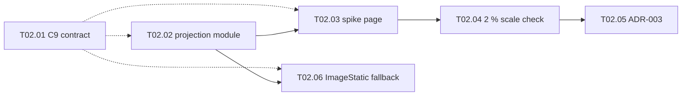

# TASK-02 — Spike: OpenLayers custom Mars projection + custom tile grid

| Field | Value |
| --- | --- |
| Objective | Spike: OpenLayers custom Mars projection + custom tile grid |
| Requirements | FR-01, D-03 (06 §C); FR-02 through the tile pixel encoding (T02.01, T02.06) |
| Lane / owner role | frontend — Frontend engineer |
| Milestone | M0 (06 §B, Track P); T02.04 and T02.05 close in M1. Under Track S the code subtasks run on Day 1 before M3 (map §g) |
| Window | T02.01, T02.05 pre-event-allowed; T02.02–T02.04, T02.06 pre-event-if-permitted (06 §A Track P) |
| Effort (doc 06) | 2–4 h |
| Done when (doc 06) | Scale bar matches a DEM-measured feature within 2 % |
| Main risk → fallback | Fails in 2 h → ImageStatic fallback (02 §B) |
| Spec sections | [06 §C](../specs/06_High_Level_Implementation_Plan.md#c-work-packages) · [02 §B](../specs/02_Technical_Requirements_Document.md#b-technology-choices) · [02 §C.1](../specs/02_Technical_Requirements_Document.md#c1-coordinate-reference-conventions-applies-to-every-layer) · [02 §C.4](../specs/02_Technical_Requirements_Document.md#c4-mars-specific-pitfalls-to-test-explicitly) · [02 §E.1](../specs/02_Technical_Requirements_Document.md#e1-static-asset-contract) · [02 §F.1](../specs/02_Technical_Requirements_Document.md#f1-test-plan) · [05 Layer](../specs/05_Backend_and_Database_Schema.md#layer) · [05 §F.1](../specs/05_Backend_and_Database_Schema.md#f1-site-manifest-abridged-aoi-values-illustrative-until-task-01) · [01 FR-01](../specs/01_Product_Requirements_Document.md#fr-01--load-site-and-optical-basemap-offline) · [04 §C.1 Map overlays](../specs/04_Design_Brief.md#map-overlays) · [ADR-003](../decisions/ADR-003-openlayers-mars-projection.md) |

06 §C deliverable: "Minimal page showing test tiles + correct scale bar". The spike proves the rendering path on the mock site first (T02.02, T02.03), then checks the scale on real AOI tiles (T02.04).

## Inputs this task consumes

| Input | Kind | Owner | Dependency |
| --- | --- | --- | --- |
| C1 TypeScript types `Site`, `Layer`, `TileGrid` in `web/src/types/schema.ts` | contract | T03.01 | soft (T02.02) |
| C9 tile-grid contract `docs/contracts/tile-grid.md` | contract | T02.01 | soft (T02.02, T02.03, T02.06) |
| F4 mock site `web/public/sites/mock_site/` | fixture | T03.02 | soft (T02.03, T02.06) |
| Reference feature and its DEM-measured length in `docs/ops/feasibility/dem-quality.md` | upstream output | T01.03 | hard (T02.04) |
| Real AOI tiles from the pipeline tiler, rendered locally and git-ignored | upstream output | T03.12 | hard (T02.04) |
| `ol` and `proj4`, already in `web/package.json` | upstream output | — | none |

## Outputs this task provides

| Output | Path | Consumers |
| --- | --- | --- |
| Contract C9 v1: tile grid and tile pixel encoding | `docs/contracts/tile-grid.md` | T02.02, T02.03, T02.06, T03.02, T03.12, T07.07 |
| Mars projection module | `web/src/ui/map/projection.ts` | T07.06 (hard), T02.03, T02.06 |
| Web CRS-guard test (02 §C.4.2) | `web/tests/ui/projection.test.ts` | Every web subtask must keep it green |
| Spike page | `web/spike/` | T02.04, T02.06 |
| Scale-bar check record | `docs/ops/verification-log.md` (section T02.04) | T02.05, T16.02 |
| D-03 outcome | `docs/decisions/ADR-003-openlayers-mars-projection.md` | T03.25, T07.07, T07.16, T16.02 |
| ImageStatic layer factory (fallback only) | `web/src/ui/map/imageStatic.ts` | T07.16 |

## Subtasks

### T02.01 — Write the tile-grid and tile-encoding contract v1

- **Type:** contract
- **Tag:** agent-ready · core
- **Window:** pre-event-allowed
- **Estimate:** 1 h
- **Owns (writes):** `docs/contracts/tile-grid.md`
- **Reads:** [05 Layer](../specs/05_Backend_and_Database_Schema.md#layer) (`tile_grid`, `kind`), [05 §F.1](../specs/05_Backend_and_Database_Schema.md#f1-site-manifest-abridged-aoi-values-illustrative-until-task-01), [02 §B](../specs/02_Technical_Requirements_Document.md#b-technology-choices) (spike and fallback), [02 §E.1](../specs/02_Technical_Requirements_Document.md#e1-static-asset-contract), [02 §C.2 L1](../specs/02_Technical_Requirements_Document.md#l1--optical-basemap-fr-01) and [L4](../specs/02_Technical_Requirements_Document.md#l4--thermal-inertia-fr-02-fr-10) (missing data), [04 §C.1 Map overlays](../specs/04_Design_Brief.md#map-overlays), `web/src/types/schema.ts` (`TileGrid`), `schemas/site-manifest.schema.json`, `pipeline/src/marswalk_pipeline/tiles.py` (`render_tiles` signature), [map §d C9](_coordination.md#d-contracts-registry)
- **Depends on:** none
- **Parallel with:** T00.01–T00.03, T01.01–T01.05, T03.01, T05.01, T06.01
- **Steps:**
  1. Copy the 05 §C `tile_grid` fields (`origin_m`, `resolutions_m`, `tile_size_px`, `format`) into a field table with units, and quote the 05 §F.1 example values as the illustrative case.
  2. Give the path template `tiles/<layer_id>/{z}/{x}/{y}.{ext}` (02 §E.1), say that `z` indexes `resolutions_m`, and that `origin_m` is the grid's top-left corner as in the 05 §F.1 example; leave the x/y counting direction `TODO(verify)` for T02.03.
  3. Define the pixel encoding per layer: display images for ortho and hillshade; data-encoded slope, because 04 §C.1 class edges follow the current limits (`TODO(decision)`: which encoding); elevation and thermal-inertia ramps per 04 §C.1 (`TODO(decision)`: pre-coloured or data-encoded).
  4. State no-data handling: transparent (02 §C.2 L1); thermal-inertia gaps stay "unknown", never zero (02 §C.2 L4).
  5. Add the fallback form from 02 §B: one PNG per 2 m layer for `ol/source/ImageStatic` (`kind: image_static`, 05 §C), same encoding.
  6. Add the version line (v1), the consumer list from map §d C9 and a link to the change process.
- **Acceptance:**
  - Serves: FR-01, FR-02, D-03 · [05 Layer](../specs/05_Backend_and_Database_Schema.md#layer), [02 §B](../specs/02_Technical_Requirements_Document.md#b-technology-choices)
  - Every 05 §C `tile_grid` field appears with its meaning and unit; the path template matches 02 §E.1.
  - Each raster layer named in 03 SCR-03 has a stated encoding or an explicit `TODO(decision)`.
  - Every number in the file is quoted from a cited spec section; the open choices are marked `TODO(verify)` or `TODO(decision)` (map §e value rule, `CLAUDE.md` §2).
  - The file names its version (v1), owner (T02.01), consumers and the change process.
- **Verify:** `npx --no-install markdownlint-cli2 docs/contracts/tile-grid.md` and `python3 scripts/check_links.py docs/contracts`; the reviewer ticks each field against 05 §C Layer and 05 §F.1.
- **Agent brief:** Write `docs/contracts/tile-grid.md`, contract C9 v1, from 05 §C Layer, 05 §F.1, 02 §B, 02 §E.1 and 04 §C.1. Cover fields, addressing, per-layer pixel encoding, no-data and the ImageStatic form. Quote every value from a spec; leave the x/y direction `TODO(verify)` and the slope encoding `TODO(decision)`. Touch no other file.
- **Conflict notes:** Contract C9: after merge, changes go only through an appended `T02.nn — contract-change:` subtask (map §d), never concurrently. It freezes at the end of M1 (10 Nov). T03.02, T03.12 and T07.07 rebase after any change.

### T02.02 — Implement the Mars projection module with a web CRS-guard test

- **Type:** implement
- **Tag:** agent-ready · core
- **Window:** pre-event-if-permitted
- **Estimate:** 1–1.5 h
- **Owns (writes):** `web/src/ui/map/projection.ts`, `web/tests/ui/projection.test.ts`
- **Reads:** `docs/contracts/tile-grid.md`, `web/src/types/schema.ts` (`Site.crs`, `Site.aoi`, `TileGrid`), [02 §B](../specs/02_Technical_Requirements_Document.md#b-technology-choices), [02 §C.1](../specs/02_Technical_Requirements_Document.md#c1-coordinate-reference-conventions-applies-to-every-layer), [02 §C.4](../specs/02_Technical_Requirements_Document.md#c4-mars-specific-pitfalls-to-test-explicitly) items 2–3, [05 Site](../specs/05_Backend_and_Database_Schema.md#site), [05 §F.1](../specs/05_Backend_and_Database_Schema.md#f1-site-manifest-abridged-aoi-values-illustrative-until-task-01), `web/package.json`
- **Depends on:** T02.01 (soft), T03.01 (soft)
- **Parallel with:** T03.02, T03.03–T03.06, T05.02–T05.04
- **Steps:**
  1. Register `site.crs.proj4` with proj4js under a Mars-specific code, using the manifest string byte-for-byte; never use EPSG:3857 or EPSG:4326.
  2. Create the OpenLayers projection in metres with extent `aoi.extent_m`.
  3. Build an OpenLayers tile grid from a layer's `tile_grid` as C9 defines it.
  4. Check how OpenLayers computes point resolution for this projection. If it would estimate through EPSG:4326 on the Earth sphere (the 02 §C.4.2 pitfall), give the projection a point-resolution function in projection metres (`TODO(verify)`).
  5. Write the test file: the web CRS guard (no `EPSG:3857`, `EPSG:4326` or `ol/sphere` anywhere under `web/src/`), and a check that the registered definition is the manifest string unchanged (use the 05 §F.1 example string).
  6. Run the test and the type check.
- **Acceptance:**
  - Serves: FR-01, D-03 · [02 §B](../specs/02_Technical_Requirements_Document.md#b-technology-choices), [02 §C.1](../specs/02_Technical_Requirements_Document.md#c1-coordinate-reference-conventions-applies-to-every-layer)
  - Given a `Site`, when the module registers the projection, then it uses `site.crs.proj4` unchanged and a code other than EPSG:3857 or EPSG:4326 (02 §C.1 "Never").
  - The projection's units are metres and its extent is `aoi.extent_m`; tile grids come from the manifest `tile_grid`, never from hard-coded values.
  - Test case allocated here: no EPSG:3857 view or `ol/sphere` in the web app (02 §C.4.2). The round-trip case belongs to T03.03.
  - `make typecheck` passes.
- **Verify:** `npx vitest run tests/ui/projection.test.ts` (run in `web/`); `make typecheck`.
- **Agent brief:** Create `web/src/ui/map/projection.ts`: register the manifest's `crs.proj4` with proj4js and OpenLayers (metres, AOI extent) and build tile grids from `tile_grid` per `docs/contracts/tile-grid.md`. Add `web/tests/ui/projection.test.ts` with the web CRS guard (02 §C.4.2). Confirm the scale line will use projection metres; mark anything unconfirmed `TODO(verify)`.
- **Conflict notes:** New files only. T07.06 builds on this module (hard), so keep its exported names stable once T07.06 starts; later changes go through a `follow-up:` subtask. The guard test scans all of `web/src/`, so every web lane must keep it green.

### T02.03 — Build the spike page: mock-site tiles in the Mars projection with a metric scale bar

- **Type:** implement
- **Tag:** agent-ready · core
- **Window:** pre-event-if-permitted
- **Estimate:** 0.5–1 h
- **Owns (writes):** `web/spike/`
- **Reads:** `web/src/ui/map/projection.ts`, `docs/contracts/tile-grid.md`, `web/public/sites/mock_site/` (F4), [02 §B](../specs/02_Technical_Requirements_Document.md#b-technology-choices) (spike), [01 FR-01](../specs/01_Product_Requirements_Document.md#fr-01--load-site-and-optical-basemap-offline), [04 §B](../specs/04_Design_Brief.md#b-layout-and-navigation) (scale bar position)
- **Depends on:** T02.02 (hard: the page uses the projection module), T02.01 (soft), T03.02 (soft)
- **Parallel with:** T03.03–T03.06, T05.02, T05.04
- **Steps:**
  1. Add a minimal page (HTML entry and script) under `web/spike/`, served by the Vite dev server.
  2. Load `sites/mock_site/site-manifest.json` (F4) and register its projection through `projection.ts`.
  3. Add one XYZ tile layer per mock raster layer, with a tile grid from its `tile_grid`, and fit the view to the AOI extent.
  4. Add an OpenLayers scale line in metric units at the bottom left (04 §B). Zoom through every resolution and check for gaps or shifts between levels. Record the observed x/y direction for C9.
  5. With the network disabled in the browser's devtools, confirm that every request goes to `localhost` (01 FR-01).
  6. Stop at the 2 h timebox of 02 §B, counted from the start of T02.02. If the tiles do not render correctly, trigger T02.06 and note why for T02.05.
- **Acceptance:**
  - Serves: FR-01, D-03 · [02 §B](../specs/02_Technical_Requirements_Document.md#b-technology-choices)
  - Given the mock site served by `make dev` with the network disabled, when the spike page opens, then the mock tiles render in the Mars projection at every level of the mock tile grid, with no gap or offset between levels, and the scale line shows metres.
  - No request leaves `localhost` (01 FR-01 acceptance).
  - The page reads origin, resolutions and tile size from the manifest; it hard-codes none of them.
  - The observed tile addressing is written down for C9 (a `contract-change:` subtask if it differs from v1).
- **Verify:** `make typecheck`; manual: `make dev`, open the spike page with devtools set to Offline, zoom through every level, read the network log.
- **Agent brief:** Build a throwaway page under `web/spike/` that loads the mock site (F4), registers the Mars projection via `web/src/ui/map/projection.ts`, shows its XYZ tiles with tile grids from the manifest, and adds a metric scale line. Check alignment at every zoom level and offline loading. Timebox: 2 h together with T02.02 (02 §B).
- **Conflict notes:** `web/spike/` is throwaway: nothing in `web/src/` imports it, and it must not enter the production build (`TODO(verify)`: Vite builds only `web/index.html` by default). T02.06 may replace the page if the fallback is triggered.

### T02.04 — Verify the scale bar against a DEM-measured feature within 2 % on real AOI tiles

- **Type:** verify
- **Tag:** human-required · core
- **Window:** pre-event-if-permitted
- **Estimate:** 1 h
- **Owns (writes):** `docs/ops/verification-log.md` (append-only)
- **Reads:** `docs/ops/feasibility/dem-quality.md` (reference feature from T01.03), real AOI tiles rendered locally with the T03.12 tiler, `web/spike/`, [01 FR-01](../specs/01_Product_Requirements_Document.md#fr-01--load-site-and-optical-basemap-offline), [02 §F.1](../specs/02_Technical_Requirements_Document.md#f1-test-plan) (Projection row), [02 §C.1](../specs/02_Technical_Requirements_Document.md#c1-coordinate-reference-conventions-applies-to-every-layer)
- **Depends on:** T02.03 (hard: the check runs on the spike page), T01.03 (hard: the 2 % check needs the DEM-measured reference feature), T03.12 (hard: the 2 % check runs on real AOI tiles)
- **Parallel with:** T03.19–T03.21, T04.04–T04.06
- **Steps:**
  1. Take the reference feature and its DEM-measured length from `docs/ops/feasibility/dem-quality.md` (T01.03), and note the direction in which it was measured (02 §C.1 records the east–west scale difference of the source projection).
  2. Have the data lead render the AOI tiles locally with the T03.12 tiler (output stays in git-ignored folders), and point the spike page at them. If T02.06 was triggered, use the ImageStatic page instead.
  3. At each tile-grid level where the feature is visible, measure its on-screen length and convert it to metres using the scale bar.
  4. Compare each value with the DEM-measured length against the 2 % tolerance of 01 FR-01.
  5. Append a `## T02.04 — <title>` section to the verification log: feature, data used, levels checked, values, pass or fail.
- **Acceptance:**
  - Serves: FR-01 · [01 FR-01](../specs/01_Product_Requirements_Document.md#fr-01--load-site-and-optical-basemap-offline), [02 §F.1](../specs/02_Technical_Requirements_Document.md#f1-test-plan)
  - Given the map at any zoom, then the scale bar length agrees with a measured feature (e.g., known crater diameter in the DEM) within 2 % (01 FR-01 acceptance).
  - Test case allocated here: scale bar vs DEM-measured feature within 2 % (02 §F.1 Projection). The pipeline stub test of the same name is removed by T03.03 (map open point 11).
  - The log section states every level checked and its result; a failure names the level and the measured difference.
- **Verify:** Manual checklist: the spike page with real tiles open offline; each level measured; values written to `docs/ops/verification-log.md`; the reviewer re-measures one level.
- **Agent brief:** Human-required. The frontend engineer measures the T01.03 reference feature on real AOI tiles at each zoom level and compares it with the scale bar (2 %, 01 FR-01). An agent may prepare the log section template and point the spike page at the local tile folder, but the measurements are human.
- **Conflict notes:** The verification log is append-only: add one section at the end and keep both sides on a rebase conflict. Real tiles are never committed (`CLAUDE.md` §2).

### T02.05 — Record the spike outcome in ADR-003 (D-03)

- **Type:** human
- **Tag:** human-required · core
- **Window:** pre-event-allowed
- **Estimate:** 0.5 h
- **Owns (writes):** `docs/decisions/ADR-003-openlayers-mars-projection.md`
- **Reads:** `docs/ops/verification-log.md` (section T02.04), the T02.03 notes, `docs/contracts/tile-grid.md`, [02 Unresolved decisions](../specs/02_Technical_Requirements_Document.md#unresolved-decisions-owned-by-this-document) (D-03), [02 §B](../specs/02_Technical_Requirements_Document.md#b-technology-choices)
- **Depends on:** T02.04 (hard: the 2 % result is the evidence)
- **Parallel with:** T03.22, T16.01, T17.01
- **Steps:**
  1. Read the T02.04 log section and the T02.03 outcome (tiles render, or T02.06 was triggered).
  2. Add the outcome to ADR-003: tiled layers or ImageStatic, date, evidence link and the C9 version in force.
  3. If the spike changed C9, check that a `contract-change:` subtask was appended (map §d) and link it.
  4. Run the docs checks.
- **Acceptance:**
  - Serves: D-03 · [02 Unresolved decisions](../specs/02_Technical_Requirements_Document.md#unresolved-decisions-owned-by-this-document)
  - ADR-003 states the D-03 outcome, its date and a link to the T02.04 evidence; the decision text quoted from 02 is unchanged.
  - The status wording follows the team's decision (`TODO(decision)`: ADRs say "Proposed" and no accepted-state wording is defined); the 02 status row is left to T16.02.
- **Verify:** `make docs-check`.
- **Agent brief:** Human-required: the frontend engineer decides D-03 from the spike evidence. An agent may draft the ADR-003 addition from the T02.04 log section and the T02.03 notes for the engineer to confirm.
- **Conflict notes:** ADR-003 has a single owner. The specs stay untouched; T16.02 syncs the 02 status row (spec-change).

### T02.06 — Fallback — start only if the spike fails within 2 h: ImageStatic layer factory in the Mars projection

- **Type:** fallback
- **Tag:** agent-ready · core
- **Window:** pre-event-if-permitted
- **Estimate:** 1–2 h
- **Owns (writes):** `web/src/ui/map/imageStatic.ts`, `web/spike/` (replaces T02.03)
- **Reads:** [02 §B](../specs/02_Technical_Requirements_Document.md#b-technology-choices) (fallback), [05 Layer](../specs/05_Backend_and_Database_Schema.md#layer) (`kind: image_static`), `web/src/ui/map/projection.ts`, `docs/contracts/tile-grid.md` (encoding), `web/public/sites/mock_site/` (F4)
- **Depends on:** T02.02 (hard: the fallback uses the same projection module), T02.01 (soft), T03.02 (soft)
- **Parallel with:** T03.25
- **Steps:**
  1. Create `web/src/ui/map/imageStatic.ts`: a factory that turns a manifest layer with `kind: image_static` into an `ol/source/ImageStatic` image layer in the Mars projection, with the image extent set to `aoi.extent_m` (02 §B).
  2. Switch the spike page to show a stand-in PNG (a mock-site tile, F4) through the factory, with the metric scale line.
  3. Check alignment and the scale line as in T02.03, including the offline network check.
  4. Write down for T02.05 and T07.16 that 02 §B keeps a 0.5 m tiled ortho in this fallback (spec question 2).
- **Acceptance:**
  - Serves: FR-01, FR-02, D-03 · [02 §B](../specs/02_Technical_Requirements_Document.md#b-technology-choices), [05 Layer](../specs/05_Backend_and_Database_Schema.md#layer)
  - Given an `image_static` layer and the AOI extent, when the factory builds it, then the image covers `aoi.extent_m` in the Mars projection and the scale line still shows metres.
  - The image uses the pixel encoding of C9; no request leaves `localhost` (01 FR-01).
  - The trigger (the spike failed within 2 h) is recorded for ADR-003 by T02.05.
- **Verify:** `make typecheck`; manual: `make dev`, open the spike page offline and check that the stand-in image is aligned to the AOI with a metric scale line.
- **Agent brief:** Only if the spike failed within 2 h: create `web/src/ui/map/imageStatic.ts`, which wraps `ol/source/ImageStatic` for `image_static` layers in the Mars projection over `aoi.extent_m` (02 §B). Prove it on the spike page with a mock-site PNG and a metric scale line, offline.
- **Conflict notes:** Starts only on the trigger. It replaces the T02.03 page and never runs at the same time as T02.03. T03.25 renders the real PNGs in parallel; T07.16 consumes the factory.

## Internal dependency graph

T02.06 starts only if T02.03 fails within the 2 h timebox; T02.04 then checks the ImageStatic page. T02.04 also needs T01.03 and T03.12 (hard, outside this task).

## Definition of done (task level)

- [06 §D.7](../specs/06_High_Level_Implementation_Plan.md#d7-definition-of-done-per-feature): the FR-01 scale check passed and is logged (T02.04); the CRS-guard test is committed. Provenance labels, keyboard reach and SCR-09 credits do not apply to the throwaway spike page; the production scale bar is T07.06. The page works offline: it loads only local files.
- C9 v1 is merged before T03.02, T03.12 and T07.07 start; any spike-driven change is merged as a `contract-change:` before the C9 freeze (end of M1, 10 Nov).
- `npx vitest run tests/ui/projection.test.ts` (in `web/`) and `make typecheck` pass.
- ADR-003 records D-03 (tiled layers or ImageStatic) with the T02.04 evidence.
- Done when (06 §C): scale bar matches a DEM-measured feature within 2 %.

## Spec questions

1. **Slope tile encoding** (map open point 6). 04 §C.1 and 05 §F.1 (`breaks_follow_scenario: true`) make slope classes follow the current limits, so slope tiles must be data-encoded and coloured in the browser. C9 must choose the encoding (`TODO(decision)`), and the spike must show that OpenLayers can colour data tiles in this projection (`TODO(verify)`).
2. **Ortho in the fallback.** 02 §B's fallback keeps "a 0.5 m tiled basemap only for the ortho", but the fallback is triggered when tiled rendering fails in the spike. What the ortho uses if XYZ tiles fail altogether is not specified — `TODO(decision)`.
3. **Scale-line resolution.** 02 §B marks "scale line uses projection metres" as Confirmed via the OpenLayers examples. For this Mars projection, the spike must confirm that OpenLayers does not estimate point resolution through EPSG:4326 on the Earth sphere (02 §C.4.2) — `TODO(verify)` in T02.02.
4. **Tile addressing.** 05 §C lists the `tile_grid` fields but not whether `origin_m` is the top-left corner (the 05 §F.1 example suggests it) or which way x and y count — `TODO(verify)` in T02.03, recorded in C9 (map §d).
5. **TASK-01 dependency.** 06 §C says TASK-02 depends on TASK-01 (projection string). The map lets T02.02–T02.03 start on the mock site's illustrative 05 §F.1 string, and keeps the TASK-01 hard dependency only at T02.04 (through T01.03 and T03.12). This is a planning choice, not a spec change.
6. **Measurement procedure.** 01 FR-01 sets the 2 % tolerance "at any zoom" but no procedure. T02.04 checks every tile-grid level where the feature is visible and logs the method. The pipeline stub test of the same name duplicates this case and is removed by T03.03 (map open point 11).
