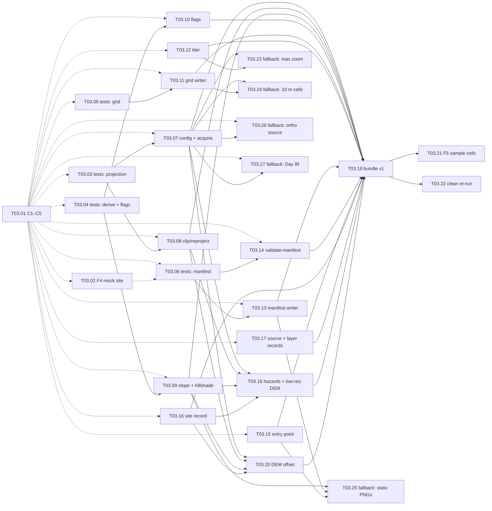

# TASK-03 — Preprocessing pipeline

| Field | Value |
| --- | --- |
| Objective | Preprocessing pipeline. Deliverable (06 §C): `pipeline/` scripts → tiles (ortho 0.5 m; hillshade/slope/elevation/TI 2 m), routing grid 5 m (elevation, slope_p90, slope_max, flags, TI), `site-manifest.json`, `sources.lock.json`, `validate_manifest.py` |
| Requirements | 06: FR-01–FR-03, FR-07, NFR-06. Subtasks also serve FR-04, FR-06, FR-10, FR-15–FR-17, NFR-02, NFR-07, NFR-09, NFR-10, U-10 |
| Lane / owner role | data — Data/GIS lead |
| Milestone | M0 (contracts, mock site) · M1 (pipeline, bundle v1) · M2 (clean re-run check) |
| Window | pre-event-allowed (every subtask; code subtasks start once T00.03 lifts the phase gate) |
| Effort (doc 06) | 8–14 h |
| Done when (doc 06) | Validator passes; sampled values match source rasters; total bundle ≤ 250 MB |
| Main risk → fallback | Slow tiling → lower max zoom; grid too big → 10 m cells |
| Spec sections | [02 §A.1](../specs/02_Technical_Requirements_Document.md#a1-system-boundary) · [02 §C.1](../specs/02_Technical_Requirements_Document.md#c1-coordinate-reference-conventions-applies-to-every-layer) · [02 §C.2](../specs/02_Technical_Requirements_Document.md#c2-data-layers) · [02 §C.3](../specs/02_Technical_Requirements_Document.md#c3-data-volume-budget-proposed) · [02 §C.4](../specs/02_Technical_Requirements_Document.md#c4-mars-specific-pitfalls-to-test-explicitly) · [02 §E.1](../specs/02_Technical_Requirements_Document.md#e1-static-asset-contract) · [02 §F.1](../specs/02_Technical_Requirements_Document.md#f1-test-plan) · [05 §C](../specs/05_Backend_and_Database_Schema.md#c-entity-definitions) · [05 §E.3](../specs/05_Backend_and_Database_Schema.md#e3-referential-integrity-validated-by-the-validate-manifest-command-and-at-app-boot-in-dev-builds) · [05 §E.5](../specs/05_Backend_and_Database_Schema.md#e5-provenance-required-to-reproduce-a-result) · [06 §C](../specs/06_High_Level_Implementation_Plan.md#c-work-packages) · [06 §D.3](../specs/06_High_Level_Implementation_Plan.md#d3-integration-checkpoints) · [Map §c.3](_coordination.md#c3-pipeline) · [Map §d](_coordination.md#d-contracts-registry) |

## Inputs this task consumes

| Input | Kind | Owner | Dependency |
| --- | --- | --- | --- |
| Site decision D-01, AOI bounds and centre (`docs/ops/feasibility.md`, `docs/ops/feasibility/aoi.md`) | upstream output | T01.05 (from T01.02) | hard for T03.07 and T03.16 |
| DEM label facts: datum, no-data value (`docs/ops/feasibility/dem-label.md`) | upstream output | T01.01 | read by T03.08; reached through T01.05 |
| DEM quality and LOW_RES_DEM evidence (`docs/ops/feasibility/dem-quality.md`) | upstream output | T01.03 | read by T03.18; reached through T01.05 |
| Coverage of the THEMIS tile and the colour COG (`docs/ops/feasibility/coverage.md`) | upstream output | T01.04 | read by T03.17 and T03.19; see Spec questions |
| Tile-grid and tile-encoding contract C9 (`docs/contracts/tile-grid.md`) | contract | T02.01 | soft for T03.02, T03.12, T03.25 |
| Traverse source and records, vector packaging code, POI records and images | upstream output | T04.01, T04.03, T04.04, T04.05 | hard for T03.19 |
| Traverse offset (`pipeline/sites/gale_boxwork/known_offsets/traverse.json`) | upstream output | T04.08 | hard for T03.19 |
| TI threshold (`pipeline/sites/gale_boxwork/ti_threshold.json`; dropped by cut 4) | upstream output | T04.07 | optional input of T03.19's run; see Spec questions |
| RAD EnvConstant and DataSource records | upstream output | T06.10 | hard for T03.19 |
| Model DataSource records (Tobler, Apollo 17, Mars24) | upstream output | T12.05 | hard for T03.19 |
| JSON-Schema validator in the pipeline dependencies | upstream output | T14.01 | hard for T03.14 |
| Geo stack (GDAL, rasterio, numpy, pyproj) from `pipeline/environment.yml` | environment | exists | — |

## Outputs this task provides

| Output | Path | Consumers |
| --- | --- | --- |
| C1 TypeScript mirror of the 05 entities | `packages/protocol/src/schema.ts` | All web subtasks (T05.*, T07.*–T12.*, T14.*) |
| C2 site-manifest JSON Schema | `schemas/site-manifest.schema.json` | T03.02, T03.13, T03.14, T07.02, T14.03 |
| C3 plan-export JSON Schema | `schemas/plan-export.schema.json` | T05.03, T11.01, T11.02 |
| C4 routing-grid binary layout (frozen by review) | 05 §C mirrors in `config.py`, `schema.ts`, `grid.ts` | T03.10, T03.11, T03.02, T05.02, T05.16 |
| C5 site-config input layout | `pipeline/sites/README.md` | T03.13, T03.16, T03.17, T04.01, T04.04, T04.05, T04.07, T04.08, T06.10, T12.05 |
| F4 mock site bundle | `data/sites/mock_site/` | T02.03, T07.*, T08.06, T10.01, T14.05 |
| AOI intermediates (clipped DEM, ortho, TI; hillshade) | `pipeline/work/` (git-ignored, local runs) | T03.18, T03.20, T04.07, T04.08 |
| Tiler | `pipeline/src/marswalk_pipeline/tiles.py` | T02.04, T03.19 |
| `validate-manifest` | `pipeline/src/marswalk_pipeline/validate_manifest.py` | T03.19, T03.22, 06 §D.6 freeze check |
| Pipeline entry point | `pipeline/src/marswalk_pipeline/__main__.py` | T14.01 (`make data`), T03.19, T03.22 |
| Bundle v1 and lock file | `data/sites/gale_boxwork/`, `pipeline/sources.lock.json` | T05.28, T09.06, T07.*, T14.*, T16.03 |
| F5 real-grid sample cells | `apps/web/tests/fixtures/real/sample_cells.json` | T05.28, T07.15 |
| Static PNG layers (fallback) | `pipeline/src/marswalk_pipeline/static_images.py` | T07.16 |

## Subtasks

### T03.01 — Freeze data contracts v1: 05 entity mirror, grid binary layout, site-config input layout

- **Type:** contract
- **Tag:** agent-ready · core
- **Window:** pre-event-allowed
- **Estimate:** 2–3 h
- **Owns (writes):** `packages/protocol/src/schema.ts`, `schemas/site-manifest.schema.json`, `schemas/plan-export.schema.json`, `pipeline/sites/README.md`, `data/sites/gale_boxwork/README.md`, `pipeline/src/marswalk_pipeline/derive.py` (stub → T03.09), `pipeline/src/marswalk_pipeline/flags.py` (stub → T03.10)
- **Reads:** [05 §A–§F](../specs/05_Backend_and_Database_Schema.md#c-entity-definitions) (every entity, [flag bits](../specs/05_Backend_and_Database_Schema.md#flag-bits), §E.1, §E.3, §F.1–§F.3), [02 §C.1](../specs/02_Technical_Requirements_Document.md#c1-coordinate-reference-conventions-applies-to-every-layer), [02 §E.1](../specs/02_Technical_Requirements_Document.md#e1-static-asset-contract), [02 §E.2](../specs/02_Technical_Requirements_Document.md#e2-worker-message-protocol), `pipeline/src/marswalk_pipeline/config.py`, `packages/compute/src/grid.ts`, `packages/protocol/src/worker.ts`, [map §d C1–C5](_coordination.md#d-contracts-registry)
- **Depends on:** none
- **Parallel with:** T00.01–T00.03, T01.01–T01.05, T02.01, T05.01, T05.03, T06.01
- **Steps:**
  1. Diff every field of `schema.ts` and both JSON Schemas against 05 §C (names, types, required flags, enums, defaults); fix each mismatch in favour of 05.
  2. C1: record the decision on required PlanResult, Leg and Warning fields (the existing `TODO(decision)`), including whether `conditions`, `radiation` and `stops_timeline` may be absent in the M3 slice (map open point 3). Keep it a visible `TODO(decision)` until the data lead signs off, and list the 05 wording it needs under Spec questions.
  3. C2/C3: model `legend` on the 05 §F.1 example (`type`, `breaks_follow_scenario`, `classes`); record U-11 (store profile arrays in the export; 05 recommends storing) as `TODO(decision)`.
  4. C4 by review only: compare the `config.py` constants, `FLAG_BITS` in `schema.ts` and `LoadedGrid` in `packages/compute/src/grid.ts` with 05 RoutingGrid and flag bits. Report any mismatch to its owner (T03.07, T05.16); do not edit those files.
  5. C5: write `pipeline/sites/README.md` — one JSON file per DataSource, Layer, EnvConstant, POI and known offset under `pipeline/sites/<site_id>/`, plus `site.json`, `hazards.geojson`, `low_res_dem.geojson` and `ti_threshold.json`; record the layer ids (`TODO(decision)`; 05 §F.1 uses `slope` and `elevation`).
  6. Move the `hazard_flags` stub from `derive.py` into a new `flags.py`, adding inputs for the HARD_HAZARD and LOW_RES_DEM masks (its docstring says they come from inputs); it keeps raising `NotImplementedError`.
  7. Check `data/sites/gale_boxwork/README.md` still matches 02 §E.1; state contract versions C1–C5 = v1 in the PR description.
- **Acceptance:**
  - Serves: FR-01, FR-03, FR-07, FR-15, NFR-06 · [05 §C](../specs/05_Backend_and_Database_Schema.md#c-entity-definitions)
  - Every 05 entity (Site, DataSource, Layer, Asset, RoutingGrid, POI, TraversePoint, EnvConstant, MissionScenario, Waypoint, PlanResult, Leg, Warning, PlanExport) has one TypeScript definition and its JSON Schema definition, with field names copied from 05.
  - Flag bit positions and the slope encoding (degrees × 4, 255 = no data) are identical in 05, `config.py` and `schema.ts`.
  - The schemas state that `crs.proj4` must be byte-identical to the pipeline constant (05 §E.3).
  - Every decision the map lists for C1–C5 is either recorded or left as a visible `TODO(decision)`.
  - The stubs still import: `make test` reports only skipped or todo tests.
- **Verify:** `make typecheck` · `python3 -m json.tool schemas/site-manifest.schema.json` · `python3 -m json.tool schemas/plan-export.schema.json` · `make test` · `make lint`
- **Agent brief:** Freeze data contracts C1–C5 from `docs/tasks/_coordination.md` §d. Diff `packages/protocol/src/schema.ts` and `schemas/*.schema.json` against 05 §C and fix them in favour of 05; write `pipeline/sites/README.md`; move the `hazard_flags` stub into `flags.py`. Invent no fields; leave open choices as `TODO(decision)`.
- **Conflict notes:** Blocking — merge before T03.02 and before any TASK-03 test or implement PR. Afterwards C1–C3 change only through `contract-change:` subtasks (map §d), and 05 itself only through a `spec-change:` subtask. `derive.py` passes to T03.09 and `flags.py` to T03.10 when this PR merges. This subtask never writes `config.py` or `grid.ts`.

### T03.02 — Fixture: mock site bundle (manifest, placeholder tiles, tiny grid, sample POI and traverse GeoJSON)

- **Type:** fixture
- **Tag:** agent-ready · core
- **Window:** pre-event-allowed
- **Estimate:** 2–3 h
- **Owns (writes):** `pipeline/tests/fixtures/make_mock_site.py`, `data/sites/mock_site/`, `.gitignore` (append-only), `apps/web/tests/fixtures/README.md` (append-only)
- **Reads:** [05 §F.1](../specs/05_Backend_and_Database_Schema.md#f1-site-manifest-abridged-aoi-values-illustrative-until-task-01), [05 §F.2](../specs/05_Backend_and_Database_Schema.md#f2-poi-feature), [05 §C](../specs/05_Backend_and_Database_Schema.md#c-entity-definitions) (Site, Asset, RoutingGrid, flag bits, EnvConstant), [02 §E.1](../specs/02_Technical_Requirements_Document.md#e1-static-asset-contract), [02 §D.2](../specs/02_Technical_Requirements_Document.md#d2-route-planning-fr-06-fr-07-fr-10) validation cases, `docs/contracts/tile-grid.md` (C9), [map §e](_coordination.md#e-fixtures-and-mocks) fixture value rule
- **Depends on:** T03.01 (soft), T02.01 (soft)
- **Parallel with:** T03.03, T03.04, T03.05, T05.02, T05.03, T02.02
- **Steps:**
  1. Write a standard-library-only generator that rebuilds `data/sites/mock_site/` byte for byte on every run (fixed `data_version` in the 05 §C Site pattern, sorted JSON keys).
  2. Manifest values: `crs`, `aoi`, `default_start`, the slope Layer, the DataSource and the solar-max EnvConstant copied verbatim from 05 §F.1; the solar-min EnvConstant from 05 §C EnvConstant; `site_id` `mock_site`.
  3. A tiny routing grid covering `aoi.extent_m`: flat ground, one 20° wall with a single gap (02 §D.2 cases), one no-data patch, one HARD_HAZARD cell and one TI gap; little-endian, row-major, north-up arrays (02 §E.1). Grid dimensions and cell size are declared synthetic parameters.
  4. Placeholder tiles for the coarsest levels of the 05 §F.1 `tile_grid`, laid out and encoded as C9 v1 says.
  5. Sample vectors: the 05 §F.2 POI feature without its image fields (exercises SCR-06's image-missing state, 05 §E.6) and a few traverse points whose sols come from 02 §C.2 and 05 §F.2; any extra POI carries placeholder text.
  6. Assets with `sha256`, `bytes`, `width`, `height`, `nodata` and `byte_order` computed by the generator; append the `mock_site` negation to `.gitignore` under `# T03.02`; append the F4 section to `apps/web/tests/fixtures/README.md` naming the source of every non-placeholder value.
- **Acceptance:**
  - Serves: FR-01, FR-02, FR-03, FR-04, FR-17 · [map §e F4](_coordination.md#e-fixtures-and-mocks)
  - Running the generator twice leaves `git status` clean.
  - `git check-ignore` reports nothing under `data/sites/mock_site/` (map open point 17).
  - The manifest validates against C2; once T03.14 lands, `validate-manifest data/sites/mock_site` exits 0.
  - Every number is a spec example, a spec default or range limit, generator output, a typed placeholder or a declared synthetic parameter.
- **Verify:** `$(make -s pipeline-python) pipeline/tests/fixtures/make_mock_site.py` (run twice from the repo root) · `git status --porcelain data/sites/mock_site` (empty after the second run) · `git check-ignore -v data/sites/mock_site/tiles data/sites/mock_site/grid` (no output) · `du -sh data/sites/mock_site`
- **Agent brief:** Write `pipeline/tests/fixtures/make_mock_site.py` (standard library only) that generates fixture F4 under `data/sites/mock_site/` from the 05 §F.1/§F.2 examples plus declared synthetic shapes. Make it deterministic, commit its output, add the `.gitignore` negation and the fixtures README section. No invented science values.
- **Conflict notes:** F4 matches C1, C2, C4 and C9 v1; a contract-change to any of them lists T03.02 as a consumer to regenerate. `.gitignore` and `apps/web/tests/fixtures/README.md` are append-only: add at the end, keep both sides on a rebase conflict. Never write mock data under `data/sites/gale_boxwork/`.

### T03.03 — Tests: projection and raster handling (02 §C.1, §C.4)

- **Type:** test
- **Tag:** agent-ready · core
- **Window:** pre-event-allowed
- **Estimate:** 1.5–2 h
- **Owns (writes):** `pipeline/tests/test_clip_reproject.py`
- **Reads:** [02 §C.1](../specs/02_Technical_Requirements_Document.md#c1-coordinate-reference-conventions-applies-to-every-layer), [02 §C.4](../specs/02_Technical_Requirements_Document.md#c4-mars-specific-pitfalls-to-test-explicitly), [02 §F.1](../specs/02_Technical_Requirements_Document.md#f1-test-plan) Projection row, [05 §F.1](../specs/05_Backend_and_Database_Schema.md#f1-site-manifest-abridged-aoi-values-illustrative-until-task-01) (example projection string), `pipeline/src/marswalk_pipeline/clip_reproject.py`, `pipeline/src/marswalk_pipeline/config.py`, [map Test-case allocation](_coordination.md#test-case-allocation)
- **Depends on:** T03.01 (soft)
- **Parallel with:** T03.02, T03.04, T03.05, T03.06
- **Steps:**
  1. Replace the skipped stubs with one real test per allocated case below.
  2. Build synthetic rasters in a temporary folder (known corner coordinates, a marked north row, a declared no-data value); never use downloaded data.
  3. Round trip: lat/lon ↔ x/y through the `config.py` working projection (red until T03.07 fills it) at the AOI corners and centre, asserting ≤ 1 mm.
  4. CRS guard: scan `pipeline/src/` for EPSG:3857 / WGS84 code paths (02 §C.1 "Never").
  5. Delete `test_scale_bar_vs_dem_measured_feature_within_2_percent`: that case belongs to T02.04 (map open point 11).
  6. Guard geo imports with `pytest.importorskip` so `make test` skips cleanly where GDAL, rasterio or pyproj are missing (`TODO(decision)` with T14.01, see Spec questions).
- **Acceptance:**
  - Serves: FR-01, FR-02, FR-03 · [02 §C.4](../specs/02_Technical_Requirements_Document.md#c4-mars-specific-pitfalls-to-test-explicitly)
  - Allocated cases, each one test: lat/lon ↔ x/y round trip within 1 mm (02 §F.1 Projection); no EPSG:3857/WGS84 path in the pipeline (02 §C.4.2); row 0 = north after reprojection (02 §C.4.3); DEM no-data → NaN before slope (02 §C.4.4).
  - Against the stubs the new tests fail; they pass once T03.07 and T03.08 land.
- **Verify:** `$(make -s pipeline-python) -m pytest -q pipeline/tests/test_clip_reproject.py` (red before T03.07 and T03.08, green after) · `make test` (skips cleanly without the geo stack)
- **Agent brief:** Turn the skipped stubs in `pipeline/tests/test_clip_reproject.py` into pytest cases for the four cases the map allocates to T03.03, using synthetic rasters only. Remove the scale-bar stub (T02.04 owns that case). Guard geo imports with `pytest.importorskip`.
- **Conflict notes:** Tests first (map §h.3): this PR stays a draft; T03.07 and T03.08 branch from it, and the three merge back to back once both pass. Only this subtask edits the file.

### T03.04 — Tests: slope, hillshade, aggregation and hazard flags

- **Type:** test
- **Tag:** agent-ready · core
- **Window:** pre-event-allowed
- **Estimate:** 1.5–2.5 h
- **Owns (writes):** `pipeline/tests/test_derive.py`
- **Reads:** [02 §C.2 L2](../specs/02_Technical_Requirements_Document.md#l2--topography-elevation-hillshade-fr-02-fr-03-fr-08), [L3](../specs/02_Technical_Requirements_Document.md#l3--slope-fr-02-fr-07-fr-10), [L4](../specs/02_Technical_Requirements_Document.md#l4--thermal-inertia-fr-02-fr-10), [02 §F.1](../specs/02_Technical_Requirements_Document.md#f1-test-plan) Slope row, [05 flag bits](../specs/05_Backend_and_Database_Schema.md#flag-bits), [05 §E.6](../specs/05_Backend_and_Database_Schema.md#e6-unavailable-or-replaced-source-data), `pipeline/src/marswalk_pipeline/derive.py`, `pipeline/src/marswalk_pipeline/flags.py` (stub from T03.01), `pipeline/src/marswalk_pipeline/config.py`
- **Depends on:** T03.01 (soft)
- **Parallel with:** T03.02, T03.03, T03.05, T03.06
- **Steps:**
  1. Synthetic planes of 0°, 10° and 30° on a 1 m grid: Horn slope within ±0.05° (also covers the 02 §C.2 L3 10° ramp).
  2. A NaN border: cells that touch NaN come out NaN, not as spikes.
  3. Aggregation per routing-grid cell: p90 and max on blocks whose answer follows from construction (uniform blocks; one block with a single steep pixel); the percentile method is `TODO(decision)` for T03.09.
  4. Hillshade at azimuth 315° and altitude 45° (02 §C.2 L2): output shape and NaN propagation only.
  5. Flags: NO_DATA where elevation is NaN; TI_UNKNOWN where TI is missing or NaN, never zero; LOW_TI only when a threshold is passed; HARD_HAZARD and LOW_RES_DEM from the input masks; bits 5–7 stay 0.
  6. Guard geo imports with `pytest.importorskip`.
- **Acceptance:**
  - Serves: FR-02, FR-07, FR-10 · [02 §C.2 L3](../specs/02_Technical_Requirements_Document.md#l3--slope-fr-02-fr-07-fr-10)
  - Allocated cases: synthetic planes 0°, 10°, 30° within ±0.05° (02 §F.1 Slope, includes the 02 §C.2 L3 ramp); NaN edges give NaN, not spikes (02 §F.1 Slope).
  - Skeleton cases kept here (not allocated elsewhere): p90/max aggregation; a TI gap yields TI_UNKNOWN, not zero (02 §C.2 L4, 05 §E.6).
  - Red until T03.09 and T03.10 land.
- **Verify:** `$(make -s pipeline-python) -m pytest -q pipeline/tests/test_derive.py` · `make test`
- **Agent brief:** Turn the skipped stubs in `pipeline/tests/test_derive.py` into pytest cases for Horn slope, NaN edges, p90/max aggregation, hillshade and the hazard-flag bitfield (imported from `flags.py`), using synthetic arrays whose answers follow from construction. Guard geo imports with `pytest.importorskip`.
- **Conflict notes:** Tests first (map §h.3): T03.09 and T03.10 branch from this PR and merge back to back with it. One test file covers both `derive.py` and `flags.py`.

### T03.05 — Tests: routing-grid encoding

- **Type:** test
- **Tag:** agent-ready · core
- **Window:** pre-event-allowed
- **Estimate:** 1 h
- **Owns (writes):** `pipeline/tests/test_grid.py`
- **Reads:** [05 RoutingGrid](../specs/05_Backend_and_Database_Schema.md#routinggrid), [05 flag bits](../specs/05_Backend_and_Database_Schema.md#flag-bits), [05 Asset](../specs/05_Backend_and_Database_Schema.md#asset), [02 §E.1](../specs/02_Technical_Requirements_Document.md#e1-static-asset-contract), `pipeline/src/marswalk_pipeline/grid.py`, `pipeline/src/marswalk_pipeline/config.py`, `packages/protocol/src/schema.ts`
- **Depends on:** T03.01 (soft)
- **Parallel with:** T03.02, T03.03, T03.04, T03.06
- **Steps:**
  1. `encode_slope_u8`: degrees × 4 in 0.25° steps, NaN → 255; slopes steeper than the encodable range follow the T03.11 decision (Spec questions).
  2. Flag bit positions equal 05 (NO_DATA 0 … LOW_RES_DEM 4) and match `FLAG_BITS` in `packages/protocol/src/schema.ts`, read as text (C4 mirror check).
  3. `write_grid`: the five 02 §E.1 files, little-endian, row-major, north-up; byte sizes equal width × height × item size; f32 no-data NaN and u8 no-data 255 (05 Asset); no TI file when TI is absent.
  4. A grid larger than the 05 limit (`width*height ≤ 4e6`) is refused.
  5. Guard numpy imports with `pytest.importorskip`.
- **Acceptance:**
  - Serves: FR-03, FR-07 · [05 RoutingGrid](../specs/05_Backend_and_Database_Schema.md#routinggrid)
  - The three skeleton cases pass once T03.11 lands: u8 slope is degrees × 4 with 255 no-data; flag bits match 05; arrays are little-endian, row-major, north-up.
- **Verify:** `$(make -s pipeline-python) -m pytest -q pipeline/tests/test_grid.py` · `make test`
- **Agent brief:** Turn the skipped stubs in `pipeline/tests/test_grid.py` into pytest cases for the 05 RoutingGrid encoding, the flag bits (including a text check against `FLAG_BITS` in `schema.ts`) and the 02 §E.1 array layout. Guard numpy with `pytest.importorskip`.
- **Conflict notes:** Tests first (map §h.3): T03.11 branches from this PR and merges right after it.

### T03.06 — Tests: manifest integrity, sampled values, bundle size

- **Type:** test
- **Tag:** agent-ready · core
- **Window:** pre-event-allowed
- **Estimate:** 2–3 h
- **Owns (writes):** `pipeline/tests/test_manifest.py`
- **Reads:** [05 §E.3](../specs/05_Backend_and_Database_Schema.md#e3-referential-integrity-validated-by-the-validate-manifest-command-and-at-app-boot-in-dev-builds), [05 Site](../specs/05_Backend_and_Database_Schema.md#site), [05 Asset](../specs/05_Backend_and_Database_Schema.md#asset), [02 §F](../specs/02_Technical_Requirements_Document.md#f-nonfunctional-requirements-and-validation) NFR-09, [06 §C](../specs/06_High_Level_Implementation_Plan.md#c-work-packages) TASK-03 done-when, `schemas/site-manifest.schema.json`, `data/sites/mock_site/` (F4)
- **Depends on:** T03.01 (soft), T03.02 (soft)
- **Parallel with:** T03.03, T03.04, T03.05
- **Steps:**
  1. Positive case: the F4 mock site passes `validate()` with no problems.
  2. One broken copy per 05 §E.3 rule in a temporary folder — missing asset file, wrong SHA-256, unknown `source_ids`, mismatched grid dimensions, a POI or default start outside the AOI or on an impassable cell, an altered `crs.proj4` — each reported.
  3. `write_manifest` output validates against `schemas/site-manifest.schema.json`.
  4. Real-bundle tests that skip while `data/sites/gale_boxwork/site-manifest.json` is absent: grid values match the 5 m source rasters in `pipeline/work/` at a deterministic set of cells; the site bundle is ≤ 250 MB.
  5. Guard geo and JSON-Schema imports with `pytest.importorskip`.
- **Acceptance:**
  - Serves: FR-01, FR-15, NFR-06, NFR-09 · [05 §E.3](../specs/05_Backend_and_Database_Schema.md#e3-referential-integrity-validated-by-the-validate-manifest-command-and-at-app-boot-in-dev-builds)
  - The eight skeleton cases are real tests: schema validity; every asset reference resolves and its SHA-256 matches; every source id resolves; all grids share width, height, cell and origin; POIs and default start inside the AOI and passable; `crs.proj4` byte-identical to the pipeline constant; sampled values match the source rasters (06 TASK-03 done-when); bundle ≤ 250 MB (NFR-09).
  - Red until T03.13 and T03.14 land; the real-bundle tests skip until T03.19.
- **Verify:** `$(make -s pipeline-python) -m pytest -q pipeline/tests/test_manifest.py` · `make test`
- **Agent brief:** Turn the skipped stubs in `pipeline/tests/test_manifest.py` into pytest cases for every 05 §E.3 integrity rule, using the F4 mock site and broken copies of it, plus real-bundle checks that skip while the bundle is absent. Guard geo and JSON-Schema imports with `pytest.importorskip`.
- **Conflict notes:** Tests first (map §h.3): T03.13 and T03.14 branch from this PR; the three merge back to back once both pass. Never write into `data/sites/mock_site/` — copy it to a temporary folder for broken cases.

### T03.07 — Implement config (working projection for the AOI) and source acquisition

- **Type:** implement
- **Tag:** agent-ready · core
- **Window:** pre-event-allowed
- **Estimate:** 2–3 h
- **Owns (writes):** `pipeline/src/marswalk_pipeline/config.py`, `pipeline/src/marswalk_pipeline/acquire.py`
- **Reads:** [`docs/ops/feasibility.md`](../ops/feasibility.md), `docs/ops/feasibility/aoi.md`, `docs/ops/feasibility/coverage.md`, [02 §C.1](../specs/02_Technical_Requirements_Document.md#c1-coordinate-reference-conventions-applies-to-every-layer), [02 §C.2 L1–L4](../specs/02_Technical_Requirements_Document.md#c2-data-layers), [02 §B](../specs/02_Technical_Requirements_Document.md#b-technology-choices) Pipeline row, [05 §E.5](../specs/05_Backend_and_Database_Schema.md#e5-provenance-required-to-reproduce-a-result), `pipeline/sources.lock.json`, `docs/contracts/tile-grid.md` (C9)
- **Depends on:** T01.05 (hard: the working projection and the site record need the chosen AOI and site), T03.03 (hard: tests-first pair), T03.01 (soft)
- **Parallel with:** T03.08, T03.09, T03.10, T03.11, T03.12, T03.16, T03.17
- **Steps:**
  1. Fill the working projection from the `config.py` template with the AOI centre recorded by T01.05; every other token of the 02 §C.1 string stays unchanged.
  2. Keep the grid, slope-encoding and flag constants exactly as frozen by C4; add the tile resolutions of C9 v1 as constants so T03.23 can drop the finest level in one place (`TODO(decision)` if C9 keeps them per layer instead).
  3. Implement `fetch_sources`: read each lock-file entry, window-read COGs through GDAL `/vsicurl/` (02 §C.2 L1), reuse files already in `pipeline/work/` (the DEM from T01.01), and record SHA-256 plus the exact GDAL and rasterio versions (05 §E.5).
  4. Contact external sources only in this step; nothing here runs at app runtime (02 §A.1).
  5. Make the T03.03 round-trip and CRS-guard tests pass.
- **Acceptance:**
  - Serves: FR-01, FR-02, FR-03, NFR-06 · [02 §C.1](../specs/02_Technical_Requirements_Document.md#c1-coordinate-reference-conventions-applies-to-every-layer)
  - The projection string differs from the 02 §C.1 template only in the AOI-centre values, and those equal `docs/ops/feasibility.md`.
  - Given a scratch lock file with one reachable COG entry, when `fetch_sources` runs, then the window lands in `pipeline/work/` and the entry gains its `sha256`; a second run downloads nothing.
  - T03.03's round-trip (≤ 1 mm) and pipeline CRS-guard tests pass.
- **Verify:** `$(make -s pipeline-python) -m pytest -q pipeline/tests/test_clip_reproject.py` · manual: one `fetch_sources` run against a scratch copy of the lock file
- **Agent brief:** Fill the working projection in `config.py` from T01.05's AOI centre and implement `fetch_sources` in `acquire.py` (GDAL `/vsicurl/` windows, checksums and tool versions written to the lock entries). `pipeline/sources.lock.json` is a committed file (05 §E.5), but T03.19 owns its content and commits it with bundle v1; do not commit it from this subtask. Never compute the AOI centre yourself — copy it from the feasibility record.
- **Conflict notes:** Stacked on T03.03 with T03.08 (map §h.3). `pipeline/sources.lock.json` is written only by T03.19's run. Fallbacks T03.23, T03.24 (`config.py`) and T03.26, T03.27 (`acquire.py`) may replace these files later, one at a time and never while this subtask is open.

### T03.08 — Implement clip/reproject and DEM no-data → NaN

- **Type:** implement
- **Tag:** agent-ready · core
- **Window:** pre-event-allowed
- **Estimate:** 2–3 h
- **Owns (writes):** `pipeline/src/marswalk_pipeline/clip_reproject.py`
- **Reads:** [02 §C.1](../specs/02_Technical_Requirements_Document.md#c1-coordinate-reference-conventions-applies-to-every-layer), [02 §C.2](../specs/02_Technical_Requirements_Document.md#c2-data-layers) (preprocessing and resampling rows), [02 §C.4](../specs/02_Technical_Requirements_Document.md#c4-mars-specific-pitfalls-to-test-explicitly) items 3–4, [05 RoutingGrid](../specs/05_Backend_and_Database_Schema.md#routinggrid) (elevation resampling), `docs/ops/feasibility/dem-label.md`, `pipeline/tests/test_clip_reproject.py`
- **Depends on:** T03.03 (hard: tests-first pair), T03.01 (soft)
- **Parallel with:** T03.07, T03.09, T03.10, T03.11, T03.12
- **Steps:**
  1. `clip_and_reproject`: window-read the source, warp to the given eqc string and `extent_m` at `resolution_m`, row 0 = north (02 §C.4.3).
  2. Resampling per 02 §C.2: bilinear for elevation and TI display, nearest for flag inputs; the 5 m grid elevation is the bilinear-resampled mean of the 1 m DEM (05 RoutingGrid).
  3. `nodata_to_nan`: replace the DEM's declared no-data value with NaN before slope (02 §C.4.4); if the file declares none, use the PDS3-label value recorded by T01.01 (`TODO(verify)` which applies).
  4. Pass the Mars CRS string straight to GDAL/rasterio; never route through EPSG:3857 or WGS84 (02 §C.1).
  5. Make the T03.03 row-0 and no-data tests pass.
- **Acceptance:**
  - Serves: FR-01, FR-02, FR-03 · [02 §C.4](../specs/02_Technical_Requirements_Document.md#c4-mars-specific-pitfalls-to-test-explicitly)
  - T03.03's "row 0 = north after reprojection" and "DEM no-data → NaN before slope" tests pass.
  - Output rasters carry the working CRS and exactly the requested extent and resolution.
- **Verify:** `$(make -s pipeline-python) -m pytest -q pipeline/tests/test_clip_reproject.py`
- **Agent brief:** Implement `clip_and_reproject` and `nodata_to_nan` in `clip_reproject.py` per 02 §C.1–§C.4 (warp to the given eqc string, north-up, bilinear/nearest as 02 §C.2 says, no-data → NaN). Make T03.03's raster tests pass; never use EPSG:3857 or WGS84.
- **Conflict notes:** Stacked on T03.03 with T03.07. Outputs of local runs go to `pipeline/work/` (git-ignored) and feed T03.18, T03.20, T04.07 and T04.08.

### T03.09 — Implement Horn slope, hillshade and p90/max aggregation

- **Type:** implement
- **Tag:** agent-ready · core
- **Window:** pre-event-allowed
- **Estimate:** 2–3 h
- **Owns (writes):** `pipeline/src/marswalk_pipeline/derive.py`
- **Reads:** [02 §C.2 L2](../specs/02_Technical_Requirements_Document.md#l2--topography-elevation-hillshade-fr-02-fr-03-fr-08), [02 §C.2 L3](../specs/02_Technical_Requirements_Document.md#l3--slope-fr-02-fr-07-fr-10), `pipeline/tests/test_derive.py`, `pipeline/src/marswalk_pipeline/config.py`
- **Depends on:** T03.04 (hard: tests-first pair), T03.01 (soft)
- **Parallel with:** T03.07, T03.08, T03.10, T03.11, T03.12
- **Steps:**
  1. `horn_slope_deg`: Horn method on the reprojected 1 m DEM, degrees 0–90; NaN in → NaN out (02 §C.2 L3).
  2. `hillshade`: azimuth 315°, altitude 45° (02 §C.2 L2).
  3. `aggregate_slope`: p90 (used for the hard limit) and max (caution, "micro-relief") per routing-grid cell; the factor comes from the grid cell constant, never a literal 5 (C4); record the percentile method chosen for the `TODO(decision)` in T03.04.
  4. Make the T03.04 slope, NaN-edge, hillshade and aggregation tests pass.
- **Acceptance:**
  - Serves: FR-02, FR-07 · [02 §C.2 L3](../specs/02_Technical_Requirements_Document.md#l3--slope-fr-02-fr-07-fr-10)
  - T03.04's synthetic-plane tests (0°, 10°, 30° within ±0.05°), NaN-edge test and aggregation tests pass.
- **Verify:** `$(make -s pipeline-python) -m pytest -q pipeline/tests/test_derive.py`
- **Agent brief:** Implement `horn_slope_deg`, `hillshade` and `aggregate_slope` in `derive.py` per 02 §C.2 L2–L3 and make T03.04's slope tests pass. Read the grid cell size from `config.py`; never hard-code it.
- **Conflict notes:** Takes over `derive.py` after T03.01 moved the `hazard_flags` stub out. Stacked on T03.04 with T03.10; both merge back to back with the test PR.

### T03.10 — Implement the hazard-flag bitfield

- **Type:** implement
- **Tag:** agent-ready · core
- **Window:** pre-event-allowed
- **Estimate:** 1.5–2.5 h
- **Owns (writes):** `pipeline/src/marswalk_pipeline/flags.py`
- **Reads:** [05 flag bits](../specs/05_Backend_and_Database_Schema.md#flag-bits), [05 §E.6](../specs/05_Backend_and_Database_Schema.md#e6-unavailable-or-replaced-source-data), [02 §C.2 L4](../specs/02_Technical_Requirements_Document.md#l4--thermal-inertia-fr-02-fr-10), [02 §D.2](../specs/02_Technical_Requirements_Document.md#d2-route-planning-fr-06-fr-07-fr-10) Impassable row, `pipeline/sites/README.md` (C5), `pipeline/tests/test_derive.py`
- **Depends on:** T03.04 (hard: tests-first pair), T03.01 (soft)
- **Parallel with:** T03.07, T03.08, T03.09, T03.11, T03.12
- **Steps:**
  1. Bit 0 NO_DATA where elevation is NaN.
  2. Bit 3 TI_UNKNOWN where the TI grid is absent or NaN — "unknown", never zero (02 §C.2 L4, 05 §E.6).
  3. Bit 2 LOW_TI only when a threshold is given (U-03); with no `ti_threshold.json` (cut 4) no LOW_TI bit is set. The flag is interpretive.
  4. Bits 1 HARD_HAZARD and 4 LOW_RES_DEM from masks rasterised from the C5 GeoJSON inputs, nearest resampling (02 §C.2 L4); bits 5–7 stay zero.
  5. Make the T03.04 flag tests pass.
- **Acceptance:**
  - Serves: FR-07, FR-10, FR-16 · [05 flag bits](../specs/05_Backend_and_Database_Schema.md#flag-bits)
  - T03.04's TI-gap test passes: a TI gap gives TI_UNKNOWN, not zero.
  - Given no threshold, no cell carries LOW_TI; given no TI grid, every cell carries TI_UNKNOWN (05 §E.6).
- **Verify:** `$(make -s pipeline-python) -m pytest -q pipeline/tests/test_derive.py`
- **Agent brief:** Implement `hazard_flags` in `flags.py` as the 05 flag bitfield: NO_DATA, TI_UNKNOWN, LOW_TI (only with a threshold), HARD_HAZARD and LOW_RES_DEM from input masks. Make T03.04's flag tests pass; a missing TI layer must yield TI_UNKNOWN, never silence.
- **Conflict notes:** Takes over `flags.py` after T03.01's stub merges. Stacked on T03.04 with T03.09. Its real inputs come from T03.18 and T04.07 at T03.19's run.

### T03.11 — Implement the routing-grid writer (u8 slope encoding, little-endian arrays, TI sidecar)

- **Type:** implement
- **Tag:** agent-ready · core
- **Window:** pre-event-allowed
- **Estimate:** 1–1.5 h
- **Owns (writes):** `pipeline/src/marswalk_pipeline/grid.py`
- **Reads:** [05 RoutingGrid](../specs/05_Backend_and_Database_Schema.md#routinggrid), [05 Asset](../specs/05_Backend_and_Database_Schema.md#asset), [02 §E.1](../specs/02_Technical_Requirements_Document.md#e1-static-asset-contract), [02 §C.3](../specs/02_Technical_Requirements_Document.md#c3-data-volume-budget-proposed), `pipeline/src/marswalk_pipeline/config.py`, `pipeline/tests/test_grid.py`
- **Depends on:** T03.05 (hard: tests-first pair), T03.01 (soft)
- **Parallel with:** T03.07, T03.08, T03.09, T03.10, T03.12
- **Steps:**
  1. `encode_slope_u8`: degrees × 4 in 0.25° steps, NaN → 255 (05 RoutingGrid); slopes beyond the encodable range follow the decision recorded here (`TODO(decision)`, Spec questions).
  2. `write_grid`: raw little-endian, row-major, north-up arrays at the 02 §E.1 paths; f32 no-data NaN, u8 no-data 255 (05 Asset).
  3. TI sidecar `grid/ti_100m.f32` on its own grid with `ti_cell_m` (05 RoutingGrid); omitted when TI is unavailable.
  4. Refuse grids where `width*height` exceeds the 05 limit.
  5. Make T03.05 pass.
- **Acceptance:**
  - Serves: FR-03, FR-07 · [05 RoutingGrid](../specs/05_Backend_and_Database_Schema.md#routinggrid)
  - T03.05's three skeleton cases pass.
  - A grid with the 05 §F.1 dimensions produces the array sizes listed in 02 §C.3.
- **Verify:** `$(make -s pipeline-python) -m pytest -q pipeline/tests/test_grid.py`
- **Agent brief:** Implement `encode_slope_u8` and `write_grid` in `grid.py` per 05 RoutingGrid and 02 §E.1 (u8 degrees × 4 with 255 no-data; little-endian, row-major, north-up arrays; TI sidecar). Make T03.05 pass.
- **Conflict notes:** Stacked on T03.05. Fallback T03.24 changes only the cell constant in `config.py`, never this file.

### T03.12 — Implement tile rendering per the tile-grid contract

- **Type:** implement
- **Tag:** agent-ready · core
- **Window:** pre-event-allowed
- **Estimate:** 2–3 h
- **Owns (writes):** `pipeline/src/marswalk_pipeline/tiles.py`
- **Reads:** `docs/contracts/tile-grid.md` (C9), [02 §E.1](../specs/02_Technical_Requirements_Document.md#e1-static-asset-contract), [02 §C.2](../specs/02_Technical_Requirements_Document.md#c2-data-layers), [02 §C.3](../specs/02_Technical_Requirements_Document.md#c3-data-volume-budget-proposed), [02 §B](../specs/02_Technical_Requirements_Document.md#b-technology-choices) spike, [05 Layer](../specs/05_Backend_and_Database_Schema.md#layer) `tile_grid`, [05 Asset](../specs/05_Backend_and_Database_Schema.md#asset), [04 §C.1 map overlays](../specs/04_Design_Brief.md#map-overlays)
- **Depends on:** T02.01 (soft), T03.01 (soft)
- **Parallel with:** T03.07, T03.08, T03.09, T03.10, T03.11, T03.13, T03.14
- **Steps:**
  1. `render_tiles` writes `tiles/<layer_id>/{z}/{x}/{y}.{ext}` with the origin, resolutions, tile size, addressing and y direction of C9 (`TODO(verify)` until T02.04 confirms them on real tiles).
  2. Formats per 02 §C.3: ortho JPEG at 0.5 m; hillshade, slope, elevation and TI PNG or WebP at 2 m (06 §C TASK-03 deliverable).
  3. Pixel encoding per C9: slope tiles are data-encoded because their classes follow the current limits (04 §C.1, 05 §F.1 `breaks_follow_scenario`); colour ramps from 04 §C.1 only where C9 asks for pre-coloured tiles (map open point 6).
  4. Missing data stays transparent (02 §C.2 L1).
  5. Write the tiles-root index file whose SHA-256 the manifest stores (05 Asset); its format is `TODO(decision)` in C9.
- **Acceptance:**
  - Serves: FR-01, FR-02 · [02 §E.1](../specs/02_Technical_Requirements_Document.md#e1-static-asset-contract)
  - Given a small synthetic raster, tiles land at the C9 paths and open in the T02.03 spike page.
  - The index file lists every tile written.
  - No paired test subtask: tile addressing is verified on real tiles by T02.04.
- **Verify:** manual: render a small synthetic raster into a temporary folder, compare the paths with C9, open them in the T02.03 spike page
- **Agent brief:** Implement `render_tiles` in `tiles.py` exactly as the C9 tile-grid contract specifies (paths, origin, resolutions, tile size, addressing, pixel encoding, index file). Formats from 02 §C.3; missing data transparent. Leave anything C9 has not settled as `TODO(verify)`.
- **Conflict notes:** T02.04 depends on this subtask (cross-task hard). Cut 7 or a failed spike adds static PNGs through T03.25 instead of editing this file; T03.23 lowers the max zoom through `config.py`, not here.

### T03.13 — Implement the manifest writer from site-config records and assets

- **Type:** implement
- **Tag:** agent-ready · core
- **Window:** pre-event-allowed
- **Estimate:** 2–3 h
- **Owns (writes):** `pipeline/src/marswalk_pipeline/manifest.py`
- **Reads:** [05 §C](../specs/05_Backend_and_Database_Schema.md#c-entity-definitions) (Site, DataSource, Layer, Asset, RoutingGrid, EnvConstant), [05 §E.3–§E.5](../specs/05_Backend_and_Database_Schema.md#e5-provenance-required-to-reproduce-a-result), [05 §F.1](../specs/05_Backend_and_Database_Schema.md#f1-site-manifest-abridged-aoi-values-illustrative-until-task-01), `pipeline/sites/README.md` (C5), `schemas/site-manifest.schema.json` (C2), `pipeline/src/marswalk_pipeline/config.py`, `pipeline/tests/test_manifest.py`
- **Depends on:** T03.06 (hard: tests-first pair), T03.01 (soft)
- **Parallel with:** T03.07, T03.08, T03.09, T03.10, T03.11, T03.12, T03.14
- **Steps:**
  1. `sha256_file`: hex SHA-256 of a file (05 Asset).
  2. `write_manifest`: assemble the Site from `site.json` and the `sources/`, `layers/`, `env_constants/` and `known_offsets/` records plus the produced assets; `schema_version` as in 05 §F.1.
  3. Copy `crs.proj4` byte for byte from the `config.py` constant (05 §E.3) and set `crs.base` to `IAU_2015:49900` (02 §C.1).
  4. One Asset per file (`sha256`, `bytes`, `width`/`height`, `nodata`, `byte_order`) and one per tiles root (hash of its index file); every `*_asset` reference resolves (05 §C Site `assets`).
  5. Layer `kind` follows the produced asset: a tiles root gives `raster_tiles` with `tile_grid`, a single PNG gives `image_static` (05 Layer), so T03.25 works without editing this file.
  6. Deterministic output: sorted keys and stable ordering (NFR-06).
- **Acceptance:**
  - Serves: FR-01, FR-15, NFR-06 · [05 Site](../specs/05_Backend_and_Database_Schema.md#site)
  - T03.06's writer tests pass; the mock inputs produce a manifest that validates against C2.
  - Two runs on the same inputs give byte-identical manifests.
- **Verify:** `$(make -s pipeline-python) -m pytest -q pipeline/tests/test_manifest.py`
- **Agent brief:** Implement `sha256_file` and `write_manifest` in `manifest.py`: build `site-manifest.json` from the C5 site-config records and the produced assets with checksums, copying `crs.proj4` from `config.py` byte for byte. Output must be deterministic and valid against `schemas/site-manifest.schema.json`.
- **Conflict notes:** Stacked on T03.06 with T03.14. The committed `data/sites/gale_boxwork/site-manifest.json` is written only by T03.19's run.

### T03.14 — Implement `validate-manifest`

- **Type:** implement
- **Tag:** agent-ready · core
- **Window:** pre-event-allowed
- **Estimate:** 2–3 h
- **Owns (writes):** `pipeline/src/marswalk_pipeline/validate_manifest.py`
- **Reads:** [05 §E.3](../specs/05_Backend_and_Database_Schema.md#e3-referential-integrity-validated-by-the-validate-manifest-command-and-at-app-boot-in-dev-builds), [05 §E.4](../specs/05_Backend_and_Database_Schema.md#e4-versioning-and-migration), [02 §E.1](../specs/02_Technical_Requirements_Document.md#e1-static-asset-contract) boot validation, [02 §D.2](../specs/02_Technical_Requirements_Document.md#d2-route-planning-fr-06-fr-07-fr-10) Impassable row, `schemas/site-manifest.schema.json` (C2), `pipeline/pyproject.toml`, `pipeline/tests/test_manifest.py`
- **Depends on:** T03.06 (hard: tests-first pair), T14.01 (hard: the JSON-Schema validator arrives in the dependency batch), T03.01 (soft)
- **Parallel with:** T03.07, T03.08, T03.09, T03.10, T03.11, T03.12, T03.13
- **Steps:**
  1. Validate the manifest against `schemas/site-manifest.schema.json` with the validator T14.01 adds.
  2. Every `*_asset` / `asset_id` resolves to an Asset whose file exists and whose SHA-256 matches; every `source_ids` entry resolves to a DataSource (05 §E.3).
  3. All grids share `width`, `height`, `cell_m` and `origin_m`; array byte sizes match their dimensions.
  4. All POIs and the default start lie inside `aoi.extent_m` and on passable cells — impassable as in 02 §D.2, with the slope limit used for this check a `TODO(decision)` (Spec questions).
  5. `crs.proj4` is byte-identical to the `config.py` constant; the `schema_version` major is checked (05 §E.4).
  6. `main()`: `validate-manifest <site_dir>` prints every problem and exits 1 on any.
- **Acceptance:**
  - Serves: FR-16, NFR-06, NFR-10 · [05 §E.3](../specs/05_Backend_and_Database_Schema.md#e3-referential-integrity-validated-by-the-validate-manifest-command-and-at-app-boot-in-dev-builds)
  - T03.06's positive and negative cases pass.
  - `validate-manifest data/sites/mock_site` exits 0; a broken copy exits 1 and names the broken rule.
- **Verify:** `$(make -s pipeline-python) -m pytest -q pipeline/tests/test_manifest.py` · `make validate SITE=mock_site`
- **Agent brief:** Implement `validate` and `main` in `validate_manifest.py` covering every 05 §E.3 integrity rule plus the schema-version major check; `validate-manifest <site_dir>` exits 1 on any problem. Use the JSON-Schema validator chosen in T14.01.
- **Conflict notes:** Stacked on T03.06 with T03.13. The console-script name lives in `pipeline/pyproject.toml` (owned by T14.01). The app's dev boot check (T14.03) must agree with these rules.

### T03.15 — Implement the pipeline entry point (`python -m marswalk_pipeline`)

- **Type:** implement
- **Tag:** agent-ready · core
- **Window:** pre-event-allowed
- **Estimate:** 1 h
- **Owns (writes):** `pipeline/src/marswalk_pipeline/__main__.py`
- **Reads:** [`CLAUDE.md`](../../CLAUDE.md) §5 repo map (step order), [02 §A.1](../specs/02_Technical_Requirements_Document.md#a1-system-boundary), `pipeline/sites/README.md` (C5), docstrings of every module in `pipeline/src/marswalk_pipeline/`
- **Depends on:** T03.01 (soft)
- **Parallel with:** T03.07, T03.08, T03.09, T03.10, T03.11, T03.12, T03.13, T03.14
- **Steps:**
  1. `python -m marswalk_pipeline <site_id>` reads `pipeline/sites/<site_id>/` and runs acquire → clip/reproject → derive → flags → grid → tiles → vectors → manifest → validate (`CLAUDE.md` §5).
  2. Intermediates go to `pipeline/work/`; the bundle goes to `data/sites/<site_id>/`.
  3. Stop at the first failing step and name it.
  4. `--help` lists the steps in order; import step modules lazily so `--help` works without the geo stack.
- **Acceptance:**
  - Serves: FR-01 · [02 §A.1](../specs/02_Technical_Requirements_Document.md#a1-system-boundary)
  - `--help` exits 0 and lists the steps in order.
  - A run against the stubs stops at the first unimplemented step and names it; the full end-to-end run is T03.19.
- **Verify:** `$(make -s pipeline-python) -m marswalk_pipeline --help`
- **Agent brief:** Write `pipeline/src/marswalk_pipeline/__main__.py` that chains the existing pipeline functions for one site in the `CLAUDE.md` §5 order, writes intermediates to `pipeline/work/` and the bundle to `data/sites/<site_id>/`, and stops with the failing step's name. No network outside acquire.
- **Conflict notes:** `make data` is wired to this entry point by T14.01 (Makefile owner). Fallback T03.25 may replace this file to route 2 m layers to static images.

### T03.16 — Write the site record (AOI, default start, data version)

- **Type:** human
- **Tag:** human-required · core
- **Window:** pre-event-allowed
- **Estimate:** 0.5–1 h
- **Owns (writes):** `pipeline/sites/gale_boxwork/site.json`
- **Reads:** [`docs/ops/feasibility.md`](../ops/feasibility.md), `docs/ops/feasibility/aoi.md`, [05 Site](../specs/05_Backend_and_Database_Schema.md#site), [05 §F.1](../specs/05_Backend_and_Database_Schema.md#f1-site-manifest-abridged-aoi-values-illustrative-until-task-01), [02 §C.2](../specs/02_Technical_Requirements_Document.md#c2-data-layers) (DEM extent), `pipeline/sites/README.md` (C5)
- **Depends on:** T01.05 (hard: the working projection and the site record need the chosen AOI and site), T03.01 (soft)
- **Parallel with:** T03.07, T03.17
- **Steps:**
  1. Set `site_id`, `name` and `body` per 05 Site (the 05 §F.1 values for Gale).
  2. Copy `aoi.bbox_geo` from T01.05; derive `aoi.extent_m` with pyproj in the working projection and paste the command and its output into the PR — never compute it by hand or with an LLM (`CLAUDE.md` §2).
  3. Choose `default_start` (habitat/rover position, labelled as in 05 §F.1) on terrain expected to be passable; T03.14 checks it on the real grid during T03.19.
  4. Set `data_version` in the 05 Site pattern for the bundle date.
- **Acceptance:**
  - Serves: FR-01, FR-06 · [05 Site](../specs/05_Backend_and_Database_Schema.md#site)
  - Every value traces to `docs/ops/feasibility.md` or to the pasted pyproj output.
  - The AOI lies inside the DEM extent (02 §C.2); `name` ≤ 80 chars; `site_id` matches `^[a-z0-9_]+$`.
- **Verify:** `python3 -m json.tool pipeline/sites/gale_boxwork/site.json` · manual: compare with `docs/ops/feasibility.md`
- **Agent brief:** Human: choose the default start position and confirm the AOI. Agent may copy the AOI values from `docs/ops/feasibility.md` into `site.json` per the C5 layout and run the pyproj conversion for `extent_m`, pasting its output.
- **Conflict notes:** Single-file subtask. `crs.proj4` is not stored here; T03.13 copies it from `config.py`. If T03.14 rejects the default start during T03.19, a `follow-up:` subtask moves it.

### T03.17 — Write DataSource and Layer records for the DEM, ortho and THEMIS layers

- **Type:** implement
- **Tag:** agent-ready · core
- **Window:** pre-event-allowed
- **Estimate:** 1–2 h
- **Owns (writes):** `pipeline/sites/gale_boxwork/sources/usgs-gale-dem-1m-v3.json`, `pipeline/sites/gale_boxwork/sources/` (append-only), `pipeline/sites/gale_boxwork/layers/slope.json`, `pipeline/sites/gale_boxwork/layers/elevation.json`, `pipeline/sites/gale_boxwork/layers/` (append-only)
- **Reads:** [05 DataSource](../specs/05_Backend_and_Database_Schema.md#datasource), [05 Layer](../specs/05_Backend_and_Database_Schema.md#layer), [05 §F.1](../specs/05_Backend_and_Database_Schema.md#f1-site-manifest-abridged-aoi-values-illustrative-until-task-01), [02 §C.2 L1–L4](../specs/02_Technical_Requirements_Document.md#c2-data-layers), [02 Sources](../specs/02_Technical_Requirements_Document.md#sources-accessed-2026-11-02), [03 SCR-03](../specs/03_App_Flow_and_Diagrams.md#scr-03--layers-panel), [04 §C.1 map overlays](../specs/04_Design_Brief.md#map-overlays), [06 §C](../specs/06_High_Level_Implementation_Plan.md#c-work-packages) TASK-03 deliverable, `docs/ops/feasibility/coverage.md`, `pipeline/sites/README.md` (C5)
- **Depends on:** T03.01 (soft), T01.04 (hard: the source records name the tiles the coverage check found)
- **Parallel with:** T03.07, T03.12, T03.16
- **Steps:**
  1. DEM DataSource: copy the 05 §F.1 record verbatim.
  2. Ortho and THEMIS DataSources from 02 §C.2 L1 and L4 and 02 Sources (title, publisher, authors, version, url, credit, licence); `accessed` is the team's own access date. The THEMIS tile page and any field 02 lacks stay `TODO(verify)` until T01.04's coverage note supplies them.
  3. Layer records for ortho, hillshade, elevation, slope (05 §F.1 verbatim), thermal inertia and hazard flags, with ids from C5; category, provenance, units, `default_visible` and `optional` per 05 Layer and 03 SCR-03 (orthoimage and hillshade on, basemap not optional).
  4. Display resolutions from 06 §C TASK-03 (ortho 0.5 m; hillshade, slope, elevation, TI 2 m); the hazard-flags resolution is `TODO(decision)`.
  5. `limitations` text copied from 02 §C.2 (effective DTM resolution and artifacts, TI 100 m pixels and accuracy, interpretive flags).
- **Acceptance:**
  - Serves: FR-02, FR-15, NFR-07 · [05 DataSource](../specs/05_Backend_and_Database_Schema.md#datasource)
  - Every record has every field 05 marks required; every Layer `source_ids` entry resolves.
  - No value comes from memory: each cites 02, 05 or the coverage note, or is `TODO(verify)`.
- **Verify:** `for f in pipeline/sites/gale_boxwork/sources/*.json pipeline/sites/gale_boxwork/layers/*.json; do python3 -m json.tool "$f" > /dev/null || echo "$f"; done` · manual source-by-source check against 02 §C.2
- **Agent brief:** Write the DataSource records (DEM, ortho, THEMIS TI) and Layer records (ortho, hillshade, elevation, slope, thermal inertia, hazard flags) as one JSON file each under `pipeline/sites/gale_boxwork/`, copying values from 05 §F.1 and 02 §C.2. Unknown fields stay `TODO(verify)`; never fill them from memory.
- **Conflict notes:** `sources/` and `layers/` are append-only by file: other subtasks add their own records (T04.01, T04.04, T06.10, T12.05, T18.01). Start after T01.04's coverage note if possible (Spec questions: map change proposed).

### T03.18 — Digitise HARD_HAZARD features and LOW_RES_DEM coverage

- **Type:** human
- **Tag:** human-required · core
- **Window:** pre-event-allowed
- **Estimate:** 1.5–3 h
- **Owns (writes):** `pipeline/sites/gale_boxwork/hazards.geojson`, `pipeline/sites/gale_boxwork/low_res_dem.geojson`
- **Reads:** `docs/ops/feasibility/dem-quality.md`, [05 flag bits](../specs/05_Backend_and_Database_Schema.md#flag-bits), [05 Unresolved U-10](../specs/05_Backend_and_Database_Schema.md#unresolved-items-owned-by-this-document), [02 §C.2 L2](../specs/02_Technical_Requirements_Document.md#l2--topography-elevation-hillshade-fr-02-fr-03-fr-08) (artifacts), AOI hillshade and ortho in `pipeline/work/`, `pipeline/sites/README.md` (C5)
- **Depends on:** T03.07 (hard: working projection for the AOI), T03.08 (hard: AOI-clipped ortho), T03.09 (hard: AOI hillshade), T03.16 (hard: AOI extent)
- **Parallel with:** T03.17, T03.20
- **Steps:**
  1. Run clip/reproject and hillshade for the AOI locally; outputs stay in `pipeline/work/`.
  2. Digitise team-identified impassable features (e.g. scarps, 05 flag bits) as polygons in working-projection metres; an empty FeatureCollection is a valid result.
  3. LOW_RES_DEM: use stereo-pair footprints from the DEM metadata if obtainable, else hand-digitise CTX/HRSC/MOLA-fill areas from hillshade texture (U-10), labelled interpreted.
  4. Record method and provenance (assumed / interpreted) in each feature's properties.
- **Acceptance:**
  - Serves: FR-07, FR-10, U-10 · [05 flag bits](../specs/05_Backend_and_Database_Schema.md#flag-bits)
  - Both files parse as GeoJSON in working-projection metres; every feature states its method.
  - The LOW_RES_DEM coverage agrees with T01.03's quality note.
- **Verify:** `python3 -m json.tool pipeline/sites/gale_boxwork/hazards.geojson` · `python3 -m json.tool pipeline/sites/gale_boxwork/low_res_dem.geojson` · manual overlay on the AOI hillshade
- **Agent brief:** Human: digitise impassable features and low-resolution DEM areas on the AOI hillshade and ortho. Agent may export the drawing to GeoJSON in working-projection metres and check the CRS and properties.
- **Conflict notes:** Inputs only; T03.10's code rasterises them during T03.19's run.

### T03.19 — Run the pipeline; commit bundle v1 (manifest, vectors, lock file)

- **Type:** integrate
- **Tag:** human-required · core
- **Window:** pre-event-allowed
- **Estimate:** 2–3 h
- **Owns (writes):** `pipeline/sources.lock.json`, `data/sites/gale_boxwork/`
- **Reads:** `pipeline/sites/gale_boxwork/`, `docs/ops/feasibility/coverage.md`, [02 §E.1](../specs/02_Technical_Requirements_Document.md#e1-static-asset-contract), [05 §E.3](../specs/05_Backend_and_Database_Schema.md#e3-referential-integrity-validated-by-the-validate-manifest-command-and-at-app-boot-in-dev-builds), [05 §E.6](../specs/05_Backend_and_Database_Schema.md#e6-unavailable-or-replaced-source-data), [06 §D.3](../specs/06_High_Level_Implementation_Plan.md#d3-integration-checkpoints), `.gitignore`
- **Depends on:** T03.07–T03.18 (hard: every pipeline step and site-config input), T03.20 (hard: the DEM offset goes into this bundle), T04.01 (hard: manifest checksums must cover the vectors and images, 05 §E.3), T04.03–T04.05 (hard: manifest checksums must cover the vectors and images, 05 §E.3), T04.08 (hard: manifest checksums must cover the vectors and images, 05 §E.3), T06.10 (hard: the manifest carries the EnvConstants and model DataSources), T12.05 (hard: the manifest carries the EnvConstants and model DataSources)
- **Parallel with:** none
- **Steps:**
  1. Add the source URLs and versions from `docs/ops/feasibility/coverage.md` to `pipeline/sources.lock.json`.
  2. Run `python -m marswalk_pipeline gale_boxwork` in the pipeline environment; acquisition fills checksums and tool versions.
  3. Check `validate-manifest data/sites/gale_boxwork` exits 0 and, with Wi-Fi off, `python -m http.server` on localhost serves the manifest and a tile (06 §D.3, 10 Nov).
  4. Commit only `site-manifest.json`, `vectors/` and the lock file; tiles, grid and images stay git-ignored (`CLAUDE.md` §2).
  5. Any later asset change is a new `data_version`; never overwrite assets in place (05 §E.6).
- **Acceptance:**
  - Serves: FR-01, FR-02, FR-03, FR-07, NFR-06, NFR-09 · [06 §C](../specs/06_High_Level_Implementation_Plan.md#c-work-packages) TASK-03 done-when
  - The validator passes.
  - Allocated case: measured offsets present in manifest `known_offsets_m` (02 §F.1 Data alignment).
  - Total bundle ≤ 250 MB (NFR-09).
  - With the network off, the bundle loads from a static server on localhost.
- **Verify:** `make validate SITE=gale_boxwork` · `du -sh data/sites/gale_boxwork` · `git status --porcelain` (only the manifest, vectors and lock file staged)
- **Agent brief:** Human: run the full pipeline, judge the outputs and commit bundle v1. Agent may drive the commands, summarise validator output and check that no binary or downloaded file is staged.
- **Conflict notes:** Sole writer of the committed bundle and the lock file; T18.01 later follows up with a new data version. T03.21 and T03.22 start after this merges. Unless cut 4 is called, wait for T04.07's threshold before the final run (Spec questions).

### T03.20 — Verify DEM hillshade vs ortho alignment; record the offset

- **Type:** verify
- **Tag:** human-required · core
- **Window:** pre-event-allowed
- **Estimate:** 1–1.5 h
- **Owns (writes):** `pipeline/sites/gale_boxwork/known_offsets/elevation.json`, `docs/ops/verification-log.md` (append-only)
- **Reads:** [02 §F.1](../specs/02_Technical_Requirements_Document.md#f1-test-plan) Data alignment row, [02 §C.2 L2](../specs/02_Technical_Requirements_Document.md#l2--topography-elevation-hillshade-fr-02-fr-03-fr-08) (artifacts), [02 §C.2 L6](../specs/02_Technical_Requirements_Document.md#l6--mission-vectors-fr-04-fr-17), [05 Site](../specs/05_Backend_and_Database_Schema.md#site) `known_offsets_m`, AOI hillshade and ortho in `pipeline/work/`
- **Depends on:** T03.07–T03.09 (hard: AOI-clipped ortho and hillshade intermediates), T03.16 (hard: AOI extent)
- **Parallel with:** T03.17, T03.18, T04.08
- **Steps:**
  1. Overlay the AOI hillshade on the ortho in a GIS; pick edges visible in both.
  2. Measure the offset in metres at several points; record method, points and result in the verification log.
  3. Write the measured value to `known_offsets/elevation.json` in the C5 format.
  4. Note any DTM artifacts seen (boxes, seams, facets; 02 §C.2 L2).
- **Acceptance:**
  - Serves: FR-01, FR-17 · [02 §F.1](../specs/02_Technical_Requirements_Document.md#f1-test-plan)
  - Allocated case: DEM hillshade vs ortho edge alignment (02 §F.1 Data alignment).
  - The offset is a human measurement with its method stated; no tolerance is claimed (none in the specs).
- **Verify:** manual checklist recorded in the T03.20 section of `docs/ops/verification-log.md`
- **Agent brief:** Human: measure the DEM-to-ortho offset in a GIS and record it. Agent may prepare the overlay project and write the measured number into `known_offsets/elevation.json` and the verification-log section.
- **Conflict notes:** The verification log is append-only (one section per verify subtask, at the end). The offset reaches the manifest only through T03.19.

### T03.21 — Fixture: real-grid sample cells from a `rasterio` readout

- **Type:** fixture
- **Tag:** agent-ready · core
- **Window:** pre-event-allowed
- **Estimate:** 1 h
- **Owns (writes):** `pipeline/tests/fixtures/make_sample_cells.py`, `apps/web/tests/fixtures/real/sample_cells.json`, `apps/web/tests/fixtures/README.md` (append-only)
- **Reads:** [01 FR-03](../specs/01_Product_Requirements_Document.md#fr-03--point-inspection) acceptance, [05 RoutingGrid](../specs/05_Backend_and_Database_Schema.md#routinggrid), [05 §E.1](../specs/05_Backend_and_Database_Schema.md#e1-access-patterns-queries-and-indexes), bundle v1 grid, 5 m intermediates in `pipeline/work/`, [map §e](_coordination.md#e-fixtures-and-mocks)
- **Depends on:** T03.19 (hard: needs the real bundle)
- **Parallel with:** T03.22
- **Steps:**
  1. Choose 10 cells by a deterministic rule stated in the README section; no hand-picked values.
  2. Read elevation and slope p90 at those cells with rasterio from the preprocessed rasters; write `x_m`, `y_m`, cell indices, values and the bundle `data_version`.
  3. Commit the small JSON and append the F5 section to `apps/web/tests/fixtures/README.md`.
- **Acceptance:**
  - Serves: FR-03 · [01 FR-03](../specs/01_Product_Requirements_Document.md#fr-03--point-inspection)
  - Re-running the generator reproduces the JSON byte for byte.
  - Values equal the bundle arrays at the 05 §E.1 addresses.
- **Verify:** `$(make -s pipeline-python) pipeline/tests/fixtures/make_sample_cells.py` (run twice) · `git diff --exit-code apps/web/tests/fixtures/real/sample_cells.json`
- **Agent brief:** Write `pipeline/tests/fixtures/make_sample_cells.py` that reads 10 deterministically chosen cells from the preprocessed rasters with rasterio and writes fixture F5 for the TypeScript sampling check. Every value comes from the readout; document the selection rule.
- **Conflict notes:** F5 matches C4 and the bundle v1 `data_version`; a new data version needs a `follow-up:` regeneration. Consumers: T05.28, T07.15. The fixtures README is append-only.

### T03.22 — Verify a clean-checkout re-run reproduces checksums; bundle ≤ 250 MB

- **Type:** verify
- **Tag:** agent-ready · core
- **Window:** pre-event-allowed
- **Estimate:** 1.5–3 h
- **Owns (writes):** `docs/ops/verification-log.md` (append-only)
- **Reads:** [06 §D.3](../specs/06_High_Level_Implementation_Plan.md#d3-integration-checkpoints) (12 Nov), [06 §D.6](../specs/06_High_Level_Implementation_Plan.md#d6-demo-freeze-criteria-day-2-0600), [05 §E.5](../specs/05_Backend_and_Database_Schema.md#e5-provenance-required-to-reproduce-a-result), [02 §F](../specs/02_Technical_Requirements_Document.md#f-nonfunctional-requirements-and-validation) NFR-06 and NFR-09, `pipeline/sources.lock.json`, `pipeline/environment.yml`
- **Depends on:** T03.19 (hard: compares a fresh run with bundle v1)
- **Parallel with:** T03.21
- **Steps:**
  1. `git clone` into a temporary folder; create the pipeline environment from `pipeline/environment.yml` with the tool versions recorded in the lock file.
  2. Run the pipeline from the clean checkout, re-downloading sources.
  3. Compare every asset SHA-256 with the committed manifest; explain any difference (`TODO(verify)`: encoder determinism).
  4. Run the pipeline tests with the geo stack (real-bundle tests included) and record the bundle size.
- **Acceptance:**
  - Serves: NFR-06, NFR-09 · [06 §D.3](../specs/06_High_Level_Implementation_Plan.md#d3-integration-checkpoints)
  - The clean re-run reproduces the checksums (06 §D.3, 12 Nov).
  - Bundle ≤ 250 MB; validator and pipeline tests green.
- **Verify:** in the clone: `$(make -s pipeline-python) -m marswalk_pipeline gale_boxwork` · `make validate SITE=gale_boxwork` · `$(make -s pipeline-python) -m pytest -q pipeline` · `du -sh data/sites/gale_boxwork`
- **Agent brief:** In a fresh clone, rebuild the pipeline environment, re-run the pipeline and compare every asset checksum with the committed manifest; run the pipeline tests and record the bundle size. Write results only to your section of `docs/ops/verification-log.md`.
- **Conflict notes:** Read-only check in a separate clone; writes only its own verification-log section. A checksum mismatch becomes a `follow-up:` subtask on the owning step.

### T03.23 — Fallback — start only if tiling is too slow: lower the max zoom

- **Type:** fallback
- **Tag:** agent-ready · core
- **Window:** pre-event-allowed
- **Estimate:** 1 h
- **Owns (writes):** `pipeline/src/marswalk_pipeline/config.py` (replaces T03.07)
- **Reads:** `docs/contracts/tile-grid.md` (C9), [02 §B](../specs/02_Technical_Requirements_Document.md#b-technology-choices), [02 §C.3](../specs/02_Technical_Requirements_Document.md#c3-data-volume-budget-proposed), [06 §C](../specs/06_High_Level_Implementation_Plan.md#c-work-packages) TASK-03 risk
- **Depends on:** T03.07 (hard: edits the tile constants it wrote), T03.12 (hard: the slowness shows when tiling runs)
- **Parallel with:** none
- **Steps:**
  1. Confirm the trigger from T03.19 runs (tiling time or tile volume).
  2. Drop the finest resolution from the tile constants.
  3. Re-run tiling and the manifest; check the bundle size again.
  4. If C9 fixes the finest level, raise a `contract-change:` on T02.01 first.
- **Acceptance:**
  - Serves: FR-01, NFR-09 · [06 §C](../specs/06_High_Level_Implementation_Plan.md#c-work-packages)
  - Manifest `tile_grid.resolutions_m` matches the tiles on disk; the validator passes.
  - Tiles still load in the T02.03 spike page.
- **Verify:** `$(make -s pipeline-python) -m marswalk_pipeline gale_boxwork` · `make validate SITE=gale_boxwork`
- **Agent brief:** Only when tiling is too slow: remove the finest tile resolution from `config.py`, re-run tiling and the manifest, and confirm the validator and the spike page still work.
- **Conflict notes:** Replaces part of T03.07's `config.py`; never open at the same time as T03.24, which edits the same file.

### T03.24 — Fallback — start only if the 5 m grid is too big or slow: 10 m cells

- **Type:** fallback
- **Tag:** agent-ready · core
- **Window:** pre-event-allowed
- **Estimate:** 1–1.5 h
- **Owns (writes):** `pipeline/src/marswalk_pipeline/config.py` (replaces T03.07)
- **Reads:** [02 §D.2](../specs/02_Technical_Requirements_Document.md#d2-route-planning-fr-06-fr-07-fr-10), [02 §C.3](../specs/02_Technical_Requirements_Document.md#c3-data-volume-budget-proposed), [05 RoutingGrid](../specs/05_Backend_and_Database_Schema.md#routinggrid), [map §d C4](_coordination.md#d-contracts-registry)
- **Depends on:** T03.07 (hard: edits the grid constant it wrote), T03.11 (hard: the grid size shows when the grid is written)
- **Parallel with:** none
- **Steps:**
  1. Confirm the trigger: the grid is too big, or the real-grid benchmark recorded in ADR-002 is too slow.
  2. Set the grid cell to 10 m (06 §C TASK-03 fallback).
  3. Re-run grid and manifest; compute reads `cell_m` (C4), so no compute change is expected.
  4. Raise the spec impact (02 §D.2 says 5 m) for a `spec-change:`.
- **Acceptance:**
  - Serves: FR-07, NFR-02 · [06 §C](../specs/06_High_Level_Implementation_Plan.md#c-work-packages)
  - Manifest `grid.cell_m` is 10 and the validator passes.
  - The real-grid check (T05.28) is re-run on the new grid.
- **Verify:** `make validate SITE=gale_boxwork` · `$(make -s pipeline-python) -m pytest -q pipeline/tests/test_grid.py`
- **Agent brief:** Only when the 5 m grid is too big or too slow: change the grid cell constant in `config.py` to 10 m, re-run the grid and manifest, validate, and report the spec sections that now say 5 m.
- **Conflict notes:** Replaces part of T03.07's `config.py`; never open at the same time as T03.23. Produces a new `data_version`.

### T03.25 — Fallback — start only if T02 spike fails or cut 7 is called: one PNG per 2 m layer for ImageStatic

- **Type:** fallback
- **Tag:** agent-ready · core
- **Window:** pre-event-allowed
- **Estimate:** 2–3 h
- **Owns (writes):** `pipeline/src/marswalk_pipeline/static_images.py`, `pipeline/src/marswalk_pipeline/__main__.py` (replaces T03.15)
- **Reads:** [02 §B](../specs/02_Technical_Requirements_Document.md#b-technology-choices) (ImageStatic fallback), `docs/contracts/tile-grid.md` (C9 pixel encoding), [05 Layer](../specs/05_Backend_and_Database_Schema.md#layer) (`kind` `image_static`), [06 §D.4](../specs/06_High_Level_Implementation_Plan.md#d4-cut-list-cut-in-this-order-when-behind) item 7
- **Depends on:** T03.09 (hard: renders the derived rasters), T03.13 (hard: the writer must emit image_static layers), T03.15 (hard: replaces its step order), T02.01 (soft)
- **Parallel with:** none
- **Steps:**
  1. Confirm the trigger: the T02 spike failed within 2 h, or cut 7 was called.
  2. Render one PNG per 2 m layer at 2 m/px with the C9 pixel encoding; the ortho stays a 0.5 m tiled basemap (02 §B).
  3. Route those layers through the new step in the entry point.
  4. Re-run; the manifest lists them as `image_static` layers.
- **Acceptance:**
  - Serves: FR-01, FR-02 · [02 §B](../specs/02_Technical_Requirements_Document.md#b-technology-choices)
  - The validator passes and the bundle stays ≤ 250 MB.
  - The frontend ImageStatic path (T07.16, with T02.06) loads the images.
- **Verify:** `$(make -s pipeline-python) -m marswalk_pipeline gale_boxwork` · `make validate SITE=gale_boxwork`
- **Agent brief:** Only on a failed spike or cut 7: add `static_images.py` that renders one PNG per 2 m layer (02 §B) and switch those layers to it in `__main__.py`; keep the ortho tiled. Validate the new bundle.
- **Conflict notes:** Coordinate with T02.06 and T07.16 (frontend side of the same fallback). Produces a new `data_version`.

### T03.26 — Fallback — start only if the colour COG misses the AOI: grayscale 25 cm window or cached Mars Trek HiRISE tiles

- **Type:** fallback
- **Tag:** human-required · core
- **Window:** pre-event-allowed
- **Estimate:** 2–3 h
- **Owns (writes):** `pipeline/src/marswalk_pipeline/acquire.py` (replaces T03.07), `pipeline/sites/gale_boxwork/sources/` (append-only)
- **Reads:** [02 §C.2 L1](../specs/02_Technical_Requirements_Document.md#l1--optical-basemap-fr-01), [06 §D.5](../specs/06_High_Level_Implementation_Plan.md#d5-data-and-service-fallbacks), [04 Unresolved U-09](../specs/04_Design_Brief.md#unresolved-items-owned-by-this-document), `docs/ops/feasibility/coverage.md`
- **Depends on:** T03.07 (hard: edits its acquisition code), T03.01 (soft)
- **Parallel with:** none
- **Steps:**
  1. Confirm the trigger: T01.04's coverage note says the colour COG does not cover the AOI.
  2. Human chooses the grayscale 25 cm ortho window (range reads or full download, 02 §C.2 L1) or cached Mars Trek HiRISE tiles (product endpoint from GetCapabilities, `TODO(verify)`).
  3. Add the replacement DataSource record and adjust acquisition.
  4. If T03.17 already wrote the ortho Layer record, its `source_ids` change needs an appended `follow-up:` subtask (map §h.5).
- **Acceptance:**
  - Serves: FR-01 · [06 §D.5](../specs/06_High_Level_Implementation_Plan.md#d5-data-and-service-fallbacks)
  - The basemap covers the AOI; credit and use constraints of the new source are recorded.
- **Verify:** manual: the new source downloads into `pipeline/work/` and covers the AOI extent
- **Agent brief:** Human: pick the replacement ortho source. Agent may adapt `fetch_sources` to it and write the DataSource record, copying fields from 02 §C.2 L1; unknown endpoints stay `TODO(verify)`.
- **Conflict notes:** Never open at the same time as T03.27 (same `acquire.py`). `sources/` is append-only by file.

### T03.27 — Fallback — start only if quantitative TI misses the AOI: THEMIS Day IR 100 m (qualitative)

- **Type:** fallback
- **Tag:** human-required · core
- **Window:** pre-event-allowed
- **Estimate:** 1.5–2.5 h
- **Owns (writes):** `pipeline/src/marswalk_pipeline/acquire.py` (replaces T03.07), `pipeline/sites/gale_boxwork/sources/` (append-only), `pipeline/sites/gale_boxwork/layers/` (append-only)
- **Reads:** [02 §C.2 L4](../specs/02_Technical_Requirements_Document.md#l4--thermal-inertia-fr-02-fr-10), [02 Sources](../specs/02_Technical_Requirements_Document.md#sources-accessed-2026-11-02) (ASU global data sets), [06 §D.5](../specs/06_High_Level_Implementation_Plan.md#d5-data-and-service-fallbacks), [05 §E.6](../specs/05_Backend_and_Database_Schema.md#e6-unavailable-or-replaced-source-data)
- **Depends on:** T03.07 (hard: edits its acquisition code), T03.01 (soft)
- **Parallel with:** none
- **Steps:**
  1. Confirm the trigger: T01.04 finds no quantitative TI coverage of the AOI.
  2. Fetch the THEMIS Day IR 100 m mosaic (ASU) as a qualitative display layer.
  3. Write no TI sidecar and no LOW_TI: every cell carries TI_UNKNOWN (05 §E.6), so sand warnings show "unknown".
  4. Add the Day IR DataSource and Layer records (qualitative, no tiu units); retiring T03.17's quantitative TI record, if merged, needs an appended `follow-up:` subtask.
- **Acceptance:**
  - Serves: FR-02 · [02 §C.2 L4](../specs/02_Technical_Requirements_Document.md#l4--thermal-inertia-fr-02-fr-10)
  - The thermal layer's legend says qualitative; no tiu value appears anywhere in the bundle.
- **Verify:** `make validate SITE=gale_boxwork` · manual legend check
- **Agent brief:** Human: confirm the fallback. Agent may add Day IR acquisition and its source and layer records, and drop the TI sidecar so all cells read TI_UNKNOWN.
- **Conflict notes:** Never open at the same time as T03.26 (same `acquire.py`). Effectively drops LOW_TI as cut 4 would.

## Internal dependency graph

## Definition of done (task level)

- [06 §D.7](../specs/06_High_Level_Implementation_Plan.md#d7-definition-of-done-per-feature): acceptance criteria met; pipeline unit tests committed; every Layer and DataSource carries provenance and credit; the bundle works offline from localhost; every credited source is in the manifest `sources`, which SCR-09 lists.
- 06 TASK-03 done-when: the validator passes; sampled values match the source rasters; the total bundle is ≤ 250 MB.
- 06 §D.3 checkpoints: 10 Nov — manifest validates and assets load offline from a static server (T03.19); 12 Nov — a clean-checkout re-run reproduces checksums (T03.22).
- `make lint typecheck test docs-check` passes; geo-dependent tests skip cleanly where the geo stack is absent.
- No pipeline path uses EPSG:3857 or WGS84; `crs.proj4` is byte-identical in `config.py` and the manifest.
- No downloaded dataset or large binary is committed: only the manifest, vectors, lock file and the small F4/F5 fixtures.
- Contracts C1–C5 are at v1 with their decisions recorded or left as visible `TODO(decision)`; fixtures F4 and F5 have their README sections.

## Spec questions

1. **PlanResult required fields (map open point 3).** 05 has no *Req* column for PlanResult, Leg and Warning; T03.01 can record a proposal but 05 must change through a `spec-change:` subtask. Map change proposed: append a `spec-change:` subtask for that 05 wording and U-11 after T03.01, or widen T16.02's scope to include it.
2. **CI and the geo stack.** `make setup` installs only `pipeline[dev]` (no GDAL, rasterio, numpy or pyproj), so real pipeline tests would fail in CI. This plan guards them with `pytest.importorskip`; whether CI should install the geo stack instead is `TODO(decision)` for T14.01 and T14.02.
3. **THEMIS and ortho records need T01.04.** 02 Sources gives the THEMIS page only for example tile 30S060E; the AOI tile (pattern `30S120E`) and colour-COG coverage come from T01.04. Map change proposed: add T01.04 → T03.17 (hard: the exact THEMIS tile and ortho product come from the coverage check).
4. **TI threshold before bundle v1.** If cut 4 is not called, the LOW_TI bits need T04.07's threshold before T03.19 runs. Map change proposed: add T04.07 → T03.19 (hard unless cut 4 is called).
5. **TI threshold has no manifest field (map open point 10).** It lives in `pipeline/sites/gale_boxwork/ti_threshold.json` (C5) and the methods text.
6. **Slope tile encoding (map open point 6).** Slope classes follow the current limits (04 §C.1, 05 §F.1), so T03.12 depends on C9's encoding decision.
7. **Duplicate test (map open point 11).** T03.03 deletes the pipeline stub `test_scale_bar_vs_dem_measured_feature_within_2_percent`; the case belongs to T02.04.
8. **Slope encoding range.** 05 RoutingGrid encodes 0–63.5° in u8 with 255 = no data; behaviour for steeper cells is unspecified — `TODO(decision)` at T03.11.
9. **Passability for validation.** 05 §E.3 requires POIs and the default start on passable cells, but the hard slope limit is a user input (02 §E.3); which limit `validate-manifest` uses is `TODO(decision)` at T03.14.
10. **Tiles-root checksum.** 05 Asset says tiles roots store the hash of an index file, but no index format is defined — `TODO(decision)` in C9 / T03.12.
11. **DEM–ortho tolerance.** The specs give an alignment tolerance only for the traverse (02 §C.2 L6, ≤ 5 m); T03.20 records the measured DEM offset without a pass/fail threshold.
12. **Reproducible checksums.** The 12 Nov check (06 §D.3) assumes deterministic encoders and pinned GDAL/rasterio versions (05 §E.5) — `TODO(verify)` in T03.22.
13. **Hazard-flags layer.** 03 SCR-03 lists a "Hazard flags" layer but 06 TASK-03 names display resolutions only for ortho, hillshade, slope, elevation and TI — `TODO(decision)` at T03.17.
14. **10 m fallback.** If T03.24 triggers, 02 §D.2 ("8-connected 5 m grid") and ADR-004 become outdated and need a `spec-change:`.
15. **DEM no-data value.** 02 §C.4.4 gives examples only; T03.08 uses the file's declared value or T01.01's label value — `TODO(verify)` which applies.
