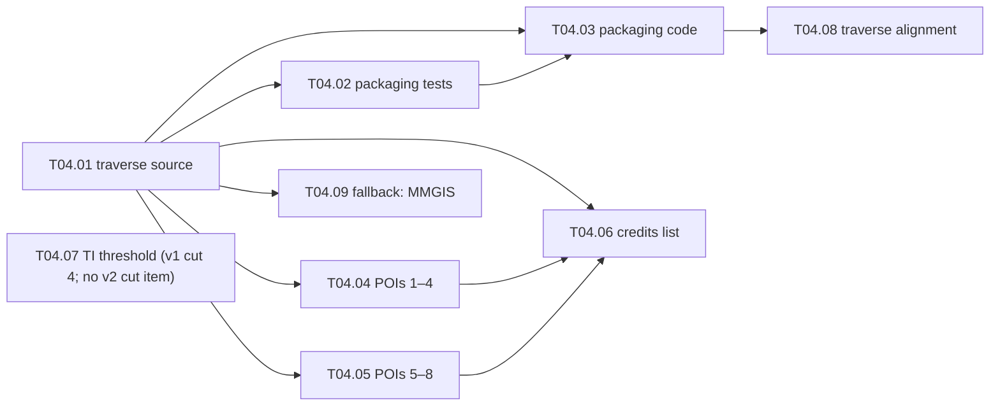

# TASK-04 — Vectors, POIs and images

| Field | Value |
| --- | --- |
| Objective | Vectors, POIs and images |
| Requirements | FR-04, FR-17 (06 §C); also FR-10 (T04.07, v1 cut 4, no v2 cut item), NFR-07 (T04.06), U-03, U-04 |
| Lane / owner role | data — R1 support: Mishkat Ahmed Khan (data half); story — R6: Sadman Shaharier Mahim (content half) |
| Milestone | M2 (06 §C.1 *When*: P 6–9 Nov) |
| Window | pre-event-allowed |
| Effort (doc 06) | 4–8 h |
| Done when (doc 06) | Traverse aligns with tracks at ≥ 3 checkpoints; every POI has credit + position source |
| Main risk → fallback | PLACES parsing slow → MMGIS JSON (cached, labelled unofficial) |
| Spec sections | [01 FR-04](../specs/01_Product_Requirements_Document.md#fr-04--points-of-interest-with-ground-imagery) · [01 FR-17](../specs/01_Product_Requirements_Document.md#fr-17--curiosity-traverse-overlay) · [01 §B](../specs/01_Product_Requirements_Document.md#b-goals-and-success-criteria) · [02 §C.2 L4](../specs/02_Technical_Requirements_Document.md#l4--thermal-inertia-fr-02-fr-10) · [02 §C.2 L6](../specs/02_Technical_Requirements_Document.md#l6--mission-vectors-fr-04-fr-17) · [02 §E.1](../specs/02_Technical_Requirements_Document.md#e1-static-asset-contract) · [02 §F.1](../specs/02_Technical_Requirements_Document.md#f1-test-plan) · [05 POI](../specs/05_Backend_and_Database_Schema.md#poi) · [05 TraversePoint](../specs/05_Backend_and_Database_Schema.md#traversepoint) · [05 §F.2](../specs/05_Backend_and_Database_Schema.md#f2-poi-feature) · [06 §C](../specs/06_High_Level_Implementation_Plan.md#c-work-packages) · [06 §D.5](../specs/06_High_Level_Implementation_Plan.md#d5-data-and-service-fallbacks) · [ADR-007](../decisions/ADR-007-pov-imagery.md) |

> **Re-dated 2026-11-06** to [06](../specs/06_High_Level_Implementation_Plan.md) v2.2 (session handoff §F.2): milestones follow 06 §B v2, windows follow Track P (recorded 4 Nov), cut tags follow the v2 cut list in 06 §D.4 ([map §h.6](_coordination.md#h6-cut-list--subtasks-06-d4)), and every subtask names its Owner from 06 §A.2. Step texts that still mention v1 times (for example "Day 1" or "M5") refer to the v1 plan; the register in the [coordination map](_coordination.md#a3-register) is authoritative.

06 §C deliverable: `traverse.geojson`, `pois.geojson` (5–8 POIs), `images/`, credits list. This task writes the curated inputs and the packaging code; the T03.19 pipeline run writes the bundle files.

## Inputs this task consumes

| Input | Kind | Owner | Dependency |
| --- | --- | --- | --- |
| C1–C2: POI, TraversePoint, Layer and DataSource field names (`packages/protocol/src/schema.ts`, `schemas/site-manifest.schema.json`) | contract | T03.01 | soft |
| C5: site-config input layout (`pipeline/sites/README.md`) | contract | T03.01 | soft |
| Chosen AOI and site (D-01) in `docs/ops/feasibility.md` | upstream output | T01.05 | read only; M0 ends before M1 (see Spec questions) |
| THEMIS tile id and coverage note `docs/ops/feasibility/coverage.md` | upstream output | T01.04 | read only (T04.06, T04.07) |
| Clipped AOI TI raster and ortho in `pipeline/work/` | upstream output | T03.08 | hard (T04.07, T04.08) |

## Outputs this task provides

| Output | Path | Consumers |
| --- | --- | --- |
| Traverse DataSource and Layer records | `pipeline/sites/gale_boxwork/sources/<traverse-source-id>.json`, `pipeline/sites/gale_boxwork/layers/traverse.json` | T03.13, T03.19, T04.06, T12.03 |
| Curated POI records and the POI layer record | `pipeline/sites/gale_boxwork/pois/`, `pipeline/sites/gale_boxwork/layers/pois.json` | T03.19, T07.14 |
| POI images, saved by hand (git-ignored) | `pipeline/work/images/` | T03.19 |
| Packaging code | `pipeline/src/marswalk_pipeline/vectors.py` | T03.15, T03.19 |
| Packaged vectors (written by the T03.19 run) | `data/sites/gale_boxwork/vectors/traverse.geojson`, `data/sites/gale_boxwork/vectors/pois.geojson` | T07.10, T07.11, T10.01 |
| Dataset and image credits list | `docs/ops/credits.md` | T12.03, T16.03, T16.05 |
| TI threshold (v1 cut 4; no v2 cut item) | `pipeline/sites/gale_boxwork/ti_threshold.json`, `docs/ops/ti-threshold.md` | T03.10, T12.04, T16.02 |
| Measured traverse offset | `pipeline/sites/gale_boxwork/known_offsets/traverse.json` | T03.13, T03.19 |

## Subtasks

### T04.01 — Choose and cache the traverse source (U-04); write its DataSource and Layer records

- **Owner:** Obidit Islam (team lead · R1 Data & GIS) — taken over from Mishkat Ahmed Khan on 9 Nov to unblock T03.19 (data lead's call; Mishkat informed on the PR)
- **Type:** human
- **Tag:** human-required · core
- **Window:** pre-event-allowed
- **Estimate:** 1.5–2.5 h
- **Owns (writes):** `pipeline/sites/gale_boxwork/sources/<traverse-source-id>.json`, `pipeline/sites/gale_boxwork/layers/traverse.json`
- **Reads:** [02 §C.2 L6](../specs/02_Technical_Requirements_Document.md#l6--mission-vectors-fr-04-fr-17), [02 §C.2](../specs/02_Technical_Requirements_Document.md#c2-data-layers) (AOI and sol range), [02 Sources](../specs/02_Technical_Requirements_Document.md#sources-accessed-2026-11-02), [05 DataSource](../specs/05_Backend_and_Database_Schema.md#datasource), [05 Layer](../specs/05_Backend_and_Database_Schema.md#layer), [05 TraversePoint](../specs/05_Backend_and_Database_Schema.md#traversepoint), [05 §F.1](../specs/05_Backend_and_Database_Schema.md#f1-site-manifest-abridged-aoi-values-illustrative-until-task-01), [03 SCR-03](../specs/03_App_Flow_and_Diagrams.md#scr-03--layers-panel), `docs/ops/feasibility.md`, `pipeline/sites/README.md`
- **Depends on:** T03.01 (soft), T01.05 (hard: the cached traverse range depends on the chosen AOI and site)
- **Parallel with:** T04.07, T03.16, T03.17
- **Steps:**
  1. Compare the preferred source, the PDS PLACES archive (`doi:10.17189/1520397`), with the MMGIS fallback ([02 §C.2 L6](../specs/02_Technical_Requirements_Document.md#l6--mission-vectors-fr-04-fr-17)); check the PLACES field layout, which 02 marks "to verify".
  2. Cache the traverse portion that covers the AOI recorded in `docs/ops/feasibility.md` into `pipeline/work/` (git-ignored). The sol range is ≈ 4,450–4,750 per 02 §C.2; the exact range is `TODO(decision)` from the AOI.
  3. Record the U-04 decision, the cached file names, the field layout and the cache path in the PR description (no file is assigned for it yet; see Spec questions).
  4. Write the DataSource record with every required 05 field (source id, title, publisher, missions, instruments, version, url, credit, licence, accessed) copied from the source page; unknown values stay `TODO(verify)`.
  5. Write the traverse Layer record: category `mission`, kind `vector`, provenance `measured` (05 TraversePoint), visible by default (03 SCR-03 "Curiosity traverse (on)"), its source id, and the asset id `vec-traverse` used in 05 §F.1. Legend and resolution fields follow C2 and C5 (`TODO(decision)`, see Spec questions).
- **Acceptance:**
  - Serves: FR-17, U-04 · [02 §C.2 L6](../specs/02_Technical_Requirements_Document.md#l6--mission-vectors-fr-04-fr-17)
  - The chosen source, its URL or DOI and the field layout are written down where T04.02, T04.03 and T16.02 can read them.
  - The DataSource record has every field 05 marks required; the source id is unique and kebab-case.
  - The Layer record parses as JSON and uses only fields from 05 §C Layer.
  - Nothing under `pipeline/work/` is committed.
- **Verify:** `python3 -m json.tool pipeline/sites/gale_boxwork/layers/traverse.json`; the same for the DataSource record; `git status --short` lists no `pipeline/work/` file; manual check of both records against 05 §C.
- **Agent brief:** The data lead chooses between PDS PLACES and MMGIS and caches the traverse data. An agent may compare the two formats and draft the two JSON records from the source pages and 05 §C. It never invents URLs, DOIs, versions or field names.
- **Conflict notes:** Both files are new in the append-only-by-file folders `sources/` and `layers/` (map §c.3); never edit another subtask's record. The cached data stays in `pipeline/work/`. T04.09 may replace `layers/traverse.json` if its trigger fires.

### T04.02 — Tests: traverse and POI packaging

- **Owner:** Mishkat Ahmed Khan (R2 Compute lead · R1 support)
- **Type:** test
- **Tag:** agent-ready · core
- **Window:** pre-event-allowed
- **Estimate:** 1–1.5 h
- **Owns (writes):** `pipeline/tests/test_vectors.py`
- **Reads:** `pipeline/src/marswalk_pipeline/vectors.py` (signatures), `pipeline/sites/README.md`, [05 POI](../specs/05_Backend_and_Database_Schema.md#poi), [05 TraversePoint](../specs/05_Backend_and_Database_Schema.md#traversepoint), [05 §F.1](../specs/05_Backend_and_Database_Schema.md#f1-site-manifest-abridged-aoi-values-illustrative-until-task-01), [05 §F.2](../specs/05_Backend_and_Database_Schema.md#f2-poi-feature), [02 §C.1](../specs/02_Technical_Requirements_Document.md#c1-coordinate-reference-conventions-applies-to-every-layer), [02 §E.1](../specs/02_Technical_Requirements_Document.md#e1-static-asset-contract), [01 FR-04](../specs/01_Product_Requirements_Document.md#fr-04--points-of-interest-with-ground-imagery), [01 FR-17](../specs/01_Product_Requirements_Document.md#fr-17--curiosity-traverse-overlay), the traverse layout recorded by T04.01
- **Depends on:** T03.01 (soft), T04.01 (hard: the traverse source field layout)
- **Parallel with:** T04.04, T04.05, T04.07
- **Steps:**
  1. Read the frozen signatures `package_traverse(src, proj4, out)` and `package_pois(curated, proj4, out)`.
  2. Build synthetic inputs in a temporary folder: POI records in the C5 layout and a small traverse file in the layout T04.01 recorded. Follow the fixture value rule (map §e); use the 05 §F.1 example `crs.proj4` string verbatim.
  3. Write the POI-output cases listed under Acceptance.
  4. Write the traverse-output cases.
  5. Add the repeat-run case, and skip pyproj-dependent cases with `pytest.importorskip("pyproj")` so CI without the geo stack stays green.
  6. Open the PR as a draft; it merges right before T04.03 (stacked).
- **Acceptance:**
  - Serves: FR-04, FR-17 · [05 POI](../specs/05_Backend_and_Database_Schema.md#poi), [05 TraversePoint](../specs/05_Backend_and_Database_Schema.md#traversepoint), [02 §E.1](../specs/02_Technical_Requirements_Document.md#e1-static-asset-contract)
  - `pois.geojson` is a FeatureCollection of Point Features in working-projection metres, with `lat` and `lon_e` kept as properties (02 §E.1).
  - Every POI Feature carries the 05 required properties; `science_objective` and `why_it_matters` are at most 300 characters; `position_uncertainty_m` is ≥ 0; `provenance` is one of measured, derived, modelled, assumed.
  - A POI with `image_asset` also has `image_credit` and `image_source_url`; every POI has `position_source` (01 FR-04, 05 §C).
  - With the 05 §F.1 example projection, a point at its `lat_0`/`lon_0` is written at (0, 0) (02 §C.1: origin at the AOI centre).
  - `traverse.geojson` holds Point Features with an integer `sol` and a `source_id`, plus exactly one LineString (05 TraversePoint).
  - The same inputs packaged twice give byte-identical files (supports the T03.22 checksum re-run).
  - Not claimed here: POIs inside the AOI and passable (T03.06), projection round trip and CRS guard (T03.03).
- **Verify:** `$(make -s pipeline-python) -m pytest pipeline/tests/test_vectors.py` (run `make check-env` first; environment from `pipeline/environment.yml`).
- **Agent brief:** Write `pipeline/tests/test_vectors.py` for `package_traverse` and `package_pois` from 05 §C POI/TraversePoint and 02 §E.1. Use synthetic inputs only (map §e value rule) and the 05 §F.1 projection string. Tests fail against the stubs and pass once T04.03 lands.
- **Conflict notes:** New file. Stacked PR with T04.03 (map §h.3); do not touch `test_manifest.py` (T03.06) or `test_clip_reproject.py` (T03.03). T04.09 may add an MMGIS case if its trigger fires.

### T04.03 — Implement traverse and POI packaging

- **Owner:** Mishkat Ahmed Khan (R2 Compute lead · R1 support)
- **Type:** implement
- **Tag:** agent-ready · core
- **Window:** pre-event-allowed
- **Estimate:** 1.5–2.5 h
- **Owns (writes):** `pipeline/src/marswalk_pipeline/vectors.py`
- **Reads:** `pipeline/tests/test_vectors.py`, `pipeline/sites/README.md`, `pipeline/src/marswalk_pipeline/config.py` (read only), [02 §C.1](../specs/02_Technical_Requirements_Document.md#c1-coordinate-reference-conventions-applies-to-every-layer), [02 §C.4](../specs/02_Technical_Requirements_Document.md#c4-mars-specific-pitfalls-to-test-explicitly), [02 §E.1](../specs/02_Technical_Requirements_Document.md#e1-static-asset-contract), [05 POI](../specs/05_Backend_and_Database_Schema.md#poi), [05 TraversePoint](../specs/05_Backend_and_Database_Schema.md#traversepoint), the traverse layout recorded by T04.01
- **Depends on:** T04.02 (hard: paired tests), T04.01 (hard: the cached source and its layout), T03.01 (soft)
- **Parallel with:** T04.04, T04.05, T04.06, T04.07
- **Steps:**
  1. Implement `package_pois`: read every POI record of the C5 layout in a stable order, project `lat`/`lon_e` to working-projection metres with the `proj4` string passed in, and write Point Features with the 05 POI properties.
  2. Implement `package_traverse`: parse the cached source per the recorded layout; write Point Features with `sol`, `site_drive`, `lat`, `lon_e`, `elevation_m` (if provided) and `source_id`, plus one LineString.
  3. Keep the output deterministic (stable feature order and key order) so checksums reproduce.
  4. Use only the Mars `proj4` string; never route coordinates through EPSG:3857 or WGS84 ([02 §C.4](../specs/02_Technical_Requirements_Document.md#c4-mars-specific-pitfalls-to-test-explicitly)).
  5. Run T04.02's tests until they pass; keep the frozen signatures.
- **Acceptance:**
  - Serves: FR-04, FR-17 · [02 §E.1](../specs/02_Technical_Requirements_Document.md#e1-static-asset-contract), [05 §F.2](../specs/05_Backend_and_Database_Schema.md#f2-poi-feature)
  - Every T04.02 case passes.
  - Output names match 02 §E.1: `vectors/traverse.geojson` and `vectors/pois.geojson` under the site folder.
  - `package_traverse(src, proj4, out)` and `package_pois(curated, proj4, out)` keep their signatures, because T03.15 calls them.
- **Verify:** `$(make -s pipeline-python) -m pytest pipeline/tests/test_vectors.py`; `make test`.
- **Agent brief:** Fill in `package_traverse` and `package_pois` in `vectors.py` until `pipeline/tests/test_vectors.py` passes. Use pyproj with the given Mars `proj4` string only; keep output stable and the signatures unchanged.
- **Conflict notes:** Stacked on T04.02. Files outside `vectors.py` are not touched; the T03.19 run writes the bundle files. T04.09 may replace the traverse parser if its trigger fires.

### T04.04 — Curate POIs 1–4 with images, credits and position sources; write the POI layer record

- **Owner:** Sadman Shaharier Mahim (product & systems lead · R4 Hab Core · demo story)
- **Type:** human
- **Tag:** human-required · core
- **Window:** pre-event-allowed
- **Estimate:** 2–3 h
- **Owns (writes):** `pipeline/sites/gale_boxwork/pois/poi-boxwork-ridge.json`, `pipeline/sites/gale_boxwork/pois/<poi_id_2>.json`, `pipeline/sites/gale_boxwork/pois/<poi_id_3>.json`, `pipeline/sites/gale_boxwork/pois/<poi_id_4>.json`, `pipeline/sites/gale_boxwork/layers/pois.json`
- **Reads:** [01 FR-04](../specs/01_Product_Requirements_Document.md#fr-04--points-of-interest-with-ground-imagery), [01 §E](../specs/01_Product_Requirements_Document.md#e-core-demonstration-scenario) (step 3), [03 SCR-06](../specs/03_App_Flow_and_Diagrams.md#scr-06--poi-detail-panel), [05 POI](../specs/05_Backend_and_Database_Schema.md#poi), [05 §F.2](../specs/05_Backend_and_Database_Schema.md#f2-poi-feature), [05 §E.6](../specs/05_Backend_and_Database_Schema.md#e6-unavailable-or-replaced-source-data), [02 §C.2 L6](../specs/02_Technical_Requirements_Document.md#l6--mission-vectors-fr-04-fr-17), [06 §D.5](../specs/06_High_Level_Implementation_Plan.md#d5-data-and-service-fallbacks), [ADR-007](../decisions/ADR-007-pov-imagery.md), `docs/ops/feasibility.md`, `pipeline/sites/README.md`, the traverse cached by T04.01
- **Depends on:** T03.01 (soft), T04.01 (hard: positions come from the cached traverse), T01.05 (hard: POIs must lie inside the chosen AOI), T04.10 (soft: stop-type list, v2)
- **Parallel with:** T04.02, T04.03, T04.05, T04.07
- **Steps:**
  1. Choose four POIs from NASA mission blog and photojournal descriptions of the boxwork campaign (02 §C.2 L6), including "Boxwork ridge" (01 §E step 3). Ids other than `poi-boxwork-ridge` are `TODO(decision)`.
  2. For each, fill the 05 POI fields: name, `lat`, `lon_e`, `science_objective` and `why_it_matters` (at most 300 characters each), `position_source`, `position_uncertainty_m` and provenance `assumed`. Positions come from a cited source, such as a traverse waypoint at a sol.
  3. Pick one Curiosity Navcam or Mastcam image per POI from NASA raw-image or photojournal pages and save it by hand as `pipeline/work/images/<poi_id>.jpg` (git-ignored; `TODO(decision)` on this staging path, see Spec questions).
  4. Record `image_credit` ("NASA/JPL-Caltech", with MSSS for Mastcam, 02 §C.2 L6), the exact `image_source_url`, `image_sol`, `image_date`, `image_camera` and the `image_asset` id (05 example style `img-boxwork-ridge`).
  5. Check each POI against the AOI recorded by T01.05; replace any that falls outside.
  6. Write the POI Layer record: category `mission`, kind `vector`, provenance `assumed`, visible by default (03 SCR-03 "POIs (on)"), asset id `vec-pois` (05 §F.1); legend and resolution fields per C2 and C5.
  7. (v2, FR-45) Give each POI a `stop_type`, an objective and its evidence, using the stop-type list in `docs/ops/exploration-zone.md` (T04.10).
- **Acceptance:**
  - Serves: FR-04 · [01 FR-04](../specs/01_Product_Requirements_Document.md#fr-04--points-of-interest-with-ground-imagery), [05 POI](../specs/05_Backend_and_Database_Schema.md#poi)
  - Four POI records exist, one of them `poi-boxwork-ridge`.
  - Every POI has `position_source` and `position_uncertainty_m`; every POI with an image has `image_credit` and `image_source_url` (05 §C; see Spec questions on the FR-04 wording).
  - Every position, sol, date and credit traces to a cited page; nothing is estimated by an agent.
  - Images are Curiosity frames saved locally and never committed; none shows a person.
- **Verify:** `python3 -m json.tool` on each new record; `git status --short` shows no image staged; manual checklist: fields against 05 §C, text lengths, AOI check, credit present.
- **Agent brief:** The story lead picks the POIs and images. An agent may draft `science_objective` and `why_it_matters` from the cited NASA pages and fill the JSON from the curator's notes. It never invents positions, sols, dates, uncertainties or credits.
- **Conflict notes:** New files in the append-only-by-file folders `pois/` and `layers/`. Agree POI ids with T04.05 in the claims table to avoid duplicates. T07.14 builds the demo plan from these ids, and T03.19 must run after them.

### T04.05 — Curate POIs 5–8 (at least one, to reach the 5-POI minimum)

- **Owner:** Sadman Shaharier Mahim (product & systems lead · R4 Hab Core · demo story)
- **Type:** human
- **Tag:** human-required · core
- **Window:** pre-event-allowed
- **Estimate:** 1.5–3 h
- **Owns (writes):** `pipeline/sites/gale_boxwork/pois/<poi_id_5>.json`, `pipeline/sites/gale_boxwork/pois/<poi_id_6>.json`, `pipeline/sites/gale_boxwork/pois/<poi_id_7>.json`, `pipeline/sites/gale_boxwork/pois/<poi_id_8>.json`
- **Reads:** same as T04.04
- **Depends on:** T03.01 (soft), T04.01 (hard: positions come from the cached traverse), T01.05 (hard: POIs must lie inside the chosen AOI), T04.10 (soft: stop-type list, v2)
- **Parallel with:** T04.02, T04.03, T04.04, T04.07
- **Steps:**
  1. Choose one to four further POIs so the site has 5–8 (01 FR-04); ids are `TODO(decision)`.
  2. Fill the 05 POI fields as in T04.04 steps 2–4, saving each image by hand to `pipeline/work/images/<poi_id>.jpg`.
  3. Check each POI against the AOI recorded by T01.05.
  4. Drop the unused placeholder files from the PR; only curated POIs are committed.
  5. (v2, FR-45) Give each POI a `stop_type`, an objective and its evidence, using the stop-type list in `docs/ops/exploration-zone.md` (T04.10).
- **Acceptance:**
  - Serves: FR-04 · [01 FR-04](../specs/01_Product_Requirements_Document.md#fr-04--points-of-interest-with-ground-imagery), [05 POI](../specs/05_Backend_and_Database_Schema.md#poi)
  - With T04.04, the site has 5–8 POIs.
  - Each new POI meets the T04.04 field, source and image criteria.
- **Verify:** `python3 -m json.tool` on each new record; `ls pipeline/sites/gale_boxwork/pois/` lists 5–8 files; manual checklist as in T04.04.
- **Agent brief:** The story lead adds the remaining POIs. An agent may draft text and fill JSON from the curator's cited notes, never inventing positions, sols, dates, uncertainties or credits.
- **Conflict notes:** New files only. Coordinate ids with T04.04; `layers/pois.json` belongs to T04.04.

### T04.06 — Write the dataset and image credits list

- **Owner:** Sadman Shaharier Mahim (product & systems lead · R4 Hab Core · demo story)
- **Type:** human
- **Tag:** human-required · core
- **Window:** pre-event-allowed
- **Estimate:** 0.5–1 h
- **Owns (writes):** `docs/ops/credits.md`
- **Reads:** [02 §C.2](../specs/02_Technical_Requirements_Document.md#c2-data-layers) (attribution lines), [02 Sources](../specs/02_Technical_Requirements_Document.md#sources-accessed-2026-11-02), [02 §F](../specs/02_Technical_Requirements_Document.md#f-nonfunctional-requirements-and-validation) (NFR-07), [05 DataSource](../specs/05_Backend_and_Database_Schema.md#datasource), `docs/ops/feasibility/coverage.md`, the records under `pipeline/sites/gale_boxwork/pois/` and `sources/`
- **Depends on:** T04.01 (hard: the traverse source credit), T04.04 (hard: image credits), T04.05 (hard: image credits)
- **Parallel with:** T04.02, T04.03, T04.07, T04.08
- **Steps:**
  1. List each planned dataset of 02 §C.2 (L1–L4, L6, L7; L5 only if built) with publisher, credit and use constraints copied from 02 and its source page.
  2. List each POI image: POI id, camera, sol, credit and source URL, copied from the POI records.
  3. Add the traverse source with its credit.
  4. Mark anything not yet known (for example the THEMIS file name) `TODO(verify)`.
- **Acceptance:**
  - Serves: FR-04, NFR-07 · [02 §F](../specs/02_Technical_Requirements_Document.md#f-nonfunctional-requirements-and-validation)
  - Every POI image appears with its credit and source URL.
  - Every 02 §C.2 dataset in the build appears with the credit 02 states (e.g. L1: "NASA/JPL-Caltech/University of Arizona; USGS Astrogeology (Calef & Parker 2016)").
  - No credit text is written from memory; each line traces to 02 or a source page.
- **Verify:** manual cross-check of every `image_credit` in `pipeline/sites/gale_boxwork/pois/` against the list; `npx --no-install markdownlint-cli2 docs/ops/credits.md`; `python3 scripts/check_links.py docs/ops/credits.md`.
- **Agent brief:** Compile `docs/ops/credits.md` from 02 §C.2, 02 Sources and the curated POI and source records. Copy credit strings exactly; mark unknowns `TODO(verify)`. The story lead reviews.
- **Conflict notes:** New file. The README (T16.03) and SCR-09 (T12.03) read it but own their own copies; T16.05 checks they agree.

### T04.07 — Resolve U-03: TI "loose fines" threshold from the AOI histogram and literature

- **Owner:** Obidit Islam (team lead · R1 Data & GIS) — taken over from Mishkat Ahmed Khan on 9 Nov to unblock T03.19 (data lead's call; Mishkat informed on the PR)
- **Type:** human
- **Tag:** human-required · core
- **Window:** pre-event-allowed
- **Estimate:** 1–2 h
- **Owns (writes):** `pipeline/sites/gale_boxwork/ti_threshold.json`, `docs/ops/ti-threshold.md`
- **Reads:** [02 §C.2 L4](../specs/02_Technical_Requirements_Document.md#l4--thermal-inertia-fr-02-fr-10), [01 §F.2](../specs/01_Product_Requirements_Document.md#f2-key-assumptions) (A-05), [05 Flag bits](../specs/05_Backend_and_Database_Schema.md#flag-bits), [02 Unresolved](../specs/02_Technical_Requirements_Document.md#unresolved-decisions-owned-by-this-document) (U-03), `pipeline/sites/README.md`, the clipped AOI TI raster in `pipeline/work/`
- **Depends on:** T03.08 (hard: The TI histogram and the alignment check need the clipped AOI rasters), T03.01 (soft)
- **Parallel with:** T04.01–T04.06, T04.08
- **Steps:**
  1. Compute the AOI TI histogram with a short `rasterio`/`numpy` command on the clipped raster, and record the exact command and its output in the note so it can be re-run.
  2. Look up the published interpretation of low thermal inertia as loose fines and cite it (`TODO(verify)`: sources).
  3. The data lead chooses a threshold in tiu, or decides there is no defensible one.
  4. If chosen, write `ti_threshold.json` in the C5 layout with value, unit and an "interpretive" label.
  5. Write `docs/ops/ti-threshold.md`: method, histogram, citation, the interpretive label (02 §C.2 L4), and the limits from 01 A-05 and 02 L4 (100 m pixels, ~20 % absolute accuracy).
- **Acceptance:**
  - Serves: FR-10, U-03 · [02 §C.2 L4](../specs/02_Technical_Requirements_Document.md#l4--thermal-inertia-fr-02-fr-10)
  - The threshold traces to the recorded histogram and a cited interpretation, and is labelled interpretive.
  - If no threshold is chosen, the note says so and `ti_threshold.json` is not written; T03.10 then sets no `LOW_TI` bits (v1 cut 4, no v2 cut item, map §h.6).
  - TI gaps stay "unknown", never zero (02 §C.2 L4).
- **Verify:** re-run the recorded command and compare its output with the note; `python3 -m json.tool pipeline/sites/gale_boxwork/ti_threshold.json` if written; manual review of the citation.
- **Agent brief:** An agent may run the histogram command and draft `docs/ops/ti-threshold.md`. The data lead chooses the threshold; the agent never proposes a number.
- **Conflict notes:** T03.10 reads `ti_threshold.json` (an absent file means no `LOW_TI`). V1 cut 4 (no v2 cut item) drops this subtask; T16.02 copies the U-03 outcome into the spec tables.

### T04.08 — Verify traverse alignment with HiRISE tracks at the checkpoints; record the offset

- **Owner:** Mishkat Ahmed Khan (R2 Compute lead · R1 support)
- **Type:** verify
- **Tag:** human-required · core
- **Window:** pre-event-allowed
- **Estimate:** 1–1.5 h
- **Owns (writes):** `pipeline/sites/gale_boxwork/known_offsets/traverse.json`, `docs/ops/verification-log.md` (append-only)
- **Reads:** [01 FR-17](../specs/01_Product_Requirements_Document.md#fr-17--curiosity-traverse-overlay), [01 §B](../specs/01_Product_Requirements_Document.md#b-goals-and-success-criteria), [02 §F.1](../specs/02_Technical_Requirements_Document.md#f1-test-plan), [02 §C.2 L6](../specs/02_Technical_Requirements_Document.md#l6--mission-vectors-fr-04-fr-17) (alignment tolerance), [05 Site](../specs/05_Backend_and_Database_Schema.md#site) (`known_offsets_m`), `pipeline/sites/README.md`, [map open point 9](_coordination.md#open-points)
- **Depends on:** T04.03 (hard: the packaged traverse), T03.08 (hard: The TI histogram and the alignment check need the clipped AOI rasters)
- **Parallel with:** T04.04, T04.05, T04.06, T04.07
- **Steps:**
  1. Package the traverse locally with T04.03's code and load it over the clipped ortho in a GIS viewer.
  2. Check alignment with visible rover tracks at 5 checkpoints, which satisfies both the ≥ 3 of FR-17 and 06 and the 5 of 01 §B and 02 §F.1.
  3. Measure the offset in metres at each checkpoint and compare it with the ≤ 5 m tolerance (02 §C.2 L6, Proposed).
  4. Write the measured offset to `known_offsets/traverse.json` in the C5 layout.
  5. Append a `## T04.08` section to the verification log: checkpoint locations, offsets, and the pass count against both thresholds.
- **Acceptance:**
  - Serves: FR-17 · [01 FR-17](../specs/01_Product_Requirements_Document.md#fr-17--curiosity-traverse-overlay), [02 §F.1](../specs/02_Technical_Requirements_Document.md#f1-test-plan)
  - Allocated case "Traverse on ortho at the checkpoints" (02 §F.1 Data alignment): *given* the packaged traverse and the clipped ortho, *when* checked at 5 locations, *then* the overlay aligns with the visible rover tracks within the stated tolerance at ≥ 3 of them (FR-17, 06 done-when), and the result at all 5 is recorded (01 §B, 02 §F.1).
  - The offset is a human measurement, written to `known_offsets/traverse.json`.
- **Verify:** manual checklist: 5 checkpoints logged, offsets in metres, pass counts for ≥ 3 and 5, offset file parses (`python3 -m json.tool pipeline/sites/gale_boxwork/known_offsets/traverse.json`).
- **Agent brief:** The data lead does the visual check and the measurements. An agent may set up the viewer project and the log section template, and must not estimate offsets.
- **Conflict notes:** The verification log is append-only (one section per verify subtask). The offset file must merge before T03.19 runs. If T04.09 later switches the source, the check repeats in a new log section.

### T04.09 — Fallback — start only if PLACES parsing is too slow: MMGIS JSON cached once, labelled unofficial

- **Owner:** Mishkat Ahmed Khan (R2 Compute lead · R1 support)
- **Type:** fallback
- **Tag:** human-required · core
- **Window:** pre-event-allowed
- **Estimate:** 2–3 h
- **Owns (writes):** `pipeline/sites/gale_boxwork/sources/<mmgis-source-id>.json`, `pipeline/sites/gale_boxwork/layers/traverse.json` (replaces T04.01), `pipeline/src/marswalk_pipeline/vectors.py` (replaces T04.03), `pipeline/tests/test_vectors.py` (replaces T04.02), `pipeline/sites/gale_boxwork/known_offsets/traverse.json` (replaces T04.08)
- **Reads:** [02 §C.2 L6](../specs/02_Technical_Requirements_Document.md#l6--mission-vectors-fr-04-fr-17), [06 §D.5](../specs/06_High_Level_Implementation_Plan.md#d5-data-and-service-fallbacks), [06 §C](../specs/06_High_Level_Implementation_Plan.md#c-work-packages) (TASK-04 risk), [05 DataSource](../specs/05_Backend_and_Database_Schema.md#datasource), [05 Layer](../specs/05_Backend_and_Database_Schema.md#layer), `pipeline/sites/README.md`
- **Depends on:** T04.01 (hard: the PLACES choice and the traverse layer record it replaces), T03.01 (soft)
- **Parallel with:** T04.04, T04.05, T04.07
- **Steps:**
  1. Confirm the trigger with the data lead: PLACES parsing is too slow (06 §C TASK-04 risk).
  2. Find the MSL MMGIS JSON path, which 02 §C.2 L6 marks unverified (`TODO(verify)`), and fetch it once into `pipeline/work/`.
  3. Write the MMGIS DataSource record and point `layers/traverse.json` at it, labelling the source unofficial in the layer `limitations` text (exact wording `TODO(decision)`).
  4. Add the MMGIS parse path to `package_traverse` plus one test case on a synthetic sample in the cached layout.
  5. Repeat the T04.08 alignment check on the new traverse, update the offset file and append a log section.
- **Acceptance:**
  - Serves: FR-17 · [06 §D.5](../specs/06_High_Level_Implementation_Plan.md#d5-data-and-service-fallbacks), [02 §C.2 L6](../specs/02_Technical_Requirements_Document.md#l6--mission-vectors-fr-04-fr-17)
  - The traverse comes from a single cached MMGIS file; nothing is fetched at runtime.
  - The UI-facing records label the source unofficial; the DataSource record has every required 05 field.
  - The T04.02 cases and the new MMGIS case pass.
- **Verify:** `$(make -s pipeline-python) -m pytest pipeline/tests/test_vectors.py`; `python3 -m json.tool` on both records; manual repeat of the T04.08 checklist.
- **Agent brief:** Only after the data lead confirms the trigger: cache the MSL MMGIS traverse JSON once, switch the traverse records to it, label it unofficial and add its parser and test. The MMGIS path is unverified; never guess it.
- **Conflict notes:** Writes files owned by T04.01, T04.02, T04.03 and T04.08 only after the trigger, never at the same time as them (map §c.1 rule 3). The new DataSource is a new file in the append-only-by-file `sources/` folder. T03.19 must run again if the bundle already exists.

### T04.10 — Write the Exploration Zone framing and the stop-type list (v2, FR-45, U-16)

- **Owner:** Sadman Shaharier Mahim (product & systems lead · R4 Hab Core · demo story)
- **Type:** human
- **Tag:** human-required · core
- **Window:** pre-event-allowed
- **Estimate:** 1–1.5 h
- **Owns (writes):** `docs/ops/exploration-zone.md`
- **Reads:** [01 FR-45](../specs/01_Product_Requirements_Document.md#fr-45--exploration-zone-layer-t0-m), [06 §C.1](../specs/06_High_Level_Implementation_Plan.md#c1-retained-from-v1-planning-spine-tier-0) TASK-04, [docs/reference](../reference/)
- **Depends on:** T01.05 (hard: AOI and site)
- **Parallel with:** T04.04
- **Steps:**
  1. Write the Exploration Zone framing for Gale (one paragraph) with its citation (U-16), or `TODO(verify)` if none is found.
  2. Define the stop types (science, resource and any others 01 FR-45 names) with one line each; T04.04 and T04.05 give every POI a `stop_type`, an objective and its evidence.
- **Acceptance:**
  - Serves: FR-45 · U-16
  - Every claim cites a source; the stop-type list matches 01 FR-45.
- **Verify:** `make docs-check`; a second person checks each citation.
- **Agent brief:** The product & systems lead writes it; an agent may collect candidate citations. No invented facts.
- **Conflict notes:** New file.

### T04.11 — Check the dust-record source for the scenario window (v2, U-17)

- **Owner:** Mishkat Ahmed Khan (R2 Compute lead · R1 support)
- **Type:** human
- **Tag:** human-required · desirable
- **Window:** pre-event-allowed
- **Estimate:** 0.5–1 h
- **Owns (writes):** `docs/ops/dust-record.md`
- **Reads:** [01 FR-49](../specs/01_Product_Requirements_Document.md#fr-49--dust-advisory-replay-t2-s), [06 §C.1](../specs/06_High_Level_Implementation_Plan.md#c1-retained-from-v1-planning-spine-tier-0) TASK-04
- **Depends on:** none
- **Parallel with:** T21.06
- **Steps:**
  1. Look for an orbiter weather-imagery record of dust activity near Gale in the scenario window (U-17).
  2. Record what was found with its source, or that nothing suitable exists; FR-49 is qualitative only.
- **Acceptance:**
  - Serves: FR-49 · U-17
  - The note states found or not found, with sources.
- **Verify:** `make docs-check`.
- **Agent brief:** A person searches; an agent may list candidate archives. Never quantify dust.
- **Conflict notes:** New file. Feeds T18.13 only.

## Internal dependency graph

Cross-task edges (T03.01 soft; T03.08 hard into T04.07 and T04.08; this task into T03.19 and T07.14) are in the Inputs and Outputs tables and in [map §f](_coordination.md#f-dependency-graph).

## Definition of done (task level)

- [06 §D.7](../specs/06_High_Level_Implementation_Plan.md#d7-definition-of-done-per-feature): acceptance criteria of FR-04 and FR-17 met; packaging unit tests committed (T04.02); provenance set on every record (POIs `assumed`, traverse `measured`); every source credited and listed for SCR-09 (T04.06); everything is a local file, so it works offline. Keyboard reachability does not apply (no UI here).
- 06 done-when: the traverse aligns with tracks at ≥ 3 checkpoints (T04.08); every POI has a credit and a position source (T04.04, T04.05).
- 5–8 POIs, including Boxwork ridge (01 FR-04, 01 §E step 3).
- U-04 is recorded; U-03 is recorded, or v1 cut 4 (no v2 cut item) is invoked.
- No downloaded data or images are committed (`CLAUDE.md` §2).
- `make test` and `python3 scripts/check_tasks.py` pass.

## Spec questions

1. **Checkpoint count** (map open point 9): FR-17 and 06 TASK-04 say ≥ 3 locations; 01 §B and 02 §F.1 say 5. T04.08 checks 5 and records both counts.
2. **Field name:** 01 FR-04 acceptance names `source_url`; 05 §C POI names `image_source_url`. The plan uses the 05 name, because 05 owns field names (`CLAUDE.md` §6); the FR-04 wording is not changed here.
3. **Image required?** 01 FR-04 says every POI has `image_credit` populated; 05 §C makes the image fields conditional, and 05 §E.6 keeps a POI valid with null image fields. The curators aim for an image on every POI; validation follows 05.
4. **Look direction:** 01 FR-04 shows an "approximate look direction if known", but 05 §C POI has no field for it — `TODO(decision)`: add it to 05 or drop it.
5. **Vector layers:** 05 §C Layer requires `legend`, `native_resolution_m`, `display_resolution_m` and a tiles-root `asset_id` for every layer, but the traverse and POI layers are vectors — `TODO(decision)` at C2 and C5 (T03.01).
6. **TI threshold home** (map open point 10): 05 has no manifest field for it, and 02 assigns U-03 to TASK-04 while 06 TASK-04 does not list it. T04.07 records it in `ti_threshold.json` and `docs/ops/ti-threshold.md`.
7. **"In/near the AOI"** (01 FR-17) gives no distance. The cached sol range (≈ 4,450–4,750 per 02 §C.2) and any clipping margin are `TODO(decision)` in T04.01; the frozen `package_traverse` signature has no extent argument.
8. **MMGIS path:** 02 §C.2 L6 says the MSL path is unverified — `TODO(verify)` in T04.09.
9. **Map change proposed:** §c gives T04.01 no document for the U-04 outcome and the PLACES field layout, while U-03 has `docs/ops/ti-threshold.md`. Add `docs/ops/traverse-source.md` owned by T04.01. Until then the decision lives in T04.01's PR description.
10. **Map change proposed (optional):** 06 §C makes TASK-04 depend on TASK-01, but the map has no edge from T01.05 to T04.01, T04.04 or T04.05. The plan relies on M0 ending before M1 and on validate-manifest (05 §E.3) at T03.19. Add T01.05 → T04.01, T04.04, T04.05 (hard: the AOI bounds) if the team wants it enforced.
11. **Image staging:** the specs say where images end up (`images/<poi_id>.jpg`, 02 §E.1) but not where curated images wait before the run. This plan uses the git-ignored `pipeline/work/images/` (05 §B lists `pipeline/work/` for downloads) — `TODO(decision)` with T03.19. How team laptops share them depends on bundle hosting (map open point 13).
12. **Position uncertainty:** 05 §C requires `position_uncertainty_m` but gives no method — `TODO(decision)`; each curator states the basis in `position_source`.
