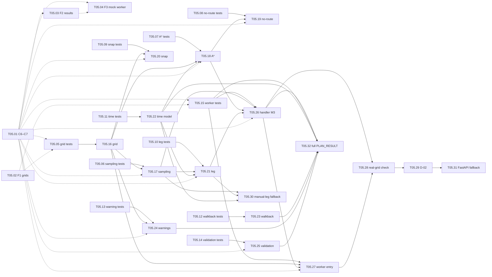

# TASK-05 — Compute core: grid loader, sampling, A*, profile, time model, walkback, warnings

| Field | Value |
| --- | --- |
| Objective | Compute core: grid loader, sampling, A*, profile, time model, walkback, warnings |
| Requirements | 06 §C: FR-03, FR-06–FR-10, NFR-02, NFR-06. Also served by subtasks here: FR-05, FR-11, FR-12, FR-16, NFR-10 |
| Lane / owner role | compute — Compute engineer |
| Milestone | M0 (contracts, fixtures), M3 (minimum slice for the walking skeleton), M4 (rest); under Track P the code moves to M0–M2 |
| Window | pre-event-if-permitted (Track P code); contract T05.01, fixture T05.03 and ADR record T05.29 are pre-event-allowed |
| Effort (doc 06) | 8–12 h |
| Done when (doc 06) | Tests green; real-grid p95 3-stop route ≤ 2 s |
| Main risk → fallback | Too slow → coarser grid / FastAPI alternative (02 §A.3) |
| Spec sections | [02 §D.1](../specs/02_Technical_Requirements_Document.md#d1-point-sampling-fr-03-fr-08) · [02 §D.2](../specs/02_Technical_Requirements_Document.md#d2-route-planning-fr-06-fr-07-fr-10) · [02 §D.3](../specs/02_Technical_Requirements_Document.md#d3-walking-time-model-fr-09) · [02 §E.2](../specs/02_Technical_Requirements_Document.md#e2-worker-message-protocol) · [02 §E.3](../specs/02_Technical_Requirements_Document.md#e3-input-validation-rules) · [02 §F.1](../specs/02_Technical_Requirements_Document.md#f1-test-plan) · [05 RoutingGrid](../specs/05_Backend_and_Database_Schema.md#routinggrid) · [05 PlanResult](../specs/05_Backend_and_Database_Schema.md#planresult-computed) · [05 §E.1](../specs/05_Backend_and_Database_Schema.md#e1-access-patterns-queries-and-indexes) · [01 FR-07](../specs/01_Product_Requirements_Document.md#fr-07--constraint-aware-route-computation) · [06 §C](../specs/06_High_Level_Implementation_Plan.md#c-work-packages) |

06 §C deliverable: `packages/compute/src/*` plus a Vitest suite with the cases in 02 §D; depends on the TASK-03 grid, "synthetic grid OK for tests". Contracts, fixtures and paths follow the frozen [coordination map](_coordination.md): [§c.4](_coordination.md#c4-web-app), [§c.5](_coordination.md#c5-web-tests-and-fixtures), [§d](_coordination.md#d-contracts-registry), [§e](_coordination.md#e-fixtures-and-mocks), [Test-case allocation](_coordination.md#test-case-allocation).

## Inputs this task consumes

| Input | Kind | Owner | Dependency |
| --- | --- | --- | --- |
| C1 TypeScript mirror of the 05 entities (`packages/protocol/src/schema.ts`), incl. the decision on optional PlanResult fields (open point 3) | contract | T03.01 | soft |
| C4 routing-grid binary layout (05 §C RoutingGrid, Flag bits; `LoadedGrid` in `packages/compute/src/grid.ts`) | contract | T03.01 | soft |
| C8 conditions interface (`packages/compute/src/conditions.ts`) | contract | T06.01 | soft (T05.32 only; tests mock it) |
| Real routing grid, bundle v1 (`data/sites/gale_boxwork/grid/`) | upstream output | T03.19 | hard (T05.28 only) |
| F5 real-grid sample cells (`apps/web/tests/fixtures/real/sample_cells.json`) | fixture | T03.21 | hard (T05.28 only: real data) |
| Auto-routing go/no-go in ADR-004 | upstream output | T09.06 | hard (T05.30 only: it is the trigger) |

At run time the full PLAN_RESULT also needs the TASK-06 implementations behind C8 (T06.06–T06.09); no subtask here waits for them.

## Outputs this task provides

| Output | Path | Consumers |
| --- | --- | --- |
| C6 worker message protocol v1 | `packages/protocol/src/worker.ts` | T05.04, T05.15, T05.26, T05.27, T07.04, T08.03 |
| C7 compute module layout and signatures v1 | stubs in `packages/compute/src/` | T05.05–T05.32, T08.04 (`validate.ts`) |
| F1 synthetic routing grids | `apps/web/tests/fixtures/grids.ts` | T05.05–T05.15, T05.30 |
| F2 canned PLAN_RESULT messages | `apps/web/tests/fixtures/plan-results/` | T05.04, T09.03–T09.07, T10.01–T10.03, T11.01–T11.05, T12.02 |
| F3 mock worker | `apps/web/tests/fixtures/mockWorker.ts` | T07.04, T07.12, T08.03–T08.11, T09.01–T09.07 |
| Compute worker (real) | `apps/web/src/worker/planWorker.ts` and modules | T07.04, T09.06, T11.05, T14.03–T14.10 |
| Input validation shared with the UI | `packages/compute/src/validate.ts` | T08.04, T08.11 |
| Real-grid benchmark result | `docs/ops/verification-log.md` section `T05.28` | T05.29 |
| D-02 decision record | `docs/decisions/ADR-002-static-app-no-backend.md` | T05.31 (trigger) |
| Manual-leg fallback (only if triggered) | `packages/compute/src/manualLeg.ts` | T09.08 |
| FastAPI fallback (only if triggered) | `server/` | TASK-07 worker client (map change proposed) |

## Subtasks

### T05.01 — Freeze compute contracts v1: worker protocol and compute module layout

- **Owner:** Mishkat Ahmed Khan (R2 Compute lead · R1 support)
- **Type:** contract
- **Tag:** agent-ready · core
- **Window:** pre-event-allowed
- **Estimate:** 2–3 h
- **Owns (writes):** `packages/protocol/src/worker.ts`, `packages/compute/src/route.ts` (stub → T05.18), `packages/compute/src/noRoute.ts` (stub → T05.19), `packages/compute/src/snap.ts` (stub → T05.20), `packages/compute/src/leg.ts` (stub → T05.21), `packages/compute/src/validate.ts` (stub → T05.25), `packages/compute/src/handler.ts` (stub → T05.26), `apps/web/src/worker/planWorker.ts` (stub → T05.27), `packages/compute/src/sampling.ts` (stub → T05.17), `packages/compute/src/warnings.ts` (stub → T05.24)
- **Reads:** [02 §E.2](../specs/02_Technical_Requirements_Document.md#e2-worker-message-protocol), [02 §E.3](../specs/02_Technical_Requirements_Document.md#e3-input-validation-rules), [02 §D.1](../specs/02_Technical_Requirements_Document.md#d1-point-sampling-fr-03-fr-08), [02 §D.2](../specs/02_Technical_Requirements_Document.md#d2-route-planning-fr-06-fr-07-fr-10), [02 §B](../specs/02_Technical_Requirements_Document.md#b-technology-choices), [05 PlanResult](../specs/05_Backend_and_Database_Schema.md#planresult-computed), `packages/protocol/src/schema.ts`, `packages/compute/src/`, `packages/compute/tests/`, map §d rows C6–C7 and open points 3–5
- **Depends on:** T03.01 (soft)
- **Parallel with:** T05.02, T05.03, T06.01, T07.01, T08.01
- **Steps:**
  1. Compare `protocol.ts` with 02 §E.2 field by field (message types, the `reason` set, error codes, cancel-check interval); fix mismatches, make the SAMPLE_RESULT value fields nullable as 02 §D.1 requires ("null values with reason"), and drop comments that no longer match 02.
  2. Record the C6 decisions as `TODO(decision)` in `protocol.ts`, each with its options: how the worker receives the routing grid (open point 4) and how a newer `plan_revision` cancels a running search (open point 5).
  3. Split the stubs without implementing anything: move `snapToPassable` to `snap.ts` and `toLeg` to `leg.ts` unchanged; move `handleMessage` from `worker.ts` to `handler.ts` with the loaded grid and site data as explicit inputs; add `noRoute.ts` (no-route reason and nearest reachable cell from the explored set) and `validate.ts` (field-level errors the UI can show, mapped to `INVALID_INPUT` by the worker). Every stub throws like the existing ones (`TODO(TASK-05)`, `CLAUDE.md` §3).
  4. Record the C7 decisions as `TODO(decision)`: projection maths in the worker (proj4 or hand-written eqc, 02 §B) and how `samplePoint` and `collectWarnings` get the inputs they lack (spec questions 5–6); whether `searchLeg` takes an injectable expansion limit so the TIMEOUT test stays small.
  5. List every exported signature in `packages/compute/src/` in the PR description as C7 v1, then run `make typecheck test`.
- **Acceptance:**
  - Serves: FR-03, FR-06, FR-07, NFR-06 · [02 §E.2](../specs/02_Technical_Requirements_Document.md#e2-worker-message-protocol)
  - `protocol.ts` matches 02 §E.2: request, response and error shapes, the `reason` set, error codes `GRID_NOT_LOADED`, `INVALID_INPUT`, `TIMEOUT`, `CANCELLED`, `INTERNAL`, and the cooperative check every 50,000 expansions.
  - `route.ts` keeps only `searchLeg`, `LegSearch` and the 02 §D.2 limits; `worker.ts` keeps only the entry; each new stub exports the signature its paired test subtask needs.
  - No function body is implemented (phase gate); `make typecheck test` passes with the existing `it.todo` suites.
  - Every open choice is a `TODO(decision)` that names its options; none is resolved without the lane owner's review.
- **Verify:** `make typecheck test`; `git grep -n "TODO(decision)" packages/compute/src/` lists the C6 and C7 decisions.
- **Agent brief:** Freeze the compute contracts. Align `packages/protocol/src/worker.ts` with 02 §E.2 and §D.1, split the compute stubs into the files map §c.4 lists (stubs only, no logic), and record the open C6/C7 choices as `TODO(decision)` with their options. Signatures must typecheck.
- **Conflict notes:** Blocking — do first. Writes stub-only edits to files that T05.17–T05.27 own after it merges; later signature changes go through a `contract-change:` subtask that lists consumers (map §d). T07.04, T08.03 and T08.04 consume `protocol.ts` and `validate.ts`, so announce the freeze in the PR.

### T05.02 — Fixture: synthetic routing grids

- **Owner:** Mishkat Ahmed Khan (R2 Compute lead · R1 support)
- **Type:** fixture
- **Tag:** agent-ready · core
- **Window:** pre-event-if-permitted
- **Estimate:** 1.5–2.5 h
- **Owns (writes):** `apps/web/tests/fixtures/grids.ts`, `apps/web/tests/fixtures/README.md` (append-only)
- **Reads:** [02 §D.2](../specs/02_Technical_Requirements_Document.md#d2-route-planning-fr-06-fr-07-fr-10) (Validation row), [05 RoutingGrid](../specs/05_Backend_and_Database_Schema.md#routinggrid), [05 Flag bits](../specs/05_Backend_and_Database_Schema.md#flag-bits), [05 §E.3](../specs/05_Backend_and_Database_Schema.md#e3-referential-integrity-validated-by-the-validate-manifest-command-and-at-app-boot-in-dev-builds), `packages/compute/src/grid.ts`, `packages/protocol/src/schema.ts`, map §e (F1, fixture value rule)
- **Depends on:** T03.01 (soft)
- **Parallel with:** T05.01, T05.03, T05.04, T05.05–T05.15
- **Steps:**
  1. Write builders that return `LoadedGrid` (C4 v1): 10° plane, wall with one gap, uniform 20° ramp, NaN island (usable as a barrier around a target), hazard wall (`HARD_HAZARD`), and a variant of any grid without the TI sidecar.
  2. Derive slope arrays (degrees × 4, 255 = no data) and flag bits (`FLAG_BITS`) in code from each declared shape; type no slope or elevation value by hand.
  3. Take `cell_m`, size and origin as parameters; no builder assumes 5 m cells.
  4. Append `## F1 — Synthetic routing grids` to `apps/web/tests/fixtures/README.md`: each shape, its parameters, the spec case it serves, and contract version C4 v1.
- **Acceptance:**
  - Serves: FR-07 · [02 §D.2](../specs/02_Technical_Requirements_Document.md#d2-route-planning-fr-06-fr-07-fr-10)
  - Every shape in the map's F1 row exists and typechecks as `LoadedGrid`; all arrays of a grid share width, height, `cell_m` and origin (05 §E.3).
  - Slope and flag arrays come from code; the README names the source of every non-placeholder value (fixture value rule, map §e).
- **Verify:** `make typecheck`; review the README section against map §e.
- **Agent brief:** Build synthetic `LoadedGrid` fixtures in `apps/web/tests/fixtures/grids.ts` for the 02 §D.2 validation cases (map §e, F1): plane, wall with a gap, 20° ramp, NaN island, hazard wall, no-TI variant. Derive slopes and flags in code from parameters; document each shape in the fixtures README.
- **Conflict notes:** README is append-only: the first fixture PR to merge adds the `# Test fixtures` heading, later PRs rebase and append only their section. A shape change after merge is a `follow-up:` that rechecks T05.05–T05.15 and T05.30.

### T05.03 — Fixture: canned PLAN_RESULT messages (OK, PARTIAL, OVER_LIMITS)

- **Owner:** Mishkat Ahmed Khan (R2 Compute lead · R1 support)
- **Type:** fixture
- **Tag:** agent-ready · core
- **Window:** pre-event-allowed
- **Estimate:** 1–1.5 h
- **Owns (writes):** `apps/web/tests/fixtures/plan-results/`, `apps/web/tests/fixtures/README.md` (append-only)
- **Reads:** [02 §E.2](../specs/02_Technical_Requirements_Document.md#e2-worker-message-protocol) (COMPUTE_PLAN and PLAN_RESULT examples), [05 PlanResult](../specs/05_Backend_and_Database_Schema.md#planresult-computed), [05 §F.3](../specs/05_Backend_and_Database_Schema.md#f3-plan-export-abridged-status-ok), [02 §E.3](../specs/02_Technical_Requirements_Document.md#e3-input-validation-rules), [04 §C.1 semantic colours](../specs/04_Design_Brief.md#status-and-alert-colours-ops), map §e
- **Depends on:** T03.01 (soft), T05.01 (soft)
- **Parallel with:** T05.02, T05.05–T05.15
- **Steps:**
  1. `partial.json`: the 02 §E.2 PLAN_RESULT example verbatim (status PARTIAL, one NO_ROUTE leg, `totals` null); fields the example omits get typed placeholders.
  2. `ok.json`: a PLAN_RESULT message carrying the 05 §F.3 `result` verbatim (status OK, totals, radiation, warnings), with `request_id` and `plan_revision` from the 02 §E.2 example; omitted fields get typed placeholders.
  3. `over-limits.json`: `ok.json` with status OVER_LIMITS and one `WALKBACK_EXCEEDED` warning (severity `blocked`, no location, as 04 §C.1 maps "limit exceeded"); its scenario sets `walkback_limit_km` to the 02 §E.3 minimum, 0.5, so the 05 §F.3 `max_walkback_km` of 3.06 exceeds it.
  4. Append `## F2 — Canned PLAN_RESULT messages` to the README: per file, the spec section behind every value, the assumed scenario, and the list of placeholders (for example the empty `profile` arrays).
- **Acceptance:**
  - Serves: FR-07, FR-08, FR-09, FR-10, FR-11, FR-12 · [02 §E.2](../specs/02_Technical_Requirements_Document.md#e2-worker-message-protocol)
  - Field names follow 05 §C and C1 v1 exactly; any NO_ROUTE leg goes with status PARTIAL and `totals` null (02 §E.2 rule).
  - Every number is copied from 02 §E.2, 05 §F.3 or 02 §E.3, or is a typed placeholder (`CLAUDE.md` §2, map §e).
- **Verify:** `python3 -m json.tool` on each file; `make typecheck` once T05.04 imports them typed; review the README entry.
- **Agent brief:** Write three canned PLAN_RESULT messages in `apps/web/tests/fixtures/plan-results/` (OK, PARTIAL, OVER_LIMITS) by copying the 02 §E.2 and 05 §F.3 examples verbatim and filling omitted fields with typed placeholders, as map §e prescribes. Invent no numbers; document every value's source in the fixtures README.
- **Conflict notes:** README is append-only. File names are what T05.04 and the frontend tests load; renaming needs a `follow-up:`. If T03.01 makes PlanResult fields optional (open point 3), a `follow-up:` drops the matching placeholders.

### T05.04 — Fixture: mock worker answering from the canned fixtures

- **Owner:** Mishkat Ahmed Khan (R2 Compute lead · R1 support)
- **Type:** fixture
- **Tag:** agent-ready · core
- **Window:** pre-event-if-permitted
- **Estimate:** 1–1.5 h
- **Owns (writes):** `apps/web/tests/fixtures/mockWorker.ts`, `apps/web/tests/fixtures/README.md` (append-only)
- **Reads:** [02 §E.2](../specs/02_Technical_Requirements_Document.md#e2-worker-message-protocol) (SAMPLE_RESULT example), `packages/protocol/src/worker.ts`, `apps/web/tests/fixtures/plan-results/`, map §e (F3)
- **Depends on:** T05.01 (soft), T05.03 (soft)
- **Parallel with:** T05.02, T05.05–T05.15
- **Steps:**
  1. Write a module worker that answers SAMPLE_POINT with the 02 §E.2 SAMPLE_RESULT example (verbatim, `request_id` echoed) and COMPUTE_PLAN with one F2 message, echoing `request_id` and `plan_revision`.
  2. Choose the F2 file from the worker URL query (for example `?result=partial`), defaulting to OK; an unknown name answers an ERROR with code `INTERNAL`.
  3. Import the JSON fixtures typed as the C6 message types, so `make typecheck` catches drift between F2 and C6.
  4. Append `## F3 — Mock worker` to the README: how to select a result, that it is for dev builds only, contract version C6 v1.
- **Acceptance:**
  - Serves: FR-03, FR-07 · [02 §E.2](../specs/02_Technical_Requirements_Document.md#e2-worker-message-protocol)
  - Every response typechecks as `WorkerResponse`; request ids and plan revisions are echoed.
  - It lives under `apps/web/tests/`; the production build (`make demo`) does not include it.
- **Verify:** `make typecheck`; manual: start it from a dev page through T07.04's dev switch once that exists, and check both message types.
- **Agent brief:** Write `apps/web/tests/fixtures/mockWorker.ts`, a module worker that answers the C6 protocol from the canned F2 messages and the 02 §E.2 SAMPLE_RESULT example, chosen by a URL query. Typed imports only, no logic beyond echoing ids; document it in the fixtures README.
- **Conflict notes:** README is append-only. The dev-only switch that loads it belongs to T07.04 (`apps/web/src/ui/workerClient.ts`); this file never imports from `apps/web/src/ui/`.

### T05.05 — Tests: grid loader and addressing

- **Owner:** Mishkat Ahmed Khan (R2 Compute lead · R1 support)
- **Type:** test
- **Tag:** agent-ready · core
- **Window:** pre-event-if-permitted
- **Estimate:** 0.5–1 h
- **Owns (writes):** `packages/compute/tests/grid.test.ts`
- **Reads:** [05 RoutingGrid](../specs/05_Backend_and_Database_Schema.md#routinggrid), [05 Flag bits](../specs/05_Backend_and_Database_Schema.md#flag-bits), [05 §E.1](../specs/05_Backend_and_Database_Schema.md#e1-access-patterns-queries-and-indexes), [05 §E.3](../specs/05_Backend_and_Database_Schema.md#e3-referential-integrity-validated-by-the-validate-manifest-command-and-at-app-boot-in-dev-builds), [05 §E.6](../specs/05_Backend_and_Database_Schema.md#e6-unavailable-or-replaced-source-data), `packages/compute/src/grid.ts`, `apps/web/tests/fixtures/grids.ts`
- **Depends on:** T05.01 (soft), T05.02 (soft)
- **Parallel with:** T05.06–T05.15
- **Steps:**
  1. Replace the `it.todo` entries with tests on F1 grids.
  2. Cell index: `i = floor((origin_y − y)/cell)`, `j = floor((x − origin_x)/cell)`, offset `i*width + j`; null outside the grid (05 §E.1).
  3. Slope u8 decodes as degrees × 4 with 255 = no data; flag bits match 05 §C; arrays whose dimensions differ from the grid metadata are rejected (05 §E.3).
  4. A grid without the TI sidecar still loads (05 §E.6).
  5. Read the cell size from `meta.cell_m`; no literal 5 m.
- **Acceptance:**
  - Serves: FR-03, FR-07 · [05 §E.1](../specs/05_Backend_and_Database_Schema.md#e1-access-patterns-queries-and-indexes)
  - Covers the allocated case "Grid addressing `i = floor((origin_y − y)/cell)`" plus the 05 §C encoding rules above; claims no other allocated case.
  - Before T05.16 lands, the only failures are the `TODO(TASK-05)` stub errors.
- **Verify:** `npx vitest run tests/compute/grid.test.ts` (run in `apps/web/`): fails only with the stub error before T05.16, passes after.
- **Agent brief:** Turn the `it.todo` entries in `packages/compute/tests/grid.test.ts` into real tests of `loadGrid`, `cellIndex` and `decodeSlopeDeg` on the F1 fixtures, following 05 §C RoutingGrid and §E.1. Expected values come from the spec rules only.
- **Conflict notes:** Draft PR until T05.16 passes it; T05.16 stacks on this branch and the two merge back to back (map §h.3).

### T05.06 — Tests: point and profile sampling

- **Owner:** Mishkat Ahmed Khan (R2 Compute lead · R1 support)
- **Type:** test
- **Tag:** agent-ready · core
- **Window:** pre-event-if-permitted
- **Estimate:** 1–1.5 h
- **Owns (writes):** `packages/compute/tests/sampling.test.ts`
- **Reads:** [02 §D.1](../specs/02_Technical_Requirements_Document.md#d1-point-sampling-fr-03-fr-08), [02 §E.2](../specs/02_Technical_Requirements_Document.md#e2-worker-message-protocol) (SAMPLE_RESULT), [05 PlanResult](../specs/05_Backend_and_Database_Schema.md#planresult-computed) (Leg profile), [01 FR-03](../specs/01_Product_Requirements_Document.md#fr-03--point-inspection), [01 FR-08](../specs/01_Product_Requirements_Document.md#fr-08--elevation-and-slope-profile), `packages/compute/src/sampling.ts`, `apps/web/tests/fixtures/grids.ts`
- **Depends on:** T05.01 (soft), T05.02 (soft)
- **Parallel with:** T05.05, T05.07–T05.15
- **Steps:**
  1. Replace the `it.todo` entries; delete the rasterio-readout todo, which the map allocates to T05.28.
  2. Outside the AOI → `OUTSIDE_AOI` with null values; a NaN cell → `NO_DATA` (02 §D.1).
  3. Inside the AOI: nearest cell for slope and flags, bilinear elevation, TI nearest from the 100 m sidecar or null when it is absent; reasons `HARD_HAZARD` and `SLOPE_OVER_LIMIT` against the given hard limit; mock `snap.ts` and assert that `snap` is what `snapToPassable` returns.
  4. `sampleProfile`: one sample every 5 m (05 §C Leg), `slope_class` ok / caution / over_limit against the current limits (01 FR-08).
  5. Assert `lat` / `lon_e` per the T05.01 projection decision (C7).
- **Acceptance:**
  - Serves: FR-03, FR-08 · [02 §D.1](../specs/02_Technical_Requirements_Document.md#d1-point-sampling-fr-03-fr-08)
  - Covers the allocated case "Outside AOI → `OUTSIDE_AOI`; NaN cell → `NO_DATA`"; snapping stays with T05.09 and the rasterio cells with T05.28.
- **Verify:** `npx vitest run tests/compute/sampling.test.ts` (run in `apps/web/`).
- **Agent brief:** Write the `samplePoint` and `sampleProfile` tests in `packages/compute/tests/sampling.test.ts` from 02 §D.1, §E.2 and 05 §C Leg, using F1 grids and a mocked `snap.ts`. Remove the rasterio todo (it moves to T05.28).
- **Conflict notes:** Draft until T05.17 passes it; T05.17 stacks on this branch.

### T05.07 — Tests: A* core (gap, re-sample, determinism, TIMEOUT)

- **Owner:** Mishkat Ahmed Khan (R2 Compute lead · R1 support)
- **Type:** test
- **Tag:** agent-ready · cut-6
- **Window:** pre-event-if-permitted
- **Estimate:** 1–1.5 h
- **Owns (writes):** `packages/compute/tests/route.test.ts`
- **Reads:** [02 §D.2](../specs/02_Technical_Requirements_Document.md#d2-route-planning-fr-06-fr-07-fr-10), [02 §F.1](../specs/02_Technical_Requirements_Document.md#f1-test-plan) (Routing row), [01 FR-07](../specs/01_Product_Requirements_Document.md#fr-07--constraint-aware-route-computation), `packages/compute/src/route.ts`, `apps/web/tests/fixtures/grids.ts`
- **Depends on:** T05.01 (soft), T05.02 (soft)
- **Parallel with:** T05.05, T05.06, T05.08–T05.15
- **Steps:**
  1. Wall with one gap → the route passes through the gap (02 §D.2 (1)).
  2. Re-sample every returned step: no step's cell has `slope_p90` above the hard limit (02 §D.2 (3)).
  3. Repeated runs give identical cell paths, with ties broken by cell index (02 §D.2 (4)).
  4. `TIMEOUT` after 3 × 10⁶ node expansions, using the T05.01 decision (injectable limit or a large synthetic grid).
  5. Delete the todos the map allocates elsewhere: snapping (→ T05.09), NO_ROUTE, START_BLOCKED, END_BLOCKED and nearest reachable (→ T05.08), real-grid timing (→ T05.28).
- **Acceptance:**
  - Serves: FR-07, NFR-06 · [02 §D.2](../specs/02_Technical_Requirements_Document.md#d2-route-planning-fr-06-fr-07-fr-10)
  - Exactly the allocated cases D.2 (1), (3), (4) and the TIMEOUT row; each removed todo lives once in its new file.
  - FR-07: "a route is returned whose every step satisfies the hard slope limit (verified by re-sampling the result)".
- **Verify:** `npx vitest run tests/compute/route.test.ts` (run in `apps/web/`).
- **Agent brief:** Rewrite `packages/compute/tests/route.test.ts` as the A* core suite: gap, re-sample, determinism and TIMEOUT cases from 02 §D.2 on F1 grids. Remove the todos that the map's Test-case allocation sends to snap, no-route and real-grid files.
- **Conflict notes:** Draft until T05.18 passes it; T05.18 stacks on this branch. Cut 6 drops this subtask with T05.08, T05.18 and T05.19 (map §h.6).

### T05.08 — Tests: no-route reasons and nearest reachable cell

- **Owner:** Mishkat Ahmed Khan (R2 Compute lead · R1 support)
- **Type:** test
- **Tag:** agent-ready · cut-6
- **Window:** pre-event-if-permitted
- **Estimate:** 1–1.5 h
- **Owns (writes):** `packages/compute/tests/noRoute.test.ts`
- **Reads:** [02 §D.2](../specs/02_Technical_Requirements_Document.md#d2-route-planning-fr-06-fr-07-fr-10) (No feasible route row), [02 §E.2](../specs/02_Technical_Requirements_Document.md#e2-worker-message-protocol) (PLAN_RESULT example), [01 FR-07](../specs/01_Product_Requirements_Document.md#fr-07--constraint-aware-route-computation), `packages/compute/src/noRoute.ts`, `packages/compute/src/route.ts`, `apps/web/tests/fixtures/grids.ts`
- **Depends on:** T05.01 (soft), T05.02 (soft)
- **Parallel with:** T05.05–T05.07, T05.09–T05.15
- **Steps:**
  1. Uniform 20° ramp with a 15° hard limit → `NO_ROUTE` / `DISCONNECTED_BY_SLOPE` (02 §D.2 (2)).
  2. Impassable start → `START_BLOCKED`; impassable end → `END_BLOCKED`.
  3. Hazard wall → `DISCONNECTED_BY_HAZARD`; NaN barrier around the target → `DISCONNECTED_BY_NODATA`.
  4. `nearest_reachable` is the explored cell with the smallest Euclidean distance to the target.
  5. Run every case through `searchLeg`, so the suite passes once T05.18 and T05.19 have both landed.
- **Acceptance:**
  - Serves: FR-07 · [02 §D.2](../specs/02_Technical_Requirements_Document.md#d2-route-planning-fr-06-fr-07-fr-10)
  - Covers the allocated cases D.2 (2) and "START_BLOCKED, END_BLOCKED, DISCONNECTED_BY_HAZARD, DISCONNECTED_BY_NODATA; nearest_reachable"; mixed-barrier cases wait for the T05.19 `TODO(decision)`.
  - FR-07 (compute part): "Given no passable connection, then the leg is marked 'No feasible route' with the reason … and the nearest reachable point toward the target is shown."
- **Verify:** `npx vitest run tests/compute/noRoute.test.ts` (run in `apps/web/`).
- **Agent brief:** Create `packages/compute/tests/noRoute.test.ts` with the no-route cases of 02 §D.2, run through `searchLeg` on F1 grids: slope, hazard and no-data barriers, blocked endpoints and the nearest reachable cell.
- **Conflict notes:** Draft until T05.19 passes it; T05.19 stacks on this branch. The old todos are deleted from `route.test.ts` by T05.07, so the order of merging does not matter.

### T05.09 — Tests: snapping

- **Owner:** Mishkat Ahmed Khan (R2 Compute lead · R1 support)
- **Type:** test
- **Tag:** agent-ready · core
- **Window:** pre-event-if-permitted
- **Estimate:** 0.5–1 h
- **Owns (writes):** `packages/compute/tests/snap.test.ts`
- **Reads:** [02 §D.2](../specs/02_Technical_Requirements_Document.md#d2-route-planning-fr-06-fr-07-fr-10) (Snapping row), [02 §E.2](../specs/02_Technical_Requirements_Document.md#e2-worker-message-protocol) (`snap` null rule), [01 FR-06](../specs/01_Product_Requirements_Document.md#fr-06--waypoint-placement-and-editing), `packages/compute/src/snap.ts`, `apps/web/tests/fixtures/grids.ts`
- **Depends on:** T05.01 (soft), T05.02 (soft)
- **Parallel with:** T05.05–T05.08, T05.10–T05.15
- **Steps:**
  1. Create the file with the snapping cases that leave `route.test.ts`.
  2. An impassable point snaps to the nearest passable cell within 50 m, reporting `distance_m`.
  3. `null` when no passable cell lies within the radius (02 §E.2).
  4. Passability uses the scenario's current hard limit; equal-distance candidates resolve deterministically (`TODO(decision)`: by cell index).
- **Acceptance:**
  - Serves: FR-06 · [02 §D.2](../specs/02_Technical_Requirements_Document.md#d2-route-planning-fr-06-fr-07-fr-10)
  - Covers the allocated case "Snap to the nearest passable cell within 50 m, else rejected".
  - FR-06 (compute part): "Placing a waypoint on a no-data or impassable cell is refused with a message and the nearest passable cell offered (snap within 50 m)."
- **Verify:** `npx vitest run tests/compute/snap.test.ts` (run in `apps/web/`).
- **Agent brief:** Create `packages/compute/tests/snap.test.ts` for `snapToPassable` from 02 §D.2 and §E.2 on F1 grids: snap within 50 m, null beyond, current hard limit, deterministic ties.
- **Conflict notes:** Draft until T05.20 passes it; T05.20 stacks on this branch.

### T05.10 — Tests: leg assembly (metrics, simplification, profile)

- **Owner:** Mishkat Ahmed Khan (R2 Compute lead · R1 support)
- **Type:** test
- **Tag:** agent-ready · core
- **Window:** pre-event-if-permitted
- **Estimate:** 1–1.5 h
- **Owns (writes):** `packages/compute/tests/leg.test.ts`
- **Reads:** [02 §D.2](../specs/02_Technical_Requirements_Document.md#d2-route-planning-fr-06-fr-07-fr-10) (Post-processing row), [05 PlanResult](../specs/05_Backend_and_Database_Schema.md#planresult-computed) (Leg), [02 §E.2](../specs/02_Technical_Requirements_Document.md#e2-worker-message-protocol) (leg example), `packages/compute/src/leg.ts`, `apps/web/tests/fixtures/grids.ts`
- **Depends on:** T05.01 (soft), T05.02 (soft)
- **Parallel with:** T05.05–T05.09, T05.11–T05.15
- **Steps:**
  1. Douglas–Peucker at 2 m changes only `geometry`; every metric comes from the unsimplified cell path (02 §D.2).
  2. Check `distance_m`, `walk_time_min`, `climb_m`, `descent_m`, `max_slope_deg` and `cell_path_length` on F1 plane and ramp paths through properties of the code's own output (e.g. no descent on an uphill ramp; walk time equals the sum of `stepTimeH` over the steps), never hand-computed numbers.
  3. `profile` has one sample every 5 m along the path, with `slope_class` against the current limits.
  4. A NO_ROUTE search result becomes a leg with `reason` and `nearest_reachable`; its other fields follow the C1 decision (open point 3).
- **Acceptance:**
  - Serves: FR-07, FR-08 · [02 §D.2](../specs/02_Technical_Requirements_Document.md#d2-route-planning-fr-06-fr-07-fr-10)
  - Covers the allocated case "Douglas–Peucker 2 m for display only; metrics on the unsimplified path".
  - Expected values are spec values or properties of the outputs (map §e); the speed table and 1 km cases stay with T05.11.
- **Verify:** `npx vitest run tests/compute/leg.test.ts` (run in `apps/web/`).
- **Agent brief:** Create `packages/compute/tests/leg.test.ts` for `toLeg`: metrics on the unsimplified path, display-only simplification at 2 m, profile every 5 m, NO_ROUTE legs. Use F1 paths and property checks, not hand-computed numbers.
- **Conflict notes:** Draft until T05.21 passes it; T05.21 stacks on this branch.

### T05.11 — Tests: walking-time model

- **Owner:** Mishkat Ahmed Khan (R2 Compute lead · R1 support)
- **Type:** test
- **Tag:** agent-ready · core
- **Window:** pre-event-if-permitted
- **Estimate:** 0.5–1 h
- **Owns (writes):** `packages/compute/tests/timeModel.test.ts`
- **Reads:** [02 §D.3](../specs/02_Technical_Requirements_Document.md#d3-walking-time-model-fr-09), [02 §D.2](../specs/02_Technical_Requirements_Document.md#d2-route-planning-fr-06-fr-07-fr-10) (speed model, step cost), [02 §F.1](../specs/02_Technical_Requirements_Document.md#f1-test-plan) (Time model row), [01 FR-09](../specs/01_Product_Requirements_Document.md#fr-09--traverse-time-distance-and-return-estimates), `packages/compute/src/timeModel.ts`
- **Depends on:** T05.01 (soft)
- **Parallel with:** T05.05–T05.10, T05.12–T05.15
- **Steps:**
  1. Replace the `it.todo` entries.
  2. Both columns of the 02 §D.3 table to 0.01 km/h: the suited column with v₀ = 3.3 km/h, the unsuited (Tobler) column with the same function and v₀ = 5.037 km/h, the Tobler flat value used in 02 §D.2's `v_max`.
  3. 1 km flat → 18.18 min; 1 km at a constant +10° gradient (horizontal 1 km) → 3D length 1015.4 m, ≈ 34.2 min (02 §D.3).
  4. `stepTimeH` scales with the caution multiplier (02 §D.2 step cost); the EVA timeline is start + Σ walk + Σ dwell, with arrival and departure in UTC per waypoint (02 §D.3).
- **Acceptance:**
  - Serves: FR-09 · [02 §D.3](../specs/02_Technical_Requirements_Document.md#d3-walking-time-model-fr-09)
  - Covers the allocated cases: speed table (six rows) exact to 0.01 km/h, the two 1 km cases, the EVA timeline.
  - FR-09: "Reference cases in 02 §D.3 reproduce exactly in unit tests (e.g., 1 km flat at 3.3 km/h = 18.2 min)."
- **Verify:** `npx vitest run tests/compute/timeModel.test.ts` (run in `apps/web/`).
- **Agent brief:** Turn the `it.todo` entries in `packages/compute/tests/timeModel.test.ts` into tests of `suitedSpeedKmh`, `stepTimeH` and `evaTimeline` with the 02 §D.3 reference values only.
- **Conflict notes:** Draft until T05.22 passes it; T05.22 stacks on this branch.

### T05.12 — Tests: walkback

- **Owner:** Mishkat Ahmed Khan (R2 Compute lead · R1 support)
- **Type:** test
- **Tag:** agent-ready · core
- **Window:** pre-event-if-permitted
- **Estimate:** 0.5–1 h
- **Owns (writes):** `packages/compute/tests/walkback.test.ts`
- **Reads:** [02 §D.3](../specs/02_Technical_Requirements_Document.md#d3-walking-time-model-fr-09) (walkback), [03 §C.2](../specs/03_App_Flow_and_Diagrams.md#c2-alternative-paths) (one-way excursion), [01 FR-09](../specs/01_Product_Requirements_Document.md#fr-09--traverse-time-distance-and-return-estimates), `packages/compute/src/walkback.ts`
- **Depends on:** T05.01 (soft)
- **Parallel with:** T05.05–T05.11, T05.13–T05.15
- **Steps:**
  1. Replace the `it.todo` entries.
  2. Loop route: at each point, min(distance back along the route to the start, remaining route distance to the end); the maximum over the route is returned in km.
  3. One-way route: distance back along the route (03 §C.2).
  4. Inputs are cumulative route distances in metres, as the skeleton signature takes them.
- **Acceptance:**
  - Serves: FR-09 · [02 §D.3](../specs/02_Technical_Requirements_Document.md#d3-walking-time-model-fr-09)
  - Covers the allocated case "Walkback on loop and one-way routes"; the comparison with the limit is T05.13's (WALKBACK_EXCEEDED).
- **Verify:** `npx vitest run tests/compute/walkback.test.ts` (run in `apps/web/`).
- **Agent brief:** Turn the `it.todo` entries in `packages/compute/tests/walkback.test.ts` into tests of `maxWalkbackKm` for loop and one-way routes, per 02 §D.3.
- **Conflict notes:** Draft until T05.23 passes it; T05.23 stacks on this branch.

### T05.13 — Tests: warnings and plan status

- **Owner:** Mishkat Ahmed Khan (R2 Compute lead · R1 support)
- **Type:** test
- **Tag:** agent-ready · core
- **Window:** pre-event-if-permitted
- **Estimate:** 1–2 h
- **Owns (writes):** `packages/compute/tests/warnings.test.ts`
- **Reads:** [01 FR-10](../specs/01_Product_Requirements_Document.md#fr-10--hazard-and-constraint-warnings), [01 §B](../specs/01_Product_Requirements_Document.md#b-goals-and-success-criteria), [05 PlanResult](../specs/05_Backend_and_Database_Schema.md#planresult-computed) (Warning), [05 §E.6](../specs/05_Backend_and_Database_Schema.md#e6-unavailable-or-replaced-source-data), [02 §E.2](../specs/02_Technical_Requirements_Document.md#e2-worker-message-protocol) (PARTIAL rule), [03 §E.4](../specs/03_App_Flow_and_Diagrams.md#e4-state--plan-computation-asynchronous-cancellable), [04 §C.1 semantic colours](../specs/04_Design_Brief.md#status-and-alert-colours-ops), `packages/compute/src/warnings.ts`, `apps/web/tests/fixtures/grids.ts`
- **Depends on:** T05.01 (soft), T05.02 (soft)
- **Parallel with:** T05.05–T05.12, T05.14, T05.15
- **Steps:**
  1. Replace the `it.todo` entries.
  2. Any NO_ROUTE leg → status PARTIAL and `totals` null (02 §E.2); routed but EVA duration, walkback or darkness exceeded → OVER_LIMITS (03 §E.4); otherwise OK.
  3. Each FR-10 code with its severity, `leg`, along-leg `from_m` / `to_m` (null when the warning has no location) and `message` (05 §C Warning); every over-limit segment is flagged (01 §B).
  4. TI sidecar absent → `TI_UNKNOWN` with severity `unknown`, never silence (05 §E.6).
  5. Build inputs as the T05.01 decision says warnings see grid flags (spec question 6).
- **Acceptance:**
  - Serves: FR-10, FR-16 · [01 FR-10](../specs/01_Product_Requirements_Document.md#fr-10--hazard-and-constraint-warnings)
  - Covers the allocated case "Any `NO_ROUTE` leg → `PARTIAL`, `totals` null"; the 02 §F.1 Recovery "missing TI layer" case stays with T14.05 — this file tests the 05 §E.6 unit rule only.
  - 01 §B: "100 % of route segments that exceed the configured slope limit or cross no-data/hazard cells are flagged" (compute part).
- **Verify:** `npx vitest run tests/compute/warnings.test.ts` (run in `apps/web/`).
- **Agent brief:** Write the `collectWarnings` and `planStatus` tests in `packages/compute/tests/warnings.test.ts` from 01 FR-10, 05 §C Warning, 05 §E.6, 02 §E.2 and 03 §E.4. Severities follow 04 §C.1; leave `TODO(decision)` where the spec does not map a code.
- **Conflict notes:** Draft until T05.24 passes it; T05.24 stacks on this branch.

### T05.14 — Tests: input validation (02 §E.3)

- **Owner:** Mishkat Ahmed Khan (R2 Compute lead · R1 support)
- **Type:** test
- **Tag:** agent-ready · core
- **Window:** pre-event-if-permitted
- **Estimate:** 1 h
- **Owns (writes):** `packages/compute/tests/validate.test.ts`
- **Reads:** [02 §E.3](../specs/02_Technical_Requirements_Document.md#e3-input-validation-rules), [05 MissionScenario](../specs/05_Backend_and_Database_Schema.md#missionscenario-user-input), [05 Waypoint](../specs/05_Backend_and_Database_Schema.md#waypoint-user-input), [01 FR-05](../specs/01_Product_Requirements_Document.md#fr-05--mission-inputs-with-validated-defaults), `packages/compute/src/validate.ts`
- **Depends on:** T05.01 (soft)
- **Parallel with:** T05.05–T05.13, T05.15
- **Steps:**
  1. Create the file against the `validate.ts` stub signature from T05.01.
  2. For each 02 §E.3 rule, one value inside, one at each limit and one outside: `eva_start_utc` ISO-8601 UTC with year 2000–2100; `max_eva_duration_h` 0.5–10; `dwell_min_per_stop` 0–180; `hard_slope_limit_deg` 5–35 and above `caution_slope_deg`; `caution_slope_deg` 2–30; `walkback_limit_km` 0.5–20; `suited_flat_speed_kmh` 0.5–6; `solar_phase` max or min.
  3. Waypoints: 2–11 (start + ≤ 10 stops), exactly one start (05 Waypoint), all inside the AOI.
  4. Each error names the field and the allowed range, so the UI can show it inline (FR-05); limits are inclusive per the `TODO(decision)` in spec question 12.
- **Acceptance:**
  - Serves: FR-05 · [02 §E.3](../specs/02_Technical_Requirements_Document.md#e3-input-validation-rules)
  - Covers the allocated case "Ranges of 02 §E.3 → `INVALID_INPUT`".
- **Verify:** `npx vitest run tests/compute/validate.test.ts` (run in `apps/web/`).
- **Agent brief:** Create `packages/compute/tests/validate.test.ts`: every 02 §E.3 range at, inside and outside its limits, plus the waypoint count and AOI rules, with errors that name the field and range.
- **Conflict notes:** Draft until T05.25 passes it; T05.25 stacks on this branch.

### T05.15 — Tests: worker handler and cancellation

- **Owner:** Mishkat Ahmed Khan (R2 Compute lead · R1 support)
- **Type:** test
- **Tag:** agent-ready · core
- **Window:** pre-event-if-permitted
- **Estimate:** 1–2 h
- **Owns (writes):** `packages/compute/tests/worker.test.ts`
- **Reads:** [02 §E.2](../specs/02_Technical_Requirements_Document.md#e2-worker-message-protocol), [03 §E.3](../specs/03_App_Flow_and_Diagrams.md#e3-sequence--compute-plan), [03 §E.4](../specs/03_App_Flow_and_Diagrams.md#e4-state--plan-computation-asynchronous-cancellable), [03 §D](../specs/03_App_Flow_and_Diagrams.md#d-error-and-recovery-flows), [02 §F](../specs/02_Technical_Requirements_Document.md#f-nonfunctional-requirements-and-validation) (NFR-06, NFR-10), [05 §D](../specs/05_Backend_and_Database_Schema.md#distinctions-the-schema-enforces), `packages/compute/src/handler.ts`, `apps/web/src/worker/planWorker.ts`, `apps/web/tests/fixtures/grids.ts`
- **Depends on:** T05.01 (soft), T05.02 (soft)
- **Parallel with:** T05.05–T05.14
- **Steps:**
  1. SAMPLE_POINT → SAMPLE_RESULT that echoes `request_id` and carries the 02 §E.2 fields.
  2. COMPUTE_PLAN → PLAN_RESULT that echoes `request_id` and `plan_revision`, with one leg per consecutive waypoint pair plus the return leg when `loop` is on (05 PlanResult).
  3. No grid → ERROR `GRID_NOT_LOADED`; a search TIMEOUT → ERROR `TIMEOUT`; a thrown exception → ERROR `INTERNAL`, never a crashed worker (NFR-10).
  4. Only the latest `plan_revision` is processed; a superseded request ends with ERROR `CANCELLED`, using the C6 cancellation decision (02 §E.2).
  5. The same plan twice gives an identical result, comparing every field except the per-run `computed_utc` and `timing_ms` (05 §D separates the run from the result; `TODO(decision)`, spec question 13).
- **Acceptance:**
  - Serves: FR-07, NFR-02, NFR-06, NFR-10 · [02 §E.2](../specs/02_Technical_Requirements_Document.md#e2-worker-message-protocol)
  - Covers the allocated cases "Only the latest `plan_revision` is processed; cooperative cancel" and "Same plan twice → identical result"; the 02 §E.3 ranges stay with T05.14.
  - 03 §E.4: "Computing → Computing: newer revision (cancel older)".
- **Verify:** `npx vitest run tests/compute/worker.test.ts` (run in `apps/web/`).
- **Agent brief:** Create `packages/compute/tests/worker.test.ts` for the M3 handler slice and the worker entry: message shapes and id echo, error codes, latest-revision cancellation, determinism. Use F1 grids; no case from T05.13 or T05.14.
- **Conflict notes:** Draft until T05.26 and T05.27 pass it; both stack on this branch (T05.26 first). T05.32 later extends this file as a `follow-up:` (after T05.15).

### T05.16 — Implement the grid loader

- **Owner:** Mishkat Ahmed Khan (R2 Compute lead · R1 support)
- **Type:** implement
- **Tag:** agent-ready · core
- **Window:** pre-event-if-permitted
- **Estimate:** 1–1.5 h
- **Owns (writes):** `packages/compute/src/grid.ts`
- **Reads:** [05 RoutingGrid](../specs/05_Backend_and_Database_Schema.md#routinggrid), [05 §E.1](../specs/05_Backend_and_Database_Schema.md#e1-access-patterns-queries-and-indexes), [05 §E.3](../specs/05_Backend_and_Database_Schema.md#e3-referential-integrity-validated-by-the-validate-manifest-command-and-at-app-boot-in-dev-builds), [02 §E.1](../specs/02_Technical_Requirements_Document.md#e1-static-asset-contract), `packages/compute/tests/grid.test.ts`
- **Depends on:** T05.05 (hard: its tests define done), T03.01 (soft)
- **Parallel with:** T05.20–T05.25
- **Steps:**
  1. `loadGrid`: wrap the little-endian buffers as typed arrays (DataView, or confirm little-endian hosts — `TODO(verify)`); check each array against `width × height` and the TI sidecar against its own size from `ti_cell_m`; reject any mismatch.
  2. `cellIndex`: the 05 §E.1 formula; null outside the grid.
  3. `decodeSlopeDeg`: u8 / 4; 255 → null.
  4. Use `meta.cell_m` and `meta.origin_m` everywhere; no literal cell size.
- **Acceptance:**
  - Serves: FR-03, FR-07 · [05 §E.1](../specs/05_Backend_and_Database_Schema.md#e1-access-patterns-queries-and-indexes)
  - T05.05 passes; `make typecheck` passes.
  - `LoadedGrid` keeps its C4 shape.
- **Verify:** `npx vitest run tests/compute/grid.test.ts` (run in `apps/web/`); `make typecheck`.
- **Agent brief:** Implement `loadGrid`, `cellIndex` and `decodeSlopeDeg` in `packages/compute/src/grid.ts` until `packages/compute/tests/grid.test.ts` passes. Follow 05 §C and §E.1; read the cell size from the metadata.
- **Conflict notes:** Stacks on T05.05's branch; the two merge back to back. `LoadedGrid` is part of C4 (T03.01): a shape change needs a `contract-change:`.

### T05.17 — Implement point and profile sampling

- **Owner:** Mishkat Ahmed Khan (R2 Compute lead · R1 support)
- **Type:** implement
- **Tag:** agent-ready · core
- **Window:** pre-event-if-permitted
- **Estimate:** 1.5–2 h
- **Owns (writes):** `packages/compute/src/sampling.ts`
- **Reads:** [02 §D.1](../specs/02_Technical_Requirements_Document.md#d1-point-sampling-fr-03-fr-08), [02 §E.2](../specs/02_Technical_Requirements_Document.md#e2-worker-message-protocol), [02 §B](../specs/02_Technical_Requirements_Document.md#b-technology-choices) (projection maths), [05 PlanResult](../specs/05_Backend_and_Database_Schema.md#planresult-computed) (Leg profile), `packages/compute/tests/sampling.test.ts`
- **Depends on:** T05.06 (hard: its tests define done), T05.16 (hard: uses the grid addressing), T05.01 (soft)
- **Parallel with:** T05.18, T05.20, T05.22–T05.25
- **Steps:**
  1. `samplePoint`: nearest cell for slope and flags, bilinear elevation, TI nearest from the sidecar or null; reasons `OUTSIDE_AOI`, `NO_DATA`, `HARD_HAZARD`, `SLOPE_OVER_LIMIT` with null values where 02 §D.1 says so (precedence between reasons `TODO(decision)`).
  2. Compute `lat` / `lon_e` with the T05.01 projection decision (proj4 or hand-written eqc, 02 §B).
  3. For impassable inside-AOI points, ask `snapToPassable` for `snap`.
  4. `sampleProfile`: one sample every 5 m (05 §C Leg), bilinear elevation, `slope_class` against the current caution and hard limits.
- **Acceptance:**
  - Serves: FR-03, FR-08 · [02 §D.1](../specs/02_Technical_Requirements_Document.md#d1-point-sampling-fr-03-fr-08)
  - T05.06 passes.
  - FR-03 (compute part): "Clicking outside the AOI shows 'Outside mapped area' and no values."
- **Verify:** `npx vitest run tests/compute/sampling.test.ts` (run in `apps/web/`).
- **Agent brief:** Implement `samplePoint` and `sampleProfile` in `packages/compute/src/sampling.ts` until `packages/compute/tests/sampling.test.ts` passes, following 02 §D.1 and the T05.01 projection decision. No DOM, no fetch.
- **Conflict notes:** Stacks on T05.06's branch. Snap offers work at run time only after T05.20 merges; until then the UI uses the F3 mock worker. Profile spacing is the 05 Leg value (5 m) even if T03.24 moves the grid to 10 m cells.

### T05.18 — Implement the A* least-time search

- **Owner:** Mishkat Ahmed Khan (R2 Compute lead · R1 support)
- **Type:** implement
- **Tag:** agent-ready · cut-6
- **Window:** pre-event-if-permitted
- **Estimate:** 2–3 h
- **Owns (writes):** `packages/compute/src/route.ts`
- **Reads:** [02 §D.2](../specs/02_Technical_Requirements_Document.md#d2-route-planning-fr-06-fr-07-fr-10), [02 §E.2](../specs/02_Technical_Requirements_Document.md#e2-worker-message-protocol) (cancellation), `packages/compute/src/timeModel.ts`, `packages/compute/src/noRoute.ts`, `packages/compute/tests/route.test.ts`
- **Depends on:** T05.07 (hard: its tests define done), T05.16 (hard: grid access), T05.22 (hard: step cost uses `stepTimeH`), T05.01 (soft)
- **Parallel with:** T05.17, T05.20, T05.23–T05.25
- **Steps:**
  1. 8-connected search; step length `cell_m` orthogonally and `cell_m·√2` diagonally (02 §D.2 gives 5 m and 7.071 m for the 5 m grid).
  2. Impassable: `flags & NO_DATA`, `flags & HARD_HAZARD`, or `slope_p90 > hard_slope_limit_deg`; directional gradient S = Δz / d; step cost through `stepTimeH` with the Assumed multipliers 1.5 (`slope_max > caution_slope_deg`) and 1.3 (`LOW_TI`) as named constants — the case where both apply, and which cell decides, is `TODO(decision)` (spec question 7).
  3. A* with h = straight-line distance / v_max, v_max = v₀ · 6 / 5.037; binary heap; ties broken by cell index.
  4. Count expansions: TIMEOUT at `MAX_NODE_EXPANSIONS`; cancellation check every `CANCEL_CHECK_EVERY_EXPANSIONS` per the C6 decision.
  5. When the open set empties, hand the explored set to `noRoute.ts` for the reason and nearest reachable cell.
- **Acceptance:**
  - Serves: FR-07, NFR-02, NFR-06 · [02 §D.2](../specs/02_Technical_Requirements_Document.md#d2-route-planning-fr-06-fr-07-fr-10)
  - T05.07 passes.
  - FR-07: "a route is returned whose every step satisfies the hard slope limit (verified by re-sampling the result)"; "Same inputs + same data version ⇒ identical route (NFR-06)".
- **Verify:** `npx vitest run tests/compute/route.test.ts` (run in `apps/web/`).
- **Agent brief:** Implement `searchLeg` in `packages/compute/src/route.ts` exactly as 02 §D.2 defines it (impassable rule, Tobler step cost with multipliers, admissible heuristic, cell-index tie-break, expansion limit, cancellation hook) until `packages/compute/tests/route.test.ts` passes.
- **Conflict notes:** Stacks on T05.07's branch. T05.01's stub edit removed `snapToPassable` and `toLeg` from this file before this subtask starts. Cut 6 drops it; the fallbacks are T05.30 and T09.08.

### T05.19 — Implement no-route reasons and nearest reachable cell

- **Owner:** Mishkat Ahmed Khan (R2 Compute lead · R1 support)
- **Type:** implement
- **Tag:** agent-ready · cut-6
- **Window:** pre-event-if-permitted
- **Estimate:** 1.5–2.5 h
- **Owns (writes):** `packages/compute/src/noRoute.ts`
- **Reads:** [02 §D.2](../specs/02_Technical_Requirements_Document.md#d2-route-planning-fr-06-fr-07-fr-10) (No feasible route row), `packages/compute/src/route.ts`, `packages/compute/tests/noRoute.test.ts`
- **Depends on:** T05.08 (hard: its tests define done), T05.18 (hard: the tests run through `searchLeg`), T05.01 (soft)
- **Parallel with:** T05.20, T05.23–T05.25
- **Steps:**
  1. Before the search: `START_BLOCKED` or `END_BLOCKED` when an endpoint is impassable.
  2. After exhaustion: classify the barrier as `DISCONNECTED_BY_SLOPE`, `DISCONNECTED_BY_HAZARD` or `DISCONNECTED_BY_NODATA`; the rule for mixed barriers is `TODO(decision)` (spec question 8).
  3. `nearest_reachable`: the explored cell with the smallest Euclidean distance to the target, as cell-centre `x_m` / `y_m`.
  4. Every NO_ROUTE result carries a reason (no silent failure, 01 §B).
- **Acceptance:**
  - Serves: FR-07 · [02 §D.2](../specs/02_Technical_Requirements_Document.md#d2-route-planning-fr-06-fr-07-fr-10)
  - T05.08 passes.
  - FR-07: "Given no passable connection, then the leg is marked 'No feasible route' with the reason … and the nearest reachable point toward the target is shown" (compute part).
- **Verify:** `npx vitest run tests/compute/noRoute.test.ts` (run in `apps/web/`).
- **Agent brief:** Implement the no-route pre-checks, barrier classification and nearest reachable cell in `packages/compute/src/noRoute.ts` until `packages/compute/tests/noRoute.test.ts` passes. Leave the mixed-barrier rule as a `TODO(decision)` unless the lane owner has decided it.
- **Conflict notes:** Stacks on T05.08's branch and rebases on T05.18. Cut 6 drops it.

### T05.20 — Implement snapping

- **Owner:** Mishkat Ahmed Khan (R2 Compute lead · R1 support)
- **Type:** implement
- **Tag:** agent-ready · core
- **Window:** pre-event-if-permitted
- **Estimate:** 1 h
- **Owns (writes):** `packages/compute/src/snap.ts`
- **Reads:** [02 §D.2](../specs/02_Technical_Requirements_Document.md#d2-route-planning-fr-06-fr-07-fr-10) (Snapping row), [02 §E.2](../specs/02_Technical_Requirements_Document.md#e2-worker-message-protocol), `packages/compute/tests/snap.test.ts`
- **Depends on:** T05.09 (hard: its tests define done), T05.16 (hard: grid access), T05.01 (soft)
- **Parallel with:** T05.17–T05.19, T05.21–T05.25
- **Steps:**
  1. Search the cells within `SNAP_RADIUS_M` (50 m) of the point, stepping by `cell_m`.
  2. Passable means the same rule as the search, with the scenario's current hard limit.
  3. Return the nearest passable cell centre and `distance_m`; ties resolved by cell index; null when none.
- **Acceptance:**
  - Serves: FR-06 · [02 §D.2](../specs/02_Technical_Requirements_Document.md#d2-route-planning-fr-06-fr-07-fr-10)
  - T05.09 passes.
  - 02 §E.2: "`snap` is `null` when no passable cell lies within `snap_radius_m`."
- **Verify:** `npx vitest run tests/compute/snap.test.ts` (run in `apps/web/`).
- **Agent brief:** Implement `snapToPassable` in `packages/compute/src/snap.ts` (nearest passable cell within 50 m, null otherwise) until `packages/compute/tests/snap.test.ts` passes.
- **Conflict notes:** Stacks on T05.09's branch. Placement validation in the UI (T08.06) uses it through SAMPLE_POINT.

### T05.21 — Implement leg assembly

- **Owner:** Mishkat Ahmed Khan (R2 Compute lead · R1 support)
- **Type:** implement
- **Tag:** agent-ready · core
- **Window:** pre-event-if-permitted
- **Estimate:** 1.5–2.5 h
- **Owns (writes):** `packages/compute/src/leg.ts`
- **Reads:** [02 §D.2](../specs/02_Technical_Requirements_Document.md#d2-route-planning-fr-06-fr-07-fr-10) (Post-processing row), [05 PlanResult](../specs/05_Backend_and_Database_Schema.md#planresult-computed) (Leg), `packages/compute/src/sampling.ts`, `packages/compute/src/timeModel.ts`, `packages/compute/tests/leg.test.ts`
- **Depends on:** T05.10 (hard: its tests define done), T05.17 (hard: uses `sampleProfile`), T05.22 (hard: uses the time model), T05.01 (soft)
- **Parallel with:** T05.18–T05.20, T05.23–T05.25
- **Steps:**
  1. Metrics on the unsimplified cell path: `distance_m`, `walk_time_min`, `climb_m`, `descent_m`, `max_slope_deg`, `cell_path_length` (definitions where 02 and 05 are silent: `TODO(decision)`, spec question 10).
  2. `geometry`: the path as `[x_m, y_m]` pairs, Douglas–Peucker simplified at 2 m for display only.
  3. `profile` from `sampleProfile` with the scenario's limits.
  4. NO_ROUTE results become legs with `reason` and `nearest_reachable`; other fields per the C1 decision (open point 3).
- **Acceptance:**
  - Serves: FR-07, FR-08 · [02 §D.2](../specs/02_Technical_Requirements_Document.md#d2-route-planning-fr-06-fr-07-fr-10)
  - T05.10 passes.
- **Verify:** `npx vitest run tests/compute/leg.test.ts` (run in `apps/web/`).
- **Agent brief:** Implement `toLeg` in `packages/compute/src/leg.ts`: metrics on the unsimplified path, 2 m Douglas–Peucker geometry, profile from `sampleProfile`, NO_ROUTE legs, until `packages/compute/tests/leg.test.ts` passes.
- **Conflict notes:** Stacks on T05.10's branch. The manual-leg fallback (T05.30) reuses this module, so keep it independent of the search.

### T05.22 — Implement the walking-time model

- **Owner:** Mishkat Ahmed Khan (R2 Compute lead · R1 support)
- **Type:** implement
- **Tag:** agent-ready · core
- **Window:** pre-event-if-permitted
- **Estimate:** 1 h
- **Owns (writes):** `packages/compute/src/timeModel.ts`
- **Reads:** [02 §D.2](../specs/02_Technical_Requirements_Document.md#d2-route-planning-fr-06-fr-07-fr-10) (speed model, step cost), [02 §D.3](../specs/02_Technical_Requirements_Document.md#d3-walking-time-model-fr-09), `packages/compute/tests/timeModel.test.ts`
- **Depends on:** T05.11 (hard: its tests define done)
- **Parallel with:** T05.16, T05.17, T05.20, T05.23–T05.25
- **Steps:**
  1. `suitedSpeedKmh`: v(S) = v₀ · exp(−3.5·|S + 0.05|) / exp(−0.175) (02 §D.2).
  2. `stepTimeH`: √(d² + Δz²) / v(S) × m, in hours.
  3. `evaTimeline`: start + Σ leg walk time + Σ dwell, arrival and departure in UTC per waypoint; LTST and sun elevation come later through C8.
  4. Keep the 02 §D.3 label ("modelled — Earth hiking function scaled to an Apollo lunar planning speed …") in the module header for the UI's provenance label.
- **Acceptance:**
  - Serves: FR-09 · [02 §D.3](../specs/02_Technical_Requirements_Document.md#d3-walking-time-model-fr-09)
  - T05.11 passes; the 02 §D.3 reference cases reproduce exactly (FR-09).
- **Verify:** `npx vitest run tests/compute/timeModel.test.ts` (run in `apps/web/`).
- **Agent brief:** Implement `suitedSpeedKmh`, `stepTimeH` and `evaTimeline` in `packages/compute/src/timeModel.ts` with the 02 §D.2/§D.3 formulas until `packages/compute/tests/timeModel.test.ts` passes.
- **Conflict notes:** Stacks on T05.11's branch. T05.18 and T05.21 wait for it, so merge it early.

### T05.23 — Implement walkback

- **Owner:** Mishkat Ahmed Khan (R2 Compute lead · R1 support)
- **Type:** implement
- **Tag:** agent-ready · core
- **Window:** pre-event-if-permitted
- **Estimate:** 0.5–1 h
- **Owns (writes):** `packages/compute/src/walkback.ts`
- **Reads:** [02 §D.3](../specs/02_Technical_Requirements_Document.md#d3-walking-time-model-fr-09) (walkback), `packages/compute/tests/walkback.test.ts`
- **Depends on:** T05.12 (hard: its tests define done)
- **Parallel with:** T05.16–T05.22, T05.24, T05.25
- **Steps:**
  1. Loop: per point, min(distance back to the start, remaining distance to the end).
  2. One-way: distance back to the start.
  3. Return the maximum over the route in km.
- **Acceptance:**
  - Serves: FR-09 · [02 §D.3](../specs/02_Technical_Requirements_Document.md#d3-walking-time-model-fr-09)
  - T05.12 passes.
- **Verify:** `npx vitest run tests/compute/walkback.test.ts` (run in `apps/web/`).
- **Agent brief:** Implement `maxWalkbackKm` in `packages/compute/src/walkback.ts` per 02 §D.3 until `packages/compute/tests/walkback.test.ts` passes.
- **Conflict notes:** Stacks on T05.12's branch.

### T05.24 — Implement warnings and plan status

- **Owner:** Mishkat Ahmed Khan (R2 Compute lead · R1 support)
- **Type:** implement
- **Tag:** agent-ready · core
- **Window:** pre-event-if-permitted
- **Estimate:** 2–3 h
- **Owns (writes):** `packages/compute/src/warnings.ts`
- **Reads:** [01 FR-10](../specs/01_Product_Requirements_Document.md#fr-10--hazard-and-constraint-warnings), [05 PlanResult](../specs/05_Backend_and_Database_Schema.md#planresult-computed) (Warning), [05 §E.6](../specs/05_Backend_and_Database_Schema.md#e6-unavailable-or-replaced-source-data), [03 §E.4](../specs/03_App_Flow_and_Diagrams.md#e4-state--plan-computation-asynchronous-cancellable), [04 §C.1 semantic colours](../specs/04_Design_Brief.md#status-and-alert-colours-ops), `packages/compute/tests/warnings.test.ts`
- **Depends on:** T05.13 (hard: its tests define done), T05.16 (hard: reads grid flags), T05.01 (soft)
- **Parallel with:** T05.17–T05.23, T05.25
- **Steps:**
  1. `collectWarnings`: one rule per FR-10 code, with inputs per the T05.01 decision on grid flags (spec question 6).
  2. Severities from 04 §C.1 (caution, blocked, unknown); `LOW_RES_DEM` and `DARKNESS` severities and how darkness is judged along a leg are `TODO(decision)` (spec question 9).
  3. Missing TI → `TI_UNKNOWN` (unknown), never silence (05 §E.6).
  4. `planStatus`: PARTIAL if any leg is NO_ROUTE; OVER_LIMITS if EVA duration, walkback or darkness is exceeded; else OK (03 §E.4).
- **Acceptance:**
  - Serves: FR-10, FR-16 · [01 FR-10](../specs/01_Product_Requirements_Document.md#fr-10--hazard-and-constraint-warnings)
  - T05.13 passes.
  - FR-10 (compute part): each warning carries severity, the affected segment or time and a message.
- **Verify:** `npx vitest run tests/compute/warnings.test.ts` (run in `apps/web/`).
- **Agent brief:** Implement `collectWarnings` and `planStatus` in `packages/compute/src/warnings.ts` from 01 FR-10, 05 §C Warning, 05 §E.6 and 03 §E.4 until `packages/compute/tests/warnings.test.ts` passes. Keep undecided severities as `TODO(decision)`.
- **Conflict notes:** Stacks on T05.13's branch. The 1.3 LOW_TI cost and the LOW_TI warning stay dormant under cut 4 (no threshold, map §h.6).

### T05.25 — Implement input validation

- **Owner:** Mishkat Ahmed Khan (R2 Compute lead · R1 support)
- **Type:** implement
- **Tag:** agent-ready · core
- **Window:** pre-event-if-permitted
- **Estimate:** 1–1.5 h
- **Owns (writes):** `packages/compute/src/validate.ts`
- **Reads:** [02 §E.3](../specs/02_Technical_Requirements_Document.md#e3-input-validation-rules), [05 MissionScenario](../specs/05_Backend_and_Database_Schema.md#missionscenario-user-input), [05 Waypoint](../specs/05_Backend_and_Database_Schema.md#waypoint-user-input), `packages/compute/tests/validate.test.ts`
- **Depends on:** T05.14 (hard: its tests define done), T05.01 (soft)
- **Parallel with:** T05.16–T05.24
- **Steps:**
  1. One check per 02 §E.3 row, returning field, message and allowed range.
  2. Waypoint checks: count 2–11, exactly one start, all inside the AOI extent.
  3. Pure module: no DOM, no fetch, so the UI (T08.04) and the worker (T05.32) share it.
- **Acceptance:**
  - Serves: FR-05 · [02 §E.3](../specs/02_Technical_Requirements_Document.md#e3-input-validation-rules)
  - T05.14 passes.
  - FR-05 (data for the UI): "Out-of-range inputs are rejected inline with the valid range shown."
- **Verify:** `npx vitest run tests/compute/validate.test.ts` (run in `apps/web/`).
- **Agent brief:** Implement the 02 §E.3 checks in `packages/compute/src/validate.ts` as a pure function the UI and the worker share, until `packages/compute/tests/validate.test.ts` passes.
- **Conflict notes:** Stacks on T05.14's branch. T08.04 imports it; a signature change after merge is a `contract-change:` (C7).

### T05.26 — Implement the worker handler, minimum slice: SAMPLE_POINT and legs-only PLAN_RESULT

- **Owner:** Mishkat Ahmed Khan (R2 Compute lead · R1 support)
- **Type:** implement
- **Tag:** agent-ready · core
- **Window:** pre-event-if-permitted
- **Estimate:** 1.5–2 h
- **Owns (writes):** `packages/compute/src/handler.ts`
- **Reads:** [02 §E.2](../specs/02_Technical_Requirements_Document.md#e2-worker-message-protocol), [05 PlanResult](../specs/05_Backend_and_Database_Schema.md#planresult-computed), [06 §B](../specs/06_High_Level_Implementation_Plan.md#b-milestones) (M3), `packages/compute/tests/worker.test.ts`
- **Depends on:** T05.15 (hard: its tests define done), T05.17 (hard: calls `samplePoint`), T05.18 (hard: calls `searchLeg`), T05.21 (hard: calls `toLeg`), T05.01 (soft), T03.01 (soft)
- **Parallel with:** T05.19, T05.20, T05.23–T05.25
- **Steps:**
  1. SAMPLE_POINT → `samplePoint`, wrapped as SAMPLE_RESULT with the echoed `request_id`.
  2. COMPUTE_PLAN → one leg per consecutive waypoint pair plus the return leg when `loop` is on, via `searchLeg` and `toLeg`.
  3. Status OK, or PARTIAL when any leg is NO_ROUTE; `totals` null in this slice; fields the slice cannot fill follow the C1 decision (open point 3) — if C1 keeps them required, record "Map change proposed" for a hard dependency on T06.09 instead of inventing values.
  4. Errors: `GRID_NOT_LOADED` without a grid, `TIMEOUT` from the search, `INTERNAL` for any exception.
  5. Keep it pure: the grid and site data come in as inputs.
- **Acceptance:**
  - Serves: FR-03, FR-07, FR-08 · [02 §E.2](../specs/02_Technical_Requirements_Document.md#e2-worker-message-protocol)
  - The T05.15 cases for message shapes, errors and determinism pass.
  - 06 §B M3 (compute part): "clicking two points draws a routed line and an elevation profile".
- **Verify:** `npx vitest run tests/compute/worker.test.ts` (run in `apps/web/`).
- **Agent brief:** Implement the M3 slice of `handleMessage` in `packages/compute/src/handler.ts`: SAMPLE_POINT and a legs-only PLAN_RESULT with errors per 02 §E.2, until the handler cases in `packages/compute/tests/worker.test.ts` pass. Fill no field with invented values.
- **Conflict notes:** Stacks on T05.15's branch, before T05.27. T05.32 completes this file (after T05.26); T05.30 may replace the routing path if T09.06 says no-go. A NO_ROUTE leg needs T05.19; until then it surfaces as `INTERNAL`.

### T05.27 — Implement the worker entry: grid initialisation, latest-revision cancellation

- **Owner:** Mishkat Ahmed Khan (R2 Compute lead · R1 support)
- **Type:** implement
- **Tag:** agent-ready · core
- **Window:** pre-event-if-permitted
- **Estimate:** 2–3 h
- **Owns (writes):** `apps/web/src/worker/planWorker.ts`
- **Reads:** [02 §E.2](../specs/02_Technical_Requirements_Document.md#e2-worker-message-protocol), [02 §E.1](../specs/02_Technical_Requirements_Document.md#e1-static-asset-contract), [03 §E.4](../specs/03_App_Flow_and_Diagrams.md#e4-state--plan-computation-asynchronous-cancellable), `packages/protocol/src/worker.ts`, `packages/compute/tests/worker.test.ts`
- **Depends on:** T05.15 (hard: its tests define done), T05.26 (hard: dispatches to the handler), T05.16 (hard: loads the grid), T05.01 (soft)
- **Parallel with:** T05.19, T05.20, T05.23–T05.25
- **Steps:**
  1. Wire `self.onmessage` to `handleMessage` and post exactly one response per request.
  2. Initialise the grid per the C6 decision (open point 4); `GRID_NOT_LOADED` when it fails.
  3. Track the latest `plan_revision`; cancel older searches cooperatively per the C6 decision (open point 5) and answer them with `CANCELLED`.
  4. Catch everything into `INTERNAL` so the worker never dies on bad input (NFR-10); read only local assets (NFR-01).
- **Acceptance:**
  - Serves: NFR-02, NFR-10 · [02 §E.2](../specs/02_Technical_Requirements_Document.md#e2-worker-message-protocol)
  - The T05.15 cancellation case passes.
  - 03 §E.4: "Computing → Computing: newer revision (cancel older)".
- **Verify:** `npx vitest run tests/compute/worker.test.ts` (run in `apps/web/`); manual: in a dev build, two quick edits produce one PLAN_RESULT for the newer revision.
- **Agent brief:** Implement the worker entry in `apps/web/src/worker/planWorker.ts`: message wiring, grid initialisation and latest-revision cancellation per the recorded C6 decisions, until the cancellation cases in `packages/compute/tests/worker.test.ts` pass.
- **Conflict notes:** Stacks on T05.15's branch after T05.26. T07.04 (worker client) is the main-thread side of the same protocol; coordinate any C6 change through a `contract-change:`.

### T05.28 — Verify on the real grid: 10 sampled cells; 20 pairs p50/p95; 3-stop loop ≤ 2 s

- **Owner:** Mishkat Ahmed Khan (R2 Compute lead · R1 support)
- **Type:** verify
- **Tag:** agent-ready · core
- **Window:** pre-event-if-permitted
- **Estimate:** 1.5–2.5 h
- **Owns (writes):** `packages/compute/tests/realGrid.test.ts`, `docs/ops/verification-log.md` (append-only)
- **Reads:** [02 §F.1](../specs/02_Technical_Requirements_Document.md#f1-test-plan) (Routing row), [01 FR-03](../specs/01_Product_Requirements_Document.md#fr-03--point-inspection), [01 §B](../specs/01_Product_Requirements_Document.md#b-goals-and-success-criteria), [02 §F](../specs/02_Technical_Requirements_Document.md#f-nonfunctional-requirements-and-validation) (NFR-02), `apps/web/tests/fixtures/real/sample_cells.json`, `data/sites/gale_boxwork/`
- **Depends on:** T03.19 (hard: the benchmark and the rasterio comparison run on the real grid), T03.21 (hard: the benchmark and the rasterio comparison run on the real grid), T05.16–T05.27 (hard: measures the real implementation)
- **Parallel with:** T05.23–T05.25, T05.32
- **Steps:**
  1. Load the real bundle's grid in Node; skip the whole file when the bundle is absent (it is git-ignored).
  2. FR-03: compare the 10 F5 cells — elevation exact at the routing-grid cell, slope within ±0.1° (which raster F5 reads is `TODO(decision)`, spec question 11).
  3. 20 scripted pairs inside the AOI from a seeded generator: each returns a route or an explicit no-route reason — 0 crashes, 0 silent failures (01 §B); report p50 and p95 time.
  4. Time 3-stop loops through the handler and report p95 against 2 s (06 §C done-when, NFR-02).
  5. Append `## T05.28 — Verify on the real grid` to the verification log: machine, Node version, `data_version`, p50/p95, failures.
- **Acceptance:**
  - Serves: FR-03, FR-07, NFR-02 · [02 §F.1](../specs/02_Technical_Requirements_Document.md#f1-test-plan)
  - Covers the allocated cases "10 sampled cells match the rasterio readout" and "Real grid: 20 random pairs, p50/p95; 3-stop loop ≤ 2 s".
  - 06 §C done-when: "real-grid p95 3-stop route ≤ 2 s" — met, or the miss is recorded for T05.29.
- **Verify:** `npx vitest run tests/compute/realGrid.test.ts` (run in `apps/web/` with the bundle present); check the new verification-log section.
- **Agent brief:** Write `packages/compute/tests/realGrid.test.ts` that skips without the real bundle and otherwise checks the 10 F5 cells, 20 seeded pairs (p50/p95, no silent failures) and the 3-stop loop time, then log the numbers it measured in `docs/ops/verification-log.md`.
- **Conflict notes:** The verification log is append-only. These are Node timings; the browser check on the weakest laptop is T14.07. Feeds D-02 (T05.29).

### T05.29 — Record D-02 from the benchmark in ADR-002

- **Owner:** Mishkat Ahmed Khan (R2 Compute lead · R1 support)
- **Type:** human
- **Tag:** human-required · core
- **Window:** pre-event-allowed
- **Estimate:** 0.5 h
- **Owns (writes):** `docs/decisions/ADR-002-static-app-no-backend.md`
- **Reads:** `docs/ops/verification-log.md` (T05.28 section), [02 Unresolved decisions](../specs/02_Technical_Requirements_Document.md#unresolved-decisions-owned-by-this-document) (D-02), [02 §A.3](../specs/02_Technical_Requirements_Document.md#a3-why-a-habitat-server-now-proposed--reverses-v1-d-02), [06 §D.5](../specs/06_High_Level_Implementation_Plan.md#d5-data-and-service-fallbacks)
- **Depends on:** T05.28 (hard: the decision rests on its measurement)
- **Parallel with:** T05.30, T05.32
- **Steps:**
  1. Read the T05.28 results.
  2. Apply the D-02 rule: "Keep static unless TASK-05 router benchmark > 2 s p95" (02 Unresolved decisions).
  3. If p95 > 2 s, record that T03.24 (10 m cells) is tried first and T05.31 starts only if that is not enough (map §h.7).
  4. Write outcome, evidence (p95, `data_version`, machine) and date in ADR-002.
- **Acceptance:**
  - Serves: D-02 · [02 §A.3](../specs/02_Technical_Requirements_Document.md#a3-why-a-habitat-server-now-proposed--reverses-v1-d-02)
  - ADR-002 states the decision and the measurement it rests on; nothing in a spec changes (spec status sync is T16.02).
- **Verify:** `make docs-check`; the lane owner reads the ADR.
- **Agent brief:** Human decision by the Compute engineer. An agent may draft the ADR-002 text from the T05.28 log section; the human checks the numbers and signs off the outcome.
- **Conflict notes:** Single owner of ADR-002. Triggers T03.24 or T05.31 only when the rule says so.

### T05.30 — Fallback — start only if T09.06 says no-go: manual polyline validation (compute side)

- **Owner:** Mishkat Ahmed Khan (R2 Compute lead · R1 support)
- **Type:** fallback
- **Tag:** agent-ready · core
- **Window:** pre-event-if-permitted
- **Estimate:** 1.5–2 h
- **Owns (writes):** `packages/compute/src/manualLeg.ts`, `packages/compute/src/handler.ts` (replaces T05.26)
- **Reads:** [06 §D.4](../specs/06_High_Level_Implementation_Plan.md#d4-cut-list-cut-in-this-order-when-behind) (item 6), [02 §D.2](../specs/02_Technical_Requirements_Document.md#d2-route-planning-fr-06-fr-07-fr-10), [01 FR-10](../specs/01_Product_Requirements_Document.md#fr-10--hazard-and-constraint-warnings), [ADR-004](../decisions/ADR-004-least-time-routing.md), `packages/compute/src/leg.ts`, `packages/compute/src/sampling.ts`
- **Depends on:** T09.06 (hard: the fallbacks start only on a no-go), T05.17 (hard: reuses the profile code), T05.21 (hard: reuses leg assembly), T05.22 (hard: reuses the time model)
- **Parallel with:** T09.08
- **Steps:**
  1. Start only when ADR-004 records a no-go, or cut 6 is called (map §h.6).
  2. Ask for the C6 `contract-change:` that lets COMPUTE_PLAN carry hand-drawn leg vertices (02 §E.2 has no such field; spec question 15).
  3. `manualLeg.ts`: resample each drawn leg, flag over-limit, no-data and hazard samples instead of refusing them, and build legs with the leg-assembly and profile code.
  4. In `handler.ts`, route COMPUTE_PLAN through manual legs when they are present; warnings come from `collectWarnings` once T05.24 has merged.
  5. Keep the whole change under the 06 §D.4 budget ("implementable in < 2 h").
- **Acceptance:**
  - Serves: FR-07, FR-08, FR-10 · [06 §D.4](../specs/06_High_Level_Implementation_Plan.md#d4-cut-list-cut-in-this-order-when-behind)
  - 06 §D.4 item 6: "user draws legs; tool checks slope/hazards and computes profile and time".
  - Over-limit sections of a drawn leg are flagged, never hidden (01 §B).
- **Verify:** `npx vitest run tests/compute/leg.test.ts tests/compute/sampling.test.ts` (run in `apps/web/`); manual: a leg drawn across the F1 20° ramp comes back with its over-limit samples flagged.
- **Agent brief:** Only after a no-go in ADR-004: add `packages/compute/src/manualLeg.ts`, which validates hand-drawn legs with the existing profile, leg and time code, and route COMPUTE_PLAN through it in `handler.ts`. Needs the C6 contract-change for leg vertices first.
- **Conflict notes:** Replaces T05.26's routing path; T05.32 also edits `handler.ts`, so rebase and keep both. T09.08 draws the legs in the UI. Its own test file is a proposed map change (spec question 15).

### T05.31 — Fallback — start only if T05.29 records p95 > 2 s: FastAPI `/route` with a scikit-image least-cost path

- **Owner:** Mishkat Ahmed Khan (R2 Compute lead · R1 support)
- **Type:** fallback
- **Tag:** agent-ready · core
- **Window:** pre-event-if-permitted
- **Estimate:** 2–3 h
- **Owns (writes):** `server/`
- **Reads:** [02 §A.3](../specs/02_Technical_Requirements_Document.md#a3-why-a-habitat-server-now-proposed--reverses-v1-d-02), [02 §E.3](../specs/02_Technical_Requirements_Document.md#e3-input-validation-rules), [06 §D.5](../specs/06_High_Level_Implementation_Plan.md#d5-data-and-service-fallbacks), [ADR-002](../decisions/ADR-002-static-app-no-backend.md), [05 PlanResult](../specs/05_Backend_and_Database_Schema.md#planresult-computed) (Leg)
- **Depends on:** T05.29 (hard: its recorded result is the trigger)
- **Parallel with:** T05.32
- **Steps:**
  1. Start only if ADR-002 records p95 > 2 s after the 10 m grid (T03.24) was tried (map §h.7).
  2. FastAPI app in `server/` serving `/route` with scikit-image `MCP_Geometric` on the same grid arrays and impassable rule (02 §A.3); whether `/estimate` is needed or estimates stay in the worker is `TODO(decision)`.
  3. Repeat the 02 §E.3 validation (02 §A.3 names the duplication as a cost).
  4. Bind to localhost only; put the start command and Python requirements in `server/` (`TODO(verify)` the exact command).
  5. Hand the UI switch to TASK-07's worker client (spec question 16).
- **Acceptance:**
  - Serves: FR-07, NFR-02 · [02 §A.3](../specs/02_Technical_Requirements_Document.md#a3-why-a-habitat-server-now-proposed--reverses-v1-d-02)
  - Returned legs use the 05 Leg fields; every step respects the hard limit when re-sampled.
  - No request leaves `localhost` (NFR-01, NFR-08).
- **Verify:** Manual: start the server, request a leg between two passable points of the real grid, re-sample its steps, compare its time with the browser route.
- **Agent brief:** Only if ADR-002 says the browser router is too slow: build a localhost-only FastAPI `/route` in `server/` with scikit-image `MCP_Geometric` over the routing grid, with the 02 §E.3 validation, returning 05 Leg fields.
- **Conflict notes:** Its Python dependencies stay inside `server/`, apart from `pipeline/pyproject.toml` (T14.01). A CSP of `default-src 'self'` may block a server on another port (`TODO(verify)`, spec question 16).

### T05.32 — follow-up: complete PLAN_RESULT assembly (totals, timeline, warnings, status, conditions)

- **Owner:** Mishkat Ahmed Khan (R2 Compute lead · R1 support)
- **Type:** implement
- **Tag:** agent-ready · core
- **Window:** pre-event-if-permitted
- **Estimate:** 2.5–3 h
- **Owns (writes):** `packages/compute/src/handler.ts` (after T05.26), `packages/compute/tests/worker.test.ts` (after T05.15)
- **Reads:** [05 PlanResult](../specs/05_Backend_and_Database_Schema.md#planresult-computed), [02 §E.2](../specs/02_Technical_Requirements_Document.md#e2-worker-message-protocol), [02 §E.3](../specs/02_Technical_Requirements_Document.md#e3-input-validation-rules), [02 §D.3](../specs/02_Technical_Requirements_Document.md#d3-walking-time-model-fr-09), `packages/compute/src/conditions.ts`, `packages/compute/src/warnings.ts`, `packages/compute/src/walkback.ts`, `packages/compute/src/validate.ts`
- **Depends on:** T05.26 (hard: extends its handler), T05.15 (hard: extends its tests), T05.22 (hard: timeline), T05.23 (hard: walkback), T05.24 (hard: warnings and status), T05.25 (hard: worker-side validation), T06.01 (soft)
- **Parallel with:** T05.28, T05.29
- **Steps:**
  1. Add failing handler tests to `worker.test.ts` first: every PLAN_RESULT field is filled from its module; no case from T05.13 or T05.14 is repeated.
  2. `totals` per 05 PlanResult, null when PARTIAL (02 §E.2: no misleading totals).
  3. `stops_timeline` from `evaTimeline` plus LTST and sun elevation through C8; `conditions` and `radiation` through C8 (mocked in tests until T06.09 lands).
  4. `warnings` from `collectWarnings`, `status` from `planStatus`, `INVALID_INPUT` from `validate.ts` before any search (02 §E.3: validation also runs in the worker).
  5. `computed_utc`, and `timing_ms` with the `routing` and `estimates` keys of the 02 §E.2 example.
- **Acceptance:**
  - Serves: FR-07, FR-08, FR-09, FR-10, FR-11, FR-12 · [05 PlanResult](../specs/05_Backend_and_Database_Schema.md#planresult-computed)
  - A full PLAN_RESULT matches 05 §C field by field; `totals` is null whenever a leg is NO_ROUTE.
  - Invalid input never reaches the search: the worker answers `INVALID_INPUT` with the request id.
- **Verify:** `npx vitest run tests/compute/worker.test.ts` (run in `apps/web/`); `make test`.
- **Agent brief:** Finish `handleMessage` in `packages/compute/src/handler.ts`: totals, timeline, conditions and radiation via the C8 interface, warnings, status and worker-side validation, test-first in `packages/compute/tests/worker.test.ts`. Mock `conditions.ts` until TASK-06 lands.
- **Conflict notes:** Follow-up after T05.26 and T05.15 merge; T05.30 may also have edited `handler.ts`, so rebase and keep both. T11.05 needs this before export metrics can be reproduced.

## Internal dependency graph

Cross-task edges, drawn in the map's §f: T03.01 (soft) → T05.01, T05.02, T05.03, T05.16, T05.26; T03.19 and T03.21 (hard) → T05.28; T09.06 (hard) → T05.30; T06.01 (soft) → T05.32.

## Definition of done (task level)

- [06 §D.7](../specs/06_High_Level_Implementation_Plan.md#d7-definition-of-done-per-feature): the requirement's acceptance criteria are met; unit tests for every compute module are committed; compute modules keep their 02 labels (time model "modelled", 02 §D.3) for the UI's provenance chips (T12.01); keyboard reachability does not apply (no UI here); works offline — compute functions never fetch and the worker reads only local assets; the sources behind the models (Tobler, Apollo 17 planning) are credited through T12.05.
- 06 §C done-when: "Tests green; real-grid p95 3-stop route ≤ 2 s" — `make test` green and the T05.28 log section shows the p95; D-02 recorded in ADR-002 (T05.29).
- No `it.todo` is left in this task's test files, and each allocated case lives in exactly one file ([map Test-case allocation](_coordination.md#test-case-allocation)).
- `make lint typecheck test docs-check` passes; no cell size is hard-coded (`cell_m` is read from the grid); no EPSG:3857 or `ol/sphere` code in `packages/compute/src/` (02 §C.4.2).
- The fixtures README has sections F1–F3, each naming the source of every value.

## Spec questions

1. **Grid delivery to the worker** — 02 §E.2 defines `GRID_NOT_LOADED` but no message that delivers the grid (map open point 4). T05.01 records the options; a new message needs a `spec-change:` to 02 §E.2.
2. **Cancellation mechanism** — a check every 50,000 expansions (02 §E.2) only sees newer messages if the search yields to the worker's event loop; the stub `searchLeg` is synchronous (open point 5). `TODO(decision)` in T05.01.
3. **M3 without TASK-06** — the legs-only slice (T05.26) can fill `conditions`, `radiation` and `stops_timeline` only if C1 makes them optional (open point 3). Otherwise M3 needs a hard dependency on T06.09, which the map does not list.
4. **Nullable SAMPLE_RESULT values** — 02 §D.1 says outside-AOI and NaN samples return null values, but `protocol.ts` types `lat`, `lon_e`, `elevation_m` and `slope_p90_deg` as numbers. T05.01 fixes C6.
5. **Projection input for `samplePoint`** — the skeleton signature has no way to compute `lat` / `lon_e` (02 §B: proj4 or hand-written eqc). Map change proposed: give T05.01 a stub edit on `packages/compute/src/sampling.ts` (stub → T05.17) so the C7 freeze can set the signature before T05.06 is written.
6. **Grid flags for `collectWarnings`** — the skeleton signature `(legs, scenario, timeline, maxWalkbackKm)` cannot see the flags behind LOW_TI, TI_UNKNOWN, LOW_RES_DEM and NO_DATA_ADJACENT, and 05 Leg.profile carries no flags. Map change proposed: give T05.01 a stub edit on `packages/compute/src/warnings.ts` (stub → T05.24) for the same reason.
7. **Caution multipliers** — 02 §D.2 gives m = 1.5 (caution slope) and 1.3 (LOW_TI) but not the value when both apply, nor whether the source or destination cell of a step decides. `TODO(decision)` in T05.18.
8. **Mixed barriers** — 02 §D.2 does not say which `DISCONNECTED_BY_*` reason wins when slope, hazard and no-data cells all bound the explored region. `TODO(decision)` in T05.19.
9. **Warning severities and darkness** — 04 §C.1 maps most codes to caution, blocked or unknown, but not LOW_RES_DEM or DARKNESS; and 05 `stops_timeline` holds sun elevation only at arrivals, so "segment in darkness" (FR-10) has no defined evaluation along a leg. `TODO(decision)` in T05.24.
10. **Leg metric definitions** — 02 and 05 do not fix whether `distance_m` is horizontal or 3D, whether `max_slope_deg` comes from `slope_p90` or the step gradient, or which numeric fields a NO_ROUTE leg carries (open point 3). `TODO(decision)` in T05.21.
11. **FR-03 slope tolerance** — FR-03 allows ±0.1° slope, but the grid stores slope in 0.25° steps (05 RoutingGrid); if F5 reads the float slope raster, rounding alone can exceed the tolerance. `TODO(decision)` with T03.21 on which raster F5 reads.
12. **Range limits** — 02 §E.3 does not say whether its range limits are inclusive. `TODO(decision)` in T05.14 and T05.25.
13. **Determinism comparison** — NFR-06 asks for "identical results", but `computed_utc` and `timing_ms` change per run (05 §D separates the run from the result). `TODO(decision)` in T05.15: compare without them.
14. **TIMEOUT test size** — reaching 3 × 10⁶ expansions needs either an injectable limit (C7) or a very large synthetic grid. `TODO(decision)` in T05.01.
15. **Manual-leg fallback** — COMPUTE_PLAN (02 §E.2) has no field for hand-drawn leg vertices, so T05.30 needs a C6 `contract-change:` and a 02 §E.2 `spec-change:`. Map change proposed: add `packages/compute/tests/manualLeg.test.ts` owned by T05.30.
16. **FastAPI fallback wiring** — switching the UI to a localhost server belongs to `apps/web/src/ui/workerClient.ts` (T07.04), and CSP `default-src 'self'` (NFR-08) may block a server on another port (`TODO(verify)`). Map change proposed: a `follow-up:` in TASK-07 if T05.31 is triggered.
17. **Effort** — 06 gives 8–12 h for TASK-05; the tests-first split here adds up to more (map open point 18; totals come from `scripts/check_tasks.py --summary`).
18. **Node vs browser timing** — T05.28 measures in Node; NFR-02 is judged in browsers on the weakest laptop (T14.07). The two numbers can differ.
