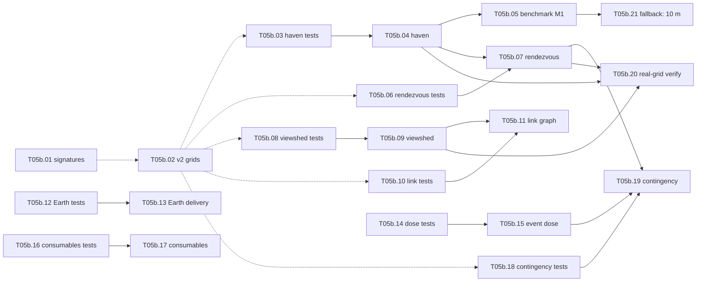

# TASK-05b — Compute v2: haven, rendezvous, viewshed, link graph, Earth delivery, event dose, consumables, contingency

| Field | Value |
| --- | --- |
| Objective | The v2 science in `packages/compute`: time-to-haven fields, crew–vehicle rendezvous, dynamic relay viewshed, surface link graph, Earth delivery rule, event dose integral and trigger, suit consumables, contingency ranking (02 §D.8–§D.15); pure, deterministic, tested on synthetic grids, then checked on the real grid |
| Requirements | FR-35, FR-38, FR-39, FR-40, FR-42, FR-43, FR-44, NFR-02, NFR-06 |
| Lane / owner role | compute — R2 Compute: Mishkat Ahmed Khan (haven, rendezvous, contingency, benchmarks) and Anjim Hossain (viewshed, link graph, Earth delivery, event dose, consumables). T05b.01–T05b.07, T05b.18 and T05b.19: Sadman Shaharier Mahim (R4 Hab Core) — taken over from Mishkat Ahmed Khan on 7 Nov, by agreement; T05b.20 and T05b.21 stay with Mishkat |
| Milestone | M1 (Dijkstra benchmark go/no-go Sat 7 Nov) → M3 (real-grid checks, 10 Nov) |
| Window | pre-event-if-permitted (T05b.01 and T05b.02 are pre-event-allowed) |
| Effort (doc 06) | 12–18 h (Mishkat 6–9, Anjim 6–9) |
| Done when (doc 06) | Synthetic tests green; benchmarks within NFR-02 |
| Main risk → fallback | Full-grid Dijkstra over 2 s → 10 m grid for all fields and `T_hab` precomputed in the pipeline (T05b.21) |
| Spec sections | [02 §D.8](../specs/02_Technical_Requirements_Document.md#d8-time-to-safe-haven-fr-39) · [02 §D.9](../specs/02_Technical_Requirements_Document.md#d9-crew-and-vehicle-parameter-sets-fr-40-fr-41--assumed-unless-cited-shown-in-the-ui-05-paramset) · [02 §D.10](../specs/02_Technical_Requirements_Document.md#d10-rendezvous-fr-40) · [02 §D.11](../specs/02_Technical_Requirements_Document.md#d11-line-of-sight-comm-coverage-fr-42) · [02 §D.12](../specs/02_Technical_Requirements_Document.md#d12-earth-link-model-fr-43) · [02 §D.13](../specs/02_Technical_Requirements_Document.md#d13-space-weather-event-model-fr-37-fr-38) · [02 §D.14](../specs/02_Technical_Requirements_Document.md#d14-simulation-engine-fr-34-fr-35) · [02 §D.15](../specs/02_Technical_Requirements_Document.md#d15-contingency-options-fr-44) · [02 §F](../specs/02_Technical_Requirements_Document.md#f-nonfunctional-requirements-and-validation) · [02 §F.2](../specs/02_Technical_Requirements_Document.md#f2-test-plan-additions-v2) · [05 ParamSet](../specs/05_Backend_and_Database_Schema.md#paramset-v2) |

## Inputs this task consumes

| Input | Kind | Owner | Dependency |
| --- | --- | --- | --- |
| Grid loader and least-time search from the v1 compute core | upstream output | T05.16, T05.18 | hard (T05b.04, T05b.07) |
| Protocol v0 entities (`ContingencyOption`, `Crew`, `LinkState`) | contract | T20.01 | soft (T05b.01) |
| Real grid, `comm_hab` coverage grid and bundle v1 | upstream output | T03.19, T03.29 | hard (T05b.20) |
| Real Earth-link table | upstream output | T21.04 | hard (T05b.20) |
| Assumed ParamSets (suit, rovers, link, alert, shielding) | contract | T21.01 | soft (T05b.01) |

## Outputs this task provides

| Output | Path | Consumers |
| --- | --- | --- |
| v2 compute signatures | `packages/compute/src/{haven,rendezvous,viewshed,linkGraph,earthLink,eventDose,consumables,contingency}.ts` | T22.*, T23.*, T26.*, T29.* |
| Synthetic v2 grids | `packages/compute/tests/fixtures/v2grids.ts` | every T05b test subtask |
| Benchmark and real-grid check results | `docs/ops/verification-log.md` | M1 gate, M3, D.5 fallback decision |

## Subtasks

### T05b.01 — Freeze the v2 compute signatures

- **Owner:** Sadman Shaharier Mahim (R4 Hab Core) — taken over from Mishkat Ahmed Khan on 7 Nov, by agreement
- **Type:** contract
- **Tag:** agent-ready · core
- **Window:** pre-event-allowed
- **Estimate:** 1 h
- **Owns (writes):** `packages/compute/src/haven.ts` (stub → T05b.04), `packages/compute/src/rendezvous.ts` (stub → T05b.07), `packages/compute/src/viewshed.ts` (stub → T05b.09), `packages/compute/src/linkGraph.ts` (stub → T05b.11), `packages/compute/src/earthLink.ts` (stub → T05b.13), `packages/compute/src/eventDose.ts` (stub → T05b.15), `packages/compute/src/consumables.ts` (stub → T05b.17), `packages/compute/src/contingency.ts` (stub → T05b.19), `packages/compute/src/index.ts`
- **Reads:** [02 §D.8–§D.15](../specs/02_Technical_Requirements_Document.md#d8-time-to-safe-haven-fr-39), [05 ParamSet](../specs/05_Backend_and_Database_Schema.md#paramset-v2), `packages/protocol/src/runtime.ts`
- **Depends on:** T20.01 (soft: protocol entities), T21.01 (soft: ParamSet keys)
- **Parallel with:** T22.01, T20.01
- **Steps:**
  1. Check each stub's inputs and outputs against its 02 §D section; every parameter that is not data comes in through a ParamSet argument, never a constant in code.
  2. Units in names (`_s`, `_m`, `_ugy`, `_ugy_h`); positions in working-projection metres.
  3. Export everything from `index.ts`; no behaviour.
- **Acceptance:**
  - Serves: FR-39, FR-40, FR-42, FR-43, FR-44, NFR-06 · [02 §D.8](../specs/02_Technical_Requirements_Document.md#d8-time-to-safe-haven-fr-39)
  - Every function the engine needs has a typed stub; the Hab Core and the planner worker can import them.
- **Verify:** `make typecheck`.
- **Agent brief:** Review and freeze the existing v2 stubs against 02 §D.8–§D.15. Types only. Spec constants that are not labelled `Assumed` ParamSet values (horizon radius, `t_ingress`) are named constants with their section cited.
- **Conflict notes:** Each module's owner takes it over after this merges; later signature changes are `contract-change:` subtasks here.

### T05b.02 — Fixture: synthetic v2 grids

- **Owner:** Sadman Shaharier Mahim (R4 Hab Core) — taken over from Mishkat Ahmed Khan on 7 Nov, by agreement
- **Type:** fixture
- **Tag:** agent-ready · core
- **Window:** pre-event-allowed
- **Estimate:** 1–1.5 h
- **Owns (writes):** `packages/compute/tests/fixtures/v2grids.ts`
- **Reads:** [02 §D.8](../specs/02_Technical_Requirements_Document.md#d8-time-to-safe-haven-fr-39) validation, [02 §D.10](../specs/02_Technical_Requirements_Document.md#d10-rendezvous-fr-40) validation, [02 §D.11](../specs/02_Technical_Requirements_Document.md#d11-line-of-sight-comm-coverage-fr-42) validation, [map §e](_coordination.md#e-fixtures-and-mocks) fixture value rule
- **Depends on:** T05b.01 (soft: grid type)
- **Parallel with:** T22.02, T20.02
- **Steps:**
  1. The 02 validation cases as grid generators: hab at the origin, vehicle 2 km away on flat ground, crew 1 km from the hab; a wall forcing a detour; a ridge the vehicle cannot climb; a fully blocked vehicle; a flat plane with a single wall for LOS; a sphere-sampled grid for the curvature test.
  2. Shape parameters (distances, wall position) come from the 02 text and are declared at the top of the file.
- **Acceptance:**
  - Serves: FR-39, FR-40, FR-42 · [02 §F.2](../specs/02_Technical_Requirements_Document.md#f2-test-plan-additions-v2)
  - Each 02 validation case has one named generator; values follow the fixture value rule.
- **Verify:** `make typecheck`; `npm --workspace @marswalk/compute test`.
- **Agent brief:** Build deterministic synthetic grids for the 02 §D.8, §D.10 and §D.11 validation cases. No real data.
- **Conflict notes:** Single owner; v1 synthetic grids (F1) stay with T05.02.

### T05b.03 — Tests: time to haven (02 §D.8 cases)

- **Owner:** Sadman Shaharier Mahim (R4 Hab Core) — taken over from Mishkat Ahmed Khan on 7 Nov, by agreement
- **Type:** test
- **Tag:** agent-ready · core
- **Window:** pre-event-if-permitted
- **Estimate:** 1–1.5 h
- **Owns (writes):** `packages/compute/tests/haven.test.ts`
- **Reads:** [02 §D.8](../specs/02_Technical_Requirements_Document.md#d8-time-to-safe-haven-fr-39), `packages/compute/tests/fixtures/v2grids.ts`
- **Depends on:** T05b.02 (soft: fixtures)
- **Parallel with:** T05b.06, T05b.08
- **Steps:**
  1. Reverse Dijkstra `T_hab` on flat ground equals the hand-computed walking time to the hab.
  2. The wall case forces a detour; the vehicle-slower-than-walking case chooses the hab.
  3. Live `haven(p)` is the minimum of hab and vehicle; the bounded crew Dijkstra stops at the haven limit.
  4. Planning approximation is labelled `modelled (approximation)`.
- **Acceptance:**
  - Serves: FR-39 · [02 §D.8](../specs/02_Technical_Requirements_Document.md#d8-time-to-safe-haven-fr-39)
  - Each case above is one named test; expected values are derived in the test from the declared fixture shape and the v1 time model.
- **Verify:** `npm --workspace @marswalk/compute test -- haven` fails before T05b.04 and passes after.
- **Agent brief:** Write haven tests from 02 §D.8; compute expected times in the test from the fixture's declared distances, never type a result in.
- **Conflict notes:** Pair T05b.03 → T05b.04.

### T05b.04 — Implement haven fields (reverse Dijkstra, bounded Dijkstra, live and planning forms)

- **Owner:** Sadman Shaharier Mahim (R4 Hab Core) — taken over from Mishkat Ahmed Khan on 7 Nov, by agreement
- **Type:** implement
- **Tag:** agent-ready · core
- **Window:** pre-event-if-permitted
- **Estimate:** 2–3 h
- **Owns (writes):** `packages/compute/src/haven.ts`
- **Reads:** `packages/compute/tests/haven.test.ts`, [02 §D.8](../specs/02_Technical_Requirements_Document.md#d8-time-to-safe-haven-fr-39), `packages/compute/src/route.ts`, `packages/compute/src/grid.ts`
- **Depends on:** T05b.03 (hard: tests first), T05.16 (hard: grid loader), T05.18 (hard: shares the least-time step cost), T05b.01 (soft: stub)
- **Parallel with:** T05b.07
- **Steps:**
  1. Reverse Dijkstra from the hab with the gradient sign flipped; vehicle Dijkstra on the 10 m aggregate grid.
  2. Bounded crew Dijkstra stopped at the haven limit; live haven as 02 §D.8.
  3. Planning approximation every 50 m along a route; fixed iteration order and tie-break by cell index.
- **Acceptance:**
  - Serves: FR-39, NFR-06 · [02 §D.8](../specs/02_Technical_Requirements_Document.md#d8-time-to-safe-haven-fr-39)
  - T05b.03 passes; repeated runs give identical fields.
- **Verify:** `npm --workspace @marswalk/compute test -- haven`.
- **Agent brief:** Implement `haven.ts` until the tests pass, reusing the v1 step cost from `route.ts`.
- **Conflict notes:** Single owner.

### T05b.05 — Verify the full-grid Dijkstra benchmark on the weakest laptop (M1 go/no-go)

- **Owner:** Sadman Shaharier Mahim (R4 Hab Core) — taken over from Mishkat Ahmed Khan on 7 Nov, by agreement
- **Type:** verify
- **Tag:** agent-ready · core
- **Window:** pre-event-if-permitted
- **Estimate:** 0.5–1 h
- **Owns (writes):** `packages/compute/bench/haven.bench.ts`, `docs/ops/verification-log.md` (append-only)
- **Reads:** [06 §B](../specs/06_High_Level_Implementation_Plan.md#b-milestones) M1, [02 §F](../specs/02_Technical_Requirements_Document.md#f-nonfunctional-requirements-and-validation) NFR-02
- **Depends on:** T05b.04 (hard: the real Dijkstra)
- **Parallel with:** T20.08, T02.04
- **Steps:**
  1. Benchmark one full-grid `T_hab` field on a synthetic grid the size of the AOI (cell count from 02 §D.8), five runs, report median and worst.
  2. Run on the team's weakest laptop; append a T05b.05 section with the machine, times, and go (≤ 2 s) or no-go.
- **Acceptance:**
  - Serves: FR-39, NFR-02 · [06 §B](../specs/06_High_Level_Implementation_Plan.md#b-milestones) M1
  - The section states the measured times and go/no-go; on no-go T05b.21 is claimed the same evening.
- **Verify:** `npx --no-install vitest bench --root packages/compute`; the verification-log section exists.
- **Agent brief:** Write the benchmark and record measured values only.
- **Conflict notes:** Append-only log file.

### T05b.06 — Tests: rendezvous (02 §D.10 cases)

- **Owner:** Sadman Shaharier Mahim (R4 Hab Core) — taken over from Mishkat Ahmed Khan on 7 Nov, by agreement
- **Type:** test
- **Tag:** agent-ready · cut-6
- **Window:** pre-event-if-permitted
- **Estimate:** 1 h
- **Owns (writes):** `packages/compute/tests/rendezvous.test.ts`
- **Reads:** [02 §D.10](../specs/02_Technical_Requirements_Document.md#d10-rendezvous-fr-40), `packages/compute/tests/fixtures/v2grids.ts`
- **Depends on:** T05b.02 (soft: fixtures)
- **Parallel with:** T05b.03
- **Steps:**
  1. Crew on a ridge the vehicle cannot climb → rendezvous at the ridge foot.
  2. Vehicle blocked entirely → `NO_RENDEZVOUS`.
  3. Tie-break: minimum crew time, then cell index; two crew → the vehicle path visiting both in the order that minimises the later arrival.
- **Acceptance:**
  - Serves: FR-40, NFR-06 · [02 §D.10](../specs/02_Technical_Requirements_Document.md#d10-rendezvous-fr-40)
  - Each case above is one named test.
- **Verify:** `npm --workspace @marswalk/compute test -- rendezvous` fails before T05b.07 and passes after.
- **Agent brief:** Write rendezvous tests from 02 §D.10 on the synthetic grids.
- **Conflict notes:** Pair T05b.06 → T05b.07. Cut 6 replaces exact rendezvous with T23.09.

### T05b.07 — Implement the rendezvous search

- **Owner:** Sadman Shaharier Mahim (R4 Hab Core) — taken over from Mishkat Ahmed Khan on 7 Nov, by agreement
- **Type:** implement
- **Tag:** agent-ready · cut-6
- **Window:** pre-event-if-permitted
- **Estimate:** 1.5–2 h
- **Owns (writes):** `packages/compute/src/rendezvous.ts`
- **Reads:** `packages/compute/tests/rendezvous.test.ts`, [02 §D.10](../specs/02_Technical_Requirements_Document.md#d10-rendezvous-fr-40), `packages/compute/src/haven.ts`
- **Depends on:** T05b.06 (hard: tests first), T05b.04 (hard: shares the Dijkstra fields), T05b.01 (soft: stub)
- **Parallel with:** T05b.09
- **Steps:**
  1. Bounded crew Dijkstra and vehicle Dijkstra (10 m grid, sampled to 5 m); candidates passable for the vehicle.
  2. `q*` by the 02 rule; paths by back-pointers; the two-crew permutation step.
- **Acceptance:**
  - Serves: FR-40, NFR-06 · [02 §D.10](../specs/02_Technical_Requirements_Document.md#d10-rendezvous-fr-40)
  - T05b.06 passes.
- **Verify:** `npm --workspace @marswalk/compute test -- rendezvous`.
- **Agent brief:** Implement `rendezvous.ts` until the tests pass; deterministic tie-breaks only.
- **Conflict notes:** Single owner.

### T05b.08 — Tests: line of sight, curvature and dynamic viewshed (02 §D.11)

- **Owner:** Anjim Hossain (R2/R4 float)
- **Type:** test
- **Tag:** agent-ready · core
- **Window:** pre-event-if-permitted
- **Estimate:** 1 h
- **Owns (writes):** `packages/compute/tests/viewshed.test.ts`
- **Reads:** [02 §D.11](../specs/02_Technical_Requirements_Document.md#d11-line-of-sight-comm-coverage-fr-42), `packages/compute/tests/fixtures/v2grids.ts`
- **Depends on:** T05b.02 (soft: fixtures)
- **Parallel with:** T05b.03
- **Steps:**
  1. Horizon distance √(2Rh) for the two 02 §D.11 heights equals the values the spec states.
  2. On the flat plane with one wall, the shadow begins exactly behind the wall.
  3. The sphere-sampled grid hides cells beyond the horizon.
- **Acceptance:**
  - Serves: FR-42 · [02 §D.11](../specs/02_Technical_Requirements_Document.md#d11-line-of-sight-comm-coverage-fr-42)
  - Each case above is one named test.
- **Verify:** `npm --workspace @marswalk/compute test -- viewshed` fails before T05b.09 and passes after.
- **Agent brief:** Write LOS and viewshed tests from 02 §D.11; the horizon values are quoted from the spec text.
- **Conflict notes:** Pair T05b.08 → T05b.09.

### T05b.09 — Implement line of sight and the 20 m dynamic viewshed

- **Owner:** Anjim Hossain (R2/R4 float)
- **Type:** implement
- **Tag:** agent-ready · cut-5
- **Window:** pre-event-if-permitted
- **Estimate:** 1.5–2 h
- **Owns (writes):** `packages/compute/src/viewshed.ts`
- **Reads:** `packages/compute/tests/viewshed.test.ts`, [02 §D.11](../specs/02_Technical_Requirements_Document.md#d11-line-of-sight-comm-coverage-fr-42)
- **Depends on:** T05b.08 (hard: tests first), T05b.01 (soft: stub)
- **Parallel with:** T05b.04
- **Steps:**
  1. Ray-cast with the curvature drop d²/2R; binary LOS only (no Fresnel zone, diffraction or link budget).
  2. Dynamic viewshed on a 20 m grid within the radius 02 §D.11 gives.
- **Acceptance:**
  - Serves: FR-42 · [02 §D.11](../specs/02_Technical_Requirements_Document.md#d11-line-of-sight-comm-coverage-fr-42)
  - T05b.08 passes; output labelled `derived` with "radio propagation not modelled beyond line of sight".
- **Verify:** `npm --workspace @marswalk/compute test -- viewshed`.
- **Agent brief:** Implement `viewshed.ts` until the tests pass. Cut 5 drops the dynamic part (static hab coverage only); `lineOfSight` stays core because the link graph uses it.
- **Conflict notes:** Single owner.

### T05b.10 — Tests: surface link graph

- **Owner:** Anjim Hossain (R2/R4 float)
- **Type:** test
- **Tag:** agent-ready · core
- **Window:** pre-event-if-permitted
- **Estimate:** 0.5–1 h
- **Owns (writes):** `packages/compute/tests/linkGraph.test.ts`
- **Reads:** [02 §D.11](../specs/02_Technical_Requirements_Document.md#d11-line-of-sight-comm-coverage-fr-42), [02 §A.5](../specs/02_Technical_Requirements_Document.md#a5-network-model), `scenarios/storm-sol4190/param_sets/link-assumed.json`
- **Depends on:** T05b.02 (soft: fixtures)
- **Parallel with:** T05b.08
- **Steps:**
  1. An edge exists only with mutual LOS and distance within the ParamSet range for that node pair.
  2. A suit is linked directly, through the buddy suit, or through a relay rover; a suit with no path is unlinked.
  3. BFS order is deterministic.
- **Acceptance:**
  - Serves: FR-42 · [02 §A.5](../specs/02_Technical_Requirements_Document.md#a5-network-model)
  - Each case above is one named test.
- **Verify:** `npm --workspace @marswalk/compute test -- linkGraph` fails before T05b.11 and passes after.
- **Agent brief:** Write link-graph tests; ranges come from the link ParamSet passed in.
- **Conflict notes:** New file. Pair T05b.10 → T05b.11.

### T05b.11 — Implement the surface link graph

- **Owner:** Anjim Hossain (R2/R4 float)
- **Type:** implement
- **Tag:** agent-ready · core
- **Window:** pre-event-if-permitted
- **Estimate:** 0.5–1 h
- **Owns (writes):** `packages/compute/src/linkGraph.ts`
- **Reads:** `packages/compute/tests/linkGraph.test.ts`, `packages/compute/src/viewshed.ts`
- **Depends on:** T05b.10 (hard: tests first), T05b.09 (hard: `lineOfSight`), T05b.01 (soft: stub)
- **Parallel with:** T05b.13
- **Steps:**
  1. Build edges per tick for crew and rovers only, never every cell; BFS to the hab.
- **Acceptance:**
  - Serves: FR-42
  - T05b.10 passes.
- **Verify:** `npm --workspace @marswalk/compute test -- linkGraph`.
- **Agent brief:** Implement `linkStates` until the tests pass.
- **Conflict notes:** Single owner.

### T05b.12 — Tests: Earth delivery rule

- **Owner:** Anjim Hossain (R2/R4 float)
- **Type:** test
- **Tag:** agent-ready · core
- **Window:** pre-event-if-permitted
- **Estimate:** 0.5–1 h
- **Owns (writes):** `packages/compute/tests/earthLink.test.ts`
- **Reads:** [02 §D.12](../specs/02_Technical_Requirements_Document.md#d12-earth-link-model-fr-43), `schemas/earth-link.schema.json`
- **Depends on:** T21.01 (soft: table format)
- **Parallel with:** T05b.14
- **Steps:**
  1. A message sent mid-pass is delivered at once plus light time; one sent between passes waits for the next pass.
  2. Earth → Mars uses `next_pass_start(t_send_earth + light_time)`; conjunction blackout blocks delivery.
  3. Use a small synthetic table; the light time comes from the table, never from code.
- **Acceptance:**
  - Serves: FR-43 · [02 §D.12](../specs/02_Technical_Requirements_Document.md#d12-earth-link-model-fr-43)
  - Each case above is one named test.
- **Verify:** `npm --workspace @marswalk/compute test -- earthLink` fails before T05b.13 and passes after.
- **Agent brief:** Write delivery-rule tests from 02 §D.12 on a synthetic table.
- **Conflict notes:** Pair T05b.12 → T05b.13.

### T05b.13 — Implement the Earth delivery rule

- **Owner:** Anjim Hossain (R2/R4 float)
- **Type:** implement
- **Tag:** agent-ready · core
- **Window:** pre-event-if-permitted
- **Estimate:** 0.5–1 h
- **Owns (writes):** `packages/compute/src/earthLink.ts`
- **Reads:** `packages/compute/tests/earthLink.test.ts`, [02 §D.12](../specs/02_Technical_Requirements_Document.md#d12-earth-link-model-fr-43)
- **Depends on:** T05b.12 (hard: tests first), T05b.01 (soft: stub)
- **Parallel with:** T05b.11
- **Steps:**
  1. Next pass from the table's `passes`; delivery times as 02 §D.12; label the model "simplified DTN model".
- **Acceptance:**
  - Serves: FR-43
  - T05b.12 passes.
- **Verify:** `npm --workspace @marswalk/compute test -- earthLink`.
- **Agent brief:** Implement the delivery rule until the tests pass.
- **Conflict notes:** Single owner.

### T05b.14 — Tests: radiation trigger and event dose integral

- **Owner:** Anjim Hossain (R2/R4 float)
- **Type:** test
- **Tag:** agent-ready · core
- **Window:** pre-event-if-permitted
- **Estimate:** 0.5–1 h
- **Owns (writes):** `packages/compute/tests/eventDose.test.ts`
- **Reads:** [02 §D.13](../specs/02_Technical_Requirements_Document.md#d13-space-weather-event-model-fr-37-fr-38), [02 §F.2](../specs/02_Technical_Requirements_Document.md#f2-test-plan-additions-v2), `scenarios/storm-sol4190/param_sets/alert-assumed.json`, `scenarios/storm-sol4190/param_sets/shielding-assumed.json`
- **Depends on:** T21.01 (soft: dose-series format)
- **Parallel with:** T05b.12
- **Steps:**
  1. The trigger fires on the first sample satisfying the alert ParamSet rule and clears by the 02 §D.13 clear rule.
  2. The dose integral matches a hand calculation for a three-step series (02 §F.2), with shielding factors from the ParamSet.
  3. Received and "if unsheltered" doses are both returned; units are µGy, never Sv.
- **Acceptance:**
  - Serves: FR-38 · [02 §D.13](../specs/02_Technical_Requirements_Document.md#d13-space-weather-event-model-fr-37-fr-38)
  - Each case above is one named test; the three-step expected value is computed in the test from the step values.
- **Verify:** `npm --workspace @marswalk/compute test -- eventDose` fails before T05b.15 and passes after.
- **Agent brief:** Write trigger and dose tests from 02 §D.13 on synthetic series.
- **Conflict notes:** Pair T05b.14 → T05b.15.

### T05b.15 — Implement the radiation trigger and event dose integral

- **Owner:** Anjim Hossain (R2/R4 float)
- **Type:** implement
- **Tag:** agent-ready · core
- **Window:** pre-event-if-permitted
- **Estimate:** 0.5–1 h
- **Owns (writes):** `packages/compute/src/eventDose.ts`
- **Reads:** `packages/compute/tests/eventDose.test.ts`, [02 §D.13](../specs/02_Technical_Requirements_Document.md#d13-space-weather-event-model-fr-37-fr-38)
- **Depends on:** T05b.14 (hard: tests first), T05b.01 (soft: stub)
- **Parallel with:** T05b.17
- **Steps:**
  1. Trigger and clear rules from the alert ParamSet; integral Σ r(t)·s(loc)·Δt with gaps handled as the DoseSeries rule says.
  2. *(2026-11-07, contract note)* `integrateDose` returns `{received_ugy, unsheltered_ugy, gap_s}` instead of one number, so the caller gets both doses (step 3 of T05b.14) and the seconds that fell in a gap. `rateAt` holds the last sample; a gap (null) neither raises nor clears the trigger and adds no dose. First consumer: T22.09.
- **Acceptance:**
  - Serves: FR-38
  - T05b.14 passes.
- **Verify:** `npm --workspace @marswalk/compute test -- eventDose`.
- **Agent brief:** Implement `eventDose.ts` until the tests pass.
- **Conflict notes:** Single owner.

### T05b.16 — Tests: suit consumables (02 §D.14)

- **Owner:** Anjim Hossain (R2/R4 float)
- **Type:** test
- **Tag:** agent-ready · core
- **Window:** pre-event-if-permitted
- **Estimate:** 0.5 h
- **Owns (writes):** `packages/compute/tests/consumables.test.ts`
- **Reads:** [02 §D.14](../specs/02_Technical_Requirements_Document.md#d14-simulation-engine-fr-34-fr-35), `scenarios/storm-sol4190/param_sets/suit-assumed.json`
- **Depends on:** T05b.01 (soft: signature)
- **Parallel with:** T05b.14
- **Steps:**
  1. O₂ fraction falls at `P_met / P_ref / o2_nominal_h` with walking and resting rates from the suit ParamSet.
  2. The fraction never goes below 0 and time to empty follows from the rate.
- **Acceptance:**
  - Serves: FR-35 · [02 §D.14](../specs/02_Technical_Requirements_Document.md#d14-simulation-engine-fr-34-fr-35)
  - Each case above is one named test; expected values follow from the ParamSet inside the test.
- **Verify:** `npm --workspace @marswalk/compute test -- consumables` fails before T05b.17 and passes after.
- **Agent brief:** Write consumables tests from 02 §D.14; the planner's illustrative O₂ cases (02 §D.6) are added later by T18.04.
- **Conflict notes:** Pair T05b.16 → T05b.17. T18.04 extends the file after this (follow-up).

### T05b.17 — Implement suit consumables

- **Owner:** Anjim Hossain (R2/R4 float)
- **Type:** implement
- **Tag:** agent-ready · core
- **Window:** pre-event-if-permitted
- **Estimate:** 0.5 h
- **Owns (writes):** `packages/compute/src/consumables.ts`
- **Reads:** `packages/compute/tests/consumables.test.ts`
- **Depends on:** T05b.16 (hard: tests first), T05b.01 (soft: stub)
- **Parallel with:** T05b.15
- **Steps:**
  1. Implement the rate and the per-tick update; all coefficients from the suit ParamSet.
- **Acceptance:**
  - Serves: FR-35
  - T05b.16 passes.
- **Verify:** `npm --workspace @marswalk/compute test -- consumables`.
- **Agent brief:** Implement `consumables.ts` until the tests pass.
- **Conflict notes:** Single owner; T18.05 adds the planner estimate later (follow-up).

### T05b.18 — Tests: contingency options and ranking (02 §D.15)

- **Owner:** Sadman Shaharier Mahim (R4 Hab Core) — taken over from Mishkat Ahmed Khan on 7 Nov, by agreement
- **Type:** test
- **Tag:** agent-ready · core
- **Window:** pre-event-if-permitted
- **Estimate:** 1 h
- **Owns (writes):** `packages/compute/tests/contingency.test.ts`
- **Reads:** [02 §D.15](../specs/02_Technical_Requirements_Document.md#d15-contingency-options-fr-44), [05 ContingencyOption](../specs/05_Backend_and_Database_Schema.md#contingencyoption)
- **Depends on:** T05b.02 (soft: fixtures)
- **Parallel with:** T05b.06
- **Steps:**
  1. Candidates: abort to hab, vehicle rendezvous, continue with remaining stops skipped (terrain refuge only when TASK-18 adds it).
  2. Each option carries ETA to shelter, expected dose until sheltered, stops dropped and violations.
  3. Rank by expected dose, then ETA; ties broken deterministically.
- **Acceptance:**
  - Serves: FR-44 · [02 §D.15](../specs/02_Technical_Requirements_Document.md#d15-contingency-options-fr-44)
  - Each case above is one named test.
- **Verify:** `npm --workspace @marswalk/compute test -- contingency` fails before T05b.19 and passes after.
- **Agent brief:** Write ranking tests from 02 §D.15 with stubbed haven, rendezvous and dose inputs.
- **Conflict notes:** Pair T05b.18 → T05b.19.

### T05b.19 — Implement contingency options and ranking

- **Owner:** Sadman Shaharier Mahim (R4 Hab Core) — taken over from Mishkat Ahmed Khan on 7 Nov, by agreement
- **Type:** implement
- **Tag:** agent-ready · core
- **Window:** pre-event-if-permitted
- **Estimate:** 1.5–2 h
- **Owns (writes):** `packages/compute/src/contingency.ts`
- **Reads:** `packages/compute/tests/contingency.test.ts`, `packages/compute/src/haven.ts`, `packages/compute/src/rendezvous.ts`, `packages/compute/src/eventDose.ts`
- **Depends on:** T05b.18 (hard: tests first), T05b.04 (hard), T05b.07 (hard), T05b.15 (hard), T05b.01 (soft: stub)
- **Parallel with:** T05b.20
- **Steps:**
  1. Build each option from haven, rendezvous and the projected dose along its path.
  2. Rank and return `ContingencyOption`s with `path_preview`.
- **Acceptance:**
  - Serves: FR-44, NFR-06
  - T05b.18 passes.
- **Verify:** `npm --workspace @marswalk/compute test -- contingency`.
- **Agent brief:** Implement `contingency.ts` until the tests pass.
- **Conflict notes:** Single owner.

### T05b.20 — Verify on the real grid: haven, rendezvous and viewshed vs independent checks; NFR-02 timings

- **Owner:** Mishkat Ahmed Khan (R2 Compute lead), with Anjim Hossain for the viewshed points
- **Type:** verify
- **Tag:** agent-ready · core
- **Window:** pre-event-if-permitted
- **Estimate:** 1.5–2.5 h
- **Owns (writes):** `packages/compute/tests/realGridV2.test.ts`, `pipeline/tests/check_v2_independent.py`, `docs/ops/verification-log.md` (append-only)
- **Reads:** [02 §F.2](../specs/02_Technical_Requirements_Document.md#f2-test-plan-additions-v2), [02 §F](../specs/02_Technical_Requirements_Document.md#f-nonfunctional-requirements-and-validation) NFR-02
- **Depends on:** T05b.04 (hard: real haven), T05b.07 (hard: real rendezvous), T05b.09 (hard: real viewshed), T03.19 (hard: real grid), T03.29 (hard: `comm_hab` grid)
- **Parallel with:** T22.14
- **Steps:**
  1. Five real-grid positions: haven and rendezvous against an independent Python computation (scikit-image least-cost path), as 02 §F.2 asks.
  2. Five points: viewshed against a GDAL `gdal_viewshed` run.
  3. Timings on the weakest laptop: haven field, rendezvous, relay viewshed against the NFR-02 targets.
- **Acceptance:**
  - Serves: FR-39, FR-40, FR-42, NFR-02 · [02 §F.2](../specs/02_Technical_Requirements_Document.md#f2-test-plan-additions-v2)
  - The verification section lists each comparison and each timing against its target, with pass or fail.
- **Verify:** `npm --workspace @marswalk/compute test -- realGridV2` (skips without the bundle) and `$(make -s pipeline-python) pipeline/tests/check_v2_independent.py`.
- **Agent brief:** Compare with independent tools and record measured values only.
- **Conflict notes:** New files; append-only log.

### T05b.21 — Fallback — start only if T05b.05 says no-go: 10 m grid for all fields; `T_hab` precomputed in the pipeline

- **Owner:** Mishkat Ahmed Khan (R2 Compute lead)
- **Type:** fallback
- **Tag:** agent-ready · core
- **Window:** pre-event-if-permitted
- **Estimate:** 1.5–2 h
- **Owns (writes):** `packages/compute/src/haven.ts` (replaces T05b.04)
- **Reads:** [06 §D.5](../specs/06_High_Level_Implementation_Plan.md#d5-data-and-service-fallbacks) Dijkstra row
- **Depends on:** T05b.05 (hard: start only on no-go), T05b.04 (hard: replaces it)
- **Parallel with:** T05b.07
- **Steps:**
  1. Run every field on the 10 m aggregate grid; load `T_hab` from a pipeline-precomputed grid (a new TASK-03 output, through a `coord:` change).
  2. Label the coarser haven values in Sources & methods.
- **Acceptance:**
  - Serves: FR-39, NFR-02 · [06 §D.5](../specs/06_High_Level_Implementation_Plan.md#d5-data-and-service-fallbacks)
  - T05b.03 still passes on the 10 m grid; the benchmark meets 2 s.
- **Verify:** `npm --workspace @marswalk/compute test -- haven`; rerun T05b.05's benchmark.
- **Agent brief:** Only on a no-go benchmark: coarsen and precompute. Do not change the public signatures.
- **Conflict notes:** Replaces T05b.04's file; never at the same time.

## Internal dependency graph

## Definition of done (task level)

- 06 §C.2 done-when: synthetic tests green (T05b.03–T05b.19) and benchmarks within NFR-02 (T05b.05, T05b.20).
- Every result that the UI shows carries its provenance class (`modelled`, `derived`) from the compute output.
- No `Date.now()`, no unseeded randomness, fixed iteration order (NFR-06).

## Spec questions

1. **AOI cell count for the benchmark.** 02 §D.8 quotes 360 k cells for 6 × 6 km at 10 m; the 5 m grid size depends on the TASK-01 AOI. T05b.05 benchmarks on a synthetic grid of the chosen AOI's size.
2. **Precomputed `T_hab` (fallback).** The pipeline has no such output yet; T05b.21 needs a `coord:` change adding it to TASK-03.
3. **Consumables split.** The engine's suit consumables (02 §D.14, FR-35) and the planner's illustrative O₂ estimate (02 §D.6, FR-19) share `consumables.ts`; this task owns the module and T18.04–T18.05 extend it as follow-ups.
