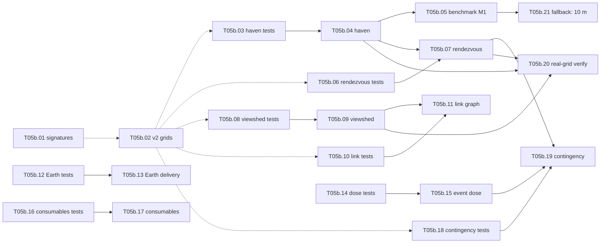

# TASK-05b — Compute v2: haven, rendezvous, viewshed, link graph, Earth delivery, event dose, consumables, contingency

| Field | Value |
| --- | --- |
| Objective | The v2 science in `packages/compute`: time-to-haven fields, crew–vehicle rendezvous, dynamic relay viewshed, surface link graph, Earth delivery rule, event dose integral and trigger, suit consumables, contingency ranking (02 §D.8–§D.15); pure, deterministic, tested on synthetic grids, then checked on the real grid |
| Requirements | FR-35, FR-38, FR-39, FR-40, FR-42, FR-43, FR-44, NFR-02, NFR-06 |
| Lane / owner role | compute — R2 Compute: Mishkat Ahmed Khan (haven, rendezvous, contingency, benchmarks) and Anjim Hossain (viewshed, link graph, Earth delivery, event dose, consumables). T05b.01–T05b.07, T05b.18 and T05b.19: Sadman Shaharier Mahim (R4 Hab Core) — taken over from Mishkat Ahmed Khan on 7 Nov, by agreement; T05b.20 and T05b.21 stay with Mishkat |
| Milestone | M1 (Dijkstra benchmark go/no-go Sat 7 Nov) → M3 (real-grid checks, 10 Nov) |
| Window | pre-event-if-permitted (T05b.01 and T05b.02 are pre-event-allowed) |
| Effort (doc 06) | 12–18 h (Mishkat 6–9, Anjim 6–9) |
| Done when (doc 06) | Synthetic tests green; benchmarks within NFR-02 |
| Main risk → fallback | Full-grid Dijkstra over 2 s → 10 m grid for all fields and `T_hab` precomputed in the pipeline (T05b.21) |
| Spec sections | [02 §D.8](../specs/02_Technical_Requirements_Document.md#d8-time-to-safe-haven-fr-39) · [02 §D.9](../specs/02_Technical_Requirements_Document.md#d9-crew-and-vehicle-parameter-sets-fr-40-fr-41--assumed-unless-cited-shown-in-the-ui-05-paramset) · [02 §D.10](../specs/02_Technical_Requirements_Document.md#d10-rendezvous-fr-40) · [02 §D.11](../specs/02_Technical_Requirements_Document.md#d11-line-of-sight-comm-coverage-fr-42) · [02 §D.12](../specs/02_Technical_Requirements_Document.md#d12-earth-link-model-fr-43) · [02 §D.13](../specs/02_Technical_Requirements_Document.md#d13-space-weather-event-model-fr-37-fr-38) · [02 §D.14](../specs/02_Technical_Requirements_Document.md#d14-simulation-engine-fr-34-fr-35) · [02 §D.15](../specs/02_Technical_Requirements_Document.md#d15-contingency-options-fr-44) · [02 §F](../specs/02_Technical_Requirements_Document.md#f-nonfunctional-requirements-and-validation) · [02 §F.2](../specs/02_Technical_Requirements_Document.md#f2-test-plan-additions-v2) · [05 ParamSet](../specs/05_Backend_and_Database_Schema.md#paramset-v2) |

## Inputs this task consumes

| Input | Kind | Owner | Dependency |
| --- | --- | --- | --- |
| Grid loader and least-time search from the v1 compute core | upstream output | T05.16, T05.18 | hard (T05b.04, T05b.07) |
| Protocol v0 entities (`ContingencyOption`, `Crew`, `LinkState`) | contract | T20.01 | soft (T05b.01) |
| Real grid, `comm_hab` coverage grid and bundle v1 | upstream output | T03.19, T03.29 | hard (T05b.20) |
| Real Earth-link table | upstream output | T21.04 | hard (T05b.20) |
| Assumed ParamSets (suit, rovers, link, alert, shielding) | contract | T21.01 | soft (T05b.01) |

## Outputs this task provides

| Output | Path | Consumers |
| --- | --- | --- |
| v2 compute signatures | `packages/compute/src/{haven,rendezvous,viewshed,linkGraph,earthLink,eventDose,consumables,contingency}.ts` | T22.*, T23.*, T26.*, T29.* |
| Synthetic v2 grids | `packages/compute/tests/fixtures/v2grids.ts` | every T05b test subtask |
| Benchmark and real-grid check results | `docs/ops/verification-log.md` | M1 gate, M3, D.5 fallback decision |

## Subtasks

### T05b.01 — Freeze the v2 compute signatures

- **Owner:** Sadman Shaharier Mahim (R4 Hab Core) — taken over from Mishkat Ahmed Khan on 7 Nov, by agreement
- **Type:** contract
- **Tag:** agent-ready · core
- **Window:** pre-event-allowed
- **Estimate:** 1 h
- **Owns (writes):** `packages/compute/src/haven.ts` (stub → T05b.04), `packages/compute/src/rendezvous.ts` (stub → T05b.07), `packages/compute/src/viewshed.ts` (stub → T05b.09), `packages/compute/src/linkGraph.ts` (stub → T05b.11), `packages/compute/src/earthLink.ts` (stub → T05b.13), `packages/compute/src/eventDose.ts` (stub → T05b.15), `packages/compute/src/consumables.ts` (stub → T05b.17), `packages/compute/src/contingency.ts` (stub → T05b.19), `packages/compute/src/index.ts`
- **Reads:** [02 §D.8–§D.15](../specs/02_Technical_Requirements_Document.md#d8-time-to-safe-haven-fr-39), [05 ParamSet](../specs/05_Backend_and_Database_Schema.md#paramset-v2), `packages/protocol/src/runtime.ts`
- **Depends on:** T20.01 (soft: protocol entities), T21.01 (soft: ParamSet keys)
- **Parallel with:** T22.01, T20.01
- **Steps:**
  1. Check each stub's inputs and outputs against its 02 §D section; every parameter that is not data comes in through a ParamSet argument, never a constant in code.
  2. Units in names (`_s`, `_m`, `_ugy`, `_ugy_h`); positions in working-projection metres.
  3. Export everything from `index.ts`; no behaviour.
- **Acceptance:**
  - Serves: FR-39, FR-40, FR-42, FR-43, FR-44, NFR-06 · [02 §D.8](../specs/02_Technical_Requirements_Document.md#d8-time-to-safe-haven-fr-39)
  - Every function the engine needs has a typed stub; the Hab Core and the planner worker can import them.
- **Verify:** `make typecheck`.
- **Agent brief:** Review and freeze the existing v2 stubs against 02 §D.8–§D.15. Types only. Spec constants that are not labelled `Assumed` ParamSet values (horizon radius, `t_ingress`) are named constants with their section cited.
- **Conflict notes:** Each module's owner takes it over after this merges; later signature changes are `contract-change:` subtasks here.

**Proposed 2026-11-07** (T05b.01 taken over from Mishkat Ahmed Khan by agreement). `haven.ts`, `rendezvous.ts` and `contingency.ts` are frozen (contract C15, pinned by `packages/compute/tests/contracts.test.ts`). Anjim Hossain's five modules (`viewshed.ts`, `linkGraph.ts`, `earthLink.ts`, `eventDose.ts`, `consumables.ts`) are not frozen: the proposals below wait for his accept or reject, then become `contract-change:` subtasks.

Frozen items:

- `haven.ts`: `TimeField` gains `origin_m` and `prev` (`prev` points toward the field's start). New stubs `vehiclePassable(grid, params)`, `timeAt(field, x_m, y_m)`, `pathTo(field, x_m, y_m)` (cell first, start last) and `liveHaven(hab, crew, vehicle, passable, ingress, crew_at)`, which returns `LiveHaven | null` (null = no haven reachable; hab wins a tie). `havenAlongRoute(grid, samples, hab, vehicle, scenario, ingress)` takes the grid so the vehicle branch can test "straight segment is passable" (02 §D.8), and `ingress: {hab_s, vehicle_s}`.
- `rendezvous.ts`: `RendezvousOk`, `RendezvousPair`; the `rendezvous` parameter is `passable` (the old name shadowed the exported `vehiclePassable`); `crew_path` and `vehicle_path` run from each start to q*. `rendezvousPair(a, b, vehicleFromA, vehicleFromB)` returns `{order, later_arrival_s}` (was `total_s`). Proposed: `later_arrival_s` is the time the vehicle is at the second-visited member's meeting point with that member there, measured from now, excluding ingress (02 §D.10; NFR-06); tie rule `[0, 1]`.
- `contingency.ts`: `ContingencyInputs` gains `plan`, `scenario`, `ingress` and optional `pair`; `ingress_s` is removed. Proposed: `option_id` is `${alert_id}:${kind}`. A two-crew `VEHICLE_RENDEZVOUS` option reports the first-visited point in `ContingencyOption.rendezvous`; `TODO(decision)`: 05 has a single rendezvous point per option.
- Named constants (02 §D.8): `HAB_INGRESS_S` (300 s, Assumed; `TODO(decision)`), `VEHICLE_GRID_CELL_M` (10), `HAVEN_SAMPLE_SPACING_M` (50), `HAVEN_PLANNING_RADIUS_M` (300).

Open spec questions (no doc edits in T05b.01):

1. `TODO(decision)`: hab ingress is labelled Assumed in 02 §D.8, but no ParamSet kind has a key for it (05 says every non-data number lives in a ParamSet).
2. `TODO(decision)`: the planner's `havenAlongRoute` needs a vehicle start, but 05 `MissionScenario` has only `vehicle_param_set`; `Scenario.vehicles[].start_x_m` exists only on the Hab Core side (T09.09).
3. The suit ParamSet's `flat_speed_kmh`, `hard_slope_deg` and `caution_slope_deg` duplicate the `MissionScenario` limits that the crew and hab fields use. Proposed: the published plan's `MissionScenario` wins, plus a loader check that they agree (T22.11). `TODO(decision)`.
4. `TODO(decision)`: the rule that aggregates the 5 m grid to the 10 m vehicle grid (for example, passable only if all four children are) is not in the spec; T05b.04 decides it.

Proposed signature changes in Anjim Hossain's modules (not frozen; each is forced by 02 or by a consumer):

**viewshed.ts (T05b.09)**

| Item | Current | Proposed | Why |
| --- | --- | --- | --- |
| `MARS_RADIUS_M` | `3_396_190` | unchanged; add a JSDoc citing 02 §C.1 (`IAU_2015:49900`) and §D.11 | Named constant, source cited |
| `horizonDistanceM(height_m)`, `lineOfSight(grid, from, to)` | as is | unchanged | §D.11. Heights are above local terrain; the link graph uses `lineOfSight` |
| `viewshed(grid, from, target_height_m, radius_m, cell_m)` | returns `Uint8Array` | same arguments; returns `CoverageGrid { cell_m; width; height; origin_m: [number, number]; visible: Uint8Array }` | A bare `Uint8Array` has no geometry. `links.ts` (COMM_SHADOW on the remaining route) and the T29 relay must look up positions. The caller passes `RELAY_VIEWSHED_RADIUS_M` and `RELAY_VIEWSHED_CELL_M`; the arguments stay so tests can use small grids |
| NEW `RELAY_VIEWSHED_RADIUS_M` | — | `4000` (02 §D.11, "horizon radius") | Named constant |
| NEW `RELAY_VIEWSHED_CELL_M` | — | `20` (02 §D.11) | Named constant |

**linkGraph.ts (T05b.11)**

| Item | Current | Proposed | Why |
| --- | --- | --- | --- |
| `LinkNode` | `{node_id, kind: "hab" \| "suit" \| "rover", x_m, y_m, antenna_m}` | unchanged. The engine fills `antenna_m` from the suit or rover ParamSet `antenna_m`, and the hab from link `hab_mast_m` | ParamSet keys from 05 |
| `linkStates` | `(nodes, los, params, sim_time): LinkState[]` | `(nodes, los, params, sim_time, previous: readonly LinkState[]): LinkNodeState[]`, where `LinkNodeState extends LinkState { path_to_hab: string[] }` (empty when unlinked) | `since_sim_time` cannot be produced purely without the previous states. `Crew.link_path` (05, e.g. `["EV1","EV2","HAB"]`) needs the BFS path. Ranges come from `range_hab_suit_m`, `range_suit_suit_m`, `range_rover_m` |
| NEW `HAB_NODE_ID` | — | `"HAB"` (05 Crew `link_path` example) | Named constant |

**earthLink.ts (T05b.13)**

| Item | Current | Proposed | Why |
| --- | --- | --- | --- |
| `linkAt` | `(table, t_utc): row` | `(table, t_utc): EarthLinkRow \| null` (null before the first row) | No row exists before the table starts |
| `nextPassStart` | `(table, t_utc): string \| null` | `(table, t_utc): { start_utc: string; orbiter: "mro" \| "maven" \| "tgo" } \| null` | `EarthMessage.via` needs the orbiter |
| `inConjunction` | `(table, t_utc, params)` | unchanged (`conjunction_deg`) | §D.12 |
| `deliveryTime` | `(table, direction, t_send_utc, params): string \| null` | `(…): { deliver_utc: string; via: "mro" \| "maven" \| "tgo" \| "dte"; light_time_s: number } \| null` (null = blackout or no pass). JSDoc: for `to_mars`, `t_send_utc` is the Earth send time (`sent_earth_utc`) | `EARTH_MSG_QUEUED` needs `deliver_utc` and `via` (05 EarthMessage). DTE is used when `params.dte_enabled` |
| NEW `DTE_MIN_ELEV_DEG` | — | `10` (02 §D.12) | Named constant. A constant rather than reusing `relay_min_elev_deg` |

**eventDose.ts (implemented in T05b.15)**

| Item | Proposed | Note |
| --- | --- | --- |
| `rateAt(series, t_utc): number \| null` | as implemented; JSDoc "µGy/h" | |
| `triggerState(series, t_utc, alertParams)` | as implemented. Replace the literal `highs >= 2` with a named `TRIGGER_CONSECUTIVE_SAMPLES = 2` (02 §D.13) | Behaviour unchanged. The only code change proposed in this module |
| `integrateDose(series, steps, shielding): EventDose` | as implemented; `EventDose` is already exported | Already matches `tick.ts` and `tick.test.ts`. Also covers contingency's projected dose (future steps along a path) |

`consumables.ts` (`stepO2`, `o2RemainingS`): no change; every coefficient already comes from the suit ParamSet.

**Consumers (all Anjim's)**

T23.03 `havenTick` consumes `liveHaven` from `haven.ts` (frozen in this PR; please confirm the return shape `{haven_s, kind, target_x_m, target_y_m}`). T26.01, T26.04 and T29.03 consume the viewshed, link graph and Earth link changes above.

### T05b.02 — Fixture: synthetic v2 grids

- **Owner:** Sadman Shaharier Mahim (R4 Hab Core) — taken over from Mishkat Ahmed Khan on 7 Nov, by agreement
- **Type:** fixture
- **Tag:** agent-ready · core
- **Window:** pre-event-allowed
- **Estimate:** 1–1.5 h
- **Owns (writes):** `packages/compute/tests/fixtures/v2grids.ts`
- **Reads:** [02 §D.8](../specs/02_Technical_Requirements_Document.md#d8-time-to-safe-haven-fr-39) validation, [02 §D.10](../specs/02_Technical_Requirements_Document.md#d10-rendezvous-fr-40) validation, [02 §D.11](../specs/02_Technical_Requirements_Document.md#d11-line-of-sight-comm-coverage-fr-42) validation, [map §e](_coordination.md#e-fixtures-and-mocks) fixture value rule
- **Depends on:** T05b.01 (soft: grid type)
- **Parallel with:** T22.02, T20.02
- **Steps:**
  1. The 02 validation cases as grid generators: hab at the origin, vehicle 2 km away on flat ground, crew 1 km from the hab; a wall forcing a detour; a ridge the vehicle cannot climb; a fully blocked vehicle; a flat plane with a single wall for LOS; a sphere-sampled grid for the curvature test.
  2. Shape parameters (distances, wall position) come from the 02 text and are declared at the top of the file.
- **Acceptance:**
  - Serves: FR-39, FR-40, FR-42 · [02 §F.2](../specs/02_Technical_Requirements_Document.md#f2-test-plan-additions-v2)
  - Each 02 validation case has one named generator; values follow the fixture value rule.
- **Verify:** `make typecheck`; `npm --workspace @marswalk/compute test`.
- **Agent brief:** Build deterministic synthetic grids for the 02 §D.8, §D.10 and §D.11 validation cases. No real data.
- **Conflict notes:** Single owner; v1 synthetic grids (F1) stay with T05.02.
- **Proposed 2026-11-07** (done by Sadman Shaharier Mahim, taken over from Mishkat Ahmed Khan by agreement; every value and its source is in the header of `v2grids.ts`; none is a science value):
  - Crew 1 km east and vehicle 2 km west of the hab, so one geometry serves both D.8 vehicle cases and only the vehicle speed decides. 5 m haven cells, extent x -2200..+1200 m, y +-600 m.
  - Detour wall at x = +500 m, |y| <= 300 m, 1 cell thick, `HARD_HAZARD`. Slow vehicle: `pr1-assumed` with `flat_speed_kmh` 2 (the 02 §D.9 utility-rover speed).
  - Ridge on 10 m cells: 10-cell plateau, 10-cell flanks at 25 deg, same profile in every row; crew on the plateau, vehicle at x = -400 m. Blocked vehicle: closed 1-cell `HARD_HAZARD` ring at Chebyshev distance 2.
  - LOS wall at x = +500 m, 20 m high, as elevation (not a flag). Sphere strip: 20 m cells, 3 rows, 1.25 x combined horizon, elevation 0 (curvature comes from the d^2/2R drop in `lineOfSight`; confirm with the T05b.08 owner). `commHab` all 255, no TI layer, no no-data cells.
  - **Spec gap, `TODO(decision)` for the 02 §D.10 owner:** at the default limits (suit 15 deg, rover 20 deg) the D.10 ridge case "crew on a ridge the vehicle cannot climb" cannot be built, since a flank above 20 deg is also above the crew's 15 deg. The fixture uses a 25 deg flank and `ridgeScenario()` (crew hard limit 35 deg, the 02 §E.3 maximum). 02 is unchanged.
  - `packages/compute/tests/v2grids.test.ts` is a self-check added beside the fixture: it tests the declared shapes only, no haven, rendezvous or LOS behaviour. The declared points are cell centres at 5 m, and at 10 m only when a grid is built natively at 10 m; a 2 x 2 aggregate of the 5 m haven grid is 2.5 m off them, so T05b.04's aggregation rule and tests must allow for that.

### T05b.03 — Tests: time to haven (02 §D.8 cases)

- **Owner:** Sadman Shaharier Mahim (R4 Hab Core) — taken over from Mishkat Ahmed Khan on 7 Nov, by agreement
- **Type:** test
- **Tag:** agent-ready · core
- **Window:** pre-event-if-permitted
- **Estimate:** 1–1.5 h
- **Owns (writes):** `packages/compute/tests/haven.test.ts`
- **Reads:** [02 §D.8](../specs/02_Technical_Requirements_Document.md#d8-time-to-safe-haven-fr-39), `packages/compute/tests/fixtures/v2grids.ts`
- **Depends on:** T05b.02 (soft: fixtures)
- **Parallel with:** T05b.06, T05b.08
- **Steps:**
  1. Reverse Dijkstra `T_hab` on flat ground equals the hand-computed walking time to the hab.
  2. The wall case forces a detour; the vehicle-slower-than-walking case chooses the hab.
  3. Live `haven(p)` is the minimum of hab and vehicle; the bounded crew Dijkstra stops at the haven limit.
  4. Planning approximation is labelled `modelled (approximation)`.
- **Acceptance:**
  - Serves: FR-39 · [02 §D.8](../specs/02_Technical_Requirements_Document.md#d8-time-to-safe-haven-fr-39)
  - Each case above is one named test; expected values are derived in the test from the declared fixture shape and the v1 time model.
- **Verify:** `npm --workspace @marswalk/compute test -- haven` fails before T05b.04 and passes after.
- **Agent brief:** Write haven tests from 02 §D.8; compute expected times in the test from the fixture's declared distances, never type a result in.
- **Conflict notes:** Pair T05b.03 → T05b.04.

### T05b.04 — Implement haven fields (reverse Dijkstra, bounded Dijkstra, live and planning forms)

- **Owner:** Sadman Shaharier Mahim (R4 Hab Core) — taken over from Mishkat Ahmed Khan on 7 Nov, by agreement
- **Type:** implement
- **Tag:** agent-ready · core
- **Window:** pre-event-if-permitted
- **Estimate:** 2–3 h
- **Owns (writes):** `packages/compute/src/haven.ts`
- **Reads:** `packages/compute/tests/haven.test.ts`, [02 §D.8](../specs/02_Technical_Requirements_Document.md#d8-time-to-safe-haven-fr-39), `packages/compute/src/route.ts`, `packages/compute/src/grid.ts`
- **Depends on:** T05b.03 (hard: tests first), T05.16 (hard: grid loader), T05.18 (hard: shares the least-time step cost), T05b.01 (soft: stub)
- **Parallel with:** T05b.07
- **Steps:**
  1. Reverse Dijkstra from the hab with the gradient sign flipped; vehicle Dijkstra on the 10 m aggregate grid.
  2. Bounded crew Dijkstra stopped at the haven limit; live haven as 02 §D.8.
  3. Planning approximation every 50 m along a route; fixed iteration order and tie-break by cell index.
- **Acceptance:**
  - Serves: FR-39, NFR-06 · [02 §D.8](../specs/02_Technical_Requirements_Document.md#d8-time-to-safe-haven-fr-39)
  - T05b.03 passes; repeated runs give identical fields.
- **Verify:** `npm --workspace @marswalk/compute test -- haven`.
- **Agent brief:** Implement `haven.ts` until the tests pass, reusing the v1 step cost from `route.ts`.
- **Conflict notes:** Single owner.

- **Proposed 2026-11-07** (done by Sadman Shaharier Mahim, taken over from Mishkat Ahmed Khan by agreement; every item is a `TODO(decision)` for the spec owner unless it is a fact). `haven.ts` calls none of `grid.ts`, `route.ts` or `timeModel.ts` (all stubs: T05.16, T05.18, T05.22); its private helpers repeat 02 §D.2 and 05 §E.1 and are marked `TODO(TASK-05)` for replacement, with a parity test (`it.todo` in `haven.test.ts`).
  - **Multiplier cell and stacking.** The caution (1.5) and low-TI (1.3) multipliers of 02 §D.2 are charged on the cell entered in the direction of travel (the neighbour for forward fields, the settled cell for the reverse hab field), and they multiply when both apply (1.95). 02 §D.2 does not say which cell or whether they stack; T05.18 must give the same answer or the route and the haven times diverge. The constants are private (Assumed in 02 §D.2); `index.ts` uses `export *`, so exporting them here would clash with T05.18's names.
  - **No corner cutting rule.** A diagonal step is allowed even when both orthogonal neighbours are impassable (pure 8-connectivity as in 02 §D.2). T05.18 must match.
  - **Start seeding.** The start cell (hab, crew position, vehicle) is seeded at 0 even if its own flags or slope make it impassable, because the hab footprint may be flagged on the real grid; its neighbours must still be passable.
  - **Out-of-grid start.** `habTimeField` and `vehicleTimeField` throw `RangeError`; `crewTimeField` returns an all-Infinity field of the grid's size (the crew position may leave the clipped AOI; the engine then sees no haven). A negative or NaN `limit_s` throws `RangeError`.
  - **Aggregation 5 m to 10 m.** A 10 m parent is passable only if all its existing children are `vehiclePassable` (a 5 m gap is closed for the rover, the safe direction); elevation is the mean of the children (Float64); LOW_TI if any child has it; edge parents use the children they have (`ceil(W/2) x ceil(H/2)`); the lattice keeps the grid origin; a grid at or above 10 m is its own aggregate. Answers T05b.01 open question 4. A 10 m parent centre can be 2.5 m off a declared 5 m point (see `v2grids.ts`), which the tests allow for.
  - **Vehicle step.** theta is the angle of the directional gradient between lattice cell centres, `atan(|dz| / d)`, so uphill equals downhill; v = flat x max(min_speed_frac, 1 - theta / hard_slope_deg); step = sqrt(d^2 + dz^2) / v x (low_ti_cost if the entered parent is LOW_TI). There is no caution multiplier for the rover: 02 §D.9 lists a caution slope but gives no cost for it, and the ParamSet keys read are the four in the stub.
  - **Hab wins ties** between the hab and the vehicle branch of `liveHaven` (frozen in T05b.01); the meeting cell breaks ties by smaller T_crew, then cell index. `liveHaven` returns null when neither branch is finite. The engine must map a null to `haven_min` null: a non-finite `haven_s` would become `null` in JSON anyway.
  - **Exponent rearranged.** The suited step is computed as `sqrt(d^2 + dz^2) / v0 x exp(3.5 |S + 0.05| - 0.175) x m` (02 §D.2 divided out: one `exp`, no division); on flat ground (dz = 0) the factor is 1 and is skipped. Equal to the spec form to rounding (tests compare to 1e-9).
  - **Planning segment rule.** `havenAlongRoute` tests "straight segment from p is passable" on the grid: sampled every half cell, every touched cell must pass the 02 §D.2 suited impassability. The vehicle branch is skipped when `scenario.vehicle_available` is false.
  - **Small additions.** `HAVEN_PLANNING_LABEL` (`Readonly`, `Object.freeze`d, `{ provenance: "modelled", note: "approximation" }`) is a new data export in `haven.ts` (additive; the T05b.01 contract pins no export list for it). `havenAlongRoute` returns `number[]`, so the caller (T23.03 / the planner UI) applies the label to the values it shows. A back-pointer cycle makes `pathTo` return an empty path. `tests/contracts.test.ts` no longer expects the eight haven functions to throw the stub error (they are implemented); their signatures stay pinned.
  - **Spec mismatch, "~50 k expansions" (02 §D.8).** The bounded crew field at 30 min has about 308 k finite cells: 2.83 R^2 for the octile ball of R = 1800 s x 3.3 km/h / 5 m = 330 cells on open ground, and 308,190 measured on a 1200 x 1200 non-flat synthetic grid. That is about 6 times the quoted 50 k. It also allocates full-grid arrays (the frozen API indexes it like `passable`). Measured on an Apple M2, Node 24.5: 88 ms on that grid. The engine (T23.03) should not recompute it every tick; recompute on a cell change or every N sim-seconds (`TODO(decision)` for the engine owner).
  - **Spec issue, planning form can be optimistic (02 §D.8).** `dist_walk` = straight line / v0 ignores slope, detours and the Tobler slowdown, so it can understate the walk to q; the 300 m radius can overstate the vehicle branch against the live form. Neither bound holds, so "the planning value is never below the live value" cannot be asserted (the earlier `it.todo` was dropped), and the planning haven time may be too short, which is a safety question for the spec owner. The `modelled (approximation)` label stays mandatory.
  - **Infinity must not reach JSON.** `havenAlongRoute` returns `Infinity` for an unreachable sample (frozen return type `number[]`). Callers map `Infinity` to null before anything reaches JSON or state, because `JSON.stringify(Infinity)` silently writes `null` (T23.03, the planner worker and the plan export).
  - **Input checks (Proposed).** `liveHaven` and `havenAlongRoute` throw `RangeError` for an ingress value that is NaN, negative or not finite. `liveHaven` also throws `RangeError` when the hab and crew fields differ in width, height, cell size or origin (not only length), or the mask differs in length (a bare `Uint8Array` has no geometry to compare).
  - **NaN elevation is impassable** for the suit and for the rover (DEM no-data becomes NaN before slope, CLAUDE.md section 2). Proposed / `TODO(decision)`: 02 §D.2 lists only the flags and the slope.
  - **ParamSet validation ranges (Proposed / `TODO(decision)`).** `hard_slope_deg` in (0, 90], `min_speed_frac` in (0, 1], `flat_speed_kmh` and `low_ti_cost` finite and > 0; the ranges are not in 05, they only keep the step cost finite. Only the kinds `pressurized_rover` and `utility_rover` are accepted by `vehicleTimeField` and `vehiclePassable` (02 §D.9 "same form"); any other kind throws `TypeError`.
  - **Cell size must divide 10 m** (Proposed / `TODO(decision)`): `vehicleTimeField` throws `RangeError` when `cell_m` is below 10 m and does not divide it (a grid at or above 10 m is its own aggregate).
  - **Diagonal moves may cut between two diagonally touching blocked cells** (Proposed / `TODO(decision)`): there is no corner-cutting check, only the destination cell is tested. `route.ts` (T05.16 / T05.18) must make the same choice, or the haven and route times disagree about which cells are reachable.
  - **Off-grid starts differ by field** (Proposed / `TODO(decision)`): `crewTimeField` returns an all-Infinity field for a start outside the grid, while `habTimeField` and `vehicleTimeField` throw `RangeError`. The crew position can leave a clipped AOI at run time; the hab and the rover are plan data.
  - **slopeMax 255 follows the literal formula** (Proposed / `TODO(decision)`): `255 / 4 = 63.75 deg` exceeds the caution slope, so a no-data `slope_max` gets the 1.5 caution multiplier (conservative); `slope_p90` 255 is impassable.
  - **Private step cost.** The suited step cost and the cell addressing in `haven.ts` are a private copy of the 02 §D.2 formulas and 05 §E.1, pending T05.16 / T05.18 (`grid.ts`, `route.ts` and `timeModel.ts` are still stubs). The parity test (a `habTimeField` step equals `stepTimeH` x 3600) stays `it.todo`; until it lands, the route and haven costs can drift apart.
  - **Lattice cache.** The per-cell arrays (passability, multiplier, elevation; the 10 m aggregate) are cached per grid object and per scenario / ParamSet object (nested `WeakMap`s), and rebuilt when the numbers they were built from change. A grid is treated as immutable once passed in: editing its arrays afterwards is not detected. `vehiclePassable` returns a copy. Results are byte-identical; on a 1200 x 1200 grid `crewTimeField` went from about 86 ms (first call) to about 70 ms (later calls).
  - **Cost.** `habTimeField` on a 1200 x 1200 non-flat grid takes about 0.34 s (first call 0.46 s) on an Apple M2, Node 24.5, from a throwaway script; the real benchmark is T05b.05.

### T05b.05 — Verify the full-grid Dijkstra benchmark on the weakest laptop (M1 go/no-go)

- **Owner:** Sadman Shaharier Mahim (R4 Hab Core) — taken over from Mishkat Ahmed Khan on 7 Nov, by agreement
- **Type:** verify
- **Tag:** agent-ready · core
- **Window:** pre-event-if-permitted
- **Estimate:** 0.5–1 h
- **Owns (writes):** `packages/compute/bench/haven.bench.ts`, `docs/ops/verification-log.md` (append-only)
- **Reads:** [06 §B](../specs/06_High_Level_Implementation_Plan.md#b-milestones) M1, [02 §F](../specs/02_Technical_Requirements_Document.md#f-nonfunctional-requirements-and-validation) NFR-02
- **Depends on:** T05b.04 (hard: the real Dijkstra)
- **Parallel with:** T20.08, T02.04
- **Steps:**
  1. Benchmark one full-grid `T_hab` field on a synthetic grid the size of the AOI (cell count from 02 §D.8), five runs, report median and worst.
  2. Run on the team's weakest laptop; append a T05b.05 section with the machine, times, and go (≤ 2 s) or no-go.
- **Acceptance:**
  - Serves: FR-39, NFR-02 · [06 §B](../specs/06_High_Level_Implementation_Plan.md#b-milestones) M1
  - The section states the measured times and go/no-go; on no-go T05b.21 is claimed the same evening.
- **Verify:** `npx --no-install vitest bench --root packages/compute`; the verification-log section exists.
- **Agent brief:** Write the benchmark and record measured values only.
- **Conflict notes:** Append-only log file.
- **Proposed 2026-11-08** (`TODO(decision)` for the owner and the team lead; the Steps and Acceptance text above is unchanged):
  - **Rule.** GO if the worst of five cold runs of one full-grid `T_hab` field is 2000 ms or less on the weakest laptop (02 §F NFR-02, "go (≤ 2 s)" above). The median and the minimum are reported with it but do not decide. The first call of a process is one warm-up run and is not one of the five.
  - **Cold, not warm.** Each run uses a freshly built grid, so the per-grid lattice cache in `haven.ts` cannot serve runs 2 to 5. A warm re-run on one grid is reported as a separate line only. The Hab Core builds the lattice once per grid, so warm is the steady state, but cold is what the first `habTimeField` call after a plan load costs.
  - **Terrain.** Two deterministic terrains on the same grid: flat, and a synthetic rough one (analytic sine surface, slope bands from its gradient, a fixed hazard lattice and a low-TI band). The slower of the two decides. Constants are labelled "Assumed, bench-only" in `packages/compute/bench/grid.ts`; they are not science and not data. The real grid is T05b.20, not this task.
  - **Grid size.** Derived, never typed: `aoi.extent_m` of `pipeline/sites/gale_boxwork/site.json` divided by the haven cell (`HAVEN_CELL_M`, 5 m, 02 §D.2); the builder throws if the extent is not a whole number of cells. The hab is `hab_mast` from the same file. `TODO(decision)`: the 5 m cell lives in a test fixture today; a shared `ROUTING_CELL_M` constant in `src` (for T05.16, T05b.04 and the bench) would remove the copy.
  - **Secondary cases (context, not the decision).** `crewTimeField` with a 30 min bound, `vehicleTimeField`, and `liveHaven` on the fields just built.
  - **Verify (needs `--run`, else Vitest bench waits for file changes).** `npx --no-install vitest bench --run --reporter=verbose --root packages/compute` (`--reporter=verbose` because the default reporter hides the bench's printed report), or `npm --workspace @marswalk/compute run bench`. The bench is outside `test.include`, so `make test-web` and CI never time anything. A grid-builder unit test, `packages/compute/tests/benchGrid.test.ts`, runs there.
  - **Also touches (Proposed):** `bench/grid.ts`, `tests/benchGrid.test.ts`, `packages/compute/package.json` script `bench`, `packages/compute/tsconfig.json` include `bench`.
  - **Not done by this note.** The verification-log section needs a person to run the bench on the weakest laptop; status stays `wip` until then. Times from other machines go in the PR body, not in the log.

### T05b.06 — Tests: rendezvous (02 §D.10 cases)

- **Owner:** Sadman Shaharier Mahim (R4 Hab Core) — taken over from Mishkat Ahmed Khan on 7 Nov, by agreement
- **Type:** test
- **Tag:** agent-ready · cut-6
- **Window:** pre-event-if-permitted
- **Estimate:** 1 h
- **Owns (writes):** `packages/compute/tests/rendezvous.test.ts`
- **Reads:** [02 §D.10](../specs/02_Technical_Requirements_Document.md#d10-rendezvous-fr-40), `packages/compute/tests/fixtures/v2grids.ts`
- **Depends on:** T05b.02 (soft: fixtures)
- **Parallel with:** T05b.03
- **Steps:**
  1. Crew on a ridge the vehicle cannot climb → rendezvous at the ridge foot.
  2. Vehicle blocked entirely → `NO_RENDEZVOUS`.
  3. Tie-break: minimum crew time, then cell index; two crew → the vehicle path visiting both in the order that minimises the later arrival.
- **Acceptance:**
  - Serves: FR-40, NFR-06 · [02 §D.10](../specs/02_Technical_Requirements_Document.md#d10-rendezvous-fr-40)
  - Each case above is one named test.
- **Verify:** `npm --workspace @marswalk/compute test -- rendezvous` fails before T05b.07 and passes after.
- **Agent brief:** Write rendezvous tests from 02 §D.10 on the synthetic grids.
- **Conflict notes:** Pair T05b.06 → T05b.07. Cut 6 replaces exact rendezvous with T23.09.

### T05b.07 — Implement the rendezvous search

- **Owner:** Sadman Shaharier Mahim (R4 Hab Core) — taken over from Mishkat Ahmed Khan on 7 Nov, by agreement
- **Type:** implement
- **Tag:** agent-ready · cut-6
- **Window:** pre-event-if-permitted
- **Estimate:** 1.5–2 h
- **Owns (writes):** `packages/compute/src/rendezvous.ts`
- **Reads:** `packages/compute/tests/rendezvous.test.ts`, [02 §D.10](../specs/02_Technical_Requirements_Document.md#d10-rendezvous-fr-40), `packages/compute/src/haven.ts`
- **Depends on:** T05b.06 (hard: tests first), T05b.04 (hard: shares the Dijkstra fields), T05b.01 (soft: stub)
- **Parallel with:** T05b.09
- **Steps:**
  1. Bounded crew Dijkstra and vehicle Dijkstra (10 m grid, sampled to 5 m); candidates passable for the vehicle.
  2. `q*` by the 02 rule; paths by back-pointers; the two-crew permutation step.
- **Acceptance:**
  - Serves: FR-40, NFR-06 · [02 §D.10](../specs/02_Technical_Requirements_Document.md#d10-rendezvous-fr-40)
  - T05b.06 passes.
- **Verify:** `npm --workspace @marswalk/compute test -- rendezvous`.
- **Agent brief:** Implement `rendezvous.ts` until the tests pass; deterministic tie-breaks only.
- **Conflict notes:** Single owner.

**Proposed 2026-11-08 — TODO(decision)** (T05b.07 implementation notes; the items from the `vehicle_path` end point onward are the review decisions of 8 Nov):

- `passable` mask length validation: `passable.length` must equal `crew.seconds.length` (the 5 m routing grid size); throws `RangeError` on mismatch.
- Path orientation: `crew_path` and `vehicle_path` reverse the back-pointer array returned by `pathTo(field, x_m, y_m)`, so that each path runs forward from its start position to the meeting cell `q*`.
- Vehicle arrival time at meeting cell: `eta_vehicle_s` is evaluated via `timeAt(vehicle, qx, qy)` on the 10 m vehicle time field.
- `rendezvousPair` later arrival definition (02 §D.10 silent): For visiting order `[0, 1]`, vehicle arrives at A's rendezvous point and both crew A and vehicle are present at `t_first = max(a.eta_vehicle_s, a.eta_crew_s)`. The vehicle then travels from A's point to B's meeting point with transit time `timeAt(vehicleFromA, b.x_m, b.y_m)`, arriving at `t_veh = t_first + transit`. The rendezvous at B occurs when both vehicle and crew B are present: `later_arrival_s = max(t_veh, b.eta_crew_s)`. When both `[0, 1]` and `[1, 0]` produce equal `later_arrival_s`, the tie rule deterministically selects `[0, 1]`.
- `vehicle_path` ends at q*: the vehicle walk ends at the centre of the 10 m parent cell, up to about 3.5 m from q* on a 5 m crew grid, so the exact point (`x_m`, `y_m`) is appended as the last vertex unless it already is the last centre. The first vertex stays the centre of the vehicle's 10 m cell (up to half a cell from the vehicle position); this is documented on the result type. T23.05 relies on the path ending at the target (`SHELTER_REACH_M` = 1 m). Decision by the orchestrating session.
- `rendezvousPair` throws `RangeError` when any of the four arrival times is not finite, when a transit time is NaN, or when both visiting orders are unreachable (both transits `Infinity`); with only one order unreachable the other wins. The result is therefore always JSON-safe. A caller that gets the error falls back to two separate rendezvous. Decision by the orchestrating session.
- `rendezvous` also throws `RangeError` when a field is internally inconsistent (`cell_m` not a finite number above 0; `width`, `height` not positive integers; `seconds` or `prev` length not `width x height`). The mask is a bare `Uint8Array`, so its length against the crew cell count is the only mask check; the vehicle field's frame (a 10 m aggregate over the same origin) cannot be compared with the mask.
- A cyclic back-pointer chain (a corrupt field) makes `pathTo` return an empty path; `rendezvous` passes that through, so `status` stays "OK" with an empty `crew_path` or `vehicle_path` (documented, pinned by a test) rather than returning `NO_RENDEZVOUS`. Proposed; revisit if the Hab Core wants a hard failure.
- `rendezvous` and `rendezvousPair` left the stub list in `packages/compute/tests/contracts.test.ts` (outside this subtask's Owns, as T05b.04 did for `haven.ts`).
- Duplicate helper: `centreOfCell` in `rendezvous.ts` copies the private one in `haven.ts` (T05b.04); `haven.ts` is not edited here. TODO(verify): export one of them after both branches are on main.
- TODO(decision) for the 02 §D.10 owner: the tie-break "min T_c, then cell index" leaves a band of foot cells tied on the ridge fixture (the crew time alternates with the row parity, so rows 0, 20, 100, -100 m and others tie with the foot row y = 0 at 10 m), and the lowest index is the north-most of them (y = 100 m at 10 m, 50 m at 5 m), although the vehicle would reach the foot row y = 0 sooner. Should `T_v` break the tie before the cell index? The code and tests keep the spec text as written.

### T05b.08 — Tests: line of sight, curvature and dynamic viewshed (02 §D.11)

- **Owner:** Anjim Hossain (R2/R4 float)
- **Type:** test
- **Tag:** agent-ready · core
- **Window:** pre-event-if-permitted
- **Estimate:** 1 h
- **Owns (writes):** `packages/compute/tests/viewshed.test.ts`
- **Reads:** [02 §D.11](../specs/02_Technical_Requirements_Document.md#d11-line-of-sight-comm-coverage-fr-42), `packages/compute/tests/fixtures/v2grids.ts`
- **Depends on:** T05b.02 (soft: fixtures)
- **Parallel with:** T05b.03
- **Steps:**
  1. Horizon distance √(2Rh) for the two 02 §D.11 heights equals the values the spec states.
  2. On the flat plane with one wall, the shadow begins exactly behind the wall.
  3. The sphere-sampled grid hides cells beyond the horizon.
- **Acceptance:**
  - Serves: FR-42 · [02 §D.11](../specs/02_Technical_Requirements_Document.md#d11-line-of-sight-comm-coverage-fr-42)
  - Each case above is one named test.
- **Verify:** `npm --workspace @marswalk/compute test -- viewshed` fails before T05b.09 and passes after.
- **Agent brief:** Write LOS and viewshed tests from 02 §D.11; the horizon values are quoted from the spec text.
- **Conflict notes:** Pair T05b.08 → T05b.09.

### T05b.09 — Implement line of sight and the 20 m dynamic viewshed

- **Owner:** Anjim Hossain (R2/R4 float)
- **Type:** implement
- **Tag:** agent-ready · cut-5
- **Window:** pre-event-if-permitted
- **Estimate:** 1.5–2 h
- **Owns (writes):** `packages/compute/src/viewshed.ts`
- **Reads:** `packages/compute/tests/viewshed.test.ts`, [02 §D.11](../specs/02_Technical_Requirements_Document.md#d11-line-of-sight-comm-coverage-fr-42)
- **Depends on:** T05b.08 (hard: tests first), T05b.01 (soft: stub)
- **Parallel with:** T05b.04
- **Steps:**
  1. Ray-cast with the curvature drop d²/2R; binary LOS only (no Fresnel zone, diffraction or link budget).
  2. Dynamic viewshed on a 20 m grid within the radius 02 §D.11 gives.
- **Acceptance:**
  - Serves: FR-42 · [02 §D.11](../specs/02_Technical_Requirements_Document.md#d11-line-of-sight-comm-coverage-fr-42)
  - T05b.08 passes; output labelled `derived` with "radio propagation not modelled beyond line of sight".
- **Verify:** `npm --workspace @marswalk/compute test -- viewshed`.
- **Agent brief:** Implement `viewshed.ts` until the tests pass. Cut 5 drops the dynamic part (static hab coverage only); `lineOfSight` stays core because the link graph uses it.
- **Conflict notes:** Single owner.

### T05b.10 — Tests: surface link graph

- **Owner:** Anjim Hossain (R2/R4 float)
- **Type:** test
- **Tag:** agent-ready · core
- **Window:** pre-event-if-permitted
- **Estimate:** 0.5–1 h
- **Owns (writes):** `packages/compute/tests/linkGraph.test.ts`
- **Reads:** [02 §D.11](../specs/02_Technical_Requirements_Document.md#d11-line-of-sight-comm-coverage-fr-42), [02 §A.5](../specs/02_Technical_Requirements_Document.md#a5-network-model), `scenarios/storm-sol4190/param_sets/link-assumed.json`
- **Depends on:** T05b.02 (soft: fixtures)
- **Parallel with:** T05b.08
- **Steps:**
  1. An edge exists only with mutual LOS and distance within the ParamSet range for that node pair.
  2. A suit is linked directly, through the buddy suit, or through a relay rover; a suit with no path is unlinked.
  3. BFS order is deterministic.
- **Acceptance:**
  - Serves: FR-42 · [02 §A.5](../specs/02_Technical_Requirements_Document.md#a5-network-model)
  - Each case above is one named test.
- **Verify:** `npm --workspace @marswalk/compute test -- linkGraph` fails before T05b.11 and passes after.
- **Agent brief:** Write link-graph tests; ranges come from the link ParamSet passed in.
- **Conflict notes:** New file. Pair T05b.10 → T05b.11.

### T05b.11 — Implement the surface link graph

- **Owner:** Anjim Hossain (R2/R4 float)
- **Type:** implement
- **Tag:** agent-ready · core
- **Window:** pre-event-if-permitted
- **Estimate:** 0.5–1 h
- **Owns (writes):** `packages/compute/src/linkGraph.ts`
- **Reads:** `packages/compute/tests/linkGraph.test.ts`, `packages/compute/src/viewshed.ts`
- **Depends on:** T05b.10 (hard: tests first), T05b.09 (hard: `lineOfSight`), T05b.01 (soft: stub)
- **Parallel with:** T05b.13
- **Steps:**
  1. Build edges per tick for crew and rovers only, never every cell; BFS to the hab.
- **Acceptance:**
  - Serves: FR-42
  - T05b.10 passes.
- **Verify:** `npm --workspace @marswalk/compute test -- linkGraph`.
- **Agent brief:** Implement `linkStates` until the tests pass.
- **Conflict notes:** Single owner.

### T05b.12 — Tests: Earth delivery rule

- **Owner:** Anjim Hossain (R2/R4 float)
- **Type:** test
- **Tag:** agent-ready · core
- **Window:** pre-event-if-permitted
- **Estimate:** 0.5–1 h
- **Owns (writes):** `packages/compute/tests/earthLink.test.ts`
- **Reads:** [02 §D.12](../specs/02_Technical_Requirements_Document.md#d12-earth-link-model-fr-43), `schemas/earth-link.schema.json`
- **Depends on:** T21.01 (soft: table format)
- **Parallel with:** T05b.14
- **Steps:**
  1. A message sent mid-pass is delivered at once plus light time; one sent between passes waits for the next pass.
  2. Earth → Mars uses `next_pass_start(t_send_earth + light_time)`; conjunction blackout blocks delivery.
  3. Use a small synthetic table; the light time comes from the table, never from code.
- **Acceptance:**
  - Serves: FR-43 · [02 §D.12](../specs/02_Technical_Requirements_Document.md#d12-earth-link-model-fr-43)
  - Each case above is one named test.
- **Verify:** `npm --workspace @marswalk/compute test -- earthLink` fails before T05b.13 and passes after.
- **Agent brief:** Write delivery-rule tests from 02 §D.12 on a synthetic table.
- **Conflict notes:** Pair T05b.12 → T05b.13.

### T05b.13 — Implement the Earth delivery rule

- **Owner:** Anjim Hossain (R2/R4 float)
- **Type:** implement
- **Tag:** agent-ready · core
- **Window:** pre-event-if-permitted
- **Estimate:** 0.5–1 h
- **Owns (writes):** `packages/compute/src/earthLink.ts`
- **Reads:** `packages/compute/tests/earthLink.test.ts`, [02 §D.12](../specs/02_Technical_Requirements_Document.md#d12-earth-link-model-fr-43)
- **Depends on:** T05b.12 (hard: tests first), T05b.01 (soft: stub)
- **Parallel with:** T05b.11
- **Steps:**
  1. Next pass from the table's `passes`; delivery times as 02 §D.12; label the model "simplified DTN model".
- **Acceptance:**
  - Serves: FR-43
  - T05b.12 passes.
- **Verify:** `npm --workspace @marswalk/compute test -- earthLink`.
- **Agent brief:** Implement the delivery rule until the tests pass.
- **Conflict notes:** Single owner.

### T05b.14 — Tests: radiation trigger and event dose integral

- **Owner:** Anjim Hossain (R2/R4 float)
- **Type:** test
- **Tag:** agent-ready · core
- **Window:** pre-event-if-permitted
- **Estimate:** 0.5–1 h
- **Owns (writes):** `packages/compute/tests/eventDose.test.ts`
- **Reads:** [02 §D.13](../specs/02_Technical_Requirements_Document.md#d13-space-weather-event-model-fr-37-fr-38), [02 §F.2](../specs/02_Technical_Requirements_Document.md#f2-test-plan-additions-v2), `scenarios/storm-sol4190/param_sets/alert-assumed.json`, `scenarios/storm-sol4190/param_sets/shielding-assumed.json`
- **Depends on:** T21.01 (soft: dose-series format)
- **Parallel with:** T05b.12
- **Steps:**
  1. The trigger fires on the first sample satisfying the alert ParamSet rule and clears by the 02 §D.13 clear rule.
  2. The dose integral matches a hand calculation for a three-step series (02 §F.2), with shielding factors from the ParamSet.
  3. Received and "if unsheltered" doses are both returned; units are µGy, never Sv.
- **Acceptance:**
  - Serves: FR-38 · [02 §D.13](../specs/02_Technical_Requirements_Document.md#d13-space-weather-event-model-fr-37-fr-38)
  - Each case above is one named test; the three-step expected value is computed in the test from the step values.
- **Verify:** `npm --workspace @marswalk/compute test -- eventDose` fails before T05b.15 and passes after.
- **Agent brief:** Write trigger and dose tests from 02 §D.13 on synthetic series.
- **Conflict notes:** Pair T05b.14 → T05b.15.

### T05b.15 — Implement the radiation trigger and event dose integral

- **Owner:** Anjim Hossain (R2/R4 float)
- **Type:** implement
- **Tag:** agent-ready · core
- **Window:** pre-event-if-permitted
- **Estimate:** 0.5–1 h
- **Owns (writes):** `packages/compute/src/eventDose.ts`
- **Reads:** `packages/compute/tests/eventDose.test.ts`, [02 §D.13](../specs/02_Technical_Requirements_Document.md#d13-space-weather-event-model-fr-37-fr-38)
- **Depends on:** T05b.14 (hard: tests first), T05b.01 (soft: stub)
- **Parallel with:** T05b.17
- **Steps:**
  1. Trigger and clear rules from the alert ParamSet; integral Σ r(t)·s(loc)·Δt with gaps handled as the DoseSeries rule says.
  2. *(2026-11-07, contract note)* `integrateDose` returns `{received_ugy, unsheltered_ugy, gap_s}` instead of one number, so the caller gets both doses (step 3 of T05b.14) and the seconds that fell in a gap. `rateAt` holds the last sample; a gap (null) neither raises nor clears the trigger and adds no dose. First consumer: T22.09.
- **Acceptance:**
  - Serves: FR-38
  - T05b.14 passes.
- **Verify:** `npm --workspace @marswalk/compute test -- eventDose`.
- **Agent brief:** Implement `eventDose.ts` until the tests pass.
- **Conflict notes:** Single owner.

### T05b.16 — Tests: suit consumables (02 §D.14)

- **Owner:** Anjim Hossain (R2/R4 float)
- **Type:** test
- **Tag:** agent-ready · core
- **Window:** pre-event-if-permitted
- **Estimate:** 0.5 h
- **Owns (writes):** `packages/compute/tests/consumables.test.ts`
- **Reads:** [02 §D.14](../specs/02_Technical_Requirements_Document.md#d14-simulation-engine-fr-34-fr-35), `scenarios/storm-sol4190/param_sets/suit-assumed.json`
- **Depends on:** T05b.01 (soft: signature)
- **Parallel with:** T05b.14
- **Steps:**
  1. O₂ fraction falls at `P_met / P_ref / o2_nominal_h` with walking and resting rates from the suit ParamSet.
  2. The fraction never goes below 0 and time to empty follows from the rate.
- **Acceptance:**
  - Serves: FR-35 · [02 §D.14](../specs/02_Technical_Requirements_Document.md#d14-simulation-engine-fr-34-fr-35)
  - Each case above is one named test; expected values follow from the ParamSet inside the test.
- **Verify:** `npm --workspace @marswalk/compute test -- consumables` fails before T05b.17 and passes after.
- **Agent brief:** Write consumables tests from 02 §D.14; the planner's illustrative O₂ cases (02 §D.6) are added later by T18.04.
- **Conflict notes:** Pair T05b.16 → T05b.17. T18.04 extends the file after this (follow-up).

### T05b.17 — Implement suit consumables

- **Owner:** Anjim Hossain (R2/R4 float)
- **Type:** implement
- **Tag:** agent-ready · core
- **Window:** pre-event-if-permitted
- **Estimate:** 0.5 h
- **Owns (writes):** `packages/compute/src/consumables.ts`
- **Reads:** `packages/compute/tests/consumables.test.ts`
- **Depends on:** T05b.16 (hard: tests first), T05b.01 (soft: stub)
- **Parallel with:** T05b.15
- **Steps:**
  1. Implement the rate and the per-tick update; all coefficients from the suit ParamSet.
- **Acceptance:**
  - Serves: FR-35
  - T05b.16 passes.
- **Verify:** `npm --workspace @marswalk/compute test -- consumables`.
- **Agent brief:** Implement `consumables.ts` until the tests pass.
- **Conflict notes:** Single owner; T18.05 adds the planner estimate later (follow-up).

### T05b.18 — Tests: contingency options and ranking (02 §D.15)

- **Owner:** Sadman Shaharier Mahim (R4 Hab Core) — taken over from Mishkat Ahmed Khan on 7 Nov, by agreement
- **Type:** test
- **Tag:** agent-ready · core
- **Window:** pre-event-if-permitted
- **Estimate:** 1 h
- **Owns (writes):** `packages/compute/tests/contingency.test.ts`
- **Reads:** [02 §D.15](../specs/02_Technical_Requirements_Document.md#d15-contingency-options-fr-44), [05 ContingencyOption](../specs/05_Backend_and_Database_Schema.md#contingencyoption)
- **Depends on:** T05b.02 (soft: fixtures)
- **Parallel with:** T05b.06
- **Steps:**
  1. Candidates: abort to hab, vehicle rendezvous, continue with remaining stops skipped (terrain refuge only when TASK-18 adds it).
  2. Each option carries ETA to shelter, expected dose until sheltered, stops dropped and violations.
  3. Rank by expected dose, then ETA; ties broken deterministically.
- **Acceptance:**
  - Serves: FR-44 · [02 §D.15](../specs/02_Technical_Requirements_Document.md#d15-contingency-options-fr-44)
  - Each case above is one named test.
- **Verify:** `npm --workspace @marswalk/compute test -- contingency` fails before T05b.19 and passes after.
- **Agent brief:** Write ranking tests from 02 §D.15 with stubbed haven, rendezvous and dose inputs.
- **Conflict notes:** Pair T05b.18 → T05b.19.

### T05b.19 — Implement contingency options and ranking

- **Owner:** Sadman Shaharier Mahim (R4 Hab Core) — taken over from Mishkat Ahmed Khan on 7 Nov, by agreement
- **Type:** implement
- **Tag:** agent-ready · core
- **Window:** pre-event-if-permitted
- **Estimate:** 1.5–2 h
- **Owns (writes):** `packages/compute/src/contingency.ts`
- **Reads:** `packages/compute/tests/contingency.test.ts`, `packages/compute/src/haven.ts`, `packages/compute/src/rendezvous.ts`, `packages/compute/src/eventDose.ts`
- **Depends on:** T05b.18 (hard: tests first), T05b.04 (hard), T05b.07 (hard), T05b.15 (hard), T05b.01 (soft: stub)
- **Parallel with:** T05b.20
- **Steps:**
  1. Build each option from haven, rendezvous and the projected dose along its path.
  2. Rank and return `ContingencyOption`s with `path_preview`.
- **Acceptance:**
  - Serves: FR-44, NFR-06
  - T05b.18 passes.
- **Verify:** `npm --workspace @marswalk/compute test -- contingency`.
- **Agent brief:** Implement `contingency.ts` until the tests pass.
- **Conflict notes:** Single owner.

**Proposed 2026-11-08 — TODO(decision)** (T05b.19 implementation notes; none is in 02 §D.15):

- `option_id` is `${alert_id}:${kind}`, so identical inputs give identical ids across ticks (NFR-06).
- Options are joint over all crew on alert (02 §D.15 says "for each crew member on alert"): the ETA is the slowest member's, `path_preview` is crew[0]'s walk (or, for a pair, the first-visited member's `crew_path`), and `stops_dropped` are the stops after the largest `stop_index` of the crew. Per-member options would need a spec change to 05 `ContingencyOption`.
- Finite options only: an option whose ETA or dose is not finite (an off-grid or unreachable crew member, an infinite rendezvous time) is left out, so nothing becomes `null` in the JSON event log (T23.07); the result is `[]` when none is left.
- Two crew with an OK rendezvous each need `inputs.pair`: `proposeOptions` throws RangeError without it (T23.07 must pass the `rendezvousPair` result). When either member has no rendezvous the pair cannot be built and is not needed. A `pair.order` that does not index the crew throws RangeError. Three or more crew who all have an OK rendezvous throw RangeError too: `pair` covers exactly two (`CrewId` is EV1 or EV2 today); with fewer rendezvous results the abort and skip options are still given.
- Dose until sheltered: the whole walk plus ingress is counted in the suit (`integrateDose` with `shelter: "suit"`), split at each dose-series sample time inside it, so the sum is exact (no step constant). This is the conservative side: the ingress seconds may already be in the shelter.
- The future replayed series is used from `now_utc` onward (the tick has not happened yet when the options are proposed), and `gap_s` from `integrateDose` is dropped, so seconds in a gap add no dose. Both are oracle knowledge; the Hab Core may not know the future rate. A conservative gap rule (and a forecast-only series) are open.
- `VEHICLE_RENDEZVOUS` exists only when every crew member has an `OK` rendezvous. One member: shelter ETA = max(`eta_crew_s`, `eta_vehicle_s`) + `ingress.vehicle_s`. Two: `pair.later_arrival_s + ingress.vehicle_s`, with the first-visited point (`pair.order[0]`) in `rendezvous` and its `crew_path` as `path_preview`.
- `CONTINUE_SKIP` follows the planned route without dwell (the dropped stops are passed, not visited) from the crew position: the share of the current leg still ahead (by polyline length, applied to that leg's `walk_time_min`) plus the later legs whole. The current leg is the first leg whose `from` is the member's last stop passed (`stop_index`; 0 = the waypoint with role `start`), so a later leg that passes closer, such as the return leg of an out-and-back plan, is never projected onto. A `stop_index` that is not an integer in 0..(number of stops) throws RangeError, then `ingress.hab_s`. It assumes the plan ends at the hab and can be slower than `ABORT_TO_HAB`. It is left out when any leg from the member's last stop onward is not OK (a gap would understate the ETA), and a member with no leg from the last stop falls back to the walk to the hab.
- Violations are Warning codes: `HAVEN_TIME_EXCEEDED` when the ETA is over `max_haven_min` (strictly), and `EVA_DURATION_EXCEEDED` when the longest `eva_elapsed_s` of the crew plus the ETA is over `max_eva_duration_h`; both can apply, in that order. 05 names `EVA_DURATION_EXCEEDED` without a comparison; "exceeded" is read as strictly over, as for the haven time.
- Ranking: `expected_dose_ugy` ascending, then `eta_shelter_min`, then `option_id` in code-point order (not `localeCompare`, which depends on the host locale; NFR-06). Ranks are 1..N. Because every option starts at `now_utc` and the rate is not negative, a longer ETA never has a lower dose, so the dose key and the ETA key only differ in how equal doses are ordered. This holds while all options count the whole walk at the suit factor from `now_utc` and the rate is not negative; a terrain refuge (T2) or ingress counted at the shelter factor would break it.
- Terrain refuge (T2) is not proposed until TASK-18 adds it.
- `now_utc` must carry an explicit `Z` or `±hh:mm` offset (the rule `eventDose` uses), otherwise RangeError: a zone-less time would be read in the host time zone (NFR-06).
- `packages/compute/tests/contracts.test.ts` lost `proposeOptions` from its throwing-stub list when T05b.19 landed (outside this subtask's Owns, as for `haven.ts` and `rendezvous.ts`).

### T05b.20 — Verify on the real grid: haven, rendezvous and viewshed vs independent checks; NFR-02 timings

- **Owner:** Mishkat Ahmed Khan (R2 Compute lead), with Anjim Hossain for the viewshed points
- **Type:** verify
- **Tag:** agent-ready · core
- **Window:** pre-event-if-permitted
- **Estimate:** 1.5–2.5 h
- **Owns (writes):** `packages/compute/tests/realGridV2.test.ts`, `pipeline/tests/check_v2_independent.py`, `docs/ops/verification-log.md` (append-only)
- **Reads:** [02 §F.2](../specs/02_Technical_Requirements_Document.md#f2-test-plan-additions-v2), [02 §F](../specs/02_Technical_Requirements_Document.md#f-nonfunctional-requirements-and-validation) NFR-02
- **Depends on:** T05b.04 (hard: real haven), T05b.07 (hard: real rendezvous), T05b.09 (hard: real viewshed), T03.19 (hard: real grid), T03.29 (hard: `comm_hab` grid)
- **Parallel with:** T22.14
- **Steps:**
  1. Five real-grid positions: haven and rendezvous against an independent Python computation (scikit-image least-cost path), as 02 §F.2 asks.
  2. Five points: viewshed against a GDAL `gdal_viewshed` run.
  3. Timings on the weakest laptop: haven field, rendezvous, relay viewshed against the NFR-02 targets.
- **Acceptance:**
  - Serves: FR-39, FR-40, FR-42, NFR-02 · [02 §F.2](../specs/02_Technical_Requirements_Document.md#f2-test-plan-additions-v2)
  - The verification section lists each comparison and each timing against its target, with pass or fail.
- **Verify:** `npm --workspace @marswalk/compute test -- realGridV2` (skips without the bundle) and `$(make -s pipeline-python) pipeline/tests/check_v2_independent.py`.
- **Agent brief:** Compare with independent tools and record measured values only.
- **Conflict notes:** New files; append-only log.

### T05b.21 — Fallback — start only if T05b.05 says no-go: 10 m grid for all fields; `T_hab` precomputed in the pipeline

- **Owner:** Mishkat Ahmed Khan (R2 Compute lead)
- **Type:** fallback
- **Tag:** agent-ready · core
- **Window:** pre-event-if-permitted
- **Estimate:** 1.5–2 h
- **Owns (writes):** `packages/compute/src/haven.ts` (replaces T05b.04)
- **Reads:** [06 §D.5](../specs/06_High_Level_Implementation_Plan.md#d5-data-and-service-fallbacks) Dijkstra row
- **Depends on:** T05b.05 (hard: start only on no-go), T05b.04 (hard: replaces it)
- **Parallel with:** T05b.07
- **Steps:**
  1. Run every field on the 10 m aggregate grid; load `T_hab` from a pipeline-precomputed grid (a new TASK-03 output, through a `coord:` change).
  2. Label the coarser haven values in Sources & methods.
- **Acceptance:**
  - Serves: FR-39, NFR-02 · [06 §D.5](../specs/06_High_Level_Implementation_Plan.md#d5-data-and-service-fallbacks)
  - T05b.03 still passes on the 10 m grid; the benchmark meets 2 s.
- **Verify:** `npm --workspace @marswalk/compute test -- haven`; rerun T05b.05's benchmark.
- **Agent brief:** Only on a no-go benchmark: coarsen and precompute. Do not change the public signatures.
- **Conflict notes:** Replaces T05b.04's file; never at the same time.

## Internal dependency graph

## Definition of done (task level)

- 06 §C.2 done-when: synthetic tests green (T05b.03–T05b.19) and benchmarks within NFR-02 (T05b.05, T05b.20).
- Every result that the UI shows carries its provenance class (`modelled`, `derived`) from the compute output.
- No `Date.now()`, no unseeded randomness, fixed iteration order (NFR-06).

## Spec questions

1. **AOI cell count for the benchmark.** 02 §D.8 quotes 360 k cells for 6 × 6 km at 10 m; the 5 m grid size depends on the TASK-01 AOI. T05b.05 benchmarks on a synthetic grid of the chosen AOI's size.
2. **Precomputed `T_hab` (fallback).** The pipeline has no such output yet; T05b.21 needs a `coord:` change adding it to TASK-03.
3. **Consumables split.** The engine's suit consumables (02 §D.14, FR-35) and the planner's illustrative O₂ estimate (02 §D.6, FR-19) share `consumables.ts`; this task owns the module and T18.04–T18.05 extend it as follow-ups.
