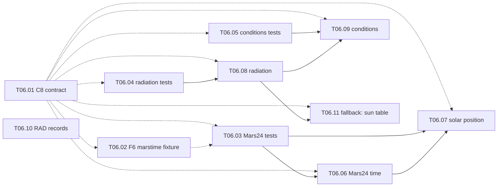

# TASK-06 — Mars24 solar functions + radiation estimate

| Field | Value |
| --- | --- |
| Objective | Mars24 solar functions + radiation estimate |
| Requirements | FR-11, FR-12 (06 §C); also FR-10 (darkness inputs) and FR-15 (EnvConstant and DataSource records), per the map register |
| Lane / owner role | compute — R2 Compute: Mishkat Ahmed Khan |
| Milestone | M1 (contract, fixture, records) · M2 (code; 06 §C.1 *When*: P 7–9 Nov) |
| Window | pre-event-if-permitted (Track P code); T06.01, T06.02 and T06.10 are pre-event-allowed |
| Effort (doc 06) | 3–5 h |
| Done when (doc 06) | 3 reference timestamps within tolerance; radiation examples exact |
| Main risk → fallback | Port bug → precompute LTST/sun table for demo dates in pipeline with `marstime` |
| Spec sections | [02 §D.5](../specs/02_Technical_Requirements_Document.md#d5-solar-conditions-fr-11) · [02 §D.4](../specs/02_Technical_Requirements_Document.md#d4-radiation-estimate-fr-12) · [02 §C.4](../specs/02_Technical_Requirements_Document.md#c4-mars-specific-pitfalls-to-test-explicitly) · [02 §C.2 L7](../specs/02_Technical_Requirements_Document.md#l7--environmental-values-fr-11-fr-12-fr-13) · [02 §F.1](../specs/02_Technical_Requirements_Document.md#f1-test-plan) · [01 FR-11](../specs/01_Product_Requirements_Document.md#fr-11--daylight-and-sun-conditions) · [01 FR-12](../specs/01_Product_Requirements_Document.md#fr-12--radiation-dose-estimate) · [05 EnvConstant](../specs/05_Backend_and_Database_Schema.md#envconstant) · [05 PlanResult](../specs/05_Backend_and_Database_Schema.md#planresult-computed) · [03 SCR-07](../specs/03_App_Flow_and_Diagrams.md#scr-07--conditions-panel) · [06 §C](../specs/06_High_Level_Implementation_Plan.md#c-work-packages) · [Map §d](_coordination.md#d-contracts-registry) |

> **Re-dated 2026-11-06** to [06](../specs/06_High_Level_Implementation_Plan.md) v2.2 (session handoff §F.2): milestones follow 06 §B v2, windows follow Track P (recorded 4 Nov), cut tags follow the v2 cut list in 06 §D.4 ([map §h.6](_coordination.md#h6-cut-list--subtasks-06-d4)), and every subtask names its Owner from 06 §A.2. Step texts that still mention v1 times (for example "Day 1" or "M5") refer to the v1 plan; the register in the [coordination map](_coordination.md#a3-register) is authoritative.

## Inputs this task consumes

| Input | Kind | Owner | Dependency |
| --- | --- | --- | --- |
| C1 — `EnvConstant` and `PlanResult` types in `packages/protocol/src/schema.ts`, including the optionality decision of map open point 3 | contract | T03.01 | soft (T06.01) |
| C5 — site-config input layout, `pipeline/sites/README.md` | contract | T03.01 | soft (T06.10) |
| C8 — conditions interface (created here) | contract | T06.01 | soft (T06.02–T06.09, T06.11) |
| F6 — Mars24 reference values | fixture | T06.02 | soft (T06.03) |
| `marstime` in the pipeline environment | upstream output | T14.01 | hard (T06.02); T06.11 also needs it (see Spec questions) |
| Arrival and departure UTC per stop, from `evaTimeline` | upstream output, passed in at run time through the C8 signature | T05.22 | none — an argument, not a build dependency |
| RAD dose rates and their ranges | spec values | [05 §C EnvConstant](../specs/05_Backend_and_Database_Schema.md#envconstant), [02 §D.4](../specs/02_Technical_Requirements_Document.md#d4-radiation-estimate-fr-12) | — |

## Outputs this task provides

| Output | Path | Consumers |
| --- | --- | --- |
| C8 conditions interface and the solar-function stubs | `packages/compute/src/conditions.ts`, `packages/compute/src/sun.ts`, `packages/compute/src/mars24.ts` | T05.32, T06.02–T06.09, T06.11 |
| F6 Mars24 reference values | `apps/web/tests/fixtures/mars24-reference.json` | T06.03 |
| Mars24 time functions (MSD, L_s, LTST, longitude conversion) | `packages/compute/src/mars24.ts` | T06.07, T06.09, T08.04 (LTST preview in SCR-04) |
| Solar position and flat-horizon sunrise/sunset | `packages/compute/src/sun.ts` | T06.09 |
| Radiation estimate | `packages/compute/src/radiation.ts` | T06.09, T06.11 |
| Conditions assembly: `stops_timeline` LTST and sun elevation, `conditions`, `radiation` | `packages/compute/src/conditions.ts` | T05.32, T05.24 (DARKNESS, through the timeline), T10.02, T10.03, T11.03 |
| RAD EnvConstant and DataSource records | `pipeline/sites/gale_boxwork/env_constants/`, `pipeline/sites/gale_boxwork/sources/hassler-2014-rad.json` | T03.13, T03.19, T12.03 |
| Precomputed sun table (fallback only) | `packages/compute/src/sunTable.json` | `conditions.ts` as rewritten by T06.11 |

## Subtasks

### T06.01 — Freeze the conditions interface; move the solar functions to `sun.ts`

- **Owner:** Mishkat Ahmed Khan (R2 Compute lead · R1 support)
- **Type:** contract
- **Tag:** agent-ready · core
- **Window:** pre-event-allowed
- **Estimate:** 1–1.5 h
- **Owns (writes):** `packages/compute/src/mars24.ts` (stub → T06.06), `packages/compute/src/sun.ts` (stub → T06.07), `packages/compute/src/conditions.ts` (stub → T06.09)
- **Reads:** `packages/compute/src/mars24.ts`, `packages/compute/src/radiation.ts`, `packages/compute/src/timeModel.ts`, `packages/protocol/src/schema.ts`, `packages/compute/src/handler.ts` (T05.01 stub), [02 §D.4](../specs/02_Technical_Requirements_Document.md#d4-radiation-estimate-fr-12), [02 §D.5](../specs/02_Technical_Requirements_Document.md#d5-solar-conditions-fr-11), [02 §C.4](../specs/02_Technical_Requirements_Document.md#c4-mars-specific-pitfalls-to-test-explicitly), [05 PlanResult](../specs/05_Backend_and_Database_Schema.md#planresult-computed), [05 EnvConstant](../specs/05_Backend_and_Database_Schema.md#envconstant), [Map §d C8](_coordination.md#d-contracts-registry)
- **Depends on:** T03.01 (soft)
- **Parallel with:** T05.01, T06.10
- **Steps:**
  1. Move the `solarPosition` and `sunriseSunset` stubs, signatures and JSDoc unchanged, from `mars24.ts` into a new `sun.ts`; `mars24.ts` keeps `marsSolDate`, `solarLongitude`, `eastToWestLongitude` and `localTrueSolarTime`.
  2. Create `conditions.ts` with one exported assembly function and its types, built only from 05 PlanResult field names (`stops_timeline` `arrive_ltst` and `sun_elevation_deg`, `conditions`, `radiation`) and the existing `estimateDose` signature.
  3. Every new body throws `TODO(<owner id>)`, e.g. `TODO(T06.07): not implemented`.
  4. Record the open C8 choices as `TODO(decision)` in the JSDoc for the compute-lane owner: which point gives the site latitude and longitude; what DARKNESS needs (sunrise/sunset UTC or sun elevation along legs); which duration feeds the dose, including PARTIAL plans; how the EnvConstant is chosen from `solar_phase`.
  5. Check with the T05.01 owner that the `handler.ts` stub calls the C8 function by its new name. *Gap recorded 2026-11-09: `handler.ts` does not call `assembleConditions` while it throws `TODO(T06.09)`; handler wiring is tracked under T05.32 (wip until T06.09 implements conditions assembly).*
  6. Run `make typecheck test`.
- **Acceptance:**
  - Serves: FR-11, FR-12 · [02 §D.4](../specs/02_Technical_Requirements_Document.md#d4-radiation-estimate-fr-12), [02 §D.5](../specs/02_Technical_Requirements_Document.md#d5-solar-conditions-fr-11), [05 PlanResult](../specs/05_Backend_and_Database_Schema.md#planresult-computed)
  - `sun.ts` and `conditions.ts` exist; every exported body throws a `TODO(...)` error; no logic is added.
  - Field names come only from 05 §C; longitude parameters stay east-positive ([02 §C.1](../specs/02_Technical_Requirements_Document.md#c1-coordinate-reference-conventions-applies-to-every-layer)).
  - `make typecheck` passes and `make test` still reports the TASK-06 specs as todos.
- **Verify:** `make typecheck test`; `git diff --stat` shows only the three owned files.
- **Agent brief:** Split the Mars24 stubs: move `solarPosition` and `sunriseSunset` from `packages/compute/src/mars24.ts` into a new `sun.ts`, and add a `conditions.ts` stub (contract C8) that assembles timeline LTST and sun elevation, conditions and radiation using only 05 PlanResult field names. Bodies throw `TODO(<owner id>)`; open choices stay `TODO(decision)` in JSDoc. `make typecheck test` must pass.
- **Conflict notes:** Stub handover (map §c.1 rule 2): after merge, `mars24.ts` belongs to T06.06, `sun.ts` to T06.07 and `conditions.ts` to T06.09. Merge before any TASK-06 test or implement subtask starts, and alongside T05.01, whose `handler.ts` stub calls C8. Later changes need a `contract-change:` subtask (map §d).
- **Follow-up (2026-11-09 reconciliation):** TODO(decision): Define darkness evaluation during travel and dwell, including temporal sampling or crossing inputs and warning location; arrival elevation alone does not cover the EVA interval.

### T06.02 — Fixture: Mars24 reference values generated with `marstime`

- **Owner:** Mishkat Ahmed Khan (R2 Compute lead · R1 support)
- **Type:** fixture
- **Tag:** agent-ready · core
- **Window:** pre-event-allowed
- **Estimate:** 1–2 h
- **Owns (writes):** `pipeline/tests/fixtures/make_mars24_reference.py`, `apps/web/tests/fixtures/mars24-reference.json`, `apps/web/tests/fixtures/README.md` (append-only)
- **Reads:** [02 §D.5](../specs/02_Technical_Requirements_Document.md#d5-solar-conditions-fr-11), [02 §C.4](../specs/02_Technical_Requirements_Document.md#c4-mars-specific-pitfalls-to-test-explicitly), [02 §E.2](../specs/02_Technical_Requirements_Document.md#e2-worker-message-protocol), [02 §E.3](../specs/02_Technical_Requirements_Document.md#e3-input-validation-rules), [05 §F.1](../specs/05_Backend_and_Database_Schema.md#f1-site-manifest-abridged-aoi-values-illustrative-until-task-01), [02 Sources](../specs/02_Technical_Requirements_Document.md#sources-accessed-2026-11-02) (`marstime` docs), [Map §e F6](_coordination.md#e-fixtures-and-mocks)
- **Depends on:** T14.01 (hard: `marstime` arrives in the dependency batch), T06.01 (soft)
- **Parallel with:** T06.04, T06.05, T06.10
- **Steps:**
  1. Record the inputs: at least 3 reference timestamps (`TODO(decision)`; the spec names none, and 02 §E.2's `eva_start_utc` example is one candidate; all inside the 02 §E.3 range), and the site point from the 05 §F.1 example `crs.proj4` centre, declared synthetic.
  2. Write the generator: for each timestamp, ask `marstime` for MSD, L_s, Mars Year, equation of time, LTST, solar declination, solar elevation and azimuth.
  3. Get flat-horizon sunrise/sunset from `marstime`, or derive them in the generator from its solar elevation; `TODO(verify)` its API and whether it takes west longitude (02 §C.4.1).
  4. Write the JSON with inputs, outputs, the `marstime` version and the generator path; no output is typed by hand.
  5. Append `## F6 — Mars24 reference values` to the fixtures README, listing the source of every value.
  6. Run the generator twice; the file must not change.
- **Acceptance:**
  - Serves: FR-11 · [02 §D.5](../specs/02_Technical_Requirements_Document.md#d5-solar-conditions-fr-11), [Map §e F6](_coordination.md#e-fixtures-and-mocks)
  - Given the pipeline environment from T14.01, when the generator runs twice, then the JSON is byte-identical.
  - Outputs come only from `marstime` through the generator; inputs come from the spec example or the recorded decision (map §e fixture value rule, items 1, 3 and 4).
  - The file covers at least 3 timestamps (02 §D.5) and states the longitude convention passed to `marstime` in each call.
- **Verify:** `$(make -s pipeline-python) pipeline/tests/fixtures/make_mars24_reference.py` (twice), then `git diff --exit-code apps/web/tests/fixtures/mars24-reference.json` and `python3 -m json.tool apps/web/tests/fixtures/mars24-reference.json`.
- **Agent brief:** Write a deterministic generator, `pipeline/tests/fixtures/make_mars24_reference.py`, that uses `marstime` to compute Mars24 reference values (MSD, L_s, Mars Year, LTST, solar elevation and azimuth, flat-horizon sunrise/sunset) for the recorded timestamps at the 05 §F.1 example site point, and writes `apps/web/tests/fixtures/mars24-reference.json`. Never type an output number by hand; mark unknown API details `TODO(verify)`.
- **Conflict notes:** The README is append-only (one `## F6` section at the end; keep both sides on a rebase conflict). The JSON matches C8 v1; if C8 changes, a `follow-up:` subtask regenerates it. T06.03 starts after this merges.
- **Follow-up (2026-11-09 reconciliation):** TODO(verify): Pin marstime in the approved pipeline environment, verify its APIs, longitude and azimuth conventions, UTC-to-TT handling and version reporting, then regenerate F6 twice and compare bytes. Identify direct package outputs separately from generator-derived azimuth and sunrise/sunset.
- **Follow-up (2026-11-09 reconciliation):** TODO(verify): Reconcile the F6 record labelled Sol 4190 at 2024-05-18T06:00:00Z with the specifications' 2024-05-20 event date. Preserve existing numerical outputs until an approved regeneration or documented relabelling.

### T06.03 — Tests: Mars24 time and sun functions vs `marstime`

- **Owner:** Mishkat Ahmed Khan (R2 Compute lead · R1 support)
- **Type:** test
- **Tag:** agent-ready · core
- **Window:** pre-event-if-permitted
- **Estimate:** 1–2 h
- **Owns (writes):** `packages/compute/tests/mars24.test.ts`, `packages/compute/tests/sun.test.ts`
- **Reads:** `apps/web/tests/fixtures/mars24-reference.json`, `packages/compute/src/mars24.ts`, `packages/compute/src/sun.ts`, [02 §D.5](../specs/02_Technical_Requirements_Document.md#d5-solar-conditions-fr-11), [02 §C.4](../specs/02_Technical_Requirements_Document.md#c4-mars-specific-pitfalls-to-test-explicitly), [02 §F.1](../specs/02_Technical_Requirements_Document.md#f1-test-plan), [01 FR-11](../specs/01_Product_Requirements_Document.md#fr-11--daylight-and-sun-conditions), [Map test-case allocation](_coordination.md#test-case-allocation)
- **Depends on:** T06.01 (soft), T06.02 (soft)
- **Parallel with:** T06.04, T06.05
- **Steps:**
  1. Load F6 in both files; take every expected value from F6 or the spec.
  2. `mars24.test.ts`: LTST within 1 min of F6 at every reference timestamp; `eastToWestLongitude` returns `west = (360 − east) mod 360` at Gale, using the 05 §F.1 example longitude.
  3. `mars24.test.ts`: L_s and Mars Year against F6 (tolerance `TODO(decision)`; 02 §D.5 sets tolerances only for elevation and LTST).
  4. `sun.test.ts`: solar elevation within 0.1° of F6 at every timestamp; at the returned sunrise and sunset instants the elevation is 0° within the same 0.1° (flat horizon); the times match F6 within a `TODO(decision)` tolerance.
  5. Move the skeleton's solar-elevation and sunrise/sunset todos from `mars24.test.ts` into `sun.test.ts` so each case lives once.
  6. Confirm every case fails against the stubs.
- **Acceptance:**
  - Serves: FR-11 · [02 §D.5](../specs/02_Technical_Requirements_Document.md#d5-solar-conditions-fr-11), [02 §C.4](../specs/02_Technical_Requirements_Document.md#c4-mars-specific-pitfalls-to-test-explicitly), [02 §F.1](../specs/02_Technical_Requirements_Document.md#f1-test-plan)
  - Allocated cases, and no others: "≥ 3 timestamps vs `marstime`: 0.1° elevation, 1 min LTST" (02 §D.5, §F.1 Mars24) and "Mars24 longitude sign at Gale" (02 §C.4.1).
  - "Unit tests match reference values from a trusted Mars24 implementation for ≥ 3 timestamps within 0.1° (solar elevation) and 1 min (LTST)" (01 FR-11).
  - Given the stubs, when the suite runs, then every case fails; the PR stays a draft until T06.06 and T06.07 make it pass.
- **Verify:** `npx vitest run tests/compute/mars24.test.ts tests/compute/sun.test.ts` (run in `apps/web/`).
- **Agent brief:** Write the Vitest cases for the Mars24 port against fixture F6: LTST within 1 min and solar elevation within 0.1° at every reference timestamp, the east-to-west longitude conversion at Gale, and flat-horizon sunrise/sunset. Expected values come only from F6 or the spec. Leave the PR as a draft for T06.06 and T06.07.
- **Conflict notes:** Stacked PRs (map §h.3): T06.06 branches from this branch and T06.07 from T06.06; merge T06.03, T06.06 and T06.07 back to back once T06.07's branch is green. If v1 cut 5 (no v2 cut item) is called first, this PR is never merged, so `main` never carries failing tests.
- **Follow-up (2026-11-09 reconciliation):** The sun-function cases in `sun.test.ts` depend on the T06.07 stubs and are PENDING-gated (they are skipped unless `PENDING_RED=1` is set, which exposes the expected `TODO(T06.07): not implemented` failures). Their bodies are kept. T06.03 stays `wip`.
- **Follow-up (2026-11-09 reconciliation):** TODO(verify): Independently verify the Clancy Mars Year offset table and reference UTC-to-TT handling. TODO(decision): Ratify L_s, equation-of-time and sunrise/sunset tolerances; provisional test bounds do not establish new requirements.
- **Update (2026-11-10):** T06.07 now exists, so the PENDING gate was removed from `sun.test.ts`; all of its F6 cases pass against the implementation, and same-sol, no-crossing and azimuth cases were added (see T06.07). T06.03 stays `wip` for the open `TODO(verify)`/`TODO(decision)` items above (Clancy table, UTC-to-TT handling, tolerances, F6 reproducibility).

### T06.04 — Tests: radiation estimate

- **Owner:** Mishkat Ahmed Khan (R2 Compute lead · R1 support)
- **Type:** test
- **Tag:** agent-ready · core
- **Window:** pre-event-if-permitted
- **Estimate:** 0.5–1 h
- **Owns (writes):** `packages/compute/tests/radiation.test.ts`
- **Reads:** `packages/compute/src/radiation.ts`, `packages/protocol/src/schema.ts`, [02 §D.4](../specs/02_Technical_Requirements_Document.md#d4-radiation-estimate-fr-12), [02 §F.1](../specs/02_Technical_Requirements_Document.md#f1-test-plan), [05 EnvConstant](../specs/05_Backend_and_Database_Schema.md#envconstant), [05 §F.3](../specs/05_Backend_and_Database_Schema.md#f3-plan-export-abridged-status-ok), [01 FR-12](../specs/01_Product_Requirements_Document.md#fr-12--radiation-dose-estimate)
- **Depends on:** T06.01 (soft)
- **Parallel with:** T06.03, T06.05
- **Steps:**
  1. Build the EnvConstant inputs from 05 §C verbatim: solar max `value` 0.64, `low` 0.52, `high` 0.76 mSv/day (`rad-gale-dose-eq-solar-max`); solar min `value` 0.925, `low` 0.85, `high` 1.0 (`rad-gale-dose-eq-solar-min`).
  2. Case: 7 h at solar max gives `dose_mSv` 0.187 with range 0.152–0.222 (02 §D.4).
  3. Case: 7 h at solar min gives the range 0.248–0.292 (02 §D.4); the spec gives no midpoint dose, so none is asserted.
  4. Keep the skeleton's 05 §F.3 check (148 min at solar max gives 0.066, range 0.053–0.078) as an extra reference; compare every value at the three decimals the specs print.
  5. Assert `solar_phase` and `const_id` are copied from the EnvConstant; move the skeleton todo "briefing shows 0.19 mSv" out of this file — it is a display check (see Spec questions).
- **Acceptance:**
  - Serves: FR-12 · [02 §D.4](../specs/02_Technical_Requirements_Document.md#d4-radiation-estimate-fr-12), [02 §F.1](../specs/02_Technical_Requirements_Document.md#f1-test-plan), [05 EnvConstant](../specs/05_Backend_and_Database_Schema.md#envconstant)
  - Allocated case, and no others: "7 h at solar max → 0.187 (0.152–0.222) mSv; solar min → 0.248–0.292 mSv" (02 §D.4, §F.1 Radiation).
  - Every expected value is printed in 02 §D.4 or 05 §F.3; none is computed by hand.
  - Given the stub, when the suite runs, then every case fails; the PR stays a draft until T06.08.
- **Verify:** `npx vitest run tests/compute/radiation.test.ts` (run in `apps/web/`).
- **Agent brief:** Write Vitest cases for `estimateDose` using the 05 §C rates verbatim: the 02 §D.4 7-hour examples at solar max and min, plus the 05 §F.3 148-minute example, compared at the specs' three decimals, and the copied `solar_phase` and `const_id`. Leave the PR as a draft for T06.08.
- **Conflict notes:** Stacked PR with T06.08 (map §h.3). Only this subtask writes `radiation.test.ts`.

### T06.05 — Tests: conditions assembly

- **Owner:** Mishkat Ahmed Khan (R2 Compute lead · R1 support)
- **Type:** test
- **Tag:** agent-ready · core
- **Window:** pre-event-if-permitted
- **Estimate:** 1–1.5 h
- **Owns (writes):** `packages/compute/tests/conditions.test.ts`
- **Reads:** `packages/compute/src/conditions.ts`, `packages/compute/src/timeModel.ts`, `packages/protocol/src/schema.ts`, [05 PlanResult](../specs/05_Backend_and_Database_Schema.md#planresult-computed), [05 §C conventions](../specs/05_Backend_and_Database_Schema.md#c-entity-definitions), [02 §D.4](../specs/02_Technical_Requirements_Document.md#d4-radiation-estimate-fr-12), [02 §D.5](../specs/02_Technical_Requirements_Document.md#d5-solar-conditions-fr-11), [01 FR-10](../specs/01_Product_Requirements_Document.md#fr-10--hazard-and-constraint-warnings)
- **Depends on:** T06.01 (soft)
- **Parallel with:** T06.03, T06.04
- **Steps:**
  1. Mock `mars24.ts` and `sun.ts` with `vi.mock`, so the cases test assembly only and stay valid under v1 cut 5 (no v2 cut item).
  2. Case: each `stops_timeline` entry receives `arrive_ltst` ("HH:MM", 05 §C) and `sun_elevation_deg` from the solar functions at its `arrive_utc`.
  3. Case: `conditions` carries `mars_year`, `ls_deg`, `sunrise_ltst`, `sunset_ltst`, `sunrise_utc` and `sunset_utc` for the EVA sol (flat horizon).
  4. Case: `radiation` uses the EnvConstant whose `conditions.solar_phase` equals the scenario's `solar_phase` and returns its `const_id`.
  5. Cases for the C8 decisions, as `it.todo` until T06.01's choices are settled: the duration that feeds the dose, including PARTIAL plans with `totals` null, and the data DARKNESS needs.
- **Acceptance:**
  - Serves: FR-10, FR-11, FR-12 · [05 PlanResult](../specs/05_Backend_and_Database_Schema.md#planresult-computed), [02 §D.4](../specs/02_Technical_Requirements_Document.md#d4-radiation-estimate-fr-12), [02 §D.5](../specs/02_Technical_Requirements_Document.md#d5-solar-conditions-fr-11)
  - The map allocates no named case here; expected values come from the mocks or the 05 §C records, never from hand arithmetic.
  - Output field names are exactly those of 05 §C PlanResult.
  - Given the stub, when the suite runs, then every case fails; the PR stays a draft until T06.09.
- **Verify:** `npx vitest run tests/compute/conditions.test.ts` (run in `apps/web/`).
- **Agent brief:** Write Vitest cases for the C8 conditions assembly with `mars24.ts` and `sun.ts` mocked: per-stop LTST and sun elevation, the EVA-sol conditions block, and the radiation block chosen by `solar_phase`. Keep the undecided C8 cases as `it.todo`. Use 05 PlanResult field names exactly. Leave the PR as a draft for T06.09.
- **Conflict notes:** Stacked PR with T06.09 (map §h.3). T06.11 may replace this file if the fallback is triggered.

### T06.06 — Implement the Mars24 time functions (MSD, L_s, LTST, east → west longitude)

- **Owner:** Mishkat Ahmed Khan (R2 Compute lead · R1 support)
- **Type:** implement
- **Tag:** agent-ready · core
- **Window:** pre-event-if-permitted
- **Estimate:** 2–3 h
- **Owns (writes):** `packages/compute/src/mars24.ts`
- **Reads:** `packages/compute/tests/mars24.test.ts`, `apps/web/tests/fixtures/mars24-reference.json`, [02 §D.5](../specs/02_Technical_Requirements_Document.md#d5-solar-conditions-fr-11), [02 §C.4](../specs/02_Technical_Requirements_Document.md#c4-mars-specific-pitfalls-to-test-explicitly), [02 §C.1](../specs/02_Technical_Requirements_Document.md#c1-coordinate-reference-conventions-applies-to-every-layer), [02 Sources](../specs/02_Technical_Requirements_Document.md#sources-accessed-2026-11-02) (GISS Mars24 notes, Allison & McEwen 2000, `marstime`)
- **Depends on:** T06.03 (hard: paired tests), T06.01 (soft)
- **Parallel with:** T06.08, T06.09
- **Steps:**
  1. Implement `marsSolDate` per the Mars24 algorithm (Allison & McEwen 2000; GISS Mars24 notes), including the UTC-to-TT step it needs (`TODO(verify)` the handling against the notes; no network at run time).
  2. Implement `solarLongitude`, returning L_s and the Mars Year (year convention `TODO(verify)` against `marstime`).
  3. Implement `eastToWestLongitude` as `west = (360 − east) mod 360` and call it only at the Mars24 boundary; inputs and outputs stay east-positive.
  4. Implement `localTrueSolarTime` (equation of time plus mean solar time at the site longitude), returning "HH:MM".
  5. Make `mars24.test.ts` pass; keep every function pure (no DOM, no fetch).
- **Acceptance:**
  - Serves: FR-11 · [02 §D.5](../specs/02_Technical_Requirements_Document.md#d5-solar-conditions-fr-11), [02 §C.4](../specs/02_Technical_Requirements_Document.md#c4-mars-specific-pitfalls-to-test-explicitly), [01 FR-11](../specs/01_Product_Requirements_Document.md#fr-11--daylight-and-sun-conditions)
  - `mars24.test.ts` passes: LTST within 1 min at every reference timestamp and the longitude-sign case at Gale.
  - No Earth defaults (02 §C.4.2) and no network request.
- **Verify:** `npx vitest run tests/compute/mars24.test.ts` (run in `apps/web/`); `make typecheck`.
- **Agent brief:** Port the Mars24 time functions into `packages/compute/src/mars24.ts` — Mars Sol Date, L_s and Mars Year, east-to-west longitude, and LTST — following Allison & McEwen 2000 and the GISS Mars24 notes, until `tests/compute/mars24.test.ts` passes against fixture F6. Pure functions only; east-positive longitude everywhere except inside the Mars24 formulas.
- **Conflict notes:** Owns `mars24.ts` after T06.01's stub edit. Branch from T06.03 (stacked); T06.07 branches from this branch. If the tests cannot be made to pass, T06.11 is the fallback trigger.
- **Follow-up (2026-11-09 reconciliation):** TODO(verify): Independently verify the Clancy Mars Year offset table and reference UTC-to-TT handling. TODO(decision): Ratify L_s, equation-of-time and sunrise/sunset tolerances; provisional test bounds do not establish new requirements.
- **Update (2026-11-10):** `mars24.ts` now throws `RangeError` for an invalid `Date`, an instant before 1972-01-01 UTC (no tabulated leap seconds) and a non-finite longitude, and keeps its helper functions internal. The leap-second table is NAIF `naif0012.tls` as on main (36 s from 2015-07-01, 37 s from 2017-01-01); a draft table that applied those steps one year and one day early was not merged. `TODO(verify)`: confirm with IERS Bulletin C that no leap second follows 2017-01-01.

### T06.07 — Implement solar position and flat-horizon sunrise/sunset

- **Owner:** Mishkat Ahmed Khan (R2 Compute lead · R1 support)
- **Type:** implement
- **Tag:** agent-ready · core
- **Window:** pre-event-if-permitted
- **Estimate:** 1.5–2.5 h
- **Owns (writes):** `packages/compute/src/sun.ts`
- **Reads:** `packages/compute/src/mars24.ts`, `packages/compute/tests/sun.test.ts`, `apps/web/tests/fixtures/mars24-reference.json`, [02 §D.5](../specs/02_Technical_Requirements_Document.md#d5-solar-conditions-fr-11), [02 §C.1](../specs/02_Technical_Requirements_Document.md#c1-coordinate-reference-conventions-applies-to-every-layer)
- **Depends on:** T06.03 (hard: paired tests), T06.06 (hard: solar position needs MSD, L_s and LTST), T06.01 (soft)
- **Parallel with:** T06.08, T06.09
- **Steps:**
  1. Compute solar declination from L_s and the hour angle from LTST, using T06.06's functions.
  2. `solarPosition`: elevation and azimuth at planetocentric latitude and east longitude (identical to planetographic on the sphere); azimuth convention `TODO(verify)` against `marstime`.
  3. Model no terrain shadowing, refraction or dust opacity (02 §D.5 limitation), and say so in the JSDoc.
  4. `sunriseSunset`: the instants in the sol containing `utc` where elevation crosses 0°, as UTC ISO strings and LTST "HH:MM"; search method `TODO(decision)`.
  5. Make `sun.test.ts` pass.
- **Acceptance:**
  - Serves: FR-11 · [02 §D.5](../specs/02_Technical_Requirements_Document.md#d5-solar-conditions-fr-11), [01 FR-11](../specs/01_Product_Requirements_Document.md#fr-11--daylight-and-sun-conditions)
  - `sun.test.ts` passes: solar elevation within 0.1° at every reference timestamp, and sunrise/sunset on a flat horizon.
  - "Terrain shadowing is explicitly stated as not modelled" (01 FR-11): the JSDoc states it, so SCR-07 and the methods text can repeat it.
- **Verify:** `npx vitest run tests/compute/sun.test.ts` (run in `apps/web/`); `make typecheck`.
- **Agent brief:** Implement `solarPosition` and `sunriseSunset` in `packages/compute/src/sun.ts` on top of the Mars24 time functions in `mars24.ts`, until `tests/compute/sun.test.ts` passes against F6: elevation within 0.1°, flat horizon, no terrain or refraction. Unknown conventions stay `TODO(verify)`.
- **Conflict notes:** Owns `sun.ts` after T06.01's stub. Branch from T06.06 (stacked); merge right after T06.03 and T06.06.
- **Follow-up (2026-11-09 reconciliation):** TODO(decision): Schedule T06.07 solar position and flat-horizon sunrise/sunset implementation after the reference conventions are verified; the T06.03 sun cases remain PENDING-gated until then.
- **Update (2026-11-10, review repair of the integrated `sun.ts`):** `sunriseSunset` now takes both events from the local true solar sol (LTST 00:00 to 00:00) that contains `utc`, so probes before dawn or after sunset return the same pair as midday (regression: Gale `2026-11-14T21:00:00Z`); the `?? utc` fallback is gone. No-crossing contract (|cos H0| > 1, polar day or night): `sunriseSunset` throws `SunEventsUnavailableError` (a `RangeError` with `reason` `SUN_ALWAYS_UP` or `SUN_NEVER_UP`) and never invents an instant; 05 PlanResult.conditions has no absent-event form, so T06.09 must catch it. TODO(decision): team to confirm this contract (not reachable at Gale). TODO(verify): add the NASA Mars24 worked azimuth example with its printed inputs and cite it; the azimuth cases use F6 marstime elevation and declination through the spherical law of cosines because the page was unreachable offline. T06.07 stays `wip` until these are closed.

### T06.08 — Implement the radiation estimate

- **Owner:** Mishkat Ahmed Khan (R2 Compute lead · R1 support)
- **Type:** implement
- **Tag:** agent-ready · core
- **Window:** pre-event-if-permitted
- **Estimate:** 0.5 h
- **Owns (writes):** `packages/compute/src/radiation.ts`
- **Reads:** `packages/compute/tests/radiation.test.ts`, `packages/protocol/src/schema.ts`, [02 §D.4](../specs/02_Technical_Requirements_Document.md#d4-radiation-estimate-fr-12), [05 EnvConstant](../specs/05_Backend_and_Database_Schema.md#envconstant), [01 FR-12](../specs/01_Product_Requirements_Document.md#fr-12--radiation-dose-estimate)
- **Depends on:** T06.04 (hard: paired tests), T06.01 (soft)
- **Parallel with:** T06.06, T06.07
- **Steps:**
  1. Implement `estimateDose` as `dose_mSv = rate_mSv_per_day × duration_h / 24` for the EnvConstant `value`, `low` and `high`.
  2. Copy `solar_phase` from the EnvConstant `conditions` and its `const_id`.
  3. Do not round; display precision is a UI decision (see Spec questions).
  4. Make `radiation.test.ts` pass.
- **Acceptance:**
  - Serves: FR-12 · [02 §D.4](../specs/02_Technical_Requirements_Document.md#d4-radiation-estimate-fr-12), [01 FR-12](../specs/01_Product_Requirements_Document.md#fr-12--radiation-dose-estimate)
  - Output is `{dose_mSv, dose_low_mSv, dose_high_mSv, solar_phase, const_id}` (02 §D.4).
  - The 02 §D.4 examples reproduce: "radiation examples exact" (06 §C done-when).
- **Verify:** `npx vitest run tests/compute/radiation.test.ts` (run in `apps/web/`); `make typecheck`.
- **Agent brief:** Implement `estimateDose` in `packages/compute/src/radiation.ts` per 02 §D.4 (rate × duration / 24 for value, low and high; copy `solar_phase` and `const_id`; no rounding) until `tests/compute/radiation.test.ts` passes.
- **Conflict notes:** Stacked on T06.04; merge the two back to back.

### T06.09 — Implement conditions assembly (timeline LTST, sun elevation, radiation)

- **Owner:** Mishkat Ahmed Khan (R2 Compute lead · R1 support)
- **Type:** implement
- **Tag:** agent-ready · core
- **Window:** pre-event-if-permitted
- **Estimate:** 1–2 h
- **Owns (writes):** `packages/compute/src/conditions.ts`
- **Reads:** `packages/compute/tests/conditions.test.ts`, `packages/compute/src/mars24.ts`, `packages/compute/src/sun.ts`, `packages/compute/src/radiation.ts`, `packages/compute/src/timeModel.ts`, `packages/compute/src/warnings.ts`, [05 PlanResult](../specs/05_Backend_and_Database_Schema.md#planresult-computed), [02 §D.4](../specs/02_Technical_Requirements_Document.md#d4-radiation-estimate-fr-12), [02 §D.5](../specs/02_Technical_Requirements_Document.md#d5-solar-conditions-fr-11), [01 FR-10](../specs/01_Product_Requirements_Document.md#fr-10--hazard-and-constraint-warnings)
- **Depends on:** T06.05 (hard: paired tests), T06.08 (hard: the assembly calls the radiation estimate), T06.01 (soft)
- **Parallel with:** T06.06, T06.07
- **Steps:**
  1. Fill `arrive_ltst` and `sun_elevation_deg` for every `stops_timeline` entry from `localTrueSolarTime` and `solarPosition` (the time model leaves them to Mars24).
  2. Fill `conditions` from `solarLongitude` and `sunriseSunset` for the sol of `eva_start_utc`, flat horizon.
  3. Fill `radiation` through `estimateDose` with the EnvConstant matching `solar_phase` and the duration decided at T06.01.
  4. Supply the DARKNESS inputs in the shape T06.01 recorded (consumer: T05.24, through T05.32).
  5. Make `conditions.test.ts` pass; run `make typecheck`.
- **Acceptance:**
  - Serves: FR-10, FR-11, FR-12 · [05 PlanResult](../specs/05_Backend_and_Database_Schema.md#planresult-computed), [02 §D.4](../specs/02_Technical_Requirements_Document.md#d4-radiation-estimate-fr-12), [02 §D.5](../specs/02_Technical_Requirements_Document.md#d5-solar-conditions-fr-11)
  - `conditions.test.ts` passes; output field names are exactly those of 05 §C.
  - The end-to-end daylight warning for an early-morning start (01 §E step 7) is checked in T10.03, not here.
- **Verify:** `npx vitest run tests/compute/conditions.test.ts` (run in `apps/web/`); `make typecheck`.
- **Agent brief:** Implement the C8 function in `packages/compute/src/conditions.ts`: per-stop LTST and sun elevation, the EVA-sol conditions block and the radiation block, using `mars24.ts`, `sun.ts` and `radiation.ts`, until `tests/compute/conditions.test.ts` passes. Follow the C8 decisions recorded in the stub's JSDoc.
- **Conflict notes:** Owns `conditions.ts` after T06.01's stub; stacked on T06.05. T05.32 calls it through C8; T06.11 may replace the file if the fallback is triggered.
- **Follow-up (2026-11-09 reconciliation):** TODO(decision): Complete C8 assembly into PlanResult after deciding the site coordinate, EnvConstant selection, PARTIAL-plan dose duration and darkness inputs. Until then, return the existing M3 empty timeline and omit conditions and radiation.
- **Follow-up (2026-11-09 reconciliation):** TODO(decision): Define darkness evaluation during travel and dwell, including temporal sampling or crossing inputs and warning location; arrival elevation alone does not cover the EVA interval.

### T06.10 — Write the RAD EnvConstant and DataSource records (05 §C values verbatim)

- **Owner:** Mishkat Ahmed Khan (R2 Compute lead · R1 support)
- **Type:** implement
- **Tag:** agent-ready · core
- **Window:** pre-event-allowed
- **Estimate:** 0.5–1 h
- **Owns (writes):** `pipeline/sites/gale_boxwork/env_constants/rad-gale-dose-eq-solar-max.json`, `pipeline/sites/gale_boxwork/env_constants/rad-gale-dose-eq-solar-min.json`, `pipeline/sites/gale_boxwork/sources/hassler-2014-rad.json`, `pipeline/sites/gale_boxwork/sources/` (append-only)
- **Reads:** `pipeline/sites/README.md` (C5), `schemas/site-manifest.schema.json`, [05 EnvConstant](../specs/05_Backend_and_Database_Schema.md#envconstant), [05 DataSource](../specs/05_Backend_and_Database_Schema.md#datasource), [05 §F.1](../specs/05_Backend_and_Database_Schema.md#f1-site-manifest-abridged-aoi-values-illustrative-until-task-01), [02 §C.2 L7](../specs/02_Technical_Requirements_Document.md#l7--environmental-values-fr-11-fr-12-fr-13), [Mars Scientific Context §9](../reference/mars-scientific-context.md#9-radiation-and-space-environment) and its source list
- **Depends on:** T03.01 (soft)
- **Parallel with:** T06.01, T06.02
- **Steps:**
  1. Write `rad-gale-dose-eq-solar-max.json` with the 05 §C and §F.1 values verbatim: `quantity` "surface dose equivalent rate", `value` 0.64, `low` 0.52, `high` 0.76, `unit` "mSv/day", `conditions` {solar_phase max, location "Gale crater floor", period "2012-2013"}, `provenance` "measured", `source_id` "hassler-2014-rad".
  2. Write `rad-gale-dose-eq-solar-min.json` with the 05 §C values: `value` 0.925, `low` 0.85, `high` 1.0, `provenance` "measured", `note` "reported range, Simonsen et al. 2024", `unit` "mSv/day" (02 §C.2 L7), `conditions.solar_phase` "min"; the other conditions come from the solar-minimum row of Mars Scientific Context §9 or stay `TODO(verify)`; `source_id` is `simonsen-2024-rad` (Obidit Islam (data lead), 2026-11-10; map open point 12).
  3. Write `hassler-2014-rad.json`: title, authors and link copied from the Hassler et al. (2014) entry in the Mars Scientific Context source list; missions and instruments from the specs (MSL, RAD); `accessed` is the date of access; any required field the sources do not give is `TODO(verify)`.
  4. Use the existing `simonsen-2024-rad.json` DataSource (Simonsen et al. 2024, link in the same source list) for the solar-min record.
  5. Check every file parses and uses the field names of the manifest schema's EnvConstant and DataSource definitions.
- **Acceptance:**
  - Serves: FR-12, FR-15 · [05 EnvConstant](../specs/05_Backend_and_Database_Schema.md#envconstant), [05 DataSource](../specs/05_Backend_and_Database_Schema.md#datasource)
  - Every number is copied from 05 §C or §F.1; nothing is rounded, derived or guessed.
  - No URL, DOI, licence or credit text is invented: missing values are `TODO(verify)`.
  - After T03.19 runs, `validate-manifest` reports no problem with these records, and SCR-09 can credit the RAD source (FR-15).
- **Verify:** `python3 -m json.tool` on each owned file; after T03.19, `make validate SITE=gale_boxwork`.
- **Agent brief:** Create the two RAD EnvConstant JSON records and the RAD DataSources under `pipeline/sites/gale_boxwork/`, copying values verbatim from 05 §C/§F.1 and the citation from `docs/reference/mars-scientific-context.md`. Leave anything the sources do not state as `TODO(verify)`; use the decided solar-min `source_id` above.
- **Conflict notes:** The `sources/` and `env_constants/` folders are append-only by file: one record per file, owned by its creator; never edit another subtask's record. T03.19 needs these files before it builds bundle v1 (map §f).
- **Follow-up (2026-11-09 reconciliation):** TODO(verify): Mishkat Ahmed Khan must verify RAD DataSource metadata and access dates against the cited publications, including publisher, version, credit, licence and missions/instruments. Obidit Islam (data lead), 2026-11-10 confirmed `simonsen-2024-rad` for the solar-minimum `source_id`. Preserve numerical EnvConstant values; the complete-bundle validator and SCR-09 checks remain open.
- **PR follow-up:** Obidit Islam will inform Mishkat Ahmed Khan (owner of the RAD records) by a review request or comment on this PR when it is opened; that notification has not yet been sent in this fix round.

### T06.11 — Fallback — start only if Mars24 tests fail: precomputed sun table for the demo dates

- **Owner:** Mishkat Ahmed Khan (R2 Compute lead · R1 support)
- **Type:** fallback
- **Tag:** agent-ready · core
- **Window:** pre-event-if-permitted
- **Estimate:** 2–3 h
- **Owns (writes):** `pipeline/src/marswalk_pipeline/sun_table.py`, `packages/compute/src/sunTable.json`, `packages/compute/src/conditions.ts` (replaces T06.09), `packages/compute/tests/conditions.test.ts` (replaces T06.05)
- **Reads:** `packages/compute/src/conditions.ts`, `packages/compute/src/radiation.ts`, `pipeline/tests/fixtures/make_mars24_reference.py`, [06 §C](../specs/06_High_Level_Implementation_Plan.md#c-work-packages), [06 §D.4](../specs/06_High_Level_Implementation_Plan.md#d4-cut-list-cut-in-this-order-when-behind), [02 §B](../specs/02_Technical_Requirements_Document.md#b-technology-choices), [02 §D.5](../specs/02_Technical_Requirements_Document.md#d5-solar-conditions-fr-11), [03 SCR-07](../specs/03_App_Flow_and_Diagrams.md#scr-07--conditions-panel)
- **Depends on:** T06.08 (hard: the table-backed assembly keeps the live radiation estimate), T06.01 (soft)
- **Parallel with:** none — starts only on its trigger
- **Steps:**
  1. Fix the demo dates (`TODO(decision)`, taken from the demo plan or demo script; 02 §E.2's example date is a candidate) and the table time step (`TODO(decision)`).
  2. Write `sun_table.py`: with `marstime`, compute LTST, solar elevation, L_s, Mars Year and flat-horizon sunrise/sunset for each demo sol at the site point decided in T06.01; write `sunTable.json` with the inputs and the `marstime` version.
  3. Replace the live Mars24 calls in `conditions.ts` with table lookups; outside the tabulated dates return an explicit "not available" state (SCR-07), never an extrapolated value.
  4. Keep the radiation block live through `estimateDose`, and adapt `conditions.test.ts` to the table-backed version.
  5. Ask the T12.04 owner to note in the methods text that sun values are precomputed for the demo dates; the label stays modelled.
- **Acceptance:**
  - Serves: FR-11 · [06 §C](../specs/06_High_Level_Implementation_Plan.md#c-work-packages) (TASK-06 fallback), [06 §D.4](../specs/06_High_Level_Implementation_Plan.md#d4-cut-list-cut-in-this-order-when-behind) item 5
  - "Port bug → precompute LTST/sun table for demo dates in pipeline with `marstime`" (06 §C): the demo scenario shows LTST, sun elevation and sunrise/sunset from the table.
  - Running the table generator twice gives a byte-identical file; no value in it is typed by hand.
  - The demo path makes no live Mars24 call; the unmerged T06.03, T06.06 and T06.07 branches stay off `main`.
- **Verify:** `$(make -s pipeline-python) -m marswalk_pipeline.sun_table` (twice), then `git diff --exit-code packages/compute/src/sunTable.json`; `npx vitest run tests/compute/conditions.test.ts` (run in `apps/web/`).
- **Agent brief:** Fallback for v1 cut 5 (no v2 cut item): generate a sun table for the demo dates with `marstime` in `pipeline/src/marswalk_pipeline/sun_table.py`, write `packages/compute/src/sunTable.json`, and switch `conditions.ts` to table lookups (explicit "not available" outside the table) while keeping the live radiation estimate. Deterministic output; nothing typed by hand.
- **Conflict notes:** Writes `conditions.ts` and `conditions.test.ts` in place of T06.09 and T06.05 (map §c.1 rule 3); never at the same time as them. Needs `marstime` from T14.01, and `sunTable.json` is not yet in map §c (see Spec questions). The methods text belongs to T12.04: ask, don't edit.

## Internal dependency graph

T06.10 has no edge inside this task; it feeds T03.19 (map §f).

## Definition of done (task level)

- [06 §D.7](../specs/06_High_Level_Implementation_Plan.md#d7-definition-of-done-per-feature): the acceptance criteria of 01 FR-11 and FR-12 are met; unit tests are committed for the Mars24 time and sun functions, the radiation estimate and the conditions assembly; outputs carry `const_id`, so the UI can show the provenance labels; the functions work offline (pure, no fetch); the RAD source reaches SCR-09 through T06.10. Keyboard reachability applies to SCR-07 in TASK-10, not here.
- 06 §C done-when: "3 reference timestamps within tolerance; radiation examples exact".
- `make typecheck test` is green; F6 regenerates byte-identically.
- Longitude is east-positive everywhere except inside the Mars24 formulas ([02 §C.4](../specs/02_Technical_Requirements_Document.md#c4-mars-specific-pitfalls-to-test-explicitly)).
- `python3 scripts/check_tasks.py` passes.

## Spec questions

1. **Window** ([map open point 2](_coordination.md#open-points)): 06 §D.2 says TASK-06 has no data dependency, but 06 §A Track P covers only TASK-02 and TASK-05, so T06.03–T06.09 stay `event-only` — `TODO(decision)`.
2. **M3 slice** (open point 3): if C1 makes `conditions`, `radiation` and `stops_timeline` required, M3 needs T06.09; otherwise T06.09 can land in M4 as planned.
3. **Solar-min record** (open point 12): 05 §C gives value, low, high and a note (Simonsen et al. 2024) but no `source_id` and no `conditions`. Obidit Islam (data lead), 2026-11-10 chose `simonsen-2024-rad`; T06.10 leaves unverified metadata `TODO(verify)`.
4. **Reference timestamps:** 02 §D.5 asks for at least 3 but names none; 02 §E.2's `eva_start_utc` example is one candidate — `TODO(decision)` in T06.02.
5. **Tolerances:** 02 §D.5 sets tolerances only for solar elevation (0.1°) and LTST (1 min); those for L_s (strictly below 0.05°, as asserted in `mars24.test.ts`; an earlier draft documented 0.1° while its `toBeCloseTo(…, 1)` assertion allowed only less than 0.05°), Mars Year (exact), MSD (0.001 sol) and sunrise/sunset times (within 2 min of F6 in the F6 case, within 30 s in the same-sol cases of `sun.test.ts`; observed at most 2 s) are provisional — `TODO(decision)` to ratify (tested in T06.03 and T06.07).
6. **Dose duration:** 01 FR-12 says "EVA duration", 02 §D.4 "planned duration", and 05 §F.3 uses `eva_total_min`; `totals` is null for PARTIAL plans (02 §E.2), so the duration for a partial plan is undefined — `TODO(decision)` at T06.01.
7. **Display rounding:** 01 FR-12 shows 0.19 mSv where 02 §D.4 gives 0.187 and 05 §F.3 stores 0.066 (three decimals). Compute keeps unrounded values; the display rule is a UI `TODO(decision)` for SCR-07 and SCR-08. Map change proposed: give the 01 FR-12 "card shows 0.19 mSv" check, removed from `radiation.test.ts`, to T11.05 and T10.03.
8. **Site position:** 02 §D.5 uses "the site's planetocentric latitude and longitude", but 05 Site has no single site point (`aoi.bbox_geo`, the `crs` centre, `default_start`) — `TODO(decision)` at T06.01.
9. **DARKNESS:** 01 FR-10 warns about a "segment in darkness"; C8 must say whether T05.24 gets sunrise/sunset UTC or sun elevation along the legs — `TODO(decision)` at T06.01.
10. **`marstime` details:** its API, longitude convention (02 §C.4.1), Mars Year and azimuth conventions, and UTC-to-TT handling are `TODO(verify)` before T06.02 and T06.06.
11. **Map change proposed (schedule):** the lanes board puts T06.02 in M1, but its hard dependency T14.01 is in M2. Move T06.02 to M2, or land T14.01's `marstime` entry first.
12. **Map change proposed (fallback):** T06.11 also needs `marstime` (a hard edge on T14.01 missing from map §f) and writes `packages/compute/src/sunTable.json`, which map §c does not list. Add both, plus T06.11's `(replaces T06.05)` on `packages/compute/tests/conditions.test.ts`, to the map.
13. **Follow-up (2026-11-09 reconciliation):** TODO(decision): The team lead must reconcile stale event-only prose with the Track P and coordination-register windows; this review makes no task-window change.
14. **No sunrise/sunset in a sol (2026-11-10):** at polar latitudes the sun may not cross the flat horizon. `sunriseSunset` throws `SunEventsUnavailableError` instead of returning a placeholder; whether C8 omits `conditions`, reports a polar-day/night state or blocks such sites is `TODO(decision)` at T06.09 (Gale never hits it).
