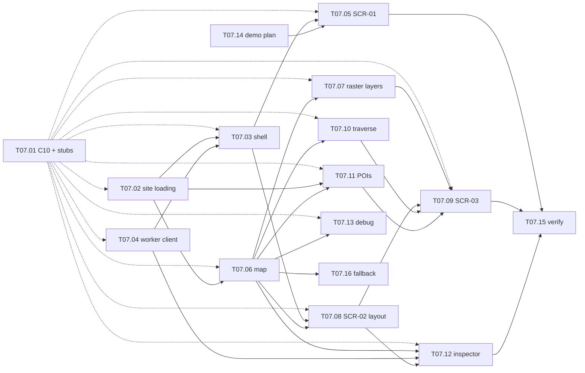

# TASK-07 — App shell + map workspace + layers panel + inspector

| Field | Value |
| --- | --- |
| Objective | App shell + map workspace + layers panel + inspector |
| Requirements | FR-01–03, FR-15–17, NFR-11 (06 §C); subtasks also serve FR-04, FR-06, NFR-01, NFR-03, NFR-05, NFR-08, NFR-10 · screens SCR-01, SCR-02, SCR-03 |
| Lane / owner role | frontend — Frontend engineer (T07.14: story — Design & story lead) |
| Milestone | M2 (T07.01, T07.14) · M3 (T07.02–T07.08; T07.16 if triggered) · M4 (T07.09–T07.13, T07.15) |
| Window | event-only; T07.01 and T07.14 are pre-event-allowed |
| Effort (doc 06) | 6–10 h |
| Done when (doc 06) | All layers toggle; inspector values match grid |
| Main risk → fallback | Projection issues → ImageStatic |
| Spec sections | [06 §C](../specs/06_High_Level_Implementation_Plan.md#c-work-packages) · [03 §A](../specs/03_App_Flow_and_Diagrams.md#a-information-architecture) · [03 SCR-01](../specs/03_App_Flow_and_Diagrams.md#scr-01--mission-briefing) · [03 SCR-02](../specs/03_App_Flow_and_Diagrams.md#scr-02--map-workspace) · [03 SCR-03](../specs/03_App_Flow_and_Diagrams.md#scr-03--layers-panel) · [03 §D](../specs/03_App_Flow_and_Diagrams.md#d-error-and-recovery-flows) · [02 §C.1](../specs/02_Technical_Requirements_Document.md#c1-coordinate-reference-conventions-applies-to-every-layer) · [02 §C.4](../specs/02_Technical_Requirements_Document.md#c4-mars-specific-pitfalls-to-test-explicitly) · [02 §E.1](../specs/02_Technical_Requirements_Document.md#e1-static-asset-contract) · [02 §E.2](../specs/02_Technical_Requirements_Document.md#e2-worker-message-protocol) · [02 §F](../specs/02_Technical_Requirements_Document.md#f-nonfunctional-requirements-and-validation) · [04 §B](../specs/04_Design_Brief.md#b-layout-and-navigation) · [04 §C.1](../specs/04_Design_Brief.md#c1-colour-tokens) · [04 §C.5](../specs/04_Design_Brief.md#c5-map-annotations-and-selection-states) · [04 §D](../specs/04_Design_Brief.md#d-interaction-and-component-behavior) · [04 §E](../specs/04_Design_Brief.md#f-accessibility-and-responsive-behavior) · [05 §C Layer](../specs/05_Backend_and_Database_Schema.md#layer) · [05 §E.1](../specs/05_Backend_and_Database_Schema.md#e1-access-patterns-queries-and-indexes) |

TASK-07 builds the browser shell: site loading, hash routes `#/` and `#/map`, SCR-01, the SCR-02 workspace with its map, SCR-03 and the point inspector. Its contract subtask (T07.01) also creates the UI module stubs other tasks fill in, so frontend work in TASK-08 to TASK-14 can start in parallel ([map §d](_coordination.md#d-contracts-registry), C10).

## Inputs this task consumes

| Input | Kind | Owner | Dependency |
| --- | --- | --- | --- |
| C1 TypeScript mirror of the 05 entities (`packages/protocol/src/schema.ts`) | contract | T03.01 | soft |
| C2 site-manifest JSON Schema (legend structure) | contract | T03.01 | soft |
| C6 worker message protocol (`packages/protocol/src/worker.ts`) | contract | T05.01 | soft |
| C9 tile grid and tile pixel encoding (`docs/contracts/tile-grid.md`) | contract | T02.01 | soft |
| C11 plan-store state and events (`apps/web/src/state/planStore.ts` interfaces) | contract | T08.01 | soft |
| C12 CSS token names and status classes (`apps/web/src/ui/styles/tokens.css`) | contract | T13.01 | soft |
| F3 mock worker (`apps/web/tests/fixtures/mockWorker.ts`) | fixture | T05.04 | soft |
| F4 mock site bundle (`data/sites/mock_site/`) | fixture | T03.02 | soft |
| F5 real-grid sample cells (`apps/web/tests/fixtures/real/sample_cells.json`; exists only once bundle v1 does) | fixture | T03.21 | soft |
| Mars projection module (`apps/web/src/ui/map/projection.ts`) | upstream output | T02.02 | hard (T07.06) |
| Curated POI ids (`pipeline/sites/gale_boxwork/pois/`) | upstream output | T04.04 | hard (T07.14) |
| ImageStatic layer factory (`apps/web/src/ui/map/imageStatic.ts`) — fallback only | upstream output | T02.06 | hard (T07.16; map change proposed) |
| One PNG per 2 m layer — fallback only | upstream output | T03.25 | hard (T07.16; map change proposed) |

## Outputs this task provides

| Output | Path | Consumers |
| --- | --- | --- |
| C10 UI contract: app context, screen and map-module signatures, worker-client interface, map handle, layer order, provenance attribute names, URL parameters | `apps/web/src/ui/context.ts` | T07.02–T07.13, T08.03–T08.09, T09.01–T09.05, T10.01, T10.02, T11.02–T11.04, T12.01, T12.03, T13.05–T13.07, T14.03, T14.04 |
| 23 UI module stubs handed to their owners | the `(stub → …)` paths of T07.01 | T07.02, T07.04, T07.06, T07.07, T07.10–T07.13, T08.05–T08.09, T09.01, T09.02, T09.04, T09.05, T11.02, T11.04, T12.01, T13.05, T13.06, T14.03 |
| Site loading and boot lookup maps | `apps/web/src/boot/loadSite.ts` | T07.03, T07.06, T07.09, T07.11, T10.01, T12.03 |
| Hash router, boot sequence, CSP meta tag | `apps/web/src/ui/router.ts`, `apps/web/src/main.ts`, `apps/web/index.html` | T11.03, T12.03, T14.03, T14.04, T14.09 |
| Worker client | `apps/web/src/ui/workerClient.ts` | T07.12, T08.03, T08.06, T09.03, T09.06, T14.05, T14.10 |
| SCR-01 Mission Briefing | `apps/web/src/ui/screens/scr01MissionBriefing.tsx` | T07.15, T13.10, T17.02 |
| Map and map handle | `apps/web/src/ui/map/createMap.ts` | T07.07, T07.10–T07.13, T08.06–T08.09, T09.01, T09.05, T11.04, T13.06 |
| Raster layers with layer state | `apps/web/src/ui/map/rasterLayers.ts` | T07.09, T07.15, T07.16, T14.05 |
| SCR-02 workspace layout and mount points | `apps/web/src/ui/screens/scr02MapWorkspace.tsx` | T08.04, T09.03, T10.01, T10.02, T13.07, T13.10 |
| SCR-03 Layers panel | `apps/web/src/ui/screens/scr03LayersPanel.tsx` | T07.15, T13.09, T14.05 |
| Traverse and POI map layers | `apps/web/src/ui/map/traverseLayer.ts`, `apps/web/src/ui/map/poiLayer.ts` | T07.09, T10.01 |
| Point inspector | `apps/web/src/ui/map/inspector.ts` | T07.15, T13.06 |
| `?debug=1` overlay | `apps/web/src/ui/debug.ts` | T14.09 |
| Demo plan | `apps/web/src/ui/demoPlan.json` | T07.05, T09.06, T14.06, T17.02 |
| Verification record | `docs/ops/verification-log.md` (section `T07.15`) | T09.06, T14.06 |

## Subtasks

### T07.01 — Freeze UI contracts v1: app context, screen interface, map handle, layer order, provenance attributes; create UI module stubs

- **Owner:** Saba Atharique (R3 Map & Planner UI)
- **Type:** contract
- **Tag:** agent-ready · core
- **Window:** pre-event-allowed
- **Estimate:** 2–3 h
- **Owns (writes):** `apps/web/src/ui/context.ts`, `apps/web/src/boot/loadSite.ts` (stub → T07.02), `apps/web/src/boot/validateSite.ts` (stub → T14.03), `apps/web/src/ui/workerClient.ts` (stub → T07.04), `apps/web/src/ui/debug.ts` (stub → T07.13), `apps/web/src/ui/map/createMap.ts` (stub → T07.06), `apps/web/src/ui/map/rasterLayers.ts` (stub → T07.07), `apps/web/src/ui/map/traverseLayer.ts` (stub → T07.10), `apps/web/src/ui/map/poiLayer.ts` (stub → T07.11), `apps/web/src/ui/map/inspector.ts` (stub → T07.12), `apps/web/src/ui/map/waypointLayer.ts` (stub → T08.06), `apps/web/src/ui/map/addStopMode.ts` (stub → T08.07), `apps/web/src/ui/map/waypointDrag.ts` (stub → T08.08), `apps/web/src/ui/map/touchInput.ts` (stub → T08.09), `apps/web/src/ui/map/routeLayer.ts` (stub → T09.01), `apps/web/src/ui/map/keyboard.ts` (stub → T13.06), `apps/web/src/ui/plan/stopsList.ts` (stub → T08.05), `apps/web/src/ui/results/profileChart.ts` (stub → T09.02), `apps/web/src/ui/results/warningsList.ts` (stub → T09.04), `apps/web/src/ui/results/profileLink.ts` (stub → T09.05), `apps/web/src/ui/briefing/mapSnapshot.ts` (stub → T11.04), `apps/web/src/export/planExport.ts` (stub → T11.02), `apps/web/src/ui/components/metric.ts` (stub → T12.01), `apps/web/src/ui/components/statusIcon.ts` (stub → T13.05)
- **Reads:** `docs/tasks/_coordination.md` §c.4 and §d (C10); [03 §A](../specs/03_App_Flow_and_Diagrams.md#a-information-architecture), [03 §B](../specs/03_App_Flow_and_Diagrams.md#b-screen-specification), [04 §B](../specs/04_Design_Brief.md#b-layout-and-navigation), [04 §E](../specs/04_Design_Brief.md#f-accessibility-and-responsive-behavior), [02 §E.2](../specs/02_Technical_Requirements_Document.md#e2-worker-message-protocol), [01 FR-02](../specs/01_Product_Requirements_Document.md#fr-02--scientific-layers-with-legend-and-opacity), [01 FR-15](../specs/01_Product_Requirements_Document.md#fr-15--provenance-and-methods), `apps/web/src/main.ts`, `apps/web/src/ui/screens/*.tsx`, `apps/web/src/state/planStore.ts`, `packages/protocol/src/worker.ts`, `packages/protocol/src/schema.ts`
- **Depends on:** T03.01 (soft), T05.01 (soft)
- **Parallel with:** T03.01, T05.01, T08.01, T13.01, T07.14
- **Steps:**
  1. Read the C10 row of the map, the skeleton screen stubs and `main.ts`; list what other modules need from the shell (site, plan store, worker client, map).
  2. Write `context.ts` with types and constants only: `LoadedSite` (manifest plus the 05 §E.1 lookup maps), `AppContext`, a `ScreenRenderer` signature `(root, ctx)` that the existing `render*` functions satisfy, a map-module signature, the `WorkerClient` interface over the C6 messages, `MapHandle`, the boot-problem and site-validator types, and the URL parameters `?site=`, `?debug=1` (NFR-11) and a dev-only mock-worker switch.
  3. Encode the FR-02 layer order as constants (basemap < hillshade < scientific overlay < hazards < route < POIs); mark the traverse and waypoint positions `TODO(decision)` (open point 7).
  4. Name the provenance attribute `data-provenance` with values `measured`, `derived`, `modelled`, `assumed` (FR-15, NFR-05); mark the source-id attribute name `TODO(decision)` (open point 8).
  5. State the stub convention: a not-built module throws `TODO(<owner id>)`, and shell code shows a "not built in this version" placeholder instead of failing.
  6. Create the 23 stub files listed above, each exporting its typed signature and throwing `TODO(<owner id>)` with the owner from §c.4.
  7. Run the checks; describe the frozen C10 v1 in the PR.
- **Acceptance:**
  - Serves: FR-01, FR-02, FR-03, FR-15, FR-17, NFR-05 · [03 §A](../specs/03_App_Flow_and_Diagrams.md#a-information-architecture), [02 §E.2](../specs/02_Technical_Requirements_Document.md#e2-worker-message-protocol), [04 §B](../specs/04_Design_Brief.md#b-layout-and-navigation)
  - `context.ts` contains only types and constants; it imports types only from `schema.ts` (C1), `protocol.ts` (C6) and the existing `PlanStore` type in `planStore.ts`.
  - Each of the 23 stub files exists, typechecks and throws `TODO(<owner id>)` naming the §c.4 owner.
  - The layer-order constants follow FR-02; open choices stay `TODO(decision)` and are not decided here.
  - No EPSG:3857 view, WGS84 path or `ol/sphere` import (02 §C.4.2).
  - `make lint typecheck test docs-check` passes.
- **Verify:** `make typecheck test`; manual: each stub file in *Owns* contains `TODO(` plus its owner id from §c.4.
- **Agent brief:** Create `apps/web/src/ui/context.ts` (contract C10 in `docs/tasks/_coordination.md` §d) and the 23 stub files this subtask lists, each with typed exports that throw `TODO(<owner id>)`. Types and constants only, no logic. Leave open choices (layer slots for traverse and waypoints, source-id attribute name) as `TODO(decision)`. Run `make typecheck test`.
- **Conflict notes:** Blocking — do first; C10 freezes at M2. Each stub passes to its owner when this PR merges (§c.1 rule 2); owners soft-depend on T07.01. `context.ts` uses the existing `PlanStore` type name without depending on T08.01, so the contract order stays acyclic. Later changes go through a `contract-change:` subtask in TASK-07 that lists every consumer (§d). `apps/web/src/ui/router.ts` is not a stub here: T07.03 creates it.

### T07.02 — Implement site loading (manifest fetch, `?site=` override, lookup maps)

- **Owner:** Saba Atharique (R3 Map & Planner UI)
- **Type:** implement
- **Tag:** agent-ready · core
- **Window:** event-only
- **Estimate:** 1–1.5 h
- **Owns (writes):** `apps/web/src/boot/loadSite.ts`
- **Reads:** `apps/web/src/ui/context.ts`, `packages/protocol/src/schema.ts`, `schemas/site-manifest.schema.json`, `data/sites/mock_site/`, [02 §E.1](../specs/02_Technical_Requirements_Document.md#e1-static-asset-contract), [05 §C Site](../specs/05_Backend_and_Database_Schema.md#site), [05 §C Asset](../specs/05_Backend_and_Database_Schema.md#asset), [05 §E.1](../specs/05_Backend_and_Database_Schema.md#e1-access-patterns-queries-and-indexes), [03 §D](../specs/03_App_Flow_and_Diagrams.md#d-error-and-recovery-flows)
- **Depends on:** T07.01 (soft), T03.01 (soft), T03.02 (soft)
- **Parallel with:** T07.04, T07.06, T08.03
- **Steps:**
  1. Implement the `loadSite` signature from C10: take the site id from `?site=` or the default site, and fetch `sites/<site_id>/site-manifest.json` relative to the app base (no absolute URL).
  2. On a failed fetch or invalid JSON, raise a boot problem that names the missing file (03 §D, "Boot asset failure").
  3. Build the boot lookup maps for layers, sources, assets and POIs (05 §E.1); read the POI features from `pois_asset` (02 §E.1: working-projection metres, lat/lon kept as properties).
  4. Resolve every asset path relative to the site folder (05 §C Asset `path`).
  5. Leave schema-version and checksum checks to `validateSite` (T14.03).
- **Acceptance:**
  - Serves: FR-01, FR-16 · [02 §E.1](../specs/02_Technical_Requirements_Document.md#e1-static-asset-contract), [05 §E.1](../specs/05_Backend_and_Database_Schema.md#e1-access-patterns-queries-and-indexes)
  - Given `?site=mock_site`, when the app boots, then the mock manifest and POIs load from `data/sites/mock_site/` and no request leaves `localhost` (FR-01).
  - Given a missing manifest, then boot reports a problem naming that file (03 §D).
  - Every layer, source, asset and POI in the manifest is found by its id.
- **Verify:** `make typecheck`; manual in `make dev`: open `/?site=mock_site` and confirm in devtools Network that only localhost is contacted; rename the mock manifest in a local copy and confirm the problem names it.
- **Agent brief:** Implement `loadSite` in `apps/web/src/boot/loadSite.ts` to the C10 signature: fetch `sites/<id>/site-manifest.json` relative to the app base, honour `?site=`, build lookup maps for layers, sources, assets and POIs (05 §E.1), and raise a boot problem naming any missing file. No validation beyond parsing; that is T14.03.
- **Conflict notes:** Stub handover from T07.01. Only this subtask edits `loadSite.ts`; schema-version and SHA-256 checks belong to `validateSite.ts` (T14.03).

### T07.03 — Implement the app shell: hash router, boot sequence, CSP meta tag

- **Owner:** Saba Atharique (R3 Map & Planner UI)
- **Type:** implement
- **Tag:** agent-ready · core
- **Window:** event-only
- **Estimate:** 2–3 h
- **Owns (writes):** `apps/web/src/ui/router.ts`, `apps/web/src/main.ts`, `apps/web/index.html`
- **Reads:** `apps/web/src/ui/context.ts`, `apps/web/src/ui/screens/*.tsx`, `apps/web/src/boot/validateSite.ts`, `apps/web/src/state/planStore.ts`, [03 §A](../specs/03_App_Flow_and_Diagrams.md#a-information-architecture), [03 SCR-00](../specs/03_App_Flow_and_Diagrams.md#scr-00--boot-error), [03 SCR-09](../specs/03_App_Flow_and_Diagrams.md#scr-09--sources--methods), [03 §C.4](../specs/03_App_Flow_and_Diagrams.md#c4-returning-to-an-earlier-step), [03 §D](../specs/03_App_Flow_and_Diagrams.md#d-error-and-recovery-flows), [02 §F](../specs/02_Technical_Requirements_Document.md#f-nonfunctional-requirements-and-validation) (NFR-01, NFR-08)
- **Depends on:** T07.01 (soft), T08.01 (soft), T03.02 (soft), T07.02 (hard: the boot sequence loads the site through it), T07.04 (hard: the boot sequence starts the worker client)
- **Parallel with:** T07.05, T07.06, T08.03
- **Steps:**
  1. Write `router.ts`: one typed table of the four hash routes `#/` (SCR-01), `#/map` (SCR-02), `#/briefing` (SCR-08) and `#/sources` (SCR-09 overlay, with deep links such as `#/sources#layer-slope`) (03 §A, SCR-09 entry); unknown hashes go to `#/`.
  2. Back from SCR-08 or SCR-09 returns to SCR-02 with the drawers as they were; the logo returns to SCR-01 and keeps the plan in memory (03 §C.4).
  3. Write the boot sequence in `main.ts`: check Web Worker support, then load the site, run `validateSite`, start the worker client, create the plan store, then start the router; any problem renders SCR-00 with the missing asset's name (03 SCR-00, §D).
  4. Apply the C10 stub convention: a not-built screen or module shows its placeholder; if `validateSite` or the SCR-00 renderer is not built yet, log that and show boot failures as plain text, never a blank page.
  5. Add a Content-Security-Policy meta tag `default-src 'self'` to `apps/web/index.html` (NFR-08).
  6. Check the production build offline with `make demo` (NFR-01).
- **Acceptance:**
  - Serves: FR-01, FR-16, NFR-01, NFR-08 · [03 §A](../specs/03_App_Flow_and_Diagrams.md#a-information-architecture), [03 §D](../specs/03_App_Flow_and_Diagrams.md#d-error-and-recovery-flows), [02 §F](../specs/02_Technical_Requirements_Document.md#f-nonfunctional-requirements-and-validation)
  - Each of `#/`, `#/map`, `#/briefing` and `#/sources` shows its screen or that screen's "not built" placeholder; `#/sources#layer-<id>` opens SCR-09 at that anchor once SCR-09 exists.
  - Given a missing manifest, when the app opens, then SCR-00 (or plain text before T14.04) names the missing file (03 §D "Boot asset failure").
  - With the network disabled, the `make demo` build boots and no request leaves `localhost` (FR-01, NFR-01); the CSP meta tag is present (NFR-08).
- **Verify:** `make typecheck`; `make demo`, then in devtools set the network to Offline and open each route; check the Network panel shows only localhost.
- **Agent brief:** Implement `apps/web/src/ui/router.ts` (four hash routes, SCR-09 deep links, back behaviour per 03 §C.4) and the boot sequence in `apps/web/src/main.ts` (Worker check → loadSite → validateSite → worker client → plan store → router; failures to SCR-00). Not-built modules show placeholders, never a blank page. Add a CSP meta `default-src 'self'` to `apps/web/index.html`. Verify with `make demo` offline.
- **Conflict notes:** Single owner of the route registry: screens never edit `router.ts`. `main.ts` keeps its existing `tokens.css` import. Until T08.03, T14.03 and T14.04 merge, the shell runs on their stubs through the placeholder convention; no follow-up edit is needed when they land.

### T07.04 — Implement the worker client (request ids, latest revision, crash → retry)

- **Owner:** Saba Atharique (R3 Map & Planner UI)
- **Type:** implement
- **Tag:** agent-ready · core
- **Window:** event-only
- **Estimate:** 1.5–2.5 h
- **Owns (writes):** `apps/web/src/ui/workerClient.ts`
- **Reads:** `apps/web/src/ui/context.ts`, `packages/protocol/src/worker.ts`, `apps/web/src/worker/planWorker.ts`, `apps/web/tests/fixtures/mockWorker.ts`, [02 §E.2](../specs/02_Technical_Requirements_Document.md#e2-worker-message-protocol), [03 §D](../specs/03_App_Flow_and_Diagrams.md#d-error-and-recovery-flows), [03 §E.4](../specs/03_App_Flow_and_Diagrams.md#e4-state--plan-computation-asynchronous-cancellable), [02 §F](../specs/02_Technical_Requirements_Document.md#f-nonfunctional-requirements-and-validation) (NFR-10)
- **Depends on:** T07.01 (soft), T05.01 (soft), T05.04 (soft)
- **Parallel with:** T07.02, T07.06, T08.03
- **Steps:**
  1. Implement the C10 `WorkerClient`: start `apps/web/src/worker/planWorker.ts` as a module worker; in dev builds, the C10 mock-worker switch starts the F3 mock worker instead.
  2. Give every request a unique `request_id` and resolve SAMPLE_POINT replies by that id (02 §E.2).
  3. For COMPUTE_PLAN, deliver only the result of the latest `plan_revision`; drop older results and treat `CANCELLED` as superseded, not as an error (02 §E.2, 03 §E.4).
  4. Send the grid to the worker the way T05.01 decides (open point 4); until then use only the 02 §E.2 messages.
  5. On `onerror`, `messageerror`, `TIMEOUT` or `INTERNAL`, fail pending requests with a typed error, expose a crashed state, and offer `retry()`, which restarts the worker (NFR-10; 03 §D "Worker timeout/crash").
- **Acceptance:**
  - Serves: FR-03, FR-07, NFR-10 · [02 §E.2](../specs/02_Technical_Requirements_Document.md#e2-worker-message-protocol), [03 §D](../specs/03_App_Flow_and_Diagrams.md#d-error-and-recovery-flows)
  - With the mock worker, SAMPLE_POINT and COMPUTE_PLAN round-trip and match by `request_id`.
  - Given two COMPUTE_PLAN requests in a row, only the newer revision's PLAN_RESULT reaches the caller.
  - Given a worker error, pending requests fail with a typed error, the map stays usable and `retry()` restores service (03 §D).
  - The worker script is bundled locally; nothing is fetched from outside `localhost`.
- **Verify:** `make typecheck`; manual in `make dev` with the mock-worker switch: rapid scenario edits deliver only the last result; an ERROR reply from the mock worker (or an exception thrown in devtools) shows the crashed state and `retry()` recovers.
- **Agent brief:** Implement the C10 `WorkerClient` in `apps/web/src/ui/workerClient.ts`: module worker (F3 mock worker in dev via the C10 switch), unique request ids, latest-revision-only delivery for COMPUTE_PLAN, `CANCELLED` treated as superseded, crash detection with a `retry()` that restarts the worker. Follow `protocol.ts` exactly; check by hand with the mock worker.
- **Conflict notes:** Stub handover from T07.01. Protocol changes go through a T05.01 `contract-change:` only. If T05.01 adds a grid-loading message (open point 4), this client follows it.

### T07.05 — Implement SCR-01 Mission Briefing

- **Owner:** Saba Atharique (R3 Map & Planner UI)
- **Type:** implement
- **Tag:** agent-ready · core
- **Window:** event-only
- **Estimate:** 1–2 h
- **Owns (writes):** `apps/web/src/ui/screens/scr01MissionBriefing.tsx`, `apps/web/src/ui/screens/scr01MissionBriefing.css`
- **Reads:** `apps/web/src/ui/context.ts`, `apps/web/src/ui/demoPlan.json`, `apps/web/src/ui/styles/tokens.css`, [03 SCR-01](../specs/03_App_Flow_and_Diagrams.md#scr-01--mission-briefing), [04 §F SCR-01](../specs/04_Design_Brief.md#scr-01-mission-briefing), [01 §F.1](../specs/01_Product_Requirements_Document.md#f1-prototype-boundary-must-appear-in-the-app-and-the-video), [05 §C MissionScenario](../specs/05_Backend_and_Database_Schema.md#missionscenario-user-input)
- **Depends on:** T07.01 (soft), T08.01 (soft), T13.01 (soft), T03.02 (soft), T07.03 (hard: the screen is reached through the router), T07.14 (hard: imports the demo plan file)
- **Parallel with:** T07.06, T07.07, T07.08
- **Steps:**
  1. Lay out SCR-01 per 04 §F: a centred column (max 720 px) over a darkened, blurred site image; the site title from manifest `name`; the science objective; "What this tool does"; data badges; a disclaimer box with the `unknown` outline; the buttons **Start planning** and **Open demo plan**; the link **Sources & methods**.
  2. Copy the disclaimer verbatim from 01 §F.1; where the spec gives no source for other copy or the image, leave `TODO(decision)` (Spec questions).
  3. **Start planning** opens `#/map` with the 05 MissionScenario defaults, all labelled `assumed`.
  4. **Open demo plan** loads `demoPlan.json` into the plan store and opens `#/map`; **Sources & methods** opens `#/sources`.
  5. Show the loading state while the manifest loads; boot errors are handled by the shell (03 SCR-01 states).
  6. Style with C12 tokens in `scr01MissionBriefing.css`; every control is reachable by keyboard (04 §E).
- **Acceptance:**
  - Serves: FR-01, FR-15, SCR-01 · [03 SCR-01](../specs/03_App_Flow_and_Diagrams.md#scr-01--mission-briefing), [04 §F SCR-01](../specs/04_Design_Brief.md#scr-01-mission-briefing), [01 §F.1](../specs/01_Product_Requirements_Document.md#f1-prototype-boundary-must-appear-in-the-app-and-the-video)
  - The disclaimer text equals 01 §F.1.
  - **Start planning**, **Open demo plan** and **Sources & methods** work by mouse and by keyboard.
  - Any number shown on SCR-01 carries a provenance label (FR-15).
- **Verify:** `make typecheck`; manual in `make dev` with `?site=mock_site`: read the screen, tab through every control, trigger all three actions.
- **Agent brief:** Implement SCR-01 in `apps/web/src/ui/screens/scr01MissionBriefing.tsx` and its `.css` from 03 SCR-01 and 04 §F: title from the manifest, the 01 §F.1 disclaimer verbatim, **Start planning** (defaults), **Open demo plan** (loads `apps/web/src/ui/demoPlan.json` into the store), **Sources & methods**. Copy with no defined source stays `TODO(decision)`. Keyboard-reachable; C12 tokens only.
- **Conflict notes:** The screen file adopts the C10 `(root, ctx)` signature itself; the router table accepts it unchanged. Styles stay in this screen's own `.css` file; new tokens are appended to `tokens.css` only under its append-only rule.

### T07.06 — Implement the map: view, metric scale bar, north arrow, coordinate readout

- **Owner:** Saba Atharique (R3 Map & Planner UI)
- **Type:** implement
- **Tag:** agent-ready · core
- **Window:** event-only
- **Estimate:** 1.5–2.5 h
- **Owns (writes):** `apps/web/src/ui/map/createMap.ts`
- **Reads:** `apps/web/src/ui/map/projection.ts`, `apps/web/src/ui/context.ts`, `data/sites/mock_site/`, [01 FR-01](../specs/01_Product_Requirements_Document.md#fr-01--load-site-and-optical-basemap-offline), [02 §C.1](../specs/02_Technical_Requirements_Document.md#c1-coordinate-reference-conventions-applies-to-every-layer), [02 §C.4](../specs/02_Technical_Requirements_Document.md#c4-mars-specific-pitfalls-to-test-explicitly), [04 §B](../specs/04_Design_Brief.md#b-layout-and-navigation), [04 §E](../specs/04_Design_Brief.md#f-accessibility-and-responsive-behavior)
- **Depends on:** T07.01 (soft), T03.02 (soft), T02.02 (hard: the map is built on the projection module), T07.02 (hard: the map reads the loaded manifest)
- **Parallel with:** T07.03, T07.04, T07.05, T07.08
- **Steps:**
  1. Implement `createMap` to the C10 signature: an OpenLayers map in the Mars projection from `projection.ts`, with the view extent `aoi.extent_m`, fitted to the AOI on open.
  2. Add a scale bar measured in projection metres; never use `ol/sphere`, an Earth-radius helper or an EPSG:3857 view (02 §C.4.2).
  3. Add a north arrow (top right) and a coordinate readout (bottom right) showing `−4.71234°, 137.38765°E` style values (5 decimals) plus local x/y metres from the AOI origin (02 §C.1).
  4. Return the C10 map handle with the layer-order slots and a fit-to-AOI action for the toolbar.
  5. Honour `prefers-reduced-motion`: instant jumps, no animated fly-to (04 §E).
- **Acceptance:**
  - Serves: FR-01, SCR-02 · [01 FR-01](../specs/01_Product_Requirements_Document.md#fr-01--load-site-and-optical-basemap-offline), [02 §C.1](../specs/02_Technical_Requirements_Document.md#c1-coordinate-reference-conventions-applies-to-every-layer), [02 §C.4](../specs/02_Technical_Requirements_Document.md#c4-mars-specific-pitfalls-to-test-explicitly)
  - Given the mock site, the map shows the AOI in the Mars projection with a scale bar in metres, a north arrow and the coordinate readout.
  - The readout shows planetocentric latitude and east-positive longitude to 5 decimals (02 §C.1).
  - The web CRS guard (T02.02's test) stays green: no EPSG:3857 view and no `ol/sphere`. The 2 % scale-bar check is T02.04's, not claimed here.
- **Verify:** `npx vitest run tests/ui/projection.test.ts` (run in `apps/web/`); `make typecheck`; manual in `make dev` with `?site=mock_site`.
- **Agent brief:** Implement `createMap` in `apps/web/src/ui/map/createMap.ts`: OpenLayers map on the T02.02 projection module, AOI extent from the manifest, a scale bar in projection metres (never `ol/sphere` or EPSG:3857), north arrow, and a coordinate readout in °E to 5 decimals plus x/y metres. Return the C10 map handle. Respect reduced motion.
- **Conflict notes:** Stub handover from T07.01. CSS for map controls lives in `scr02MapWorkspace.css` (T07.08); use the class names T07.08 lists. Layer modules attach through the map handle only and never import each other.

### T07.07 — Implement tiled raster layers with slope classes that follow the current limits

- **Owner:** Saba Atharique (R3 Map & Planner UI)
- **Type:** implement
- **Tag:** agent-ready · cut-7
- **Window:** event-only
- **Estimate:** 2–3 h
- **Owns (writes):** `apps/web/src/ui/map/rasterLayers.ts`
- **Reads:** `docs/contracts/tile-grid.md`, `apps/web/src/ui/context.ts`, `apps/web/src/state/planStore.ts`, `apps/web/src/ui/styles/tokens.css`, `data/sites/mock_site/`, [01 FR-02](../specs/01_Product_Requirements_Document.md#fr-02--scientific-layers-with-legend-and-opacity), [01 FR-16](../specs/01_Product_Requirements_Document.md#fr-16--offline-and-degraded-operation), [04 §C.1 Map overlays](../specs/04_Design_Brief.md#map-overlays), [05 §C Layer](../specs/05_Backend_and_Database_Schema.md#layer), [05 §E.6](../specs/05_Backend_and_Database_Schema.md#e6-unavailable-or-replaced-source-data), [02 §E.1](../specs/02_Technical_Requirements_Document.md#e1-static-asset-contract)
- **Depends on:** T07.01 (soft), T02.01 (soft), T03.02 (soft), T08.01 (soft), T13.01 (soft), T07.06 (hard: layers are added to the map)
- **Parallel with:** T07.08, T07.10, T07.11, T07.12
- **Steps:**
  1. For each manifest layer of kind `raster_tiles`, create a tile layer from its `tile_grid` using the addressing and pixel encoding in C9.
  2. Colour the slope layer in the browser from its data-encoded tiles so the class edges follow the current caution and hard limits from the plan store, with the 04 §C.1 slope ramp and its hatch patterns (open point 6).
  3. Give elevation and thermal inertia their separate sequential ramps (04 §C.1); their legends read metres and tiu.
  4. Place each layer at its FR-02 order slot; expose show/hide, opacity and the current state for SCR-03.
  5. Report each layer's state — loading, unavailable (missing asset or tile 404), out of range (zoomed out beyond the tile set) — for SCR-03 (03 SCR-03, FR-16, 05 §E.6).
- **Acceptance:**
  - Serves: FR-01, FR-02 · [01 FR-02](../specs/01_Product_Requirements_Document.md#fr-02--scientific-layers-with-legend-and-opacity), [04 §C.1 Map overlays](../specs/04_Design_Brief.md#map-overlays), [05 §C Layer](../specs/05_Backend_and_Database_Schema.md#layer)
  - Layers start visible or hidden by their `default_visible` value (05 §C Layer).
  - Given the hard slope limit changes (01 §E step 6: 15° → 12°), then the slope classes re-colour without reloading the page.
  - Given a missing layer asset, then that layer reports unavailable and every other layer still renders (FR-16).
  - No tile request leaves `localhost`.
- **Verify:** `make typecheck`; manual in `make dev` on `mock_site`: show and hide every layer, change the hard limit in the store and watch the slope classes, remove one layer folder in a local copy and see the unavailable state.
- **Agent brief:** Implement `apps/web/src/ui/map/rasterLayers.ts`: tile layers built from the manifest `tile_grid` and the C9 contract, the slope layer coloured in the browser by the current caution and hard limits (04 §C.1 ramp and hatches), elevation and thermal-inertia ramps, FR-02 order slots, and per-layer state (loading, unavailable, out of range) for SCR-03.
- **Conflict notes:** Stub handover from T07.01. Cut 7 drops this subtask; T07.16 then replaces this file (§h.6). Ramp colours come from C12 tokens; a new token is appended to `tokens.css` under its append-only rule.

### T07.08 — Implement the SCR-02 workspace layout (top bar, drawers, toolbar, responsive)

- **Owner:** Saba Atharique (R3 Map & Planner UI)
- **Type:** implement
- **Tag:** agent-ready · core
- **Window:** event-only
- **Estimate:** 2–3 h
- **Owns (writes):** `apps/web/src/ui/screens/scr02MapWorkspace.tsx`, `apps/web/src/ui/screens/scr02MapWorkspace.css`
- **Reads:** `apps/web/src/ui/context.ts`, `apps/web/src/state/planStore.ts`, `apps/web/src/ui/styles/tokens.css`, [03 SCR-02](../specs/03_App_Flow_and_Diagrams.md#scr-02--map-workspace), [03 SCR-08](../specs/03_App_Flow_and_Diagrams.md#scr-08--briefing-card), [04 §B](../specs/04_Design_Brief.md#b-layout-and-navigation), [04 §D](../specs/04_Design_Brief.md#d-interaction-and-component-behavior), [04 §E](../specs/04_Design_Brief.md#f-accessibility-and-responsive-behavior), [04 §F SCR-02](../specs/04_Design_Brief.md#scr-02-map-workspace-with-scr-03040507-embedded), [01 Clarifications](../specs/01_Product_Requirements_Document.md#clarifications)
- **Depends on:** T07.01 (soft), T08.01 (soft), T13.01 (soft), T03.02 (soft), T07.03 (hard: the workspace is the `#/map` route), T07.06 (hard: the workspace hosts the map)
- **Parallel with:** T07.07, T07.10, T07.11, T07.12
- **Steps:**
  1. Lay out SCR-02 per 04 §B: a 48 px top bar (logo and site name, data-version chip, Briefing, Sources, ?), a 320 px left drawer (tabs Layers and Plan), a 320 px right drawer (POI detail and Conditions), a 220 px results panel that collapses to a 48 px status strip, and the map filling the rest.
  2. Add the map toolbar (top left) with the Add-stop toggle slot (behaviour in T08.07) and Fit AOI (map handle).
  3. Mount SCR-03, SCR-04, SCR-05, SCR-06, SCR-07 and the map modules through the C10 signatures, each isolated: a not-built or failing module shows "not built in this version" in its own slot.
  4. Enable the Briefing button for OK, Over limits and Partial plans; disable it with a tooltip when there are no stops or after a computation error (03 SCR-08 entry, 04 §D, 01 Clarifications).
  5. Keep the 04 §E tab order (top bar → left drawer → map toolbar → map → results → right drawer) and the keys `B` (briefing) and `?` (sources); map keys belong to T13.06.
  6. Implement the 04 §E responsive layouts (≥ 1280, 1024–1279, 768–1023 bottom sheets, < 768 view-only message) and write the map-control and popover CSS classes used by T07.06 and T07.12.
- **Acceptance:**
  - Serves: FR-01, FR-16, NFR-03, SCR-02 · [03 SCR-02](../specs/03_App_Flow_and_Diagrams.md#scr-02--map-workspace), [04 §B](../specs/04_Design_Brief.md#b-layout-and-navigation), [04 §E](../specs/04_Design_Brief.md#f-accessibility-and-responsive-behavior)
  - On screens narrower than 1280 px the map is never covered by more than one drawer (04 §B).
  - The Briefing button follows the enable rules above.
  - A panel or map module that fails, or is still a stub, never blanks the workspace.
  - Below 768 px the view-only message shows (01 Clarifications, NFR-03).
- **Verify:** `make typecheck`; manual in `make dev` at widths 1366, 1280, 1024, 768 and below 768; keyboard-only tab through the workspace.
- **Agent brief:** Implement the SCR-02 layout in `apps/web/src/ui/screens/scr02MapWorkspace.tsx` and its `.css` per 04 §B, §D and §E: top bar, two drawers, results panel, map toolbar, isolated mount points for SCR-03 to SCR-07 and the map modules, Briefing-button rules, tab order, responsive breakpoints. No panel content here, only slots.
- **Conflict notes:** Panels and map modules are mounted, never edited, by this file. T13.07 later follows up on this file for coach marks (`after T07.08`). The class names for map controls and popovers are listed in the PR so T07.06 and T07.12 can use them.

### T07.09 — Implement SCR-03 Layers panel

- **Owner:** Saba Atharique (R3 Map & Planner UI)
- **Type:** implement
- **Tag:** agent-ready · core
- **Window:** event-only
- **Estimate:** 2–3 h
- **Owns (writes):** `apps/web/src/ui/screens/scr03LayersPanel.tsx`, `apps/web/src/ui/screens/scr03LayersPanel.css`
- **Reads:** `apps/web/src/ui/context.ts`, `apps/web/src/ui/map/rasterLayers.ts`, `apps/web/src/ui/map/traverseLayer.ts`, `apps/web/src/ui/map/poiLayer.ts`, `apps/web/src/ui/components/metric.ts`, `schemas/site-manifest.schema.json`, [01 FR-02](../specs/01_Product_Requirements_Document.md#fr-02--scientific-layers-with-legend-and-opacity), [01 FR-16](../specs/01_Product_Requirements_Document.md#fr-16--offline-and-degraded-operation), [03 SCR-03](../specs/03_App_Flow_and_Diagrams.md#scr-03--layers-panel), [04 §D](../specs/04_Design_Brief.md#d-interaction-and-component-behavior), [04 §C.1 Map overlays](../specs/04_Design_Brief.md#map-overlays), [05 §C Layer](../specs/05_Backend_and_Database_Schema.md#layer)
- **Depends on:** T07.01 (soft), T03.01 (soft), T13.01 (soft), T03.02 (soft), T07.07 (hard: rows drive the raster layers), T07.08 (hard: mounted in the left drawer), T07.10 (hard: the traverse row drives that layer), T07.11 (hard: the POI row drives that layer)
- **Parallel with:** T07.12, T07.13, T08.04
- **Steps:**
  1. Render one row per manifest layer in the FR-02 order: toggle, name, opacity slider 0–100 %, provenance chip (T12.01 component), and an info link to `#/sources#layer-<layer_id>` (03 SCR-03).
  2. When a layer is on, show its legend inline under the row: units (m, °, tiu), ramp or classes, and native resolution; the thermal-inertia legend notes "100 m pixels" (01 FR-02, 04 §B, 04 §C.1).
  3. Include the Curiosity traverse and POI rows; show Spectral only if the manifest contains it (FR-18).
  4. Render the row states from 03 SCR-03 and 04 §D: default, loading, unavailable ("Unavailable in this build", row disabled with its reason) and out of range (zoom hint).
  5. Keep at most two scientific overlays visible: a third toggle dims the oldest and tells the user (04 §D); which layers count as scientific overlays is `TODO(decision)` (Spec questions).
- **Acceptance:**
  - Serves: FR-02, FR-15, FR-16, FR-17, SCR-03 · [01 FR-02](../specs/01_Product_Requirements_Document.md#fr-02--scientific-layers-with-legend-and-opacity), [03 SCR-03](../specs/03_App_Flow_and_Diagrams.md#scr-03--layers-panel), [04 §D](../specs/04_Design_Brief.md#d-interaction-and-component-behavior)
  - Given any layer is on, then its legend shows units (m, °, tiu) and native resolution (FR-02).
  - Layer order is fixed: basemap < hillshade < scientific overlay < hazards < route < POIs (FR-02).
  - Every row carries a provenance label and a link into SCR-09 (FR-15).
  - Given a layer whose asset is missing, then its row is disabled with "Unavailable in this build" (03 SCR-03); the full F.1 recovery case is T14.05's.
  - The 300 ms toggle time (FR-02) is measured in T07.15.
- **Verify:** `make typecheck`; manual in `make dev` on `mock_site`: toggle every row, move each opacity slider, turn on a third scientific overlay, remove one layer folder in a local copy and check its row state.
- **Agent brief:** Implement SCR-03 in `apps/web/src/ui/screens/scr03LayersPanel.tsx` and its `.css` per 03 SCR-03 and 04 §D: one row per manifest layer in FR-02 order with toggle, opacity, inline legend (units, native resolution), provenance chip, SCR-09 link and the four row states; at most two scientific overlays at once. Drive layers only through their public APIs.
- **Conflict notes:** Uses the layer APIs of T07.07, T07.10 and T07.11 and never edits those files. The provenance chip comes from `metric.ts` (T12.01); until it merges, its stub placeholder shows. Legend structure follows the C2 decision of T03.01.

### T07.10 — Implement the Curiosity traverse layer

- **Owner:** Saba Atharique (R3 Map & Planner UI)
- **Type:** implement
- **Tag:** agent-ready · core
- **Window:** event-only
- **Estimate:** 1–1.5 h
- **Owns (writes):** `apps/web/src/ui/map/traverseLayer.ts`
- **Reads:** `apps/web/src/ui/context.ts`, `data/sites/mock_site/`, `apps/web/src/ui/styles/tokens.css`, [01 FR-17](../specs/01_Product_Requirements_Document.md#fr-17--curiosity-traverse-overlay), [02 §E.1](../specs/02_Technical_Requirements_Document.md#e1-static-asset-contract), [04 §C.5](../specs/04_Design_Brief.md#c5-map-annotations-and-selection-states), [05 §C TraversePoint](../specs/05_Backend_and_Database_Schema.md#traversepoint)
- **Depends on:** T07.01 (soft), T03.02 (soft), T13.01 (soft), T07.06 (hard: the layer is added to the map)
- **Parallel with:** T07.07, T07.11, T07.12
- **Steps:**
  1. Load the `traverse_asset` GeoJSON (working-projection metres, 02 §E.1) into a vector layer at its C10 order slot (open point 7).
  2. Style it per 04 §C.5: a thin `#E8EDF2` line at 60 % opacity, dashed; show the sol label on hover.
  3. On click, show the sol and the source of the traverse point, with provenance `measured` (01 FR-17, 05 §C TraversePoint).
  4. Expose show/hide and opacity for the SCR-03 row through the same API as the raster layers.
- **Acceptance:**
  - Serves: FR-17 · [01 FR-17](../specs/01_Product_Requirements_Document.md#fr-17--curiosity-traverse-overlay), [04 §C.5](../specs/04_Design_Brief.md#c5-map-annotations-and-selection-states)
  - The traverse renders with sol labels; clicking a point shows its sol and source.
  - Alignment with the rover tracks is verified by T04.08, not here.
- **Verify:** `make typecheck`; manual in `make dev` on the `mock_site` sample traverse.
- **Agent brief:** Implement `apps/web/src/ui/map/traverseLayer.ts`: load the manifest's traverse GeoJSON (metres, working projection) into a dashed `#E8EDF2` 60 % line with hover sol labels; click shows sol and source. Same show/hide and opacity API as the raster layers.
- **Conflict notes:** Stub handover from T07.01. The layer slot comes from C10 constants; do not invent a z-index locally.

### T07.11 — Implement the POI layer and POI selection

- **Owner:** Saba Atharique (R3 Map & Planner UI)
- **Type:** implement
- **Tag:** agent-ready · core
- **Window:** event-only
- **Estimate:** 1–1.5 h
- **Owns (writes):** `apps/web/src/ui/map/poiLayer.ts`
- **Reads:** `apps/web/src/ui/context.ts`, `apps/web/src/boot/loadSite.ts`, `apps/web/src/state/planStore.ts`, `apps/web/src/ui/styles/tokens.css`, [01 FR-04](../specs/01_Product_Requirements_Document.md#fr-04--points-of-interest-with-ground-imagery), [03 SCR-06](../specs/03_App_Flow_and_Diagrams.md#scr-06--poi-detail-panel), [04 §C.3](../specs/04_Design_Brief.md#c3-shape-grid-and-structure), [04 §C.5](../specs/04_Design_Brief.md#c5-map-annotations-and-selection-states)
- **Depends on:** T07.01 (soft), T03.02 (soft), T08.01 (soft), T13.01 (soft), T07.02 (hard: POIs come from the boot lookup map), T07.06 (hard: the layer is added to the map)
- **Parallel with:** T07.07, T07.10, T07.12
- **Steps:**
  1. Draw 24 px POI markers from the boot POI map: white pin with a `bg` outline, label on hover, `accent` pin when selected (04 §C.3, §C.5).
  2. On selection, record the selected POI in the plan-store selection (C11) and open SCR-06 in the right drawer (01 FR-04, 03 SCR-06).
  3. Offer a select-POI call that the keyboard controls (T13.06) can use.
  4. Expose show/hide for the SCR-03 POI row.
- **Acceptance:**
  - Serves: FR-04 · [01 FR-04](../specs/01_Product_Requirements_Document.md#fr-04--points-of-interest-with-ground-imagery), [04 §C.5](../specs/04_Design_Brief.md#c5-map-annotations-and-selection-states)
  - Clicking a POI marker opens the right drawer with SCR-06 (its placeholder until T10.01 merges).
  - Marker states follow 04 §C.5.
- **Verify:** `make typecheck`; manual in `make dev` on the `mock_site` sample POIs.
- **Agent brief:** Implement `apps/web/src/ui/map/poiLayer.ts`: 24 px POI markers from the boot POI map with the 04 §C.5 states; selecting one stores the selection (C11) and opens SCR-06 in the right drawer; expose a select call for keyboard controls and show/hide for SCR-03.
- **Conflict notes:** Stub handover from T07.01. Selection shape follows C11 (T08.01); "Add as stop" lives in SCR-06 (T10.01), not here.

### T07.12 — Implement the point-inspector popover

- **Owner:** Saba Atharique (R3 Map & Planner UI)
- **Type:** implement
- **Tag:** agent-ready · core
- **Window:** event-only
- **Estimate:** 1.5–2 h
- **Owns (writes):** `apps/web/src/ui/map/inspector.ts`
- **Reads:** `apps/web/src/ui/context.ts`, `packages/protocol/src/worker.ts`, `apps/web/src/ui/workerClient.ts`, `apps/web/src/ui/components/metric.ts`, `apps/web/tests/fixtures/mockWorker.ts`, [01 FR-03](../specs/01_Product_Requirements_Document.md#fr-03--point-inspection), [02 §D.1](../specs/02_Technical_Requirements_Document.md#d1-point-sampling-fr-03-fr-08), [02 §D.2](../specs/02_Technical_Requirements_Document.md#d2-route-planning-fr-06-fr-07-fr-10), [02 §E.2](../specs/02_Technical_Requirements_Document.md#e2-worker-message-protocol), [03 §D](../specs/03_App_Flow_and_Diagrams.md#d-error-and-recovery-flows), [04 §E](../specs/04_Design_Brief.md#f-accessibility-and-responsive-behavior)
- **Depends on:** T07.01 (soft), T05.01 (soft), T05.04 (soft), T07.04 (hard: SAMPLE_POINT goes through the worker client), T07.06 (hard: listens to map clicks), T07.08 (hard: uses the workspace popover styles)
- **Parallel with:** T07.10, T07.11, T07.13
- **Steps:**
  1. On a map click outside Add-stop mode, send SAMPLE_POINT with `snap_radius_m` 50 (02 §D.2, §E.2) through the worker client.
  2. Show the popover: planetocentric latitude and east-positive longitude (°, 5 decimals), elevation (m relative to the DEM's MOLA-tied datum), slope (°), thermal inertia (tiu or "no data"), each with its source and provenance label (01 FR-03, FR-15).
  3. Outside the AOI, show "Outside mapped area" and no values (01 FR-03, 03 §D).
  4. Expose an inspect-at-point call for the keyboard crosshair (01 FR-03, 04 §E; keys in T13.06).
  5. Close on Escape or map move and return focus to the map (04 §E).
- **Acceptance:**
  - Serves: FR-03 · [01 FR-03](../specs/01_Product_Requirements_Document.md#fr-03--point-inspection), [02 §D.1](../specs/02_Technical_Requirements_Document.md#d1-point-sampling-fr-03-fr-08), [02 §E.2](../specs/02_Technical_Requirements_Document.md#e2-worker-message-protocol)
  - Given a click inside the AOI, then the popover shows the SAMPLE_RESULT values with sources and provenance labels.
  - Given a click outside the AOI, then it shows "Outside mapped area" and no values (01 FR-03).
  - The display check against the grid is T07.15; the numeric 10-cell comparison is T05.28.
- **Verify:** `make typecheck`; manual in `make dev` with the mock-worker switch and `mock_site`: click inside and outside the AOI, close with Escape.
- **Agent brief:** Implement `apps/web/src/ui/map/inspector.ts`: on map click send SAMPLE_POINT (snap radius 50 m) via the worker client and show lat, °E lon (5 decimals), elevation, slope and TI (or "no data") with sources and provenance labels; "Outside mapped area" outside the AOI; expose inspect-at-point for keyboard use.
- **Conflict notes:** Stub handover from T07.01. Values render through `metric.ts` (T12.01) so FR-15 attributes stay uniform. Popover CSS classes come from `scr02MapWorkspace.css` (T07.08).

### T07.13 — Implement `?debug=1` diagnostics

- **Owner:** Saba Atharique (R3 Map & Planner UI)
- **Type:** implement
- **Tag:** agent-ready · core
- **Window:** event-only
- **Estimate:** 1 h
- **Owns (writes):** `apps/web/src/ui/debug.ts`
- **Reads:** `apps/web/src/ui/context.ts`, `apps/web/src/state/planStore.ts`, [02 §F](../specs/02_Technical_Requirements_Document.md#f-nonfunctional-requirements-and-validation) (NFR-11), [05 §E.1](../specs/05_Backend_and_Database_Schema.md#e1-access-patterns-queries-and-indexes), [05 §C PlanResult](../specs/05_Backend_and_Database_Schema.md#planresult-computed)
- **Depends on:** T07.01 (soft), T08.01 (soft), T07.06 (hard: reads pointer positions on the map)
- **Parallel with:** T07.09, T07.12
- **Steps:**
  1. When the URL has `?debug=1`, show an overlay with FPS, worker timings (`timing_ms` of the latest result), the grid cell under the cursor (05 §E.1 addressing from the manifest grid metadata) and the data version (NFR-11).
  2. Without the parameter, render nothing and register no listeners.
  3. Keep the overlay out of print.
- **Acceptance:**
  - Serves: NFR-11 · [02 §F](../specs/02_Technical_Requirements_Document.md#f-nonfunctional-requirements-and-validation)
  - With `?debug=1`, the four items show and update; without it, nothing changes.
- **Verify:** `make typecheck`; manual in `make dev` with and without `?debug=1`.
- **Agent brief:** Implement `apps/web/src/ui/debug.ts`: with `?debug=1` show FPS, latest `timing_ms`, grid cell under the cursor (05 §E.1 formula on manifest metadata) and data version; without it do nothing.
- **Conflict notes:** Stub handover from T07.01. The release check of NFR-11 is T14.09.

### T07.14 — Author the demo plan (three POI stops)

- **Owner:** Sadman Shaharier Mahim (product & systems lead · R4 Hab Core · demo story)
- **Type:** human
- **Tag:** human-required · core
- **Window:** pre-event-allowed
- **Estimate:** 1 h
- **Owns (writes):** `apps/web/src/ui/demoPlan.json`
- **Reads:** `pipeline/sites/gale_boxwork/pois/`, `packages/protocol/src/schema.ts`, [01 §E](../specs/01_Product_Requirements_Document.md#e-core-demonstration-scenario), [03 SCR-01](../specs/03_App_Flow_and_Diagrams.md#scr-01--mission-briefing), [02 §E.3](../specs/02_Technical_Requirements_Document.md#e3-input-validation-rules), [05 §C MissionScenario](../specs/05_Backend_and_Database_Schema.md#missionscenario-user-input), [05 §C Waypoint](../specs/05_Backend_and_Database_Schema.md#waypoint-user-input)
- **Depends on:** T04.04 (hard: the demo plan references curated POI ids), T03.01 (soft)
- **Parallel with:** T07.01, T13.03, T17.01
- **Steps:**
  1. With the story lead, choose three curated POIs from `pipeline/sites/gale_boxwork/pois/` for the preloaded plan (03 SCR-01, 01 §E steps 3–4).
  2. Check on the hillshade and slope layers that the stops support 01 §E steps 5–7 (stop 2 can be dragged onto a steep slope; lowering the limit 15° → 12° re-routes; an early start triggers the daylight warning).
  3. Write `apps/web/src/ui/demoPlan.json` in the shape chosen for open point 15; the proposal is POI ids plus scenario defaults, with no copied coordinates (`TODO(decision)`).
  4. Keep every scenario value inside the 02 §E.3 ranges; record the reason for any value that is not a 05 default.
- **Acceptance:**
  - Serves: FR-06, SCR-01 · [03 SCR-01](../specs/03_App_Flow_and_Diagrams.md#scr-01--mission-briefing), [01 §E](../specs/01_Product_Requirements_Document.md#e-core-demonstration-scenario)
  - The file names exactly three stops that reference existing POI ids (≤ 10 stops, 02 §E.3).
  - Scenario values lie within 02 §E.3; non-default values carry a reason.
  - The step 8 radiation conflict is recorded under Spec questions, not silently resolved.
- **Verify:** manual: every POI id exists in `pipeline/sites/gale_boxwork/pois/`; `make typecheck` (the JSON import compiles); the full 01 §E dry run happens in T14.06 and T17.02.
- **Agent brief:** Human: pick three curated POIs that make the 01 §E demo steps work. Agent: write `apps/web/src/ui/demoPlan.json` from the chosen ids (shape per open point 15), check the ids exist and every scenario value is inside 02 §E.3.
- **Conflict notes:** Only this subtask writes `demoPlan.json`; T07.05 imports it. POI records stay owned by T04.04 and T04.05.

### T07.15 — Verify SCR-01, SCR-02, SCR-03: toggles ≤ 300 ms, inspector values match the grid

- **Owner:** Saba Atharique (R3 Map & Planner UI)
- **Type:** verify
- **Tag:** human-required · core
- **Window:** event-only
- **Estimate:** 1–1.5 h
- **Owns (writes):** `docs/ops/verification-log.md` (append-only)
- **Reads:** `apps/web/tests/fixtures/real/sample_cells.json`, `data/sites/gale_boxwork/`, [06 §C](../specs/06_High_Level_Implementation_Plan.md#c-work-packages), [01 FR-02](../specs/01_Product_Requirements_Document.md#fr-02--scientific-layers-with-legend-and-opacity), [01 FR-03](../specs/01_Product_Requirements_Document.md#fr-03--point-inspection), [03 SCR-01](../specs/03_App_Flow_and_Diagrams.md#scr-01--mission-briefing), [03 SCR-02](../specs/03_App_Flow_and_Diagrams.md#scr-02--map-workspace), [03 SCR-03](../specs/03_App_Flow_and_Diagrams.md#scr-03--layers-panel), [06 §D.7](../specs/06_High_Level_Implementation_Plan.md#d7-definition-of-done-per-feature)
- **Depends on:** T07.05–T07.12 (hard: verifies the integrated screens and layers), T03.21 (soft)
- **Parallel with:** T08.11, T09.07, T10.03
- **Steps:**
  1. Build with `make demo`, set the browser offline, open the real bundle.
  2. SCR-01: content, the 01 §F.1 disclaimer, the three actions by mouse and keyboard.
  3. SCR-02: layout, scale bar in metres, north arrow, coordinate readout, data-version chip, the 04 §E widths.
  4. SCR-03: toggle every layer and time each toggle with tiles cached (devtools Performance); check legends (units, native resolution) and the fixed order.
  5. Inspector: at each F5 cell the popover shows the F5 values (display check).
  6. Append the results under `## T07.15 — <title>` in the verification log.
- **Acceptance:**
  - Serves: FR-02, FR-03, SCR-01, SCR-02, SCR-03 · [06 §C](../specs/06_High_Level_Implementation_Plan.md#c-work-packages)
  - "All layers toggle; inspector values match grid" (06 TASK-07 done when).
  - Toggling a layer updates the map within 300 ms with tiles cached (01 FR-02).
  - No request leaves `localhost` during the run (FR-01).
  - The results are logged in `docs/ops/verification-log.md`.
- **Verify:** manual checklist above, recorded in `docs/ops/verification-log.md`.
- **Agent brief:** Human runs the checklist on the real bundle offline; an agent may draft the log section and compare popover values with `apps/web/tests/fixtures/real/sample_cells.json`.
- **Conflict notes:** Append-only log: add one section at the end; on a rebase conflict keep both sides. Findings become `follow-up:` subtasks in the owning task (§c.1 rule 3).

### T07.16 — Fallback — start only if projection issues persist or cut 7 is called: ImageStatic layers

- **Owner:** Saba Atharique (R3 Map & Planner UI)
- **Type:** fallback
- **Tag:** agent-ready · core
- **Window:** event-only
- **Estimate:** 2–3 h
- **Owns (writes):** `apps/web/src/ui/map/rasterLayers.ts` (replaces T07.07)
- **Reads:** `apps/web/src/ui/map/imageStatic.ts`, `apps/web/src/ui/context.ts`, [02 §B](../specs/02_Technical_Requirements_Document.md#b-technology-choices), [06 §D.4](../specs/06_High_Level_Implementation_Plan.md#d4-cut-list-cut-in-this-order-when-behind), [04 §C.1 Map overlays](../specs/04_Design_Brief.md#map-overlays)
- **Depends on:** T07.06 (hard: layers are added to the map), T02.06 (hard: builds on the ImageStatic factory), T03.25 (hard: needs one PNG per 2 m layer)
- **Parallel with:** none
- **Steps:**
  1. Replace the 2 m tiled layers with one ImageStatic image per layer from T03.25, built with the T02.06 factory in the same Mars projection; keep the 0.5 m tiled basemap for the ortho (02 §B fallback).
  2. Keep the layer API SCR-03 uses (show/hide, opacity, state), the FR-02 order and the 04 §C.1 legends.
  3. Keep slope classes following the current limits; browser recolouring of an ImageStatic source is `TODO(verify)`.
  4. Record which trigger fired (06 TASK-07 risk or cut 7) in the PR.
- **Acceptance:**
  - Serves: FR-01, FR-02 · [02 §B](../specs/02_Technical_Requirements_Document.md#b-technology-choices), [06 §D.4](../specs/06_High_Level_Implementation_Plan.md#d4-cut-list-cut-in-this-order-when-behind)
  - SCR-03 works unchanged against the ImageStatic layers; order and legends are unchanged.
  - No request leaves `localhost`.
- **Verify:** `make typecheck`; manual in `make demo` offline: toggle every layer, change the hard limit and check the slope classes.
- **Agent brief:** Only if triggered: rewrite `apps/web/src/ui/map/rasterLayers.ts` to use one ImageStatic image per 2 m layer (T03.25 PNGs, T02.06 factory), keeping the 0.5 m tiled ortho and the same API for SCR-03.
- **Conflict notes:** Replaces T07.07's file; never runs at the same time as T07.07. Starts in the cut-7 wave with T02.06 and T03.25 (§h.6); the two hard edges are not in the map's §f table yet (Spec questions).

### T07.17 — Implement the shared map controls (+, −, FIT for planner and ops; EVA full-screen set) (v2)

- **Owner:** Saba Atharique (R3 Map & Planner UI)
- **Type:** implement
- **Tag:** agent-ready · core
- **Window:** pre-event-if-permitted
- **Estimate:** 1.5–2.5 h
- **Owns (writes):** `apps/web/src/ui/map/MapControls.tsx`
- **Reads:** [04 §E.5](../specs/04_Design_Brief.md#e5-scr-12-eva-tablet-ops-phonetablet-portrait--360-px) full-screen map, [01 FR-32](../specs/01_Product_Requirements_Document.md#fr-32--eva-client-suit-tablet-t1-m), [Mockup handoff](../design/mockup-handoff.md#stop-task-list-and-full-screen-map-fr-50-g-30-to-g-43) G-42, G-43, DV-14, `apps/web/tests/ui/map/fullScreenMap.test.ts`
- **Depends on:** T07.06 (hard: map module), T31.01 (soft: stub created on 6 Nov)
- **Parallel with:** T07.07
- **Steps:**
  1. `planner` and `ops` variants: + / − / FIT buttons beside drag and wheel (06 §C.1 TASK-07, added 5 Nov).
  2. `eva-full` variant: +, −, FIT, FOLLOW, LAYERS, CLOSE, each ≥ 56 px with a word.
- **Acceptance:**
  - Serves: FR-32, FR-02 · [04 §E.5](../specs/04_Design_Brief.md#e5-scr-12-eva-tablet-ops-phonetablet-portrait--360-px)
  - The `MapControls` cases of `fullScreenMap.test.ts` pass (written by T24.10).
- **Verify:** `npm --workspace @marswalk/web test -- fullScreenMap`.
- **Agent brief:** Implement the button sets on the shared map; actions call the map handle, not OpenLayers directly from screens.
- **Conflict notes:** Single owner; FullScreenMap (T24.09) and the ops map (T25.02) use it.

### T07.18 — Implement the Exploration Zone layer: POI stop types on the map (v2, FR-45)

- **Owner:** Saba Atharique (R3 Map & Planner UI)
- **Type:** implement
- **Tag:** agent-ready · core
- **Window:** pre-event-if-permitted
- **Estimate:** 1 h
- **Owns (writes):** `apps/web/src/ui/map/ezLayer.ts`
- **Reads:** [01 FR-45](../specs/01_Product_Requirements_Document.md#fr-45--exploration-zone-layer-t0-m), `docs/ops/exploration-zone.md`, [04 §C.1](../specs/04_Design_Brief.md#c1-colour-tokens)
- **Depends on:** T07.11 (hard: POI layer), T04.10 (soft: stop types)
- **Parallel with:** T07.12
- **Steps:**
  1. Style POIs by `stop_type` with shape and word, never status colours (04 §A.3).
  2. Add the layer to the layer order and the legend.
- **Acceptance:**
  - Serves: FR-45
  - Each stop type has a shape and a word in the legend.
- **Verify:** `npm --workspace @marswalk/web test`; manual check on the mock site.
- **Agent brief:** Add one vector layer on the POI source.
- **Conflict notes:** New file.

## Internal dependency graph

The graph omits T07.15's transitive edges (it hard-depends on T07.05–T07.12).

## Definition of done (task level)

- [06 §D.7](../specs/06_High_Level_Implementation_Plan.md#d7-definition-of-done-per-feature): acceptance criteria met for FR-01, FR-02, FR-03, FR-04 (markers), FR-15 (layer rows, inspector values), FR-16 (layer unavailable state) and FR-17; a manual test note recorded by T07.15; provenance labels present; SCR-01, SCR-02 and SCR-03 keyboard-reachable; works offline; layer sources come from the manifest, so SCR-09 can credit them.
- 06 TASK-07 done when: "All layers toggle; inspector values match grid" (T07.15).
- Mars CRS rules hold: no EPSG:3857 view, no WGS84 path, no `ol/sphere`; T02.02's web CRS guard test passes.
- Not-yet-built modules show placeholders; no blank page; no console errors on the demo path once its modules exist ([06 §D.6](../specs/06_High_Level_Implementation_Plan.md#d6-demo-freeze-criteria-day-2-0600)).
- `make lint typecheck test docs-check` and `python3 scripts/check_tasks.py` pass.

## Spec questions

1. Layer slots for the traverse and waypoints are not in the FR-02 order (map open point 7) — T07.01 `TODO(decision)`.
2. NFR-05 requires a source id on every value but names no attribute (open point 8) — T07.01 `TODO(decision)`.
3. Slope classes follow the current limits (04 §C.1), so slope tiles must be data-encoded and coloured in the browser (open point 6). 03 SCR-00 also lists "browser lacks Web Worker/WebGL-free fallback"; if T07.07 colours tiles with WebGL, a path without WebGL is needed — `TODO(verify)`.
4. How the worker receives the grid (open point 4) decides T07.04's start-up messages.
5. Demo plan location and shape (open point 15) — T07.14 proposes POI ids plus scenario defaults.
6. 03 SCR-01 needs a context thumbnail, a one-sentence science objective, "What this tool does" and data badges, but 05 Site holds only `name`; where this copy and image come from is `TODO(decision)` (T07.05).
7. 05 MissionScenario says `eva_start_utc` defaults to "site default", but 05 Site has no such field; this affects T07.14 and the plan-store defaults (T08.01).
8. 01 §E step 8 shows 0.19 mSv for a 7 h EVA at solar maximum, but the default max EVA duration is 6 h (01 FR-05) and 05 §F.3 derives the dose from the planned EVA total; the demo plan cannot show 0.19 mSv without changing inputs — `TODO(decision)` (T07.14, T17.01).
9. OpenLayers may compute scale through a geographic transform with an Earth radius unless the projection provides its own point resolution (02 §C.4.2); the spike (T02.02–T02.04) must confirm the scale bar uses projection metres — `TODO(verify)`; T07.06 relies on it.
10. FR-15 says no numeric value without a provenance label; whether the scale bar, coordinate readout, data-version chip and debug overlay count is T12.02's rule — `TODO(decision)`.
11. 04 §D limits visible "scientific overlays" to two but does not say which layers count — `TODO(decision)` (T07.09).
12. Map change proposed: add T02.06 → T07.16 and T03.25 → T07.16 to the §f cross-task hard table; they are the cut-7 chain of §h.6 and T07.16 cannot work without them.
13. Map change proposed: §c.5 gives TASK-07 no test files, so request matching and revision dropping (T07.04), site loading (T07.02) and slope class edges (T07.07) are checked only by hand; proposed `apps/web/tests/ui/workerClient.test.ts`, `apps/web/tests/ui/loadSite.test.ts` and `apps/web/tests/ui/rasterLayers.test.ts`, owned by those subtasks.
