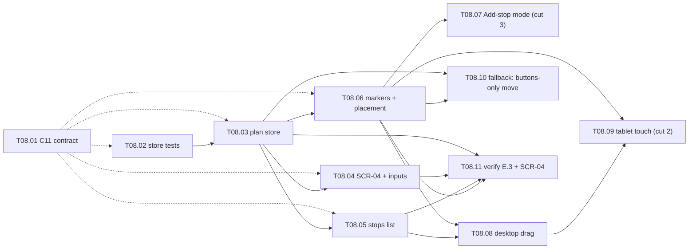

# TASK-08 — Plan panel + waypoint editing

| Field | Value |
| --- | --- |
| Objective | Plan panel + waypoint editing |
| Requirements | FR-05, FR-06 (06 §C); also FR-09, NFR-03, NFR-04, SCR-04 (register) |
| Lane / owner role | frontend — Frontend engineer |
| Milestone | M2 (contract T08.01) · M3 (store, markers, Add-stop mode) · M4 (rest) |
| Window | pre-event-allowed (T08.01) · event-only (all others) |
| Effort (doc 06) | 4–6 h |
| Done when (doc 06) | All E.3 validation rules enforced in UI |
| Main risk → fallback | Drag complex → buttons only |
| Spec sections | [01 FR-05](../specs/01_Product_Requirements_Document.md#fr-05--mission-inputs-with-validated-defaults) · [01 FR-06](../specs/01_Product_Requirements_Document.md#fr-06--waypoint-placement-and-editing) · [02 §D.2](../specs/02_Technical_Requirements_Document.md#d2-route-planning-fr-06-fr-07-fr-10) · [02 §E.2](../specs/02_Technical_Requirements_Document.md#e2-worker-message-protocol) · [02 §E.3](../specs/02_Technical_Requirements_Document.md#e3-input-validation-rules) · [03 SCR-04](../specs/03_App_Flow_and_Diagrams.md#scr-04--plan-panel) · [03 §C.3](../specs/03_App_Flow_and_Diagrams.md#c3-editing-and-recalculating) · [03 §D](../specs/03_App_Flow_and_Diagrams.md#d-error-and-recovery-flows) · [03 §E.4](../specs/03_App_Flow_and_Diagrams.md#e4-state--plan-computation-asynchronous-cancellable) · [04 §C.5](../specs/04_Design_Brief.md#c5-map-annotations-and-selection-states) · [04 §D](../specs/04_Design_Brief.md#d-interaction-and-component-behavior) · [04 §E](../specs/04_Design_Brief.md#e-accessibility-and-responsive-behavior) · [05 MissionScenario](../specs/05_Backend_and_Database_Schema.md#missionscenario-user-input) · [05 Waypoint](../specs/05_Backend_and_Database_Schema.md#waypoint-user-input) |

## Inputs this task consumes

| Input | Kind | Owner | Dependency |
| --- | --- | --- | --- |
| C1 TypeScript entity mirror: MissionScenario, Waypoint, PlanResult (`web/src/types/schema.ts`) | contract | T03.01 | soft |
| C6 worker protocol: SAMPLE_POINT, COMPUTE_PLAN, PLAN_RESULT, ERROR (`web/src/compute/protocol.ts`) | contract | T05.01 | soft |
| C7 `validate.ts` signature (02 §E.3 rules); `MAX_STOPS` and `SNAP_RADIUS_M` in `web/src/compute/route.ts` | contract | T05.01 | soft |
| C8 `localTrueSolarTime` signature for the LTST preview (`web/src/compute/mars24.ts`) | contract | T06.01 | soft |
| C10 app context, screen renderer, worker-client interface, map handle, provenance attributes; stubs for `stopsList.ts`, `waypointLayer.ts`, `addStopMode.ts`, `waypointDrag.ts`, `touchInput.ts` | contract | T07.01 | soft |
| C12 token names and status classes (`web/src/ui/styles/tokens.css`) | contract | T13.01 | soft |
| F2 canned PLAN_RESULT messages (`web/tests/fixtures/plan-results/`) | fixture | T05.03 | soft |
| F3 mock worker (`web/tests/fixtures/mockWorker.ts`) | fixture | T05.04 | soft |
| F4 mock site bundle (`web/public/sites/mock_site/`) | fixture | T03.02 | soft |
| Dependency batch with the DOM test environment | upstream output | T14.01 | hard (T08.02 only) |

## Outputs this task provides

| Output | Path | Consumers |
| --- | --- | --- |
| C11 plan-store contract (state, status, actions, selection, hover) | `web/src/state/planStore.ts` (interfaces) | T07.04, T07.05, T08.02–T08.10, T09.01–T09.05, T10.01, T10.02, T11.02–T11.04, T13.06, T18.07 |
| Plan store implementation | `web/src/state/planStore.ts` | T07.03, T07.05, T09.06, T10.01, T18.07 |
| SCR-04 panel and mission-inputs form | `web/src/ui/screens/scr04PlanPanel.ts`, `web/src/ui/screens/scr04PlanPanel.css` | T07.08, T08.11, T13.09, T13.10, T14.06 |
| Stops list (reorder, delete, undo, accessible stops table) | `web/src/ui/plan/stopsList.ts` | T08.04, T08.08, T08.11, T13.10 |
| Waypoint markers and the placement function (validation + snap offer) | `web/src/ui/map/waypointLayer.ts` | T07.08, T08.07–T08.10, T09.06, T10.01 |
| Add-stop mode (free placement, `A`, crosshair `Enter`) | `web/src/ui/map/addStopMode.ts` | T07.08, T09.06, T13.06 |
| Desktop drag (map markers, list rows) | `web/src/ui/map/waypointDrag.ts` | T07.08, T17.01 (demo step 5) |
| Tablet touch input | `web/src/ui/map/touchInput.ts` | T07.08 |
| Verification evidence for 06 TASK-08 done-when | `docs/ops/verification-log.md` (section T08.11) | T14.06, T16.06 |

## Subtasks

### T08.01 — Freeze the plan-store contract v1 (state, status, actions, selection)

- **Type:** contract
- **Tag:** agent-ready · core
- **Window:** pre-event-allowed
- **Estimate:** 1.5–2 h
- **Owns (writes):** `web/src/state/planStore.ts` (stub → T08.03)
- **Reads:** `web/src/state/planStore.ts`, `web/src/types/schema.ts`, `web/src/compute/protocol.ts`, [03 §C.3](../specs/03_App_Flow_and_Diagrams.md#c3-editing-and-recalculating), [03 §E.3](../specs/03_App_Flow_and_Diagrams.md#e3-sequence--compute-plan), [03 §E.4](../specs/03_App_Flow_and_Diagrams.md#e4-state--plan-computation-asynchronous-cancellable), [03 SCR-04](../specs/03_App_Flow_and_Diagrams.md#scr-04--plan-panel), [03 SCR-05](../specs/03_App_Flow_and_Diagrams.md#scr-05--route-results-panel) (linking), [05 MissionScenario](../specs/05_Backend_and_Database_Schema.md#missionscenario-user-input), [05 Waypoint](../specs/05_Backend_and_Database_Schema.md#waypoint-user-input), map §d C11
- **Depends on:** T03.01 (soft), T05.01 (soft)
- **Parallel with:** T07.01, T13.01, T12.04, T14.01, T16.02
- **Steps:**
  1. Compare the existing `PlanState` and `PlanStore` with the 03 §C.3 edits and the 03 §E.4 states (Empty, Computing, OK, OverLimits, Partial, Error).
  2. Add to `PlanState`: plan status, the last worker error code (02 §E.2), whether an undo is available, the selected waypoint, and the hover position shared by map, stops list and profile (the C11 decision "selection and hover shape").
  3. Add to `PlanStore` the actions the specs name: add, move and delete a waypoint; reorder stops; single-level undo; set scenario fields (debounced, 03 SCR-04); reset defaults; load a plan (demo plan for T07.05, FR-20 restore for T18.07); select; hover; retry after an error.
  4. Type the worker side with C6 message types only (`ComputePlanRequest`, `PlanResultMessage`, `WorkerError`), so C11 never imports `web/src/ui/context.ts`.
  5. Leave `createPlanStore` as a stub that throws `TODO(T08.03)`; record choices the specs leave open as `TODO(decision)` doc comments.
  6. Run `make typecheck`; list the C11 consumers from map §d in the PR.
- **Acceptance:**
  - Serves: FR-05, FR-06 · [03 §E.4](../specs/03_App_Flow_and_Diagrams.md#e4-state--plan-computation-asynchronous-cancellable), [03 §C.3](../specs/03_App_Flow_and_Diagrams.md#c3-editing-and-recalculating)
  - Every 03 §E.4 state and every 03 §C.3 edit maps to a state field or an action.
  - Scenario and waypoint shapes are the C1 types from 05 §C, not new copies.
  - Types only: `createPlanStore` still throws `TODO(T08.03)`; no other file changes.
  - The file imports only `web/src/types/schema.ts` and `web/src/compute/protocol.ts`; `make typecheck` passes; C11 is marked v1 (freeze M2).
- **Verify:** `make typecheck`; `grep -n "TODO(T08.03)" web/src/state/planStore.ts`
- **Agent brief:** Freeze contract C11 in `web/src/state/planStore.ts`: extend the interfaces to cover the 03 §E.4 states, the 03 §C.3 edits, single-level undo, selection and hover, using only C1 and C6 types. Keep `createPlanStore` throwing `TODO(T08.03)`. Mark open choices `TODO(decision)`; check with `make typecheck`.
- **Conflict notes:** Interface edits only; T08.03 owns the file after this merges (stub handover). No import of `context.ts`: T07.01 may import the `PlanStore` type, and the reverse import would create a C10 ↔ C11 cycle. Changes after M2 need a `contract-change:` subtask listing the C11 consumers (map §d).

### T08.02 — Tests: plan store (revisions, undo, debounce, stale results)

- **Type:** test
- **Tag:** agent-ready · core
- **Window:** event-only
- **Estimate:** 1.5–2 h
- **Owns (writes):** `web/tests/state/planStore.test.ts`
- **Reads:** `web/src/state/planStore.ts` (C11), `web/tests/fixtures/plan-results/` (F2), [02 §E.2](../specs/02_Technical_Requirements_Document.md#e2-worker-message-protocol), [02 §E.3](../specs/02_Technical_Requirements_Document.md#e3-input-validation-rules), [03 §C.3](../specs/03_App_Flow_and_Diagrams.md#c3-editing-and-recalculating), [03 §E.3](../specs/03_App_Flow_and_Diagrams.md#e3-sequence--compute-plan), [03 §E.4](../specs/03_App_Flow_and_Diagrams.md#e4-state--plan-computation-asynchronous-cancellable), [03 SCR-04](../specs/03_App_Flow_and_Diagrams.md#scr-04--plan-panel), [01 FR-06](../specs/01_Product_Requirements_Document.md#fr-06--waypoint-placement-and-editing)
- **Depends on:** T08.01 (soft), T05.03 (soft), T14.01 (hard: the DOM test environment arrives in the dependency batch)
- **Parallel with:** T07.02–T07.08, T09.01, T09.02, T05.16–T05.27
- **Steps:**
  1. Build a fake worker side that records each sent `COMPUTE_PLAN` and replays F2 results with a chosen `plan_revision`.
  2. Revisions: each edit raises `plan_revision` and sends one `COMPUTE_PLAN` carrying it (03 §E.3).
  3. Timing with fake timers: scenario edits wait 300 ms before recomputing; reorder and delete recompute at once (03 SCR-04).
  4. Stale results: a result for an older revision leaves the state unchanged (03 §C.3, 02 §E.2).
  5. Undo restores the previous waypoint list and recomputes; only one level (01 FR-06, 03 §C.3).
  6. States follow 03 §E.4: Empty → Computing on the first stop; Computing → OK, OverLimits, Partial or Error; edit → Computing; all stops removed → Empty; retry from Error.
  7. Limits and defaults: exactly one start and at most 10 stops (05 §C Waypoint, 01 FR-06); reset restores the scenario the store was created with.
- **Acceptance:**
  - Serves: FR-05, FR-06 · [03 §C.3](../specs/03_App_Flow_and_Diagrams.md#c3-editing-and-recalculating), [03 §E.4](../specs/03_App_Flow_and_Diagrams.md#e4-state--plan-computation-asynchronous-cancellable)
  - Given a store with only the start, when a stop is added, then `plan_revision` rises by one, one `COMPUTE_PLAN` carries it and the status is Computing.
  - Given two scenario edits within 300 ms, when the timers run, then exactly one `COMPUTE_PLAN` is sent.
  - Given an in-flight revision, when a newer edit is made and the older result arrives, then the state does not change.
  - Given a delete, when undo runs, then the previous list returns and a recompute is sent; a second undo does nothing.
  - Given 10 stops, when an 11th is added, then it is refused.
  - Claims no case from the map's Test-case allocation table.
- **Verify:** `npx vitest run tests/state/planStore.test.ts` (run in `web/`); fails until T08.03 lands
- **Agent brief:** Write `web/tests/state/planStore.test.ts` against contract C11 in `web/src/state/planStore.ts`: revision bump per edit, 300 ms debounce vs immediate reorder/delete, stale results ignored, single-level undo, 03 §E.4 states, 10-stop limit. Use a fake worker side and F2 fixtures; no DOM needed. Open the PR as a draft.
- **Conflict notes:** Owns only the test file. The PR stays a draft until T08.03 passes it; T08.03 branches from this branch and the two merge back to back (map §h.3).

### T08.03 — Implement the plan store

- **Type:** implement
- **Tag:** agent-ready · core
- **Window:** event-only
- **Estimate:** 2–3 h
- **Owns (writes):** `web/src/state/planStore.ts`
- **Reads:** `web/src/state/planStore.ts` (C11), `web/tests/state/planStore.test.ts`, `web/src/types/schema.ts`, `web/src/compute/protocol.ts`, `web/src/compute/route.ts` (`MAX_STOPS`), `web/src/ui/context.ts` (C10 worker client), [03 §C.3](../specs/03_App_Flow_and_Diagrams.md#c3-editing-and-recalculating), [03 §E.3](../specs/03_App_Flow_and_Diagrams.md#e3-sequence--compute-plan), [03 §E.4](../specs/03_App_Flow_and_Diagrams.md#e4-state--plan-computation-asynchronous-cancellable), [02 §E.3](../specs/02_Technical_Requirements_Document.md#e3-input-validation-rules)
- **Depends on:** T08.02 (hard: tests first, stacked PR), T08.01 (soft), T07.01 (soft), T05.01 (soft), T05.04 (soft), T03.01 (soft)
- **Parallel with:** T08.06, T07.02–T07.08, T09.01, T09.02
- **Steps:**
  1. Branch from the T08.02 branch.
  2. Implement `createPlanStore`: state, subscribers, waypoint ids `wp-<n>` and one start (05 §C Waypoint).
  3. Each edit raises `plan_revision` and sends `COMPUTE_PLAN`; scenario edits debounce 300 ms; reorder, delete and drop send at once (03 SCR-04, §C.3).
  4. Apply only results whose `plan_revision` is the latest; map `PLAN_RESULT.status` and `ERROR` to the 03 §E.4 states.
  5. Keep one undo snapshot of the waypoint list; refuse an 11th stop with `MAX_STOPS`.
  6. Run the T08.02 tests and `make typecheck`.
- **Acceptance:**
  - Serves: FR-05, FR-06 · [03 §C.3](../specs/03_App_Flow_and_Diagrams.md#c3-editing-and-recalculating), [03 §E.4](../specs/03_App_Flow_and_Diagrams.md#e4-state--plan-computation-asynchronous-cancellable)
  - All T08.02 tests pass; the C11 interfaces are unchanged.
  - No request with fewer than two waypoints is sent (02 §E.3: waypoints 2–11); the status stays Empty (03 §E.4).
  - No DOM access and no network use (NFR-01).
- **Verify:** `npx vitest run tests/state/planStore.test.ts` (run in `web/`); `make typecheck`
- **Agent brief:** Implement `createPlanStore` in `web/src/state/planStore.ts` to the frozen C11 interfaces until `web/tests/state/planStore.test.ts` passes: revisions, 300 ms debounce, latest-revision results only, single-level undo, 10-stop limit. Branch from the T08.02 branch; do not change the interfaces.
- **Conflict notes:** Stacked on T08.02; merge right after it. Interface changes need a `contract-change:` on C11. T18.07 later edits this file as a `follow-up:` (after T08.03).

### T08.04 — Implement the SCR-04 panel and mission-inputs form

- **Type:** implement
- **Tag:** agent-ready · core
- **Window:** event-only
- **Estimate:** 2–3 h
- **Owns (writes):** `web/src/ui/screens/scr04PlanPanel.ts`, `web/src/ui/screens/scr04PlanPanel.css`
- **Reads:** `web/src/ui/context.ts` (C10), `web/src/state/planStore.ts` (C11), `web/src/compute/validate.ts` (C7), `web/src/compute/mars24.ts` (C8), `web/src/ui/plan/stopsList.ts`, `web/src/ui/components/metric.ts`, `web/src/ui/styles/tokens.css`, [01 FR-05](../specs/01_Product_Requirements_Document.md#fr-05--mission-inputs-with-validated-defaults), [02 §E.3](../specs/02_Technical_Requirements_Document.md#e3-input-validation-rules), [03 SCR-04](../specs/03_App_Flow_and_Diagrams.md#scr-04--plan-panel), [04 §B](../specs/04_Design_Brief.md#b-layout-and-navigation), [04 §C.2](../specs/04_Design_Brief.md#c2-typography), [04 §D](../specs/04_Design_Brief.md#d-interaction-and-component-behavior), [05 MissionScenario](../specs/05_Backend_and_Database_Schema.md#missionscenario-user-input)
- **Depends on:** T08.03 (hard: input edits recompute through the store), T08.01 (soft), T07.01 (soft), T05.01 (soft), T06.01 (soft), T13.01 (soft)
- **Parallel with:** T08.05, T08.08, T09.03, T10.01, T10.02
- **Steps:**
  1. Change `renderPlanPanel` to the C10 screen signature; mount the inputs form and the stops list from `web/src/ui/plan/stopsList.ts`, with an inline placeholder while that module is still a stub.
  2. One field per MissionScenario input (05 §C), each with its unit (04 §C.2): start time UTC with an LTST preview, max EVA duration, dwell per stop, hard and caution slope, walkback limit, suited speed, solar phase, loop toggle (03 SCR-04).
  3. Check every change with `validate.ts`; show the allowed range inline; keep the last valid value in effect until corrected; never pass an invalid value to the store (03 SCR-04, §C.3, §D).
  4. Show the badge "Defaults are assumptions — not flight rules." and a Reset defaults action; default values carry provenance `assumed` with the C10 attributes (05 §C MissionScenario).
  5. Fill the LTST preview from `localTrueSolarTime`; show "—" with a tooltip while it is unavailable (stub, or cut 5).
  6. Collapse the inputs into a "Constraints" accordion after the first edit while the stops list stays open (04 §B); field states per 04 §D Input field.
- **Acceptance:**
  - Serves: FR-05, SCR-04 · [01 FR-05](../specs/01_Product_Requirements_Document.md#fr-05--mission-inputs-with-validated-defaults), [02 §E.3](../specs/02_Technical_Requirements_Document.md#e3-input-validation-rules), [03 SCR-04](../specs/03_App_Flow_and_Diagrams.md#scr-04--plan-panel)
  - Out-of-range inputs are rejected inline with the valid range shown (01 FR-05).
  - Changing any input recomputes results without page reload (01 FR-05).
  - A visible badge says "Defaults are assumptions — not flight rules." (01 FR-05).
  - The panel states Empty (only start), Editing, Invalid input and Computing render (03 SCR-04).
  - Every displayed value carries `data-provenance` and a source id (NFR-05).
- **Verify:** Manual checklist with `make dev`, the F4 mock site and the F3 mock worker: each 02 §E.3 field rejects an out-of-range value with its range; hard slope ≤ caution slope is rejected; one recompute 300 ms after an edit; badge visible; Tab reaches every field. Then `make lint typecheck`.
- **Agent brief:** Implement SCR-04 in `web/src/ui/screens/scr04PlanPanel.ts` (+ `.css`): the 05 §C MissionScenario inputs with units, inline 02 §E.3 validation through `validate.ts`, the defaults badge, Reset defaults, the LTST preview and the 04 §B accordion; mount the stops list. Use only C10, C11 and C12 interfaces; no science in the UI.
- **Conflict notes:** Owns the two scr04 files only. Imports `stopsList.ts` (T08.05) and `validate.ts` (T05.25) without editing them. Uses existing C12 tokens; a missing token goes through the `tokens.css` append-only rule, not an edit here. The UI check T08.11 needs the real `validate.ts` (Spec questions 8).

### T08.05 — Implement the stops list (reorder buttons, delete, undo)

- **Type:** implement
- **Tag:** agent-ready · core
- **Window:** event-only
- **Estimate:** 2–3 h
- **Owns (writes):** `web/src/ui/plan/stopsList.ts`
- **Reads:** `web/src/ui/context.ts` (C10), `web/src/state/planStore.ts` (C11), `web/tests/fixtures/plan-results/` (F2), [01 FR-06](../specs/01_Product_Requirements_Document.md#fr-06--waypoint-placement-and-editing), [01 FR-09](../specs/01_Product_Requirements_Document.md#fr-09--traverse-time-distance-and-return-estimates), [02 §C.1](../specs/02_Technical_Requirements_Document.md#c1-coordinate-reference-conventions-applies-to-every-layer) (display format), [03 SCR-04](../specs/03_App_Flow_and_Diagrams.md#scr-04--plan-panel), [04 §D](../specs/04_Design_Brief.md#d-interaction-and-component-behavior), [04 §E](../specs/04_Design_Brief.md#e-accessibility-and-responsive-behavior), [05 PlanResult](../specs/05_Backend_and_Database_Schema.md#planresult-computed)
- **Depends on:** T08.03 (hard: reorder, delete and undo go through the store), T08.01 (soft), T07.01 (soft), T05.03 (soft), T13.01 (soft)
- **Parallel with:** T08.04, T08.06, T09.03, T10.01
- **Steps:**
  1. Render one row per waypoint: number, name or POI, coordinates in the 02 §C.1 display format (through the projection the app context exposes, C10), arrival LTST and sun elevation from the latest `stops_timeline`.
  2. Add ↑/↓ reorder and Delete buttons per stop and an Undo action, all reachable by keyboard (NFR-04).
  3. Show the 04 §D states: row highlighted ↔ selected map marker (C11 selection), ETA shimmer while computing, the empty text "Add a stop: click a POI or press A", a row marked ⬣ with its reason on error.
  4. Render a drag-handle element (44 px on touch, 04 §E) and stable `data-` attributes per row for T08.08; no drag logic here.
  5. Make the list readable by screen readers as the text alternative to the map (04 §E).
- **Acceptance:**
  - Serves: FR-06, FR-09, SCR-04 · [01 FR-06](../specs/01_Product_Requirements_Document.md#fr-06--waypoint-placement-and-editing), [03 SCR-04](../specs/03_App_Flow_and_Diagrams.md#scr-04--plan-panel), [04 §D](../specs/04_Design_Brief.md#d-interaction-and-component-behavior)
  - Reorder and delete recompute at once; Undo restores the previous waypoint list (03 SCR-04, 01 FR-06).
  - Arrival LTST and sun elevation come only from the latest PLAN_RESULT and carry provenance attributes (NFR-05).
  - All row controls work by keyboard; status shows icon and text, not colour alone (NFR-04).
- **Verify:** Manual checklist with `make dev` and F2 results through F3: reorder ↑/↓, delete, undo, empty text, error row, accessible names on every button. Then `make lint typecheck`.
- **Agent brief:** Implement the stops list in `web/src/ui/plan/stopsList.ts` per 03 SCR-04 and 04 §D: numbered rows with coordinates, arrival LTST and sun elevation, ↑/↓, Delete and Undo through the C11 store, keyboard and screen-reader access. Render drag handles and `data-` attributes but no drag logic.
- **Conflict notes:** Owns only `stopsList.ts` (stub from T07.01). T08.08 attaches drag by event delegation and never edits this file. A sibling stylesheet is not in map §c (Spec questions 6).

### T08.06 — Implement waypoint markers and placement validation with a snap offer

- **Type:** implement
- **Tag:** agent-ready · core
- **Window:** event-only
- **Estimate:** 2–3 h
- **Owns (writes):** `web/src/ui/map/waypointLayer.ts`
- **Reads:** `web/src/ui/context.ts` (C10 map handle, worker client, provenance attributes), `web/src/state/planStore.ts` (C11), `web/src/compute/protocol.ts` (C6), `web/src/compute/route.ts` (`SNAP_RADIUS_M`), [01 FR-06](../specs/01_Product_Requirements_Document.md#fr-06--waypoint-placement-and-editing), [02 §D.2](../specs/02_Technical_Requirements_Document.md#d2-route-planning-fr-06-fr-07-fr-10), [02 §E.2](../specs/02_Technical_Requirements_Document.md#e2-worker-message-protocol), [02 §C.4](../specs/02_Technical_Requirements_Document.md#c4-mars-specific-pitfalls-to-test-explicitly), [03 §D](../specs/03_App_Flow_and_Diagrams.md#d-error-and-recovery-flows), [03 §E.1](../specs/03_App_Flow_and_Diagrams.md#e1-overall-user-flow), [04 §C.3](../specs/04_Design_Brief.md#c3-spacing-and-sizing), [04 §C.5](../specs/04_Design_Brief.md#c5-map-annotations-and-selection-states), [05 Waypoint](../specs/05_Backend_and_Database_Schema.md#waypoint-user-input), [05 Site](../specs/05_Backend_and_Database_Schema.md#site)
- **Depends on:** T08.03 (hard: placements become store edits), T08.01 (soft), T07.01 (soft), T05.01 (soft), T05.04 (soft), T03.02 (soft), T13.01 (soft)
- **Parallel with:** T08.07, T09.01, T09.02, T07.10–T07.12
- **Steps:**
  1. Draw the start marker at the manifest `default_start` with its label, and numbered 28 px stop markers (04 §C.3) with the 04 §C.5 states: default, hover ring, selected focus ring, invalid ⬣.
  2. Export one placement function, with the signature from the T07.01 stub, for every placement path: map click, crosshair `Enter`, drag drop, long-press and POI "Add as stop".
  3. Placement sends `SAMPLE_POINT` with `snap_radius_m` = `SNAP_RADIUS_M`; outside the AOI → "Outside mapped area" and no waypoint; impassable with `snap` → offer the snapped position; impassable without `snap` → refuse with the reason (03 §D, §E.1).
  4. When a snap is accepted, store the waypoint with `snapped_from` (05 §C Waypoint); work only in projected metres (02 §C.4: no `ol/sphere`).
  5. Keep markers in sync with the store; the selected marker and its stops-list row highlight together (C11 selection).
- **Acceptance:**
  - Serves: FR-06 · [01 FR-06](../specs/01_Product_Requirements_Document.md#fr-06--waypoint-placement-and-editing), [02 §D.2](../specs/02_Technical_Requirements_Document.md#d2-route-planning-fr-06-fr-07-fr-10), [03 §D](../specs/03_App_Flow_and_Diagrams.md#d-error-and-recovery-flows)
  - Placing a waypoint on a no-data or impassable cell is refused with a message and the nearest passable cell offered (snap within 50 m) (01 FR-06).
  - A click outside the AOI shows "Outside mapped area" and adds nothing (03 §D).
  - The impassable message names the cause in the 03 §D form ("Not walkable here (slope 22° > 15° limit)"), with values taken from the SAMPLE_RESULT and the scenario.
  - Markers follow 04 §C.3 sizes and 04 §C.5 states; waypoints take the 04 §E focus ring.
- **Verify:** Manual checklist with `make dev`, the F4 mock site and the F3 mock worker returning the 02 §E.2 SAMPLE_RESULT example: click outside the AOI, impassable with snap, refusal without snap, accepted snap stored with `snapped_from`. Then `make lint typecheck`.
- **Agent brief:** Implement `web/src/ui/map/waypointLayer.ts`: start and numbered stop markers with the 04 §C.5 states, and the single placement function (SAMPLE_POINT, 50 m snap offer, "Outside mapped area", refusal with reason) that every placement path uses. Projected metres only; signatures from the T07.01 stub.
- **Conflict notes:** Owns `waypointLayer.ts` (stub from T07.01); T07.08 mounts it. T08.07–T08.10 and T10.01 call the placement function, so its signature changes only through a `contract-change:` on C10. SAMPLE_POINT has no slope-limit field (Spec questions 1).

### T08.07 — Implement Add-stop mode (free placement, `A`, crosshair `Enter`)

- **Type:** implement
- **Tag:** agent-ready · cut-3
- **Window:** event-only
- **Estimate:** 1–2 h
- **Owns (writes):** `web/src/ui/map/addStopMode.ts`
- **Reads:** `web/src/ui/context.ts` (C10), `web/src/ui/map/waypointLayer.ts`, [03 SCR-02](../specs/03_App_Flow_and_Diagrams.md#scr-02--map-workspace), [04 §E](../specs/04_Design_Brief.md#e-accessibility-and-responsive-behavior), [04 §F SCR-02](../specs/04_Design_Brief.md#scr-02-map-workspace-with-scr-03040507-embedded), [01 FR-06](../specs/01_Product_Requirements_Document.md#fr-06--waypoint-placement-and-editing), map §h.6
- **Depends on:** T08.06 (hard: places stops through the placement function), T07.01 (soft)
- **Parallel with:** T08.03, T09.01, T09.02, T07.08
- **Steps:**
  1. Export the mode toggle that the T07.08 toolbar button calls; the toggle shows `accent` fill while the mode is on (04 §F SCR-02).
  2. While on, show a crosshair at the map centre; a map click places a stop through the T08.06 placement function.
  3. Bind `A` to toggle the mode and `Enter` to place a stop at the crosshair (04 §E); ignore both keys while a text field has focus.
  4. Announce mode changes politely for screen readers (04 §E `aria-live`).
- **Acceptance:**
  - Serves: FR-06, NFR-04 · [03 SCR-02](../specs/03_App_Flow_and_Diagrams.md#scr-02--map-workspace), [04 §E](../specs/04_Design_Brief.md#e-accessibility-and-responsive-behavior)
  - In Add-stop mode, `Enter` places a stop at the map-centre crosshair, which is visible only in that mode (04 §E).
  - Placements use the same validation and snap flow as T08.06 (01 FR-06).
  - Typing in an input never toggles the mode.
- **Verify:** Manual: toggle by button and by `A`; place by click; place by `Enter` at the crosshair using the keyboard only. Then `make lint typecheck`.
- **Agent brief:** Implement `web/src/ui/map/addStopMode.ts`: the Add-stop toggle, the map-centre crosshair, click placement and the `A` / `Enter` keys of 04 §E, all placing through the T08.06 placement function. The toolbar button itself belongs to T07.08.
- **Conflict notes:** Cut 3 drops this subtask (map §h.6): stops then come from SCR-06 "Add as stop" (T10.01), and the M3 check uses the demo plan (T07.14) if this is not done by M3. T13.06 also covers 04 §E keys (Spec questions 7). Owns only `addStopMode.ts` (stub from T07.01).

### T08.08 — Implement desktop drag: waypoints on the map, rows in the stops list

- **Type:** implement
- **Tag:** agent-ready · core
- **Window:** event-only
- **Estimate:** 2–3 h
- **Owns (writes):** `web/src/ui/map/waypointDrag.ts`
- **Reads:** `web/src/ui/context.ts` (C10), `web/src/state/planStore.ts` (C11), `web/src/ui/map/waypointLayer.ts`, `web/src/ui/plan/stopsList.ts`, [01 FR-06](../specs/01_Product_Requirements_Document.md#fr-06--waypoint-placement-and-editing), [01 §E](../specs/01_Product_Requirements_Document.md#e-core-demonstration-scenario) (step 5), [03 §C.3](../specs/03_App_Flow_and_Diagrams.md#c3-editing-and-recalculating), [03 SCR-04](../specs/03_App_Flow_and_Diagrams.md#scr-04--plan-panel)
- **Depends on:** T08.06 (hard: dropped positions go through the placement function), T08.05 (hard: drags the list rows and their handles), T07.01 (soft)
- **Parallel with:** T08.04, T08.09, T09.03–T09.05
- **Steps:**
  1. Let the user drag a waypoint marker; on drop, validate and snap or refuse through the T08.06 placement function; a valid drop is one store edit, so a new `plan_revision` cancels the in-flight computation (03 §C.3).
  2. After a refused drop, return the marker to its last valid position and show the refusal message.
  3. Drag stops-list rows by their handle; a drop reorders through the store and recomputes at once (03 SCR-04).
  4. Attach to the stops list by event delegation on its container; use Pointer Events so touch can reuse it (T08.09).
  5. With the F3 mock worker and the F2 PARTIAL fixture, rehearse 01 §E step 5 (stop 2 dragged onto a steep slope).
- **Acceptance:**
  - Serves: FR-06 · [01 FR-06](../specs/01_Product_Requirements_Document.md#fr-06--waypoint-placement-and-editing), [03 §C.3](../specs/03_App_Flow_and_Diagrams.md#c3-editing-and-recalculating)
  - Given a stop dragged onto an impassable cell, when it is dropped, then the T08.06 refusal or snap offer appears (01 FR-06).
  - Given a valid drop, then exactly one recompute is sent with a new `plan_revision` (03 §C.3).
  - Reordering by drag gives the same order as the ↑/↓ buttons.
- **Verify:** Manual checklist with `make dev` and F3: valid drag, drag onto an impassable cell, refused drop returns, row drag reorders. Then `make lint typecheck`.
- **Agent brief:** Implement `web/src/ui/map/waypointDrag.ts`: marker drag that validates on drop through the T08.06 placement function, and handle-based row reorder on the stops list via event delegation. Pointer Events only; do not edit `stopsList.ts` or `waypointLayer.ts`.
- **Conflict notes:** Owns `waypointDrag.ts` (stub from T07.01). If drag does not work at the Day 1 17:30 checkpoint, the fallback T08.10 replaces this file; the two never run at the same time.

### T08.09 — Implement tablet touch: long-press placement and drag

- **Type:** implement
- **Tag:** agent-ready · cut-2
- **Window:** event-only
- **Estimate:** 1.5–2.5 h
- **Owns (writes):** `web/src/ui/map/touchInput.ts`
- **Reads:** `web/src/ui/context.ts` (C10), `web/src/ui/map/waypointLayer.ts`, `web/src/ui/map/waypointDrag.ts`, [01 Clarifications](../specs/01_Product_Requirements_Document.md#clarifications), [02 §F](../specs/02_Technical_Requirements_Document.md#f-nonfunctional-requirements-and-validation) (NFR-03), [04 §C.3](../specs/04_Design_Brief.md#c3-spacing-and-sizing), [04 §E](../specs/04_Design_Brief.md#e-accessibility-and-responsive-behavior)
- **Depends on:** T08.06 (hard: long-press places through the placement function), T08.08 (hard: touch drag reuses the desktop drag), T07.01 (soft)
- **Parallel with:** T08.10, T08.11, T09.07, T10.03
- **Steps:**
  1. Long-press on the map places a stop through the T08.06 placement function (04 §E Touch).
  2. Check that the T08.08 Pointer Events drag works for touch on markers and on the 44 px row handles (04 §E); report gaps to T08.08's owner instead of editing its file.
  3. On a viewport at least 768 px wide (NFR-03), check that touch targets are at least 44 × 44 px (04 §C.3) and that stops can be added and deleted (01 Clarifications).
- **Acceptance:**
  - Serves: FR-06, NFR-03 · [04 §E](../specs/04_Design_Brief.md#e-accessibility-and-responsive-behavior), [01 Clarifications](../specs/01_Product_Requirements_Document.md#clarifications)
  - Long-press places a stop with the same validation and snap flow as a click (01 FR-06).
  - Touch targets are at least 44 × 44 px (04 §C.3).
  - With this subtask cut, tablets still view and add or delete stops through POI "Add as stop" and the list Delete button (01 Clarifications).
- **Verify:** Manual on a touch device or emulator at 768 px width: long-press placement, touch drag of a marker and a row, target sizes. Then `make lint typecheck`.
- **Agent brief:** Implement long-press placement in `web/src/ui/map/touchInput.ts` through the T08.06 placement function, and verify touch drag and 44 px targets on a tablet-width viewport. Do not edit `waypointDrag.ts`; report drag gaps to its owner.
- **Conflict notes:** Cut 2 drops this subtask (map §h.6). Owns only `touchInput.ts` (stub from T07.01). Bottom-sheet layout for 768–1023 px belongs to T07.08 (04 §E).

### T08.10 — Fallback — start only if T08.08 is not working at the Day 1 17:30 checkpoint: buttons-only stop move

- **Type:** fallback
- **Tag:** agent-ready · core
- **Window:** event-only
- **Estimate:** 1–1.5 h
- **Owns (writes):** `web/src/ui/map/waypointDrag.ts` (replaces T08.08)
- **Reads:** `web/src/ui/context.ts` (C10), `web/src/state/planStore.ts` (C11), `web/src/ui/map/waypointLayer.ts`, [06 §C](../specs/06_High_Level_Implementation_Plan.md#c-work-packages) (TASK-08 fallback), [06 §D.3](../specs/06_High_Level_Implementation_Plan.md#d3-integration-checkpoints), [01 §E](../specs/01_Product_Requirements_Document.md#e-core-demonstration-scenario) (step 5)
- **Depends on:** T08.06 (hard: moves go through the placement function), T08.03 (hard: uses the store's move action), T07.01 (soft)
- **Parallel with:** T08.09, T08.11, T09.07
- **Steps:**
  1. Start only when desktop drag (T08.08) does not work at the Day 1 17:30 checkpoint (06 §D.3).
  2. Replace drag with a Move control on the selected waypoint: choose Move, then click the new location, which goes through the T08.06 placement function.
  3. Keep reordering on the ↑/↓ buttons of the stops list (06 §C: buttons only).
  4. Tell the demo-script owner (T17.01) that 01 §E step 5 becomes "move stop 2" with the Move control.
- **Acceptance:**
  - Serves: FR-06 · [06 §C](../specs/06_High_Level_Implementation_Plan.md#c-work-packages), [01 FR-06](../specs/01_Product_Requirements_Document.md#fr-06--waypoint-placement-and-editing)
  - A stop can be moved without drag, with the same refusal and snap behaviour as a placement (01 FR-06).
  - 01 §E step 5 can be shown with the Move control.
- **Verify:** Manual: select stop 2, Move, click a steep cell → refusal or snap offer; click a valid cell → one recompute. Then `make lint typecheck`.
- **Agent brief:** Fallback: rewrite `web/src/ui/map/waypointDrag.ts` as a buttons-only move (select a waypoint, Move, click the target) through the T08.06 placement function; reorder stays on the ↑/↓ buttons. Start only on the 17:30 trigger.
- **Conflict notes:** Overwrites T08.08's file only after the trigger; never concurrent with T08.08. `stopsList.ts` (T08.05) is not touched.

### T08.11 — Verify the 02 §E.3 rules and SCR-04 states in the UI

- **Type:** verify
- **Tag:** human-required · core
- **Window:** event-only
- **Estimate:** 1–1.5 h
- **Owns (writes):** `docs/ops/verification-log.md` (append-only)
- **Reads:** [02 §E.3](../specs/02_Technical_Requirements_Document.md#e3-input-validation-rules), [03 SCR-04](../specs/03_App_Flow_and_Diagrams.md#scr-04--plan-panel), [01 FR-05](../specs/01_Product_Requirements_Document.md#fr-05--mission-inputs-with-validated-defaults), [01 FR-06](../specs/01_Product_Requirements_Document.md#fr-06--waypoint-placement-and-editing), [06 §D.7](../specs/06_High_Level_Implementation_Plan.md#d7-definition-of-done-per-feature), map Test-case allocation
- **Depends on:** T08.03 (hard: real store), T08.04 (hard: inputs form), T08.05 (hard: stops list), T08.06 (hard: waypoint rules), T05.04 (soft), T03.02 (soft), T05.25 (hard: the UI check needs the real validation rules)
- **Parallel with:** T08.09, T08.10, T09.07, T10.03, T11.05
- **Steps:**
  1. Run `make dev` with the F4 mock site and the F3 mock worker, or with the real bundle if it is present.
  2. For each 02 §E.3 row, enter one value below and one above the range; record the inline message and that the last valid value stays in effect.
  3. Check that hard slope ≤ caution slope is rejected, and the waypoint rule (start plus at most 10 stops, all inside the AOI).
  4. Walk the SCR-04 states Empty (only start), Editing, Invalid input and Computing; confirm Tab reaches every control (06 §D.7).
  5. Append the section `## T08.11 — Verify the 02 §E.3 rules and SCR-04 states in the UI` to `docs/ops/verification-log.md` with date, build, data version and results.
- **Acceptance:**
  - Serves: FR-05, FR-06, SCR-04 · [02 §E.3](../specs/02_Technical_Requirements_Document.md#e3-input-validation-rules), [03 SCR-04](../specs/03_App_Flow_and_Diagrams.md#scr-04--plan-panel)
  - All E.3 validation rules enforced in UI (06 §C TASK-08, done when).
  - The defaults badge and the inline ranges match 01 FR-05.
  - Claims none of the allocated cases: worker `INVALID_INPUT` stays with T05.14 and impossible stop placement with T14.05.
- **Verify:** The manual checklist above; the new verification-log section exists; `make lint docs-check`.
- **Agent brief:** A person runs this check. An agent may prepare the checklist table from 02 §E.3 and the SCR-04 states, and draft the verification-log section for the person to complete.
- **Conflict notes:** Append-only file: add one section at the end; on a rebase conflict keep both sides. Needs the real `validate.ts` (T05.25) merged first (Spec questions 8).

## Internal dependency graph

## Definition of done (task level)

- [06 §D.7](../specs/06_High_Level_Implementation_Plan.md#d7-definition-of-done-per-feature): FR-05 and FR-06 acceptance criteria met; unit tests for the store (T08.02) and a committed manual test note for the UI (T08.11 section in `docs/ops/verification-log.md`); provenance labels on every displayed value (defaults `assumed`); keyboard reachable; works offline; sources for displayed values listed in SCR-09.
- 06 done-when holds: all 02 §E.3 validation rules are enforced in the UI (T08.11).
- C11 is frozen at M2 and unchanged since, or changed only through `contract-change:` subtasks.
- Coordinates stay in projected metres; no `ol/sphere` and no EPSG:3857 path (02 §C.4).
- `make lint typecheck test docs-check` passes.

## Spec questions

1. **Slope limit in SAMPLE_POINT.** Passability depends on the scenario's `hard_slope_limit_deg` ([02 §D.2](../specs/02_Technical_Requirements_Document.md#d2-route-planning-fr-06-fr-07-fr-10)), and the skeleton `samplePoint` takes it, but the SAMPLE_POINT message ([02 §E.2](../specs/02_Technical_Requirements_Document.md#e2-worker-message-protocol)) carries no limit. Placement validation (T08.06) needs the current limit; C6 (T05.01) must settle this, probably via a `spec-change:` to 02 §E.2. Not yet in the map's open points.
2. **EVA start as LTST.** FR-05 allows "UTC date-time or local true solar time", but 02 §E.3 and 05 MissionScenario define only `eva_start_utc`, and 03 SCR-04 shows "start time UTC with LTST preview". This file follows 03 SCR-04; LTST entry is `TODO(decision)`.
3. **Default EVA start.** 05 MissionScenario gives `eva_start_utc` the default "site default", but 05 Site has no default-start-time field — `TODO(decision)` for C1/C2 (T03.01).
4. **Provenance of user-entered values.** 05 §C labels defaults `assumed`; NFR-05 requires a label on every displayed value, but no spec says how edited inputs or placed waypoint coordinates are labelled — `TODO(decision)` for C10 (T07.01); related to map open point 8.
5. **Shared notification element.** 03 §D uses toasts ("Outside mapped area"), but no path in map §c owns a toast or notification component; it should be part of C10 (T07.01), otherwise a map change.
6. **Map change proposed: module stylesheets.** Map §c gives screens a sibling `.css` but not other UI modules. TASK-08 needs one for `stopsList.ts`, `waypointLayer.ts` (snap offer), `addStopMode.ts` (crosshair) and `waypointDrag.ts` (Move control). Proposal: each module in §c.4 may own a sibling `.css` with the same basename.
7. **`A` and `Enter` keys.** The T08.07 title assigns `A` and crosshair `Enter` to Add-stop mode, while T13.06 implements the 04 §E key map that also lists them. One subtask must own each binding; this file keeps `A` and `Enter` in T08.07.
8. **Map change proposed: T05.25 → T08.11 (hard).** The UI check needs the real 02 §E.3 validation that T08.04 imports from `validate.ts`; this cross-task hard dependency is not in map §f.
9. **Map wiring of TASK-08 modules.** Who calls the attach functions of `waypointLayer.ts`, `addStopMode.ts`, `waypointDrag.ts` and `touchInput.ts`, and how a cut module (T08.07, T08.09) or an unfinished stub stays harmless (e.g. the toolbar hides the Add-stop toggle), should be fixed in C10 by T07.01.
10. **Keyboard move.** 04 §E gives keyboard users no way to move a placed stop (only delete and re-add at the crosshair, which cut 3 removes); NFR-04 asks for keyboard operation of all controls. Note for T13.06 and T13.10.
11. **Effort.** 06 gives 4–6 h for TASK-08; the eleven subtasks are estimated higher (map open point 18).
12. **T14.01 → T08.02.** The store tests may not need a DOM environment, so the map's hard edge T14.01 → T08.02 could be soft; kept hard here to match map §f.
