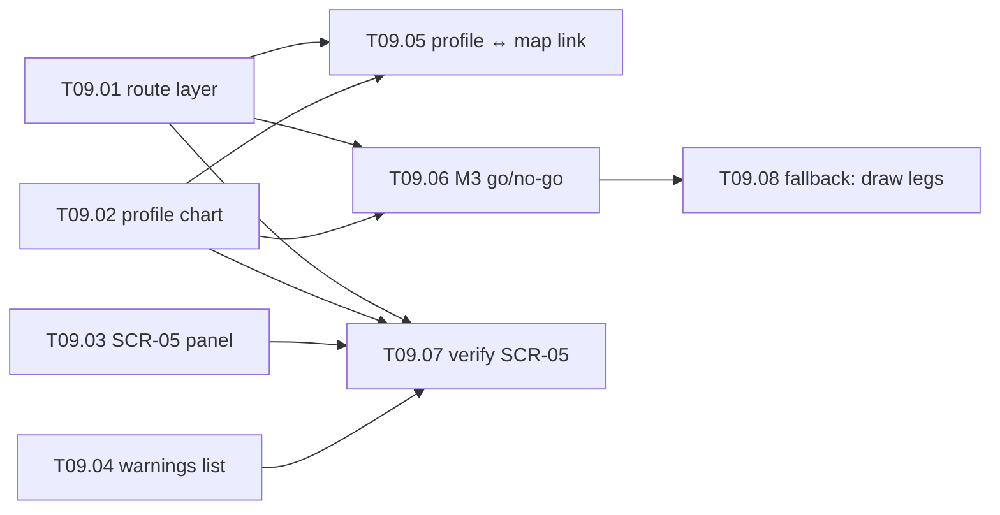

# TASK-09 — Results panel + profile

| Field | Value |
| --- | --- |
| Objective | Results panel + profile |
| Requirements | FR-07–FR-10 (06 §C); also FR-12 (dose metric), SCR-05, D-04 |
| Lane / owner role | frontend — R3 Map & Planner UI: Saba Atharique (T09.06 integration: Anjim Hossain) |
| Milestone | M3 (06 §C.1 *When*: P 9–10 Nov / E) |
| Window | pre-event-if-permitted |
| Effort (doc 06) | 4–6 h |
| Done when (doc 06) | Partial/over-limit states render per 03 §D |
| Main risk → fallback | Linking slips → profile without linking |
| Spec sections | [01 FR-07](../specs/01_Product_Requirements_Document.md#fr-07--constraint-aware-route-computation) · [01 FR-08](../specs/01_Product_Requirements_Document.md#fr-08--elevation-and-slope-profile) · [01 FR-09](../specs/01_Product_Requirements_Document.md#fr-09--traverse-time-distance-and-return-estimates) · [01 FR-10](../specs/01_Product_Requirements_Document.md#fr-10--hazard-and-constraint-warnings) · [01 FR-12](../specs/01_Product_Requirements_Document.md#fr-12--radiation-dose-estimate) · [02 §E.2](../specs/02_Technical_Requirements_Document.md#e2-worker-message-protocol) · [03 SCR-05](../specs/03_App_Flow_and_Diagrams.md#scr-05--route-results-panel) · [03 §D](../specs/03_App_Flow_and_Diagrams.md#d-error-and-recovery-flows) · [03 §E.4](../specs/03_App_Flow_and_Diagrams.md#e4-state--plan-computation-asynchronous-cancellable) · [04 §C.1](../specs/04_Design_Brief.md#c1-colour-tokens) · [04 §C.5](../specs/04_Design_Brief.md#c5-map-annotations-and-selection-states) · [04 §D](../specs/04_Design_Brief.md#d-interaction-and-component-behavior) · [04 §E](../specs/04_Design_Brief.md#f-accessibility-and-responsive-behavior) · [04 §F SCR-05](../specs/04_Design_Brief.md#scr-05-results-bottom-panel) · [05 PlanResult](../specs/05_Backend_and_Database_Schema.md#planresult-computed) · [06 §B M3](../specs/06_High_Level_Implementation_Plan.md#b-milestones) · [06 §D.3](../specs/06_High_Level_Implementation_Plan.md#d3-integration-checkpoints) · [06 §D.4](../specs/06_High_Level_Implementation_Plan.md#d4-cut-list-cut-in-this-order-when-behind) |

> **Re-dated 2026-11-06** to [06](../specs/06_High_Level_Implementation_Plan.md) v2.2 (session handoff §F.2): milestones follow 06 §B v2, windows follow Track P (recorded 4 Nov), cut tags follow the v2 cut list in 06 §D.4 ([map §h.6](_coordination.md#h6-cut-list--subtasks-06-d4)), and every subtask names its Owner from 06 §A.2. Step texts that still mention v1 times (for example "Day 1" or "M5") refer to the v1 plan; the register in the [coordination map](_coordination.md#a3-register) is authoritative.

## Inputs this task consumes

| Input | Kind | Owner | Dependency |
| --- | --- | --- | --- |
| C10 UI app context, map handle, fixed layer order, provenance attribute names; stubs for `routeLayer.ts`, `profileChart.ts`, `warningsList.ts`, `profileLink.ts`, `metric.ts`, `statusIcon.ts` | contract | T07.01 | soft |
| C11 plan-store state, status, actions, selection and hover (`apps/web/src/state/planStore.ts`) | contract | T08.01 | soft |
| C12 token names and status classes (`apps/web/src/ui/styles/tokens.css`) | contract | T13.01 | soft |
| C1 `PlanResult`, `Leg`, `Warning` types (`packages/protocol/src/schema.ts`) | contract | T03.01 | soft (through C10 and C11) |
| C6 `PLAN_RESULT` and `ERROR` messages (`packages/protocol/src/worker.ts`) | contract | T05.01 | soft (through C10) |
| F2 canned PLAN_RESULT messages (OK, PARTIAL, OVER_LIMITS) | fixture | T05.03 | soft |
| F3 mock worker | fixture | T05.04 | soft |
| Profile-chart library from the dependency batch | upstream output | T14.01 | hard (T09.02) |
| Bundle v1, compute M3 slice, app shell and map, plan store | upstream output | T03.19, T05.16–T05.18, T05.21, T05.22, T05.26, T05.27, T07.02–T07.08, T08.03 | hard (T09.06 only) |
| Metric and status-icon components (stubs until implemented) | upstream output | T12.01, T13.05 | soft (stubs by T07.01) |

## Outputs this task provides

| Output | Path | Consumers |
| --- | --- | --- |
| Route layer (cased legs, NO_ROUTE line, hazard hatch, hover hooks) | `apps/web/src/ui/map/routeLayer.ts` | T07.08 (mounts it), T09.05, T09.06, T11.04 |
| Profile chart | `apps/web/src/ui/results/profileChart.ts` | T09.03, T09.05, T09.06, T11.03 |
| SCR-05 Route Results panel | `apps/web/src/ui/screens/scr05RouteResults.tsx`, `apps/web/src/ui/screens/scr05RouteResults.css` | T07.08 (mounts it), T12.02, T13.09, T13.10, T14.06, T18.06 |
| Warnings list with click-to-zoom | `apps/web/src/ui/results/warningsList.ts` | T09.03, T11.03 |
| Profile ↔ map linking | `apps/web/src/ui/results/profileLink.ts` | T09.03 |
| Auto-routing go/no-go (D-04) | `docs/decisions/ADR-004-least-time-routing.md` | T05.30, T09.08 (fallback triggers) |
| SCR-05 state check record | `docs/ops/verification-log.md` | T14.06 |
| Hand-drawn legs (fallback only) | `apps/web/src/ui/map/drawLegs.ts` | T09.06 (on no-go), T14.06 |

## Subtasks

### T09.01 — Implement the route layer (cased legs, dashed NO_ROUTE line, hazard hatch)

- **Owner:** Saba Atharique (R3 Map & Planner UI)
- **Type:** implement
- **Tag:** agent-ready · core
- **Window:** pre-event-if-permitted
- **Estimate:** 2–3 h
- **Owns (writes):** `apps/web/src/ui/map/routeLayer.ts`
- **Reads:** `apps/web/src/ui/context.ts`, `apps/web/src/state/planStore.ts`, `packages/protocol/src/schema.ts`, `apps/web/src/ui/styles/tokens.css`, `apps/web/tests/fixtures/plan-results/`, [04 §C.1 Map overlays](../specs/04_Design_Brief.md#map-overlays), [04 §C.5](../specs/04_Design_Brief.md#c5-map-annotations-and-selection-states), [03 §D](../specs/03_App_Flow_and_Diagrams.md#d-error-and-recovery-flows), [02 §C.4](../specs/02_Technical_Requirements_Document.md#c4-mars-specific-pitfalls-to-test-explicitly), [05 PlanResult](../specs/05_Backend_and_Database_Schema.md#planresult-computed)
- **Depends on:** T07.01 (soft), T08.01 (soft), T05.03 (soft), T13.01 (soft)
- **Parallel with:** T09.02, T09.03, T09.04, T08.06
- **Steps:**
  1. Replace the T07.01 stub with an OpenLayers vector layer attached through the C10 map handle at the C10 route position in the FR-02 layer order (route above hazards, below POIs).
  2. Draw each OK leg from `Leg.geometry` (working-projection metres) as a 4 px `accent` line with a 2 px `bg` casing on each side (04 §C.1); hover makes it 6 px (04 §C.5).
  3. Draw each NO_ROUTE leg as a dashed line from its start waypoint to `nearest_reachable` in the C12 style for NO_ROUTE (04 §C.5; colour question in Spec questions).
  4. Overlay `caution` / `blocked` hatch along the route where warnings have a location (05 Warning `leg`, `from_m`, `to_m`); the distance-to-position rule is `TODO(decision)` (Spec questions).
  5. Re-render from the C11 store on every result and clear the layer when the plan is empty; expose the hover hooks T09.05 needs.
  6. Use projected metres only: no EPSG:3857 view and no `ol/sphere` (02 §C.4.2).
- **Acceptance:**
  - Serves: FR-07, FR-10 · [01 FR-07](../specs/01_Product_Requirements_Document.md#fr-07--constraint-aware-route-computation), [04 §C.5](../specs/04_Design_Brief.md#c5-map-annotations-and-selection-states)
  - Given the F2 OK fixture, when it reaches the store, then every leg shows as a cased `accent` line (04 §C.1).
  - Given the F2 PARTIAL fixture, then the NO_ROUTE leg shows dashed to its `nearest_reachable` point, as in 01 FR-07: "the nearest reachable point toward the target is shown".
  - Given warnings with `from_m`/`to_m`, then a `caution` or `blocked` hatch overlays that stretch of the leg (04 §C.5 hazard segment).
  - The layer sits at its fixed FR-02 position: below POIs, above hazards.
- **Verify:** `make typecheck`; manual check with `make dev`, the mock site (`?site=mock_site`) and the F3 mock worker (dev switch from T05.04/T07.04) answering with each F2 fixture: OK legs cased, PARTIAL dashed line, hatch on located warnings, hover widens the line.
- **Agent brief:** Implement `apps/web/src/ui/map/routeLayer.ts` (replacing the T07.01 stub): an OpenLayers vector layer that draws PlanResult legs as cased `accent` lines, NO_ROUTE legs dashed to `nearest_reachable`, and caution/blocked hatch on located warnings, per 04 §C.1 and §C.5. Read the result from the C11 store, attach through the C10 map handle, use only projected metres. Check against the F2 fixtures.
- **Conflict notes:** Writes only `routeLayer.ts`, after T07.01's stub merges (stub handover, §c.1 rule 2). Never edit `context.ts`, `createMap.ts` or `tokens.css`; a missing hook or token is a `contract-change:` in TASK-07 or TASK-13. T09.05 builds on the hover hooks, so merge T09.01 before T09.05.

### T09.02 — Implement the elevation/slope profile chart

- **Owner:** Saba Atharique (R3 Map & Planner UI)
- **Type:** implement
- **Tag:** agent-ready · core
- **Window:** pre-event-if-permitted
- **Estimate:** 2–3 h
- **Owns (writes):** `apps/web/src/ui/results/profileChart.ts`
- **Reads:** `apps/web/src/ui/context.ts`, `packages/protocol/src/schema.ts`, `apps/web/src/ui/styles/tokens.css`, `apps/web/tests/fixtures/plan-results/`, `apps/web/package.json`, [01 FR-08](../specs/01_Product_Requirements_Document.md#fr-08--elevation-and-slope-profile), [01 §B](../specs/01_Product_Requirements_Document.md#b-goals-and-success-criteria), [02 §B](../specs/02_Technical_Requirements_Document.md#b-technology-choices), [04 §C.1 Semantic](../specs/04_Design_Brief.md#status-and-alert-colours-ops), [04 §D](../specs/04_Design_Brief.md#d-interaction-and-component-behavior), [04 §F SCR-05](../specs/04_Design_Brief.md#scr-05-results-bottom-panel), [05 PlanResult](../specs/05_Backend_and_Database_Schema.md#planresult-computed)
- **Depends on:** T07.01 (soft), T05.03 (soft), T13.01 (soft), T14.01 (hard: the chart library arrives in the dependency batch)
- **Parallel with:** T09.01, T09.03, T09.04
- **Steps:**
  1. Replace the T07.01 stub with a chart built on the library chosen in T14.01 (02 §B: uPlot or Chart.js; plain SVG alternative).
  2. Plot elevation against cumulative distance from each leg's `profile` arrays; whether `dist_m` is along-leg or along-route is `TODO(decision)` (Spec questions).
  3. Fill each segment by `slope_class` with colour and pattern: `ok` solid, `caution` diagonal hatch, `over_limit` cross-hatch (04 §C.1), plus a text label, so the chart reads in grayscale.
  4. Mark stops at leg boundaries; show total climb and descent in metres from `totals` (and "—" when `totals` is null).
  5. Make the chart keyboard-focusable with a cursor and tooltip, and expose cursor events for T09.05.
  6. Render the 04 §D states: hidden when empty, faded previous profile under a spinner while computing, a message in the chart area on error; offer a print-friendly render for SCR-08.
- **Acceptance:**
  - Serves: FR-08 · [01 FR-08](../specs/01_Product_Requirements_Document.md#fr-08--elevation-and-slope-profile), [04 §D](../specs/04_Design_Brief.md#d-interaction-and-component-behavior)
  - 01 FR-08: "Total climb and descent shown in metres; chart remains readable in grayscale (pattern + label, not colour only)."
  - 01 §B: segments over the configured slope limit are flagged in the profile (`over_limit` class with its pattern).
  - Given the F2 OK fixture, then elevation is plotted against cumulative distance with stop markers; given PARTIAL, then no totals are shown (02 §E.2).
  - The cursor moves by keyboard and shows a tooltip (04 §D profile chart, selected/active).
- **Verify:** `make typecheck`; manual check with `make dev` and the F2 fixtures: patterns and labels visible in a grayscale view, keyboard cursor works, empty/computing/error states as in 04 §D, print preview of the chart readable in black and white.
- **Agent brief:** Implement `apps/web/src/ui/results/profileChart.ts` (replacing the T07.01 stub) with the chart library from T14.01: elevation vs. cumulative distance, slope classes coloured and patterned per 04 §C.1, stop markers, total climb/descent, keyboard cursor, and the 04 §D states. Use F2 fixtures; do not compute new values beyond plotting what PlanResult provides.
- **Conflict notes:** Writes only `profileChart.ts`. Shared by SCR-05 (T09.03) and SCR-08 (T11.03): keep the stub's exported signature; changing it is a `contract-change:` in TASK-07. No `package.json` edits here — the library comes only through T14.01.

### T09.03 — Implement SCR-05: status banner and metrics row

- **Owner:** Saba Atharique (R3 Map & Planner UI)
- **Type:** implement
- **Tag:** agent-ready · core
- **Window:** pre-event-if-permitted
- **Estimate:** 2–3 h
- **Owns (writes):** `apps/web/src/ui/screens/scr05RouteResults.tsx`, `apps/web/src/ui/screens/scr05RouteResults.css`
- **Reads:** `apps/web/src/ui/context.ts`, `apps/web/src/state/planStore.ts`, `apps/web/src/ui/components/metric.ts`, `apps/web/src/ui/components/statusIcon.ts`, `apps/web/src/ui/results/profileChart.ts`, `apps/web/src/ui/results/warningsList.ts`, `apps/web/src/ui/results/profileLink.ts`, `apps/web/src/ui/styles/tokens.css`, `apps/web/tests/fixtures/plan-results/`, [03 SCR-05](../specs/03_App_Flow_and_Diagrams.md#scr-05--route-results-panel), [03 §D](../specs/03_App_Flow_and_Diagrams.md#d-error-and-recovery-flows), [03 §E.4](../specs/03_App_Flow_and_Diagrams.md#e4-state--plan-computation-asynchronous-cancellable), [04 §B](../specs/04_Design_Brief.md#b-layout-and-navigation), [04 §C.2](../specs/04_Design_Brief.md#c2-typography), [04 §D](../specs/04_Design_Brief.md#d-interaction-and-component-behavior), [04 §E](../specs/04_Design_Brief.md#f-accessibility-and-responsive-behavior), [04 §F SCR-05](../specs/04_Design_Brief.md#scr-05-results-bottom-panel), [05 §F.3](../specs/05_Backend_and_Database_Schema.md#f3-plan-export-abridged-status-ok)
- **Depends on:** T07.01 (soft), T08.01 (soft), T05.03 (soft), T13.01 (soft)
- **Parallel with:** T09.01, T09.02, T09.04, T10.01, T10.02
- **Steps:**
  1. Replace the SCR-05 stub with the 04 §F layout: status banner (left), metrics row above the profile (middle), warnings list (right); collapsible to the 48 px status strip (04 §B), responsive per 04 §E.
  2. Render the banner states from the C11 store: empty, "Computing…" without layout jump, OK, Over limits, Partial with the NO_ROUTE reason, and "Computation failed — Retry" wired to the C11 retry action (03 SCR-05, 04 §D).
  3. Render the metrics row with the metric component (value, unit, provenance chip): distance, walk time, EVA total / limit, max slope, max walkback / limit, dose; which values and labels exactly is `TODO(decision)` (Spec questions).
  4. Hide totals when status is PARTIAL (02 §E.2) and show "—" with the 04 §D tooltip for values without a plan; keep the previous values at 50 % opacity while computing.
  5. Add the "Details" per-leg table (04 §D progressive disclosure) and an `aria-live="polite"` status announcement (04 §E).
  6. Mount the profile chart, warnings list and profile linking in their areas, catching a failure in any one of them so the rest of the panel stays usable.
- **Acceptance:**
  - Serves: FR-07, FR-09, FR-12, SCR-05 · [03 SCR-05](../specs/03_App_Flow_and_Diagrams.md#scr-05--route-results-panel), [04 §F SCR-05](../specs/04_Design_Brief.md#scr-05-results-bottom-panel)
  - Given any NO_ROUTE leg, then the status is Partial and no totals are shown (02 §E.2: "no misleading totals").
  - Given an OVER_LIMITS result, then the banner says Over limits with the exceeded limits (03 §D "Over limits").
  - Given a worker error, then the panel shows "Computation failed" with Retry and the map stays usable (03 §D "Worker timeout/crash").
  - Every metric carries a provenance label and source id through the metric component (FR-15, NFR-05); every number carries its unit (04 §C.2).
  - A status change is announced, e.g. "Plan updated: Over limits, 2 warnings" (04 §E).
- **Verify:** `make typecheck`; manual check with `make dev` and the F3 mock worker returning each F2 fixture plus an `ERROR`: all 03 SCR-05 states, collapse to the status strip, aria-live announcement (screen reader or devtools accessibility pane); once T12.02 exists, `npx vitest run tests/ui/provenance.test.ts` (run in `apps/web/`) stays green.
- **Agent brief:** Implement SCR-05 in `apps/web/src/ui/screens/scr05RouteResults.tsx` and its `.css`: status banner, metrics row (via the metric component), per-leg Details table, collapsible strip and aria-live status, mounting the profile chart, warnings list and linking. Follow 03 SCR-05, 03 §D and 04 §D/§F; never show totals for a PARTIAL plan. Build against the F2 fixtures through the F3 mock worker.
- **Conflict notes:** Writes only the two SCR-05 files; T07.08 mounts the panel (never edit `scr02MapWorkspace.tsx`). Uses `metric.ts` (T12.01) and `statusIcon.ts` (T13.05) as provided. T18.06 follows up on this file after it merges.

### T09.04 — Implement the warnings list with click-to-zoom

- **Owner:** Saba Atharique (R3 Map & Planner UI)
- **Type:** implement
- **Tag:** agent-ready · core
- **Window:** pre-event-if-permitted
- **Estimate:** 1–2 h
- **Owns (writes):** `apps/web/src/ui/results/warningsList.ts`
- **Reads:** `apps/web/src/ui/context.ts`, `apps/web/src/state/planStore.ts`, `apps/web/src/ui/components/statusIcon.ts`, `packages/protocol/src/schema.ts`, `apps/web/tests/fixtures/plan-results/`, [01 FR-10](../specs/01_Product_Requirements_Document.md#fr-10--hazard-and-constraint-warnings), [04 §C.1 Semantic](../specs/04_Design_Brief.md#status-and-alert-colours-ops), [04 §E](../specs/04_Design_Brief.md#f-accessibility-and-responsive-behavior), [04 §F SCR-05](../specs/04_Design_Brief.md#scr-05-results-bottom-panel), [05 PlanResult](../specs/05_Backend_and_Database_Schema.md#planresult-computed)
- **Depends on:** T07.01 (soft), T08.01 (soft), T05.03 (soft), T13.01 (soft)
- **Parallel with:** T09.01, T09.02, T09.03
- **Steps:**
  1. Replace the T07.01 stub with a list of `Warning` items: severity icon (04 §C.1), `message`, and the affected leg and stretch or time (`leg`, `from_m`, `to_m`, `at_utc`).
  2. Order the list per 04 §F ("newest-severity first"; exact rule `TODO(decision)`, Spec questions).
  3. Make each located warning a keyboard-reachable button that zooms the map to its stretch through the C10 map handle (no animated fly-to under `prefers-reduced-motion`, 04 §E).
  4. Show warnings without a location (`from_m` null, e.g. `EVA_DURATION_EXCEEDED`) as plain items with their time where given.
  5. Expose a render usable by the briefing card (T11.03) so FR-10 warnings also appear there.
- **Acceptance:**
  - Serves: FR-10 · [01 FR-10](../specs/01_Product_Requirements_Document.md#fr-10--hazard-and-constraint-warnings)
  - 01 FR-10: "Each warning shows severity icon + text + affected segment/time, appears in the results panel and on the briefing card, and can be clicked to zoom to the location."
  - Status is never shown by colour alone: icon and text accompany every severity (04 §E non-colour cues).
  - The list is readable by screen readers as the text alternative for map warnings (04 §E).
- **Verify:** `make typecheck`; manual check with `make dev` and the F2 fixtures: icon and text per warning, click and Enter zoom to the stretch, items without a location do not zoom, keyboard-only operation.
- **Agent brief:** Implement `apps/web/src/ui/results/warningsList.ts` (replacing the T07.01 stub): a keyboard-operable list of PlanResult warnings with severity icon, message and location or time; clicking a located warning zooms the map through the C10 map handle. Follow 01 FR-10 and 04 §C.1/§E/§F; test against the F2 fixtures.
- **Conflict notes:** Writes only `warningsList.ts`; SCR-05 (T09.03) and SCR-08 (T11.03) import it, so keep the stub's exported signature (changes are a `contract-change:` in TASK-07).

### T09.05 — Implement profile ↔ map linking (06 fallback: ship the profile without it)

- **Owner:** Saba Atharique (R3 Map & Planner UI)
- **Type:** implement
- **Tag:** agent-ready · core
- **Window:** pre-event-if-permitted
- **Estimate:** 1.5–2.5 h
- **Owns (writes):** `apps/web/src/ui/results/profileLink.ts`
- **Reads:** `apps/web/src/ui/results/profileChart.ts`, `apps/web/src/ui/map/routeLayer.ts`, `apps/web/src/state/planStore.ts`, `apps/web/src/ui/context.ts`, [01 FR-08](../specs/01_Product_Requirements_Document.md#fr-08--elevation-and-slope-profile), [03 SCR-05](../specs/03_App_Flow_and_Diagrams.md#scr-05--route-results-panel), [04 §B](../specs/04_Design_Brief.md#b-layout-and-navigation), [04 §D](../specs/04_Design_Brief.md#d-interaction-and-component-behavior)
- **Depends on:** T09.01 (hard: needs the route layer's hover hooks), T09.02 (hard: needs the chart's cursor events), T08.01 (soft), T07.01 (soft)
- **Parallel with:** T09.03, T09.04, T09.07
- **Steps:**
  1. Replace the T07.01 stub with a module that connects the profile cursor and the route layer through the C11 hover/selection state.
  2. Profile → map: on hover or keyboard focus, place a marker at the matching route position (distance-to-position rule `TODO(decision)`, Spec questions).
  3. Map → profile: on route hover, move the chart cursor to the matching distance.
  4. Clear the marker and cursor when the result changes or the plan empties.
  5. If this slips, ship without it (06 TASK-09 fallback): SCR-05 already isolates a failing mount.
- **Acceptance:**
  - Serves: FR-08 · [01 FR-08](../specs/01_Product_Requirements_Document.md#fr-08--elevation-and-slope-profile), [03 SCR-05](../specs/03_App_Flow_and_Diagrams.md#scr-05--route-results-panel)
  - 01 FR-08: "Hover/keyboard focus on the chart highlights the corresponding map location and vice versa."
  - Keyboard focus alone (no pointer) moves the map marker.
- **Verify:** `make typecheck`; manual check with `make dev` and the F2 OK fixture: hover and arrow keys on the chart move the map marker; hovering the route moves the chart cursor.
- **Agent brief:** Implement `apps/web/src/ui/results/profileLink.ts` (replacing the T07.01 stub): two-way linking between the profile cursor (T09.02) and a marker on the route layer (T09.01) via the C11 hover state, including keyboard focus. If it cannot be finished in time, stop: the 06 fallback ships the profile without linking.
- **Conflict notes:** Writes only `profileLink.ts`; never edits the chart, route layer or store — a missing hook is a `follow-up:` to T09.01/T09.02 or a `contract-change:` to C11 (TASK-08). Starts after T09.01 and T09.02 merge.

### T09.06 — Run the M3 walking-skeleton check; decide auto-routing go/no-go in ADR-004

- **Owner:** Anjim Hossain (R2/R4 float · integration lead)
- **Type:** integrate
- **Tag:** human-required · core
- **Window:** pre-event-if-permitted
- **Estimate:** 0.5–1 h
- **Owns (writes):** `docs/decisions/ADR-004-least-time-routing.md`
- **Reads:** [06 §B M3](../specs/06_High_Level_Implementation_Plan.md#b-milestones), [06 §D.3](../specs/06_High_Level_Implementation_Plan.md#d3-integration-checkpoints), [06 §D.4](../specs/06_High_Level_Implementation_Plan.md#d4-cut-list-cut-in-this-order-when-behind), [ADR-004](../decisions/ADR-004-least-time-routing.md), [map §h.6](_coordination.md#h6-cut-list--subtasks-06-d4), [map §h.7](_coordination.md#h7-fallbacks-06-c-d5), `data/sites/gale_boxwork/`
- **Depends on:** T03.19 (hard: the M3 check is the real end-to-end slice), T05.16–T05.18 (hard: the M3 check is the real end-to-end slice), T05.21–T05.22 (hard: the M3 check is the real end-to-end slice), T05.26–T05.27 (hard: the M3 check is the real end-to-end slice), T07.02–T07.08 (hard: the M3 check is the real end-to-end slice), T08.03 (hard: the M3 check is the real end-to-end slice), T09.01–T09.02 (hard: the M3 check is the real end-to-end slice)
- **Parallel with:** T12.01
- **Steps:**
  1. At Day 1 12:30 (06 §D.3), build `main` with `make demo` against the real bundle, with the network off.
  2. Check the 06 §B M3 exit: the map renders the AOI in the correct projection; two points produce a routed line and an elevation profile. Place the points with Add-stop mode if T08.07 has merged, else open the demo plan from SCR-01 (map §h.6, cut 4).
  3. The checkpoint is time-boxed: whatever has merged by then is what is judged.
  4. Decide go or no-go on auto-routing (06 §D.3) and record decision, date, evidence and who decided in ADR-004 (D-04).
  5. On no-go, announce cut 7 (06 §D.4 item 7): T05.07, T05.08, T05.18 and T05.19 stop; T05.30 and T09.08 start.
- **Acceptance:**
  - Serves: FR-07, FR-08, D-04 · [06 §B](../specs/06_High_Level_Implementation_Plan.md#b-milestones), [06 §D.3](../specs/06_High_Level_Implementation_Plan.md#d3-integration-checkpoints), [ADR-004](../decisions/ADR-004-least-time-routing.md#resolution-path)
  - Given the real bundle and the merged M3 slice, when two points are placed, then a routed line and an elevation profile appear (06 §B M3 exit criteria) — or the failure is recorded.
  - ADR-004 states go or no-go with date and evidence; on no-go the cut-7 fallbacks are claimed in `docs/tasks/README.md`.
- **Verify:** Manual checklist at the checkpoint: `make demo`, network disabled, AOI renders, scale bar in metres, two points routed, profile drawn; ADR-004 updated; on no-go, T05.30 and T09.08 have owners.
- **Agent brief:** Human decision at the Day 1 12:30 checkpoint. The team runs the walking skeleton offline and decides auto-routing go/no-go. An agent may prepare the checklist and draft the ADR-004 entry from the team's observations, but the decision and evidence are recorded by a person.
- **Conflict notes:** Writes only ADR-004. The D-04 status in the specs is not edited here; that needs a later `spec-change:` subtask. A no-go triggers T05.30 and T09.08 (map §h.7).

### T09.07 — Verify SCR-05 states against the OK, PARTIAL and OVER_LIMITS fixtures

- **Owner:** Saba Atharique (R3 Map & Planner UI)
- **Type:** verify
- **Tag:** human-required · core
- **Window:** pre-event-if-permitted
- **Estimate:** 1–1.5 h
- **Owns (writes):** `docs/ops/verification-log.md` (append-only)
- **Reads:** `apps/web/tests/fixtures/plan-results/`, `apps/web/tests/fixtures/mockWorker.ts`, [03 SCR-05](../specs/03_App_Flow_and_Diagrams.md#scr-05--route-results-panel), [03 §D](../specs/03_App_Flow_and_Diagrams.md#d-error-and-recovery-flows), [04 §D](../specs/04_Design_Brief.md#d-interaction-and-component-behavior), [01 FR-08](../specs/01_Product_Requirements_Document.md#fr-08--elevation-and-slope-profile), [01 FR-10](../specs/01_Product_Requirements_Document.md#fr-10--hazard-and-constraint-warnings)
- **Depends on:** T09.01 (hard: verifies the real route layer), T09.02 (hard: verifies the real profile), T09.03 (hard: verifies the real panel), T09.04 (hard: verifies the real warnings list), T05.03 (soft), T05.04 (soft), T12.01 (hard: SCR-05 values need provenance labels, FR-15)
- **Parallel with:** T09.05, T10.03, T11.05
- **Steps:**
  1. Run `make dev` with the F3 mock worker and feed each F2 fixture, then an `ERROR` message.
  2. Walk the 03 §D rows that touch SCR-05: no feasible route, over limits, partial results, worker timeout/crash.
  3. Check the 04 §D states of the status banner, metric tiles and profile chart, including empty and computing.
  4. View the profile in grayscale and confirm patterns and labels carry the slope classes (FR-08).
  5. Append a `## T09.07 — Verify SCR-05 states against the OK, PARTIAL and OVER_LIMITS fixtures` section to the verification log with results and defects; defects become `follow-up:` subtasks through a `coord:` PR.
- **Acceptance:**
  - Serves: FR-07, FR-08, FR-09, FR-10, SCR-05 · [03 SCR-05](../specs/03_App_Flow_and_Diagrams.md#scr-05--route-results-panel), [03 §D](../specs/03_App_Flow_and_Diagrams.md#d-error-and-recovery-flows)
  - 06 TASK-09 done when: "Partial/over-limit states render per 03 §D".
  - PARTIAL: dashed line to the nearest reachable point, banner with the reason, totals hidden; OVER_LIMITS: Over limits status with its list; ERROR: "Computation failed" with Retry.
  - FR-08: total climb and descent shown in metres; the chart reads in grayscale. FR-10: every warning shows icon, text and location or time, and located ones zoom.
- **Verify:** Manual checklist above; the verification-log section lists each fixture, each state and pass or fail.
- **Agent brief:** Human check of SCR-05 against the F2 fixtures (OK, PARTIAL, OVER_LIMITS) and an ERROR through the F3 mock worker, per 03 §D and 04 §D. An agent may drive the browser and draft the log entry; a person confirms visual and grayscale readability.
- **Conflict notes:** Appends one section at the end of `docs/ops/verification-log.md` (append-only); keep both sides on a rebase conflict. Writes no code: defects go to their owners as `follow-up:` subtasks.

### T09.08 — Fallback — start only if T09.06 says no-go: draw legs by hand on the map

- **Owner:** Saba Atharique (R3 Map & Planner UI)
- **Type:** fallback
- **Tag:** agent-ready · core
- **Window:** pre-event-if-permitted
- **Estimate:** 1.5–2 h
- **Owns (writes):** `apps/web/src/ui/map/drawLegs.ts`
- **Reads:** `docs/decisions/ADR-004-least-time-routing.md`, `apps/web/src/ui/context.ts`, `apps/web/src/state/planStore.ts`, `apps/web/src/ui/map/routeLayer.ts`, `packages/compute/src/manualLeg.ts`, [06 §D.4](../specs/06_High_Level_Implementation_Plan.md#d4-cut-list-cut-in-this-order-when-behind), [01 FR-07](../specs/01_Product_Requirements_Document.md#fr-07--constraint-aware-route-computation), [04 §E](../specs/04_Design_Brief.md#f-accessibility-and-responsive-behavior)
- **Depends on:** T09.06 (hard: the fallbacks start only on a no-go), T07.01 (soft), T08.01 (soft)
- **Parallel with:** T05.30
- **Steps:**
  1. Add an OpenLayers draw interaction, through the C10 map handle, for one polyline per leg between consecutive waypoints, with the ends snapped to the waypoints.
  2. Hand the drawn legs to the worker for the cut-7 validation (T05.30) — the message and store field do not exist yet (Spec questions).
  3. Show the results with the existing route layer, profile and warnings: the tool checks slope and hazards and computes profile and time (06 §D.4 item 7).
  4. Provide a keyboard path for leg entry (NFR-04); the design is `TODO(decision)`.
- **Acceptance:**
  - Serves: FR-07 · [06 §D.4](../specs/06_High_Level_Implementation_Plan.md#d4-cut-list-cut-in-this-order-when-behind)
  - Given a no-go in ADR-004, when the user draws a leg between consecutive stops, then the tool checks slope and hazards and shows profile and time for it (06 §D.4 item 6: "user draws legs; tool checks slope/hazards and computes profile and time").
  - Together with T05.30 it stays within the 06 budget: "implementable in < 2 h by reusing the profile and warning code".
- **Verify:** `make typecheck`; manual check with `make dev`: draw a leg, see the validation result in the route layer, profile and warnings.
- **Agent brief:** Only after ADR-004 records a no-go. Implement `apps/web/src/ui/map/drawLegs.ts`: a draw interaction for per-leg polylines between consecutive waypoints that sends them for validation and reuses the existing route layer, profile and warnings. Do not edit other files; the needed protocol/client/store additions come first as contract changes.
- **Conflict notes:** Writes only the new `drawLegs.ts`. Sending drawn legs needs `contract-change:` subtasks on C6 (TASK-05), C10 (TASK-07) and C11 (TASK-08) first (Spec questions). Pair it with T05.30, which owns `manualLeg.ts`.

### T09.09 — follow-up: haven and comm bands in the results panel and profile (v2, FR-39, FR-42)

- **Owner:** Saba Atharique (R3 Map & Planner UI), with Mishkat Ahmed Khan (R2) for the planning values
- **Type:** implement
- **Tag:** agent-ready · core
- **Window:** pre-event-if-permitted
- **Estimate:** 1–1.5 h
- **Owns (writes):** `apps/web/src/ui/screens/scr05RouteResults.tsx` (after T09.03)
- **Reads:** [02 §D.8](../specs/02_Technical_Requirements_Document.md#d8-time-to-safe-haven-fr-39) planning approximation, [02 §D.11](../specs/02_Technical_Requirements_Document.md#d11-line-of-sight-comm-coverage-fr-42), [06 §C.1](../specs/06_High_Level_Implementation_Plan.md#c1-retained-from-v1-planning-spine-tier-0) TASK-09
- **Depends on:** T09.03 (hard: owner of the results panel), T05b.04 (hard: planning haven values)
- **Parallel with:** T08.12
- **Steps:**
  1. Show haven minutes along the route as bands (labelled `modelled (approximation)`) and comm-shadow segments from `comm_hab` (`derived`).
- **Acceptance:**
  - Serves: FR-39, FR-42
  - Partial and over-limit states still render (06 TASK-09 done-when).
- **Verify:** `npm --workspace @marswalk/web test`.
- **Agent brief:** Add two bands to the results panel; values come from the worker.
- **Conflict notes:** Edits after T09.03 (follow-up; T18.06 also follows up, one at a time).

## Internal dependency graph

All dependencies inside this task are hard. The soft ones (contracts C10, C11, C12; fixtures F2, F3) come from other tasks and are listed under each subtask.

## Definition of done (task level)

- [06 §D.7](../specs/06_High_Level_Implementation_Plan.md#d7-definition-of-done-per-feature): the FR-07–FR-10 display criteria above are met; a manual test note is in the verification log (T09.07); every metric has a provenance label; the chart, warnings, Retry, Details and collapse controls are keyboard-reachable; it works offline; the walk-time and dose sources are listed in SCR-09.
- 06 TASK-09 done when: "Partial/over-limit states render per 03 §D" (T09.07).
- No totals are shown for a PARTIAL plan (02 §E.2).
- Status changes are announced through `aria-live="polite"` (04 §E).
- The profile reads in grayscale (FR-08); located warnings zoom the map (FR-10).
- The M3 go/no-go is recorded in ADR-004 (T09.06).
- No EPSG:3857 view or `ol/sphere` in the new modules (02 §C.4.2).
- `python3 scripts/check_tasks.py` passes.

## Spec questions

1. **M3 without TASK-06** (map open point 3): at M3 the worker returns a legs-only PLAN_RESULT, so SCR-05 shows "—" for dose until `radiation` exists. Depends on T03.01's C1 decision on optional fields.
2. **Metrics row content**: 03 SCR-05 lists seven values (including climb/descent); 04 §D and §F list six (no climb/descent). `TODO(decision)`; T09.02 shows total climb and descent with the profile either way (FR-08).
3. **Empty-state text**: 03 SCR-05 says "Add at least one stop"; 04 §D status banner says "No plan yet". `TODO(decision)`.
4. **NO_ROUTE line colour**: 03 §D says "dashed grey"; 04 §C.5 says dashed `unknown`. 04 owns visuals; `TODO(decision)` to confirm.
5. **Warning order**: 04 §F "newest-severity first" is ambiguous. `TODO(decision)`.
6. **Profile distances**: 05 does not say whether `Leg.profile.dist_m` is along-leg or along-route; FR-08 plots cumulative distance and `Warning.from_m` is along-leg. `TODO(decision)` for the C1 owner (T03.01).
7. **Distance → map position**: 05 gives along-leg distances only and `Leg.geometry` is simplified (02 §D.2), so linking, warning zoom and hazard hatch must interpolate in the UI. `TODO(decision)`: UI interpolation, or positions from compute (a C1/C7 contract-change).
8. **Provenance per metric**: only walk time and dose have labels and source ids in the specs (05 §F.3: `modelled`; `tobler-1993`, `apollo17-planning`, `hassler-2014-rad`). Distance, max slope, EVA total, max walkback and climb/descent are `TODO(decision)` with T12.04; the attribute name is map open point 8.
9. **Number formats** beyond the 04 §C.2 examples (`1.18 km`, `26 min`, `11.4°`, `0.19 mSv`): `TODO(decision)`, shared with T12.01. Decided: FD-124 (12 Nov 2026, Proposed).
10. **Map change proposed — §f row for T09.06**: §f lists T05.16–T05.27 → T09.06, but §g schedules T05.19, T05.20 and T05.23–T05.25 in M4; T09.06 depends only on the M3 subset (T05.16–T05.18, T05.21, T05.22, T05.26, T05.27). The placement path for the check (T08.06/T08.07, or the T07.14 demo plan) is not in the row either.
11. **Map change proposed — cut-7 plumbing**: there is no way to send drawn legs to the worker (no message in 02 §E.2 / C6, no worker-client method in C10, no store field in C11) and no edge T05.30 → T09.08. Add `contract-change:` subtasks to TASK-05, TASK-07 and TASK-08 before T05.30 and T09.08 can start.
12. **Map change proposed — T12.01 → T09.07**: SCR-05 cannot show numbers without the metric component's provenance label (FR-15), so T09.07 needs T12.01 implemented. Add the hard edge to §f, or rely on the board order (T12.01 in M3).
13. **Keyboard path for drawn legs** (NFR-04: keyboard operation of all controls): drawing by hand is pointer-only. `TODO(decision)`.
