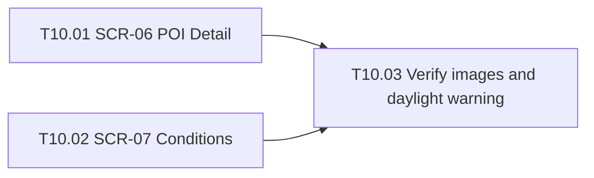

# TASK-10 — POI detail + Conditions panel

| Field | Value |
| --- | --- |
| Objective | POI detail + Conditions panel |
| Requirements | FR-04, FR-11, FR-12 (06 §C); also FR-13 (state only), FR-15, NFR-01, NFR-04, NFR-05; SCR-06, SCR-07 |
| Lane / owner role | frontend — Frontend engineer |
| Milestone | M4 |
| Window | event-only |
| Effort (doc 06) | 3–5 h |
| Done when (doc 06) | Images with credits; daylight warning appears for pre-dawn start |
| Main risk → fallback | — |
| Spec sections | [06 §C](../specs/06_High_Level_Implementation_Plan.md#c-work-packages) · [01 FR-04](../specs/01_Product_Requirements_Document.md#fr-04--points-of-interest-with-ground-imagery) · [01 FR-11](../specs/01_Product_Requirements_Document.md#fr-11--daylight-and-sun-conditions) · [01 FR-12](../specs/01_Product_Requirements_Document.md#fr-12--radiation-dose-estimate) · [01 FR-13](../specs/01_Product_Requirements_Document.md#fr-13--environmental-context-seasonal-weather) · [02 §D.4](../specs/02_Technical_Requirements_Document.md#d4-radiation-estimate-fr-12) · [02 §D.5](../specs/02_Technical_Requirements_Document.md#d5-solar-conditions-fr-11) · [03 SCR-06](../specs/03_App_Flow_and_Diagrams.md#scr-06--poi-detail-panel) · [03 SCR-07](../specs/03_App_Flow_and_Diagrams.md#scr-07--conditions-panel) · [04 §D](../specs/04_Design_Brief.md#d-interaction-and-component-behavior) · [04 §F SCR-06](../specs/04_Design_Brief.md#scr-06-poi-detail-right-drawer) · [05 POI](../specs/05_Backend_and_Database_Schema.md#poi) · [05 PlanResult](../specs/05_Backend_and_Database_Schema.md#planresult-computed) |

## Inputs this task consumes

| Input | Kind | Owner | Dependency |
| --- | --- | --- | --- |
| C1 TypeScript mirror of 05 (POI, PlanResult, Warning, EnvConstant, DataSource) in `packages/protocol/src/schema.ts` | contract | T03.01 | soft |
| C10 UI app context: screen-renderer signature, site lookup maps, provenance attribute names, `metric.ts` and `statusIcon.ts` stubs | contract | T07.01 | soft |
| C11 plan-store state and events: POI selection, add/remove stop, status, latest result | contract | T08.01 | soft |
| C12 CSS token names and status classes in `apps/web/src/ui/styles/tokens.css` | contract | T13.01 | soft |
| F2 canned PLAN_RESULT messages (OK, PARTIAL, OVER_LIMITS) | fixture | T05.03 | soft |
| F3 mock worker answering from F2 | fixture | T05.04 | soft |
| F4 mock site bundle (sample POIs, env constants, sources) | fixture | T03.02 | soft |
| Real conditions assembly (`packages/compute/src/conditions.ts`) | upstream output | T06.09 | hard (T10.03) |
| Metric and provenance-chip component (`apps/web/src/ui/components/metric.ts`) | upstream output, used through its T07.01 stub | T12.01 | soft (stub); the real one is needed by T10.03 — see Spec questions |
| Status icons (`apps/web/src/ui/components/statusIcon.ts`) | upstream output, used through its T07.01 stub | T13.05 | soft (stub) |
| Curated POIs and images in bundle v1; full PLAN_RESULT with `DARKNESS` warnings; pre-dawn start set in SCR-04 | upstream outputs | T03.19, T05.32, T08.04 | needed by T10.03, not yet in map §f — see Spec questions |

## Outputs this task provides

| Output | Path | Consumers |
| --- | --- | --- |
| SCR-06 POI Detail panel | `apps/web/src/ui/screens/scr06PoiDetail.tsx`, `apps/web/src/ui/screens/scr06PoiDetail.css` | T07.08 (right-drawer mount), T07.11 (POI selection opens it), T12.02, T12.06, T13.09, T13.10, T14.06, T17.02 (demo step 3) |
| SCR-07 Conditions panel | `apps/web/src/ui/screens/scr07Conditions.tsx`, `apps/web/src/ui/screens/scr07Conditions.css` | T07.08, T12.02, T12.06, T13.09, T13.10, T14.06, T17.02 (demo step 7), T18.03 (follow-up) |
| Manual test note for both screens | `docs/ops/verification-log.md` (T10.03 section) | T14.06, T16.06 |

## Subtasks

### T10.01 — Implement SCR-06 POI Detail

- **Type:** implement
- **Tag:** agent-ready · core
- **Window:** event-only
- **Estimate:** 1.5–2.5 h
- **Owns (writes):** `apps/web/src/ui/screens/scr06PoiDetail.tsx`, `apps/web/src/ui/screens/scr06PoiDetail.css`
- **Reads:** `packages/protocol/src/schema.ts`, `apps/web/src/ui/context.ts`, `apps/web/src/state/planStore.ts`, `apps/web/src/ui/components/metric.ts`, `apps/web/src/ui/components/statusIcon.ts`, `apps/web/src/ui/styles/tokens.css`, `data/sites/mock_site/`; [01 FR-04](../specs/01_Product_Requirements_Document.md#fr-04--points-of-interest-with-ground-imagery), [03 SCR-06](../specs/03_App_Flow_and_Diagrams.md#scr-06--poi-detail-panel), [04 §D](../specs/04_Design_Brief.md#d-interaction-and-component-behavior), [04 §E](../specs/04_Design_Brief.md#f-accessibility-and-responsive-behavior), [04 §F SCR-06](../specs/04_Design_Brief.md#scr-06-poi-detail-right-drawer), [05 POI](../specs/05_Backend_and_Database_Schema.md#poi), [05 §E.6](../specs/05_Backend_and_Database_Schema.md#e6-unavailable-or-replaced-source-data), [02 §E.1](../specs/02_Technical_Requirements_Document.md#e1-static-asset-contract)
- **Depends on:** T03.01 (soft), T03.02 (soft), T07.01 (soft), T08.01 (soft), T13.01 (soft)
- **Parallel with:** T10.02, T09.03, T09.04, T11.03, T12.03
- **Steps:**
  1. Align the file's render signature with the C10 screen-renderer type (T07.01); read the selected POI from the C11 selection and the site's POI lookup map (05 §E.1).
  2. Lay out per 04 §F: image on top (16:9, click opens a full-size native dialog), 12 px credit line, title, "Science objective", "Why it matters", image sol, date and camera, position source with `position_uncertainty_m` in metres and its provenance chip.
  3. Resolve the image through `image_asset` → the manifest Asset path (02 §E.1; 01 Clarifications); show a blurred placeholder while loading, and "Image not available" with an explanation and the source link when image fields are null or the file fails to load (03 SCR-06; 04 §D; 05 §E.6).
  4. Wire "Add as stop" and "Remove stop" to the C11 actions (append as the next waypoint with `poi_id`; remove the matching stop); disable "Add as stop" with a reason when the plan already has the 10 stops 02 §D.2 allows.
  5. Render every value through the metric component so it carries `data-provenance` and the C10 source-id attribute; use only POI fields, no invented copy (`TODO(decision)` items under Spec questions).
  6. Style with C12 tokens and status classes only; keep every control in Tab order with the 04 §E focus ring; the dialog closes with Esc and returns focus.
- **Acceptance:**
  - Serves: FR-04, FR-15, NFR-01, NFR-04, NFR-05, SCR-06 · [01 FR-04](../specs/01_Product_Requirements_Document.md#fr-04--points-of-interest-with-ground-imagery), [03 SCR-06](../specs/03_App_Flow_and_Diagrams.md#scr-06--poi-detail-panel)
  - Given a selected POI, the panel shows name, science objective, why it matters, the locally stored image with `image_credit`, sol/date/camera, position source and uncertainty, and an "Add as stop" button (01 FR-04; 03 SCR-06; 04 §F).
  - "Add as stop" appends the POI as the next waypoint and triggers recomputation (01 FR-04): the C11 action is called; recomputation itself belongs to the store (T08.03).
  - When the POI is already a stop, the button reads "Remove stop" (03 SCR-06).
  - Image loading shows a blurred placeholder; a missing image shows "Image not available" plus the source link and the panel stays usable (03 SCR-06 states; 04 §D; 05 §E.6).
  - Every numeric value carries `data-provenance` and a source id (01 FR-15; 02 NFR-05); all controls are keyboard-operable with visible focus (04 §E).
  - Images come from local site assets only; no request leaves `localhost` (02 NFR-01, NFR-08).
- **Verify:** `make typecheck lint`; manual: `make dev`, open the app with `?site=mock_site`, select each sample POI and tick the Acceptance items; mock POIs without images must show the Image missing state; devtools Network shows only `localhost` requests.
- **Agent brief:** Implement SCR-06 POI Detail in `apps/web/src/ui/screens/scr06PoiDetail.tsx` and its `.css` per 03 SCR-06, 04 §D/§F and 05 POI, rendering only POI fields from the site manifest. Wire Add/Remove stop to the C11 store actions, handle image loading and missing states per 05 §E.6, and route every value through the metric component with provenance. Touch no other file; run `make typecheck lint`.
- **Conflict notes:** Owns only the two SCR-06 files. `metric.ts` (T12.01) and `statusIcon.ts` (T13.05) are called through their T07.01 stubs and never edited here; by schedule both merge at M3–M4 before the visual check. T07.08 mounts the panel in the right drawer and T07.11 sets the POI selection; neither file is edited here. Use existing C12 tokens; a missing token goes to the design lane owner. No intra-task merge order.

### T10.02 — Implement SCR-07 Conditions

- **Type:** implement
- **Tag:** agent-ready · core
- **Window:** event-only
- **Estimate:** 1.5–2.5 h
- **Owns (writes):** `apps/web/src/ui/screens/scr07Conditions.tsx`, `apps/web/src/ui/screens/scr07Conditions.css`
- **Reads:** `packages/protocol/src/schema.ts`, `apps/web/src/ui/context.ts`, `apps/web/src/state/planStore.ts`, `apps/web/src/ui/components/metric.ts`, `apps/web/src/ui/components/statusIcon.ts`, `apps/web/src/ui/styles/tokens.css`, `apps/web/tests/fixtures/plan-results/`, `apps/web/tests/fixtures/mockWorker.ts`, `data/sites/mock_site/`; [03 SCR-07](../specs/03_App_Flow_and_Diagrams.md#scr-07--conditions-panel), [01 FR-11](../specs/01_Product_Requirements_Document.md#fr-11--daylight-and-sun-conditions), [01 FR-12](../specs/01_Product_Requirements_Document.md#fr-12--radiation-dose-estimate), [01 FR-13](../specs/01_Product_Requirements_Document.md#fr-13--environmental-context-seasonal-weather), [02 §D.4](../specs/02_Technical_Requirements_Document.md#d4-radiation-estimate-fr-12), [02 §D.5](../specs/02_Technical_Requirements_Document.md#d5-solar-conditions-fr-11), [02 §C.2 L7](../specs/02_Technical_Requirements_Document.md#l7--environmental-values-fr-11-fr-12-fr-13), [04 §C.2](../specs/04_Design_Brief.md#c2-typography), [04 §D](../specs/04_Design_Brief.md#d-interaction-and-component-behavior), [05 PlanResult](../specs/05_Backend_and_Database_Schema.md#planresult-computed), [05 EnvConstant](../specs/05_Backend_and_Database_Schema.md#envconstant)
- **Depends on:** T03.01 (soft), T03.02 (soft), T05.03 (soft), T05.04 (soft), T07.01 (soft), T08.01 (soft), T13.01 (soft)
- **Parallel with:** T10.01, T06.06–T06.09, T09.03
- **Steps:**
  1. Align the render signature with C10 (T07.01); subscribe to the latest PlanResult through C11.
  2. Mars date and sun: Mars Year and L_s from `conditions`, LTST and sun elevation per stop from `stops_timeline`, sunrise and sunset in UTC and LTST (flat horizon); state that terrain shadowing is not modelled and list the other 02 §D.5 limitations. "Sol date" stays `TODO(decision)` (Spec questions).
  3. Radiation: `dose_mSv` with `dose_low_mSv`–`dose_high_mSv`, the solar phase, and the rate source from the EnvConstant named by `const_id` and its DataSource; copy the label and the 02 §D.4 exclusions verbatim; no arithmetic in the UI.
  4. States: Computed; Daylight warning when `warnings` contains `DARKNESS`, with severity icon, text and `at_utc` (01 FR-10); Not available, where the seasonal-weather block reads "Not included in this build" (01 FR-13). Use the 04 §D metric-tile Loading, Empty and Error states for missing or stale values.
  5. Route every value through the metric component with `data-provenance` and the C10 source-id attribute; every number carries its unit (04 §C.2).
  6. Check in `make dev` with `?site=mock_site` and the mock worker serving the F2 OK, PARTIAL and OVER_LIMITS results.
- **Acceptance:**
  - Serves: FR-10 (DARKNESS display), FR-11, FR-12, FR-13, FR-15, NFR-05, SCR-07 · [03 SCR-07](../specs/03_App_Flow_and_Diagrams.md#scr-07--conditions-panel), [01 FR-11](../specs/01_Product_Requirements_Document.md#fr-11--daylight-and-sun-conditions), [01 FR-12](../specs/01_Product_Requirements_Document.md#fr-12--radiation-dose-estimate)
  - Shows local true solar time, solar elevation, sunrise/sunset (local, ignoring terrain), L_s and Mars Year for the EVA window (01 FR-11); terrain shadowing is explicitly stated as not modelled (01 FR-11 acceptance).
  - Shows the dose with its range and solar phase, the rate source (Curiosity RAD), the uncertainty and the caveats: no suit shielding, no SEP events, no terrain shielding (01 FR-12), plus the 02 §D.4 exclusions.
  - Given an EVA start before sunrise, when the plan is computed, then the panel shows the Daylight warning state with the affected time (06 TASK-10 done-when; 01 §E step 7).
  - With FR-13 not built, the seasonal-weather block shows "Not included in this build", never placeholder numbers (01 FR-13 acceptance).
  - Values are shown exactly as PlanResult and the manifest provide them; nothing is recomputed in the UI (`CLAUDE.md` §2). Each carries `data-provenance` and a source id (01 FR-15; 02 NFR-05).
- **Verify:** `make typecheck lint`; manual: `make dev` with `?site=mock_site` and the F3 mock worker; load the OK, PARTIAL and OVER_LIMITS fixtures and tick the Acceptance items and the three 03 SCR-07 states; devtools Network shows only `localhost` requests.
- **Agent brief:** Implement SCR-07 Conditions in `apps/web/src/ui/screens/scr07Conditions.tsx` and its `.css` per 03 SCR-07, 01 FR-11–FR-13 and 02 §D.4–§D.5. Render PlanResult `conditions`, `stops_timeline`, `radiation` and `DARKNESS` warnings exactly as given (no science in the UI), with verbatim labels and caveats, provenance on every value and "Not included in this build" for seasonal weather. Touch no other file; run `make typecheck lint`.
- **Conflict notes:** Owns only the two SCR-07 files. Keep the seasonal-weather block self-contained: T18.03 later edits this file as a `follow-up:` (after T10.02) and replaces only that block. Radiation and Mars24 long-form methods text belongs to T12.04 (`apps/web/src/ui/content/methods.json`); copy the short label and exclusions from 02 §D.4 here instead of writing that file. Stubs as in T10.01.

### T10.03 — Verify POI images with credits and the daylight warning for a pre-dawn start

- **Type:** verify
- **Tag:** human-required · core
- **Window:** event-only
- **Estimate:** 0.5–1 h
- **Owns (writes):** `docs/ops/verification-log.md` (append-only)
- **Reads:** `apps/web/src/ui/screens/scr06PoiDetail.tsx`, `apps/web/src/ui/screens/scr07Conditions.tsx`, `data/sites/gale_boxwork/`, `data/sites/mock_site/`, `docs/ops/demo-script.md`; [06 §C](../specs/06_High_Level_Implementation_Plan.md#c-work-packages), [01 §E](../specs/01_Product_Requirements_Document.md#e-core-demonstration-scenario), [03 SCR-06](../specs/03_App_Flow_and_Diagrams.md#scr-06--poi-detail-panel), [03 SCR-07](../specs/03_App_Flow_and_Diagrams.md#scr-07--conditions-panel), [06 §D.7](../specs/06_High_Level_Implementation_Plan.md#d7-definition-of-done-per-feature)
- **Depends on:** T10.01 (hard: verifies its screen), T10.02 (hard: verifies its screen), T06.09 (hard: the pre-dawn daylight warning needs real conditions), T03.19 (hard: real POI images), T05.32 (hard: real DARKNESS warnings), T08.04 (hard: a pre-dawn start is set in the inputs form), T12.01 (hard: provenance labels on the shown values)
- **Parallel with:** T07.15, T08.11, T09.07, T11.05
- **Steps:**
  1. With network disabled, open every POI of the real bundle (`gale_boxwork`), including "Boxwork ridge" if curated (01 §E step 3): image, credit, sol/date/camera, position source and uncertainty are present.
  2. On `?site=mock_site`, confirm the Image missing placeholder and that "Add as stop" still works; on the real bundle, add a POI and see the route recompute (01 FR-04).
  3. Build a plan from POI stops or the demo plan; in SCR-04 set the EVA start before the sunrise that SCR-07 shows; confirm the Daylight warning state, the sun elevation per stop and the affected time (01 §E step 7).
  4. Confirm the radiation block shows PlanResult `radiation` unchanged with label, range, phase, source and caveats; seasonal weather reads "Not included in this build"; terrain shadowing is stated as not modelled.
  5. Do a keyboard-only pass through both panels: Tab order per 04 §E, visible focus, image dialog opens and closes by keyboard.
  6. Append the results as `## T10.03 — <title>` at the end of `docs/ops/verification-log.md`, with data version, browser and date.
- **Acceptance:**
  - Serves: FR-04, FR-11, FR-12, SCR-06, SCR-07 · [06 §C TASK-10](../specs/06_High_Level_Implementation_Plan.md#c-work-packages)
  - Done when (06 §C): "Images with credits; daylight warning appears for pre-dawn start" is observed and recorded.
  - SCR-06 states (Image loading, Image missing) and SCR-07 states (Computed, Daylight warning, Not available) are each observed (03 §B).
  - The log section names the `data_version`, browser, date and any POI without an image.
- **Verify:** Manual checklist (Steps 1–5) on the integrated app with devtools "Offline" on; `make docs-check` after editing the log.
- **Agent brief:** Human: run the checklist on the integrated app with Wi-Fi off and append the T10.03 section to `docs/ops/verification-log.md`. An agent may prepare the checklist from this file and turn the human's notes into the log entry; it does not judge the visual results.
- **Conflict notes:** `docs/ops/verification-log.md` is append-only: add one section at the end; on a rebase conflict keep both sides. Run after T10.01, T10.02 and T06.09 have merged, plus the upstreams listed under Spec questions (map change proposed).

## Internal dependency graph

## Definition of done (task level)

- 06 §D.7 for both screens: acceptance criteria met; manual test note committed (T10.03 section of `docs/ops/verification-log.md`); provenance label on every displayed value (automated check T12.02, demo-path check T12.06); keyboard reachable; works offline; credited sources listed in SCR-09 (checked by T12.06).
- 06 done-when recorded by T10.03: images with credits, and the daylight warning for a pre-dawn start.
- No science in the UI: every value comes from PlanResult or the site manifest (`CLAUDE.md` §2).
- FR-13 shows "Not included in this build" unless TASK-18 lands T18.02 and T18.03.
- `make lint typecheck test docs-check` passes.

## Spec questions

1. **Sol date.** 03 SCR-07 lists "sol date", but 05 PlanResult `conditions` has only `mars_year`, `ls_deg` and sunrise/sunset fields. Computing it in the UI would put science outside `packages/compute/src/`; it needs a C1/C8 contract-change or removal — `TODO(decision)`.
2. **LTST at end.** 03 SCR-07 shows LTST at start and end; 05 `stops_timeline` is per waypoint and has no explicit EVA-end entry (e.g. the loop's return arrival) — `TODO(decision)`.
3. **Dose duration.** 05 §F.3 computes the dose from the EVA total (148 min → 0.066 mSv); 01 §E step 8 shows 0.19 mSv for 7 h while the 01 FR-05 default maximum is 6 h; 02 §D.4 says "planned duration". Which duration SCR-07 reports is unclear.
4. **Label wording.** 01 FR-12 gives "measured rate × planned duration (simplified)"; 02 §D.4 gives "measured background rate × planned duration (simplified)" — which is verbatim for SCR-07?
5. **PARTIAL plans.** With a `NO_ROUTE` leg there is no EVA total (02 §E.2) and the timeline is incomplete; SCR-07's behaviour is unspecified. T10.02 shows only fields present and the 04 §D empty or error tile otherwise. Related to map open point 3.
6. **Provenance of conditions.** 02 §C.2 L7 labels Mars24 outputs "Computed", which is not one of the four FR-15 labels; the label for LTST, L_s, sun elevation and sunrise/sunset is `TODO(decision)`. The Mars24 source id is set in T12.05; the solar-min rate source is map open point 12.
7. **POI values.** 05 POI has one `provenance` field (for the curated position) and no `source_id`, yet SCR-06 shows image sol/date and position uncertainty, which NFR-05 requires to carry a label and source id (map open point 8) — `TODO(decision)`.
8. **POI fields.** 01 FR-04 requires `image_credit` and `source_url` on every POI; 05 names the field `image_source_url` and makes both conditional on an image. 01 FR-04 also mentions an "approximate look direction if known", and NFR-04 needs a text alternative for the image; 05 POI has no field for either — `TODO(decision)`.
9. **Map change proposed:** T10.03 runs on the integrated app, so it also needs the real outputs of T03.19 (curated images in bundle v1), T05.32 (`DARKNESS` warnings in the full PLAN_RESULT), T08.04 (setting a pre-dawn EVA start in SCR-04) and T12.01 (values rendered through the real metric component). Map §f lists only T06.09 → T10.03.
