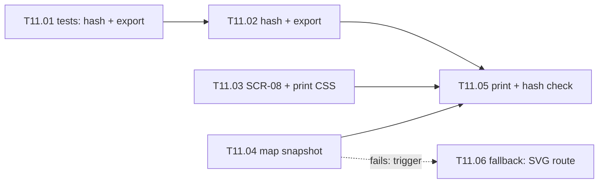

# TASK-11 — Briefing card + JSON export

| Field | Value |
| --- | --- |
| Objective | Briefing card + JSON export |
| Requirements | FR-14 (06 §C); the register adds FR-15, NFR-06, SCR-08 |
| Lane / owner role | frontend (T11.01, T11.02, T11.04, T11.06) — Frontend engineer; design (T11.03, T11.05) — Design & story lead. 06 §C owner: Design lead + Frontend |
| Milestone | M4 (Day 1, by 18:00) |
| Window | event-only |
| Effort (doc 06) | 3–5 h |
| Done when (doc 06) | One-page print in Chrome; export reproduces `plan_hash` |
| Main risk → fallback | Map snapshot hard → static AOI thumbnail with route drawn as SVG |
| Spec sections | [01 FR-14](../specs/01_Product_Requirements_Document.md#fr-14--briefing-card-and-plan-export) · [01 FR-15](../specs/01_Product_Requirements_Document.md#fr-15--provenance-and-methods) · [01 §E](../specs/01_Product_Requirements_Document.md#e-core-demonstration-scenario) · [01 §F.1](../specs/01_Product_Requirements_Document.md#f1-prototype-boundary-must-appear-in-the-app-and-the-video) · [02 §D.4](../specs/02_Technical_Requirements_Document.md#d4-radiation-estimate-fr-12) · [02 §E.2](../specs/02_Technical_Requirements_Document.md#e2-worker-message-protocol) · [02 §F.1](../specs/02_Technical_Requirements_Document.md#f1-test-plan) · [03 SCR-08](../specs/03_App_Flow_and_Diagrams.md#scr-08--briefing-card) · [04 §C.1](../specs/04_Design_Brief.md#c1-colour-palette-contrast-verified-by-computation-wcag-relative-luminance) · [04 §F SCR-08](../specs/04_Design_Brief.md#scr-08-briefing-card-print) · [05 PlanExport](../specs/05_Backend_and_Database_Schema.md#planexport) · [05 §F.3](../specs/05_Backend_and_Database_Schema.md#f3-plan-export-abridged-status-ok) · [06 §C](../specs/06_High_Level_Implementation_Plan.md#c-work-packages) |

## Inputs this task consumes

| Input | Kind | Owner | Dependency |
| --- | --- | --- | --- |
| C1 TypeScript mirror: `PlanExport`, `PlanResult`, `MissionScenario`, `Waypoint` in `web/src/types/schema.ts` | contract | T03.01 | soft |
| C3 plan-export JSON Schema `schemas/plan-export.schema.json` (U-11 still open) | contract | T03.01 | soft |
| C10 UI app context and the stubs `web/src/export/planExport.ts`, `web/src/ui/briefing/mapSnapshot.ts`, `web/src/ui/components/metric.ts`, `web/src/ui/components/statusIcon.ts`, `web/src/ui/results/profileChart.ts` | contract | T07.01 | soft |
| C11 plan-store state: scenario, waypoints, result, status | contract | T08.01 | soft |
| C12 token names, print theme and status classes in `web/src/ui/styles/tokens.css` | contract | T13.01 | soft |
| F2 canned PLAN_RESULT messages (OK, PARTIAL, OVER_LIMITS) in `web/tests/fixtures/plan-results/` | fixture | T05.03 | soft |
| F4 mock site bundle `web/public/sites/mock_site/` (site name, sources, AOI, data version) | fixture | T03.02 | soft |
| Real profile chart and route layer (`web/src/ui/results/profileChart.ts`, `web/src/ui/map/routeLayer.ts`) | upstream output | T09.01–T09.02 | hard (T11.03) |
| Full PLAN_RESULT from the real worker | upstream output | T05.32 | hard (T11.05) |
| JSON-Schema validator for the web tests (choice is a `TODO(decision)` in the dependency batch) | upstream output | T14.01 | hard (T11.01) |

## Outputs this task provides

| Output | Path | Consumers |
| --- | --- | --- |
| Plan hash and PlanExport builder with a local JSON download | `web/src/export/planExport.ts` | T11.03, T11.05, T14.08, T18.07 |
| Export and hash tests | `web/tests/export/planExport.test.ts` | T11.02 (stacked pair) |
| SCR-08 Briefing card and print CSS | `web/src/ui/screens/scr08BriefingCard.ts`, `web/src/ui/screens/scr08BriefingCard.css` | T07.03 (route `#/briefing`), T12.02, T12.06, T13.09, T13.10, T14.06, T17.02, T18.06 |
| Route map snapshot | `web/src/ui/briefing/mapSnapshot.ts` | T11.03 |
| Print and export verification record | `docs/ops/verification-log.md` (T11.05 section) | T14.06, T16.06 |

## Subtasks

### T11.01 — Tests: plan hash and export (canonical JSON, schema-valid, reproducible)

- **Type:** test
- **Tag:** agent-ready · core
- **Window:** event-only
- **Estimate:** 1–1.5 h
- **Owns (writes):** `web/tests/export/planExport.test.ts`
- **Reads:** `web/src/export/planExport.ts` (stub signature from T07.01), `web/src/types/schema.ts`, `schemas/plan-export.schema.json`, `web/tests/fixtures/plan-results/`, `web/tests/fixtures/README.md`, [05 PlanExport](../specs/05_Backend_and_Database_Schema.md#planexport), [05 §F.3](../specs/05_Backend_and_Database_Schema.md#f3-plan-export-abridged-status-ok), [02 §E.2](../specs/02_Technical_Requirements_Document.md#e2-worker-message-protocol), [02 §F NFR-06](../specs/02_Technical_Requirements_Document.md#f-nonfunctional-requirements-and-validation)
- **Depends on:** T03.01 (soft), T07.01 (soft), T05.03 (soft), T14.01 (hard: the JSON-Schema validator arrives in the dependency batch)
- **Parallel with:** T11.03, T11.04, T09.03–T09.05, T10.01–T10.02
- **Steps:**
  1. Load the OK, PARTIAL and OVER_LIMITS fixtures (F2) and take scenario and waypoints from the 05 §F.3 example.
  2. Write the allocated case: hashing the same `{data_version, scenario, waypoints}` twice gives the same `plan_hash` (NFR-06).
  3. Add property checks from 05 §C PlanExport: the hash is 12 lowercase hex characters (the schema pattern); it does not change when object keys are reordered or when `result` changes; it changes when `data_version`, any scenario field or any waypoint changes. Never hard-code an expected hash — the 05 §F.3 `plan_hash` is illustrative.
  4. Build an export from each fixture and validate it against `schemas/plan-export.schema.json` with the validator from T14.01.
  5. Check the PARTIAL rule survives export (02 §E.2): `status` PARTIAL keeps `totals` null; `result` holds PlanResult fields only, without the message fields `type`, `request_id`, `plan_revision`.
  6. Check that `disclaimer` and `provenance_summary` are present (required in 05 §C PlanExport).
  7. Keep the PR a draft until T11.02 makes it pass.
- **Acceptance:**
  - Serves: FR-14, NFR-06 · [05 PlanExport](../specs/05_Backend_and_Database_Schema.md#planexport)
  - Given the same data version, scenario and waypoints, when the hash runs twice, then both values are identical (allocated case "Same plan twice → identical `plan_hash`", map [Test-case allocation](_coordination.md#test-case-allocation)).
  - Every fixture export passes `schemas/plan-export.schema.json`.
  - No expected value is typed by hand: expectations come from 05 §C rules or from comparing two runs (fixture value rule, map [§e](_coordination.md#e-fixtures-and-mocks)).
  - The tests fail against the stub and pass after T11.02.
- **Verify:** `npx vitest run tests/export/planExport.test.ts` (run in `web/`)
- **Agent brief:** Write `web/tests/export/planExport.test.ts` for `web/src/export/planExport.ts` (stub signature from T07.01). Cover 05 §C PlanExport: `plan_hash` is the first 12 hex of SHA-256 over sorted-key canonical JSON of `{data_version, scenario, waypoints}`; same input twice gives the same hash; key order does not matter; exports built from the F2 fixtures validate against the schema. No hand-typed hashes.
- **Conflict notes:** Writes only the test file. Stacked with T11.02 (map [§h.3](_coordination.md#h3-tests-first-merge-order)): T11.02 branches from this branch and the two merge back to back. Never edit the fixtures (T05.03) or the schema (T03.01); a mismatch with them is a `contract-change:` request to their owner.

### T11.02 — Implement the plan hash and PlanExport assembly

- **Type:** implement
- **Tag:** agent-ready · core
- **Window:** event-only
- **Estimate:** 1.5–2 h
- **Owns (writes):** `web/src/export/planExport.ts`
- **Reads:** `web/tests/export/planExport.test.ts`, `web/src/types/schema.ts`, `web/src/state/planStore.ts` (C11 interfaces), `web/src/ui/context.ts` (C10), `schemas/plan-export.schema.json`, [05 PlanExport](../specs/05_Backend_and_Database_Schema.md#planexport), [05 §E.4](../specs/05_Backend_and_Database_Schema.md#e4-versioning-and-migration), [05 §E.5](../specs/05_Backend_and_Database_Schema.md#e5-provenance-required-to-reproduce-a-result), [05 §F.3](../specs/05_Backend_and_Database_Schema.md#f3-plan-export-abridged-status-ok), [01 FR-14](../specs/01_Product_Requirements_Document.md#fr-14--briefing-card-and-plan-export), [01 §F.1](../specs/01_Product_Requirements_Document.md#f1-prototype-boundary-must-appear-in-the-app-and-the-video), [03 §C.5](../specs/03_App_Flow_and_Diagrams.md#c5-saving--exporting-in-scope-export-storage-desirable)
- **Depends on:** T11.01 (hard: tests-first pair), T07.01 (soft), T03.01 (soft), T08.01 (soft)
- **Parallel with:** T11.03, T11.04
- **Steps:**
  1. Fill the T07.01 stub and keep its exported signatures; a change goes through a `contract-change:` on C10.
  2. Serialise `{data_version, scenario, waypoints}` as canonical JSON (keys sorted at every level, arrays in order), hash it with the browser's SHA-256 (Web Crypto; `TODO(verify)` it is available on the demo origin) and keep the first 12 hex characters (05 §C PlanExport). Number formatting waits for the decision in Spec questions.
  3. Assemble PlanExport from the plan-store state and the site manifest: `export_schema_version`, `app_version`, `site_id`, `data_version`, `plan_hash`, `scenario`, `waypoints`, `result` (PlanResult fields only), `provenance_summary`, `disclaimer` (05 §C). Version strings and disclaimer text are `TODO(decision)` (Spec questions).
  4. Fill `provenance_summary` with `{value_path, provenance, source_ids}` per value the card shows: start from the two 05 §F.3 entries and mark the rest `TODO(verify)` until the shared mapping has an owner (Spec questions).
  5. Provide the JSON download used by SCR-08 "Export plan JSON" — a local Blob, no network request; file name `TODO(decision)`.
  6. Make T11.01 pass and run `make typecheck`.
- **Acceptance:**
  - Serves: FR-14, NFR-06 · [05 PlanExport](../specs/05_Backend_and_Database_Schema.md#planexport), [01 FR-14](../specs/01_Product_Requirements_Document.md#fr-14--briefing-card-and-plan-export)
  - T11.01 passes.
  - Given a PARTIAL result, when it is exported, then `result.totals` is null (02 §E.2).
  - The export carries `data_version`, `scenario`, `waypoints`, `app_version` and `plan_hash`, which 05 §E.5 needs to reproduce the result.
  - The download works with the network disabled; no request leaves `localhost` (NFR-01, NFR-08).
- **Verify:** `npx vitest run tests/export/planExport.test.ts` (run in `web/`); `make typecheck`
- **Agent brief:** Implement `web/src/export/planExport.ts` against its T07.01 stub: canonical sorted-key JSON of `{data_version, scenario, waypoints}`, SHA-256 through Web Crypto, first 12 hex characters; assemble the 05 §C PlanExport (result without the message fields, `provenance_summary`, `disclaimer`) and a local JSON download. Make the stacked T11.01 tests pass; add no dependency.
- **Conflict notes:** Owns only `planExport.ts`, created as a stub by T07.01. Branch stacked on T11.01; merge right after it. Callers in SCR-08 (T11.03) code against the stub signature, so do not change it here.

### T11.03 — Implement the SCR-08 layout and print CSS

- **Type:** implement
- **Tag:** agent-ready · core
- **Window:** event-only
- **Estimate:** 2.5–3 h
- **Owns (writes):** `web/src/ui/screens/scr08BriefingCard.ts`, `web/src/ui/screens/scr08BriefingCard.css`
- **Reads:** `web/src/ui/context.ts`, `web/src/state/planStore.ts`, `web/src/export/planExport.ts`, `web/src/ui/briefing/mapSnapshot.ts`, `web/src/ui/results/profileChart.ts`, `web/src/ui/components/metric.ts`, `web/src/ui/components/statusIcon.ts`, `web/src/ui/styles/tokens.css`, `web/tests/fixtures/plan-results/`, `web/tests/fixtures/mockWorker.ts`, `web/public/sites/mock_site/`, `docs/design/wireframes/`, [03 SCR-08](../specs/03_App_Flow_and_Diagrams.md#scr-08--briefing-card), [03 §C.4](../specs/03_App_Flow_and_Diagrams.md#c4-returning-to-an-earlier-step), [04 §F SCR-08](../specs/04_Design_Brief.md#scr-08-briefing-card-print), [04 §C.1](../specs/04_Design_Brief.md#c1-colour-palette-contrast-verified-by-computation-wcag-relative-luminance), [04 §E](../specs/04_Design_Brief.md#e-accessibility-and-responsive-behavior), [01 FR-12](../specs/01_Product_Requirements_Document.md#fr-12--radiation-dose-estimate), [01 FR-14](../specs/01_Product_Requirements_Document.md#fr-14--briefing-card-and-plan-export), [01 FR-15](../specs/01_Product_Requirements_Document.md#fr-15--provenance-and-methods), [01 §F.1](../specs/01_Product_Requirements_Document.md#f1-prototype-boundary-must-appear-in-the-app-and-the-video), [02 §D.4](../specs/02_Technical_Requirements_Document.md#d4-radiation-estimate-fr-12)
- **Depends on:** T09.01–T09.02 (hard: the briefing card renders the real profile, 06 TASK-11 after TASK-09), T07.01 (soft), T08.01 (soft), T13.01 (soft), T05.03 (soft), T03.02 (soft)
- **Parallel with:** T11.01, T11.02, T11.04
- **Steps:**
  1. Lay out the card per 04 §F SCR-08: portrait, 12 mm margins; row 1 header (site, plan name, data version, plan hash, timestamp); row 2 route map snapshot (left 60 %) beside metrics and status; row 3 stops/timeline table (stop, arrival UTC/LTST, dwell, sun elevation, notes); row 4 profile; row 5 warnings and assumptions; footer with short-form sources and the 01 §F.1 prototype disclaimer. Plan name, timestamp source and the notes column are `TODO(decision)` (Spec questions).
  2. Render status from the plan store per 03 SCR-08 States: PARTIAL → red banner "Plan incomplete — not valid for use" with totals omitted; OVER_LIMITS → banner listing the exceeded limits. Use status icons and patterns with the text, never colour alone (04 §C.1).
  3. Render every number through the metric component with its provenance label and source link (FR-15): metrics, constraints (scenario limits, labelled assumed), conditions, and the radiation estimate with range, solar phase and the exclusions 02 §D.4 says are stated on the card.
  4. Add print CSS: portrait page with 12 mm margins, the 04 §C.1 print theme through C12 tokens, patterns kept for black-and-white, app chrome hidden; the card must fit one A4 or Letter page in Chrome (FR-14), so give the snapshot and the profile fixed print heights.
  5. Add the actions Print (browser print dialog), Export plan JSON (the T11.02 download) and Back to map, which returns to SCR-02 with drawers as they were (03 §C.4); all keyboard reachable with the focus ring (04 §E).
  6. Render the card with the OK, PARTIAL and OVER_LIMITS fixtures through the mock worker on `?site=mock_site`.
- **Acceptance:**
  - Serves: FR-14, FR-15, SCR-08 · [03 SCR-08](../specs/03_App_Flow_and_Diagrams.md#scr-08--briefing-card), [04 §F SCR-08](../specs/04_Design_Brief.md#scr-08-briefing-card-print)
  - The card shows every item of the 03 SCR-08 Content list, laid out in the 04 §F rows.
  - Given a PARTIAL result, then the red banner "Plan incomplete — not valid for use" appears and no totals render (03 SCR-08).
  - Given an OVER_LIMITS result, then a banner lists every exceeded limit (03 SCR-08).
  - Every displayed value carries `data-provenance` and a source id (FR-15, NFR-05; checked by T12.02).
  - Print preview in Chrome fits one page without clipping for all three fixtures (confirmed in T11.05).
- **Verify:** `make typecheck`; manual: in `make dev` with the mock worker on `?site=mock_site`, open `#/briefing` for each F2 fixture and check Chrome print preview shows one page.
- **Agent brief:** Implement SCR-08 in `scr08BriefingCard.ts` and `.css` from 03 SCR-08 and 04 §F: header, map snapshot, stops/timeline table, profile (T09.02), metrics, warnings, conditions, constraints and assumptions, sources, disclaimer; PARTIAL and OVER_LIMITS banners; print CSS that fits one A4 or Letter page with the 04 §C.1 print theme. Every value goes through the metric component with provenance. Check against the F2 fixtures via the mock worker.
- **Conflict notes:** Writes only the two `scr08BriefingCard` files. `tokens.css` is append-only after T13.01: add a missing print token there with a 04 §C reference, never here. Uses the T07.01 stubs (`planExport.ts`, `mapSnapshot.ts`, `metric.ts`, `statusIcon.ts`, `profileChart.ts`) without editing them. Merge after T09.01–T09.02; T18.06 follows up on this file later.

### T11.04 — Implement the route map snapshot

- **Type:** implement
- **Tag:** agent-ready · core
- **Window:** event-only
- **Estimate:** 1.5–2 h
- **Owns (writes):** `web/src/ui/briefing/mapSnapshot.ts`
- **Reads:** `web/src/ui/context.ts` (MapHandle, C10), `web/src/ui/map/projection.ts`, `web/src/ui/map/routeLayer.ts`, `docs/contracts/tile-grid.md`, `web/public/sites/mock_site/`, [03 SCR-08](../specs/03_App_Flow_and_Diagrams.md#scr-08--briefing-card), [04 §F SCR-08](../specs/04_Design_Brief.md#scr-08-briefing-card-print), [04 map overlays](../specs/04_Design_Brief.md#map-overlays), [02 §C.1](../specs/02_Technical_Requirements_Document.md#c1-coordinate-reference-conventions-applies-to-every-layer), [02 §C.4](../specs/02_Technical_Requirements_Document.md#c4-mars-specific-pitfalls-to-test-explicitly)
- **Depends on:** T07.01 (soft), T03.02 (soft), T07.06 (hard: the snapshot needs a rendered map)
- **Parallel with:** T11.01, T11.02, T11.03
- **Steps:**
  1. Fill the T07.01 stub against the MapHandle contract (C10) and keep its signature.
  2. Fit the view to the route extent in working-projection metres (no EPSG:3857 view, no `ol/sphere`, 02 §C.4), wait until rendering completes, compose the layer canvases into one image and restore the user's view. `TODO(verify)` the OpenLayers 10 way to read rendered canvases; `TODO(decision)` reuse the workspace map or render a hidden one.
  3. Keep the 04 §C.1 route style (cased accent line), NO_ROUTE legs and numbered stops so the snapshot matches the map.
  4. Return a printable image (for example a data URL). Tiles are same-origin local files, so the canvas should stay exportable offline — `TODO(verify)` no tainted canvas.
  5. Report a failure explicitly instead of returning a blank image, so T11.06 can be triggered.
- **Acceptance:**
  - Serves: FR-14 · [03 SCR-08](../specs/03_App_Flow_and_Diagrams.md#scr-08--briefing-card), [04 §F SCR-08](../specs/04_Design_Brief.md#scr-08-briefing-card-print)
  - Given a computed plan, when the card opens, then the snapshot shows the whole route over the basemap in the 04 §C.1 route style.
  - Taking the snapshot makes no request beyond `localhost` (NFR-01).
  - A failed capture shows as an explicit error on the card, never as a blank or stale image.
- **Verify:** `make typecheck`; manual: on `?site=mock_site` with the mock worker, open the card, compare the snapshot with the map, and check devtools Network shows only `localhost`.
- **Agent brief:** Implement `web/src/ui/briefing/mapSnapshot.ts` against its T07.01 stub: fit the map handle's view to the route extent in the working projection, capture the rendered canvases as one printable image, then restore the view. No Earth-projection helpers and no network requests. Report failures explicitly so the T11.06 fallback can take over.
- **Conflict notes:** Writes only `mapSnapshot.ts`, created as a stub by T07.01. Never edit `routeLayer.ts` (T09.01) or `createMap.ts` (T07.06). Needs a rendered map to check, see Spec questions (proposed T07.06 edge). If T11.06 is triggered, it replaces this file.

### T11.05 — Verify one-page print in Chrome and plan_hash reproduction

- **Type:** verify
- **Tag:** human-required · core
- **Window:** event-only
- **Estimate:** 1 h
- **Owns (writes):** `docs/ops/verification-log.md` (append-only)
- **Reads:** [01 FR-14](../specs/01_Product_Requirements_Document.md#fr-14--briefing-card-and-plan-export), [01 §E](../specs/01_Product_Requirements_Document.md#e-core-demonstration-scenario), [01 Clarifications](../specs/01_Product_Requirements_Document.md#clarifications), [02 §F.1](../specs/02_Technical_Requirements_Document.md#f1-test-plan), [03 SCR-08](../specs/03_App_Flow_and_Diagrams.md#scr-08--briefing-card), [04 §C.1](../specs/04_Design_Brief.md#c1-colour-palette-contrast-verified-by-computation-wcag-relative-luminance), [04 §F SCR-08](../specs/04_Design_Brief.md#scr-08-briefing-card-print), [06 §C](../specs/06_High_Level_Implementation_Plan.md#c-work-packages), `web/tests/fixtures/plan-results/`
- **Depends on:** T11.02 (hard: the real export and hash are checked), T11.03 (hard: the real card is printed), T11.04 (hard: the real snapshot is printed), T05.32 (hard: reloading the export reproduces identical metrics needs the real worker), T07.03 (hard: the checks run on the `#/briefing` route of the integrated app)
- **Parallel with:** T09.07, T10.03, T12.02
- **Steps:**
  1. Open the briefing for an OK, an OVER_LIMITS and a PARTIAL plan; confirm it opens for all three and that the Briefing button is disabled with no stops or after a computation error (03 SCR-08, 01 Clarifications).
  2. In Chrome print preview, A4 and Letter portrait: everything fits one page and nothing is clipped (allocated case "Print preview fits one page", 02 §F.1 UI; FR-14).
  3. Print or save as PDF in black and white: status, slope classes and warnings stay readable through patterns and text (04 §C.1 print theme).
  4. Check that PARTIAL shows "Plan incomplete — not valid for use" without totals and that OVER_LIMITS lists the exceeded limits (03 SCR-08).
  5. Export the plan JSON, re-run its scenario and waypoints through the real worker on the same `data_version` with an uncommitted scratch script, and compare `plan_hash` and every result metric (FR-14; 06 done-when).
  6. Walk 01 §E step 8: route, timeline, radiation, warnings, assumptions, sources and the disclaimer are on the card.
  7. Append the results, Chrome version and any failure to `docs/ops/verification-log.md`.
- **Acceptance:**
  - Serves: FR-14, SCR-08 · [01 FR-14](../specs/01_Product_Requirements_Document.md#fr-14--briefing-card-and-plan-export), [02 §F.1](../specs/02_Technical_Requirements_Document.md#f1-test-plan)
  - "Prints to one A4/Letter page in Chrome without clipping" (FR-14) holds for all three statuses.
  - Re-running the exported plan gives the same `plan_hash` and identical metrics (FR-14; 06 §C done-when).
  - Banners and black-and-white readability match 03 SCR-08 and 04 §C.1.
  - The verification log has a `## T11.05 — Verify one-page print in Chrome and plan_hash reproduction` section.
- **Verify:** Manual checklist in Steps; results recorded in `docs/ops/verification-log.md`.
- **Agent brief:** Human: run the print and export checks in Chrome on the integrated app and record them. An agent may write the scratch script that feeds the exported scenario and waypoints to the worker handler and diffs `plan_hash` and metrics, and may draft the log entry.
- **Conflict notes:** Only appends one section at the end of the verification log (append-only; on a rebase conflict keep both sides). A failure becomes a `follow-up:` subtask on the file's owner (T11.02, T11.03 or T11.04) or triggers T11.06.

### T11.06 — Fallback — start only if the map snapshot cannot be made to work: static AOI thumbnail with the route as SVG

- **Type:** fallback
- **Tag:** agent-ready · core
- **Window:** event-only
- **Estimate:** 1–1.5 h
- **Owns (writes):** `web/src/ui/briefing/mapSnapshot.ts` (replaces T11.04)
- **Reads:** `web/src/ui/context.ts`, `web/src/types/schema.ts` (`Site.aoi.extent_m`, `Leg.geometry`), `web/public/sites/mock_site/`, [06 §C](../specs/06_High_Level_Implementation_Plan.md#c-work-packages), [04 map overlays](../specs/04_Design_Brief.md#map-overlays), [02 §C.1](../specs/02_Technical_Requirements_Document.md#c1-coordinate-reference-conventions-applies-to-every-layer), [02 §C.4](../specs/02_Technical_Requirements_Document.md#c4-mars-specific-pitfalls-to-test-explicitly), [02 §E.1](../specs/02_Technical_Requirements_Document.md#e1-static-asset-contract)
- **Depends on:** T07.01 (soft), T03.02 (soft)
- **Parallel with:** T11.03
- **Steps:**
  1. Keep the stub signature; replace the canvas capture with a static AOI image plus an SVG overlay.
  2. Choose the AOI image: `TODO(decision)` — 02 §E.1 lists no thumbnail asset (candidates: a T03.25 static PNG, or the SCR-01 context thumbnail).
  3. Map route geometry (working-projection metres, 05 §C Leg) to image pixels linearly from `aoi.extent_m`, with row 0 north (02 §C.4); draw legs in the 04 §C.1 route style, NO_ROUTE legs dashed, and numbered stops.
  4. Keep it readable in black and white (dashes and labels, not colour alone).
  5. Re-run the T11.05 print check for one page.
- **Acceptance:**
  - Serves: FR-14 · [06 §C](../specs/06_High_Level_Implementation_Plan.md#c-work-packages) (TASK-11 fallback)
  - Given any computed plan, the card shows the AOI image with every leg and stop in the right place relative to the AOI extent.
  - No network request and no Earth-radius or EPSG:3857 code path (02 §C.1, §C.4).
  - The card still prints on one page.
- **Verify:** `make typecheck`; manual: card with the OK and PARTIAL fixtures on `?site=mock_site`; Chrome print preview shows one page.
- **Agent brief:** Fallback — start only if T11.04 cannot work. Rewrite `mapSnapshot.ts` with the same signature to return the AOI image with the route drawn as SVG, mapping working-projection metres to pixels from `aoi.extent_m` (row 0 north). Use the 04 §C.1 route style, dashed NO_ROUTE legs, no network.
- **Conflict notes:** Replaces T11.04's file wholesale and never runs at the same time as T11.04. If the AOI image needs a new asset, that is a `contract-change:` on C2 (T03.01) or a `follow-up:` on the pipeline (T03.25); do not add assets here.

## Internal dependency graph

T11.03 and T11.04 also code against the T11.02 stub signature (soft, through T07.01); the dotted edge is a fallback trigger, not a dependency.

## Definition of done (task level)

- [06 §D.7](../specs/06_High_Level_Implementation_Plan.md#d7-definition-of-done-per-feature): FR-14 acceptance criteria met; T11.01 unit tests green and the T11.05 manual test note committed; every value on the card has a provenance label; Print, Export and Back are keyboard reachable; opening, printing and exporting work offline; credited sources are listed on the card footer and in SCR-09.
- 06 §C done-when: one-page print in Chrome; the export reproduces `plan_hash`.
- The card opens for OK, Over limits and Partial plans, with the 03 SCR-08 banners, and stays readable in black and white.
- Every export validates against `schemas/plan-export.schema.json`.
- The briefing card and the disclaimer are never cut ([06 §D.4](../specs/06_High_Level_Implementation_Plan.md#d4-cut-list-cut-in-this-order-when-behind)).
- `make lint typecheck test docs-check` and `python3 scripts/check_tasks.py` pass.

## Spec questions

1. **Plan name.** 03 SCR-08 and 04 §F put a "plan name" in the header, but no 05 entity has a name field — `TODO(decision)`.
2. **Canonical numbers.** 05 §C says the hash input uses "numbers as written"; JavaScript serialises `6.0` as `6`, so another implementation could hash differently — `TODO(decision)` on the number format.
3. **Disclaimer text.** 05 §F.3 shows a short disclaimer; 01 §F.1 gives the full prototype boundary that "must appear in the app" — which one goes into the export and the card footer? `TODO(decision)`.
4. **Provenance mapping.** 05 §C requires `provenance_summary` but lists value paths only in the 05 §F.3 example, and no contract owns the value-path → provenance and source-id table that the metric chips and the export should share. Map change proposed: give that table an owner (C10 or the T12.04 content file).
5. **Demo radiation value.** 01 §E step 8 expects 0.19 mSv for a 7 h EVA, but the default maximum EVA duration is 6 h (FR-05) and the dose uses the planned EVA total (05 §F.3), so that demo plan would be Over limits unless the limit is raised — `TODO(decision)` for T07.14 and T17.01.
6. **Fallback thumbnail.** No thumbnail asset exists in 02 §E.1 or 05 Asset for the 06 fallback — `TODO(decision)` (a T03.25 PNG or the SCR-01 context thumbnail).
7. **Header and table sources.** 03's "generated time" (`computed_utc` or print time?) and the 04 §F "notes" column have no defined source — `TODO(decision)`.
8. **Direct `#/briefing`.** 03 SCR-08 defines when the Briefing button is disabled but not what the route shows with no computed plan — `TODO(decision)`.
9. **Version strings.** 05 §F.3 gives `export_schema_version` "1.0.0" and `app_version` "0.1.0" as examples only; whether `app_version` follows `web/package.json` is `TODO(decision)`.
10. **U-11** (store profile arrays in the export or recompute them) is open in contract C3 (map [§d](_coordination.md#d-contracts-registry)); it changes the export size, not the card.
11. **Web Crypto.** SHA-256 through Web Crypto needs a secure context — `TODO(verify)` for `make demo` on 127.0.0.1 and for any LAN or projector address used at the venue.
12. **Map change proposed — two cross-task hard edges not in map §f:** T07.06 → T11.04 (a snapshot needs a rendered map) and T07.03 → T11.05 (print and export are checked on the `#/briefing` route of the integrated app). Both are already ordered by the milestones (M3 before M4).
13. **Reload test.** FR-14 says re-loading the export "in a test"; T11.05 does it with an uncommitted scratch script. Map change proposed if a committed regression test is wanted: a `follow-up:` subtask owning a new reload test, after T05.32.
