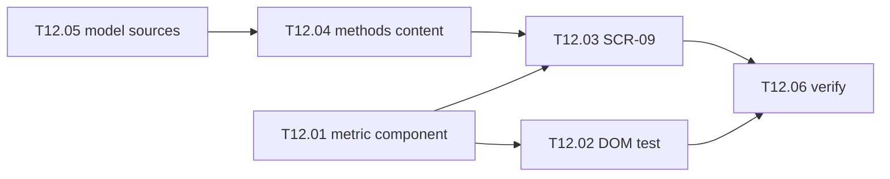

# TASK-12 — Sources & Methods + provenance attributes

| Field | Value |
| --- | --- |
| Objective | Sources & Methods + provenance attributes |
| Requirements | FR-15, NFR-05 (06 §C); the subtasks also serve SCR-09, NFR-04, NFR-07 |
| Lane / owner role | story — Design & story lead (06 §C owner: Story lead) |
| Milestone | M4 (06 §B); subtasks run M1–M5 |
| Window | Mixed: T12.04, T12.05 `pre-event-allowed`; T12.01–T12.03, T12.06 `event-only` |
| Effort (doc 06) | 2–4 h |
| Done when (doc 06) | Automated check finds no unlabelled metric |
| Main risk → fallback | — |
| Spec sections | [01 FR-15](../specs/01_Product_Requirements_Document.md#fr-15--provenance-and-methods) · [02 §F NFR-05](../specs/02_Technical_Requirements_Document.md#f-nonfunctional-requirements-and-validation) · [02 §D](../specs/02_Technical_Requirements_Document.md#d-core-processing-and-simulation-behavior) · [02 Sources](../specs/02_Technical_Requirements_Document.md#sources-accessed-2026-11-02) · [03 SCR-09](../specs/03_App_Flow_and_Diagrams.md#scr-09--sources--methods) · [04 §C.1](../specs/04_Design_Brief.md#c1-colour-tokens) · [04 §D](../specs/04_Design_Brief.md#d-interaction-and-component-behavior) · [04 §F SCR-09](../specs/04_Design_Brief.md#scr-09-sources--methods) · [05 DataSource](../specs/05_Backend_and_Database_Schema.md#datasource) · [06 §C](../specs/06_High_Level_Implementation_Plan.md#c-work-packages) |

## Inputs this task consumes

| Input | Kind | Owner | Dependency |
| --- | --- | --- | --- |
| C10 UI app context: screen-renderer signature, provenance and source-id attribute names, `metric.ts` stub | contract | T07.01 | soft (T12.01, T12.02, T12.03) |
| C11 plan-store state | contract | T08.01 | soft (T12.02) |
| C12 CSS token names | contract | T13.01 | soft (T12.01, T12.03) |
| C1 entity types (`DataSource`, `Layer`), C5 site-config input layout | contract | T03.01 | soft (T12.03, T12.05) |
| F2 canned PLAN_RESULT messages | fixture | T05.03 | soft (T12.02) |
| F4 mock site bundle (manifest with `sources`, `layers`, `env_constants`) | fixture | T03.02 | soft (T12.02, T12.03) |
| DOM test environment (choice open: map open point 16) | upstream output | T14.01 | hard (T12.02) |
| Bundle v1 manifest listing every DataSource | upstream output | T03.19 | hard (T12.06) |
| Integrated app shell and the screens that show values | upstream output | T07.03, T07.05, T07.06, T07.08–T07.10, T07.12, T08.04, T08.05, T09.02–T09.04, T10.01, T10.02, T11.03 | hard (T12.06) |

## Outputs this task provides

| Output | Path | Consumers |
| --- | --- | --- |
| Metric and provenance-chip component | `apps/web/src/ui/components/metric.ts` | T07.06, T07.09, T07.10, T07.12, T08.04, T08.05, T09.02–T09.04, T10.01, T10.02, T11.03, T12.03 |
| DOM provenance test | `apps/web/tests/ui/provenance.test.ts` | T12.06, T14.06 (06 §D.6: all Vitest suites green) |
| SCR-09 Sources & Methods | `apps/web/src/ui/screens/scr09SourcesMethods.tsx`, `apps/web/src/ui/screens/scr09SourcesMethods.css` | T07.03 (route registry), T12.06, T16.03–T16.06, T17.02 (demo step 9) |
| Methods, models and limitations content | `apps/web/src/ui/content/methods.json` | T12.03 |
| Model DataSource records | `pipeline/sites/gale_boxwork/sources/` (three files) | T03.13, T03.19, T11.02 (`provenance_summary` source ids), T12.03 |
| Verification record | `docs/ops/verification-log.md` (section T12.06) | T16.05 |

## Subtasks

### T12.01 — Implement the metric and provenance-chip component

- **Owner:** Mishkat Ahmed Khan (R2 Compute lead · R1 support)
- **Type:** implement
- **Tag:** agent-ready · core
- **Window:** event-only
- **Estimate:** 1.5–2.5 h
- **Owns (writes):** `apps/web/src/ui/components/metric.ts`
- **Reads:** `apps/web/src/ui/context.ts` (C10: component signature, provenance and source-id attribute names, anchor scheme), `apps/web/src/ui/styles/tokens.css` (C12), `packages/protocol/src/schema.ts` (`Provenance`), [04 §C.1](../specs/04_Design_Brief.md#c1-colour-tokens), [04 §C.2](../specs/04_Design_Brief.md#c2-typography), [04 §D](../specs/04_Design_Brief.md#d-interaction-and-component-behavior), [04 §E](../specs/04_Design_Brief.md#f-accessibility-and-responsive-behavior), [01 FR-15](../specs/01_Product_Requirements_Document.md#fr-15--provenance-and-methods), [02 §F NFR-05](../specs/02_Technical_Requirements_Document.md#f-nonfunctional-requirements-and-validation)
- **Depends on:** T07.01 (soft), T13.01 (soft)
- **Parallel with:** T07.02–T07.08, T08.02, T08.03, T09.01, T09.02
- **Steps:**
  1. Take over the stub T07.01 created; keep its exported signature exactly.
  2. Render the value in the metric font with its unit beside it in the label style (04 §C.2). Format numbers only as the C10 signature says (precision is spec question 7).
  3. Put `data-provenance` (one of measured, derived, modelled, assumed) and the C10 source-id attribute on the value element (NFR-05).
  4. Render the chip: symbol plus word (measured ■, derived ◆, modelled ○, assumed △), outline style, `text-secondary` on `raised` (04 §C.1). The word is the accessible name; the symbol is decorative.
  5. Make the chip a link into SCR-09 (`#/sources#<anchor>`, anchor scheme from C10, spec question 4), reachable by Tab with the focus ring (04 §E).
  6. Implement the metric-tile states of 04 §D: default, loading (previous value at 50 % opacity), empty ("—" with tooltip "needs a plan"), error (`unknown` styling).
- **Acceptance:**
  - Serves: FR-15, NFR-05, NFR-04 · [01 FR-15](../specs/01_Product_Requirements_Document.md#fr-15--provenance-and-methods), [04 §C.1](../specs/04_Design_Brief.md#c1-colour-tokens)
  - Given any value rendered with the component, then its element has `data-provenance` ∈ {measured, derived, modelled, assumed} and a non-empty source-id attribute (02 NFR-05).
  - Every value shows its unit (04 §C.2: "numbers always carry units").
  - The chip shows the 04 §C.1 symbol and word and uses no status colour.
  - The chip is a link into SCR-09, reachable by Tab, with the 2 px `focus` ring and 2 px offset (04 §E).
  - The four 04 §D metric-tile states render as specified.
  - `make typecheck` passes with the stub's signature unchanged.
- **Verify:** `make typecheck`; manual check in `make dev` with `?site=mock_site`: inspect one value per label in devtools for both attributes, tab to its chip, follow the link.
- **Agent brief:** Implement `apps/web/src/ui/components/metric.ts` against the signature T07.01 stubbed (C10). Render value and unit, set `data-provenance` and the C10 source-id attribute, and add the 04 §C.1 provenance chip as a keyboard-reachable link into SCR-09, with the 04 §D metric-tile states. Do not change the signature; write no other file.
- **Conflict notes:** Stub handover: T07.01 creates the file; start after it merges. A signature change is a `contract-change:` in TASK-07 (C10). The map gives this component no stylesheet (spec question 8): until it does, use C12 classes only. Screens call it from M3, so merge early in M3.

### T12.02 — Tests: DOM provenance check across screens

- **Owner:** Mishkat Ahmed Khan (R2 Compute lead · R1 support)
- **Type:** test
- **Tag:** agent-ready · core
- **Window:** event-only
- **Estimate:** 1.5–2.5 h
- **Owns (writes):** `apps/web/tests/ui/provenance.test.ts`
- **Reads:** `apps/web/src/ui/context.ts` (C10), `apps/web/src/state/planStore.ts` (C11), `apps/web/src/ui/components/metric.ts`, `apps/web/src/ui/screens/`, `apps/web/src/ui/map/inspector.ts`, `apps/web/src/ui/plan/stopsList.ts`, `apps/web/src/ui/results/`, `apps/web/tests/fixtures/plan-results/` (F2), `data/sites/mock_site/site-manifest.json` (F4), `apps/web/tests/fixtures/README.md`, [01 FR-15](../specs/01_Product_Requirements_Document.md#fr-15--provenance-and-methods), [02 §F](../specs/02_Technical_Requirements_Document.md#f-nonfunctional-requirements-and-validation), [03 §B](../specs/03_App_Flow_and_Diagrams.md#b-screen-specification)
- **Depends on:** T12.01 (hard: the component under test must exist), T14.01 (hard: the DOM test environment arrives in the dependency batch), T07.01 (soft), T08.01 (soft), T05.03 (soft), T03.02 (soft)
- **Parallel with:** T12.03, T09.03–T09.05, T10.01, T10.02, T11.01–T11.04
- **Steps:**
  1. Select the DOM environment T14.01 installed with a per-file environment comment; no config edit.
  2. Build an app context (C10) from the mock-site manifest (F4, read from disk) and a plan store (C11) holding each canned result: OK, PARTIAL, OVER_LIMITS (F2).
  3. Render each screen and value-showing module (SCR-00 to SCR-09, inspector popover, stops list, results modules) with each fixture. The map canvas is out of scope: canvas text is not in the DOM (whether OpenLayers can start in the DOM environment is `TODO(verify)`; otherwise stub the C10 map handle).
  4. Assert the cases below; collect every failure with its screen and element before failing.
  5. Report a screen whose render still throws a `TODO(` stub error as skipped, never as passed, and print the skipped list.
  6. Keep the non-metric allowlist (spec question 2) as one named constant with a comment per entry, holding only entries the lane owner decided.
- **Acceptance:**
  - Serves: FR-15, NFR-05 · [01 FR-15](../specs/01_Product_Requirements_Document.md#fr-15--provenance-and-methods), [02 §F](../specs/02_Technical_Requirements_Document.md#f-nonfunctional-requirements-and-validation)
  - Case 1 (01 FR-15 acceptance): every metric element on every rendered screen carries `data-provenance`.
  - Case 2 (02 NFR-05): that value is one of measured, derived, modelled, assumed, and the C10 source-id attribute is non-empty.
  - Case 3 (01 FR-15 behaviour, "No numeric value is displayed without a provenance label"): no text containing a number appears outside a labelled element, except allowlisted identifiers.
  - Case 4: the metric component sets both attributes for each of the four labels and links into SCR-09.
  - The test makes no network request and runs inside `make test`.
  - No 02 §D or §F.1 case is claimed here (map Test-case allocation).
- **Verify:** `npx vitest run tests/ui/provenance.test.ts` (run in `apps/web/`); `make test`
- **Agent brief:** Write `apps/web/tests/ui/provenance.test.ts`. Render every screen and value-showing module with the mock site (F4) and the three canned results (F2). Fail on any metric element without `data-provenance` in {measured, derived, modelled, assumed} plus the C10 source-id attribute, or on numeric text outside a labelled element (allowlist only as decided). Report stub screens as skipped; write no other file.
- **Conflict notes:** Test file only; never fix a screen here. Failures become `follow-up:` subtasks in the owning task (map §c.1, §h.5). Use a per-file environment comment; `apps/web/vite.config.ts` belongs to T14.01. Merges after T12.01; it can merge while other screens are still stubs, because they show as skipped.

### T12.03 — Implement SCR-09 Sources & Methods

- **Owner:** Mishkat Ahmed Khan (R2 Compute lead · R1 support)
- **Type:** implement
- **Tag:** agent-ready · core
- **Window:** event-only
- **Estimate:** 2–3 h
- **Owns (writes):** `apps/web/src/ui/screens/scr09SourcesMethods.tsx`, `apps/web/src/ui/screens/scr09SourcesMethods.css`
- **Reads:** `apps/web/src/ui/context.ts` (C10), `apps/web/src/ui/content/methods.json`, `apps/web/src/ui/components/metric.ts`, `packages/protocol/src/schema.ts` (`DataSource`, `Layer`, `EnvConstant`), `apps/web/src/ui/styles/tokens.css` (C12), `data/sites/mock_site/site-manifest.json` (F4), [03 SCR-09](../specs/03_App_Flow_and_Diagrams.md#scr-09--sources--methods), [03 §C.4](../specs/03_App_Flow_and_Diagrams.md#c4-returning-to-an-earlier-step), [03 §E.2](../specs/03_App_Flow_and_Diagrams.md#e2-screen-navigation), [04 §F SCR-09](../specs/04_Design_Brief.md#scr-09-sources--methods), [04 §C.1](../specs/04_Design_Brief.md#c1-colour-tokens), [04 §E](../specs/04_Design_Brief.md#f-accessibility-and-responsive-behavior), [02 §E.1](../specs/02_Technical_Requirements_Document.md#e1-static-asset-contract)
- **Depends on:** T12.01 (hard: values render through the metric component), T12.04 (hard: renders the methods content), T07.01 (soft), T13.01 (soft), T03.01 (soft), T03.02 (soft)
- **Parallel with:** T12.02, T10.01, T10.02, T11.03
- **Steps:**
  1. Change the stub's signature to the C10 screen-renderer type; the `#/sources` route stays registered by T07.03.
  2. Lay out the full-screen overlay: left anchor list (Datasets · Processing · Models · Limitations · AI use · Diagnostics), right content with tables (04 §F).
  3. Datasets table from the manifest `sources`: name, version, mission/instrument, resolution, licence/credit, link (03 SCR-09). Numeric cells go through the metric component (label: spec question 3).
  4. Processing, Models and Limitations from `methods.json`; model parameter values such as the RAD rates come from the manifest `env_constants` through the metric component; each block carries its provenance label and source ids.
  5. AI-use statement verbatim: "No AI computes or generates values in this app" (03 SCR-09).
  6. Diagnostics: data version and checksum status as boot reports them (C10), worded per 02 §E.1 (checked in development builds, skipped in production).
  7. Jump to the anchor of a deep link such as `#/sources#layer-slope`, without animation when `prefers-reduced-motion` is set (04 §E); Back returns to SCR-02 (03 §C.4, §E.2).
- **Acceptance:**
  - Serves: FR-15, SCR-09, NFR-04, NFR-07 · [03 SCR-09](../specs/03_App_Flow_and_Diagrams.md#scr-09--sources--methods), [04 §F SCR-09](../specs/04_Design_Brief.md#scr-09-sources--methods)
  - SCR-09 shows every section 03 SCR-09 lists, in the 04 §F layout.
  - Given the mock-site manifest, every `sources` entry appears in the datasets table with all six columns.
  - Given `#/sources#layer-slope`, then the overlay opens with the slope entry in view (03 SCR-09 entry).
  - Every number on the screen carries a provenance label (01 FR-15).
  - All controls and anchors are keyboard reachable with the focus ring, and text uses the 04 §C.1 tokens (NFR-04).
  - Source links are plain anchors; opening SCR-09 fetches nothing (NFR-01, NFR-08).
- **Verify:** `make typecheck`; once T12.02 is merged, `npx vitest run tests/ui/provenance.test.ts` (run in `apps/web/`) shows SCR-09 not skipped; manual check in `make dev` with `?site=mock_site`: open `#/sources` and `#/sources#layer-slope`, tab through every anchor, repeat with devtools Offline.
- **Agent brief:** Implement SCR-09 in `apps/web/src/ui/screens/scr09SourcesMethods.tsx` and its `.css`: a full-screen overlay with the 03 SCR-09 sections in the 04 §F layout. Datasets come from the manifest `sources`, methods from `apps/web/src/ui/content/methods.json`, values through the metric component, plus deep-link anchors such as `#layer-slope`. Do not touch the router (T07.03) or other screens.
- **Conflict notes:** T07.03 registers `#/sources`; screens never edit the router. The anchor scheme is shared with T12.01 through C10 (spec question 4). Methods text and equations come only from `methods.json`, never hard-coded. Needs no new token; if one is missing, raise it instead of defining local CSS variables.

### T12.04 — Write the methods, models and limitations content from 02 §C–§D

- **Owner:** Mishkat Ahmed Khan (R2 Compute lead · R1 support)
- **Type:** implement
- **Tag:** agent-ready · core
- **Window:** pre-event-allowed
- **Estimate:** 1.5–2 h
- **Owns (writes):** `apps/web/src/ui/content/methods.json`
- **Reads:** [02 §A.2](../specs/02_Technical_Requirements_Document.md#a2-architecture-diagram), [02 §C.2](../specs/02_Technical_Requirements_Document.md#c2-data-layers), [02 §D.1](../specs/02_Technical_Requirements_Document.md#d1-point-sampling-fr-03-fr-08), [02 §D.2](../specs/02_Technical_Requirements_Document.md#d2-route-planning-fr-06-fr-07-fr-10), [02 §D.3](../specs/02_Technical_Requirements_Document.md#d3-walking-time-model-fr-09), [02 §D.4](../specs/02_Technical_Requirements_Document.md#d4-radiation-estimate-fr-12), [02 §D.5](../specs/02_Technical_Requirements_Document.md#d5-solar-conditions-fr-11), [02 §D.7](../specs/02_Technical_Requirements_Document.md#d7-ai), [03 SCR-09](../specs/03_App_Flow_and_Diagrams.md#scr-09--sources--methods), [01 FR-12](../specs/01_Product_Requirements_Document.md#fr-12--radiation-dose-estimate), `pipeline/sites/gale_boxwork/sources/` (model source ids from T12.05)
- **Depends on:** T12.05 (hard: cites the model source ids it records)
- **Parallel with:** T07.01, T08.01, T13.01–T13.03, T14.01, T16.01
- **Steps:**
  1. Fix the file's shape: processing steps, models, limitations and the AI-use statement; each entry has a title, text, provenance label, source ids and a spec reference. T12.03 renders it.
  2. Processing: the pipeline steps of 02 §A.2 and the per-layer preprocessing of 02 §C.2 (L1–L4), quoted.
  3. Models: speed (02 §D.2 speed model and step cost, 02 §D.3 label), radiation (02 §D.4 model, exclusions and label), solar (02 §D.5 model and limitation). Copy equations character for character; leave parameter values that live in the manifest (`env_constants`) out.
  4. Limitations: 02 §C.2 L2 effective resolution and artifacts, L3 limitations, L4 footprint and gaps, 02 §D.2 "Known limitations", 02 §D.5 "Limitation".
  5. AI use: the 03 SCR-09 statement verbatim.
  6. Check every number and label against its cited section; anything not in the spec becomes `TODO(verify)`.
- **Acceptance:**
  - Serves: FR-15 · [01 FR-15](../specs/01_Product_Requirements_Document.md#fr-15--provenance-and-methods), [03 SCR-09](../specs/03_App_Flow_and_Diagrams.md#scr-09--sources--methods)
  - The file is valid JSON and covers processing, models (speed, radiation, solar), limitations and AI use (03 SCR-09 content).
  - Every entry carries a spec reference, and every number in it appears in that section (no new numbers, `CLAUDE.md` §2).
  - The speed label matches 02 §D.3 verbatim ("modelled — Earth hiking function scaled to an Apollo lunar planning speed; not validated for Mars suits or 0.38 g"); the radiation label uses the wording decided for spec question 10.
  - Every source id named exists under `pipeline/sites/gale_boxwork/sources/` or in a 05 example (`hassler-2014-rad`).
- **Verify:** `python3 -m json.tool apps/web/src/ui/content/methods.json`; manual checklist: compare every entry with its cited 02 or 03 section.
- **Agent brief:** Write `apps/web/src/ui/content/methods.json` for SCR-09: processing steps, models (speed, radiation, solar) with equations and labels, known limitations and the AI-use statement. Quote each entry from 02 §A.2, §C.2 or §D.1–§D.5 (or 03 SCR-09) with its section reference and the model source ids from T12.05. Copy text and numbers verbatim; add no new number.
- **Conflict notes:** Single owner. T12.03 renders the shape this file fixes, so settle it here and change it only before T12.03 starts. RAD rates are not duplicated here; SCR-09 reads them from `env_constants`. If 02 changes, the spec changes first (`spec-change:`), then this file.

### T12.05 — Write DataSource records for the models (Tobler, Apollo 17, Mars24)

- **Owner:** Mishkat Ahmed Khan (R2 Compute lead · R1 support)
- **Type:** implement
- **Tag:** agent-ready · core
- **Window:** pre-event-allowed
- **Estimate:** 0.5–1 h
- **Owns (writes):** `pipeline/sites/gale_boxwork/sources/tobler-1993.json`, `pipeline/sites/gale_boxwork/sources/apollo17-planning.json`, `pipeline/sites/gale_boxwork/sources/` (append-only)
- **Reads:** `pipeline/sites/README.md` (C5), `schemas/site-manifest.schema.json` (DataSource definition), [05 DataSource](../specs/05_Backend_and_Database_Schema.md#datasource), [05 §F.3](../specs/05_Backend_and_Database_Schema.md#f3-plan-export-abridged-status-ok), [02 Sources](../specs/02_Technical_Requirements_Document.md#sources-accessed-2026-11-02), [02 §D.3](../specs/02_Technical_Requirements_Document.md#d3-walking-time-model-fr-09), [02 §D.5](../specs/02_Technical_Requirements_Document.md#d5-solar-conditions-fr-11)
- **Depends on:** T03.01 (soft)
- **Parallel with:** T03.17, T04.04–T04.06, T06.10
- **Steps:**
  1. Follow the C5 layout: one `<source_id>.json` file per DataSource.
  2. Write `tobler-1993.json` and `apollo17-planning.json` (ids from 05 §F.3), plus one Mars24 record citing the GISS Mars24 page and Allison & McEwen 2000; its id is `TODO(decision)` (spec question 5).
  3. Copy the URLs and the DOI exactly as 02 Sources lists them; `accessed` is the date you accessed the source (02 Sources were accessed 2026-11-02).
  4. Fill title, publisher, authors, version, credit and licence from the source itself. A field you cannot find stays `TODO(verify)` and is listed in the PR (spec question 6).
  5. Check each file is valid JSON and has every field 05 §C marks required.
- **Acceptance:**
  - Serves: FR-15, NFR-07 · [05 DataSource](../specs/05_Backend_and_Database_Schema.md#datasource), [02 Sources](../specs/02_Technical_Requirements_Document.md#sources-accessed-2026-11-02)
  - Three records exist, one file each, with every required 05 §C field: `source_id`, `title`, `publisher`, `missions`, `instruments`, `version`, `url`, `credit`, `licence`, `accessed`.
  - `source_id` values are unique and kebab-case; `tobler-1993` and `apollo17-planning` match 05 §F.3.
  - Every URL and the DOI equal those in 02 Sources; no value is invented.
- **Verify:** `python3 -m json.tool pipeline/sites/gale_boxwork/sources/tobler-1993.json`, repeated for each file; manual checklist against 05 §C DataSource; `validate-manifest` checks them again in T03.19.
- **Agent brief:** Add three DataSource records under `pipeline/sites/gale_boxwork/sources/`: `tobler-1993.json`, `apollo17-planning.json` and one Mars24 / Allison & McEwen 2000 record (id `TODO(decision)`). Copy URLs and the DOI from 02 Sources; fill the other 05 §C fields from the sources themselves and leave `TODO(verify)` where a value cannot be found. Write no other file.
- **Conflict notes:** The `sources/` folder is append-only by file: create only these three files and never edit records of T03.17, T04.01, T06.10, T18.01 or T18.02. The manifest picks them up in T03.19, which depends on this subtask (hard).

### T12.06 — Verify no unlabelled metric on the demo path and every credited source in SCR-09

- **Owner:** Mishkat Ahmed Khan (R2 Compute lead · R1 support)
- **Type:** verify
- **Tag:** agent-ready · core
- **Window:** event-only
- **Estimate:** 1–1.5 h
- **Owns (writes):** `docs/ops/verification-log.md` (append-only)
- **Reads:** `apps/web/tests/ui/provenance.test.ts`, `data/sites/gale_boxwork/site-manifest.json`, [01 §E](../specs/01_Product_Requirements_Document.md#e-core-demonstration-scenario), [03 SCR-09](../specs/03_App_Flow_and_Diagrams.md#scr-09--sources--methods), [06 §C](../specs/06_High_Level_Implementation_Plan.md#c-work-packages), [06 §D.7](../specs/06_High_Level_Implementation_Plan.md#d7-definition-of-done-per-feature)
- **Depends on:** T12.02 (hard: the automated check), T12.03 (hard: SCR-09 is under verification), T03.19 (hard: SCR-09 must list the real bundle's sources), T07.03 (hard: verification runs on the integrated app), T07.05–T07.06 (hard: verification runs on the integrated app), T07.08–T07.10 (hard: verification runs on the integrated app), T07.12 (hard: verification runs on the integrated app), T08.04–T08.05 (hard: verification runs on the integrated app), T09.02–T09.04 (hard: verification runs on the integrated app), T10.01–T10.02 (hard: verification runs on the integrated app), T11.03 (hard: verification runs on the integrated app)
- **Parallel with:** T13.09, T13.10, T14.06–T14.09, T15.02
- **Steps:**
  1. Build the integrated app on the real bundle (`make demo`) and disable the network.
  2. Run the DOM test; it must pass with zero skipped screens.
  3. Walk the core scenario of 01 §E, steps 1–9. For every number on screen, confirm a provenance chip or a labelled block; check map controls against the allowlist decision (spec question 2).
  4. In SCR-09, check that every `sources` entry of the bundle manifest appears with all six columns; click one chip per label and confirm it lands on an existing anchor.
  5. Append a section `## T12.06 — Verify no unlabelled metric on the demo path and every credited source in SCR-09` to the verification log; file each failure as a `follow-up:` subtask for its owning task through a `coord:` PR.
- **Acceptance:**
  - Serves: FR-15, NFR-05, SCR-09 · [06 §C](../specs/06_High_Level_Implementation_Plan.md#c-work-packages), [01 FR-15](../specs/01_Product_Requirements_Document.md#fr-15--provenance-and-methods)
  - Given the integrated build, when the DOM test runs, then it passes with no skipped screen (06 TASK-12: "Automated check finds no unlabelled metric").
  - Every number seen on the 01 §E demo path carries a provenance label or is on the decided allowlist.
  - Every DataSource in the bundle manifest is listed in SCR-09 (06 §D.7: "credited sources listed in SCR-09").
  - The log section records the date, the bundle `data_version` and the results.
- **Verify:** `npx vitest run tests/ui/provenance.test.ts` (run in `apps/web/`); `make demo`, then the manual checklist above with the network disabled.
- **Agent brief:** On the integrated offline build (`make demo`, real bundle), run `tests/ui/provenance.test.ts` with zero skips, walk the 01 §E demo path checking every number for a provenance label, and check that SCR-09 lists every manifest DataSource. Append the results as a `## T12.06 — …` section to `docs/ops/verification-log.md`; report failures as follow-up subtasks.
- **Conflict notes:** Append-only log: add one section at the end and never edit other sections. Fixes are `follow-up:` subtasks in the owning task, filed through a `coord:` PR (map §h.5). Image and README credits are checked by T16.05 (NFR-07), not here.

## Internal dependency graph

All internal edges are hard. External soft inputs (C10, C11, C12, C1/C5, F2, F4) and hard inputs (T14.01, T03.19, screens) are listed under *Inputs*.

## Definition of done (task level)

- [06 §D.7](../specs/06_High_Level_Implementation_Plan.md#d7-definition-of-done-per-feature): FR-15 and NFR-05 acceptance criteria met; the DOM test is committed and the manual test note is the T12.06 section of the verification log; provenance labels present; chips and SCR-09 anchors keyboard reachable; works offline; credited sources listed in SCR-09.
- 06 TASK-12 done when: "Automated check finds no unlabelled metric" — `apps/web/tests/ui/provenance.test.ts` passes on the integrated build with no skipped screen.
- The three model DataSource records are in bundle v1 and pass `validate-manifest` (T03.19).
- `make lint typecheck test docs-check` passes.

## Spec questions

1. **Source-id attribute** (map open point 8): NFR-05 requires a source id on every value but names no attribute. T07.01 records the name in C10; T12.01 and T12.02 follow it.
2. **What counts as a numeric value.** 01 FR-15 says "No numeric value is displayed without a provenance label", but its test checks "every metric element". Several things show digits without being measurements: data version, plan hash and generated time (SCR-08), dataset versions and accessed dates, sol labels, the map scale bar and coordinate readout, `?debug=1` diagnostics (NFR-11), equations in SCR-09. The T12.02 allowlist is `TODO(decision)`.
3. **Provenance of dataset fields.** 05 §C DataSource has no `provenance` field, yet SCR-09 shows numeric dataset fields such as resolution. Which label applies is `TODO(decision)`.
4. **Deep-link anchors.** Only `#/sources#layer-slope` is specified (03 SCR-09). Anchor ids for datasets and models, and how the router hands the second fragment to SCR-09 (C10, T07.03), are `TODO(decision)`.
5. **Model source ids.** 05 §F.3 names `tobler-1993` and `apollo17-planning`; the Mars24 record (GISS Mars24, Allison & McEwen 2000) has no id (`TODO(decision)`). 02 Sources links Tobler's function through arXiv 2303.16065v6, not Tobler 1993 itself; which work the `tobler-1993` record cites is `TODO(verify)`.
6. **Required DataSource fields for papers.** 05 §C requires `missions`, `instruments`, `version`, `credit` and `licence`, with no fallback for sources that lack them. Allowed placeholder values are `TODO(decision)`; T12.05 invents none.
7. **Number formatting.** 04 §C.2 gives examples (1.18 km, 26 min, 11.4°, 0.19 mSv) and 01 FR-12 expects 0.19 mSv for 0.187, but no general precision rule exists. `TODO(decision)` in C10 (T07.01) or per caller.
8. **Map change proposed:** §c gives the metric component no stylesheet (`metric.ts` only). Add `apps/web/src/ui/components/metric.css` owned by T12.01, or style the chip in `base.css` (T13.04).
9. **Map change proposed:** the §f row "Screens → T12.06" should also name T07.03 (router for `#/sources#…` deep links) and T03.19 (SCR-09 must list the real bundle's sources); T12.06 depends on both (hard).
10. **Radiation label wording differs.** 01 FR-12 says "measured rate × planned duration (simplified)"; 02 §D.4 says "measured background rate × planned duration (simplified)". Which one SCR-09 and the cards show is `TODO(decision)`.
11. **AI-use statement.** The in-app text is fixed by 03 SCR-09 ("No AI computes or generates values in this app"); the final disclosure wording is still `TODO(verify)` against the 2026 guides (`docs/AI_USE.md`). A change would be a `spec-change:` of 03 first.
12. **Effort** (map open point 18): Phase 3 compares the summed subtask estimates with 06's 2–4 h for TASK-12.
