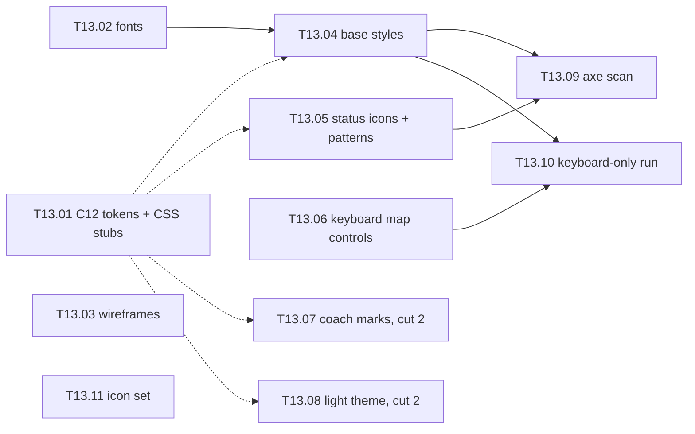

# TASK-13 — Visual system + accessibility

| Field | Value |
| --- | --- |
| Objective | Visual system + accessibility |
| Requirements | NFR-04 (06 §C); subtasks also serve NFR-01, NFR-07 (T13.02), FR-08, FR-10 (T13.05), SCR-02, SCR-08 (T13.03) and U-08 (T13.08) |
| Lane / owner role | design — Design & story lead (06 §C: Design lead) |
| Milestone | M2 (tokens only, 06 §B; also fonts and wireframes) · M4 (status icons and patterns) · M5 (the rest) |
| Window | pre-event-allowed (T13.01–T13.03) · event-only (T13.04–T13.10) |
| Effort (doc 06) | 3–6 h |
| Done when (doc 06) | axe: 0 serious issues; keyboard-only run of core scenario |
| Main risk → fallback | Time short → keep tokens + focus + patterns, drop coach marks |
| Spec sections | [04 §C Visual system](../specs/04_Design_Brief.md#c-visual-system) · [04 §D](../specs/04_Design_Brief.md#d-interaction-and-component-behavior) · [04 §E](../specs/04_Design_Brief.md#f-accessibility-and-responsive-behavior) · [04 §F](../specs/04_Design_Brief.md#f-wireframe-guidance) · [04 U-08](../specs/04_Design_Brief.md#unresolved-items-owned-by-this-document) · [02 §F NFR-04](../specs/02_Technical_Requirements_Document.md#f-nonfunctional-requirements-and-validation) · [02 §F.1](../specs/02_Technical_Requirements_Document.md#f1-test-plan) · [01 §E](../specs/01_Product_Requirements_Document.md#e-core-demonstration-scenario) · [06 §C](../specs/06_High_Level_Implementation_Plan.md#c-work-packages) · [06 §D.4](../specs/06_High_Level_Implementation_Plan.md#d4-cut-list-cut-in-this-order-when-behind) · [Coordination map](_coordination.md) |

## Inputs this task consumes

| Input | Kind | Owner | Dependency |
| --- | --- | --- | --- |
| C12 token and status-class names (`apps/web/src/ui/styles/tokens.css` v1) | contract | T13.01 | soft (T13.04, T13.05, T13.07, T13.08) |
| C10 UI app context and map handle; stubs `apps/web/src/ui/components/statusIcon.ts`, `apps/web/src/ui/map/keyboard.ts` | contract | T07.01 | soft (T13.05, T13.06) |
| C11 plan-store state and actions (selected stop, delete, status) | contract | T08.01 | soft (T13.06) |
| SCR-02 workspace `apps/web/src/ui/screens/scr02MapWorkspace.tsx` and `.css` | upstream output | T07.08 | hard (T13.07 follow-up) |
| Integrated screens on the real bundle: SCR-00 (T14.04), SCR-01 (T07.05), SCR-02 (T07.08), SCR-03 (T07.09), SCR-04 (T08.04, T08.05), SCR-05 (T09.03, T09.04), SCR-06 (T10.01), SCR-07 (T10.02), SCR-08 (T11.03), SCR-09 (T12.03) | upstream output | those subtasks | hard (T13.09, T13.10) |
| Axe tooling decision and any dependency it needs | upstream output | T14.01 | hard (T13.09; map change proposed, Spec question 5) |

## Outputs this task provides

| Output | Path | Consumers |
| --- | --- | --- |
| Token and status-class names (C12, frozen at M2) | `apps/web/src/ui/styles/tokens.css` | T07.05, T07.08, T07.09, T08.04, T08.05, T09.03, T09.04, T10.01, T10.02, T11.03, T12.01, T12.03, T13.04–T13.08 |
| Empty CSS stubs, imported from `tokens.css` | `apps/web/src/ui/styles/base.css`, `apps/web/src/ui/styles/patterns.css`, `apps/web/src/ui/styles/light.css` | T13.04, T13.05, T13.08 |
| Self-hosted fonts with licences | `apps/web/public/fonts/` | T13.04, T16.03, T16.05 |
| Paper wireframes of SCR-02 and SCR-08 | `docs/design/wireframes/` | T07.08, T11.03 |
| Base styles (typography, focus ring, reduced motion) | `apps/web/src/ui/styles/base.css` | All screens |
| Status icon component and pattern classes | `apps/web/src/ui/components/statusIcon.ts`, `apps/web/src/ui/styles/patterns.css` | T07.09, T09.03, T09.04, T10.02, T11.03 |
| Keyboard map controls | `apps/web/src/ui/map/keyboard.ts` | T07.08 (mounts the stub entry), T13.10 |
| First-run coach marks (cut 2) | `apps/web/src/ui/coachMarks.ts` | — |
| Light theme (cut 2, only if U-08 needs it) | `apps/web/src/ui/styles/light.css` | T14.06, T17.02 (venue demo) |
| Axe and keyboard-run results | `docs/ops/verification-log.md` | T14.06, T16.06 |

## Subtasks

### T13.01 — Freeze CSS token and status-class names v1 against 04 §C

- **Owner:** Ridita Alam (R5 EVA & Ops UI · design system)
- **Type:** contract
- **Tag:** agent-ready · core
- **Window:** pre-event-allowed
- **Estimate:** 1–2 h
- **Owns (writes):** `apps/web/src/ui/styles/tokens.css`, `apps/web/src/ui/styles/base.css` (stub → T13.04), `apps/web/src/ui/styles/patterns.css` (stub → T13.05), `apps/web/src/ui/styles/light.css` (stub → T13.08)
- **Reads:** `apps/web/src/ui/styles/tokens.css`, `apps/web/src/main.ts` (imports `tokens.css`), [04 §C.1](../specs/04_Design_Brief.md#c1-colour-tokens), [04 §C.2](../specs/04_Design_Brief.md#c2-typography), [04 §C.3](../specs/04_Design_Brief.md#c3-shape-grid-and-structure), [04 §C.5](../specs/04_Design_Brief.md#c5-map-annotations-and-selection-states), [04 §E](../specs/04_Design_Brief.md#f-accessibility-and-responsive-behavior), `docs/tasks/_coordination.md` §c.4 and §d (C12)
- **Depends on:** none
- **Parallel with:** T13.02, T13.03, T07.01, T08.01
- **Steps:**
  1. Compare every custom property in `tokens.css` with 04 §C.1 (chrome, semantic, map overlays, print theme), §C.2 and §C.3; where they differ, 04 wins.
  2. Add only the values 04 §C states but the file lacks, each with a 04 section comment — for example the slope-class opacities and the route, casing, focus-ring and selection widths in 04 §C.1 and §C.5, and the 180 px results panel at 1024–1279 px from 04 §E.
  3. Decide how the print theme (04 §C.1) overrides screen tokens — re-map the screen names inside `@media print` or keep separate `--print-*` names (`TODO(decision)`) — and write the choice in the header comment.
  4. Name the status and pattern classes for `ok`, `caution`, `blocked` and `unknown` (C12 decision, `TODO(decision)` on the exact names) and list them in the header comment, with the rule that canvas and JS consumers read colours with `getComputedStyle` instead of copying hex values (`TODO(decision)` if the team prefers another source).
  5. Create `base.css`, `patterns.css` and `light.css` as comment-only stubs and `@import` them at the top of `tokens.css`, so `main.ts` needs no edit (Spec question 4).
  6. Record contract version v1 and the append-only rule (§c.4) in the header comment; run lint, typecheck and build.
- **Acceptance:**
  - Serves: NFR-04 · [04 §C](../specs/04_Design_Brief.md#c-visual-system), contract C12
  - Every token value equals its 04 §C value and carries a 04 section reference; no colour or size that 04 does not state.
  - The 04 §C.1 contrast pairs are unchanged because the values are copied, not recomputed (text ≥ 4.5 : 1; status colours ≥ 6.1 : 1 on `panel`, as 04 lists them).
  - The header comment lists the status and pattern class names, the print mechanism, the contract version and the append-only rule.
  - The three stubs exist and the app still builds with only the existing `tokens.css` import in `main.ts`.
- **Verify:** `make lint typecheck`; `npm run -s build`; manual checklist: each token in `tokens.css` ticked against its 04 §C row.
- **Agent brief:** Freeze `apps/web/src/ui/styles/tokens.css` as contract C12. Make every custom property match 04 §C exactly, define the status and pattern class names and the print-theme mechanism in the header, and create the empty `base.css`, `patterns.css` and `light.css` stubs imported from `tokens.css`. Invent no colours or sizes; whatever 04 lacks is `TODO(decision)`.
- **Conflict notes:** Contract C12 freezes at M2. After this merges, `tokens.css` is append-only (§c.4): add properties at the end of the matching block with a 04 §C reference; renames need `contract-change:`. The three stubs hand over to T13.04, T13.05 and T13.08. Merge before any screen CSS starts (T07.05 onward).

### T13.02 — Self-host Inter and IBM Plex Mono; verify their licences

- **Owner:** Ridita Alam (R5 EVA & Ops UI · design system)
- **Type:** implement
- **Tag:** agent-ready · core
- **Window:** pre-event-allowed
- **Estimate:** 1 h
- **Owns (writes):** `apps/web/public/fonts/`
- **Reads:** [04 §C.2](../specs/04_Design_Brief.md#c2-typography) (Inter self-hosted, offline; IBM Plex Mono tabular numerals), [02 §F NFR-01, NFR-07, NFR-09](../specs/02_Technical_Requirements_Document.md#f-nonfunctional-requirements-and-validation), `CLAUDE.md` §2 (offline, licence, credits)
- **Depends on:** none
- **Parallel with:** T13.01, T13.03, T14.01
- **Steps:**
  1. Download only the weights 04 §C.2 uses — Inter 400, 500 and 600; IBM Plex Mono 500 — from each project's official release; mark any source you cannot confirm `TODO(verify)`.
  2. Store each family in `apps/web/public/fonts/<family>/` with its licence file.
  3. Read each licence file and confirm it allows bundling in a public Apache-2.0 repository (`TODO(verify)`: quote the licence name from the file, not from memory).
  4. Write `apps/web/public/fonts/README.md`: family, version, source URL, licence, date fetched, and the credit line for the README (T16.03).
  5. Confirm no file in `apps/web/` references a font CDN.
- **Acceptance:**
  - Serves: NFR-01, NFR-07 · [04 §C.2](../specs/04_Design_Brief.md#c2-typography)
  - Each family has its font files, its licence file and a README row with source and version.
  - No external font URL anywhere in `apps/web/` (the app must make no request beyond `localhost`, NFR-01).
  - Only the four weights above are committed (small files, not large binaries — `CLAUDE.md` §2).
- **Verify:** `ls apps/web/public/fonts/*/`; `grep -rnE "fonts\.googleapis|fonts\.gstatic" apps/web/src apps/web/index.html` returns nothing; licence files present.
- **Agent brief:** Self-host Inter (400, 500, 600) and IBM Plex Mono (500) under `apps/web/public/fonts/` with their licence files and a README listing source, version and licence. Use official sources only; mark any unconfirmed URL `TODO(verify)`. No CDN references.
- **Conflict notes:** Owns only `apps/web/public/fonts/`. The `@font-face` rules belong to T13.04. Credits flow to T16.03 and T16.05 through the README. If file size becomes a concern, raise it under NFR-09; storage decisions belong to T16.07.

### T13.03 — Sketch SCR-02 and SCR-08 wireframes on paper (04 §F)

- **Owner:** Ridita Alam (R5 EVA & Ops UI · design system)
- **Type:** human
- **Tag:** human-required · core
- **Window:** pre-event-allowed
- **Estimate:** 1–2 h
- **Owns (writes):** `docs/design/wireframes/`
- **Reads:** [04 §B](../specs/04_Design_Brief.md#b-layout-and-navigation), [04 §F SCR-02](../specs/04_Design_Brief.md#scr-02-map-workspace-with-scr-03040507-embedded), [04 §F SCR-08](../specs/04_Design_Brief.md#scr-08-briefing-card-print), [03 SCR-02](../specs/03_App_Flow_and_Diagrams.md#scr-02--map-workspace), [03 SCR-08](../specs/03_App_Flow_and_Diagrams.md#scr-08--briefing-card), [01 §E](../specs/01_Product_Requirements_Document.md#e-core-demonstration-scenario), 06 §E item 5
- **Depends on:** none
- **Parallel with:** T13.01, T13.02, T15.01, T17.01
- **Steps:**
  1. Sketch SCR-02 following the 04 §B desktop layout (top bar, left and right drawers, map, results panel) and the 04 §F toolbar and add-stop crosshair.
  2. Sketch SCR-08 following 04 §F (A4/Letter portrait, 12 mm margins, rows 1–5 and footer).
  3. Walk the nine 01 §E steps on the sketches and mark where each control sits.
  4. Photograph or scan both sketches with no people in frame (06 TASK-17 media rule) and save them in `docs/design/wireframes/`.
  5. Add `docs/design/wireframes/README.md`: what each image shows, who drew it, the date, and open layout questions for the design lead.
- **Acceptance:**
  - Serves: SCR-02, SCR-08 · [04 §F](../specs/04_Design_Brief.md#f-wireframe-guidance), [06 §B](../specs/06_High_Level_Implementation_Plan.md#b-milestones) M2 exit ("wireframe sketches")
  - Two sketches (SCR-02, SCR-08) and a README are committed.
  - Every element named in 04 §B and §F appears; no element the specs do not name.
  - No person appears in the images.
- **Verify:** manual checklist against 04 §B and §F; `make docs-check` passes for the README.
- **Agent brief:** Human task: the design lead sketches SCR-02 and SCR-08 on paper from 04 §B and §F and photographs them. An agent may prepare the 04 §B/§F element checklist beforehand and write the README once the images are added.
- **Conflict notes:** Owns only `docs/design/wireframes/`. 04 §F says no HTML wireframe is produced — do not build one. Images are small photos, not datasets.

### T13.04 — Implement base styles: typography, focus ring, reduced motion

- **Owner:** Ridita Alam (R5 EVA & Ops UI · design system)
- **Type:** implement
- **Tag:** agent-ready · core
- **Window:** event-only
- **Estimate:** 1.5–2 h
- **Owns (writes):** `apps/web/src/ui/styles/base.css`, `docs/ops/verification-log.md` (append-only)
- **Reads:** `apps/web/src/ui/styles/tokens.css` (C12), `apps/web/public/fonts/README.md`, `apps/web/vite.config.ts` (`base: "./"`), [04 §C.2](../specs/04_Design_Brief.md#c2-typography), [04 §C.3](../specs/04_Design_Brief.md#c3-shape-grid-and-structure), [04 §E](../specs/04_Design_Brief.md#f-accessibility-and-responsive-behavior) (Contrast, Focus, Motion)
- **Depends on:** T13.01 (soft), T13.02 (hard: the font files must exist for `@font-face`)
- **Parallel with:** T13.05, T13.06, T13.08, T14.03
- **Steps:**
  1. Add `@font-face` rules for the T13.02 files; confirm which URL form loads them from `apps/web/public/` under `base: "./"` in `make demo` (`TODO(verify)`).
  2. Set element defaults from 04 §C.2: body text Inter 14 px / 400 with line-height 1.45, panel headings 16 px / 600, screen titles 20 px / 600, nothing below 12 px; app background `bg` and text `text-primary` from 04 §C.1.
  3. Add the 04 §E focus style to every interactive element: 2 px `focus` ring with 2 px offset on `:focus-visible`, never removed.
  4. Add a `prefers-reduced-motion: reduce` rule that stops CSS transitions and animations (04 §E Motion).
  5. Apply the 04 §C.3 minimum target sizes to buttons and inputs: 32 px for mouse, 44 px for touch (how touch is detected is `TODO(decision)`, Spec question 10).
  6. Append a manual test note (fonts offline, focus ring, reduced motion) to the verification log.
- **Acceptance:**
  - Serves: NFR-04, NFR-01 · [04 §C.2](../specs/04_Design_Brief.md#c2-typography), [04 §E](../specs/04_Design_Brief.md#f-accessibility-and-responsive-behavior)
  - Given keyboard focus on any interactive element, then a 2 px `focus` ring with 2 px offset is visible (04 §E Focus).
  - Given `prefers-reduced-motion: reduce`, then no CSS transition or animation runs (04 §E Motion).
  - No text renders below 12 px (04 §C.2); colours come only from C12 tokens.
  - Given the network is disabled, both fonts load from local files and the devtools Network panel shows only `localhost` (NFR-01).
- **Verify:** `make lint typecheck`; `npm run -s build`; `make demo` with networking off, then manually: fonts load, the focus ring shows while tabbing through SCR-01 and SCR-02, reduced motion via devtools rendering emulation.
- **Agent brief:** Fill `apps/web/src/ui/styles/base.css` (stub from T13.01, already imported through `tokens.css`): `@font-face` for the self-hosted fonts, the 04 §C.2 typography defaults, the 04 §E focus ring on every interactive element, a reduced-motion rule and the 04 §C.3 target sizes. Use only C12 tokens; add no colours.
- **Conflict notes:** Element-level defaults only; component CSS stays with its owner (screens, T12.01 metric, T13.05 patterns). JS animations such as click-to-zoom (T09.04) and Fit AOI (T07.08) must honour reduced motion in their own code; T13.10 checks them. Map labels (12 px / 600 with a 2 px `bg` halo) are canvas styles owned by the map-layer subtasks. Verification log is append-only.

### T13.05 — Implement status icons and patterns

- **Owner:** Ridita Alam (R5 EVA & Ops UI · design system)
- **Type:** implement
- **Tag:** agent-ready · core
- **Window:** event-only
- **Estimate:** 1.5–2.5 h
- **Owns (writes):** `apps/web/src/ui/components/statusIcon.ts`, `apps/web/src/ui/styles/patterns.css`, `docs/ops/verification-log.md` (append-only)
- **Reads:** `apps/web/src/ui/styles/tokens.css` (C12 class names), `apps/web/src/ui/context.ts` (C10), the `statusIcon.ts` stub signature, [04 §C.1 semantic status](../specs/04_Design_Brief.md#status-and-alert-colours-ops), [04 §C.1 map overlays](../specs/04_Design_Brief.md#map-overlays), [04 §D](../specs/04_Design_Brief.md#d-interaction-and-component-behavior), [04 §E](../specs/04_Design_Brief.md#f-accessibility-and-responsive-behavior) (non-colour cues), [01 FR-08](../specs/01_Product_Requirements_Document.md#fr-08--elevation-and-slope-profile), [01 FR-10](../specs/01_Product_Requirements_Document.md#fr-10--hazard-and-constraint-warnings)
- **Depends on:** T13.01 (soft), T07.01 (soft)
- **Parallel with:** T13.04, T13.06, T09.03, T09.04, T11.03
- **Steps:**
  1. Implement the four C12 pattern classes in `patterns.css` from the status tokens: `ok` solid, `caution` diagonal hatch, `blocked` cross-hatch, `unknown` dotted (04 §C.1); keep them in print, where 04 retains patterns for black-and-white printing.
  2. Implement `statusIcon.ts` with the exact T07.01 stub signature: the 04 §C.1 icon (✓ circle, ▲ triangle, ⬣ octagon, ? diamond) plus the status word as text; the icon is `aria-hidden` when the word is shown.
  3. Build a dev-only sample of the four statuses and check them under grayscale emulation and in print preview.
  4. List in the `patterns.css` header which consumers use the CSS classes (status banner, warnings list, legend swatches, briefing card) and that canvas and SVG consumers (T07.07 slope tiles, T09.01 hazard hatch, T09.02 profile) draw the same 04 §C.1 patterns themselves (Spec question 3).
  5. Append the manual test note to the verification log.
- **Acceptance:**
  - Serves: NFR-04, FR-08, FR-10 · [04 §C.1](../specs/04_Design_Brief.md#c1-colour-tokens), [04 §E](../specs/04_Design_Brief.md#f-accessibility-and-responsive-behavior)
  - Every status renders icon + pattern + text; none relies on colour alone (04 §C.1 "always paired with icon + pattern + text"; NFR-04 non-colour cues).
  - Given grayscale emulation, the four statuses stay distinguishable (FR-08 "readable in grayscale (pattern + label, not colour only)").
  - Patterns survive `@media print` (04 §C.1 print theme).
  - `statusIcon.ts` keeps the T07.01 stub signature exactly.
- **Verify:** `make lint typecheck`; `npm run -s build`; manual: the dev sample in normal view, grayscale emulation and print preview; note appended to the verification log.
- **Agent brief:** Implement the four status patterns in `patterns.css` (class names from the `tokens.css` header, C12) and fill `statusIcon.ts` (stub signature from T07.01) with the icon, the status word and an accessible name, per 04 §C.1. Check grayscale and print. Provenance chips are not yours (T12.01).
- **Conflict notes:** `statusIcon.ts` is a T07.01 stub and `patterns.css` a T13.01 stub: fill bodies only; signature or class-name changes need `contract-change:` on C10 or C12. Consumers code against the stub and class names in parallel. Provenance chips (■ ◆ ○ △) belong to T12.01.

### T13.06 — Implement keyboard map controls (04 §E)

- **Owner:** Ridita Alam (R5 EVA & Ops UI · design system)
- **Type:** implement
- **Tag:** agent-ready · core
- **Window:** event-only
- **Estimate:** 2–3 h
- **Owns (writes):** `apps/web/src/ui/map/keyboard.ts`, `docs/ops/verification-log.md` (append-only)
- **Reads:** `apps/web/src/ui/context.ts` (C10 map handle), `apps/web/src/state/planStore.ts` (C11 selection, delete action, status), the `keyboard.ts` stub signature, `apps/web/src/ui/map/addStopMode.ts` (T08.07 owns `A` and `Enter`), [04 §E Keyboard](../specs/04_Design_Brief.md#f-accessibility-and-responsive-behavior), [04 §D](../specs/04_Design_Brief.md#d-interaction-and-component-behavior) (Briefing button rule), [03 §A](../specs/03_App_Flow_and_Diagrams.md#a-information-architecture) (hash routes), [03 SCR-02](../specs/03_App_Flow_and_Diagrams.md#scr-02--map-workspace), [03 SCR-08](../specs/03_App_Flow_and_Diagrams.md#scr-08--briefing-card), [03 §C.3](../specs/03_App_Flow_and_Diagrams.md#c3-editing-and-recalculating)
- **Depends on:** T07.01 (soft), T08.01 (soft)
- **Parallel with:** T13.04, T13.05, T13.07, T14.05
- **Steps:**
  1. Bind the 04 §E map keys: arrow keys pan and `+`/`−` zoom while the map has focus; reuse OpenLayers' built-in keyboard pan and zoom interactions if they match 04 §E (`TODO(verify)` their keys and focus target) instead of writing new ones.
  2. Bind `Delete` to the C11 delete action for the selected stop, `B` to `#/briefing` and `?` to `#/sources` (03 §A hash routes).
  3. Make `B` do nothing while the Briefing button is disabled — no stops, or after a computation error (03 SCR-08 entry, 04 §D).
  4. Leave `A` and crosshair `Enter` to T08.07; if cut 3 drops T08.07, those keys are simply absent.
  5. Ignore shortcuts while focus is in a text field, and keep the 04 §E tab order (top bar → left drawer → map toolbar → map → results → right drawer); use the C10 map handle's keyboard target, and request a `contract-change:` on C10 if it has none.
  6. Use instant view changes when `prefers-reduced-motion` is set (04 §E Motion).
  7. Append a manual test note to the verification log.
- **Acceptance:**
  - Serves: NFR-04 · [04 §E](../specs/04_Design_Brief.md#f-accessibility-and-responsive-behavior), [03 SCR-02](../specs/03_App_Flow_and_Diagrams.md#scr-02--map-workspace)
  - Given the map has focus, when arrow keys or `+`/`−` are pressed, then the map pans or zooms (04 §E).
  - Given a selected stop, when `Delete` is pressed, then the stop is removed and the plan recomputes immediately (03 §C.3).
  - When `B` is pressed with a computed plan (OK, Over limits or Partial), then the briefing opens; with no stops or after an Error, nothing happens (03 SCR-08).
  - When `?` is pressed, then Sources & Methods opens (03 SCR-02 exits).
  - No shortcut fires while typing in an input; `A` and `Enter` are not bound here.
- **Verify:** `make lint typecheck`; manual keyboard-only check on `make dev` (mock site or real bundle) of each key above; note appended to the verification log.
- **Agent brief:** Fill `apps/web/src/ui/map/keyboard.ts` (stub from T07.01): arrow-key pan, `+`/`−` zoom, `Delete` for the selected stop, `B` for the briefing (only when enabled) and `?` for sources, per 04 §E, through the C10 map handle and C11 store. Do not bind `A` or `Enter` (T08.07). Prefer OpenLayers' built-in keyboard interactions where they fit (verify first).
- **Conflict notes:** `keyboard.ts` is a T07.01 stub; signature changes need `contract-change:` on C10. Key ownership: `A`/`Enter` → T08.07; the other 04 §E map keys → here. The workspace (T07.08) mounts the stub entry, so no edit to `scr02MapWorkspace.tsx` is needed. Verification log is append-only.

### T13.07 — follow-up: first-run coach marks

- **Owner:** Ridita Alam (R5 EVA & Ops UI · design system)
- **Type:** implement
- **Tag:** agent-ready · cut-2
- **Window:** event-only
- **Estimate:** 1–1.5 h
- **Owns (writes):** `apps/web/src/ui/coachMarks.ts`, `apps/web/src/ui/screens/scr02MapWorkspace.tsx` (after T07.08), `apps/web/src/ui/screens/scr02MapWorkspace.css` (after T07.08), `docs/ops/verification-log.md` (append-only)
- **Reads:** [04 §D Discoverability](../specs/04_Design_Brief.md#d-interaction-and-component-behavior), [04 §E](../specs/04_Design_Brief.md#f-accessibility-and-responsive-behavior), `apps/web/src/ui/styles/tokens.css`, `apps/web/src/ui/screens/scr02MapWorkspace.tsx` (Layers tab, map area, top-bar Briefing button), [06 §D.4](../specs/06_High_Level_Implementation_Plan.md#d4-cut-list-cut-in-this-order-when-behind) cut 2
- **Depends on:** T07.08 (hard: follow-up edit of the SCR-02 workspace after its owner merges), T13.01 (soft)
- **Parallel with:** T13.06, T13.08, T13.09
- **Steps:**
  1. Start only if cut 2 has not been called (06 §D.4; 06 TASK-13 fallback "drop coach marks"); otherwise drop this subtask.
  2. Implement the three 04 §D steps — "Turn on Slope", "Click a POI → Add as stop", "Open Briefing" — dismissible and kept in memory only (no browser storage).
  3. Anchor them to elements of the SCR-02 workspace itself (Layers tab, map area, top-bar Briefing button), so no other screen is needed.
  4. Make them keyboard operable: focus moves to the mark, Dismiss or `Escape` closes it, focus returns; no animation under reduced motion (04 §E).
  5. Add one call in `scr02MapWorkspace.tsx` that starts the marks on first render, plus their styles in `scr02MapWorkspace.css` using C12 tokens only.
  6. Append a manual test note to the verification log.
- **Acceptance:**
  - Serves: 04 §D discoverability, NFR-04 · [04 §D](../specs/04_Design_Brief.md#d-interaction-and-component-behavior)
  - Exactly three steps with the 04 §D texts, dismissible, held only in memory: nothing is written to localStorage or sessionStorage, and a reload shows them again.
  - A keyboard-only user can read and dismiss every step, with the focus ring visible (04 §E).
  - Removing the one call leaves SCR-02 unchanged, so cut 2 stays a clean drop.
- **Verify:** `make lint typecheck`; manual on `make dev`: reload → three steps in order → dismiss with the keyboard → devtools Application tab shows no stored keys; note appended to the verification log.
- **Agent brief:** Add the 04 §D first-run coach marks ("Turn on Slope", "Click a POI → Add as stop", "Open Briefing"; dismissible; memory only) in `apps/web/src/ui/coachMarks.ts`, started by one call in the SCR-02 workspace after T07.08 has merged. Keyboard operable, C12 tokens only. Skip entirely if cut 2 is called.
- **Conflict notes:** `follow-up:` on T07.08's `scr02MapWorkspace.tsx` and `.css` (§c.1 rule 3): start after T07.08 merges, rebase, and limit the edit to one call plus coach-mark styles. Cut 2: nothing depends on this subtask.

### T13.08 — Implement the light theme (U-08)

- **Owner:** Ridita Alam (R5 EVA & Ops UI · design system)
- **Type:** implement
- **Tag:** agent-ready · cut-2
- **Window:** event-only
- **Estimate:** 1–2 h
- **Owns (writes):** `apps/web/src/ui/styles/light.css`, `apps/web/src/ui/styles/tokens.css` (append-only), `docs/ops/verification-log.md` (append-only)
- **Reads:** [04 §C.1](../specs/04_Design_Brief.md#c1-colour-tokens) (dark chrome; print-theme values), [04 U-08](../specs/04_Design_Brief.md#unresolved-items-owned-by-this-document), [04 §E](../specs/04_Design_Brief.md#f-accessibility-and-responsive-behavior) (Contrast), `apps/web/src/ui/styles/tokens.css` (C12)
- **Depends on:** T13.01 (soft)
- **Parallel with:** T13.04, T13.06, T13.07
- **Steps:**
  1. Start only if the venue projector washes out the dark UI at check-in (04 U-08) and cut 2 has not been called; otherwise skip.
  2. Use only colours 04 states with verified contrast: the 04 §C.1 print-theme values (text `#111827` on white; caution `#9A5B00`; blocked `#B42318`; ok `#0E7A4F`). Stop for tokens 04 gives no light value (for example `accent`, `focus`, `unknown`, `panel`): they need a 04 §C.1 change with computed contrast first (`TODO(decision)`, Spec question 1).
  3. Write the variant in `light.css` as overrides of the C12 token names under one selector; the switch that activates it is `TODO(decision)` (Spec question 9).
  4. Append any new token at the end of the matching block in `tokens.css` with a 04 §C reference (append-only rule).
  5. Never compute or invent contrast ratios here (`CLAUDE.md` §2); a new colour pair needs its ratio computed by a script and added to 04 first.
  6. Append the projector check to the verification log.
- **Acceptance:**
  - Serves: NFR-04, U-08 · [04 §C.1](../specs/04_Design_Brief.md#c1-colour-tokens), [04 U-08](../specs/04_Design_Brief.md#unresolved-items-owned-by-this-document)
  - Every colour in `light.css` is a 04 value, with its section cited.
  - Text keeps ≥ 4.5 : 1 and status colours keep the contrast 04 lists for them (04 §E Contrast).
  - Icons and patterns are unchanged, and the dark theme stays the default (04 §C.1).
- **Verify:** manual on the venue projector with both themes side by side; `make lint typecheck`; note appended to the verification log.
- **Agent brief:** Only if the U-08 projector check fails: add a light variant in `apps/web/src/ui/styles/light.css` (stub from T13.01, imported through `tokens.css`) using only colour values 04 states — the 04 §C.1 print-theme set. Values 04 lacks are `TODO(decision)` and need a 04 spec change with computed contrast. Keep dark as the default.
- **Conflict notes:** `tokens.css` is append-only after T13.01 (add at the end of the matching block). `light.css` is a T13.01 stub. A visible theme switch outside these files needs a `follow-up:` subtask on its owner (T07.03 or T07.08). Cut 2.

### T13.09 — Verify the axe scan: 0 serious issues

- **Owner:** Ridita Alam (R5 EVA & Ops UI · design system)
- **Type:** verify
- **Tag:** agent-ready · core
- **Window:** event-only
- **Estimate:** 1–2 h
- **Owns (writes):** `docs/ops/verification-log.md` (append-only)
- **Reads:** [02 §F NFR-04](../specs/02_Technical_Requirements_Document.md#f-nonfunctional-requirements-and-validation) ("axe-core scan + keyboard-only run-through"), [06 §C](../specs/06_High_Level_Implementation_Plan.md#c-work-packages) TASK-13 done-when, [04 §E](../specs/04_Design_Brief.md#f-accessibility-and-responsive-behavior), [01 §E](../specs/01_Product_Requirements_Document.md#e-core-demonstration-scenario), the T14.01 record of the axe tooling
- **Depends on:** T13.04 (hard: the focus and contrast styles under test), T13.05 (hard: the status cues under test), T14.01 (hard: axe tooling comes with the dependency batch), T07.05 (hard: verification runs on the integrated app), T07.08 (hard: verification runs on the integrated app), T07.09 (hard: verification runs on the integrated app), T08.04–T08.05 (hard: verification runs on the integrated app), T09.03–T09.04 (hard: verification runs on the integrated app), T10.01–T10.02 (hard: verification runs on the integrated app), T11.03 (hard: verification runs on the integrated app), T12.03 (hard: verification runs on the integrated app), T14.04 (hard: verification runs on the integrated app)
- **Parallel with:** T13.10, T12.06, T14.06, T14.07, T14.08, T14.09
- **Steps:**
  1. Use the axe tooling T14.01 records (`TODO(decision)`: axe-core in a test run or the axe browser extension).
  2. On `make demo` with the real bundle, scan SCR-01, SCR-02 with SCR-03, SCR-04, SCR-05, SCR-06 and SCR-07 open in turn, SCR-08 (screen and print media), SCR-09 and SCR-00 (forced boot failure); include the Partial and Over limits states reached through 01 §E steps 5–7.
  3. Log each serious or critical finding — screen, rule id, element — in the verification log; fix nothing here, but file `follow-up:` fixes for the owners through a `coord:` PR (§h.5).
  4. Re-scan after the fixes until 0 serious issues remain; log the final run (date, tool and version, screens and states).
  5. Note what axe cannot check — for example map canvas content and, under jsdom, colour contrast (`TODO(verify)`) — and point to the 04 §E text alternatives (stops table, warnings list).
- **Acceptance:**
  - Serves: NFR-04 · [02 §F](../specs/02_Technical_Requirements_Document.md#f-nonfunctional-requirements-and-validation), [06 §C](../specs/06_High_Level_Implementation_Plan.md#c-work-packages) TASK-13
  - axe reports 0 serious issues on every scanned screen and state (06 TASK-13 done-when).
  - The log names the tool and version, every screen and state scanned, and the closure of every finding.
  - Each finding is closed or has a `follow-up:` subtask.
- **Verify:** the scan command or procedure T14.01 records, run against `make demo`; the result section in `docs/ops/verification-log.md`.
- **Agent brief:** Run the axe scan chosen in T14.01 over every screen and state on the 01 §E demo path (real bundle, `make demo`). Log findings in `docs/ops/verification-log.md`, file `follow-up:` fixes for the owners, and re-scan until 0 serious issues remain (06 TASK-13). Change no code yourself.
- **Conflict notes:** Read-only on code; fixes are `follow-up:` subtasks in the owners' tasks, added through a `coord:` PR. Verification log is append-only: one section per run. The T14.01 dependency is not yet in §f (Spec question 5).

### T13.10 — Verify a keyboard-only run of the core scenario

- **Owner:** Ridita Alam (R5 EVA & Ops UI · design system)
- **Type:** verify
- **Tag:** human-required · core
- **Window:** event-only
- **Estimate:** 1–1.5 h
- **Owns (writes):** `docs/ops/verification-log.md` (append-only)
- **Reads:** [01 §E](../specs/01_Product_Requirements_Document.md#e-core-demonstration-scenario) (nine steps), [02 §F.1](../specs/02_Technical_Requirements_Document.md#f1-test-plan) UI row, [04 §E](../specs/04_Design_Brief.md#f-accessibility-and-responsive-behavior) (Keyboard, Focus, Motion, map content outside the map), [03 SCR-02](../specs/03_App_Flow_and_Diagrams.md#scr-02--map-workspace), [03 SCR-08](../specs/03_App_Flow_and_Diagrams.md#scr-08--briefing-card)
- **Depends on:** T13.04 (hard: the focus ring under test), T13.06 (hard: the map keys under test), T07.05 (hard: verification runs on the integrated app), T07.08 (hard: verification runs on the integrated app), T07.09 (hard: verification runs on the integrated app), T08.04–T08.05 (hard: verification runs on the integrated app), T09.03–T09.04 (hard: verification runs on the integrated app), T10.01–T10.02 (hard: verification runs on the integrated app), T11.03 (hard: verification runs on the integrated app), T12.03 (hard: verification runs on the integrated app)
- **Parallel with:** T13.09, T12.06, T14.07, T14.08, T14.09
- **Steps:**
  1. With mouse and touchpad unused, run 01 §E steps 1–9 on `make demo` using the keyboard only, in the 04 §E tab order.
  2. At each step check that focus is visible, the action is possible, and the result is announced or readable outside the map (stops table, warnings list, per-leg table — 04 §E).
  3. Check the 04 §E map keys: arrows, `+`/`−`, `Delete`, `B`, `?`, and `A`/`Enter` only if T08.07 was built (cut 3).
  4. Repeat the route-changing steps with reduced motion switched on and confirm there is no animated fly-to (04 §E Motion).
  5. Log pass or fail per step with the blocking element; file `follow-up:` fixes through a `coord:` PR and re-run the failed steps after they land.
- **Acceptance:**
  - Serves: NFR-04 · [01 §E](../specs/01_Product_Requirements_Document.md#e-core-demonstration-scenario), [02 §F.1](../specs/02_Technical_Requirements_Document.md#f1-test-plan) "Keyboard path through core scenario"
  - All nine 01 §E steps complete with the keyboard only (06 TASK-13 done-when: "keyboard-only run of core scenario").
  - Focus is visible at every step and there is no keyboard trap.
  - Status changes are announced through `aria-live`, e.g. "Plan updated: Over limits, 2 warnings" (04 §E).
  - The keyboard method used for step 5 is recorded (Spec question 6).
- **Verify:** manual checklist above on `make demo`; result section appended to `docs/ops/verification-log.md`.
- **Agent brief:** Human task: a team member runs 01 §E steps 1–9 with the keyboard only on the demo build and records pass or fail per step in the verification log. An agent may prepare the checklist from 01 §E and 04 §E beforehand and draft `follow-up:` fix subtasks from the findings.
- **Conflict notes:** Read-only on code; findings become `follow-up:` subtasks through a `coord:` PR. This subtask owns only the 02 §F.1 "Keyboard path through core scenario" case (map Test-case allocation); the offline-mode case belongs to T14.06. Verification log is append-only.

### T13.11 — Self-host the outline icon set and verify its licence

- **Owner:** Ridita Alam (R5 EVA & Ops UI · design system)
- **Type:** implement
- **Tag:** agent-ready · core
- **Window:** pre-event-allowed
- **Estimate:** 1 h
- **Owns (writes):** `apps/web/public/icons/`
- **Reads:** [04 §C.4](../specs/04_Design_Brief.md#c4-iconography), [04 §C.1 status icons](../specs/04_Design_Brief.md#status-and-alert-colours-ops), `docs/ops/credits.md`
- **Depends on:** none
- **Parallel with:** T13.01, T13.02, T13.03
- **Steps:**
  1. Choose the single outline icon set 04 §C.4 asks for; Lucide is the brief's example, the final choice is `TODO(decision)`.
  2. Read the set's licence in its own repository; record the licence name and URL in the PR.
  3. Copy only the icons 04 §C.4 requires (layers, route, flag, home/habitat, sun, radiation, thermometer, warning variants, info, print, download, undo) as local SVG files into `apps/web/public/icons/`.
  4. Add a `README.md` in the folder naming the set, its version and its licence.
  5. Check that no code or CSS references an icon CDN.
- **Acceptance:**
  - Serves: NFR-01, NFR-07 · [04 §C.4](../specs/04_Design_Brief.md#c4-iconography)
  - Every icon 04 §C.4 lists exists as a local file; no network request is needed at runtime (NFR-01).
  - The licence is recorded in the folder README and permits shipping the files with the app (NFR-07), so T16.05 can check it.
- **Verify:** manual: compare `apps/web/public/icons/` with the 04 §C.4 list; the folder README names set, version and licence.
- **Agent brief:** Self-host the outline icon set of 04 §C.4 (Lucide unless the design lead picks another, `TODO(decision)`): copy only the listed icons as SVG into `apps/web/public/icons/`, add a README with set, version and licence, and record the licence URL in the PR. No CDN references.
- **Conflict notes:** New folder, owned here only. T13.05 (`statusIcon.ts`) may reuse these files. The credits entry for the set goes into `docs/ops/credits.md` through its owner T04.06, not here.

### T13.12 — HUD tokens: contrast ≥ 7 : 1 (v2)

- **Owner:** Ridita Alam (R5 EVA & Ops UI · design system)
- **Type:** implement
- **Tag:** agent-ready · core
- **Window:** pre-event-allowed
- **Estimate:** 0.5–1 h
- **Owns (writes):** `apps/web/src/ui/styles/tokens.css` (append-only)
- **Reads:** [04 §C.1](../specs/04_Design_Brief.md#c1-colour-tokens), [04 §E.6](../specs/04_Design_Brief.md#e6-scr-13-hud-black-landscape), [02 §F](../specs/02_Technical_Requirements_Document.md#f-nonfunctional-requirements-and-validation) NFR-04
- **Depends on:** T13.01 (hard: token names frozen)
- **Parallel with:** T13.02
- **Steps:**
  1. Check the `[data-mode="hud"]` block against 04 §C.1; add any missing HUD token at the end of the block with its 04 reference.
  2. Run the prototype contrast script on the HUD pairs; every text pair ≥ 7 : 1.
- **Acceptance:**
  - Serves: FR-33, NFR-04 · [06 §C.1](../specs/06_High_Level_Implementation_Plan.md#c1-retained-from-v1-planning-spine-tier-0) TASK-13 ("HUD contrast ≥ 7 : 1")
  - The contrast results are recorded in the PR.
- **Verify:** The prototype contrast script; `make lint`.
- **Agent brief:** Append HUD tokens from 04 only; never rename an existing token.
- **Conflict notes:** `tokens.css` is append-only after T13.01 (map §c.4).

## Internal dependency graph

T13.03 has no internal edges; its sketches feed T07.08 and T11.03.

## Definition of done (task level)

- [06 §D.7](../specs/06_High_Level_Implementation_Plan.md#d7-definition-of-done-per-feature): NFR-04's targets are met (text contrast ≥ 4.5 : 1, keyboard operation of all controls, non-colour cues, text alternatives for map content); a manual test note is committed for every UI subtask (verification log); keyboard reachable; works offline (fonts are local). TASK-13 shows no numeric values, so no provenance label is added here; font licences are recorded in `apps/web/public/fonts/README.md`.
- 06 TASK-13 done-when: axe reports 0 serious issues (T13.09) and the core scenario runs keyboard-only (T13.10).
- Every token value matches 04 §C; every status shows icon + pattern + text; no external font or icon URL exists in `apps/web/`.
- The cut-2 subtasks (T13.07, T13.08) can be dropped without editing any other file.
- `python3 scripts/check_tasks.py` and `make lint typecheck test docs-check` pass.

## Spec questions

1. **Light-theme values.** 04 §C.1 defines only the dark chrome and the print theme; 04 U-08 recommends a light variant "only if the venue projector washes out dark UI". T13.08 can reuse the print-theme values, but `accent`, `focus`, `unknown`, `panel`, `raised` and `text-muted` have no light value with verified contrast. Map change proposed: add a `spec-change:` subtask on 04 §C.1 (light values with computed contrast) before T13.08, or limit T13.08 to the print-theme values.
2. **Icon set ownership.** 04 §C.4 requires one outline icon set (e.g. Lucide; licence "verify licence in TASK-16") for layers, route, flag, home, sun, radiation, thermometer, info, print, download and undo. No subtask in the map fetches, self-hosts or owns that set; T13.05 covers only the status icons. Map change proposed: assign the icon set (for example a new TASK-13 subtask beside T13.02) and keep its licence check in TASK-16.
3. **Canvas and SVG patterns.** 04 §C.1 patterns also appear on the map (slope classes above 15°, hazard segments) and in the profile, but T13.05 delivers CSS classes only; T07.07, T09.01 and T09.02 must draw the same patterns from 04 §C.1, which risks drift. `TODO(decision)`: should T13.05 also export a shared canvas or SVG pattern definition? This depends on the chart-library choice (map open point 16).
4. **Importing the new CSS files.** `apps/web/src/main.ts` (owned by T07.03) imports only `tokens.css`, so `base.css`, `patterns.css` and `light.css` need an import somewhere. This file has T13.01 create them as stubs imported from `tokens.css`. Map change proposed: the §c.4 rows for these three paths should read "New; stub by T13.01 (imported from `tokens.css`)".
5. **Axe tooling dependency.** T13.09 hard-depends on T14.01 because the axe tooling is a T14.01 `TODO(decision)` (map open point 16), but the §f cross-task table does not list T14.01 → T13.09. Map change proposed: add it. `TODO(verify)`: whether axe-core under jsdom can evaluate colour contrast; if it cannot, the contrast part of NFR-04 needs a browser run.
6. **Keyboard equivalent of dragging.** 01 §E step 5 drags stop 2 onto a steep slope, but 04 §E names no keyboard way to move a stop (only `Delete`, and crosshair `Enter` placement, which cut 3 can drop). `TODO(decision)`: how T13.10 performs step 5 — for example delete and re-place in Add-stop mode, or the T08.10 buttons-only move.
7. **Follow-up dependency not in §f.** T13.07 hard-depends on T07.08, as §c.1 rule 3 requires for a `follow-up:` edit and §c.4 names, but the §f cross-task table does not list it. Map change proposed: add T07.08 → T13.07.
8. **Font URLs.** How Vite resolves `apps/web/public/` font URLs under `base: "./"` (`apps/web/vite.config.ts`) so they load from `make demo` offline — `TODO(verify)` in T13.04.
9. **Light-theme activation.** `prefers-color-scheme` needs no other file but would change the default for viewers whose system is set to light, against 04 §C.1's dark default; an explicit switch needs a `follow-up:` on T07.03 or T07.08. `TODO(decision)`.
10. **Touch target detection.** 04 §C.3 sets 44 px targets for tablet touch and 32 px for mouse but not how the app tells them apart — `TODO(decision)` in T13.04.
11. **Effort.** 06 gives 3–6 h for TASK-13; the subtask estimates here may exceed that (map open point 18).
