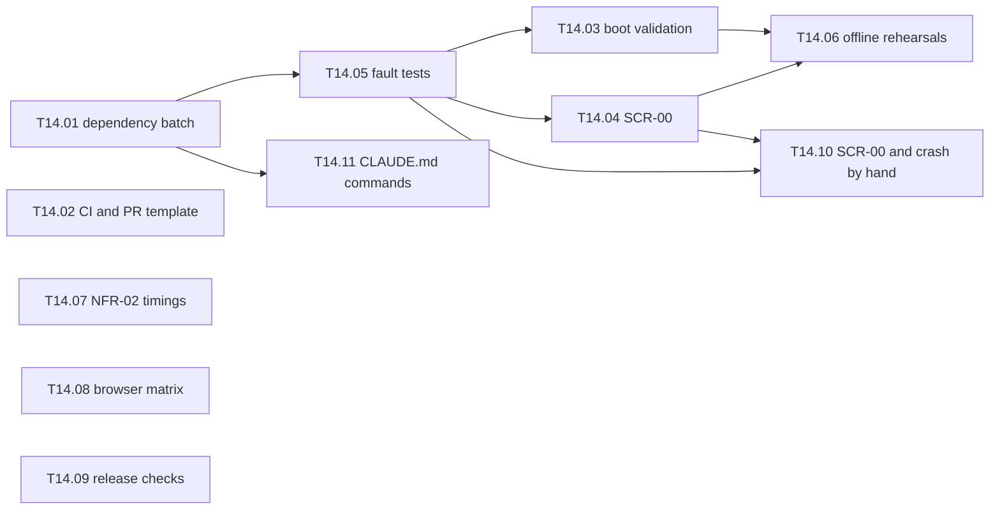

# TASK-14 — Integration + offline hardening + fault tests

| Field | Value |
| --- | --- |
| Objective | Integration + offline hardening + fault tests |
| Requirements | FR-16, NFR-01, NFR-10, NFR-03, NFR-08, NFR-09 (06 §C); the register adds NFR-02, NFR-06, NFR-07, NFR-11, SCR-00 |
| Lane / owner role | integration — Integration lead: Anjim Hossain (the dry runs are all-hands) |
| Milestone | M1 (dependency batch, CI) · M4 (hardening and fault tests, 11 Nov dry run); 06 §C.1 *When*: P 10–12 Nov / E |
| Window | pre-event-if-permitted; T14.01 and T14.02 are pre-event-allowed |
| Effort (doc 06) | 3–5 h |
| Done when (doc 06) | Two clean offline rehearsals; fault cases in 02 §F.1 pass |
| Main risk → fallback | — |
| Spec sections | [06 §C](../specs/06_High_Level_Implementation_Plan.md#c-work-packages) · [06 §D.6](../specs/06_High_Level_Implementation_Plan.md#d6-demo-freeze-criteria-day-2-0600) · [02 §E.1](../specs/02_Technical_Requirements_Document.md#e1-static-asset-contract) · [02 §E.2](../specs/02_Technical_Requirements_Document.md#e2-worker-message-protocol) · [02 §F](../specs/02_Technical_Requirements_Document.md#f-nonfunctional-requirements-and-validation) · [02 §F.1](../specs/02_Technical_Requirements_Document.md#f1-test-plan) · [03 SCR-00](../specs/03_App_Flow_and_Diagrams.md#scr-00--boot-error) · [03 §D](../specs/03_App_Flow_and_Diagrams.md#d-error-and-recovery-flows) · [05 §E.4](../specs/05_Backend_and_Database_Schema.md#e4-versioning-and-migration) · [05 §E.6](../specs/05_Backend_and_Database_Schema.md#e6-unavailable-or-replaced-source-data) · [01 FR-16](../specs/01_Product_Requirements_Document.md#fr-16--offline-and-degraded-operation) · [01 §E](../specs/01_Product_Requirements_Document.md#e-core-demonstration-scenario) |

> **Re-dated 2026-11-06** to [06](../specs/06_High_Level_Implementation_Plan.md) v2.2 (session handoff §F.2): milestones follow 06 §B v2, windows follow Track P (recorded 4 Nov), cut tags follow the v2 cut list in 06 §D.4 ([map §h.6](_coordination.md#h6-cut-list--subtasks-06-d4)), and every subtask names its Owner from 06 §A.2. Step texts that still mention v1 times (for example "Day 1" or "M5") refer to the v1 plan; the register in the [coordination map](_coordination.md#a3-register) is authoritative.

TASK-14 has no contract subtask. T14.01 and T14.02 are the early integration subtasks for the shared build files ([map §c.6](_coordination.md#c6-shared-and-build-files)); the rest runs in M5 on the integrated app.

## Inputs this task consumes

| Input | Kind | Owner | Dependency |
| --- | --- | --- | --- |
| C1 TypeScript mirror of 05 (Site, Asset, PlanResult) | contract | T03.01 | soft |
| C2 site-manifest JSON Schema (`schema_version`, `assets`) | contract | T03.01 | soft |
| C10 UI app context: screen signature, worker-client interface, boot-problem shape; `apps/web/src/boot/validateSite.ts` stub | contract | T07.01 | soft |
| C12 CSS token names and status classes | contract | T13.01 | soft |
| F4 mock site bundle `mock_site` | fixture | T03.02 | soft |
| Pipeline entry-point name `python -m marswalk_pipeline` ([map §c.3](_coordination.md#c3-pipeline)) | contract (name only) | T03.15 | none — the name is fixed by the map |
| `scripts/check_tasks.py` | upstream output | this plan | exists |
| Boot sequence, worker client, layers panel, placement validation, results panel, warnings list | upstream output | T07.03, T07.04, T07.09, T08.06, T09.03, T09.04 | hard |
| Integrated, verified app (TASK-07…TASK-12 checks) and SCR-09 | upstream output | T07.15, T08.11, T09.07, T10.03, T11.05, T12.03 | hard |
| `?debug=1` diagnostics | upstream output | T07.13 | hard |
| Real site bundle v1 on the test laptop (binaries are git-ignored) | upstream output | T03.19 | hard (transitive; copied per T16.07) |
| Real worker with the full PLAN_RESULT | upstream output | T05.32 | hard — see Spec question 13 |

## Outputs this task provides

| Output | Path | Consumers |
| --- | --- | --- |
| One dependency batch: chart library, DOM test environment, axe tooling, JSON-Schema validator, `marstime`, icon set | `package.json`, `apps/web/package.json`, `package-lock.json`, `pipeline/pyproject.toml`, `pipeline/environment.yml` | T03.14, T06.02, T08.02, T09.02, T11.01, T12.02, T14.05; T13.05 and T13.09 if they use a chosen package |
| `make data` wired to the pipeline entry point | `Makefile` | T03.19, T03.22 |
| PR template subtask field; CI step running `check_tasks.py` | `.github/` | Every PR after M2 |
| Boot validation | `apps/web/src/boot/validateSite.ts` | T07.03 (calls it), T14.04, T14.06, T14.10 |
| SCR-00 Boot error | `apps/web/src/ui/screens/scr00BootError.tsx` | T07.03 (boot-failure route), T14.10 |
| Fault-injection suite | `apps/web/tests/integration/faults.test.ts` | T14.10; 06 §D.6 "All Vitest suites green" |
| Rehearsal, timing, matrix, release and SCR-00 records | `docs/ops/verification-log.md` | T15.02, T16.06, T17.03, the 06 §D.6 freeze decision |

## Subtasks

### T14.01 — Integrate dependencies and build wiring (one dependency batch, `make data`)

- **Owner:** Anjim Hossain (R2/R4 float · integration lead)
- **Type:** integrate
- **Tag:** agent-ready · core
- **Window:** pre-event-allowed
- **Estimate:** 2–3 h
- **Owns (writes):** `package.json`, `package-lock.json`, `apps/web/package.json`, `pipeline/pyproject.toml`, `pipeline/environment.yml`, `Makefile`, `apps/web/vite.config.ts`, `apps/web/tsconfig.json`
- **Reads:** [map §c.6](_coordination.md#c6-shared-and-build-files) and [open point 16](_coordination.md#open-points); [02 §B](../specs/02_Technical_Requirements_Document.md#b-technology-choices); [02 §D.5](../specs/02_Technical_Requirements_Document.md#d5-solar-conditions-fr-11); [02 §F](../specs/02_Technical_Requirements_Document.md#f-nonfunctional-requirements-and-validation) (NFR-01, NFR-04, NFR-07, NFR-09); [04 §C.4](../specs/04_Design_Brief.md#c4-iconography); `pipeline/src/marswalk_pipeline/validate_manifest.py`; [README.md](../../README.md) quickstart; [CLAUDE.md](../../CLAUDE.md) §4
- **Depends on:** none
- **Parallel with:** T14.02, T07.01, T08.01, T13.01, T16.02, T03.22
- **Steps:**
  1. Get each owning lane's choice and record it with its reason in the PR description: profile chart — uPlot, Chart.js or plain SVG (02 §B) `TODO(decision)`; DOM test environment for Vitest, package `TODO(decision)`; axe tooling for the NFR-04 "axe-core scan" `TODO(decision)`; JSON-Schema validator for `validate-manifest`, package `TODO(decision)`; `marstime` for T06.02 and T06.11 (02 §B, §D.5); icon set (04 §C.4 "e.g., Lucide") `TODO(decision)`. Versions are whatever the install pins (`TODO(verify)`); never choose them in this plan.
  2. Add the chosen web packages in one install in the `web` workspace so `package-lock.json` changes once; nothing loads from a CDN at runtime (NFR-01, NFR-08).
  3. Add the Python packages to the `pipeline/pyproject.toml` extras and mirror them in `pipeline/environment.yml`.
  4. Point `make data` at `python -m marswalk_pipeline` (T03.15's entry point), using the conda environment's interpreter (`make -s pipeline-python`; `.venv` is retired); leave the other targets unchanged.
  5. List each new package's licence in the PR for the credits (NFR-07); flag any licence that is not permissive before merging (`TODO(verify)`).
  6. Note each new web package's size against the NFR-09 JS budget; the final measurement is T14.09's.
  7. Run the full check from a fresh clone.
- **Acceptance:**
  - Serves: NFR-01, NFR-07, NFR-09 · [02 §B](../specs/02_Technical_Requirements_Document.md#b-technology-choices), [06 §D.6](../specs/06_High_Level_Implementation_Plan.md#d6-demo-freeze-criteria-day-2-0600)
  - Every planned dependency arrives in this one PR; a later need becomes a new integration subtask ([map §c.6](_coordination.md#c6-shared-and-build-files)).
  - Given a fresh clone, when `make setup`, `make lint typecheck test docs-check` and `npm run -s build` run, then all pass.
  - No runtime dependency is fetched over the network: "100 % of demo features work with network disabled" (NFR-01).
  - `make data` invokes `python -m marswalk_pipeline`.
  - Each new package's licence is listed (NFR-07: "All data credits in UI and README; code Apache-2.0").
- **Verify:** in a fresh clone: `make setup && make lint typecheck test docs-check && npm run -s build`; `npm --workspace web ls --depth=0`; `make -n data` shows the module call.
- **Agent brief:** Once the lane owners settle the `TODO(decision)` choices listed in T14.01, add them in one PR to the root and `web` package files, the lockfile, `pipeline/pyproject.toml` and `pipeline/environment.yml`, and wire `make data` to `python -m marswalk_pipeline`. Prove a fresh clone passes `make setup`, `make lint typecheck test docs-check` and `npm run -s build`. Do not pick packages or versions yourself, and touch no other file.
- **Conflict notes:** Sole owner of every [§c.6](_coordination.md#c6-shared-and-build-files) build file; nobody else edits them, and later needs go through a `coord:` PR that appends a new integration subtask ([map §h.5](_coordination.md#h5-changing-this-map)). Merge in M2, before the consumers listed in the map's §f table start. On a lockfile conflict, rebase and re-run the install instead of hand-merging `package-lock.json`.

### T14.02 — Integrate CI and the PR template (subtask id, `check_tasks.py`)

- **Owner:** Anjim Hossain (R2/R4 float · integration lead)
- **Type:** integrate
- **Tag:** agent-ready · core
- **Window:** pre-event-allowed
- **Estimate:** 0.5–1 h
- **Owns (writes):** `.github/`
- **Reads:** `.github/pull_request_template.md`, `.github/workflows/ci.yml`, `scripts/check_tasks.py`, [map §h.1](_coordination.md#h1-branches-prs-and-commits) to [§h.5](_coordination.md#h5-changing-this-map), [CLAUDE.md](../../CLAUDE.md) §6
- **Depends on:** none
- **Parallel with:** T14.01, T07.01, T08.01, T13.01, T16.02
- **Steps:**
  1. Add a `Subtask:` line (id `Txx.yy`) to the template's Traceability block.
  2. Add checklist items for the §h.1 conventions: PR title starts with the subtask id; branch named `txx.yy-slug`; verify subtasks appended their `docs/ops/verification-log.md` section; `docs/AI_USE.md` row added when AI helped.
  3. Add a CI step `python3 scripts/check_tasks.py` after `make lint typecheck test docs-check`.
  4. Keep the existing rule that package installs are CI's only network steps; no dataset download.
  5. Open the PR and confirm CI runs the new step green.
- **Acceptance:**
  - Serves: map §h.1 and §h.5 conventions · [06 §D.6](../specs/06_High_Level_Implementation_Plan.md#d6-demo-freeze-criteria-day-2-0600)
  - Given a new PR, the template asks for the subtask id and the §h.1 checklist.
  - Given a task file that breaks the format, CI fails at the `check_tasks.py` step.
  - The template stays markdownlint-clean (`make lint`).
- **Verify:** `python3 scripts/check_tasks.py`; `make lint`; the PR's CI run shows the new step green.
- **Agent brief:** Edit only `.github/`: add a Subtask id field and the §h.1 checklist items to the PR template, and a CI step that runs `python3 scripts/check_tasks.py`. Confirm `make lint` and the CI run pass.
- **Conflict notes:** Sole owner of `.github/`. Merge in M2 so every later PR uses the new template. Once the step is live, a PR that breaks a task file fails CI: fix the task file, never weaken the check.

### T14.03 — Implement boot validation (schema major version, dev-build SHA-256)

- **Owner:** Anjim Hossain (R2/R4 float · integration lead)
- **Type:** implement
- **Tag:** agent-ready · core
- **Window:** pre-event-if-permitted
- **Estimate:** 1.5–2.5 h
- **Owns (writes):** `apps/web/src/boot/validateSite.ts`
- **Reads:** `packages/protocol/src/schema.ts` (Site, Asset), `apps/web/src/ui/context.ts` (C10 boot-problem shape), `schemas/site-manifest.schema.json`, `docs/contracts/tile-grid.md`, [02 §E.1](../specs/02_Technical_Requirements_Document.md#e1-static-asset-contract), [05 Asset](../specs/05_Backend_and_Database_Schema.md#asset), [05 §E.3](../specs/05_Backend_and_Database_Schema.md#e3-referential-integrity-validated-by-the-validate-manifest-command-and-at-app-boot-in-dev-builds), [05 §E.4](../specs/05_Backend_and_Database_Schema.md#e4-versioning-and-migration), [05 §E.6](../specs/05_Backend_and_Database_Schema.md#e6-unavailable-or-replaced-source-data), [03 §D](../specs/03_App_Flow_and_Diagrams.md#d-error-and-recovery-flows)
- **Depends on:** T14.05 (hard: tests-first pair; its boot cases define done), T07.01 (soft), T03.01 (soft), T03.02 (soft)
- **Parallel with:** T14.04, T14.07, T14.08, T14.09
- **Steps:**
  1. Keep the exported signature of the T07.01 stub; return problems in the C10 boot-problem shape.
  2. Compare the major part of `schema_version` with the app's expected major; a mismatch is a boot problem with a clear message (02 §E.1, 05 §E.4).
  3. In development builds only, fetch each Asset that has a `sha256`, hash it with the Web Crypto API and compare; tiles roots hash their index file (05 Asset; index file name from the tile-grid contract, `TODO(verify)`). Skip hashing in production builds (02 §E.1).
  4. A missing or mismatching required asset (grid arrays, the non-optional basemap) is a boot problem that names the file (03 §D "Boot asset failure").
  5. A missing optional layer asset is not fatal: report the layer as unavailable for SCR-03 (05 §E.6; FR-16). Whether production builds probe optional assets is Spec question 4.
  6. Make the boot cases of `apps/web/tests/integration/faults.test.ts` pass.
- **Acceptance:**
  - Serves: FR-16, NFR-10 · [02 §E.1](../specs/02_Technical_Requirements_Document.md#e1-static-asset-contract), [05 §E.4](../specs/05_Backend_and_Database_Schema.md#e4-versioning-and-migration)
  - Given a manifest whose `schema_version` major differs from the app's, then boot stops and "the app refuses a different major with a clear message" (05 §E.4).
  - Given a development build and an asset whose SHA-256 differs from its `sha256`, then the problem names that asset and boot ends on SCR-00 (02 §E.1: "Failure → error screen listing the missing asset").
  - Given a production build, then no SHA-256 is computed ("skipped in production for speed", 02 §E.1).
  - Given an optional layer's asset is missing, then boot continues and that layer is reported unavailable (05 §E.6).
  - No request leaves `localhost` (NFR-01).
- **Verify:** `npx vitest run tests/integration/faults.test.ts` (run in `apps/web/`); `make typecheck`.
- **Agent brief:** Implement `apps/web/src/boot/validateSite.ts` against the T07.01 stub signature: refuse a different manifest major version, check asset SHA-256 in development builds only, name a missing or corrupted required asset, and report a missing optional layer as unavailable. Make the boot cases of `tests/integration/faults.test.ts` (T14.05) pass. Write only this file.
- **Conflict notes:** Stub created by T07.01; changing its exported signature is a `contract-change:` on C10. Branch stacked on T14.05's branch; merge right after it ([map §h.3](_coordination.md#h3-tests-first-merge-order)). `apps/web/src/main.ts` (T07.03) calls this function; do not edit the boot sequence, and T07.03 must not depend on this subtask (that would close a cycle through T14.05).

### T14.04 — Implement SCR-00 Boot error

- **Owner:** Anjim Hossain (R2/R4 float · integration lead)
- **Type:** implement
- **Tag:** agent-ready · core
- **Window:** pre-event-if-permitted
- **Estimate:** 1–2 h
- **Owns (writes):** `apps/web/src/ui/screens/scr00BootError.tsx`, `apps/web/src/ui/screens/scr00BootError.css`
- **Reads:** [03 SCR-00](../specs/03_App_Flow_and_Diagrams.md#scr-00--boot-error), [03 §D](../specs/03_App_Flow_and_Diagrams.md#d-error-and-recovery-flows), [03 §E.1](../specs/03_App_Flow_and_Diagrams.md#e1-overall-user-flow), [04 §C.1 semantic status](../specs/04_Design_Brief.md#status-and-alert-colours-ops), [04 §E](../specs/04_Design_Brief.md#f-accessibility-and-responsive-behavior), `apps/web/src/ui/context.ts`, `apps/web/src/ui/styles/tokens.css`, `apps/web/src/ui/components/statusIcon.ts`
- **Depends on:** T14.05 (hard: tests-first pair), T07.01 (soft), T13.01 (soft)
- **Parallel with:** T14.03, T14.07, T14.08, T14.09
- **Steps:**
  1. Match the C10 screen signature and read the boot problems from the context.
  2. Render the 03 SCR-00 content: plain-language cause, the missing asset name, **Retry**, and a link to the README run instructions (target `TODO(decision)`, Spec question 5).
  3. Wire Retry to re-run boot through the C10 context (03 SCR-00 Exit: "Retry → boot").
  4. Show the failure with icon and text, never colour alone (04 §C.1), using the status-icon component and C12 tokens only.
  5. Move focus to the screen heading on render; Retry is keyboard-reachable and shows the focus ring (04 §E).
  6. Make the SCR-00 assertions of `apps/web/tests/integration/faults.test.ts` pass.
- **Acceptance:**
  - Serves: SCR-00, FR-16, NFR-10 · [03 SCR-00](../specs/03_App_Flow_and_Diagrams.md#scr-00--boot-error)
  - Given boot fails — manifest missing or invalid, routing grid failed, or no Web Worker (03 SCR-00 Entry) — then SCR-00 shows the cause in plain language and the missing file name (03 §D).
  - When the user activates Retry with mouse or keyboard, then boot runs again (03 §E.1).
  - Status uses icon and text, not colour only (04 §C.1, NFR-04).
  - The screen loads no remote asset and works offline (NFR-01).
  - No numeric value is shown without the C10 provenance attributes (FR-15 check in T12.02).
- **Verify:** `npx vitest run tests/integration/faults.test.ts` (run in `apps/web/`); manual: in a build with `site-manifest.json` renamed, SCR-00 appears and Tab reaches Retry.
- **Agent brief:** Implement SCR-00 in `scr00BootError.tsx` and its `.css` per 03 §B SCR-00: cause, missing asset name, Retry that re-runs boot through the C10 context, README link, icon plus text, focus on the heading. Follow the C10 screen signature and make the SCR-00 assertions of T14.05 pass.
- **Conflict notes:** Screen files owned only here. The screen signature comes from C10 (T07.01); a change is a `contract-change:` there. Use existing C12 tokens; adding one means appending to `tokens.css` under its append-only rule in a separate change. Branch stacked on T14.05.

### T14.05 — Tests: fault injection (02 §F.1 Recovery)

- **Owner:** Anjim Hossain (R2/R4 float · integration lead)
- **Type:** test
- **Tag:** agent-ready · core
- **Window:** pre-event-if-permitted
- **Estimate:** 2–3 h
- **Owns (writes):** `apps/web/tests/integration/faults.test.ts`
- **Reads:** [02 §F.1](../specs/02_Technical_Requirements_Document.md#f1-test-plan) Recovery row, [01 FR-16](../specs/01_Product_Requirements_Document.md#fr-16--offline-and-degraded-operation), [01 FR-06](../specs/01_Product_Requirements_Document.md#fr-06--waypoint-placement-and-editing), [03 §D](../specs/03_App_Flow_and_Diagrams.md#d-error-and-recovery-flows), [04 §D](../specs/04_Design_Brief.md#d-interaction-and-component-behavior), [02 §D.2](../specs/02_Technical_Requirements_Document.md#d2-route-planning-fr-06-fr-07-fr-10) Snapping, [02 §E.2](../specs/02_Technical_Requirements_Document.md#e2-worker-message-protocol), [05 §E.4](../specs/05_Backend_and_Database_Schema.md#e4-versioning-and-migration), [05 §E.6](../specs/05_Backend_and_Database_Schema.md#e6-unavailable-or-replaced-source-data), `data/sites/mock_site/`, `apps/web/tests/fixtures/README.md`, `apps/web/src/ui/context.ts`, `packages/protocol/src/worker.ts`
- **Depends on:** T14.01 (hard: the DOM test environment arrives in the dependency batch), T07.03–T07.04 (hard: verification runs on the integrated app; 06 puts TASK-14 after TASK-07 to TASK-12), T07.09 (hard: same reason, the unavailable layer row), T08.06 (hard: same reason, placement refusal and snap offer), T09.03–T09.04 (hard: same reason, error banner and warnings list), T03.02 (soft), T05.32 (hard: two fault cases run the real worker)
- **Parallel with:** T14.07, T14.08, T14.09, T13.09, T13.10, T12.06
- **Steps:**
  1. Build each fault from the F4 `mock_site` inside the test (a fake fetch or a temporary copy): thermal-inertia assets missing; one grid file with bytes that no longer match its `sha256`; a worker that throws during COMPUTE_PLAN (a Worker-like test double through the C10 worker-client interface, Spec question 9); stop placements on an impassable cell and outside the AOI.
  2. Case 1, missing TI layer (FR-16 acceptance).
  3. Case 2, corrupted grid checksum, in a development build (03 §D "Boot asset failure").
  4. Case 3, worker exception (03 §D "Worker timeout/crash").
  5. Case 4, impossible stop placement (FR-06 acceptance; 03 §D rows "Location outside AOI" and "No-data cell / impassable cell").
  6. Supporting check that no other subtask owns: a manifest with a different `schema_version` major (05 §E.4).
  7. Keep the PR a draft until T14.03 and T14.04, stacked on it, make the boot cases pass; a failing case caused by another task's code becomes a `follow-up:` subtask there.
- **Acceptance:**
  - Serves: FR-16, NFR-10 · [02 §F.1](../specs/02_Technical_Requirements_Document.md#f1-test-plan)
  - Case 1: Given the thermal-inertia tiles are deleted, when the app boots and a plan is computed, then the TI layer row shows its unavailable state (wording is Spec question 1), routing still succeeds, and sand-caution warnings show `unknown` — `TI_UNKNOWN` with severity `unknown` (FR-16; 05 §E.6).
  - Case 2: Given a development build and a grid array whose SHA-256 differs from the manifest, then SCR-00 shows that grid file's name (03 §D).
  - Case 3: Given the worker throws during COMPUTE_PLAN, then the results panel shows "Computation failed — Retry" (04 §D), the map stays usable (03 §D), and Retry recomputes (NFR-10: "worker crash shows retry").
  - Case 4: Given a stop placed on an impassable cell with a passable cell within 50 m, then "Not walkable here (…)" is shown and the snapped position is offered; with none within 50 m it is refused with its reason; given a click outside the AOI, then "Outside mapped area" is shown and no waypoint is added (FR-06; 02 §D.2; 03 §D).
  - Supporting: a manifest with a different major `schema_version` ends on SCR-00 with a clear message (05 §E.4).
  - Claims only the four 02 §F.1 Recovery cases of the [Test-case allocation](_coordination.md#test-case-allocation) plus the supporting check; test data follows the [fixture value rule](_coordination.md#e-fixtures-and-mocks).
- **Verify:** `npx vitest run tests/integration/faults.test.ts` (run in `apps/web/`); `make test`.
- **Agent brief:** Write `apps/web/tests/integration/faults.test.ts` with the four 02 §F.1 Recovery cases (missing TI layer, corrupted grid checksum, worker exception, impossible stop placement) and the schema-major check, injecting faults into the `mock_site` fixture inside the test. Assert the 03 §D behaviours with spec wording; change no app code.
- **Conflict notes:** Writes only this file and reads F4 without changing it. Paired with T14.03 and T14.04: their branches stack on this one and merge right after it ([map §h.3](_coordination.md#h3-tests-first-merge-order)). A case that fails because of another task's code is fixed by a `follow-up:` subtask in that task (via a `coord:` PR); never weaken an assertion to go green.

### T14.06 — Verify two clean offline rehearsals of the core scenario

- **Owner:** Anjim Hossain (R2/R4 float · integration lead) — the dry runs are all-hands (06 §A.2)
- **Type:** verify
- **Tag:** human-required · core
- **Window:** pre-event-if-permitted
- **Estimate:** 1.5–2.5 h
- **Owns (writes):** `docs/ops/verification-log.md` (append-only)
- **Reads:** [01 §E](../specs/01_Product_Requirements_Document.md#e-core-demonstration-scenario), [01 §B](../specs/01_Product_Requirements_Document.md#b-goals-and-success-criteria), [01 FR-01](../specs/01_Product_Requirements_Document.md#fr-01--load-site-and-optical-basemap-offline), [02 §F](../specs/02_Technical_Requirements_Document.md#f-nonfunctional-requirements-and-validation) (NFR-01, NFR-06), [06 §D.3](../specs/06_High_Level_Implementation_Plan.md#d3-integration-checkpoints), [06 §D.6](../specs/06_High_Level_Implementation_Plan.md#d6-demo-freeze-criteria-day-2-0600), [demo script](../ops/demo-script.md), [Makefile](../../Makefile), `data/sites/gale_boxwork/`
- **Depends on:** T07.15 (hard: verification runs on the integrated app; 06 puts TASK-14 after TASK-07 to TASK-12), T08.11 (hard: same reason), T09.07 (hard: same reason), T10.03 (hard: same reason), T11.05 (hard: same reason; 06 §D.1 runs TASK-11 before TASK-14), T12.03 (hard: same reason; demo step 9 opens SCR-09), T14.03–T14.04 (hard: the rehearsed build includes boot validation and SCR-00)
- **Parallel with:** T14.07, T14.08, T14.09, T14.10, T13.09, T13.10, T12.06
- **Steps:**
  1. On the demo laptop, copy the git-ignored bundle v1 binaries into `data/sites/gale_boxwork/` (hosting per T16.07) and run `validate-manifest` on it (06 §D.6 "manifest validator green").
  2. Build and serve with `make demo`; turn Wi-Fi off and set devtools to Offline (01 §E starting conditions; NFR-01).
  3. Run 01 §E steps 1–9 from SCR-01 with default inputs and no intervention; screen-record this run as a backup for the videos (06 TASK-17 fallback).
  4. Run it again immediately (06 §D.6 "twice in a row without intervention").
  5. In both runs, watch the console (no errors on the demo path) and the network panel (no request leaves `localhost`).
  6. Export the plan in each run and compare the `plan_hash` values (NFR-06).
  7. Append a `## T14.06 — Verify two clean offline rehearsals of the core scenario` section to the verification log: date, laptop, browser, `data_version`, result per run, issues and the follow-ups filed.
- **Acceptance:**
  - Serves: NFR-01, FR-16 · [06 §D.6](../specs/06_High_Level_Implementation_Plan.md#d6-demo-freeze-criteria-day-2-0600), [01 §E](../specs/01_Product_Requirements_Document.md#e-core-demonstration-scenario)
  - Given a local static server and Wi-Fi off, when the core scenario runs twice in a row, then each step shows what 01 §E lists, without intervention (06 §D.6; 01 §B "rehearsed ≥ 2 times").
  - No network request leaves `localhost` (FR-01 acceptance; NFR-01).
  - No console errors on the demo path (06 §D.6).
  - Both runs give the same `plan_hash` for the same inputs (NFR-06).
  - The 02 §F.1 UI case "offline mode" is recorded as passed ([Test-case allocation](_coordination.md#test-case-allocation)).
- **Verify:** manual checklist above; `make demo`; `make validate SITE=gale_boxwork`.
- **Agent brief:** A human runs two back-to-back offline rehearsals of the 01 §E scenario on the demo laptop (Wi-Fi off, devtools Offline) and logs console, network and `plan_hash` results in `docs/ops/verification-log.md`. An agent may prepare the checklist, run `make demo` and the validator, and compare the two exports.
- **Conflict notes:** Append-only section in the verification log; keep other sections on rebase. Do not edit app files during a rehearsal; failures become `follow-up:` subtasks in the owning task. Site binaries never enter git ([CLAUDE.md](../../CLAUDE.md) §2).

### T14.07 — Verify NFR-02 timings on the weakest team laptop

- **Owner:** Anjim Hossain (R2/R4 float · integration lead)
- **Type:** verify
- **Tag:** human-required · core
- **Window:** pre-event-if-permitted
- **Estimate:** 1–1.5 h
- **Owns (writes):** `docs/ops/verification-log.md` (append-only)
- **Reads:** [02 §F](../specs/02_Technical_Requirements_Document.md#f-nonfunctional-requirements-and-validation) (NFR-02), [01 §B](../specs/01_Product_Requirements_Document.md#b-goals-and-success-criteria), [01 FR-01](../specs/01_Product_Requirements_Document.md#fr-01--load-site-and-optical-basemap-offline), [01 FR-02](../specs/01_Product_Requirements_Document.md#fr-02--scientific-layers-with-legend-and-opacity), [01 FR-07](../specs/01_Product_Requirements_Document.md#fr-07--constraint-aware-route-computation), [04 §D](../specs/04_Design_Brief.md#d-interaction-and-component-behavior), `apps/web/src/ui/debug.ts`
- **Depends on:** T07.13 (hard: verification runs on the integrated app; timings come from `?debug=1`), T07.15 (hard: verification runs on the integrated app; 06 puts TASK-14 after TASK-07 to TASK-12), T09.07 (hard: same reason), T11.05 (hard: same reason)
- **Parallel with:** T14.03, T14.04, T14.05, T14.06, T14.08, T14.09, T14.10
- **Steps:**
  1. The team names the weakest laptop (the specs do not record devices; Spec question 10).
  2. Serve the production build with the real bundle (`make demo`) and open `?debug=1`.
  3. Measure first map paint from a cold load.
  4. Measure layer toggles, and the recompute after moving, adding and deleting a stop in a 3-stop loop.
  5. Record long tasks in the devtools Performance panel during the scenario.
  6. Append the measured values, laptop and browser to the verification log.
- **Acceptance:**
  - Serves: NFR-02 · [02 §F](../specs/02_Technical_Requirements_Document.md#f-nonfunctional-requirements-and-validation)
  - On the weakest team laptop: "First map paint ≤ 5 s from localhost; 3-stop route ≤ 2 s; layer toggle ≤ 300 ms; UI never blocks > 100 ms" (NFR-02).
  - "Moving, adding or deleting a stop recomputes all results in ≤ 2 s on the weakest team laptop" (01 §B).
  - Every value is measured (devtools, `?debug=1`, PLAN_RESULT `timing_ms`), never estimated; a miss is logged and handed to the compute lane, whose fallback triggers are in [map §h.7](_coordination.md#h7-fallbacks-06-c-d5).
  - Does not claim the 02 §F.1 Routing benchmark, which is T05.28's case.
- **Verify:** manual checklist above; `make demo`; devtools Performance panel and `?debug=1`.
- **Agent brief:** A human on the weakest laptop measures the four NFR-02 targets and the 01 §B recompute time in the production build, then logs the measured values. An agent may prepare the checklist and read `timing_ms` from exported plans.
- **Conflict notes:** Append-only verification log. T05.28 owns the routing benchmark and T05.29 the D-02 decision; this subtask only reports in-app timings.

### T14.08 — Verify the browser/device matrix and cross-browser determinism

- **Owner:** Anjim Hossain (R2/R4 float · integration lead)
- **Type:** verify
- **Tag:** human-required · core
- **Window:** pre-event-if-permitted
- **Estimate:** 1.5–2.5 h
- **Owns (writes):** `docs/ops/verification-log.md` (append-only)
- **Reads:** [02 §F](../specs/02_Technical_Requirements_Document.md#f-nonfunctional-requirements-and-validation) (NFR-03, NFR-06), [01 Clarifications](../specs/01_Product_Requirements_Document.md#session-2026-11-02), [04 §E](../specs/04_Design_Brief.md#f-accessibility-and-responsive-behavior), [05 §E.5](../specs/05_Backend_and_Database_Schema.md#e5-provenance-required-to-reproduce-a-result), [05 PlanExport](../specs/05_Backend_and_Database_Schema.md#planexport)
- **Depends on:** T07.15 (hard: verification runs on the integrated app; 06 puts TASK-14 after TASK-07 to TASK-12), T08.11 (hard: same reason), T09.07 (hard: same reason), T11.05 (hard: same reason)
- **Parallel with:** T14.03, T14.04, T14.05, T14.06, T14.07, T14.09, T14.10
- **Steps:**
  1. Run the core scenario in the latest Chrome, Edge and Firefox on a desktop at ≥ 1366 × 768.
  2. On a tablet ≥ 768 px wide (or devtools emulation, `TODO(verify)`), check viewing and adding and deleting stops; drag only if T08.09 was built; layouts per 04 §E.
  3. Below 768 px, check the view-only message and a readable briefing card (04 §E).
  4. Export the same plan in each desktop browser; normalise each file with `python3 -m json.tool --sort-keys` and `diff` them.
  5. Append the matrix (browser, version, device, result, notes) to the verification log.
- **Acceptance:**
  - Serves: NFR-03, NFR-06 · [02 §F](../specs/02_Technical_Requirements_Document.md#f-nonfunctional-requirements-and-validation)
  - The core scenario works in the latest Chrome, Edge and Firefox on desktop ≥ 1366 × 768 (NFR-03 primary).
  - Tablet ≥ 768 px: view and add/delete stops work; below 768 px is view-only (NFR-03; 01 Clarifications).
  - "Same scenario + waypoints + data_version ⇒ identical results and identical plan_hash" across the three browsers (NFR-06 cross-browser check).
  - The matrix is recorded in the verification log.
- **Verify:** manual matrix above; `python3 -m json.tool --sort-keys` on each export, then `diff`.
- **Agent brief:** A human runs the NFR-03 matrix (Chrome, Edge, Firefox; tablet; below 768 px) and exports the same plan in each desktop browser. An agent may normalise and diff the exports and draft the log table.
- **Conflict notes:** Append-only verification log. A result difference between browsers is a determinism bug for TASK-05 (NFR-06), filed as a `follow-up:` there, not fixed here.

### T14.09 — Verify release checks: CSP, network log, bundle sizes, `?debug=1`

- **Owner:** Anjim Hossain (R2/R4 float · integration lead)
- **Type:** verify
- **Tag:** agent-ready · core
- **Window:** pre-event-if-permitted
- **Estimate:** 1–2 h
- **Owns (writes):** `docs/ops/verification-log.md` (append-only)
- **Reads:** [02 §F](../specs/02_Technical_Requirements_Document.md#f-nonfunctional-requirements-and-validation) (NFR-08, NFR-09, NFR-11, "Secrets/deployment"), `apps/web/index.html`, `apps/web/dist/`, [Makefile](../../Makefile)
- **Depends on:** T07.03 (hard: verification runs on the integrated app; the CSP meta tag lives in `apps/web/index.html`), T07.13 (hard: verification runs on the integrated app; `?debug=1`), T11.05 (hard: verification runs on the integrated app; 06 puts TASK-14 after TASK-07 to TASK-12)
- **Parallel with:** T14.03, T14.04, T14.05, T14.06, T14.07, T14.08, T14.10
- **Steps:**
  1. Run `npm run -s build`; confirm `apps/web/dist/index.html` carries the Content-Security-Policy `default-src 'self'` and the demo path raises no CSP violation in the console.
  2. With the devtools network panel open, run the demo path and confirm every request goes to `localhost` — no third-party, analytics or account traffic.
  3. Search `apps/web/dist` for absolute `http` or `https` URLs and review each hit.
  4. Measure the gzipped JS bundle (`gzip -c` on each file in `apps/web/dist/assets`, then `wc -c`) and the total site bundle (`du -sh`).
  5. Open `?debug=1` and check its four items.
  6. Append the results to the verification log.
- **Acceptance:**
  - Serves: NFR-08, NFR-09, NFR-11 · [02 §F](../specs/02_Technical_Requirements_Document.md#f-nonfunctional-requirements-and-validation)
  - "No accounts, no analytics, no third-party requests at runtime; Content-Security-Policy default-src 'self'" (NFR-08), with no CSP violation on the demo path.
  - "Total site bundle ≤ 250 MB; JS bundle ≤ 500 KB gzipped" (NFR-09).
  - "?debug=1 shows FPS, worker timings, grid cell under cursor, data version" (NFR-11).
  - Results recorded in the verification log.
- **Verify:** `npm run -s build`; `du -sh apps/web/dist data/sites/gale_boxwork`; `gzip -c <file> | wc -c` for each JS file in `apps/web/dist/assets`; devtools console and network checks.
- **Agent brief:** On the production build, check the CSP meta tag and violations, confirm the network panel shows only `localhost`, scan `apps/web/dist` for absolute URLs, measure gzipped JS against 500 KB and the site bundle against 250 MB, and check the `?debug=1` panel; log the results. Change no code; file `follow-up:` subtasks for failures.
- **Conflict notes:** Append-only verification log. The CSP lives in `apps/web/index.html` (T07.03); a change there is a `follow-up:` on T07.03. The pipeline's 250 MB test belongs to T03.06 and T03.22; this is the release-time re-check.

### T14.10 — Verify SCR-00 and worker-crash recovery by hand

- **Owner:** Anjim Hossain (R2/R4 float · integration lead)
- **Type:** verify
- **Tag:** human-required · core
- **Window:** pre-event-if-permitted
- **Estimate:** 1–1.5 h
- **Owns (writes):** `docs/ops/verification-log.md` (append-only)
- **Reads:** [03 SCR-00](../specs/03_App_Flow_and_Diagrams.md#scr-00--boot-error), [03 §D](../specs/03_App_Flow_and_Diagrams.md#d-error-and-recovery-flows), [03 §E.1](../specs/03_App_Flow_and_Diagrams.md#e1-overall-user-flow), [02 §F](../specs/02_Technical_Requirements_Document.md#f-nonfunctional-requirements-and-validation) (NFR-10), [01 FR-16](../specs/01_Product_Requirements_Document.md#fr-16--offline-and-degraded-operation), [04 §E](../specs/04_Design_Brief.md#f-accessibility-and-responsive-behavior), `apps/web/src/ui/screens/scr00BootError.tsx`
- **Depends on:** T14.04 (hard: SCR-00 must exist), T14.05 (hard: the automated recovery cases pass first), T07.15 (hard: verification runs on the integrated app; 06 puts TASK-14 after TASK-07 to TASK-12), T09.07 (hard: same reason)
- **Parallel with:** T14.06, T14.07, T14.08, T14.09
- **Steps:**
  1. Work on a scratch copy of `apps/web/dist` and the bundle, never on `data/sites/gale_boxwork/` itself.
  2. Rename `site-manifest.json`: SCR-00 names the missing file; restore it and press Retry: the app boots.
  3. Delete the thermal-inertia tiles folder (NFR-10 "delete layer folder"): the layer row is unavailable and a 3-stop plan still routes.
  4. Make the worker throw (NFR-10 "throw in worker"; mechanism `TODO(verify)`): the results panel shows "Computation failed — Retry", the map stays usable and Retry recomputes.
  5. Corrupt one grid file: in a development build SCR-00 names it; record what a production build does (Spec question 3).
  6. Using only the keyboard, reach Retry on SCR-00 with a visible focus ring; append all results to the verification log.
- **Acceptance:**
  - Serves: SCR-00, NFR-10 · [03 SCR-00](../specs/03_App_Flow_and_Diagrams.md#scr-00--boot-error), [02 §F](../specs/02_Technical_Requirements_Document.md#f-nonfunctional-requirements-and-validation)
  - SCR-00 shows "Plain-language cause, missing asset name, 'Retry', link to README run instructions" (03 SCR-00) and Retry returns to boot (03 §E.1).
  - "Missing optional layer never breaks routing; worker crash shows retry" (NFR-10) on the real build.
  - Production-build behaviour for a corrupted grid is recorded.
  - Results recorded in the verification log.
- **Verify:** manual checklist above, run with `make demo` against the scratch copy.
- **Agent brief:** A human injects faults into a scratch copy of the production build (missing manifest, deleted TI tiles, worker exception, corrupted grid in development and production builds), confirms SCR-00 content, Retry, keyboard access and NFR-10 behaviour, and logs the results. An agent may prepare the scratch copies and the checklist.
- **Conflict notes:** Never edit or delete files in `data/sites/gale_boxwork/` (owned by T03.19; deleting them loses the only local bundle). Append-only verification log. The automated F.1 Recovery cases are T14.05's; this is NFR-10's manual check on the real build.

### T14.11 — follow-up: refresh the `CLAUDE.md` command rows after the pipeline entry point lands

- **Owner:** Anjim Hossain (R2/R4 float · integration lead)
- **Type:** integrate
- **Tag:** agent-ready · core
- **Window:** pre-event-allowed
- **Estimate:** 0.5 h
- **Owns (writes):** `CLAUDE.md` (after T00.04)
- **Reads:** `Makefile`, `pipeline/src/marswalk_pipeline/__main__.py`, [CLAUDE.md](../../CLAUDE.md) §4
- **Depends on:** T00.04 (hard: follow-up on the file it owns), T03.15 (hard: the pipeline entry point must exist), T14.01 (hard: `make data` must be wired)
- **Parallel with:** T03.22, T16.02
- **Steps:**
  1. Run `make -n data` and read what the target now runs.
  2. Update the `make data` row of the `CLAUDE.md` §4 commands table, and any other §4 row whose command T14.01 changed.
  3. Leave every other line of `CLAUDE.md` unchanged.
  4. Run `make lint docs-check`.
- **Acceptance:**
  - Serves: TASK-03 · [CLAUDE.md](../../CLAUDE.md) §4
  - Every `make` target in the §4 table matches what the `Makefile` defines.
  - `git diff -- CLAUDE.md` shows only §4 rows.
- **Verify:** `make -n data`; `git diff -- CLAUDE.md`; `make lint docs-check`.
- **Agent brief:** After T03.15 and T14.01 merge, update the `make data` row (and any other changed row) of the commands table in `CLAUDE.md` §4 so agents see the real pipeline entry. Change nothing else.
- **Conflict notes:** `follow-up:` on a file T00.04 owns (§c.1 rule 3). `AGENTS.md` has no commands table and is not touched.

## Internal dependency graph

All edges are hard; there are no soft edges inside TASK-14. T14.02, T14.07, T14.08 and T14.09 depend only on other tasks (see each *Depends on*).

## Definition of done (task level)

- [06 §D.7](../specs/06_High_Level_Implementation_Plan.md#d7-definition-of-done-per-feature) for every subtask: acceptance criteria met · unit tests (compute) or manual test note (UI) committed · provenance label present · keyboard reachable · works offline · credited sources listed in SCR-09.
- 06 done-when: two clean offline rehearsals (T14.06) and the 02 §F.1 fault cases pass (T14.05).
- Evidence for the [06 §D.6](../specs/06_High_Level_Implementation_Plan.md#d6-demo-freeze-criteria-day-2-0600) freeze: the core scenario ran offline twice in a row; all Vitest suites and the manifest validator are green; no console errors on the demo path.
- Every NFR assigned here has a verification-log section: NFR-01 (T14.06), NFR-02 (T14.07), NFR-03 and NFR-06 (T14.08), NFR-08, NFR-09 and NFR-11 (T14.09), NFR-10 (T14.10).
- Nothing outside the paths owned here was edited; problems found were filed as `follow-up:` subtasks in their owning tasks.
- `python3 scripts/check_tasks.py` and `make lint typecheck test docs-check` pass.

## Spec questions

1. **Unavailable-layer wording.** FR-16 acceptance says "Layer unavailable"; 03 §D and 04 §D say "Unavailable in this build". T14.05 asserts the state, not the string, until this is settled — `TODO(decision)`.
2. **`TI_UNKNOWN` when only the tiles are missing.** FR-16 deletes the thermal-inertia *tiles* yet expects sand warnings to show "unknown". The routing grid carries no `LOW_TI` bits at all — U-03 is decided (2026-11-10: no defensible threshold, so no `ti_threshold.json` and T03.10 sets no `LOW_TI` bits; [ti-threshold.md](../ops/ti-threshold.md#decision)) — but it does carry `grid/ti_100m.f32` (05 §C), 05 §E.6 says to treat `LOW_TI` as `TI_UNKNOWN` when the layer is missing, and COMPUTE_PLAN (02 §E.2) has no field that tells the worker a layer is unavailable. Needs a C6 decision in T05.01 (near map open points 4–5); it decides whether T14.05 case 1 can pass.
3. **Grid checksum in production.** 02 §E.1 checks SHA-256 only in development builds; 02 §E.2 `GRID_NOT_LOADED` reads "Routing grid failed checksum or did not load"; 03 §D detects "Manifest/grid checksum" at boot. Whether a production build detects a corrupted grid is `TODO(decision)`; T14.05 tests the development path and T14.10 records production behaviour.
4. **Missing optional asset in production.** 03 §D finds an unavailable layer from "Tile 404 / asset missing at boot", while 02 §E.1 skips asset checks in production. Whether T14.03 probes optional assets in production or leaves it to tile errors (T07.07) is `TODO(decision)`.
5. **README link on SCR-00.** 03 SCR-00 asks for a link to the README run instructions, but the app runs offline and the public repository URL is fixed only by T16.07 — target `TODO(decision)`.
6. **CSP delivery.** NFR-08 names a "CSP header in hosting config", but the demo server (`make demo`, `python -m http.server`, 02 §F) cannot set headers, so the plan relies on T07.03's `<meta>` CSP. Whether that meets NFR-08, and whether it blocks the worker or OpenLayers styling in the production build, is `TODO(verify)` in T14.09.
7. **`make data` interpreter.** Decided: the conda environment in `pipeline/environment.yml` is the only pipeline environment (the old `.venv` had no GDAL); `make -s pipeline-python` prints its interpreter. T14.01 step 4 follows it.
8. **Dependency choices.** Map open point 16 plus the icon set (04 §C.4 "e.g., Lucide") are `TODO(decision)` in T14.01; versions are `TODO(verify)` at install time.
9. **Worker test double.** T14.05 case 3 runs in a DOM test environment without real Web Workers, so the C10 worker-client interface (T07.01) must accept an injected Worker-like object — `TODO(decision)` for T07.01.
10. **Test devices.** NFR-02 and 01 §B measure on "the weakest team laptop" and NFR-03 needs a tablet ≥ 768 px; neither device is recorded anywhere (T00.06 records roster and skills) — `TODO(verify)`.
11. **Freeze sign-off.** 06 §D.3 and §D.6 set the Day 2 06:00 freeze criteria, but no task owns the go/no-go call; this task's verification log is the evidence — `TODO(decision)`.
12. **Reading of the map's §f row "Screens → T14.03–T14.10".** This file reads "Screens" as the TASK-07…TASK-12 subtasks each check exercises: implement subtasks for T14.05, verify subtasks plus T07.13 and T12.03 for T14.06–T14.10. T14.03 and T14.04 need only contracts and fixtures. Please confirm.
13. **Map change proposed:** add `T05.32 → T14.05` (hard: cases 1 and 4 run the real worker, including the full PLAN_RESULT) to the §f table. The map reaches the worker from TASK-14 only through T11.05, which T14.05 does not depend on.
14. **Effort.** The atomized estimates for TASK-14 exceed 06's 3–5 h (map open point 18).
