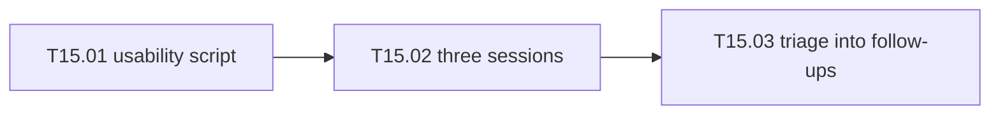

# TASK-15 — Usability test

| Field | Value |
| --- | --- |
| Objective | Usability test |
| Requirements | PRD §B ([01 §B](../specs/01_Product_Requirements_Document.md#b-goals-and-success-criteria), User value row) |
| Lane / owner role | design — Design & story lead (06 §C owner: Design lead) |
| Milestone | M5 (script T15.01 in M2) |
| Window | event-only (T15.01 is pre-event-allowed) |
| Effort (doc 06) | 2–3 h |
| Done when (doc 06) | ≥ 2 of 3 finish briefing in ≤ 5 min |
| Main risk → fallback | — |
| Spec sections | [01 §B](../specs/01_Product_Requirements_Document.md#b-goals-and-success-criteria) · [01 §E](../specs/01_Product_Requirements_Document.md#e-core-demonstration-scenario) · [01 Clarifications](../specs/01_Product_Requirements_Document.md#clarifications) · [03 §C.1](../specs/03_App_Flow_and_Diagrams.md#c1-primary-end-to-end-journey-matches-prd-e) · [06 §B](../specs/06_High_Level_Implementation_Plan.md#b-milestones) · [06 §C](../specs/06_High_Level_Implementation_Plan.md#c-work-packages) · [06 §D.4](../specs/06_High_Level_Implementation_Plan.md#d4-cut-list-cut-in-this-order-when-behind) |

## Inputs this task consumes

| Input | Kind | Owner | Dependency |
| --- | --- | --- | --- |
| Integrated offline build and laptop used for the two rehearsals | upstream output | T14.06 | hard (T15.02) |
| Path owners and the change process for new subtasks ([coordination map](_coordination.md#c1-rules), [§h.5](_coordination.md#h5-changing-this-map)) | contract | this plan | soft (T15.03) |

## Outputs this task provides

| Output | Path | Consumers |
| --- | --- | --- |
| Usability-test script | `docs/ops/usability-script.md` | T15.02 |
| Session results for three participants, with pass or fail against the 06 criterion | `docs/ops/verification-log.md` (T15.02 section) | T15.03 |
| Accepted fixes as `follow-up:` subtasks in the owning task files, added through one `coord:` PR | owning task files | Owning lanes, before the Day 2 06:00 freeze |

## Subtasks

### T15.01 — Write the usability-test script (3 non-team users, briefing in ≤ 5 min)

- **Owner:** Ridita Alam (R5 EVA & Ops UI · design system)
- **Type:** human
- **Tag:** human-required · core
- **Window:** pre-event-allowed
- **Estimate:** 1 h
- **Owns (writes):** `docs/ops/usability-script.md`
- **Reads:** [01 §B](../specs/01_Product_Requirements_Document.md#b-goals-and-success-criteria), [01 §E](../specs/01_Product_Requirements_Document.md#e-core-demonstration-scenario), [01 Clarifications](../specs/01_Product_Requirements_Document.md#clarifications), [03 §C.1](../specs/03_App_Flow_and_Diagrams.md#c1-primary-end-to-end-journey-matches-prd-e), [03 SCR-01](../specs/03_App_Flow_and_Diagrams.md#scr-01--mission-briefing), [03 SCR-08](../specs/03_App_Flow_and_Diagrams.md#scr-08--briefing-card), [06 §C](../specs/06_High_Level_Implementation_Plan.md#c-work-packages) TASK-15, [06 §D.4](../specs/06_High_Level_Implementation_Plan.md#d4-cut-list-cut-in-this-order-when-behind)
- **Depends on:** none
- **Parallel with:** T13.01, T13.03, T16.01, T17.01
- **Steps:**
  1. Quote the 01 §B User value criterion and the 06 §C TASK-15 done-when at the top of the script, with links; do not reword them.
  2. Write the participant task as an outcome only — a briefing card for a 3-stop route, starting on SCR-01 with the default inputs (01 §E starting conditions) — without naming controls, so it still works if cut 3 removes free placement. Participants use "Start planning", not "Open demo plan", which preloads the stops (03 SCR-01).
  3. Define timing: start when the app is opened (01 §B "From opening the app"), stop at the end condition; the end condition is `TODO(decision)` (spec question 2).
  4. Write the facilitator rules: what counts as help (`TODO(decision)`, 01 §B "without help"), and when a session stops.
  5. Add recording rules: participants are labelled P1–P3; notes only; no names, photos or video of people (06 §C TASK-17 rule: no under-18 likeness).
  6. Add a results template per participant: finished (yes/no), time, where they hesitated, issues with the screen id (SCR-xx). Keep the expected path (03 §C.1) on the facilitator's sheet only.
- **Acceptance:**
  - Serves: PRD §B (User value) · [01 §B](../specs/01_Product_Requirements_Document.md#b-goals-and-success-criteria)
  - Given a reader outside the team, when they read the script, then the task, the 5-minute limit, the start and end of timing and the help rules are clear without asking.
  - The criterion is quoted from 01 §B and 06 §C, not paraphrased.
  - The task wording holds with and without free placement (06 §D.4 cut 3).
  - The recording rules exclude names, faces and any under-18 likeness.
  - Open choices are marked `TODO(decision)`, not decided silently.
- **Verify:** `npx --no-install markdownlint-cli2 docs/ops/usability-script.md` and `python3 scripts/check_links.py docs/ops/usability-script.md`; manual read-through by a second team member against the acceptance list.
- **Agent brief:** The design lead writes `docs/ops/usability-script.md` for three people outside the team who must produce a briefing card for a 3-stop route in ≤ 5 minutes (01 §B, 06 §C TASK-15). An agent may draft the skeleton from 01 §B/§E and 03 §C.1 for the lead to edit; it adds no numbers beyond the spec's and leaves the end condition and help rules as `TODO(decision)`.
- **Conflict notes:** Single owner of `docs/ops/usability-script.md`; no shared files. After merge, changes go through a `follow-up:` subtask; T15.02 notes mid-session script problems in its results section instead of editing this file.

### T15.02 — Run three sessions; record times and issues

- **Owner:** Ridita Alam (R5 EVA & Ops UI · design system)
- **Type:** verify
- **Tag:** human-required · core
- **Window:** event-only
- **Estimate:** 1.5–2.5 h
- **Owns (writes):** `docs/ops/verification-log.md` (append-only)
- **Reads:** `docs/ops/usability-script.md`, the T14.06 section of `docs/ops/verification-log.md`, [01 §B](../specs/01_Product_Requirements_Document.md#b-goals-and-success-criteria), [06 §C](../specs/06_High_Level_Implementation_Plan.md#c-work-packages) TASK-15
- **Depends on:** T15.01 (hard: the session script must exist), T14.06 (hard: 06: TASK-15 after TASK-14; sessions use the rehearsed offline build)
- **Parallel with:** T12.06, T13.09, T13.10, T14.08
- **Steps:**
  1. Recruit three people outside the team who have not used the app (01 §B "first-time user"); who and where is `TODO(decision)` (spec question 3).
  2. Use the build and laptop from the T14.06 offline rehearsals; reset to SCR-01 with the default inputs before each session.
  3. Run each session exactly as the script says; time it with a stopwatch; note hesitations and issues with the screen id (SCR-xx).
  4. Append one `## T15.02 — Run three sessions; record times and issues` section to the verification log: a row per participant (P1–P3: finished yes/no, time), the number who finished in ≤ 5 minutes, and the issue list.
  5. State pass or fail against "≥ 2 of 3 finish briefing in ≤ 5 min" (06 §C TASK-15).
- **Acceptance:**
  - Serves: PRD §B (User value) · [01 §B](../specs/01_Product_Requirements_Document.md#b-goals-and-success-criteria) · [06 §C TASK-15](../specs/06_High_Level_Implementation_Plan.md#c-work-packages)
  - Three sessions with people outside the team are recorded, each with finished yes/no and a measured time.
  - Given the three results, when they are counted, then the section states whether ≥ 2 of 3 finished the briefing in ≤ 5 minutes.
  - Every issue names the screen (SCR-xx) where it happened.
  - The sessions ran on the offline rehearsal build (06 §D.7 "works offline").
  - No names, photos or video of participants are recorded.
- **Verify:** Manual: the T15.02 section exists with three participant rows, a count and a pass/fail line; `make docs-check`.
- **Agent brief:** Humans run three timed sessions with people outside the team, following `docs/ops/usability-script.md` on the T14.06 offline build. An agent may turn the facilitator's notes into the verification-log section afterwards; it never fills in or adjusts times.
- **Conflict notes:** `docs/ops/verification-log.md` is append-only: add the section at the end (create the file with a `# Verification log` heading if it does not exist yet); on a rebase conflict keep both sides. Do not edit `docs/ops/usability-script.md`.

### T15.03 — Triage the findings into follow-up subtasks

- **Owner:** Ridita Alam (R5 EVA & Ops UI · design system)
- **Type:** human
- **Tag:** human-required · core
- **Window:** event-only
- **Estimate:** 0.5–1 h
- **Owns (writes):** none — accepted fixes are appended as `follow-up:` subtasks to the owning task files through one `coord:` PR (§h.5 of the coordination map)
- **Reads:** the T15.02 section of `docs/ops/verification-log.md`, [coordination map §c](_coordination.md#c1-rules) and [§h.5](_coordination.md#h5-changing-this-map), the owning task files, [06 §D.4](../specs/06_High_Level_Implementation_Plan.md#d4-cut-list-cut-in-this-order-when-behind), [06 §D.6](../specs/06_High_Level_Implementation_Plan.md#d6-demo-freeze-criteria-day-2-0600)
- **Depends on:** T15.02 (hard: the findings to triage)
- **Parallel with:** T13.09, T14.09, T14.10
- **Steps:**
  1. List each issue from the T15.02 section with its screen and the owner of the affected path (coordination map §c).
  2. Sort the issues: blocks the 5-minute task, slows it, or cosmetic. Keep only fixes that can land before the Day 2 06:00 freeze (06 §B M6) and do not reopen items dropped by the cut list (06 §D.4).
  3. Draft one `follow-up:` subtask per accepted fix in the owning task file: next free id, the affected path with `(after <owner id>)`, and a hard dependency on that owner (§c.1 rule 3).
  4. Open one `coord: usability follow-ups` PR that edits `_coordination.md` first, then the task files, and run `python3 scripts/check_tasks.py`.
  5. List rejected issues in the PR description with the reason (after the freeze, or post-MVP).
- **Acceptance:**
  - Serves: PRD §B (User value) · [06 §C TASK-15](../specs/06_High_Level_Implementation_Plan.md#c-work-packages) deliverable "Notes from 3 non-team users; fixes"
  - Every issue from T15.02 has a disposition: a `follow-up:` subtask id or a stated reason not to fix it before the freeze.
  - Each new subtask hard-depends on the owner of the path it edits, and `python3 scripts/check_tasks.py` passes.
  - The `coord:` PR merges before the Day 2 06:00 freeze.
- **Verify:** `python3 scripts/check_tasks.py` after the `coord:` PR; manual check that every issue in the T15.02 section is listed in the PR description with a disposition.
- **Agent brief:** The design lead decides which usability findings get fixed before the Day 2 06:00 freeze. An agent may draft the `follow-up:` subtask entries in the task-file template and run `scripts/check_tasks.py`; the lead approves the list and opens the `coord:` PR.
- **Conflict notes:** No PR of its own. All fixes go into one `coord:` PR (map first, then task files, §h.5) to avoid repeated map edits; the fixes themselves are separate subtasks owned by their lanes. Fixes compete with M5 hardening (TASK-14) for the same time before the freeze.

### T15.04 — follow-up: add the v2 criteria to the usability script (HUD glance, summon, landscape cards)

- **Owner:** Ridita Alam (R5 EVA & Ops UI · design system)
- **Type:** human
- **Tag:** human-required · core
- **Window:** pre-event-allowed
- **Estimate:** 0.5–1 h
- **Owns (writes):** `docs/ops/usability-script.md` (after T15.01)
- **Reads:** [06 §C.1](../specs/06_High_Level_Implementation_Plan.md#c1-retained-from-v1-planning-spine-tier-0) TASK-15, [02 §F.2](../specs/02_Technical_Requirements_Document.md#f2-test-plan-additions-v2) Usability, [01 FR-33](../specs/01_Product_Requirements_Document.md#fr-33--hud-mode-t1-m), [Mockup handoff](../design/mockup-handoff.md#unresolved-items) U-55, U-60
- **Depends on:** T15.01 (hard: owner of the script)
- **Parallel with:** T15.02
- **Steps:**
  1. Add the HUD 3-s glance test and "summon vehicle" without instruction (02 §F.2) with their pass rule (≥ 2 of 3 per criterion, 06 §C.1).
  2. Add UT-9 (landscape full-screen map cards, U-60) and the glove skip-reason check (U-55).
- **Acceptance:**
  - Serves: FR-33, FR-40 · [02 §F.2](../specs/02_Technical_Requirements_Document.md#f2-test-plan-additions-v2)
  - Each new criterion is quoted from its spec and has a pass rule.
- **Verify:** `make docs-check`.
- **Agent brief:** Extend the script; quote the specs, add no numbers of your own.
- **Conflict notes:** Edits after T15.01 (follow-up).

## Internal dependency graph

## Definition of done (task level)

- 06 §C done-when: "≥ 2 of 3 finish briefing in ≤ 5 min", as recorded in the T15.02 section of `docs/ops/verification-log.md`.
- 06 §C deliverable: notes from three non-team users; fixes triaged into `follow-up:` subtasks scheduled before the Day 2 06:00 freeze.
- [06 §D.7](../specs/06_High_Level_Implementation_Plan.md#d7-definition-of-done-per-feature), as it applies here: the manual test note is committed (the verification-log section) and the sessions ran offline. Provenance labels, keyboard reach and SCR-09 credits are verified elsewhere (T12.06, T13.10, T16.05).
- No names, faces or under-18 likeness recorded.
- `python3 scripts/check_tasks.py` passes after the `coord:` PR.

## Spec questions

1. **Pass ratio.** 01 §B sets the 5-minute target "tested with ≥ 3 people outside the team" but gives no pass ratio; 06 §C TASK-15 says "≥ 2 of 3 finish briefing in ≤ 5 min". This plan uses 06's wording — confirm it is the intended bar.
2. **End of the timed task.** "Produces a briefing card" (01 §B) is not defined further: is opening SCR-08 enough, or must the card be printed or exported, and must the plan be OK? 01 Clarifications let the card open for OK, Over limits and Partial plans. Also undefined: what counts as "without help". `TODO(decision)` in T15.01.
3. **Recruiting and venue.** Who the three people outside the team are, and where they are found during M5 (Day 1 19:00 → Day 2 06:00), is open; it depends on U-14 (physical or virtual venue, recorded by T00.06). `TODO(decision)`.
4. **No fallback.** 06 §C gives no fallback if fewer than 2 of 3 finish. Whether to re-test after fixes before the freeze is `TODO(decision)`.
