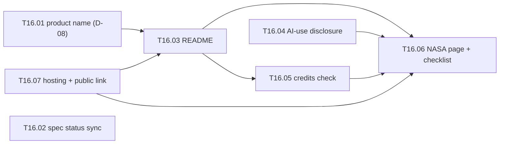

# TASK-16 — Submission package

| Field | Value |
| --- | --- |
| Objective | Submission package |
| Requirements | Scoring items, NFR-07 (06 §C); also FR-15 (T16.05), D-08 (T16.01) and the status ids synced by T16.02: D-01, D-03, U-01–U-05, U-09, U-10, U-12–U-14 |
| Lane / owner role | story — R6: Obidit Islam (submission); T16.02 spec sync: Sadman Shaharier Mahim |
| Milestone | M2 (skeleton: T16.01, T16.02, T16.07) · M8 (final, Day 2 06:00 → 09:00) |
| Window | pre-event-allowed, except T16.06 (event-only) |
| Effort (doc 06) | 2–4 h |
| Done when (doc 06) | Repo link opens in a private window; every page field filled |
| Main risk → fallback | — |
| Spec sections | [06 §C TASK-16](../specs/06_High_Level_Implementation_Plan.md#c-work-packages) · [06 §B M2, M6](../specs/06_High_Level_Implementation_Plan.md#b-milestones) · [06 §D.6](../specs/06_High_Level_Implementation_Plan.md#d6-demo-freeze-criteria-day-2-0600) · [02 §B Hosting](../specs/02_Technical_Requirements_Document.md#b-technology-choices) · [02 §F NFR-07](../specs/02_Technical_Requirements_Document.md#f-nonfunctional-requirements-and-validation) · [01 §F.4 D-08](../specs/01_Product_Requirements_Document.md#f4-unresolved-decisions-owned-by-this-document) · [03 SCR-09](../specs/03_App_Flow_and_Diagrams.md#scr-09--sources--methods) · [04 §C.4](../specs/04_Design_Brief.md#c4-iconography) · [Submission checklist](../ops/submission-checklist.md) · [AI use log](../AI_USE.md) |

> **Re-dated 2026-11-06** to [06](../specs/06_High_Level_Implementation_Plan.md) v2.2 (session handoff §F.2): milestones follow 06 §B v2, windows follow Track P (recorded 4 Nov), cut tags follow the v2 cut list in 06 §D.4 ([map §h.6](_coordination.md#h6-cut-list--subtasks-06-d4)), and every subtask names its Owner from 06 §A.2. Step texts that still mention v1 times (for example "Day 1" or "M5") refer to the v1 plan; the register in the [coordination map](_coordination.md#a3-register) is authoritative.

## Inputs this task consumes

| Input | Kind | Owner | Dependency |
| --- | --- | --- | --- |
| Rules answer and Track S/P (`docs/ops/rules.md`) | upstream output | T00.03 | hard (T16.02) |
| D-01 decision, feasibility summary and notes, ADR-001 | upstream output | T01.05 (notes: T01.01–T01.04) | hard (T16.02) |
| D-03 spike outcome (ADR-003) | upstream output | T02.05 | hard (T16.02) |
| Team roster and venue (`docs/ops/team.md`), traverse source record (U-04), TI threshold (U-03), LOW_RES_DEM coverage (U-10) | upstream outputs | T00.06, T04.01, T04.07, T03.18 | none — T16.02 applies them only if already recorded |
| SCR-09 Sources & Methods, including its AI-use statement | upstream output | T12.03 | hard (T16.03–T16.06) |
| Hardening and verification results (verification-log sections) | upstream output | T14.03–T14.10 | hard (T16.06) |
| Bundle v1 site manifest (`DataSource.credit`) and POI image credits | upstream output | T03.19 | read only; no §f edge (Spec question 4) |
| Credits list (`docs/ops/credits.md`) | upstream output | T04.06 | read only; no §f edge (Spec question 4) |
| 240-s and 30-s video links (verification-log sections) | upstream output | T17.02, T17.03 | read only; no §f edge (Spec question 4) |

No contract (§d) or fixture (§e) is consumed.

## Outputs this task provides

| Output | Path | Consumers |
| --- | --- | --- |
| Final product name (D-08) | `docs/decisions/ADR-008-product-name.md` | T16.03, T16.06; read by T07.03 (page title), T07.05 (SCR-01), T17.01–T17.03 (videos) |
| Spec status rows and docs index in sync with M0–M1 outcomes | `docs/specs/` status rows, `docs/README.md` | Every lane during the event |
| Bundle hosting decision and public repo link | `docs/ops/hosting.md` | T16.03 (run instructions), T16.06; the integration lane if a deploy workflow is needed (Spec question 7) |
| Final README (run instructions, credits, licence) | `README.md` | T16.05, T16.06, judges |
| Final AI-use disclosure | `docs/AI_USE.md` | T16.06 |
| Credits cross-check result | `docs/ops/verification-log.md` (T16.05 section) | T16.06 |
| Completed submission checklist and NASA page fields | `docs/ops/submission-checklist.md` | Team, judges |

## Subtasks

### T16.01 — Decide the final product name (D-08); record ADR-008

- **Owner:** Obidit Islam (team lead · R1 Data & GIS)
- **Type:** human
- **Tag:** human-required · core
- **Window:** pre-event-allowed
- **Estimate:** 0.5–1 h
- **Owns (writes):** `docs/decisions/ADR-008-product-name.md`
- **Reads:** [01 §F.4](../specs/01_Product_Requirements_Document.md#f4-unresolved-decisions-owned-by-this-document) (D-08 row), the 01 header *Product* row, [ADR-001](../decisions/ADR-001-site-selection.md) (ADR format), [docs index — Major proposed decisions](../README.md#major-proposed-decisions)
- **Depends on:** none
- **Parallel with:** T16.02, T16.07, T14.01, T14.02, T17.01
- **Steps:**
  1. The team shortlists candidate names.
  2. Check each candidate against other public 2026 repositories (01 §F.4: "avoid names already used by other public 2026 repos"); the search method is `TODO(verify)`.
  3. The team picks one name; note who decided and when.
  4. Write ADR-008 in the format of the existing ADRs (header table; "This record mirrors D-08"; Decision; Alternative / trigger; Resolution path citing 01 §F.4).
  5. List the files that still carry the working title, for their owners (Spec question 6).
- **Acceptance:**
  - Serves: D-08 · [01 §F.4](../specs/01_Product_Requirements_Document.md#f4-unresolved-decisions-owned-by-this-document)
  - ADR-008 exists, follows the header structure of ADR-001 and states the chosen name.
  - Given the name check, then ADR-008 records the search terms used and either "no public 2026 repo with this name found" or the conflicts found and why the name was still chosen.
  - `make lint docs-check` passes.
- **Verify:** `make lint docs-check`; manual: ADR-008's header rows match ADR-001's (Owner, Date, Status, Related).
- **Agent brief:** Human task: the team chooses the product name (D-08, 01 §F.4). An agent may search public repositories for each shortlisted name, report hits with links, and draft `docs/decisions/ADR-008-product-name.md` in the existing ADR format for the team to approve.
- **Conflict notes:** New file, single owner. This subtask renames nothing: files that carry the working title belong to other owners (Spec question 6). Land it in M2 so T16.03, T07.03 and T07.05 can use the final name.

### T16.02 — spec-change: sync spec status rows and the docs index with the M0–M1 outcomes

- **Owner:** Sadman Shaharier Mahim (product & systems lead · R4 Hab Core · demo story)
- **Type:** integrate
- **Tag:** agent-ready · core
- **Window:** pre-event-allowed
- **Estimate:** 1.5–2.5 h
- **Owns (writes):** `docs/README.md`, `docs/specs/01_Product_Requirements_Document.md` (spec-change), `docs/specs/02_Technical_Requirements_Document.md` (spec-change), `docs/specs/04_Design_Brief.md` (spec-change), `docs/specs/05_Backend_and_Database_Schema.md` (spec-change), `docs/specs/06_High_Level_Implementation_Plan.md` (spec-change)
- **Reads:** [`docs/ops/rules.md`](../ops/rules.md), `docs/ops/team.md`, [`docs/ops/feasibility.md`](../ops/feasibility.md), `docs/ops/feasibility/dem-label.md`, `docs/ops/feasibility/aoi.md`, `docs/ops/feasibility/dem-quality.md`, `docs/ops/feasibility/coverage.md`, `docs/ops/ti-threshold.md`, [ADR-001](../decisions/ADR-001-site-selection.md), [ADR-003](../decisions/ADR-003-openlayers-mars-projection.md), the traverse DataSource record in `pipeline/sites/gale_boxwork/sources/`, `pipeline/sites/gale_boxwork/low_res_dem.geojson`; status rows in [01 §F.2](../specs/01_Product_Requirements_Document.md#f2-key-assumptions), [01 §F.4](../specs/01_Product_Requirements_Document.md#f4-unresolved-decisions-owned-by-this-document), [02 §C.1](../specs/02_Technical_Requirements_Document.md#c1-coordinate-reference-conventions-applies-to-every-layer), [02 §C.2](../specs/02_Technical_Requirements_Document.md#c2-data-layers), [02 Unresolved](../specs/02_Technical_Requirements_Document.md#unresolved-decisions-owned-by-this-document), [04 Unresolved](../specs/04_Design_Brief.md#unresolved-items-owned-by-this-document), [05 Unresolved](../specs/05_Backend_and_Database_Schema.md#unresolved-items-owned-by-this-document), [06 §A](../specs/06_High_Level_Implementation_Plan.md#a-planning-assumptions), [06 Unresolved](../specs/06_High_Level_Implementation_Plan.md#unresolved-items-owned-by-this-document), [docs index](../README.md#key-assumptions-and-blockers); [constitution](../../.specify/memory/constitution.md) (labels change only with evidence)
- **Depends on:** T00.03 (hard: the U-12 answer and track must be recorded), T01.05 (hard: D-01 and the TASK-01 findings must be recorded)
- **Parallel with:** T16.01, T16.07, T14.01, T14.02
- **Steps:**
  1. Collect each outcome for D-01, D-03, U-01–U-05, U-09, U-10 and U-12–U-14 with its evidence link (ops doc, feasibility note, ADR or record in Reads); list the ones not recorded yet.
  2. For each recorded outcome, change only the status row or label that names that id: the *Unresolved* tables of 01 §F.4, 02, 04, 05 and 06, and the in-body labels that cite the same item (02 §C.1 elevation datum, 02 §C.2 AOI bounds, 06 §A pre-event row and team size).
  3. Link the evidence instead of copying values: write no AOI bounds, datum text or threshold into the specs.
  4. Update the *Major proposed decisions* and *Key assumptions and blockers* tables in `docs/README.md` to match.
  5. Leave every other word, number, id and label as it is; list the unrecorded outcomes in the PR description.
  6. Run `make lint docs-check`.
- **Acceptance:**
  - Serves: D-01, D-03, U-01–U-05, U-09, U-10, U-12–U-14 · [02 Unresolved](../specs/02_Technical_Requirements_Document.md#unresolved-decisions-owned-by-this-document), [docs index](../README.md#key-assumptions-and-blockers)
  - Every changed label links its evidence; no label changes without evidence (constitution, *Development Workflow*).
  - The diff touches only status rows and labels for the listed ids and the two docs-index tables; requirement text, numbers and ids are unchanged (`CLAUDE.md` §6).
  - Given an outcome is not recorded at sync time, then its row stays *Unresolved* and the PR lists it.
  - `make lint docs-check` passes.
- **Verify:** `git diff main -- docs/specs docs/README.md` reviewed row by row against the evidence links; `make lint docs-check`.
- **Agent brief:** Sync spec status rows with the recorded M0–M1 outcomes. Read the ops docs, ADRs and records listed in Reads; for each recorded outcome change only the matching *Unresolved* or *Assumed* label and docs-index row, linking the evidence. Change no requirement text, number or id, and list outcomes not yet recorded in the PR.
- **Conflict notes:** D-03 is synced only if ADR-003 already records it; under Track S the spike decides on Day 1 (M3), so D-03 then stays in ADR-003 until a later `spec-change:`. `spec-change:` subtask: one open spec-change PR at a time (§c.2). The only other planned spec writer is the fallback T01.06 (switch to Jezero); if it is triggered, it merges first and this PR rebases on it. `docs/README.md` is owned here. Do not touch `CLAUDE.md` / `AGENTS.md` (T00.04) or the ADRs (their decision subtasks).

### T16.03 — Finalize the README: run instructions, data credits, licence

- **Owner:** Obidit Islam (team lead · R1 Data & GIS)
- **Type:** implement
- **Tag:** agent-ready · core
- **Window:** pre-event-allowed
- **Estimate:** 1.5–2.5 h
- **Owns (writes):** `README.md`
- **Reads:** `README.md`, `docs/ops/hosting.md`, `docs/decisions/ADR-008-product-name.md`, `data/sites/gale_boxwork/site-manifest.json`, `data/sites/gale_boxwork/vectors/pois.geojson`, `docs/ops/credits.md`, `Makefile`, [`CLAUDE.md`](../../CLAUDE.md) §4, [02 §F](../specs/02_Technical_Requirements_Document.md#f-nonfunctional-requirements-and-validation) (NFR-07; *Secrets/deployment* line), [01 §F.1](../specs/01_Product_Requirements_Document.md#f1-prototype-boundary-must-appear-in-the-app-and-the-video), [LICENSE](../../LICENSE)
- **Depends on:** T12.03 (hard: 06: TASK-16 after TASK-12), T16.01 (hard: the final product name), T16.07 (hard: bundle hosting and the public link)
- **Parallel with:** T16.04, T17.03
- **Steps:**
  1. Replace the working title with the ADR-008 name and rewrite *Status* for the submitted build, claiming only features that SCR-09 and `docs/ops/verification-log.md` record.
  2. Write run instructions from the Makefile targets (`make setup`, `make data`, `make dev`, `make demo`) and from `docs/ops/hosting.md` (how to obtain the site bundle); keep the offline demo path from the 02 §F *Secrets/deployment* line.
  3. Fill *Credits* from every `DataSource.credit` in the site manifest and every POI `image_credit`, cross-checked with `docs/ops/credits.md` (NFR-07).
  4. Keep the prototype boundary statement (01 §F.1) and the licence section (code Apache-2.0; data and images keep their credits).
  5. Run `make lint docs-check`.
- **Acceptance:**
  - Serves: NFR-07 · [02 §F](../specs/02_Technical_Requirements_Document.md#f-nonfunctional-requirements-and-validation), [06 §D.6](../specs/06_High_Level_Implementation_Plan.md#d6-demo-freeze-criteria-day-2-0600)
  - Given a clean clone, when a reader follows the README, then the documented commands build and serve the app (06 §D.6: "Repo builds from a clean clone with documented commands").
  - Every manifest DataSource and every POI image credit appears under *Credits* (NFR-07: "All data credits in UI and README").
  - No `TODO` remains in `README.md`.
  - `make lint docs-check` passes.
- **Verify:** In a fresh clone: `make setup && make lint typecheck test docs-check && make demo`, then open the app with the network off; T16.05's credit checks.
- **Agent brief:** Finalize `README.md`: the ADR-008 name, run instructions from the Makefile and `docs/ops/hosting.md`, a *Credits* section listing every `DataSource.credit` from the site manifest and every POI image credit, the Apache-2.0 licence line and the prototype boundary (01 §F.1). Add no number or claim that is not in the specs, the manifest or the verification log.
- **Conflict notes:** `README.md` is owned only here. Do not edit `docs/ops/credits.md` (T04.06). Merge after T16.01 and T16.07; T16.05 checks this PR's *Credits* section after it merges.

### T16.04 — Complete the AI-use disclosure

- **Owner:** Obidit Islam (team lead · R1 Data & GIS)
- **Type:** human
- **Tag:** human-required · core
- **Window:** pre-event-allowed
- **Estimate:** 1–1.5 h
- **Owns (writes):** `docs/AI_USE.md`
- **Reads:** [`docs/AI_USE.md`](../AI_USE.md), [ADR-006](../decisions/ADR-006-no-ai-in-mvp.md), [02 §D.7](../specs/02_Technical_Requirements_Document.md#d7-ai), [01 §C.4](../specs/01_Product_Requirements_Document.md#c5-out-of-scope), [03 SCR-09](../specs/03_App_Flow_and_Diagrams.md#scr-09--sources--methods) (AI-use statement), the 2026 Project Submission / Judging guides (not in the repo; `TODO(verify)`), `git log`
- **Depends on:** T12.03 (hard: 06: TASK-16 after TASK-12)
- **Parallel with:** T16.03, T16.05
- **Steps:**
  1. Read the AI-disclosure wording required by the 2026 Project Submission / Judging guides (`TODO(verify)`; due 13 Nov per the docs index).
  2. Fill the *Tools* table: each AI tool used, model or version, purpose, and the people who used it.
  3. Decide and record the prompts location (now `TODO(decision)`) and link it.
  4. Answer the TODO cells of earlier log rows with appended, dated rows that name the row they complete; never edit or delete an existing row.
  5. Check the disclosure agrees with the SCR-09 statement "No AI computes or generates values in this app" (03 SCR-09) and with ADR-006.
- **Acceptance:**
  - Serves: — (06 TASK-16 deliverable `docs/AI_USE.md`) · [06 §C](../specs/06_High_Level_Implementation_Plan.md#c-work-packages)
  - The header, *Tools* and *Prompts location* sections contain no `TODO`, `TODO(verify)` or `TODO(decision)`; anything still unknown is listed under Spec questions with the reason.
  - Every earlier log row with a TODO cell is answered by an appended row; `git diff` shows only additions inside the *Log* table.
  - The wording follows the 2026 guides once they are published.
- **Verify:** `git diff main -- docs/AI_USE.md` (*Log* table: additions only); `make lint docs-check`.
- **Agent brief:** Human task: confirm which AI tools each member used and where prompts are kept, and approve the final disclosure. An agent may draft the *Tools* table from `git log` and the existing log, list the unresolved TODO cells, and draft appended rows; it never alters existing log rows.
- **Conflict notes:** This subtask owns the header, *Tools* and *Prompts location* sections; the *Log* table stays append-only for every subtask (§c.2). Expect rebase conflicts at the end of the table: keep both rows. Merge late in M6, after the other PRs have appended their rows.

### T16.05 — Verify every dataset and image is credited in SCR-09 and the README

- **Owner:** Obidit Islam (team lead · R1 Data & GIS)
- **Type:** verify
- **Tag:** agent-ready · core
- **Window:** pre-event-allowed
- **Estimate:** 0.5–1 h
- **Owns (writes):** `docs/ops/verification-log.md` (append-only)
- **Reads:** `data/sites/gale_boxwork/site-manifest.json`, `data/sites/gale_boxwork/vectors/pois.geojson`, `README.md`, `docs/ops/credits.md`, SCR-09 and SCR-06 in the built app, [04 §C.4](../specs/04_Design_Brief.md#c4-iconography), [02 §F](../specs/02_Technical_Requirements_Document.md#f-nonfunctional-requirements-and-validation) (NFR-07)
- **Depends on:** T12.03 (hard: 06: TASK-16 after TASK-12), T16.03 (hard: the README credits section to check)
- **Parallel with:** T16.04
- **Steps:**
  1. List every DataSource (title, credit) in the site manifest and every POI `image_credit` in `pois.geojson`.
  2. Run the two checks in *Verify* against `README.md`; compare the lists with `docs/ops/credits.md`.
  3. Open SCR-09 in `make demo` with the network off and check that each dataset row shows its credit; spot-check POI image credits in SCR-06.
  4. If an icon set is bundled, confirm and credit its licence (04 §C.4: "verify licence in TASK-16").
  5. Append the result to `docs/ops/verification-log.md`; report each gap to the owner of the path concerned (`README.md` → T16.03, SCR-09 → T12.03) through a `coord:` change (§h.5).
- **Acceptance:**
  - Serves: FR-15, NFR-07 · [02 §F](../specs/02_Technical_Requirements_Document.md#f-nonfunctional-requirements-and-validation), [03 SCR-09](../specs/03_App_Flow_and_Diagrams.md#scr-09--sources--methods)
  - Every manifest DataSource and every POI image credit appears in `README.md` and in SCR-09 (NFR-07: "All data credits in UI and README").
  - The icon set's licence, if one is bundled, is recorded (04 §C.4).
  - The `## T16.05 — …` section of the verification log lists what was checked and every gap found.
- **Verify:**
  - `python3 -c "import json,sys; m=json.load(open('data/sites/gale_boxwork/site-manifest.json')); r=open('README.md',encoding='utf-8').read(); miss=[s['source_id'] for s in m['sources'] if s['title'] not in r or s['credit'] not in r]; print(miss or 'all sources credited'); sys.exit(bool(miss))"`
  - `python3 -c "import json,sys; f=json.load(open('data/sites/gale_boxwork/vectors/pois.geojson'))['features']; r=open('README.md',encoding='utf-8').read(); miss=sorted({p['properties']['image_credit'] for p in f if p['properties'].get('image_credit') and p['properties']['image_credit'] not in r}); print(miss or 'all image credits in README'); sys.exit(bool(miss))"`
  - Manual: SCR-09 and SCR-06 checks in `make demo` with the network off.
- **Agent brief:** Cross-check credits: every DataSource and POI image credit in the site bundle must appear in `README.md` and in SCR-09. Run the two commands in *Verify*, open SCR-09 in `make demo`, confirm the licence of any bundled icon set (04 §C.4), and append the result to `docs/ops/verification-log.md`.
- **Conflict notes:** Append one section at the end of `docs/ops/verification-log.md`; on a rebase conflict keep both sections. Writes nothing else: fixes go to the owners of `README.md` (T16.03) or SCR-09 (T12.03) as `follow-up:` subtasks.

### T16.06 — Fill the NASA project page fields; complete the submission checklist

- **Owner:** Obidit Islam (team lead · R1 Data & GIS)
- **Type:** human
- **Tag:** human-required · core
- **Window:** event-only
- **Estimate:** 1–2 h
- **Owns (writes):** `docs/ops/submission-checklist.md`
- **Reads:** [`docs/ops/submission-checklist.md`](../ops/submission-checklist.md), the NASA project page and the 2026 Project Submission guide (`TODO(verify)`), the Participants Guide (not in the repo; `TODO(verify)`), `README.md`, `docs/AI_USE.md`, `docs/ops/demo-script.md`, `docs/ops/hosting.md`, `docs/decisions/ADR-008-product-name.md`, `docs/ops/verification-log.md`, [06 §A](../specs/06_High_Level_Implementation_Plan.md#a-planning-assumptions) (calendar), [06 §B M6](../specs/06_High_Level_Implementation_Plan.md#b-milestones), [06 §D.6](../specs/06_High_Level_Implementation_Plan.md#d6-demo-freeze-criteria-day-2-0600), [LICENSE](../../LICENSE)
- **Depends on:** T12.03 (hard: 06: TASK-16 after TASK-12), T14.03–T14.10 (hard: the page and checklist record the frozen, verified build of 06 §B M6), T16.03 (hard: the final README), T16.04 (hard: the final AI-use disclosure), T16.05 (hard: credits verified), T16.07 (hard: the public repo link)
- **Parallel with:** none
- **Steps:**
  1. Copy the NASA project page field list from the 2026 Project Submission guide into the checklist (`TODO(verify)`: the guide and the Participants Guide are not in the repo).
  2. Draft each field only from repo content (README, demo script, AI-use disclosure, credits, ADR-008 name): no new numbers or claims.
  3. Tick each checklist item with an evidence link (verification-log section or PR), or mark it not applicable with the reason; confirm the deadlines in 06 §A.
  4. Open the repository link in a private browser window and check that it loads without signing in; confirm `LICENSE` is Apache-2.0.
  5. With the team's confirmation, submit the page and record the time of submission.
- **Acceptance:**
  - Serves: NFR-07 · [06 §C](../specs/06_High_Level_Implementation_Plan.md#c-work-packages), [06 §B](../specs/06_High_Level_Implementation_Plan.md#b-milestones)
  - Done when (06 §C): "Repo link opens in a private window; every page field filled."
  - Every checklist item is ticked with evidence or marked not applicable with a reason; the Bangladesh score-sheet items are filled from the Participants Guide.
  - Given the repository link, when it is opened in a private window, then it loads (06 §B M6: "repo public and tested in private window").
  - Every page field traces to a repo source; no field contains a number that the repo does not contain (`CLAUDE.md` §2).
- **Verify:** Manual checklist: private-window check of the repo link; each page field compared with its repo source; `make lint docs-check`.
- **Agent brief:** Human task: fill and submit the NASA project page and complete `docs/ops/submission-checklist.md`. An agent may draft field texts from the README, demo script and AI-use disclosure, list which checklist items have evidence in the verification log, and flag field text that does not trace to the repo.
- **Conflict notes:** `docs/ops/submission-checklist.md` is owned here; other subtasks put their evidence in `docs/ops/verification-log.md`. Merge last in M6, after T16.03–T16.05, T16.07 and the 30-s video (Spec question 4). Submitting the page is outward-facing: confirm with the team first.

### T16.07 — Implement the release-asset fetch route and decide what the public link shows; test the link in a private window

- **Owner:** Obidit Islam (team lead · R1 Data & GIS)
- **Type:** human
- **Tag:** human-required · core
- **Window:** pre-event-allowed
- **Estimate:** 1–2 h
- **Owns (writes):** `docs/ops/hosting.md`
- **Reads:** [`docs/ops/feasibility.md`](../ops/feasibility.md) (*Large tiles in the repo*), [02 §B](../specs/02_Technical_Requirements_Document.md#b-technology-choices) (*Hosting* row), [02 §F](../specs/02_Technical_Requirements_Document.md#f-nonfunctional-requirements-and-validation) (NFR-01, NFR-08, NFR-09), [`CLAUDE.md`](../../CLAUDE.md) §2 (*Data*), `.gitignore`, [06 §B M2](../specs/06_High_Level_Implementation_Plan.md#b-milestones) ("Public repo with licence …"), [map open point 13](_coordination.md#open-points)
- **Depends on:** none
- **Parallel with:** T16.01, T16.02, T14.01, T14.02
- **Steps:**
  1. Start from the decision in `docs/ops/feasibility.md`: the site bundle (tiles, grid, images) is shared as a GitHub release asset. Note the open option for the public link, GitHub Pages (02 §B), and the `CLAUDE.md` §2 rule against committing large binaries.
  2. Implement the decision: record how a reader obtains the bundle from the release. The team still decides what the public link shows (`TODO(decision)`); note who decided and when.
  3. Write `docs/ops/hosting.md`: the decision, the reason, how a reader obtains the bundle, and the NFR-09 size limit it must respect.
  4. With the team's confirmation, make the repository public (06 §B M2), then open its link in a private browser window and record the result.
  5. If the implementation needs a deploy workflow, a release-asset fetch script or a `.gitignore` change, hand it to the integration lane as a new subtask (§h.5); those paths are not owned here.
- **Acceptance:**
  - Serves: NFR-07 · [02 §B](../specs/02_Technical_Requirements_Document.md#b-technology-choices), [06 §B](../specs/06_High_Level_Implementation_Plan.md#b-milestones)
  - `docs/ops/hosting.md` records the decision, its reason and the steps to obtain the bundle; no dataset or large binary is committed (`CLAUDE.md` §2).
  - Given the public repository link, when it is opened in a private window, then it loads without signing in.
  - Map open point 13 is closed (release asset), and `docs/ops/hosting.md` states what the public link shows, or why that stays open.
- **Verify:** Manual: private-window check of the repository link; `make lint docs-check`.
- **Agent brief:** Human task with two jobs. (1) Implement the release-asset route from `docs/ops/feasibility.md`: an agent may draft in `docs/ops/hosting.md` how a reader obtains the bundle from the release (download, verify the SHA-256, extract), checked against NFR-09 and `CLAUDE.md` §2; a fetch script is a new integration subtask (step 5), not written here. (2) The team decides what the public link shows and makes the repository public.
- **Conflict notes:** Do not edit `docs/ops/feasibility.md` (T01.05), `.gitignore` (append-only), `.github/` (T14.02) or `README.md` (T16.03, which reads this file). The decision lands in M2; T16.06 repeats the private-window check at M6. Making the repository public is outward-facing: confirm with the team first.

## Internal dependency graph

All internal edges are hard. T16.02 has no internal dependency; its upstream inputs are in *Inputs*.

## Definition of done (task level)

- [06 §D.7](../specs/06_High_Level_Implementation_Plan.md#d7-definition-of-done-per-feature), where it applies: acceptance criteria met; a manual test note in `docs/ops/verification-log.md`; credited sources listed in SCR-09.
- 06 §C done when: "Repo link opens in a private window; every page field filled."
- 06 §B M6: repo public and tested in a private window; NASA page complete.
- 06 §D.6: "Repo builds from a clean clone with documented commands."
- NFR-07: every data credit in the UI and the README; code Apache-2.0.
- No `TODO` left in `README.md`, in the non-log sections of `docs/AI_USE.md` or in `docs/ops/submission-checklist.md`, except items that only the external guides can settle, each listed with the reason.
- `make lint docs-check` passes; each PR appends its `docs/AI_USE.md` log row.

## Spec questions

1. **External field lists.** The NASA project page fields and the Bangladesh score-sheet items come from the Participants Guide and the 2026 Project Submission / Judging guides, which are not in the repo (the guides are due 13 Nov per the [docs index](../README.md#context-inventory)) — `TODO(verify)` in T16.04 and T16.06.
2. **Map change proposed: D-03 timing.** Under Track S, T02.04 and T02.05 run at the event (§g, M3), so T16.02's hard dependency on T02.05 (§f graph) moves the M2 sync to Day 1. Either drop D-03 from T16.02 and sync it later with an appended `spec-change:` subtask, or accept T16.02 at M3 under Track S.
3. **Map change proposed: missing §f table rows.** The §f graph draws T00.03, T01.05, T02.05 → T16.02 and T14.03–T14.10 → T16.06 as hard edges, but the cross-task hard-dependency table has no rows for them.
4. **Map change proposed: inputs without an edge.** T16.03 and T16.05 read the bundle-v1 manifest (T03.19) and the credits list (T04.06); T16.06 needs the 30-s video link (T17.03). None has a §f edge. All three land before T16.06 runs, so only the map's edge list would change.
5. **Map change proposed: outcomes T16.02 does not list.** Other M0–M2 outcomes are missing from T16.02's register row: U-11 (decided in T03.01, contract C3), D-08 (T16.01) and A-01 (checked together with U-01). Add them to T16.02, or leave them for a later `spec-change:` subtask.
6. **Working title.** The 01 header says "working title — rename before submission", but no subtask applies the D-08 name to files that carry the working title (`CLAUDE.md`, `AGENTS.md`, `docs/README.md`, the 01 header, the `apps/web/index.html` title, the `package.json` descriptions; owners T00.04, T16.02, T07.03, T14.01 and the spec-change process). Owners that run after T16.01 can read ADR-008; the ones that run earlier need `follow-up:` subtasks — `TODO(decision)`.
7. **Bundle hosting (map open point 13).** Decided in `docs/ops/feasibility.md`: GitHub release asset, which keeps the `CLAUDE.md` §2 rule against committing large binaries. T16.07 implements it. What the public link shows is still open: a GitHub Pages link (02 §B) would need a deploy workflow in `.github/` (T14.02), i.e. a new integration subtask — T16.07, `TODO(decision)`.
8. **AI-use log rows.** Earlier log rows have TODO and `TODO(verify)` cells. §c.2 keeps the log append-only, so T16.04 answers them with appended rows instead of editing the rows. Confirm that this is acceptable.
9. **Icon licence.** 04 §C.4 says the icon set's licence is verified "in TASK-16", but no icon dependency has been chosen yet (T14.01). T16.05 checks whichever set is bundled.
10. **Effort (map open point 18).** These seven subtasks are estimated above 06's 2–4 h for TASK-16.
