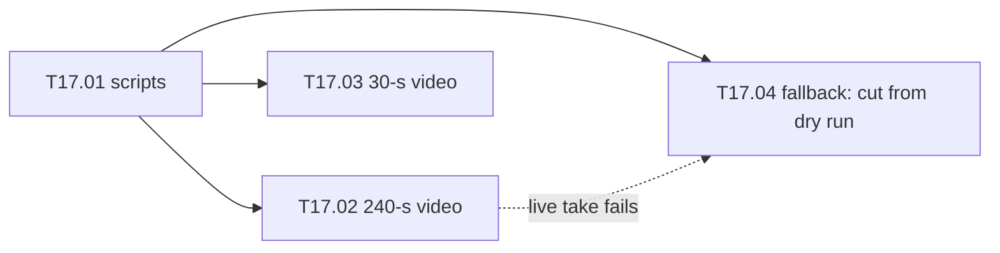

# TASK-17 — Videos

| Field | Value |
| --- | --- |
| Objective | Videos |
| Requirements | Judging (06 §C). Deliverable (06 §C): 240-s (Day 1 18:30) and 30-s (Day 2 09:00) with English subtitles, datasets named on camera, no under-18 likeness. Prototype boundary statement must appear in the video ([01 §F.1](../specs/01_Product_Requirements_Document.md#f1-prototype-boundary-must-appear-in-the-app-and-the-video)) |
| Lane / owner role | story — Design & story lead (06 §C owner: Story lead) |
| Milestone | M2 (scripts), M4 (240-s video), M6 (30-s video) |
| Window | pre-event-allowed (T17.01); event-only (T17.02–T17.04) |
| Effort (doc 06) | 3–5 h |
| Done when (doc 06) | Uploaded; links tested |
| Main risk → fallback | Live demo fails → screen recording from rehearsal |
| Spec sections | [06 §C TASK-17](../specs/06_High_Level_Implementation_Plan.md#c-work-packages) · [06 §A calendar](../specs/06_High_Level_Implementation_Plan.md#a-planning-assumptions) · [06 §B M4, M6](../specs/06_High_Level_Implementation_Plan.md#b-milestones) · [06 §D.3](../specs/06_High_Level_Implementation_Plan.md#d3-integration-checkpoints) · [01 §B](../specs/01_Product_Requirements_Document.md#b-goals-and-success-criteria) · [01 §E](../specs/01_Product_Requirements_Document.md#e-core-demonstration-scenario) · [01 §F.1](../specs/01_Product_Requirements_Document.md#f1-prototype-boundary-must-appear-in-the-app-and-the-video) · [Demo script](../ops/demo-script.md) · [Map §h.7](_coordination.md#h7-fallbacks-06-c-d5) |

## Inputs this task consumes

| Input | Kind | Owner | Dependency |
| --- | --- | --- | --- |
| Results panel on the demo path | upstream output | T09.03, T09.04 | hard (T17.02) |
| POI detail and Conditions panels | upstream output | T10.01, T10.02 | hard (T17.02) |
| Briefing card and plan export | upstream output | T11.02–T11.04 | hard (T17.02) |
| Metric component and Sources & Methods | upstream output | T12.01, T12.03 | hard (T17.02) |
| Frozen build after hardening and verification | upstream output | T14.03–T14.10 | hard (T17.03) |
| Dataset titles and credits (`docs/ops/credits.md`, SCR-09) | upstream output | T04.06, T12.03 | none (read only; reached through T12.03) |
| Product name, D-08 (`docs/decisions/ADR-008-product-name.md`) | upstream output | T16.01 | none (read if recorded; see Spec questions) |

## Outputs this task provides

| Output | Path | Consumers |
| --- | --- | --- |
| 240-s and 30-s scripts (narration and timing) | [`docs/ops/demo-script.md`](../ops/demo-script.md) | T17.02, T17.03, T17.04 |
| 240-s video link and checks | `docs/ops/verification-log.md` (section T17.02, or T17.04 if the fallback ran) | T16.06 |
| 30-s video link and checks | `docs/ops/verification-log.md` (section T17.03) | T16.06 |
| Dry-run screen capture (outside git) | team storage, `TODO(decision)` | T17.04 |

## Subtasks

### T17.01 — Draft the 240-s and 30-s demo scripts

- **Type:** human
- **Tag:** human-required · core
- **Window:** pre-event-allowed
- **Estimate:** 1–2 h
- **Owns (writes):** `docs/ops/demo-script.md`
- **Reads:** [`docs/ops/demo-script.md`](../ops/demo-script.md) (existing slots), [01 §E](../specs/01_Product_Requirements_Document.md#e-core-demonstration-scenario), [01 §F.1](../specs/01_Product_Requirements_Document.md#f1-prototype-boundary-must-appear-in-the-app-and-the-video), [01 §A.2](../specs/01_Product_Requirements_Document.md#a2-problem-statement) (problem framing slot), [02 §C.2](../specs/02_Technical_Requirements_Document.md#c2-data-layers) (dataset titles), [06 §A](../specs/06_High_Level_Implementation_Plan.md#a-planning-assumptions), [06 §C TASK-17](../specs/06_High_Level_Implementation_Plan.md#c-work-packages), `docs/ops/credits.md` and `docs/decisions/ADR-008-product-name.md` once they exist
- **Depends on:** none
- **Parallel with:** T07.14, T12.04, T15.01, T16.01
- **Steps:**
  1. Fill the Narration column of the 240-s table slot by slot, following 01 §E steps 1–9 in order; keep the Proposed slot times unless the team changes them.
  2. In the step 2 slot and the credits slot, name the datasets on screen by their 02 §C.2 titles; once `docs/ops/credits.md` (T04.06) and SCR-09 (T12.03) exist, switch to their titles and mark any difference `TODO(verify)`.
  3. Quote the 01 §F.1 prototype boundary statement verbatim in the 3:30–4:00 slot and in the 30-s closing slot.
  4. Write the narration for the four 30-s slots (title, map → route → briefing card, provenance labels, team and disclaimer).
  5. Next to every number the narration says (e.g. 0.19 mSv in step 8), note the screen it is read from; the script takes numbers from 01 §E or the app, never from elsewhere.
  6. Use the product name from ADR-008 if T16.01 has recorded it; otherwise keep the working title and mark it `TODO(decision)`.
  7. Mark the narration lines as the English subtitle text for both videos.
- **Acceptance:**
  - Serves: — (judging) · [01 §E](../specs/01_Product_Requirements_Document.md#e-core-demonstration-scenario), [06 §C TASK-17](../specs/06_High_Level_Implementation_Plan.md#c-work-packages)
  - Every 240-s slot from 0:00 to 4:00 has narration, and slots 0:20–3:30 follow 01 §E steps 1–9 in order.
  - Both scripts contain the 01 §F.1 statement word for word.
  - Both scripts name the datasets shown, with titles traceable to 02 §C.2 or SCR-09 (06 TASK-17: datasets named on camera).
  - No narration line states a number that is not in 01 §E or on the app screen it points to.
  - The 01 §E scenario steps are unchanged (the file only adds timing and narration slots).
- **Verify:** `npx --no-install markdownlint-cli2 docs/ops/demo-script.md` and `python3 scripts/check_links.py docs/ops/demo-script.md`; then by hand: read both scripts aloud against a timer (240-s script within 240 s, 30-s script within 30 s) and tick each 01 §E step.
- **Agent brief:** Human-required: the Design & story lead writes and approves the narration. An agent may draft the Narration column of `docs/ops/demo-script.md` from 01 §E, quote 01 §F.1 verbatim and use 02 §C.2 dataset titles, marking open items `TODO(verify)`; it must not change scenario steps or add numbers.
- **Conflict notes:** T17.01 is the only writer of `docs/ops/demo-script.md`. The scenario steps belong to 01 §E (read-only); a change to a step needs a `spec-change:` subtask. Merge before T17.02, T17.03 and T17.04 start.

### T17.02 — Record and submit the 240-s video by Day 1 18:30 (dry-run capture first)

- **Type:** human
- **Tag:** human-required · core
- **Window:** event-only
- **Estimate:** 2–3 h
- **Owns (writes):** `docs/ops/verification-log.md` (append-only)
- **Reads:** [`docs/ops/demo-script.md`](../ops/demo-script.md), [01 §E](../specs/01_Product_Requirements_Document.md#e-core-demonstration-scenario) (starting conditions), [01 §F.1](../specs/01_Product_Requirements_Document.md#f1-prototype-boundary-must-appear-in-the-app-and-the-video), [06 §A](../specs/06_High_Level_Implementation_Plan.md#a-planning-assumptions), [06 §B M4](../specs/06_High_Level_Implementation_Plan.md#b-milestones), [06 §D.3](../specs/06_High_Level_Implementation_Plan.md#d3-integration-checkpoints), [`CLAUDE.md`](../../CLAUDE.md) §2 (media rule), [`README.md`](../../README.md) (`make demo`)
- **Depends on:** T17.01 (hard: the narration and timing come from the script), T09.03–T09.04 (hard: the demo path must work for the recording, 06 §B M4), T10.01–T10.02 (hard: the demo path must work for the recording, 06 §B M4), T11.02–T11.04 (hard: the demo path must work for the recording, 06 §B M4), T12.01 (hard: the demo path must work for the recording, 06 §B M4), T12.03 (hard: the demo path must work for the recording, 06 §B M4), T16.01 (hard: the product name is said and shown on camera)
- **Parallel with:** T09.07, T10.03, T11.05
- **Steps:**
  1. Set up the 01 §E starting conditions: laptop, local static server (`make demo`), Wi-Fi off, app on SCR-01 with default inputs.
  2. Dry run: screen-record one full pass of the 240-s script and keep the file outside git; it is the T17.04 source.
  3. Record the live take following `docs/ops/demo-script.md`: name the datasets on camera, include the 01 §F.1 statement, and keep anyone under 18 out of frame and out of every image shown.
  4. Add English subtitles from the script narration.
  5. Upload before 13 Nov 18:30 to the destination given by the Local Lead or the Participants Guide (`TODO(verify)`).
  6. Open the uploaded link signed out and play it to the end; append a `## T17.02 — …` section to `docs/ops/verification-log.md` with the link, upload time and the Acceptance checks.
  7. If the live take fails, stop here, record why in that section and start T17.04.
- **Acceptance:**
  - Serves: — (judging) · [06 §C TASK-17](../specs/06_High_Level_Implementation_Plan.md#c-work-packages), [06 §A](../specs/06_High_Level_Implementation_Plan.md#a-planning-assumptions)
  - Given the 01 §E starting conditions (Wi-Fi off, local static server), when the video is recorded, then it shows 01 §E steps 1–9 with a live demo (06 §B M4).
  - The video has English subtitles, names the datasets on camera and shows no under-18 likeness (06 TASK-17).
  - The 01 §F.1 prototype boundary statement is in the video (01 §F.1: "must appear in the app and the video").
  - The video is no longer than 240 s and is uploaded by 13 Nov 18:30 (06 §A).
  - The link has been tested and is recorded in `docs/ops/verification-log.md` (06 TASK-17 done when: "Uploaded; links tested").
- **Verify:** Manual checklist, written into the verification-log section: play the upload signed out from start to end; tick steps 1–9 shown, English subtitles, datasets named, 01 §F.1 statement, no under-18 likeness, length within 240 s, upload time before 18:30; then `npx --no-install markdownlint-cli2 docs/ops/verification-log.md`.
- **Agent brief:** Human-required: the Design & story lead films, subtitles and uploads the 240-s video. An agent may turn the script narration into a subtitle file and draft the verification-log section; it never records, uploads or judges who appears on camera.
- **Conflict notes:** `docs/ops/verification-log.md` is append-only: add one section at the end; on a rebase conflict keep both sides. Do not tick `docs/ops/submission-checklist.md`; T16.06 owns it and reads this section. Start only when the demo-path subtasks have merged; if a fallback has replaced one of them (T07.16, T09.08, T11.06), record from the replacement. Video files and captures never enter git (`CLAUDE.md` §2).

### T17.03 — Record and upload the 30-s video by Day 2 09:00

- **Type:** human
- **Tag:** human-required · core
- **Window:** event-only
- **Estimate:** 1–2 h
- **Owns (writes):** `docs/ops/verification-log.md` (append-only)
- **Reads:** [`docs/ops/demo-script.md`](../ops/demo-script.md) (30-s table), [01 §F.1](../specs/01_Product_Requirements_Document.md#f1-prototype-boundary-must-appear-in-the-app-and-the-video), [06 §A](../specs/06_High_Level_Implementation_Plan.md#a-planning-assumptions), [06 §B M6](../specs/06_High_Level_Implementation_Plan.md#b-milestones), [06 §D.6](../specs/06_High_Level_Implementation_Plan.md#d6-demo-freeze-criteria-day-2-0600), [`CLAUDE.md`](../../CLAUDE.md) §2 (media rule)
- **Depends on:** T17.01 (hard: the narration and timing come from the script), T14.03–T14.10 (hard: the 30-s video is recorded after the demo freeze, 06 §B M6), T16.01 (hard: the product name is said and shown on camera)
- **Parallel with:** T16.03, T16.04, T16.05, T16.06, T16.07
- **Steps:**
  1. After the Day 2 06:00 freeze, run the frozen build with the 01 §E starting conditions (Wi-Fi off, local static server).
  2. Record the four 30-s slots from `docs/ops/demo-script.md`: title and challenge name, map → route → briefing card, provenance labels or the sources panel, team and prototype disclaimer.
  3. Name the datasets on camera, keep anyone under 18 out of frame, and add English subtitles.
  4. Upload by 14 Nov 09:00, never after the 12:00 hard cut-off, to the destination in the Participants Guide (`TODO(verify)`).
  5. Open the link signed out and play it to the end; append a `## T17.03 — …` section to `docs/ops/verification-log.md` with the link, upload time and the Acceptance checks.
- **Acceptance:**
  - Serves: — (judging) · [06 §C TASK-17](../specs/06_High_Level_Implementation_Plan.md#c-work-packages), [06 §A](../specs/06_High_Level_Implementation_Plan.md#a-planning-assumptions)
  - The video is no longer than 30 s, is recorded from the frozen build, and is uploaded by 14 Nov 09:00 (06 §A, 06 §B M6).
  - It has English subtitles, names the datasets on camera and shows no under-18 likeness (06 TASK-17).
  - It ends with the prototype disclaimer (01 §F.1; 30-s slot 0:25–0:30 of the demo script).
  - The link has been tested and is recorded in `docs/ops/verification-log.md` (06 TASK-17 done when: "Uploaded; links tested").
- **Verify:** Manual checklist, written into the verification-log section: play the upload signed out; tick length within 30 s, English subtitles, datasets named, disclaimer, no under-18 likeness, upload time before 09:00; then `npx --no-install markdownlint-cli2 docs/ops/verification-log.md`.
- **Agent brief:** Human-required: the Design & story lead records, subtitles and uploads the 30-s video after the freeze. An agent may prepare the subtitle file from the 30-s narration and draft the verification-log section; it never records or uploads.
- **Conflict notes:** Append-only `docs/ops/verification-log.md`; keep both sides on a rebase conflict. Record from the frozen build only: no code or data change after 06:00 (06 §B M6). Do not tick `docs/ops/submission-checklist.md` (T16.06). Video files never enter git.

### T17.04 — Fallback — start only if the live demo fails on camera: cut the 240-s video from the dry-run capture

- **Type:** fallback
- **Tag:** human-required · core
- **Window:** event-only
- **Estimate:** 1–2 h
- **Owns (writes):** `docs/ops/verification-log.md` (append-only)
- **Reads:** [`docs/ops/demo-script.md`](../ops/demo-script.md), the dry-run capture from T17.02 step 2, [01 §F.1](../specs/01_Product_Requirements_Document.md#f1-prototype-boundary-must-appear-in-the-app-and-the-video), [06 §C TASK-17](../specs/06_High_Level_Implementation_Plan.md#c-work-packages), [`CLAUDE.md`](../../CLAUDE.md) §2 (media rule)
- **Depends on:** T17.01 (hard: the narration and timing come from the script)
- **Parallel with:** T09.07, T10.03, T11.05
- **Steps:**
  1. Confirm the trigger: the live take in T17.02 failed; T17.02's verification-log section says why.
  2. Take the dry-run capture made in T17.02 step 2 and trim it to the 240-s script.
  3. Add the narration as a voice-over where the capture lacks it, keep the dataset names and the 01 §F.1 statement, and add English subtitles.
  4. Check every frame for under-18 likeness.
  5. Upload by 13 Nov 18:30 (`TODO(verify)` destination as in T17.02), test the link signed out, and append a `## T17.04 — …` section to `docs/ops/verification-log.md` that records the link and that it replaces the live take.
- **Acceptance:**
  - Serves: — (judging) · [06 §C TASK-17](../specs/06_High_Level_Implementation_Plan.md#c-work-packages) (main risk → fallback: "Live demo fails → screen recording from rehearsal")
  - The video is no longer than 240 s, shows 01 §E steps 1–9 from the dry-run capture and is uploaded by 13 Nov 18:30 (06 §A).
  - It has English subtitles, names the datasets on camera, includes the 01 §F.1 statement and shows no under-18 likeness (06 TASK-17).
  - The link has been tested and is recorded in `docs/ops/verification-log.md`.
- **Verify:** Same manual checklist as T17.02, written into the T17.04 section; then `npx --no-install markdownlint-cli2 docs/ops/verification-log.md`.
- **Agent brief:** Human-required, fallback only: when the live 240-s take fails, the Design & story lead edits the T17.02 dry-run capture into the 240-s video and uploads it. An agent may prepare subtitles from the script and draft the verification-log section.
- **Conflict notes:** Starts in the middle of T17.02, which then closes without its own upload. Append-only `docs/ops/verification-log.md`. The capture stays outside git. T16.06 reads whichever section (T17.02 or T17.04) holds the 240-s link.

## Internal dependency graph

Solid arrows are hard dependencies. The labelled dotted arrow is the fallback trigger, not a dependency. The cross-task hard dependencies (demo path for T17.02, demo freeze for T17.03) are listed in each subtask.

## Definition of done (task level)

- [06 §D.7](../specs/06_High_Level_Implementation_Plan.md#d7-definition-of-done-per-feature) where it applies: acceptance criteria met; a manual test note committed (the verification-log sections); the demo recorded offline (01 §E starting conditions); the datasets named on camera match those credited in SCR-09.
- 06 TASK-17 done when: "Uploaded; links tested" — both links are in `docs/ops/verification-log.md`.
- 240-s video uploaded by 13 Nov 18:30; 30-s video by 14 Nov 09:00, hard cut-off 12:00 (06 §A).
- Both videos: English subtitles, datasets named on camera, no under-18 likeness (06 TASK-17), and the 01 §F.1 prototype boundary statement.
- No video, capture or raw footage committed (`CLAUDE.md` §2).

## Spec questions

1. **240-s deadline.** The Participants Guide dates video 2 to 1 Nov while the run of show says 13 Nov 18:30; the plan uses 13 Nov 18:30 ([docs index](../README.md#contradictions-and-outdated-items-found)). Confirm with the Local Lead — `TODO(verify)`.
2. **Upload destination and format.** Where each video goes, its file format and whether subtitles are burned in or a separate file are not in the repo (the Participants Guide is not committed; the [submission checklist](../ops/submission-checklist.md#videos-06-task-17) marks guide items `TODO(verify)`) — `TODO(verify)`.
3. **Radiation figure in step 8.** 01 §E step 8 shows 0.19 mSv for 7 h at solar max ([FR-12](../specs/01_Product_Requirements_Document.md#fr-12--radiation-dose-estimate)), but [02 §D.4](../specs/02_Technical_Requirements_Document.md#d4-radiation-estimate-fr-12) multiplies by `duration_h`, [05 §F.3](../specs/05_Backend_and_Database_Schema.md#f3-plan-export-abridged-status-ok) derives the dose from the plan's `eva_total_min`, and the default maximum EVA duration is 6 h ([FR-05](../specs/01_Product_Requirements_Document.md#fr-05--mission-inputs-with-validated-defaults)). A 3-stop demo plan shows 0.19 mSv only if its planned duration is 7 h. `TODO(decision)`: which inputs the demo uses, so the narration matches the screen.
4. **Product name (D-08).** 01 calls Marswalk Planner a working title to rename before submission; T16.01 records the name (ADR-008, M2), but the map has no T16.01 → T17.02 or T17.03 edge. Map change proposed: add T16.01 → T17.02, T17.03 (hard: the name is said and shown on camera). Until then the scripts keep the working title.
5. **Droppable dependency.** Map change proposed: §f groups T09.03–T09.05 → T17.02, but T09.05 can be dropped (06 TASK-09 fallback: profile without linking), so this file depends on T09.03–T09.04 only and the video cannot wait on a dropped subtask.
6. **30-s fallback.** 06 TASK-17's fallback ("screen recording from rehearsal") covers both videos, but the map has a fallback only for the 240-s video (T17.04). The 30-s video is recorded after the T14.06 rehearsals; whether those rehearsals are screen-recorded as its fallback source is `TODO(decision)`.
7. **Footage storage.** Where the dry-run capture and raw footage live (never in git, `CLAUDE.md` §2) — `TODO(decision)`.
