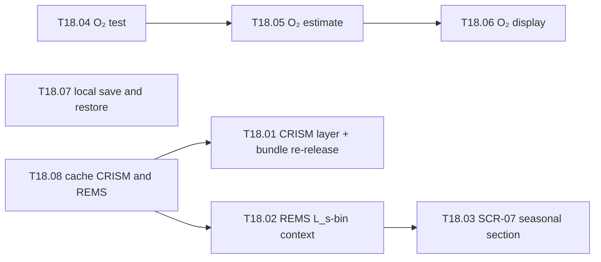

# TASK-18 — Desirables (only after freeze criteria met early)

| Field | Value |
| --- | --- |
| Objective | Desirables (only after freeze criteria met early) |
| Requirements | FR-13, FR-18, FR-19, FR-20 (all Should); FR-21 is post-MVP — note only ([01 §C.3](../specs/01_Product_Requirements_Document.md#c4-post-mvp)) |
| Lane / owner role | Any (06 §C). Per subtask: data — Data/GIS lead (T18.01, T18.02); compute — Compute engineer (T18.04, T18.05); frontend — Frontend engineer (T18.03, T18.06, T18.07) |
| Milestone | Only after the [06 §D.6](../specs/06_High_Level_Implementation_Plan.md#d6-demo-freeze-criteria-day-2-0600) freeze criteria are met early; merge before the Day 2 06:00 freeze (M5; see Spec questions 9) |
| Window | event-only (every subtask) |
| Effort (doc 06) | 2–6 h each |
| Done when (doc 06) | Feature labelled and tested |
| Main risk → fallback | Skip |
| Spec sections | [06 §C TASK-18](../specs/06_High_Level_Implementation_Plan.md#c-work-packages) · [06 §D.4 item 1](../specs/06_High_Level_Implementation_Plan.md#d4-cut-list-cut-in-this-order-when-behind) · [01 FR-13](../specs/01_Product_Requirements_Document.md#fr-13--environmental-context-seasonal-weather) · [01 FR-18](../specs/01_Product_Requirements_Document.md#fr-18--spectral-crism-layer--s) · [01 FR-19](../specs/01_Product_Requirements_Document.md#fr-19--illustrative-consumables-estimate--s) · [01 FR-20](../specs/01_Product_Requirements_Document.md#fr-20--saverestore-plan-locally--s) · [02 §C.2 L5](../specs/02_Technical_Requirements_Document.md#l5--spectral-fr-18-desirable) · [02 §C.2 L7](../specs/02_Technical_Requirements_Document.md#l7--environmental-values-fr-11-fr-12-fr-13) · [02 §D.6](../specs/02_Technical_Requirements_Document.md#d6-illustrative-consumables-fr-19-desirable) · [05 §B](../specs/05_Backend_and_Database_Schema.md#b-persistence-strategy) · [05 §E.4](../specs/05_Backend_and_Database_Schema.md#e4-versioning-and-migration) · [03 §C.5](../specs/03_App_Flow_and_Diagrams.md#c5-saving--exporting-in-scope-export-storage-desirable) |

All seven subtasks are `desirable`, which is cut 1 of [06 §D.4](../specs/06_High_Level_Implementation_Plan.md#d4-cut-list-cut-in-this-order-when-behind): they are the first work dropped and start only once the freeze criteria hold. 06 lists the deliverable as "Any of: CRISM layer, REMS context, O₂ estimate, local save" — each one ships on its own or not at all.

## Inputs this task consumes

| Input | Kind | Owner | Dependency |
| --- | --- | --- | --- |
| 06 §D.6 freeze criteria met: two clean offline rehearsals of the core scenario | upstream output | T14.06 | hard (every subtask; TASK-18 gate) |
| CRISM MTRDR coverage finding for the AOI | upstream output | T01.04 | hard (T18.01) |
| Site bundle v1 and `pipeline/sources.lock.json`, followed up by the re-release | upstream output | T03.19 | hard (T18.01) |
| SCR-07 Conditions panel, followed up | upstream output | T10.02 | hard (T18.03) |
| SCR-05 Route Results and SCR-08 Briefing Card, followed up | upstream output | T09.03, T11.03 | hard (T18.06) |
| Plan store, followed up | upstream output | T08.03 | hard (T18.07) |
| PlanExport assembly (05 §B stores the last PlanExport) | upstream output | T11.02 | hard (T18.07) |
| 05 entity mirror and schemas (C1–C3), site-config input layout (C5) | contract | T03.01 | soft |
| Tile grid and tile encoding (C9) | contract | T02.01 | soft |
| UI app context and metric-component signature (C10) | contract | T07.01 | soft |
| Plan-store state and events (C11) | contract | T08.01 | soft |
| Cached CRISM products and REMS RDR files in `pipeline/work/` | upstream output | none planned — Spec questions 1 | hard (T18.01, T18.02) |

## Outputs this task provides

| Output | Path | Consumers |
| --- | --- | --- |
| CRISM spectral layer in a re-released bundle with a new `data_version` | `data/sites/gale_boxwork/`, `pipeline/sites/gale_boxwork/layers/`, `pipeline/sites/gale_boxwork/sources/` | SCR-03 renders it from the manifest (T07.09); SCR-09 lists its source (T12.03); T16.03, T16.05 (credits) |
| REMS L_s-bin context | `pipeline/src/marswalk_pipeline/rems.py`; output location `TODO(decision)` | T18.03 |
| Seasonal-weather section of SCR-07 | `apps/web/src/ui/screens/scr07Conditions.tsx` | T12.02 (DOM provenance test must still pass) |
| Illustrative O₂ function | `packages/compute/src/consumables.ts` | T18.06 |
| Illustrative O₂ display | `apps/web/src/ui/screens/scr05RouteResults.tsx`, `apps/web/src/ui/screens/scr08BriefingCard.tsx` | T12.02; one-page print check of T11.05 |
| Last-plan save and restore | `apps/web/src/state/persist.ts`, `apps/web/src/state/planStore.ts` | SCR-01 return path ([03 §C.4](../specs/03_App_Flow_and_Diagrams.md#c4-returning-to-an-earlier-step)) |

## Subtasks

### T18.01 — follow-up: CRISM layer and bundle re-release (only if T01.04 finds MTRDR coverage)

- **Owner:** Unassigned — whoever has finished their own tasks takes it, only after M3 passes (06 §A.2)
- **Type:** implement
- **Tag:** agent-ready · desirable
- **Window:** event-only
- **Estimate:** 2–3 h
- **Owns (writes):** `pipeline/src/marswalk_pipeline/crism.py`, `pipeline/sites/gale_boxwork/layers/` (append-only), `pipeline/sites/gale_boxwork/sources/` (append-only), `data/sites/gale_boxwork/` (after T03.19), `pipeline/sources.lock.json` (after T03.19)
- **Reads:** `docs/ops/feasibility/coverage.md` (T01.04), `docs/contracts/tile-grid.md` (C9), `pipeline/sites/README.md` (C5), `schemas/site-manifest.schema.json` (C2), `pipeline/src/marswalk_pipeline/clip_reproject.py`, `pipeline/src/marswalk_pipeline/tiles.py`, `pipeline/src/marswalk_pipeline/manifest.py`, `pipeline/src/marswalk_pipeline/validate_manifest.py`; [01 FR-18](../specs/01_Product_Requirements_Document.md#fr-18--spectral-crism-layer--s), [02 §C.2 L5](../specs/02_Technical_Requirements_Document.md#l5--spectral-fr-18-desirable), [02 Sources](../specs/02_Technical_Requirements_Document.md#sources-accessed-2026-11-02), [05 §C Layer](../specs/05_Backend_and_Database_Schema.md#layer), [05 §C DataSource](../specs/05_Backend_and_Database_Schema.md#datasource), [05 §E.4](../specs/05_Backend_and_Database_Schema.md#e4-versioning-and-migration), [05 §E.6](../specs/05_Backend_and_Database_Schema.md#e6-unavailable-or-replaced-source-data)
- **Depends on:** T14.06 (hard: 06 TASK-18 gate, freeze criteria met early), T01.04 (hard: needs the CRISM coverage finding), T03.19 (hard: follow-up on the bundle it owns, §c.1 rule 3), T03.01 (soft), T02.01 (soft), T18.08 (hard: the source files must be cached before the event)
- **Parallel with:** T18.02, T18.04, T18.05, T18.07
- **Steps:**
  1. Read the coverage note from T01.04. If it records no MTRDR observation over the AOI, stop: FR-18 is not built (02 §C.2 L5 fallback "Omit").
  2. Use only MTRDR products already cached in `pipeline/work/` before the event — no download during the event (`CLAUDE.md` §2; Spec questions 1). Which summary parameter or browse product to show is `TODO(decision)`.
  3. In `crism.py`, reproject and clip with the existing `clip_reproject.py` functions and render tiles with `tiles.py` per the tile-grid contract C9; display resolution `TODO(decision)` (native ~18–20 m/px for FRT observations, 02 §C.2 L5).
  4. Add one Layer record (category `spectral`; title, legend and `limitations` carrying the 02 §C.2 L5 label "Spectral summary parameter — indicative, not a mineral identification") and one DataSource record for the PDS Geosciences Node MTRDR product; ids and provenance label `TODO(decision)`.
  5. Re-run the pipeline into a new `data_version` (05 §E.4: it changes whenever any asset changes; 05 §E.6: never overwrite assets in place); the run updates the lock file. Run `crism.py` as its own module before the manifest step — `__main__.py` (T03.15) is not edited.
  6. Run `validate-manifest`, then open the app offline and check SCR-03 and SCR-09; re-check the 06 §D.6 freeze criteria.
- **Acceptance:**
  - Serves: FR-18, NFR-06, NFR-09, SCR-03 · [01 FR-18](../specs/01_Product_Requirements_Document.md#fr-18--spectral-crism-layer--s), [02 §C.2 L5](../specs/02_Technical_Requirements_Document.md#l5--spectral-fr-18-desirable)
  - Given T01.04 found MTRDR coverage, when the re-released bundle loads, then SCR-03 lists a Spectral layer labelled as a summary-parameter browse product, "not a mineral identification" (01 FR-18).
  - Given no coverage, then nothing is built and SCR-03 shows no Spectral row ([03 SCR-03](../specs/03_App_Flow_and_Diagrams.md#scr-03--layers-panel): "only if built").
  - `validate-manifest` passes: every asset resolves with its SHA-256 and every `source_ids` entry resolves ([05 §E.3](../specs/05_Backend_and_Database_Schema.md#e3-referential-integrity-validated-by-the-validate-manifest-command-and-at-app-boot-in-dev-builds)); the `data_version` is new.
  - Total site bundle ≤ 250 MB ([NFR-09](../specs/02_Technical_Requirements_Document.md#f-nonfunctional-requirements-and-validation)); no runtime request leaves `localhost` (NFR-01).
- **Verify:** `make validate SITE=gale_boxwork`; `$(make -s pipeline-python) -m pytest pipeline/tests/test_manifest.py`; `make test`; manual: `make demo` with the network off — Spectral row and legend in SCR-03, CRISM source in SCR-09.
- **Agent brief:** Only if `docs/ops/feasibility/coverage.md` records CRISM MTRDR coverage of the AOI: write `crism.py` to tile the cached summary-parameter product per `docs/contracts/tile-grid.md`, add one Layer and one DataSource record, and re-release the bundle under a new `data_version`. Label it "not a mineral identification"; download nothing; stop if no coverage.
- **Conflict notes:** Writes the bundle and lock file only after T03.19 has merged (§c.1 rule 3) and is the only bundle writer at that time. `layers/` and `sources/` are append-only by file: add new files, never edit others. Binaries stay git-ignored; only `site-manifest.json` and vectors are committed. Does not touch `__main__.py` (T03.15).

### T18.02 — Build REMS L_s-bin temperature and pressure context from named RDR files

- **Owner:** Unassigned — whoever has finished their own tasks takes it, only after M3 passes (06 §A.2)
- **Type:** implement
- **Tag:** agent-ready · desirable
- **Window:** event-only
- **Estimate:** 2–3 h
- **Owns (writes):** `pipeline/src/marswalk_pipeline/rems.py`, `pipeline/sites/gale_boxwork/sources/` (append-only)
- **Reads:** `pipeline/sites/README.md` (C5), `schemas/site-manifest.schema.json` (C2); [01 FR-13](../specs/01_Product_Requirements_Document.md#fr-13--environmental-context-seasonal-weather), [02 §C.2 L7](../specs/02_Technical_Requirements_Document.md#l7--environmental-values-fr-11-fr-12-fr-13), [02 Sources](../specs/02_Technical_Requirements_Document.md#sources-accessed-2026-11-02) (PDS Atmospheres Node — MSL REMS), [05 §C DataSource](../specs/05_Backend_and_Database_Schema.md#datasource), [05 §E.5](../specs/05_Backend_and_Database_Schema.md#e5-provenance-required-to-reproduce-a-result)
- **Depends on:** T14.06 (hard: 06 TASK-18 gate, freeze criteria met early), T03.01 (soft), T18.08 (hard: the source files must be cached before the event)
- **Parallel with:** T18.01, T18.04, T18.05, T18.07
- **Steps:**
  1. Use REMS RDR files from the PDS Atmospheres Node that were cached in `pipeline/work/` before the event (02 §C.2 L7; Spec questions 1); file names and fields `TODO(verify)`.
  2. In `rems.py`, bin air temperature, ground temperature and pressure by L_s; bin width and the "typical range" statistic are `TODO(decision)` (not in the specs).
  3. Record, for every output value, the named RDR files it came from (01 FR-13); add an assert-based self-check that no value lacks a source file.
  4. Write the binned output to the location the team chooses (`TODO(decision)`, Spec questions 2 and 3); never write placeholder numbers.
  5. Add one DataSource record for the REMS RDR product; id, credit and licence `TODO(verify)`.
  6. Run the script twice and confirm byte-identical output (NFR-06).
- **Acceptance:**
  - Serves: FR-13, NFR-06 · [01 FR-13](../specs/01_Product_Requirements_Document.md#fr-13--environmental-context-seasonal-weather), [02 §C.2 L7](../specs/02_Technical_Requirements_Document.md#l7--environmental-values-fr-11-fr-12-fr-13)
  - Values trace to named REMS RDR files and the binning script (01 FR-13 acceptance).
  - Every number comes from the RDR files through the script; none is typed by a person or an agent (`CLAUDE.md` §2).
  - Two runs on the same files give identical output (NFR-06).
  - The DataSource record has every required 05 §C DataSource field.
- **Verify:** `$(make -s pipeline-python) -m marswalk_pipeline.rems` run twice, outputs compared with `cmp` (output path `TODO(decision)`); `$(make -s pipeline-python) -m pytest pipeline` stays green.
- **Agent brief:** Write `pipeline/src/marswalk_pipeline/rems.py`: bin the cached REMS RDR air/ground temperature and pressure values by L_s, keep the source file names with every value, and add the REMS DataSource record. Bin width, statistic and output location are open decisions — ask before choosing; download nothing during the event.
- **Conflict notes:** New module only; `sources/` is append-only by file. Not wired into `__main__.py` (T03.15). The output reaches the app only through a bundle re-release — see Spec questions 2.

### T18.03 — follow-up: seasonal-weather section in SCR-07

- **Owner:** Unassigned — whoever has finished their own tasks takes it, only after M3 passes (06 §A.2)
- **Type:** implement
- **Tag:** agent-ready · desirable
- **Window:** event-only
- **Estimate:** 1–1.5 h
- **Owns (writes):** `apps/web/src/ui/screens/scr07Conditions.tsx` (after T10.02)
- **Reads:** `apps/web/src/ui/screens/scr07Conditions.tsx`, `apps/web/src/ui/context.ts` (C10), `apps/web/src/ui/components/metric.ts`, the T18.02 output; [01 FR-13](../specs/01_Product_Requirements_Document.md#fr-13--environmental-context-seasonal-weather), [03 SCR-07](../specs/03_App_Flow_and_Diagrams.md#scr-07--conditions-panel), [05 §C PlanResult](../specs/05_Backend_and_Database_Schema.md#planresult-computed) (`conditions.ls_deg`), [04 §E](../specs/04_Design_Brief.md#f-accessibility-and-responsive-behavior)
- **Depends on:** T18.02 (hard: needs the REMS context output), T10.02 (hard: follow-up on the panel it owns, §c.1 rule 3), T14.06 (hard: 06 TASK-18 gate, freeze criteria met early), T07.01 (soft)
- **Parallel with:** T18.01, T18.04, T18.05, T18.06, T18.07
- **Steps:**
  1. Take the EVA date's L_s from `PlanResult.conditions.ls_deg` and look up its bin in the T18.02 output.
  2. Show typical air temperature, ground temperature and pressure ranges with units through the metric component, each with a provenance chip (label `TODO(decision)`: 02 §C.2 L7 says "Measured, aggregated by team") and a link to the REMS source in SCR-09.
  3. With no REMS data for the build or the bin, keep "Not included in this build" (01 FR-13; 03 SCR-07) — never placeholder numbers.
  4. Keep the section keyboard reachable and readable by screen readers (04 §E).
  5. Run the DOM provenance test and check SCR-07 offline with and without REMS data.
- **Acceptance:**
  - Serves: FR-13, FR-15, NFR-05, SCR-07 · [01 FR-13](../specs/01_Product_Requirements_Document.md#fr-13--environmental-context-seasonal-weather), [03 SCR-07](../specs/03_App_Flow_and_Diagrams.md#scr-07--conditions-panel)
  - Given REMS context for the EVA date's L_s bin, when SCR-07 opens, then air/ground temperature and pressure ranges show with units, a provenance label and a source link (01 FR-13, NFR-05).
  - Given no REMS context, then the panel shows "Not included in this build" rather than placeholder numbers (01 FR-13).
  - `tests/ui/provenance.test.ts` still passes ([01 FR-15](../specs/01_Product_Requirements_Document.md#fr-15--provenance-and-methods)).
- **Verify:** `npx vitest run tests/ui/provenance.test.ts` (run in `apps/web/`); manual offline check of SCR-07 with and without the REMS output.
- **Agent brief:** In `apps/web/src/ui/screens/scr07Conditions.tsx`, add a seasonal-weather section that shows the REMS ranges for the plan's L_s bin through the metric component, with provenance and source link, and keeps "Not included in this build" when no REMS data exists. Edit nothing else.
- **Conflict notes:** Edits SCR-07 only after T10.02 has merged; no other planned writer at the same time. Styling uses existing tokens; a `.css` change would need its own `follow-up:` entry in the map.

### T18.04 — follow-up: tests for the planner's illustrative O₂ estimate (02 §D.6)

- **Owner:** Unassigned — whoever has finished their own tasks takes it, only after M3 passes (06 §A.2)
- **Type:** test
- **Tag:** agent-ready · desirable
- **Window:** event-only
- **Estimate:** 0.5 h
- **Owns (writes):** `packages/compute/tests/consumables.test.ts` (after T05b.16)
- **Reads:** [02 §D.6](../specs/02_Technical_Requirements_Document.md#d6-illustrative-consumables-fr-19-desirable), [01 FR-19](../specs/01_Product_Requirements_Document.md#fr-19--illustrative-consumables-estimate--s), [Test-case allocation](_coordination.md#test-case-allocation)
- **Depends on:** T05b.16 (hard: owner of the test file; the engine's suit-consumables cases come first), T14.06 (hard: 06 TASK-18 gate, freeze criteria met early)
- **Parallel with:** T18.01, T18.02, T18.03, T18.07
- **Steps:**
  1. Create `packages/compute/tests/consumables.test.ts`.
  2. Import `o2LitresPerMinute(metabolicW)` from `packages/compute/src/consumables.ts` (the module exists since T05b.17; this subtask adds the planner estimate's signature beside the suit-consumables functions).
  3. Encode the one allocated case: 351.7 W → ≈ 1.03 L/min, compared at the two decimals the spec writes (tolerance `TODO(verify)`).
  4. Open the PR as a draft; T18.05 stacks on it ([§h.3](_coordination.md#h3-tests-first-merge-order)).
- **Acceptance:**
  - Serves: FR-19 · [02 §D.6](../specs/02_Technical_Requirements_Document.md#d6-illustrative-consumables-fr-19-desirable)
  - The test holds exactly the case the map allocates: metabolic rate while walking 1,200 BTU/h = 351.7 W (Apollo 17 planning value) → O₂ ≈ 1.03 L/min.
  - The expected value is copied from 02 §D.6, not calculated in the test.
  - It fails before T18.05 and passes after.
- **Verify:** `npx vitest run tests/compute/consumables.test.ts` (run in `apps/web/`).
- **Agent brief:** Write `packages/compute/tests/consumables.test.ts` with one Vitest case from 02 §D.6: `o2LitresPerMinute(351.7)` rounds to 1.03 L/min. Copy the numbers from the spec; add no other cases.
- **Conflict notes:** Edits the test file after its owner T05b.16 (follow-up); add cases, never change the suit-consumables cases. Stays a draft until T18.05 makes it pass; the two merge back to back.

### T18.05 — follow-up: implement the planner's illustrative O₂ estimate

- **Owner:** Unassigned — whoever has finished their own tasks takes it, only after M3 passes (06 §A.2)
- **Type:** implement
- **Tag:** agent-ready · desirable
- **Window:** event-only
- **Estimate:** 0.5–1 h
- **Owns (writes):** `packages/compute/src/consumables.ts` (after T05b.17)
- **Reads:** `packages/compute/tests/consumables.test.ts`; [02 §D.6](../specs/02_Technical_Requirements_Document.md#d6-illustrative-consumables-fr-19-desirable), [02 §D](../specs/02_Technical_Requirements_Document.md#d-core-processing-and-simulation-behavior), [01 FR-19](../specs/01_Product_Requirements_Document.md#fr-19--illustrative-consumables-estimate--s)
- **Depends on:** T05b.17 (hard: owner of `consumables.ts` since v2, FR-35), T18.04 (hard: tests first, paired test), T14.06 (hard: 06 TASK-18 gate, freeze criteria met early)
- **Parallel with:** T18.01, T18.02, T18.03, T18.07
- **Steps:**
  1. Create `packages/compute/src/consumables.ts` as a pure module: no DOM, no fetch (02 §D).
  2. Export the walking metabolic rate 351.7 W (1,200 BTU/h, Apollo 17 planning value) and the O₂ energy equivalent ≈ 20.4 kJ/L (RER 0.85, Weir relation — Assumed), each with a comment citing 02 §D.6 and its label.
  3. Export `o2LitresPerMinute(metabolicW)` = metabolic power ÷ energy equivalent of O₂ (02 §D.6).
  4. Do not add litres over the walk or EVA time until the team decides (`TODO(decision)`, Spec questions 6).
  5. Make T18.04 pass; merge right after it.
- **Acceptance:**
  - Serves: FR-19 · [02 §D.6](../specs/02_Technical_Requirements_Document.md#d6-illustrative-consumables-fr-19-desirable)
  - `npx vitest run tests/compute/consumables.test.ts` passes.
  - Constants match 02 §D.6 verbatim and keep their labels.
  - No routing, warning or status code imports the module (02 §D.6: "never used to block a route").
  - `make typecheck` passes.
- **Verify:** `npx vitest run tests/compute/consumables.test.ts` (run in `apps/web/`); `make typecheck`; `grep -rn consumables packages/compute/src` lists no import from `route.ts`, `warnings.ts` or `handler.ts`.
- **Agent brief:** Create `packages/compute/src/consumables.ts` exporting `o2LitresPerMinute(metabolicW)` and the two 02 §D.6 constants with their labels, so `tests/compute/consumables.test.ts` passes. Pure function; nothing in routing or warnings may use it.
- **Conflict notes:** Edits `consumables.ts` after its owner T05b.17 (follow-up): add the planner estimate, never change the suit-consumables functions. Branch stacked on T18.04; merge right after it.

### T18.06 — follow-up: show the O₂ estimate labelled "illustrative"

- **Owner:** Unassigned — whoever has finished their own tasks takes it, only after M3 passes (06 §A.2)
- **Type:** implement
- **Tag:** agent-ready · desirable
- **Window:** event-only
- **Estimate:** 1–1.5 h
- **Owns (writes):** `apps/web/src/ui/screens/scr05RouteResults.tsx` (after T09.03), `apps/web/src/ui/screens/scr08BriefingCard.tsx` (after T11.03)
- **Reads:** `packages/compute/src/consumables.ts`, `apps/web/src/ui/context.ts` (C10), `apps/web/src/ui/components/metric.ts`, both screen files; [01 FR-19](../specs/01_Product_Requirements_Document.md#fr-19--illustrative-consumables-estimate--s), [02 §D.6](../specs/02_Technical_Requirements_Document.md#d6-illustrative-consumables-fr-19-desirable), [04 §D](../specs/04_Design_Brief.md#d-interaction-and-component-behavior), [03 SCR-05](../specs/03_App_Flow_and_Diagrams.md#scr-05--route-results-panel), [03 SCR-08](../specs/03_App_Flow_and_Diagrams.md#scr-08--briefing-card), [05 §F.3](../specs/05_Backend_and_Database_Schema.md#f3-plan-export-abridged-status-ok)
- **Depends on:** T18.05 (hard: needs the O₂ function), T09.03 (hard: follow-up on the panel it owns, §c.1 rule 3), T11.03 (hard: follow-up on the card it owns, §c.1 rule 3), T14.06 (hard: 06 TASK-18 gate, freeze criteria met early), T07.01 (soft)
- **Parallel with:** T18.01, T18.02, T18.03, T18.07
- **Steps:**
  1. Call `o2LitresPerMinute` on the main thread; it is a pure compute module, imported the way the UI imports `validate.ts`.
  2. In SCR-05, add the value to the "Details" expansion, not to the six headline metrics (04 §D); placement `TODO(decision)`.
  3. In SCR-08, add one line to the metrics or assumptions block and keep the card on one page.
  4. Render it through the metric component with the word "illustrative", a provenance chip (label `TODO(decision)`: modelled or assumed) and source ids — `apollo17-planning` (05 §F.3); the 20.4 kJ/L constant has no DataSource (`TODO(verify)`).
  5. Never show it as a limit or feed it into status, warnings or the banner (01 FR-19).
  6. Run the DOM provenance test and a Chrome print preview.
- **Acceptance:**
  - Serves: FR-19, FR-14, FR-15, NFR-05, SCR-05, SCR-08 · [01 FR-19](../specs/01_Product_Requirements_Document.md#fr-19--illustrative-consumables-estimate--s), [02 §D.6](../specs/02_Technical_Requirements_Document.md#d6-illustrative-consumables-fr-19-desirable)
  - The O₂ estimate is labelled "illustrative" on SCR-05 and SCR-08 and is never shown as a limit (01 FR-19).
  - It carries `data-provenance` and a source id (NFR-05); `tests/ui/provenance.test.ts` passes.
  - The briefing card still prints on one A4/Letter page in Chrome without clipping ([01 FR-14](../specs/01_Product_Requirements_Document.md#fr-14--briefing-card-and-plan-export)).
  - Status banner, warnings and limits are unchanged with and without the estimate.
- **Verify:** `npx vitest run tests/ui/provenance.test.ts` (run in `apps/web/`); manual: Chrome print preview of SCR-08 fits one page; SCR-05 "Details" shows the labelled value offline.
- **Agent brief:** Show the illustrative O₂ rate from `packages/compute/src/consumables.ts` in SCR-05's Details expansion and on the SCR-08 card through the metric component, labelled "illustrative" with provenance and source id. It must never act as a limit, and the card must still print on one page.
- **Conflict notes:** Edits SCR-05 after T09.03 and SCR-08 after T11.03 have merged; one writer per file at a time. Styling uses existing tokens; a `.css` change would need its own `follow-up:` entry in the map.

### T18.07 — follow-up: save and restore the last plan in browser storage

- **Owner:** Unassigned — whoever has finished their own tasks takes it, only after M3 passes (06 §A.2)
- **Type:** implement
- **Tag:** agent-ready · desirable
- **Window:** event-only
- **Estimate:** 1.5–2 h
- **Owns (writes):** `apps/web/src/state/persist.ts`, `apps/web/src/state/planStore.ts` (after T08.03)
- **Reads:** `apps/web/src/state/planStore.ts` (C11 interfaces), `apps/web/src/export/planExport.ts`, `schemas/plan-export.schema.json` (C3); [01 FR-20](../specs/01_Product_Requirements_Document.md#fr-20--saverestore-plan-locally--s), [05 §B](../specs/05_Backend_and_Database_Schema.md#b-persistence-strategy), [05 §E.4](../specs/05_Backend_and_Database_Schema.md#e4-versioning-and-migration), [03 §C.4](../specs/03_App_Flow_and_Diagrams.md#c4-returning-to-an-earlier-step), [03 §C.5](../specs/03_App_Flow_and_Diagrams.md#c5-saving--exporting-in-scope-export-storage-desirable)
- **Depends on:** T08.03 (hard: follow-up on the store it owns, §c.1 rule 3), T11.02 (hard: stores the PlanExport it assembles), T14.06 (hard: 06 TASK-18 gate, freeze criteria met early), T08.01 (soft), T03.01 (soft)
- **Parallel with:** T18.01–T18.06
- **Steps:**
  1. In `persist.ts`, save the last PlanExport, built with `planExport.ts`, as a JSON string under the key `mwp:lastPlan:v1` (05 §B) after each computed plan.
  2. Wrap every storage read and write in error handling; any failure is ignored silently and the app keeps working (01 FR-20; 03 §C.5).
  3. On load, restore only when `export_schema_version` has the app's major version (05 §E.4); for another `data_version` apply the 05 §E.4 rule — message or skip is `TODO(decision)` (Spec questions 10).
  4. Restore the scenario and waypoints through the existing store actions `setScenario` and `setWaypoints`, so the plan recomputes; never display the stored result (NFR-06).
  5. Call `persist.ts` from `createPlanStore` in `planStore.ts` without changing the C11 interfaces.
  6. Check by hand: reload, blocked storage, a corrupt stored value, a different export major version.
- **Acceptance:**
  - Serves: FR-20, NFR-06, NFR-08 · [01 FR-20](../specs/01_Product_Requirements_Document.md#fr-20--saverestore-plan-locally--s), [05 §B](../specs/05_Backend_and_Database_Schema.md#b-persistence-strategy), [03 §C.5](../specs/03_App_Flow_and_Diagrams.md#c5-saving--exporting-in-scope-export-storage-desirable)
  - Given a computed plan, when the page reloads, then the last plan is restored and recomputed (03 §C.5).
  - Given storage that throws or is unavailable, then the app works and shows no error (01 FR-20).
  - A stored export with a different major `export_schema_version` is not restored (05 §E.4).
  - Nothing leaves the browser ([NFR-08](../specs/02_Technical_Requirements_Document.md#f-nonfunctional-requirements-and-validation)); `make typecheck test` passes.
- **Verify:** `make typecheck test`; manual checklist in a normal window, in a private window with site storage blocked, and with a corrupted `mwp:lastPlan:v1` value set in devtools.
- **Agent brief:** Create `apps/web/src/state/persist.ts` to save the last PlanExport under `mwp:lastPlan:v1` and restore its scenario and waypoints on load, with every storage call wrapped so failures are ignored; call it from `createPlanStore` without changing the store's interfaces.
- **Conflict notes:** Edits `planStore.ts` only after T08.03 has merged and keeps the C11 interfaces; an interface change would be a `contract-change:` subtask in TASK-08. `persist.ts` is new. No other planned writer of `planStore.ts`.

### T18.08 — Cache the CRISM and REMS source files before 13 Nov

- **Owner:** Unassigned — whoever has finished their own tasks takes it, only after M3 passes (06 §A.2)
- **Type:** human
- **Tag:** human-required · desirable
- **Window:** pre-event-allowed
- **Estimate:** 1–2 h
- **Owns (writes):** none — files go to the git-ignored `pipeline/work/`; their URLs, versions and checksums are recorded in the T18.01 and T18.02 PRs
- **Reads:** [02 §C.2 L5](../specs/02_Technical_Requirements_Document.md#l5--spectral-fr-18-desirable), [02 §C.2 L7](../specs/02_Technical_Requirements_Document.md#l7--environmental-values-fr-11-fr-12-fr-13), [02 Sources](../specs/02_Technical_Requirements_Document.md#sources-accessed-2026-11-02), `docs/ops/feasibility/coverage.md`
- **Depends on:** T01.04 (hard: CRISM is cached only if the coverage check found MTRDR data for the AOI)
- **Parallel with:** T03.07, T04.01
- **Steps:**
  1. Read the CRISM result in `docs/ops/feasibility/coverage.md`; skip CRISM when it found no coverage (FR-18 then stays out).
  2. Download the CRISM MTRDR summary-parameter products for the covering observations from the PDS bundle in 02 Sources into `pipeline/work/` (`TODO(verify)`: exact product files).
  3. Download the REMS RDR files from the PDS Atmospheres Node page in 02 Sources (`TODO(decision)`: which sols cover the L_s bin of the EVA dates).
  4. Record each file's URL, version and SHA-256 (from `sha256sum`) for the T18.01 and T18.02 PRs.
  5. Open every file once with the network off.
- **Acceptance:**
  - Serves: FR-13, FR-18 · [CLAUDE.md](../../CLAUDE.md) §2 (external sources are contacted only before the event)
  - Given TASK-18 work starts at the event, when T18.01 or T18.02 runs, then every source file it needs is already on the data laptop.
  - Every cached file has a recorded URL, version and SHA-256.
- **Verify:** manual: with the network off, list the cached files in `pipeline/work/` and compare their SHA-256 with the recorded values.
- **Agent brief:** Before 13 Nov, cache the CRISM MTRDR summary products (only if `coverage.md` shows AOI coverage) and the REMS RDR files FR-13 needs into `pipeline/work/`; record URLs, versions and checksums for the T18.01/T18.02 PRs. An agent may script the downloads after a human picks the exact files; never guess URLs.
- **Conflict notes:** Writes only the git-ignored `pipeline/work/`, so it opens no PR; its record travels with T18.01 and T18.02. Skip it if the team has no pre-event time: TASK-18 is cut first.

## Internal dependency graph

Every subtask also depends hard on T14.06 (TASK-18 gate), and each `follow-up:` on the §c owner of the path it edits; those edges leave this task and are listed per subtask.

## Definition of done (task level)

- [06 §D.7](../specs/06_High_Level_Implementation_Plan.md#d7-definition-of-done-per-feature) for each desirable that ships: acceptance criteria met; unit test (T18.04 for the compute part) or manual test note for UI work (where it is committed: Spec questions 8); provenance label present (`data-provenance` and source id); keyboard reachable; works offline; credited sources listed in SCR-09.
- 06 TASK-18 done when: "Feature labelled and tested".
- Started only after the 06 §D.6 freeze criteria held; merged before the Day 2 06:00 freeze.
- After each merge the freeze criteria still hold: core scenario offline, Vitest suites and manifest validator green, no console errors on the demo path, briefing prints on one page, clean-clone build. If any fails, revert the merge (06 fallback: "Skip").
- A desirable that is not built leaves no trace in the UI except the spec's own wording: SCR-07 shows "Not included in this build" (FR-13); SCR-03 shows no Spectral row (FR-18).
- `python3 scripts/check_tasks.py` passes.

## Spec questions

1. **External sources during the event.** `CLAUDE.md` §2 says external sources are contacted only by the pipeline, before the event. T18.01 and T18.02 are `event-only`, but no subtask caches the CRISM MTRDR products or the REMS RDR files before 13 Nov. Map change proposed: a `pre-event-allowed` data subtask that caches them into `pipeline/work/` (CRISM only if T01.04 finds coverage). Without it, both subtasks are skipped.
2. **No path for REMS output and no general re-release.** §c gives the REMS output no location, and the only bundle re-release is inside T18.01, which runs only when CRISM covers the AOI. Map change proposed: a path for the REMS output and a `follow-up:` bundle re-release that does not depend on CRISM. `TODO(decision)`.
3. **No data shape for FR-13.** 05 defines no entity or manifest field for REMS seasonal context; EnvConstant (05 §C) holds constants "used in estimates". The shape is `TODO(decision)` and needs a `spec-change:` to 05 plus a C1/C2 `contract-change:`.
4. **REMS details missing from the specs.** RDR file names and fields, L_s bin width, which statistic counts as "typical", and the provenance label for binned values (02 §C.2 L7 says "Measured, aggregated by team": `measured` or `derived`) — `TODO(verify)` / `TODO(decision)`.
5. **CRISM details missing from the specs.** Which summary parameter or browse product, layer and source ids, display resolution (native ~18–20 m/px), provenance label, and whether the C9 tile encoding covers a pre-coloured browse product (if not, a C9 `contract-change:`) — `TODO(decision)`.
6. **O₂ estimate.** 02 §D.6 writes "≈ 1.03 L/min" without a tolerance (`TODO(verify)`). It also gives 1,440 BTU/h = 422.0 W with a 20 % walkback pad, but the map's test-case allocation names only the 351.7 W case, so that value is not tested. Open: rate only or litres over the walk or EVA time; provenance label (modelled or assumed); SCR-05 placement given the six headline metrics of 04 §D — `TODO(decision)`. The ≈ 20.4 kJ/L constant has no DataSource — `TODO(verify)`.
7. **Cross-task hard dependencies missing from the map's §f table.** T01.04 → T18.01 (coverage finding); T11.02 → T18.07 (05 §B stores the last PlanExport); and the `follow-up:` handovers that §c.1 rule 3 requires: T03.19 → T18.01, T10.02 → T18.03, T09.03 and T11.03 → T18.06, T08.03 → T18.07. Map change proposed: add them to §f.
8. **Committed manual test notes.** 06 §D.7 asks for a committed manual test note for UI features, but TASK-18 has no verify subtask and §c lets only verify subtasks append to `docs/ops/verification-log.md`. There is also no test path for `persist.ts`. Map change proposed: let T18.03, T18.06 and T18.07 append their note to the verification log (or add a TASK-18 verify subtask), and add `apps/web/tests/state/persist.test.ts` for T18.07.
9. **Milestone.** The register gives TASK-18 M5–M6, but 06 §B freezes the demo at Day 2 06:00 (M6) and §g shows no build work in M6. This file treats Day 2 06:00 as the last merge time.
10. **Restoring a plan from another data version.** 05 §E.4 says old exports "show 'computed with data_version X; current Y — results may differ' and can be recomputed", but the C11 store has no field for such a message. Showing it needs a C11 `contract-change:`; the alternative is to skip the restore — `TODO(decision)`.
11. **FR-21** (space weather, 3D view, multi-site, AI narration) is post-MVP ([01 FR-21](../specs/01_Product_Requirements_Document.md#fr-21--post-mvp-items--c), [01 §C.3](../specs/01_Product_Requirements_Document.md#c4-post-mvp)): no subtask.
