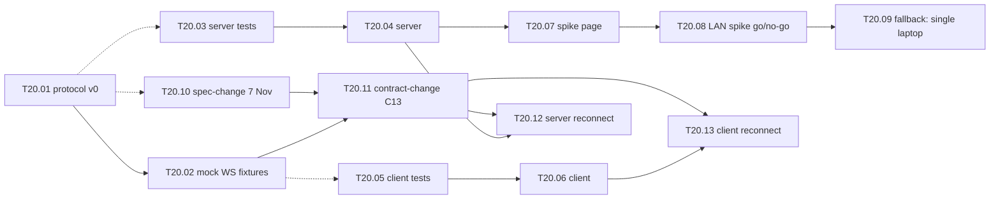

# TASK-20 — Hab Core skeleton: server, protocol v0, LAN spike

| Field | Value |
| --- | --- |
| Objective | Fastify static server and `/ws` with HELLO, SNAPSHOT, STATE_DELTA, EVENT, COMMAND_RESULT, reconnect and heartbeat; `packages/protocol` v0 frozen; the web client side of the protocol; the M1 LAN broadcast spike |
| Requirements | FR-30, FR-31, FR-32 (link-lost state), NFR-01, NFR-08, NFR-12, NFR-13 |
| Lane / owner role | hab-core — R4 Hab Core: Sadman Shaharier Mahim (Anjim Hossain supports) |
| Milestone | M1 (protocol v0 frozen and LAN spike go/no-go on Sat 7 Nov); client and reconnect by M3 |
| Window | pre-event-if-permitted (T20.01 and T20.02 are pre-event-allowed) |
| Effort (doc 06) | 6–8 h |
| Done when (doc 06) | **Spike:** 2 phones + 1 laptop get broadcasts ≤ 500 ms on the router |
| Main risk → fallback | LAN broadcast fails on the travel router → single-laptop multi-window mode (T20.09; 06 §D.5) |
| Spec sections | [02 §A.5](../specs/02_Technical_Requirements_Document.md#a5-network-model) · [02 §A.6](../specs/02_Technical_Requirements_Document.md#a6-state-model-commands--events--state) · [02 §E.4](../specs/02_Technical_Requirements_Document.md#e4-authentication-and-roles) · [02 §E.5](../specs/02_Technical_Requirements_Document.md#e5-hab-core-http-endpoints) · [02 §E.6](../specs/02_Technical_Requirements_Document.md#e6-websocket-protocol-ws) · [02 §F](../specs/02_Technical_Requirements_Document.md#f-nonfunctional-requirements-and-validation) · [05 §C.2](../specs/05_Backend_and_Database_Schema.md#c2-runtime-entities-hab-core-v2) · [01 FR-30](../specs/01_Product_Requirements_Document.md#fr-30--hab-core-session-server-t1-m) · [01 FR-31](../specs/01_Product_Requirements_Document.md#fr-31--client-roles-t1-m) · [06 §C.2](../specs/06_High_Level_Implementation_Plan.md#c2-new-in-v2-surface-ops-tier-1-unless-marked) · [06 §D.5](../specs/06_High_Level_Implementation_Plan.md#d5-data-and-service-fallbacks) |

## Inputs this task consumes

| Input | Kind | Owner | Dependency |
| --- | --- | --- | --- |
| FR-50 additions to the protocol (StopTask, task commands and events, `SNAPSHOT.tasks`), already merged on the branch (commits `28ff78e`, `d39aa0f`) | contract | T31.01 | soft (T20.01) |
| Engine interfaces (`EngineState`, `reduce`, `tick`, session API) the server calls | contract | T22.01 | soft (T20.04) |
| Dependency batch: `fastify`, `@fastify/static`, `ws` are already in `apps/hab-core/package.json`; a DOM test environment for the client tests | upstream output | T14.01 | soft (T20.05) |
| A travel router owned or borrowed by the team (U-21) | decision | T28.01 | hard (T20.08) |

## Outputs this task provides

| Output | Path | Consumers |
| --- | --- | --- |
| Protocol v0 (runtime entities, wire messages, permissions) | `packages/protocol/src/runtime.ts`, `packages/protocol/src/ws.ts` | Every v2 subtask |
| Mock WebSocket message sequences for the demo beats | `apps/web/tests/fixtures/ws/` | T24.*, T25.*, T27.*, T31.05–T31.07 |
| HTTP + WebSocket server | `apps/hab-core/src/server.ts` | T22.12, T26.02, T28.02, T28.05 |
| Web client for the Hab Core | `apps/web/src/net/habClient.ts` | T24.03, T25.01, T27.05 |
| LAN spike result and go/no-go | `docs/ops/verification-log.md` (T20.08 section) | M1 gate, T20.09, T28.05 |

## Subtasks

### T20.01 — Freeze `packages/protocol` v0: runtime entities, wire messages, permissions

- **Owner:** Sadman Shaharier Mahim (R4 Hab Core), with Mishkat Ahmed Khan (R2): 06 §A.1 pairs R2 and R4 on `packages/protocol`
- **Type:** contract
- **Tag:** agent-ready · core
- **Window:** pre-event-allowed
- **Estimate:** 1–1.5 h
- **Owns (writes):** `packages/protocol/src/runtime.ts`, `packages/protocol/src/ws.ts`, `packages/protocol/src/index.ts`
- **Reads:** [05 §C.2](../specs/05_Backend_and_Database_Schema.md#c2-runtime-entities-hab-core-v2), [02 §E.4](../specs/02_Technical_Requirements_Document.md#e4-authentication-and-roles), [02 §E.6](../specs/02_Technical_Requirements_Document.md#e6-websocket-protocol-ws), `packages/protocol/src/schema.ts` (C1, owned by T03.01)
- **Depends on:** T31.01 (soft: the FR-50 types are already in these files and must be kept)
- **Parallel with:** T22.01, T05b.01, T21.01
- **Steps:**
  1. Compare every interface in `runtime.ts` and `ws.ts` with the 05 §C.2 tables and the 02 §E.6 messages, field by field; list differences in the PR.
  2. Fix differences only by following 05 or 02. Where they disagree (for example the flat `command` body in the 02 §E.6 example against `args` in the type), write it as a question and raise it in Spec questions; do not pick silently.
  3. Check the `PERMISSIONS` table against 02 §E.4 row by row.
  4. Confirm `TaskRoverArgs` (FR-41) with Mishkat and Saba, the two TASK-29 owners.
  5. Tag the result as v0 in the file headers and announce the freeze to the team on 7 Nov (06 §D.3).
- **Acceptance:**
  - Serves: FR-30, FR-31 · [02 §E.6](../specs/02_Technical_Requirements_Document.md#e6-websocket-protocol-ws) · [05 §C.2](../specs/05_Backend_and_Database_Schema.md#c2-runtime-entities-hab-core-v2)
  - Every 05 §C.2 entity and every 02 §E.6 message has a type, with field names copied from the spec.
  - `PERMISSIONS` matches 02 §E.4 for every role and command.
  - Open mismatches are listed as questions, not resolved silently.
- **Verify:** `make typecheck`; a second person (Mishkat) reviews the field-by-field list in the PR.
- **Agent brief:** Review `packages/protocol/src/runtime.ts` and `ws.ts` against 05 §C.2 and 02 §E.4/§E.6 and correct only what the specs state. Keep the FR-50 additions. Do not add fields the specs do not define; list gaps as questions. Types only, no behaviour.
- **Conflict notes:** After the freeze, changes go through a `contract-change:` subtask in this task (map §d change process). `schema.ts` belongs to T03.01 (C1) and is read-only here.

### T20.02 — Fixture: mock WebSocket message sequences for the demo beats

- **Owner:** Sadman Shaharier Mahim (R4 Hab Core)
- **Type:** fixture
- **Tag:** agent-ready · core
- **Window:** pre-event-allowed
- **Estimate:** 1–1.5 h
- **Owns (writes):** `apps/web/tests/fixtures/ws/`
- **Reads:** [02 §E.6](../specs/02_Technical_Requirements_Document.md#e6-websocket-protocol-ws), [01 §E.1](../specs/01_Product_Requirements_Document.md#e1-killer-demo--storm-at-sol-4190-target-90-s-of-the-240-s-video), [03 §C.6](../specs/03_App_Flow_and_Diagrams.md#c6-killer-demo-journey--storm-at-sol-4190-v2-01-e1), [map §e](_coordination.md#e-fixtures-and-mocks) fixture value rule
- **Depends on:** T20.01 (hard: the fixtures must type-check against protocol v0)
- **Parallel with:** T22.02, T05b.02
- **Steps:**
  1. Write one JSON file per demo beat: connect (`HELLO` → `SNAPSHOT`), walking (`STATE_DELTA`s), radiation alert (`EVENT ALERT_RAISED`), options proposed, summon accepted, link lost and restored, stop task ticked.
  2. Take every value from the 02 §E.6 examples (section cited in a `README.md` next to the files) or use typed placeholders (`0`, `""`, `null`); no invented numbers.
  3. Add a tiny loader that types each file as `ServerMessage[]` so `make typecheck` catches drift.
  4. Mark the folder as mock data: it never ships and is never loaded by the demo.
- **Acceptance:**
  - Serves: FR-30, FR-32, FR-50 · [02 §E.6](../specs/02_Technical_Requirements_Document.md#e6-websocket-protocol-ws)
  - Each file parses and type-checks as a sequence of `ServerMessage`s.
  - Every non-placeholder value cites its 02 §E.6 example.
- **Verify:** `make typecheck` and `npm --workspace @marswalk/web test`.
- **Agent brief:** Build mock server-message sequences for the R5 screens (06 §D.2: EVA and ops start on mock fixtures on 7 Nov). Follow the map's fixture value rule: values only from 02 §E.6 examples or placeholders.
- **Conflict notes:** Single owner of the folder. When protocol v0 changes, the `contract-change:` subtask updates these files in the same PR.

### T20.03 — Tests: server handshake, fan-out, reconnect and heartbeat

- **Owner:** Sadman Shaharier Mahim (R4 Hab Core)
- **Type:** test
- **Tag:** agent-ready · core
- **Window:** pre-event-if-permitted
- **Estimate:** 1–1.5 h
- **Owns (writes):** `apps/hab-core/tests/server.test.ts`
- **Reads:** [02 §E.5](../specs/02_Technical_Requirements_Document.md#e5-hab-core-http-endpoints), [02 §E.6](../specs/02_Technical_Requirements_Document.md#e6-websocket-protocol-ws), `packages/protocol/src/ws.ts`
- **Depends on:** T20.01 (soft: message types)
- **Parallel with:** T20.05, T22.03
- **Steps:**
  1. HELLO with `last_seq: 0` returns one `SNAPSHOT` whose `seq` equals the session's `last_seq`.
  2. Two clients receive every `EVENT` in `seq` order.
  3. A client reconnecting with `last_seq` gets the events after it; a gap above `MAX_REPLAY_GAP` gets a fresh `SNAPSHOT`.
  4. `PING` every `HEARTBEAT_MS` (fake timers; the server may read wall-clock, the engine may not).
  5. A `COMMAND` gets exactly one `COMMAND_RESULT` with its `command_id`; `GET /api/health` returns the 02 §E.5 fields.
- **Acceptance:**
  - Serves: FR-30, FR-31, NFR-13 · [02 §E.6](../specs/02_Technical_Requirements_Document.md#e6-websocket-protocol-ws)
  - Each case above is one named test; they fail against the stub.
- **Verify:** `npm --workspace @marswalk/hab-core test -- server` fails before T20.04 and passes after.
- **Agent brief:** Write Vitest tests for `apps/hab-core/src/server.ts` from 02 §E.5–§E.6. Start the server on an ephemeral port with a stub engine; use fake timers for the heartbeat. Test names quote the spec rule.
- **Conflict notes:** Draft PR until T20.04 makes it pass (map §h.3, pair T20.03 → T20.04).

### T20.04 — Implement the HTTP + WebSocket server

- **Owner:** Sadman Shaharier Mahim (R4 Hab Core)
- **Type:** implement
- **Tag:** agent-ready · core
- **Window:** pre-event-if-permitted
- **Estimate:** 2–3 h
- **Owns (writes):** `apps/hab-core/src/server.ts`
- **Reads:** `apps/hab-core/tests/server.test.ts`, [02 §E.5](../specs/02_Technical_Requirements_Document.md#e5-hab-core-http-endpoints), [02 §E.6](../specs/02_Technical_Requirements_Document.md#e6-websocket-protocol-ws), [02 §F](../specs/02_Technical_Requirements_Document.md#f-nonfunctional-requirements-and-validation) (NFR-08 CSP)
- **Depends on:** T20.03 (hard: tests first), T22.01 (soft: engine and session interfaces)
- **Parallel with:** T20.06, T22.04
- **Steps:**
  1. Fastify serves `apps/web/dist` and `/sites/*`; set the NFR-08 CSP header; bind `0.0.0.0`.
  2. `/ws`: HELLO → SNAPSHOT or replay after `last_seq`; fan out `EVENT`s immediately and coalesce `STATE_DELTA`s to ≤ 10 Hz per client (02 §D.14).
  3. Route `COMMAND`s to the session (T22.12) and answer `COMMAND_RESULT`.
  4. `PING` every `HEARTBEAT_MS`; `GET /api/health`, `GET /api/session`, `GET /api/log`.
  5. Until the engine lands, drive it with the T22.02 fake scenario.
- **Acceptance:**
  - Serves: FR-30, FR-31, NFR-08, NFR-12 · [02 §E.5](../specs/02_Technical_Requirements_Document.md#e5-hab-core-http-endpoints)
  - T20.03 passes; no request leaves the LAN (no external host in code or headers).
- **Verify:** `npm --workspace @marswalk/hab-core test -- server`; `make hab` serves the built app on `0.0.0.0:8080`.
- **Agent brief:** Implement `server.ts` until T20.03 is green. Wall-clock is allowed here (heartbeat, diagnostics) but never inside `src/engine/`. No external requests.
- **Conflict notes:** `/api/report` (T27.01) and `/api/join-qr` (T28.02) are added later as `follow-up:` subtasks (after T20.04).

### T20.05 — Tests: web client handshake, ordering, reconnect and link-lost

- **Owner:** Sadman Shaharier Mahim (R4 Hab Core); Ridita Alam (R5) reviews, since R5 owns `apps/web/src/net/`
- **Type:** test
- **Tag:** agent-ready · core
- **Window:** pre-event-if-permitted
- **Estimate:** 1 h
- **Owns (writes):** `apps/web/tests/net/habClient.test.ts`
- **Reads:** [02 §E.6](../specs/02_Technical_Requirements_Document.md#e6-websocket-protocol-ws), [01 FR-32](../specs/01_Product_Requirements_Document.md#fr-32--eva-client-suit-tablet-t1-m), `apps/web/src/net/habClient.ts`, `apps/web/tests/fixtures/ws/`
- **Depends on:** T20.02 (soft: mock sequences), T14.01 (soft: DOM test environment)
- **Parallel with:** T20.03
- **Steps:**
  1. The client sends HELLO with its role and `last_seq`.
  2. Messages apply in `seq` order; a duplicate or older `seq` is ignored.
  3. Reconnect with backoff (0.5 s → 5 s, from the `habClient.ts` header) and the last applied `seq`.
  4. "HAB LINK LOST" is raised after `LINK_LOST_AFTER_MS` without a `PING` and cleared on the next one.
  5. A command sent while unlinked is queued and resent once.
- **Acceptance:**
  - Serves: FR-31, FR-32, NFR-13 · [02 §E.6](../specs/02_Technical_Requirements_Document.md#e6-websocket-protocol-ws)
  - Each case above is one named test using the T20.02 fixtures and a fake socket.
- **Verify:** `npm --workspace @marswalk/web test -- habClient` fails before T20.06 and passes after.
- **Agent brief:** Write Vitest tests for `apps/web/src/net/habClient.ts` with a fake WebSocket and fake timers; feed it the T20.02 sequences.
- **Conflict notes:** Pair T20.05 → T20.06.

### T20.06 — Implement the web client for the Hab Core

- **Owner:** Sadman Shaharier Mahim (R4 Hab Core); Ridita Alam (R5) reviews
- **Type:** implement
- **Tag:** agent-ready · core
- **Window:** pre-event-if-permitted
- **Estimate:** 1.5–2 h
- **Owns (writes):** `apps/web/src/net/habClient.ts`
- **Reads:** `apps/web/tests/net/habClient.test.ts`, [02 §E.6](../specs/02_Technical_Requirements_Document.md#e6-websocket-protocol-ws), [03 SCR-18](../specs/03_App_Flow_and_Diagrams.md#scr-18--hab-link-lost--connecting-v2-overlay)
- **Depends on:** T20.05 (hard: tests first)
- **Parallel with:** T20.04
- **Steps:**
  1. Connect to `/ws` on the page's own host (never a hard-coded or external host).
  2. Keep a client store: snapshot plus applied deltas and events, exposed as a subscribe API for the React views.
  3. Implement reconnect, the link-lost flag with its age, and the offline command queue.
- **Acceptance:**
  - Serves: FR-31, FR-32, NFR-01, NFR-13 · [02 §E.6](../specs/02_Technical_Requirements_Document.md#e6-websocket-protocol-ws)
  - T20.05 passes; the store API is documented in the file header for T24.03 and T25.01.
- **Verify:** `npm --workspace @marswalk/web test -- habClient`; `make typecheck`.
- **Agent brief:** Implement `habClient.ts` until T20.05 is green. The store API is the contract the EVA and ops views build on; keep it small and typed with `@marswalk/protocol`.
- **Conflict notes:** Single owner. EVA and ops code read the store and never open their own socket.

### T20.07 — Build the LAN spike page and script

- **Owner:** Sadman Shaharier Mahim (R4 Hab Core)
- **Type:** implement
- **Tag:** agent-ready · core
- **Window:** pre-event-if-permitted
- **Estimate:** 0.5–1 h
- **Owns (writes):** `apps/hab-core/spike/`
- **Reads:** [06 §B](../specs/06_High_Level_Implementation_Plan.md#b-milestones) M1, [02 §F](../specs/02_Technical_Requirements_Document.md#f-nonfunctional-requirements-and-validation) NFR-12
- **Depends on:** T20.04 (hard: the spike uses the real server)
- **Parallel with:** T20.06
- **Steps:**
  1. A page served by the Hab Core that shows each received `EVENT`'s `seq` large on screen.
  2. A script that emits one numbered event per second, so a screen recording of all devices shows each event's arrival.
  3. Instructions in a `README.md` in the folder: how to join from a phone on the router.
- **Acceptance:**
  - Serves: NFR-12 · [06 §B](../specs/06_High_Level_Implementation_Plan.md#b-milestones) M1
  - The page works on Android Chrome and iOS Safari over the LAN with no internet.
- **Verify:** Manual: open the page on one phone and the laptop on the same network; events appear on both.
- **Agent brief:** Build the smallest page and event emitter that let three devices show the same event number; no framework needed.
- **Conflict notes:** Spike code only; it is not imported by the app.

### T20.08 — Verify the LAN spike: 2 phones + 1 laptop ≤ 500 ms on the router (M1 go/no-go)

- **Owner:** Sadman Shaharier Mahim (R4 Hab Core)
- **Type:** verify
- **Tag:** human-required · core
- **Window:** pre-event-if-permitted
- **Estimate:** 0.5–1 h
- **Owns (writes):** `docs/ops/verification-log.md` (append-only)
- **Reads:** `apps/hab-core/spike/README.md`, [06 §B](../specs/06_High_Level_Implementation_Plan.md#b-milestones), [06 §D.5](../specs/06_High_Level_Implementation_Plan.md#d5-data-and-service-fallbacks)
- **Depends on:** T20.07 (hard: the spike page), T28.01 (hard: a configured travel router)
- **Parallel with:** T05b.05, T02.04
- **Steps:**
  1. Join two phones (Android and iOS if possible) and one laptop to the travel router with WAN unplugged.
  2. Record all three screens in one video while the script emits events; read the arrival times frame by frame.
  3. Append a `## T20.08 — Verify the LAN spike…` section: devices, worst latency measured, go or no-go.
- **Acceptance:**
  - Serves: NFR-12, NFR-01 · [06 §C.2](../specs/06_High_Level_Implementation_Plan.md#c2-new-in-v2-surface-ops-tier-1-unless-marked) TASK-20 done-when
  - The section states the measured worst latency and go (≤ 500 ms) or no-go.
  - On no-go, T20.09 is claimed the same evening.
- **Verify:** Manual: the verification-log section exists with the video link and the go/no-go line; `make docs-check`.
- **Agent brief:** Humans run the spike; an agent may turn the notes into the log section. Never adjust measured times.
- **Conflict notes:** Append-only file: add the section at the end; keep both sides on a rebase conflict.

### T20.09 — Fallback — start only if T20.08 says no-go: single-laptop multi-window mode

- **Owner:** Sadman Shaharier Mahim (R4 Hab Core)
- **Type:** fallback
- **Tag:** agent-ready · core
- **Window:** pre-event-if-permitted
- **Estimate:** 1–2 h
- **Owns (writes):** `apps/hab-core/src/localMode.ts`
- **Reads:** [06 §D.5](../specs/06_High_Level_Implementation_Plan.md#d5-data-and-service-fallbacks), [06 §D.4](../specs/06_High_Level_Implementation_Plan.md#d4-cut-list-cut-in-this-order-when-behind) item 8
- **Depends on:** T20.08 (hard: start only on no-go)
- **Parallel with:** T28.05
- **Steps:**
  1. Run the Hab Core on `localhost` and open each role view in its own window or tab of one laptop.
  2. Add a launcher that opens the ops, EVA and HUD windows in a fixed layout for the camera.
  3. Phones may still show a role view by screen mirroring in the video (06 §D.5).
- **Acceptance:**
  - Serves: FR-30, NFR-01 · [06 §D.5](../specs/06_High_Level_Implementation_Plan.md#d5-data-and-service-fallbacks)
  - The killer demo runs end to end on one laptop with the network disconnected.
- **Verify:** Manual: run the demo once on one laptop offline; note it in `docs/ops/verification-log.md`.
- **Agent brief:** Only if the LAN spike failed: make the demo work on one laptop with several windows. Do not change the protocol.
- **Conflict notes:** New file; it does not replace `server.ts`, which still runs on `localhost`.

### T20.10 — spec-change: protocol v0 decisions of 7 Nov (reconnect, command dedupe, event `data` by kind, canonical JSON, 02 §E examples)

- **Owner:** Sadman Shaharier Mahim (R4 Hab Core)
- **Type:** contract
- **Tag:** agent-ready · core
- **Window:** pre-event-allowed
- **Estimate:** 1–1.5 h
- **Owns (writes):** `docs/specs/02_Technical_Requirements_Document.md` (spec-change), `docs/specs/05_Backend_and_Database_Schema.md` (spec-change)
- **Reads:** [02 §E.6](../specs/02_Technical_Requirements_Document.md#e6-websocket-protocol-ws), [02 §E.4](../specs/02_Technical_Requirements_Document.md#e4-authentication-and-roles), [05 §C.2](../specs/05_Backend_and_Database_Schema.md#c2-runtime-entities-hab-core-v2), `packages/protocol/src/runtime.ts`, `apps/web/tests/fixtures/ws/`
- **Depends on:** T20.01 (soft: the T20.01 decisions of 6 Nov)
- **Parallel with:** T22.03, T22.04
- **Steps:**
  1. 02 §E.4/§E.6: align the examples with 05 and the T20.01 decisions (`args`, `display_name`, nested `haven`, `earth`, alert fields in `data`, `COMMAND_RESULT.event_seq`); add the `INJECT_EVENT` permission row.
  2. 02 §E.6 reconnect: the Hab Core sends a fresh `SNAPSHOT`, then the EVENTs after `last_seq` (none if the gap is > 1,000), so state changed only by STATE_DELTA during the gap is correct (NFR-13).
  3. 05 Command: a repeated `command_id` from the same client that was accepted is answered with the first `COMMAND_RESULT` and not run again; a rejected one may be retried. 05 LogEvent gains `command_ref` so the rule survives a restart.
  4. 05 LogEvent: a table of `data` fields for every LogEvent kind, taken from 02, 03, 05 and the T20.02 fixtures; anything not stated there is marked Proposed.
  5. 05 PlanExport and Session: canonical JSON is RFC 8785 (JCS) for `plan_hash` and `log_hash`.
  6. 05 Vehicle and TASK_ROVER: `task.item` for CARRY is a free-text label (FR-41 names no item list).
- **Acceptance:**
  - Serves: FR-30, FR-31, FR-34, NFR-06, NFR-13 · [02 §E.6](../specs/02_Technical_Requirements_Document.md#e6-websocket-protocol-ws) · [05 LogEvent](../specs/05_Backend_and_Database_Schema.md#logevent-one-line-of-sessionjsonl)
  - Each decision above is in 02 or 05 with the date 2026-11-07; no requirement id, number or label changes.
- **Verify:** `make docs-check`.
- **Agent brief:** Write the 7 Nov protocol decisions into 02 §E and 05 §C.2. Change examples and add rules; do not change requirement text, numbers or labels.
- **Conflict notes:** One open spec-change PR at a time (map §c). Decided by the product & systems lead on 2026-11-07; R2 adapts without a blocking review.

### T20.11 — contract-change: protocol v0 event `data` types, `command_ref` and rover-task shape (C13)

- **Owner:** Sadman Shaharier Mahim (R4 Hab Core)
- **Type:** contract
- **Tag:** agent-ready · core
- **Window:** pre-event-allowed
- **Estimate:** 1–1.5 h
- **Owns (writes):** `packages/protocol/src/runtime.ts` (after T20.01), `packages/protocol/src/ws.ts` (after T20.01), `apps/web/tests/fixtures/ws/` (after T20.02)
- **Reads:** [05 LogEvent](../specs/05_Backend_and_Database_Schema.md#logevent-one-line-of-sessionjsonl), [05 Command](../specs/05_Backend_and_Database_Schema.md#command), [02 §E.6](../specs/02_Technical_Requirements_Document.md#e6-websocket-protocol-ws)
- **Depends on:** T20.01 (hard: owner), T20.02 (hard: owner of the fixtures), T20.10 (hard: spec first)
- **Parallel with:** T22.17
- **Steps:**
  1. Add `LogEventData`, one interface per LogEvent kind from the 05 table, and `LogEvent.command_ref`.
  2. Make `Vehicle.task` and `TaskRoverArgs` match 05 (`item` free text) and remove the T20.01 decided (BD-102) on the rover shape.
  3. Update the `ws.ts` reconnect comment (SNAPSHOT, then replay).
  4. Update the F7 fixtures whose event `data` changed and add a fixture test that every fixture event has the keys of its `LogEventData` entry.
- **Acceptance:**
  - Serves: FR-30, FR-31, FR-41, NFR-06 · [05 LogEvent](../specs/05_Backend_and_Database_Schema.md#logevent-one-line-of-sessionjsonl)
  - `make typecheck test-web` passes; every LogEvent kind has a `data` type with 05 field names.
- **Verify:** `make typecheck test-web`.
- **Agent brief:** Types and fixtures only, following 05 as changed by T20.10.
- **Conflict notes:** Completes protocol v0 (C13) on 7 Nov; consumers rebase after it merges.

### T20.12 — follow-up: server sends SNAPSHOT, then the missed EVENTs, on reconnect

- **Owner:** Sadman Shaharier Mahim (R4 Hab Core)
- **Type:** implement
- **Tag:** agent-ready · core
- **Window:** pre-event-if-permitted
- **Estimate:** 0.5–1 h
- **Owns (writes):** `apps/hab-core/tests/server.test.ts` (after T20.03), `apps/hab-core/src/server.ts` (after T20.04)
- **Reads:** [02 §E.6](../specs/02_Technical_Requirements_Document.md#e6-websocket-protocol-ws)
- **Depends on:** T20.03 (hard: owner of the tests), T20.04 (hard: owner of the server), T20.11 (hard: protocol)
- **Parallel with:** T20.13
- **Steps:**
  1. Change the reconnect test first: HELLO with `last_seq` > 0 gets a SNAPSHOT, then the EVENTs after `last_seq`; a gap > 1,000 gets the SNAPSHOT only.
  2. Change `server.ts` to pass it.
- **Acceptance:**
  - Serves: FR-30, NFR-13 · [02 §E.6](../specs/02_Technical_Requirements_Document.md#e6-websocket-protocol-ws)
  - The server tests pass, with the reconnect case red before the change.
- **Verify:** `npm --workspace @marswalk/hab-core test -- server`.
- **Agent brief:** Change only the HELLO reply order in `server.ts`; tests first.
- **Conflict notes:** One `server.ts` follow-up at a time (map §c).

### T20.13 — follow-up: client reconnect within NFR-13 (1 s backoff cap, SNAPSHOT then replay)

- **Owner:** Sadman Shaharier Mahim (R4 Hab Core)
- **Type:** implement
- **Tag:** agent-ready · core
- **Window:** pre-event-if-permitted
- **Estimate:** 0.5–1 h
- **Owns (writes):** `apps/web/tests/net/habClient.test.ts` (after T20.05), `apps/web/src/net/habClient.ts` (after T20.06)
- **Reads:** [02 §E.6](../specs/02_Technical_Requirements_Document.md#e6-websocket-protocol-ws), [02 §F](../specs/02_Technical_Requirements_Document.md#f-nonfunctional-requirements-and-validation) NFR-13
- **Depends on:** T20.05 (hard: owner of the tests), T20.06 (hard: owner of the client), T20.11 (hard: protocol)
- **Parallel with:** T20.12
- **Steps:**
  1. Tests first: the retry delay never exceeds 1 s; a SNAPSHOT on reconnect keeps the event feed, and replayed EVENTs at or below its seq join the feed without changing state.
  2. Change `habClient.ts` to pass them and remove the two T20.06 open-choice notes this settles.
- **Acceptance:**
  - Serves: FR-31, FR-32, NFR-13 · [02 §E.6](../specs/02_Technical_Requirements_Document.md#e6-websocket-protocol-ws)
  - The client tests pass, with the new cases red before the change.
- **Verify:** `npm --workspace @marswalk/web test -- habClient`.
- **Agent brief:** Change the backoff cap and the SNAPSHOT/replay handling only; tests first.
- **Conflict notes:** The store API (`state`, `events`, `lastSeq`) keeps its shape for T24.03 and T25.01.

## Internal dependency graph

## Definition of done (task level)

- 06 §C.2 done-when: two phones and one laptop receive broadcasts in ≤ 500 ms on the travel router (T20.08 section in the verification log), or T20.09 is done.
- `packages/protocol` v0 is frozen on 7 Nov (06 §D.3) and later changes go through `contract-change:` subtasks.
- T20.03 and T20.05 pass in `make test-web`.
- [06 §D.7](../specs/06_High_Level_Implementation_Plan.md#d7-definition-of-done-per-feature): works with WAN unplugged; AI use logged.

## Spec questions

1. **Command body shape.** The 02 §E.6 examples put command fields beside `kind` (`{"kind":"SUMMON_VEHICLE","crew":[…]}`), while `CommandMessage` nests them in `args`. Which is the wire format? Decided in T20.01: `args` (02 §E.6).
2. **`SNAPSHOT` example vs type.** The 02 §E.6 example uses `haven_min` and `haven_kind` on crew and a `link.earth` object; 05 Crew has `haven: {minutes, kind, …}` and the type has `earth`. T20.01 follows 05 and lists the example as out of date.
3. **Join QR.** `GET /api/join-qr` needs a QR library (a new dependency through T14.01); T28.02 owns it.
