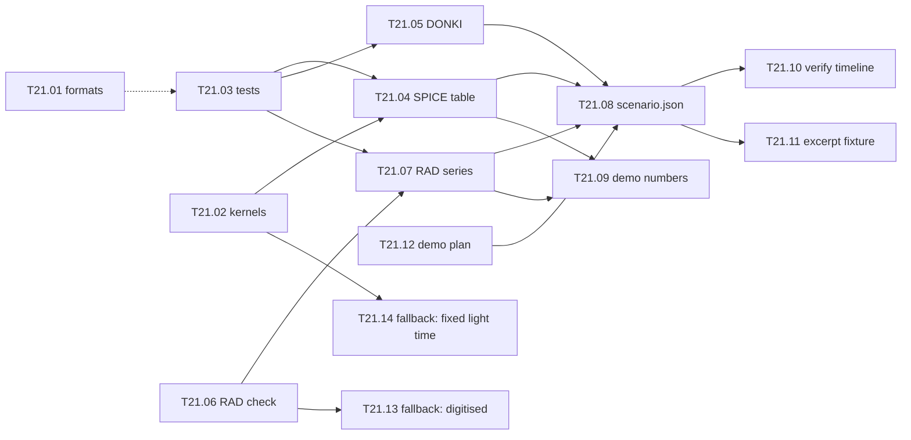

# TASK-21 — Scenario builder: SPICE, DONKI and RAD tables, `scenario.json`, demo numbers

| Field | Value |
| --- | --- |
| Objective | Build the `storm-sol4190` scenario from real sources: `earth_link.json` from SPICE kernels, the DONKI event timeline, the RAD dose series for sol 4190, the demo `PlanExport` and `scenario.json` with checksums; choose the EVA start time and write the final demo numbers into 01 §E.1 |
| Requirements | FR-34, FR-37, FR-38, FR-43, FR-50 (initial stop tasks), NFR-06, NFR-07 |
| Lane / owner role | data — R1 Data & GIS: Obidit Islam (tables); story — R6: Sadman Shaharier Mahim (script and demo numbers) |
| Milestone | M2 (scenario tables validated, Mon 9 Nov) |
| Window | pre-event-allowed (T21.11 is pre-event-if-permitted) |
| Effort (doc 06) | 8–12 h (Obidit 6–9, Sadman 2–3) |
| Done when (doc 06) | Scenario loads; timeline table reproduces source times; final script numbers written into 01 §E.1 |
| Main risk → fallback | RAD series misses sol 4190 → digitised dose curve (T21.13); kernels unavailable → fixed light time for the date (T21.14) |
| Spec sections | [02 L8](../specs/02_Technical_Requirements_Document.md#l8--space-weather-records-fr-37) · [02 L9](../specs/02_Technical_Requirements_Document.md#l9--rad-event-time-series-fr-37) · [02 L10](../specs/02_Technical_Requirements_Document.md#l10--spice-geometry-fr-43) · [02 §D.12](../specs/02_Technical_Requirements_Document.md#d12-earth-link-model-fr-43) · [02 §D.13](../specs/02_Technical_Requirements_Document.md#d13-space-weather-event-model-fr-37-fr-38) · [02 §E.7](../specs/02_Technical_Requirements_Document.md#e7-scenario-file-scenariosidscenariojson) · [05 Scenario](../specs/05_Backend_and_Database_Schema.md#scenario) · [05 DoseSeries](../specs/05_Backend_and_Database_Schema.md#doseseries-dose_seriesjson) · [05 EarthLinkTable](../specs/05_Backend_and_Database_Schema.md#earthlinktable-earth_linkjson) · [01 §E.1](../specs/01_Product_Requirements_Document.md#e1-killer-demo--storm-at-sol-4190-target-90-s-of-the-240-s-video) · [Data downloads](../ops/data-downloads.md) |

## Inputs this task consumes

| Input | Kind | Owner | Dependency |
| --- | --- | --- | --- |
| Hab position and AOI (crew and vehicle start cells) | decision | T01.07 | hard (T21.08) |
| Site bundle v1 with `data_version` and the real grid | upstream output | T03.19 | hard (T21.12) |
| Complete PLAN_RESULT assembly in `packages/compute` | upstream output | T05.32 | hard (T21.12) |
| Demo plan stops (three POI stops) | upstream output | T07.14 | hard (T21.12) |
| Earth-delivery rule (so the timeline uses the same rule as the engine) | upstream output | T05b.13 | soft (T21.10) |
| Initial stop task text | upstream output | T31.02 | soft (T21.08) |
| Downloads D8–D15 started on campus internet ([data-downloads.md](../ops/data-downloads.md) §B) | upstream output | this task | — |

## Outputs this task provides

| Output | Path | Consumers |
| --- | --- | --- |
| Earth-link table | `scenarios/storm-sol4190/earth_link.json` | T05b.13, T26.04, T26.07 |
| Dose series | `scenarios/storm-sol4190/dose_series.json` | T05b.15, T22.14, T23.08 |
| DONKI events in the scenario timeline | `scenarios/storm-sol4190/scenario.json` (`events`) | T26.04, T26.07 |
| Demo `PlanExport` | `scenarios/storm-sol4190/plan.json` | T21.08, T11.07 |
| `scenario.json` with checksums | `scenarios/storm-sol4190/scenario.json` | T22.14, T23.08, all M3/M4 checks |
| Final demo numbers in 01 §E.1 and the demo script | `docs/specs/01_Product_Requirements_Document.md`, `docs/ops/demo-script.md` | T17.01, T17.02 |

## Subtasks

### T21.01 — Freeze the scenario folder layout and the table formats

- **Owner:** Obidit Islam (R1 Data & GIS)
- **Type:** contract
- **Tag:** agent-ready · core
- **Window:** pre-event-allowed
- **Estimate:** 1 h
- **Owns (writes):** `schemas/dose-series.schema.json`, `schemas/earth-link.schema.json`, `scenarios/storm-sol4190/README.md`, `scenarios/storm-sol4190/param_sets/`
- **Reads:** [05 DoseSeries](../specs/05_Backend_and_Database_Schema.md#doseseries-dose_seriesjson), [05 EarthLinkTable](../specs/05_Backend_and_Database_Schema.md#earthlinktable-earth_linkjson), [02 §E.7](../specs/02_Technical_Requirements_Document.md#e7-scenario-file-scenariosidscenariojson), `schemas/scenario.schema.json`, `packages/protocol/src/runtime.ts`
- **Depends on:** T20.01 (soft: protocol v0 mirrors the same entities)
- **Parallel with:** T22.01, T05b.01
- **Steps:**
  1. Write JSON Schemas for `dose_series.json` and `earth_link.json` with field names copied from 05.
  2. List in the scenario README which file each pipeline step writes and which checksum the loader checks.
  3. Review the six assumed ParamSets for kind, keys and provenance (05 ParamSet); change no value.
- **Acceptance:**
  - Serves: FR-34, FR-43, FR-37 · [05 §C.2](../specs/05_Backend_and_Database_Schema.md#c2-runtime-entities-hab-core-v2)
  - Both schemas validate the 05 example records; the TypeScript types in `runtime.ts` match them.
- **Verify:** `python3 -c "import json,jsonschema; [jsonschema.Draft202012Validator.check_schema(json.load(open(f))) for f in ['schemas/dose-series.schema.json','schemas/earth-link.schema.json']]"`; `make typecheck`.
- **Agent brief:** Write the two schemas from 05 and the folder README. Do not change any ParamSet value.
- **Conflict notes:** `scenario.schema.json` belongs to the FR-50 contract (T31.01) and C-series schemas to T03.01; read-only here.

### T21.02 — Download the SPICE kernels for 18–22 May 2024; record exact files (U-18)

- **Owner:** Obidit Islam (R1 Data & GIS)
- **Type:** human
- **Tag:** human-required · core
- **Window:** pre-event-allowed
- **Estimate:** 1–1.5 h
- **Owns (writes):** `pipeline/spice/kernels.lock.json`, `docs/ops/data-downloads.md`
- **Reads:** [Data downloads](../ops/data-downloads.md) D12–D15, [02 L10](../specs/02_Technical_Requirements_Document.md#l10--spice-geometry-fr-43)
- **Depends on:** none
- **Parallel with:** T21.05, T21.06
- **Steps:**
  1. Download the generic kernels (D12) and the MRO, MAVEN and TGO SPKs that cover 18–22 May 2024 (D13–D15) into `pipeline/work/spice/` (git-ignored).
  2. Record each file's name, URL, size and SHA-256 in the lock file; mark anything not confirmed `TODO(verify)`.
  3. Update U-18 in `data-downloads.md` with what was found, and link U-15, U-44 and U-45 to the notes where T21.05 and T21.06 record their answers.
- **Acceptance:**
  - Serves: FR-43, NFR-07 · [02 L10](../specs/02_Technical_Requirements_Document.md#l10--spice-geometry-fr-43) · U-18
  - Every kernel the table step needs is listed with a checksum; no kernel binary is committed.
- **Verify:** `git status` shows no files under `pipeline/work/`; manual check that the lock file lists one SPK per orbiter.
- **Agent brief:** A person downloads; an agent may write the lock file from the downloaded folder's checksums. Never invent a file name: unknowns stay `TODO(verify)`.
- **Conflict notes:** Single owner of `docs/ops/data-downloads.md` in v2. T21.05 and T21.06 record their answers in their own files; the same person (Obidit) links them here.

### T21.03 — Tests: SPICE table, DONKI extraction and RAD series

- **Owner:** Obidit Islam (R1 Data & GIS)
- **Type:** test
- **Tag:** agent-ready · core
- **Window:** pre-event-allowed
- **Estimate:** 1–1.5 h
- **Owns (writes):** `pipeline/tests/test_spice_tables.py`, `pipeline/tests/test_donki.py`, `pipeline/tests/test_rad.py`
- **Reads:** [02 §D.12](../specs/02_Technical_Requirements_Document.md#d12-earth-link-model-fr-43), [02 §D.13](../specs/02_Technical_Requirements_Document.md#d13-space-weather-event-model-fr-37-fr-38), [02 §F.2](../specs/02_Technical_Requirements_Document.md#f2-test-plan-additions-v2), `schemas/dose-series.schema.json`, `schemas/earth-link.schema.json`
- **Depends on:** T21.01 (soft: table formats)
- **Parallel with:** T21.02
- **Steps:**
  1. SPICE: rows at the table step; light time for one timestamp matches an independent `spiceypy` call within 1 s (02 §D.12); pass windows use the link ParamSet's minimum elevation; blackout uses its separation threshold.
  2. DONKI: records in the U-44 window become `DONKI_RECORD` events with `source_id` and the record's own time.
  3. RAD: samples sorted, gaps as `null`, unit µGy/h, and `integral_check` filled (05 DoseSeries).
- **Acceptance:**
  - Serves: FR-37, FR-43 · [02 §F.2](../specs/02_Technical_Requirements_Document.md#f2-test-plan-additions-v2)
  - Each rule above is one named pytest case; inputs are small committed excerpts or generated fixtures, never the full downloads.
- **Verify:** `$(make -s pipeline-python) -m pytest pipeline/tests/test_spice_tables.py pipeline/tests/test_donki.py pipeline/tests/test_rad.py` fails before T21.04/T21.05/T21.07 and passes after.
- **Agent brief:** Write pytest cases from 02 §D.12, §D.13 and 05. Expected values come from the sources or `spiceypy`, never typed in by hand.
- **Conflict notes:** Pairs T21.03 → T21.04, T21.05, T21.07.

### T21.04 — Implement the SPICE Earth-link table

- **Owner:** Obidit Islam (R1 Data & GIS)
- **Type:** implement
- **Tag:** agent-ready · core
- **Window:** pre-event-allowed
- **Estimate:** 2–3 h
- **Owns (writes):** `pipeline/src/marswalk_pipeline/spice_tables.py`, `scenarios/storm-sol4190/earth_link.json`
- **Reads:** `pipeline/tests/test_spice_tables.py`, [02 §D.12](../specs/02_Technical_Requirements_Document.md#d12-earth-link-model-fr-43), [02 L10](../specs/02_Technical_Requirements_Document.md#l10--spice-geometry-fr-43), `pipeline/spice/kernels.lock.json`, `scenarios/storm-sol4190/param_sets/link-assumed.json`
- **Depends on:** T21.03 (hard: tests first), T21.02 (hard: kernels), T01.07 (hard: hab position for elevations)
- **Parallel with:** T21.07
- **Steps:**
  1. With `spiceypy`, compute per row: light time, Sun–Earth–Mars separation, Earth elevation and MRO, MAVEN and TGO elevations at the hab position.
  2. Derive pass windows from the link ParamSet; write `kernels` with checksums and `provenance: derived`.
  3. Use east-positive planetocentric coordinates (02 §C.1).
- **Acceptance:**
  - Serves: FR-43 · [02 §D.12](../specs/02_Technical_Requirements_Document.md#d12-earth-link-model-fr-43)
  - T21.03 SPICE cases pass; the table validates against its schema.
- **Verify:** `$(make -s pipeline-python) -m pytest pipeline/tests/test_spice_tables.py`.
- **Agent brief:** Implement the table builder until the tests pass. Every number comes from the kernels; nothing is estimated.
- **Conflict notes:** Single owner of both paths.

### T21.05 — Decide the DONKI window (U-44); implement DONKI extraction

- **Owner:** Obidit Islam (R1 Data & GIS); Sadman Shaharier Mahim (R6) agrees the window
- **Type:** implement
- **Tag:** agent-ready · core
- **Window:** pre-event-allowed
- **Estimate:** 1–1.5 h
- **Owns (writes):** `pipeline/src/marswalk_pipeline/donki.py`, `pipeline/cache/donki/`
- **Reads:** `pipeline/tests/test_donki.py`, [02 L8](../specs/02_Technical_Requirements_Document.md#l8--space-weather-records-fr-37), [Data downloads](../ops/data-downloads.md) D11
- **Depends on:** T21.03 (hard: tests first)
- **Parallel with:** T21.04
- **Steps:**
  1. Record the U-44 decision (proposed 13–24 May 2024) in `pipeline/cache/donki/README.md`.
  2. Fetch FLR, CME, CMEAnalysis, SEP, IPS and WSA-ENLIL records once from the keyless CCMC service; cache them as committed JSON.
  3. Map each record to a `ScenarioEvent` (`DONKI_RECORD`, `replayed`, `source_id`).
- **Acceptance:**
  - Serves: FR-37 · [02 L8](../specs/02_Technical_Requirements_Document.md#l8--space-weather-records-fr-37) · U-44
  - The DONKI cases of T21.03 pass; the cache is committed so the build never fetches again.
- **Verify:** `$(make -s pipeline-python) -m pytest pipeline/tests/test_donki.py`.
- **Agent brief:** Extract DONKI records into scenario events. Paths the CCMC docs do not list (SEP, WSA-ENLIL) are `TODO(verify)` until fetched.
- **Conflict notes:** The cache is small JSON (a few hundred KB, D11) and is committed on purpose; raw downloads stay in `pipeline/work/`.

### T21.06 — Download the RAD series; verify sol-4190 coverage (U-15) and the product (U-45)

- **Owner:** Obidit Islam (R1 Data & GIS); Mishkat Ahmed Khan (R2) checks U-45
- **Type:** human
- **Tag:** human-required · core
- **Window:** pre-event-allowed
- **Estimate:** 1–1.5 h
- **Owns (writes):** `docs/ops/rad-series.md`
- **Reads:** [Data downloads](../ops/data-downloads.md) D8, D9, [02 L9](../specs/02_Technical_Requirements_Document.md#l9--rad-event-time-series-fr-37), [01 §E.1](../specs/01_Product_Requirements_Document.md#e1-killer-demo--storm-at-sol-4190-target-90-s-of-the-240-s-video)
- **Depends on:** none
- **Parallel with:** T21.02
- **Steps:**
  1. Download D8 (Zenodo) and check that its `sol` column contains 4190; fetch the D9 cross-check for the same sol.
  2. Compare each product's event total with NASA's published total; write which product the demo replays and why (U-45).
  3. Record coverage, gaps, units and licence in `docs/ops/rad-series.md`, with the answers to U-15 and U-45.
- **Acceptance:**
  - Serves: FR-37, FR-38, NFR-07 · U-15, U-45
  - The note states coverage yes/no, the chosen product and the comparison with the published total, with sources.
- **Verify:** `make docs-check`; a second person (Mishkat) reads the note against the files.
- **Agent brief:** A person downloads and judges the product; an agent may tabulate what the files contain. Never adjust a value.
- **Conflict notes:** New file; single owner.

### T21.07 — Implement the RAD dose-series extraction

- **Owner:** Obidit Islam (R1 Data & GIS)
- **Type:** implement
- **Tag:** agent-ready · core
- **Window:** pre-event-allowed
- **Estimate:** 1.5–2 h
- **Owns (writes):** `pipeline/src/marswalk_pipeline/rad.py`, `scenarios/storm-sol4190/dose_series.json`
- **Reads:** `pipeline/tests/test_rad.py`, `docs/ops/rad-series.md`, [05 DoseSeries](../specs/05_Backend_and_Database_Schema.md#doseseries-dose_seriesjson)
- **Depends on:** T21.03 (hard: tests first), T21.06 (hard: product chosen)
- **Parallel with:** T21.04
- **Steps:**
  1. Read the chosen product, convert to µGy/h with the unit stated in its documentation, keep gaps as `null`.
  2. Fill `background_rate`, `method: archive` and `integral_check` (expected from the published total, computed from the samples).
- **Acceptance:**
  - Serves: FR-37, FR-38 · [05 DoseSeries](../specs/05_Backend_and_Database_Schema.md#doseseries-dose_seriesjson)
  - T21.03 RAD cases pass; any difference between expected and computed integral is explained in `rad-series.md`.
- **Verify:** `$(make -s pipeline-python) -m pytest pipeline/tests/test_rad.py`.
- **Agent brief:** Extract the series exactly; the unit conversion follows the product's own documentation, cited in a comment.
- **Conflict notes:** Single owner of both paths.

### T21.08 — Assemble `scenario.json` with checksums and initial stop tasks

- **Owner:** Obidit Islam (R1 Data & GIS)
- **Type:** implement
- **Tag:** agent-ready · core
- **Window:** pre-event-allowed
- **Estimate:** 1.5–2 h
- **Owns (writes):** `pipeline/src/marswalk_pipeline/scenario_build.py`, `scenarios/storm-sol4190/scenario.json`
- **Reads:** [05 Scenario](../specs/05_Backend_and_Database_Schema.md#scenario), `schemas/scenario.schema.json`, `scenarios/storm-sol4190/plan.json`, `scenarios/storm-sol4190/earth_link.json`, `scenarios/storm-sol4190/dose_series.json`
- **Depends on:** T21.04 (hard), T21.05 (hard), T21.07 (hard), T21.12 (hard: the demo plan), T01.07 (hard: start positions), T31.02 (soft: stop task text)
- **Parallel with:** T21.09
- **Steps:**
  1. Write `scenario.json`: identity, seed, `start_utc` (from T21.09), the plan, `stop_tasks`, crew, vehicles at their start cells, ParamSet ids, DONKI and Earth-message events sorted by `t_utc`, table paths with SHA-256s, `source_ids`.
  2. Validate against `schemas/scenario.schema.json` and the 05 rules.
- **Acceptance:**
  - Serves: FR-34, FR-50, NFR-06 · [02 §E.7](../specs/02_Technical_Requirements_Document.md#e7-scenario-file-scenariosidscenariojson)
  - The file validates; the Hab Core loader (T22.11) accepts it.
- **Verify:** `npm run -s hab:replay -- scenarios/storm-sol4190` loads it (after T22.13); schema check with `jsonschema`.
- **Agent brief:** Assemble the scenario from the built tables and the demo plan. Do not hand-edit numbers into it.
- **Conflict notes:** Single owner; the stop task text comes from T31.02's content file.

### T21.09 — spec-change: choose the EVA start time; write the final demo numbers into 01 §E.1 and the demo script

- **Owner:** Sadman Shaharier Mahim (R6 demo story and script)
- **Type:** human
- **Tag:** human-required · core
- **Window:** pre-event-allowed
- **Estimate:** 1–1.5 h
- **Owns (writes):** `docs/specs/01_Product_Requirements_Document.md` (spec-change), `docs/ops/demo-script.md` (after T17.01)
- **Reads:** [01 §E.1](../specs/01_Product_Requirements_Document.md#e1-killer-demo--storm-at-sol-4190-target-90-s-of-the-240-s-video), `docs/ops/rad-series.md`, `scenarios/storm-sol4190/earth_link.json`
- **Depends on:** T21.07 (hard: dose series), T21.04 (hard: light time and passes), T17.01 (hard: owner of the demo script)
- **Parallel with:** T21.08
- **Steps:**
  1. Pick the EVA start in daylight LTST so the storm lands mid-EVA; record the reason.
  2. Replace each `…` and `TODO` in 01 §E.1 with a number from the built tables or the headless replay, citing its source.
  3. Update the demo script's numbers to match.
- **Acceptance:**
  - Serves: FR-34, FR-37 · [01 §E.1](../specs/01_Product_Requirements_Document.md#e1-killer-demo--storm-at-sol-4190-target-90-s-of-the-240-s-video) · 06 TASK-21 done-when
  - Every number in 01 §E.1 traces to a table, a replay hash or a cited source; none is estimated.
- **Verify:** `make docs-check`; a second person checks each number against its source.
- **Agent brief:** The product & systems lead decides; an agent may list where each number comes from. No AI-computed numbers (ADR-006).
- **Conflict notes:** `spec-change:` of 01 (one open spec-change PR at a time, map §c.2); the demo script edit follows T17.01.

### T21.10 — Verify: the timeline table reproduces source times (M2)

- **Owner:** Obidit Islam (R1 Data & GIS)
- **Type:** verify
- **Tag:** agent-ready · core
- **Window:** pre-event-allowed
- **Estimate:** 0.5–1 h
- **Owns (writes):** `docs/ops/verification-log.md` (append-only)
- **Reads:** [02 §D.13](../specs/02_Technical_Requirements_Document.md#d13-space-weather-event-model-fr-37-fr-38) timeline table, [02 §F.2](../specs/02_Technical_Requirements_Document.md#f2-test-plan-additions-v2), `scenarios/storm-sol4190/scenario.json`
- **Depends on:** T21.08 (hard: scenario), T05b.13 (soft: same delivery rule)
- **Parallel with:** T22.14
- **Steps:**
  1. List each 02 §D.13 timeline row with its time from the source (DONKI, RAD, SPICE) and from the scenario.
  2. Record any difference with its reason; state pass or fail.
- **Acceptance:**
  - Serves: FR-37, FR-43 · [02 §F.2](../specs/02_Technical_Requirements_Document.md#f2-test-plan-additions-v2) Space weather
  - Each timeline row shows source time, scenario time and match.
- **Verify:** Manual: the T21.10 section of the verification log; `make docs-check`.
- **Agent brief:** Compare times; never adjust them.
- **Conflict notes:** Append-only file.

### T21.11 — Fixture: real-scenario excerpt for engine tests

- **Owner:** Obidit Islam (R1 Data & GIS)
- **Type:** fixture
- **Tag:** agent-ready · core
- **Window:** pre-event-if-permitted
- **Estimate:** 0.5 h
- **Owns (writes):** `apps/hab-core/tests/fixtures/storm-excerpt/`
- **Reads:** `scenarios/storm-sol4190/`, [map §e](_coordination.md#e-fixtures-and-mocks)
- **Depends on:** T21.08 (hard: the real scenario)
- **Parallel with:** T21.10
- **Steps:**
  1. Cut the onset hour of the dose series and the matching Earth-link rows with a committed script.
  2. Record the source file and the cut in the folder README.
- **Acceptance:**
  - Serves: FR-38, NFR-06
  - The excerpt is produced by a deterministic script from the real tables.
- **Verify:** Re-running the script reproduces the files byte for byte.
- **Agent brief:** Generate a small excerpt for tests; no hand edits.
- **Conflict notes:** Single owner.

### T21.12 — Build the demo `PlanExport` headlessly from the demo plan stops

- **Owner:** Mishkat Ahmed Khan (R2 Compute) — runs the compute core on the real grid
- **Type:** implement
- **Tag:** agent-ready · core
- **Window:** pre-event-allowed
- **Estimate:** 1–1.5 h
- **Owns (writes):** `apps/hab-core/scripts/build-demo-plan.ts`, `scenarios/storm-sol4190/plan.json`
- **Reads:** `apps/web/src/ui/demoPlan.json`, `packages/compute/src/`, [05 PlanExport](../specs/05_Backend_and_Database_Schema.md#planexport), [06 §D.1](../specs/06_High_Level_Implementation_Plan.md#d1-critical-path)
- **Depends on:** T05.32 (hard: complete PLAN_RESULT), T07.14 (hard: demo stops), T03.19 (hard: real grid)
- **Parallel with:** T21.07
- **Steps:**
  1. A Node script that loads the real grid, runs the compute core on the demo stops and writes a `PlanExport` with `plan_hash`.
  2. The planner UI is off the critical path (06 §D.1): this script keeps the storm demo independent of it.
- **Acceptance:**
  - Serves: FR-34, NFR-06 · [06 §D.1](../specs/06_High_Level_Implementation_Plan.md#d1-critical-path)
  - Two runs give the same `plan_hash`; the export validates against `schemas/plan-export.schema.json`.
- **Verify:** Run the script twice; compare `plan_hash`.
- **Agent brief:** Call `@marswalk/compute` exactly as the planner worker does; no compute logic in the script.
- **Conflict notes:** New paths; single owner. The file is a build output and is regenerated, not edited.

### T21.13 — Fallback — start only if T21.06 finds no sol-4190 series: digitised dose curve

- **Owner:** Obidit Islam (R1 Data & GIS)
- **Type:** fallback
- **Tag:** human-required · core
- **Window:** pre-event-allowed
- **Estimate:** 1.5–2 h
- **Owns (writes):** `scenarios/storm-sol4190/dose_series.json` (replaces T21.07)
- **Reads:** [02 L9](../specs/02_Technical_Requirements_Document.md#l9--rad-event-time-series-fr-37), [06 §D.5](../specs/06_High_Level_Implementation_Plan.md#d5-data-and-service-fallbacks)
- **Depends on:** T21.06 (hard: start only on no coverage)
- **Parallel with:** T21.04
- **Steps:**
  1. Digitise the published sol-4190 figure with a recorded tool and settings; keep the digitised points file.
  2. Write `method: digitised` and change the label in Sources & methods (06 §D.5).
- **Acceptance:**
  - Serves: FR-37 · [06 §D.5](../specs/06_High_Level_Implementation_Plan.md#d5-data-and-service-fallbacks)
  - The series is labelled digitised everywhere it is shown.
- **Verify:** T21.03 RAD cases pass on the digitised file.
- **Agent brief:** Only if no archive covers sol 4190. Digitising is done by a person; no values are invented.
- **Conflict notes:** Replaces T21.07's output; never at the same time.

### T21.14 — Fallback — start only if T21.02 cannot get the kernels: fixed light time for the date

- **Owner:** Obidit Islam (R1 Data & GIS)
- **Type:** fallback
- **Tag:** agent-ready · core
- **Window:** pre-event-allowed
- **Estimate:** 0.5–1 h
- **Owns (writes):** `scenarios/storm-sol4190/earth_link.json` (replaces T21.04)
- **Reads:** [06 §D.5](../specs/06_High_Level_Implementation_Plan.md#d5-data-and-service-fallbacks) SPICE row
- **Depends on:** T21.02 (hard: start only if kernels are missing)
- **Parallel with:** T21.07
- **Steps:**
  1. Light time from the DE ephemeris only (generic kernels); relay passes from a published MRO pass pattern, labelled `assumed`.
- **Acceptance:**
  - Serves: FR-43 · [06 §D.5](../specs/06_High_Level_Implementation_Plan.md#d5-data-and-service-fallbacks)
  - The weaker validity is labelled in the table and in Sources & methods.
- **Verify:** The table validates against its schema.
- **Agent brief:** Only if orbiter kernels are unavailable.
- **Conflict notes:** Replaces T21.04's output; never at the same time.

## Internal dependency graph

## Definition of done (task level)

- 06 §C.2 done-when: the scenario loads, the timeline table reproduces source times (T21.10), and the final numbers are in 01 §E.1 (T21.09).
- Every table has a checksum in `scenario.json` and a source in Sources & methods (NFR-07).
- No downloaded binary is committed; the DONKI cache and the built tables are committed.

## Spec questions

1. **DONKI window** (U-44): proposed 13–24 May 2024. Decision in T21.05.
2. **RAD product** (U-45): which detector matches the published total. Decision in T21.06.
3. **Dose-series step.** 05 DoseSeries gives no fixed sample step; the product's own cadence is kept (`TODO(verify)` on download).
4. **Committed tables.** The scenario tables are small derived JSON and are committed; `CLAUDE.md` forbids committing downloaded datasets, not derived tables. Confirm with the team lead.
