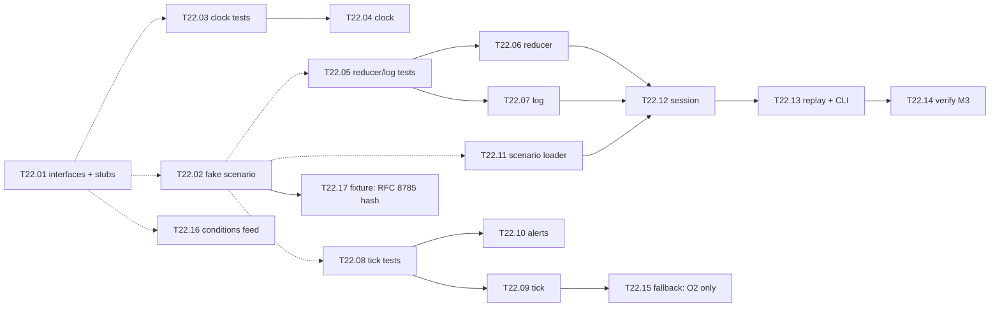

# TASK-22 — Simulation engine: clock, crew motion, consumables, alerts, event log, replay

| Field | Value |
| --- | --- |
| Objective | The deterministic Hab Core engine: mission clock, event-sourced state, crew motion along the plan, consumables and dose, alert evaluation, append-only event log with `log_hash`, persistence and resume, headless replay |
| Requirements | FR-34, FR-35, FR-36, FR-37, FR-38, NFR-02, NFR-06, NFR-10, NFR-14 |
| Lane / owner role | hab-core — R4 Hab Core: Sadman Shaharier Mahim (Anjim Hossain supports) |
| Milestone | M1 (contract and fake scenario 7 Nov) → M3 (headless replay stable, 10 Nov) |
| Window | pre-event-if-permitted (T22.01 and T22.02 are pre-event-allowed) |
| Effort (doc 06) | 10–14 h |
| Done when (doc 06) | Two runs ⇒ same log hash; 60× full run completes |
| Main risk → fallback | Consumables detail costs too much → O₂ only (T22.15) |
| Spec sections | [02 §A.6](../specs/02_Technical_Requirements_Document.md#a6-state-model-commands--events--state) · [02 §D.13](../specs/02_Technical_Requirements_Document.md#d13-space-weather-event-model-fr-37-fr-38) · [02 §D.14](../specs/02_Technical_Requirements_Document.md#d14-simulation-engine-fr-34-fr-35) · [02 §E.7](../specs/02_Technical_Requirements_Document.md#e7-scenario-file-scenariosidscenariojson) · [02 §F](../specs/02_Technical_Requirements_Document.md#f-nonfunctional-requirements-and-validation) · [05 §C.2](../specs/05_Backend_and_Database_Schema.md#c2-runtime-entities-hab-core-v2) · [05 LogEvent](../specs/05_Backend_and_Database_Schema.md#logevent-one-line-of-sessionjsonl) · [03 §E.6](../specs/03_App_Flow_and_Diagrams.md#e6-state--session-v2) · [03 §E.7](../specs/03_App_Flow_and_Diagrams.md#e7-state--alert-lifecycle-v2) · [03 §E.8](../specs/03_App_Flow_and_Diagrams.md#e8-state--crew-activity-v2) · [01 FR-34](../specs/01_Product_Requirements_Document.md#fr-34--mission-clock-and-scenario-replay-t1-m) · [01 FR-35](../specs/01_Product_Requirements_Document.md#fr-35--crew-progress-and-suit-consumables-t1-m) |

## Inputs this task consumes

| Input | Kind | Owner | Dependency |
| --- | --- | --- | --- |
| Protocol v0 (entities, events) | contract | T20.01 | soft (T22.01) |
| Compute v2 signatures (consumables, event dose) | contract | T05b.01 | soft (T22.08) |
| Consumables and event-dose functions | upstream output | T05b.15, T05b.17 | hard (T22.09) |
| Real `scenario.json` and its tables for sol 4190 | upstream output | T21.08 | hard (T22.14) |
| Server that drives the session | upstream output | T20.04 | soft (T22.12) |

## Outputs this task provides

| Output | Path | Consumers |
| --- | --- | --- |
| Engine interfaces and engine-module stubs | `apps/hab-core/src/engine/` | T23.*, T26.*, T29.*, T31.04 |
| Fake scenario for early work | `apps/hab-core/tests/fixtures/fake-scenario/` | T20.04, T23.*, T26.*, T31.03 |
| Event log with `log_hash` and snapshots | `apps/hab-core/src/log.ts` | T27.01, T27.05 |
| Headless replay (`make replay`) | `apps/hab-core/src/replay.ts`, `apps/hab-core/src/cli.ts` | T23.08, T26.07, T29.06, CI, video fallback |

## Subtasks

### T22.01 — Freeze engine interfaces; create the engine-module stubs

- **Owner:** Sadman Shaharier Mahim (R4 Hab Core)
- **Type:** contract
- **Tag:** agent-ready · core
- **Window:** pre-event-allowed
- **Estimate:** 1–1.5 h
- **Owns (writes):** `apps/hab-core/src/engine/reducer.ts` (stub → T22.06), `apps/hab-core/src/engine/tick.ts` (stub → T22.09), `apps/hab-core/src/engine/alerts.ts` (stub → T22.10), `apps/hab-core/src/engine/haven.ts` (stub → T23.03), `apps/hab-core/src/engine/vehicles.ts` (stub → T23.05), `apps/hab-core/src/engine/contingencyOps.ts` (stub → T23.07), `apps/hab-core/src/engine/links.ts` (stub → T26.01), `apps/hab-core/src/engine/earth.ts` (stub → T26.04), `apps/hab-core/src/engine/rovers.ts` (stub → T29.03), `apps/hab-core/src/engine/tasks.ts` (stub → T31.04), `apps/hab-core/src/engine/conditions.ts` (stub → T22.16), `apps/hab-core/src/scenario.ts` (stub → T22.11), `apps/hab-core/src/session.ts` (stub → T22.12), `apps/hab-core/src/log.ts` (stub → T22.07), `apps/hab-core/src/engine/README.md`
- **Reads:** [02 §A.6](../specs/02_Technical_Requirements_Document.md#a6-state-model-commands--events--state), [02 §D.14](../specs/02_Technical_Requirements_Document.md#d14-simulation-engine-fr-34-fr-35), [05 §C.2](../specs/05_Backend_and_Database_Schema.md#c2-runtime-entities-hab-core-v2), `packages/protocol/src/runtime.ts`
- **Depends on:** T20.01 (soft: protocol v0)
- **Parallel with:** T20.01, T05b.01, T21.01
- **Steps:**
  1. Fix the signatures: `reduce(state, event)`, `tick(state, scenario, dt_s)`, `LoadedScenario`, the log API (`append`, `hash`, `snapshot`, `resume`) and the session API the server calls.
  2. Split `tick` into one module per concern, each a pure function `(state, scenario) → {state, events, deltas}`: alerts, haven, vehicles, contingency, links, Earth messages, rovers, stop tasks. `tick.ts` calls them in the 02 §D.14 order.
  3. Every stub throws `TODO(TASK-nn)` and names its owner subtask; no behaviour.
  4. Write `engine/README.md`: the module map, the call order, and the rule that nothing under `src/engine/` reads wall-clock time.
- **Acceptance:**
  - Serves: FR-34, NFR-06 · [02 §D.14](../specs/02_Technical_Requirements_Document.md#d14-simulation-engine-fr-34-fr-35)
  - Each engine concern has its own module with one owner subtask, so TASK-23, TASK-26, TASK-29 and TASK-31 never edit `tick.ts`.
  - `make typecheck` passes.
- **Verify:** `make typecheck`; `npm --workspace @marswalk/hab-core test`.
- **Agent brief:** Create typed throwing stubs only. The module split exists so four teammates can work on the engine without touching the same file.
- **Conflict notes:** Each module's owner takes it over after this merges. Changing a signature later is a `contract-change:` in this task.
- **Contract change (T22.09, 2026-11-07):** `EngineState` gains `motion: Partial<Record<CrewId, CrewMotion>>`, engine-only progress state for tick.ts (see the T22.09 rules); it is not in the wire SNAPSHOT (02 §E.6); it is in the on-disk snapshot used for resume.

### T22.02 — Fixture: fake scenario with a straight-line route and a stepped dose curve

- **Owner:** Sadman Shaharier Mahim (R4 Hab Core)
- **Type:** fixture
- **Tag:** agent-ready · core
- **Window:** pre-event-allowed
- **Estimate:** 1 h
- **Owns (writes):** `apps/hab-core/tests/fixtures/fake-scenario/`
- **Reads:** [06 §D.2](../specs/06_High_Level_Implementation_Plan.md#d2-parallel-streams), [05 Scenario](../specs/05_Backend_and_Database_Schema.md#scenario), `schemas/scenario.schema.json`, [map §e](_coordination.md#e-fixtures-and-mocks) fixture value rule
- **Depends on:** T22.01 (soft: `LoadedScenario`)
- **Parallel with:** T20.02, T05b.02
- **Steps:**
  1. A `scenario.json` that validates against `schemas/scenario.schema.json`, `site_id` `mock_site`, two crew, one pressurized rover, a plan with a straight-line route and two stops, two `stop_tasks`.
  2. A `dose_series.json` with a declared synthetic step shape (background, then a step up, then back), labelled synthetic in its README; an `earth_link.json` with one constant row.
  3. List the source of every value in the folder's `README.md` (map §e rule): spec examples, declared shape parameters or placeholders.
- **Acceptance:**
  - Serves: FR-34, NFR-14 · [06 §D.2](../specs/06_High_Level_Implementation_Plan.md#d2-parallel-streams)
  - The files validate against the scenario schema; no value pretends to be real data; the demo never loads them.
- **Verify:** `npm --workspace @marswalk/hab-core test -- fixture` (a test that validates the files against the schema).
- **Agent brief:** Build a small fake scenario so the engine and server can run before TASK-21 delivers the real one. Synthetic shape parameters only, each declared.
- **Conflict notes:** Single owner. Mock data lives under `mock_site` only.

### T22.03 — Tests: mission clock

- **Owner:** Sadman Shaharier Mahim (R4 Hab Core)
- **Type:** test
- **Tag:** agent-ready · core
- **Window:** pre-event-if-permitted
- **Estimate:** 0.5–1 h
- **Owns (writes):** `apps/hab-core/tests/clock.test.ts`
- **Reads:** [02 §D.14](../specs/02_Technical_Requirements_Document.md#d14-simulation-engine-fr-34-fr-35), [01 FR-34](../specs/01_Product_Requirements_Document.md#fr-34--mission-clock-and-scenario-replay-t1-m)
- **Depends on:** T22.01 (soft: clock signature)
- **Parallel with:** T22.05, T22.08
- **Steps:**
  1. Fixed step Δt = 1 s sim time; speeds 1×, 10×, 60× convert elapsed real time into a whole number of steps.
  2. Pause stops steps; jump-to-next-event lands exactly on the next scheduled scenario event.
  3. Static check: no `Date.now()` or `new Date()` with no argument anywhere under `src/engine/`.
- **Acceptance:**
  - Serves: FR-34, NFR-06 · [02 §D.14](../specs/02_Technical_Requirements_Document.md#d14-simulation-engine-fr-34-fr-35)
  - Each rule above is one named test; the static check fails if a wall-clock call is added.
- **Verify:** `npm --workspace @marswalk/hab-core test -- clock`.
- **Agent brief:** Write Vitest tests for `engine/clock.ts` from 02 §D.14, plus a source-scan test that forbids wall-clock calls in `src/engine/`.
- **Conflict notes:** Pair T22.03 → T22.04.

### T22.04 — Implement the mission clock

- **Owner:** Sadman Shaharier Mahim (R4 Hab Core)
- **Type:** implement
- **Tag:** agent-ready · core
- **Window:** pre-event-if-permitted
- **Estimate:** 0.5–1 h
- **Owns (writes):** `apps/hab-core/src/engine/clock.ts`
- **Reads:** `apps/hab-core/tests/clock.test.ts`, [02 §D.14](../specs/02_Technical_Requirements_Document.md#d14-simulation-engine-fr-34-fr-35)
- **Depends on:** T22.03 (hard: tests first)
- **Parallel with:** T22.06
- **Steps:**
  1. Represent sim time as an integer number of seconds from the scenario start; format ISO-8601 only at the edges.
  2. Speeds, pause and jump as T22.03 specifies; the server passes real elapsed milliseconds in, the clock never reads them itself.
- **Acceptance:**
  - Serves: FR-34, NFR-06
  - T22.03 passes.
- **Verify:** `npm --workspace @marswalk/hab-core test -- clock`.
- **Agent brief:** Implement `clock.ts` until T22.03 is green. No wall-clock reads.
- **Conflict notes:** Single owner.

### T22.05 — Tests: reducer, event log, `log_hash`, snapshots and determinism

- **Owner:** Sadman Shaharier Mahim (R4 Hab Core)
- **Type:** test
- **Tag:** agent-ready · core
- **Window:** pre-event-if-permitted
- **Estimate:** 1–1.5 h
- **Owns (writes):** `apps/hab-core/tests/engine.test.ts`
- **Reads:** [02 §A.6](../specs/02_Technical_Requirements_Document.md#a6-state-model-commands--events--state), [05 LogEvent](../specs/05_Backend_and_Database_Schema.md#logevent-one-line-of-sessionjsonl), [05 §B](../specs/05_Backend_and_Database_Schema.md#b-persistence-strategy) session store, `apps/hab-core/tests/fixtures/fake-scenario/`
- **Depends on:** T22.01 (soft: interfaces), T22.02 (soft: fake scenario)
- **Parallel with:** T22.03, T22.08
- **Steps:**
  1. Keep the existing `it.todo` cases and make them real.
  2. `seq` is monotonic and gap-free; `log_hash` is a running SHA-256 over canonical JSON (sorted keys); a snapshot every 500 events (U-23).
  3. Folding `session.jsonl` over the initial state reproduces the live state; resume from the latest snapshot plus later events gives the same state.
  4. Two headless runs of the same scenario and seed give the same `log_hash` (NFR-06).
- **Acceptance:**
  - Serves: FR-34, NFR-06, NFR-10, NFR-14 · [02 §F.2](../specs/02_Technical_Requirements_Document.md#f2-test-plan-additions-v2) Engine
  - Each rule above is one named test; they fail against the stubs.
- **Verify:** `npm --workspace @marswalk/hab-core test -- engine` fails before T22.06/T22.07 and passes after.
- **Agent brief:** Turn the `it.todo` cases in `engine.test.ts` into real tests on the fake scenario. The determinism test runs the replay twice in one process and compares hashes.
- **Conflict notes:** Pair T22.05 → T22.06 and T22.07. FR-50 engine cases live in `stopTasks.test.ts` (T31.03).

### T22.06 — Implement the reducer

- **Owner:** Sadman Shaharier Mahim (R4 Hab Core)
- **Type:** implement
- **Tag:** agent-ready · core
- **Window:** pre-event-if-permitted
- **Estimate:** 1.5–2 h
- **Owns (writes):** `apps/hab-core/src/engine/reducer.ts`
- **Reads:** `apps/hab-core/tests/engine.test.ts`, [02 §A.6](../specs/02_Technical_Requirements_Document.md#a6-state-model-commands--events--state), [05 LogEvent](../specs/05_Backend_and_Database_Schema.md#logevent-one-line-of-sessionjsonl), [03 §E.6–§E.10](../specs/03_App_Flow_and_Diagrams.md#e6-state--session-v2)
- **Depends on:** T22.05 (hard: tests first), T22.01 (soft: stub)
- **Parallel with:** T22.04, T22.07
- **Steps:**
  1. One pure case per `LogEventKind`; each reads only `event.data`, never recomputes science (05 LogEvent rule).
  2. Follow the state machines of 03 §E.6–§E.10 for session, alerts, crew activity, vehicle and link.
  3. `TASK_*` events delegate to `engine/tasks.ts` (T31.04) so the task owner never edits this file.
- **Acceptance:**
  - Serves: FR-34, NFR-06 · [02 §A.6](../specs/02_Technical_Requirements_Document.md#a6-state-model-commands--events--state)
  - The reducer half of T22.05 passes; every event kind has a case, enforced by an exhaustive `switch`.
- **Verify:** `npm --workspace @marswalk/hab-core test -- engine`; `make typecheck`.
- **Agent brief:** Implement `reduce` as an exhaustive, pure fold. No wall-clock, no randomness, no compute calls.
- **Conflict notes:** Single owner; other engine concerns reach state through their own modules.

### T22.07 — Implement the append-only event log, `log_hash` and snapshots

- **Owner:** Sadman Shaharier Mahim (R4 Hab Core)
- **Type:** implement
- **Tag:** agent-ready · core
- **Window:** pre-event-if-permitted
- **Estimate:** 1–1.5 h
- **Owns (writes):** `apps/hab-core/src/log.ts`
- **Reads:** `apps/hab-core/tests/engine.test.ts`, [05 §B](../specs/05_Backend_and_Database_Schema.md#b-persistence-strategy), [05 LogEvent](../specs/05_Backend_and_Database_Schema.md#logevent-one-line-of-sessionjsonl)
- **Depends on:** T22.05 (hard: tests first), T22.01 (soft: stub)
- **Parallel with:** T22.06
- **Steps:**
  1. Append one JSON line per event to `apps/hab-core/var/sessions/<session_id>/session.jsonl`; keep `seq` gap-free.
  2. Running SHA-256 over canonical JSON (RFC 8785: sorted keys, JavaScript number format; 05 Session, decided 2026-11-07) gives `log_hash`.
  3. Write `snapshot-<seq>.json` every 500 events and `meta.json`; resume reads the latest snapshot and the lines after it.
- **Acceptance:**
  - Serves: NFR-06, NFR-10 · [05 §B](../specs/05_Backend_and_Database_Schema.md#b-persistence-strategy)
  - The log half of T22.05 passes; `apps/hab-core/var/` stays git-ignored.
- **Verify:** `npm --workspace @marswalk/hab-core test -- engine`.
- **Agent brief:** Implement the log as described in 05 §B. Canonical JSON must be byte-stable across machines.
- **Conflict notes:** Single owner. The report (T27.01) and replay mode (T27.05) only read the log.

### T22.08 — Tests: tick — crew motion, dwell, consumables, dose and alert order

- **Owner:** Sadman Shaharier Mahim (R4 Hab Core)
- **Type:** test
- **Tag:** agent-ready · core
- **Window:** pre-event-if-permitted
- **Estimate:** 1–1.5 h
- **Owns (writes):** `apps/hab-core/tests/tick.test.ts`
- **Reads:** [02 §D.13](../specs/02_Technical_Requirements_Document.md#d13-space-weather-event-model-fr-37-fr-38), [02 §D.14](../specs/02_Technical_Requirements_Document.md#d14-simulation-engine-fr-34-fr-35), `apps/hab-core/tests/fixtures/fake-scenario/`
- **Depends on:** T22.02 (soft: fake scenario), T05b.01 (soft: compute signatures)
- **Parallel with:** T22.05
- **Steps:**
  1. Crew position follows the planned cell path by cumulative leg time; dwell at stops; `ARRIVED_STOP` and `LEFT_STOP` fire once each.
  2. O₂ fraction and event dose change through the compute functions only (`consumables.ts`, `eventDose.ts`).
  3. `RADIATION_ALERT` fires on the first sample that satisfies the trigger (02 §D.13) and alerts are evaluated in the fixed 02 §D.14 order.
  4. Per-tick positions are `STATE_DELTA`s, never `LogEvent`s.
- **Acceptance:**
  - Serves: FR-35, FR-37, FR-38 · [02 §D.14](../specs/02_Technical_Requirements_Document.md#d14-simulation-engine-fr-34-fr-35)
  - Each rule above is one named test on the fake scenario.
- **Verify:** `npm --workspace @marswalk/hab-core test -- tick` fails before T22.09/T22.10 and passes after.
- **Agent brief:** Write tick tests on the fake scenario. Expected values come from the fixture's declared shape or from compute functions under test elsewhere, never typed in by hand.
- **Conflict notes:** Pair T22.08 → T22.09 and T22.10.

### T22.09 — Implement tick: crew motion, dwell, consumables and dose

- **Owner:** Sadman Shaharier Mahim (R4 Hab Core)
- **Type:** implement
- **Tag:** agent-ready · core
- **Window:** pre-event-if-permitted
- **Estimate:** 2–3 h
- **Owns (writes):** `apps/hab-core/src/engine/tick.ts`
- **Reads:** `apps/hab-core/tests/tick.test.ts`, [02 §D.14](../specs/02_Technical_Requirements_Document.md#d14-simulation-engine-fr-34-fr-35), `packages/compute/src/consumables.ts`, `packages/compute/src/eventDose.ts`
- **Depends on:** T22.08 (hard: tests first), T05b.15 (hard: real dose integral), T05b.17 (hard: real consumables), T22.01 (soft: stub)
- **Parallel with:** T22.10, T22.11
- **Steps:**
  1. Advance each crew member along the plan's cell path; dwell at stops; on re-plan follow the new path from the current cell.
  2. Update O₂ and dose by calling compute; never compute science inline.
  3. Call the engine modules in the 02 §D.14 order and merge their events and deltas.
- **Acceptance:**
  - Serves: FR-35, NFR-06 · [02 §D.14](../specs/02_Technical_Requirements_Document.md#d14-simulation-engine-fr-34-fr-35)
  - The motion, consumables and dose cases of T22.08 pass.
- **Verify:** `npm --workspace @marswalk/hab-core test -- tick`.
- **Agent brief:** Implement `tick.ts` as an orchestrator: motion here, everything else through the engine modules and `@marswalk/compute`.
- **Conflict notes:** Single owner; the other engine modules are owned by TASK-23, TASK-26, TASK-29 and TASK-31.
- **Rules (proposed 2026-11-07, `TODO(decision)`; tests: `tick.test.ts`, T22.08):**
  - S1: engine-only progress state `EngineState.motion: Partial<Record<CrewId, CrewMotion>>` (`initialState` gives `{}`). It is never sent to clients: `Session.snapshot()` picks fields explicitly.
  - S2: constant speed within a leg. Position is the arc-length fraction `leg_t_s / leg_s` along `leg.geometry`, in projected metres; `leg_s = walk_time_min * 60`. Overshoot carries into the next phase, so there is no drift. A zero leg time or zero length means arrival at once.
  - S3: `stop_index` is the 1-based position among the current plan's `role: "stop"` waypoints.
  - S4: while `start_offset_s` has not elapsed the crew member stays at the start: shielding `hab`, no O₂ used, no motion, and `eva_elapsed_s` does not grow (only the time after the offset counts). The alert modules treat a waiting crew member as not out: `buddyTick` ignores it and `consumablesTick` treats it as safe (decision 2026-11-07, review fix).
  - S5: at the end of a loop route (the last leg's `to` is the start waypoint) tick emits `CREW_SHELTERED {haven_kind: "hab"}` with the doses of this tick's dose step. The reducer sets `IN_HAB` only when the crew member was `WALKING` or `AT_STOP` (03 §E.8 "Walking → InHab: plan complete"); a `TO_HAVEN` crew member becomes `SHELTERED` (03 §E.8 "ToHaven → Sheltered"). Any other end, or a `NO_ROUTE` next leg, holds with no event. A held crew member whose revision gives a reachable next leg resumes walking (see S7). After the modules, on the first tick where the EVA is running and every crew member is `IN_HAB` or `SHELTERED`, tick logs one system `EVA_ENDED {crew_ids}` (03 §E.6 "Running → Ended: all crew sheltered or in hab"), once, because the reducer then sets `ENDED`. Proposed 2026-11-07.
  - S6: `eva_elapsed_s` grows by `dt_s` for every activity except `IN_HAB`.
  - S7: on re-plan (`plan_revision` differs from the crew member's) re-anchor on the new legs: candidates are the legs from the first whose `from` is the last waypoint reached, else all legs; snap to the closest point (ties to the earliest leg or segment). A held crew member is re-anchored too: it resumes walking when the closest point is not the end of its leg, else it stays held. `TODO(verify)` with T23.07: assumes the new first leg starts near the crew member and abort legs end at the start waypoint.
  - S8: `TO_HAVEN` crew follow the revised legs with no dwell and no `ARRIVED_STOP`/`LEFT_STOP`; at the end `CREW_SHELTERED` hab (they become `SHELTERED`, S5) if the route ends at the start waypoint, otherwise hold (T23.05 logs a vehicle shelter). An `AT_STOP` crew member that is not `TO_HAVEN` finishes its dwell, then always emits `LEFT_STOP`, then continues; when the stop is no longer in the plan (for example a `CONTINUE_SKIP` revision dropped it) the event carries the crew member's current `stop_index` (proposed 2026-11-07).
  - S9: O₂ and dose use the activity at the start of the step: `WALKING` and `TO_HAVEN` use shielding `suit` and `walking`; `AT_STOP` uses `suit` and `resting`; a held crew member (route end with no event, or waiting at a vehicle rendezvous) uses `suit` and `resting`; `IN_HAB` and a crew member waiting for its offset use `hab` and no O₂; `SHELTERED` in the hab or a vehicle uses `hab` or `pressurized_rover` and no O₂; `SHELTERED` in a refuge uses `suit` and `resting` (conservative; no refuge factor before T2). Dose runs for all crew every tick.
  - S10: a module whose body is still a stub is skipped by a narrow per-call guard (`/^TODO\(TASK-\d+\): T\d+\.\d+ not implemented$/`); any other error propagates.
  - S11: a leg whose `walk_time_min` is NaN, infinite or negative is a plan error: tick throws instead of arriving instantly (proposed 2026-11-07; zero stays "arrival at once", S2).
  - Order inside `tick`: per crew (dose, O₂, `eva_elapsed_s`, motion); reduce the motion events with seqs from `next_seq`; then `MODULE_ORDER`, each module's events reduced before the next runs. STATE_DELTAs only when a value changed; LogEvents only `ARRIVED_STOP`, `LEFT_STOP`, `CREW_SHELTERED` and `EVA_ENDED` (after the modules) from tick itself.

### T22.10 — Implement alert evaluation: radiation, consumables, buddy distance

- **Owner:** Sadman Shaharier Mahim (R4 Hab Core)
- **Type:** implement
- **Tag:** agent-ready · core
- **Window:** pre-event-if-permitted
- **Estimate:** 1–1.5 h
- **Owns (writes):** `apps/hab-core/src/engine/alerts.ts`
- **Reads:** `apps/hab-core/tests/tick.test.ts`, [02 §D.13](../specs/02_Technical_Requirements_Document.md#d13-space-weather-event-model-fr-37-fr-38), [03 §E.7](../specs/03_App_Flow_and_Diagrams.md#e7-state--alert-lifecycle-v2), [04 §D.2](../specs/04_Design_Brief.md#d2-alert-system), `scenarios/storm-sol4190/param_sets/alert-assumed.json`
- **Depends on:** T22.08 (hard: tests first), T22.01 (soft: stub)
- **Parallel with:** T22.09
- **Steps:**
  1. `RADIATION_ALERT` from the replayed rate with the trigger in the alert ParamSet (02 §D.13); clear rule from the same section.
  2. `CONSUMABLES_LOW` and `BUDDY_SEPARATION` from their ParamSet thresholds; every threshold comes from a ParamSet, never from code.
  3. Warnings latch until acknowledged and cleared (03 §E.7). Haven and comm alerts come from T23.03 and T26.01.
- **Acceptance:**
  - Serves: FR-37, FR-38 · [02 §D.13](../specs/02_Technical_Requirements_Document.md#d13-space-weather-event-model-fr-37-fr-38)
  - The alert cases of T22.08 pass; no threshold number appears in the source.
- **Verify:** `npm --workspace @marswalk/hab-core test -- tick`; `grep -nE "[0-9]{2,}" apps/hab-core/src/engine/alerts.ts` shows no threshold literals.
- **Agent brief:** Implement the three alert rules from ParamSets. Messages are action-first and ≤ 60 characters (04 §D.2); their wording was decided on 2026-11-07 (spec question 1).
- **Conflict notes:** Single owner.

### T22.11 — Implement the scenario loader and its checks

- **Owner:** Sadman Shaharier Mahim (R4 Hab Core)
- **Type:** implement
- **Tag:** agent-ready · core
- **Window:** pre-event-if-permitted
- **Estimate:** 1–1.5 h
- **Owns (writes):** `apps/hab-core/src/scenario.ts`, `apps/hab-core/tests/scenario.test.ts`
- **Reads:** [05 Scenario](../specs/05_Backend_and_Database_Schema.md#scenario), [05 §E](../specs/05_Backend_and_Database_Schema.md#e-integrity-and-access-patterns), `schemas/scenario.schema.json`, `apps/hab-core/tests/fixtures/fake-scenario/`
- **Depends on:** T22.02 (soft: fake scenario), T22.01 (soft: stub)
- **Parallel with:** T22.09
- **Steps:**
  1. Validate `scenario.json` against the schema; reject with a reason on failure.
  2. Check `site_id` and `data_version` against the loaded site, `plan_hash` (RFC 8785 canonical JSON, 05 PlanExport), table SHA-256s, that every `stop_tasks[].stop_id` names a stop Waypoint (U-61) and 1–4 tasks per stop (FR-50).
  3. Load the ParamSets the scenario lists.
- **Acceptance:**
  - Serves: FR-34, NFR-10 · [05 §E](../specs/05_Backend_and_Database_Schema.md#e-integrity-and-access-patterns)
  - A test per rejection reason passes (tests in this subtask's PR, `apps/hab-core/tests/scenario.test.ts`).
- **Verify:** `npm --workspace @marswalk/hab-core test -- scenario`.
- **Agent brief:** Implement `readScenario` with every 05 check; each rejection has a named test in the same PR.
- **Conflict notes:** Tests and loader land in one PR (the loader is small; the tests are written first in the same branch).

### T22.12 — Implement the session manager: load, commands, persistence, resume

- **Owner:** Sadman Shaharier Mahim (R4 Hab Core)
- **Type:** implement
- **Tag:** agent-ready · core
- **Window:** pre-event-if-permitted
- **Estimate:** 1.5–2 h
- **Owns (writes):** `apps/hab-core/src/session.ts`
- **Reads:** [05 Session](../specs/05_Backend_and_Database_Schema.md#session), [02 §A.6](../specs/02_Technical_Requirements_Document.md#a6-state-model-commands--events--state), `apps/hab-core/src/server.ts`
- **Depends on:** T22.06 (hard: reducer), T22.07 (hard: log), T22.11 (hard: loader), T22.01 (soft: stub), T20.04 (soft: server calls it)
- **Parallel with:** T22.13
- **Steps:**
  1. `LOAD_SCENARIO` builds the initial state and logs `SESSION_LOADED`.
  2. Each step: clock → tick → append events → reduce → hand deltas and events to the server.
  3. Commands go to `commands.ts` (T23.02) and come back as events; on restart, resume from disk (NFR-10).
- **Acceptance:**
  - Serves: FR-30, FR-34, NFR-10 · [05 Session](../specs/05_Backend_and_Database_Schema.md#session)
  - Killing and restarting the Hab Core mid-scenario resumes with the same `last_seq` and `log_hash`.
- **Verify:** `npm --workspace @marswalk/hab-core test -- engine`; manual kill and restart noted in the PR.
- **Agent brief:** Wire clock, tick, log and reducer into one authoritative session. Wall-clock enters only as elapsed milliseconds from the server.
- **Conflict notes:** Single owner.

### T22.13 — Implement headless replay and the CLI (`make replay`, `make hab`)

- **Owner:** Sadman Shaharier Mahim (R4 Hab Core)
- **Type:** implement
- **Tag:** agent-ready · core
- **Window:** pre-event-if-permitted
- **Estimate:** 1 h
- **Owns (writes):** `apps/hab-core/src/replay.ts`, `apps/hab-core/src/cli.ts`
- **Reads:** [02 §F](../specs/02_Technical_Requirements_Document.md#f-nonfunctional-requirements-and-validation) NFR-14, `CLAUDE.md` §4 commands
- **Depends on:** T22.12 (hard: session)
- **Parallel with:** T22.10
- **Steps:**
  1. `replay` runs a scenario at full speed with no clients, writes the log and prints `log_hash`.
  2. `start` serves the app with `--site`, `--scenario` and `--port`.
- **Acceptance:**
  - Serves: NFR-14 · [02 §F](../specs/02_Technical_Requirements_Document.md#f-nonfunctional-requirements-and-validation)
  - `make replay` prints a hash; `make hab` serves on `0.0.0.0:8080`.
- **Verify:** `make replay` twice gives the same hash.
- **Agent brief:** Implement the two CLI commands described in the `cli.ts` header.
- **Conflict notes:** `Makefile` belongs to T14.01; it already calls these commands.

### T22.14 — Verify: two runs give the same hash; 60× full run; tick cost (M3)

- **Owner:** Sadman Shaharier Mahim (R4 Hab Core)
- **Type:** verify
- **Tag:** agent-ready · core
- **Window:** pre-event-if-permitted
- **Estimate:** 0.5–1 h
- **Owns (writes):** `docs/ops/verification-log.md` (append-only)
- **Reads:** [06 §B](../specs/06_High_Level_Implementation_Plan.md#b-milestones) M3, [02 §F](../specs/02_Technical_Requirements_Document.md#f-nonfunctional-requirements-and-validation) NFR-02, NFR-06
- **Depends on:** T22.13 (hard: replay), T21.08 (hard: the real sol-4190 scenario), T22.10 (hard: alerts)
- **Parallel with:** T23.08
- **Steps:**
  1. Run `make replay` on the real scenario twice on one laptop and once on a second laptop; compare hashes.
  2. Run the full scenario at 60× with ops connected; record that it completes and the engine's share of one core (NFR-02 target ≤ 30 %).
  3. Commit the reference hash for the freeze criteria (06 §D.6).
- **Acceptance:**
  - Serves: NFR-02, NFR-06, NFR-14 · [06 §C.2](../specs/06_High_Level_Implementation_Plan.md#c2-new-in-v2-surface-ops-tier-1-unless-marked) TASK-22 done-when
  - Three equal hashes recorded; the 60× run completes; the measured core share is written down.
- **Verify:** Manual: the T22.14 section of the verification log; `make docs-check`.
- **Agent brief:** Run the checks and record the measured values; never adjust them.
- **Conflict notes:** Append-only file.

### T22.15 — Fallback — start only if consumables slip past M3: O₂ only

- **Owner:** Sadman Shaharier Mahim (R4 Hab Core)
- **Type:** fallback
- **Tag:** agent-ready · core
- **Window:** pre-event-if-permitted
- **Estimate:** 0.5 h
- **Owns (writes):** `apps/hab-core/src/engine/tick.ts` (replaces T22.09)
- **Reads:** [06 §C.2](../specs/06_High_Level_Implementation_Plan.md#c2-new-in-v2-surface-ops-tier-1-unless-marked) TASK-22 fallback
- **Depends on:** T22.09 (hard: replaces its consumables part)
- **Parallel with:** T22.14
- **Steps:**
  1. Keep only the O₂ fraction from `consumables.ts`; drop other consumables from state and deltas.
  2. Label the reduced model in Sources & methods.
- **Acceptance:**
  - Serves: FR-35 · [06 §C.2](../specs/06_High_Level_Implementation_Plan.md#c2-new-in-v2-surface-ops-tier-1-unless-marked)
  - The demo still shows O₂ with its provenance; T22.08 O₂ cases pass.
- **Verify:** `npm --workspace @marswalk/hab-core test -- tick`.
- **Agent brief:** Only if consumables slip: reduce to O₂. Do not change the protocol.
- **Conflict notes:** Replaces part of T22.09's file; never at the same time.

### T22.16 — Implement the conditions feed values in the engine (FR-36)

- **Owner:** Sadman Shaharier Mahim (R4 Hab Core)
- **Type:** implement
- **Tag:** agent-ready · core
- **Window:** pre-event-if-permitted
- **Estimate:** 1–1.5 h
- **Owns (writes):** `apps/hab-core/src/engine/conditions.ts`, `apps/hab-core/tests/conditions.test.ts`
- **Reads:** [01 FR-36](../specs/01_Product_Requirements_Document.md#fr-36--conditions-feed-t1-m), `packages/compute/src/mars24.ts`, `packages/compute/src/eventDose.ts`, `packages/compute/src/earthLink.ts`
- **Depends on:** T06.06 (hard: Mars24 time functions), T06.07 (hard: sun elevation), T05b.15 (hard: event dose rate), T05b.13 (hard: Earth link status), T22.01 (soft: stub)
- **Parallel with:** T22.10
- **Steps:**
  1. Tests first in the same branch: each value FR-36 lists is present in state with its provenance class.
  2. Each tick: local solar time and sun elevation at the hab (Mars24, east-positive longitude converted for Mars24), background and current event dose rate, Earth link status; temperature and pressure "not included in this build" unless FR-13 is built.
- **Acceptance:**
  - Serves: FR-36 · [01 FR-36](../specs/01_Product_Requirements_Document.md#fr-36--conditions-feed-t1-m)
  - Every value has its provenance class; nothing is labelled "live".
- **Verify:** `npm --workspace @marswalk/hab-core test -- conditions`.
- **Agent brief:** Call compute for every value; the engine only collects them into state.
- **Conflict notes:** Single owner of both files.

### T22.17 — follow-up: fake-scenario `plan_hash` with RFC 8785 canonical JSON

- **Owner:** Sadman Shaharier Mahim (R4 Hab Core)
- **Type:** fixture
- **Tag:** agent-ready · core
- **Window:** pre-event-allowed
- **Estimate:** 0.5 h
- **Owns (writes):** `apps/hab-core/tests/fixtures/fake-scenario/` (after T22.02)
- **Reads:** [05 PlanExport](../specs/05_Backend_and_Database_Schema.md#planexport)
- **Depends on:** T22.02 (hard: owner), T20.10 (hard: the canonical JSON rule)
- **Parallel with:** T20.11
- **Steps:**
  1. Make `make_fake_scenario.py` hash with RFC 8785 number formatting (JavaScript's), so any float, not only whole numbers, gives the hash the Hab Core computes.
  2. Remove the `TODO(verify)` on number canonicalisation from the fixture README; `fixture.test.ts` still recomputes the hash in JavaScript.
- **Acceptance:**
  - Serves: FR-34, NFR-06 · [05 PlanExport](../specs/05_Backend_and_Database_Schema.md#planexport)
  - `fixture.test.ts` passes on the regenerated files; regenerating twice gives identical bytes.
- **Verify:** `npm --workspace @marswalk/hab-core test -- fixture`.
- **Agent brief:** Change only the generator's canonical JSON and its README; the backend's canonical JSON (T22.07) is RFC 8785 already in JavaScript terms.
- **Conflict notes:** The fixture's values do not change, so consumers need not rebase.

## Internal dependency graph

## Definition of done (task level)

- 06 §C.2 done-when: two runs give the same log hash and a 60× full run completes (T22.14).
- The reference `log_hash` is committed for the 06 §D.6 freeze criteria.
- No wall-clock call under `src/engine/` (T22.03 static check).
- [06 §D.7](../specs/06_High_Level_Implementation_Plan.md#d7-definition-of-done-per-feature): every logged value carries a provenance map; AI use logged.

## Spec questions

1. **Alert message wording.** 04 §D.2 sets "action first, ≤ 60 characters" but gives few exact strings. *Decided 2026-11-07 by the product & systems lead:* the O₂ message says whether to return to the hab or restock at the pressurized rover; buddy: "Buddy too far — close up".
2. **Clear rule for consumables and buddy alerts.** 02 §D.13 gives a clear rule only for the radiation alert. *Decided 2026-11-07:* each clears once safe again (02 §D.14 "O₂ and buddy alerts"); the O₂ alert compares O₂ time left with the time to the nearest haven.
3. **Effort.** Fifteen subtasks sum above 06's 10–14 h range; the extra is the split into tests and implementation. Hours are not the limit in 06 §A v2.2.
