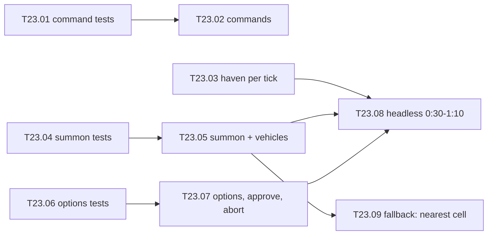

# TASK-23 — Safety ops in the Hab Core: commands, haven per tick, summon and rendezvous, contingency options, abort

| Field | Value |
| --- | --- |
| Objective | Command validation and dispatch; time to haven for each crew member every tick with `HAVEN_TIME_EXCEEDED`; `SUMMON_VEHICLE` with rendezvous, vehicle motion and sheltering; contingency options on an alert, `APPROVE_OPTION` and `ABORT` with plan revision |
| Requirements | FR-31, FR-39, FR-40, FR-44, NFR-06, NFR-12 |
| Lane / owner role | hab-core — R4 Hab Core: Sadman Shaharier Mahim (commands, summon, options); compute — R2: Anjim Hossain (haven per tick) |
| Milestone | M3 (killer demo steps 0:30–1:10 headless, 10 Nov) |
| Window | pre-event-if-permitted |
| Effort (doc 06) | 6–10 h (Sadman 3–5, Anjim 3–5) |
| Done when (doc 06) | Killer demo steps 0:30–1:10 work headless |
| Main risk → fallback | Exact rendezvous too slow or fragile → vehicle drives to the crew's nearest vehicle-passable cell (T23.09; 06 §D.4 cut 6) |
| Spec sections | [02 §E.4](../specs/02_Technical_Requirements_Document.md#e4-authentication-and-roles) · [02 §E.6](../specs/02_Technical_Requirements_Document.md#e6-websocket-protocol-ws) · [02 §D.8](../specs/02_Technical_Requirements_Document.md#d8-time-to-safe-haven-fr-39) · [02 §D.10](../specs/02_Technical_Requirements_Document.md#d10-rendezvous-fr-40) · [02 §D.15](../specs/02_Technical_Requirements_Document.md#d15-contingency-options-fr-44) · [03 §E.5](../specs/03_App_Flow_and_Diagrams.md#e5-sequence--storm-alert-to-shelter-v2) · [03 §E.9](../specs/03_App_Flow_and_Diagrams.md#e9-state--pressurized-rover-v2) · [01 §E.1](../specs/01_Product_Requirements_Document.md#e1-killer-demo--storm-at-sol-4190-target-90-s-of-the-240-s-video) · [01 FR-39](../specs/01_Product_Requirements_Document.md#fr-39--time-to-safe-haven-t0t1-m) · [01 FR-40](../specs/01_Product_Requirements_Document.md#fr-40--pressurized-rover-summon-and-rendezvous-t1-m) · [01 FR-44](../specs/01_Product_Requirements_Document.md#fr-44--contingency-re-plan-t1-m) |

> **Protocol v0 update, 7 Nov 2026 (R4, Sadman Shaharier Mahim).** Decided by the product & systems lead; build on it without waiting for a review, and adapt existing work to it:
>
> 1. Every LogEvent kind has a fixed `data` shape: the table in [05 LogEvent](../specs/05_Backend_and_Database_Schema.md#logevent-one-line-of-sessionjsonl) (T20.10) and `LogEventData` in `packages/protocol/src/runtime.ts` (T20.11).
> 2. On reconnect the Hab Core sends a fresh `SNAPSHOT`, then the missed `EVENT`s ([02 §E.6](../specs/02_Technical_Requirements_Document.md#e6-websocket-protocol-ws)).
> 3. A repeated `command_id` from the same client that was accepted is answered with the first `COMMAND_RESULT` and not run again ([05 Command](../specs/05_Backend_and_Database_Schema.md#command)).
> 4. `plan_hash` and `log_hash` use RFC 8785 canonical JSON ([05 PlanExport](../specs/05_Backend_and_Database_Schema.md#planexport)).

## Inputs this task consumes

| Input | Kind | Owner | Dependency |
| --- | --- | --- | --- |
| Engine module stubs (`haven.ts`, `vehicles.ts`, `contingencyOps.ts`) and the session API | contract | T22.01 | soft (T23.03, T23.05, T23.07) |
| Haven, rendezvous and contingency functions | upstream output | T05b.04, T05b.07, T05b.19 | hard (T23.03, T23.05, T23.07) |
| Session manager that applies commands | upstream output | T22.12 | hard (T23.08) |
| Real sol-4190 scenario | upstream output | T21.08 | hard (T23.08) |

## Outputs this task provides

| Output | Path | Consumers |
| --- | --- | --- |
| Command validation and dispatch | `apps/hab-core/src/commands.ts` | T26.*, T29.02, T31.04, all clients |
| Haven per tick and its alert | `apps/hab-core/src/engine/haven.ts` | T24.*, T25.* |
| Summon, rendezvous, vehicle motion | `apps/hab-core/src/engine/vehicles.ts` | T24.05, T25.04, T29.03 |
| Options, approval, abort and plan revision | `apps/hab-core/src/engine/contingencyOps.ts` | T24.06, T25.04, T31.04 |

## Subtasks

### T23.01 — Tests: command validation and rejections

- **Owner:** Sadman Shaharier Mahim (R4 Hab Core)
- **Type:** test
- **Tag:** agent-ready · core
- **Window:** pre-event-if-permitted
- **Estimate:** 1 h
- **Owns (writes):** `apps/hab-core/tests/commands.test.ts`
- **Reads:** [02 §E.4](../specs/02_Technical_Requirements_Document.md#e4-authentication-and-roles), [02 §E.6](../specs/02_Technical_Requirements_Document.md#e6-websocket-protocol-ws), `packages/protocol/src/ws.ts`
- **Depends on:** T22.01 (soft: engine state), T20.01 (soft: permissions)
- **Parallel with:** T23.04
- **Steps:**
  1. Keep the existing `it.todo` cases and make them real.
  2. One case per reject code: `FORBIDDEN_ROLE` (role lacks the command; EVA "self" rules), `NO_LINK` (suit unlinked), `INVALID` (bad args), `BUSY` (state forbids it).
  3. A rejected command changes nothing and logs `COMMAND_REJECTED`; an accepted one returns `event_seq`.
  4. A repeated `command_id` from the same client that was accepted gets the first `COMMAND_RESULT` again and logs nothing; one that was rejected runs normally (05 Command, decided 2026-11-07).
- **Acceptance:**
  - Serves: FR-31 · [02 §E.4](../specs/02_Technical_Requirements_Document.md#e4-authentication-and-roles)
  - Each rule above is one named test.
- **Verify:** `npm --workspace @marswalk/hab-core test -- commands` fails before T23.02 and passes after.
- **Agent brief:** Turn the `commands.test.ts` todos into tests from 02 §E.4/§E.6. FR-50 command cases live in `stopTasks.test.ts` (T31.03).
- **Conflict notes:** Pair T23.01 → T23.02.

### T23.02 — Implement command validation and dispatch

- **Owner:** Sadman Shaharier Mahim (R4 Hab Core)
- **Type:** implement
- **Tag:** agent-ready · core
- **Window:** pre-event-if-permitted
- **Estimate:** 1.5–2 h
- **Owns (writes):** `apps/hab-core/src/commands.ts`
- **Reads:** `apps/hab-core/tests/commands.test.ts`, [02 §E.4](../specs/02_Technical_Requirements_Document.md#e4-authentication-and-roles), [05 Command](../specs/05_Backend_and_Database_Schema.md#command)
- **Depends on:** T23.01 (hard: tests first)
- **Parallel with:** T23.03
- **Steps:**
  1. Check role (`PERMISSIONS` plus "self" rules), link, args and state in that order.
  2. Handle the simple commands here (`LOAD_SCENARIO`, `SET_CLOCK`, `JUMP_NEXT_EVENT`, `START_EVA`, `PUBLISH_PLAN`, `ACK_ALERT`, `INJECT_EVENT`).
  3. Remember each accepted `(client_id, command_id)` with its result and set `command_ref` on the events it produces; rebuild the memory from `command_ref` on resume (05 Command, LogEvent).
  4. Delegate `SUMMON_VEHICLE` to `engine/vehicles.ts`, `APPROVE_OPTION` and `ABORT` to `engine/contingencyOps.ts`, `SEND_MESSAGE` to `engine/earth.ts`, `TASK_ROVER` to `rover.ts`, and the task commands to `engine/tasks.ts`.
- **Acceptance:**
  - Serves: FR-31, NFR-06 · [02 §E.4](../specs/02_Technical_Requirements_Document.md#e4-authentication-and-roles)
  - T23.01 passes; commands are never logged themselves, only their events (05 Command).
- **Verify:** `npm --workspace @marswalk/hab-core test -- commands`.
- **Agent brief:** Implement validation and a dispatch table; each delegated command stays in its owner's module.
- **Conflict notes:** Single owner. Delegated handlers belong to TASK-23 (vehicles, options), TASK-26 (Earth), TASK-29 (rover) and TASK-31 (tasks).

### T23.03 — Implement haven per tick and `HAVEN_TIME_EXCEEDED`

- **Owner:** Anjim Hossain (R2/R4 float, compute half of TASK-23)
- **Type:** implement
- **Tag:** agent-ready · core
- **Window:** pre-event-if-permitted
- **Estimate:** 1.5–2 h
- **Owns (writes):** `apps/hab-core/src/engine/haven.ts`, `apps/hab-core/tests/havenTick.test.ts`
- **Reads:** [02 §D.8](../specs/02_Technical_Requirements_Document.md#d8-time-to-safe-haven-fr-39), [05 Crew](../specs/05_Backend_and_Database_Schema.md#crew), `packages/compute/src/haven.ts`
- **Depends on:** T05b.04 (hard: haven fields), T22.01 (soft: stub)
- **Parallel with:** T23.05
- **Steps:**
  1. Write the tests first in the same branch: haven minutes, kind and target for each crew member each tick; the alert when haven exceeds the plan's haven rule.
  2. Use the live form of 02 §D.8 for the 1–2 crew positions; recompute the hab field only when data or limits change.
  3. Label haven `modelled` in the provenance map.
- **Acceptance:**
  - Serves: FR-39 · [02 §D.8](../specs/02_Technical_Requirements_Document.md#d8-time-to-safe-haven-fr-39)
  - The tests pass; the tick stays within the NFR-02 engine budget on the fake scenario.
- **Verify:** `npm --workspace @marswalk/hab-core test -- havenTick`.
- **Agent brief:** Call `@marswalk/compute` haven functions from the engine module; no science inline.
- **Conflict notes:** Single owner of both files.

### T23.04 — Tests: summon, rendezvous, vehicle motion and sheltering

- **Owner:** Sadman Shaharier Mahim (R4 Hab Core)
- **Type:** test
- **Tag:** agent-ready · core
- **Window:** pre-event-if-permitted
- **Estimate:** 1 h
- **Owns (writes):** `apps/hab-core/tests/summon.test.ts`
- **Reads:** [02 §D.10](../specs/02_Technical_Requirements_Document.md#d10-rendezvous-fr-40), [03 §E.9](../specs/03_App_Flow_and_Diagrams.md#e9-state--pressurized-rover-v2), [01 FR-40](../specs/01_Product_Requirements_Document.md#fr-40--pressurized-rover-summon-and-rendezvous-t1-m)
- **Depends on:** T22.02 (soft: fake scenario), T22.01 (soft: stubs)
- **Parallel with:** T23.01
- **Steps:**
  1. `SUMMON_VEHICLE` → `VEHICLE_DISPATCHED` with the rendezvous point and both ETAs.
  2. The vehicle follows its path; `VEHICLE_ARRIVED`, then `CREW_SHELTERED` when the crew reach it.
  3. No candidate → `NO_RENDEZVOUS` result and state unchanged; a second summon while en route → `BUSY`.
- **Acceptance:**
  - Serves: FR-40 · [02 §D.10](../specs/02_Technical_Requirements_Document.md#d10-rendezvous-fr-40)
  - Each rule above is one named test on the fake scenario.
- **Verify:** `PENDING_RED=1 npm --workspace @marswalk/hab-core test -- summon` fails before T23.05 and passes after (without `PENDING_RED` the suite skips itself while `vehicles.ts` is the stub, so `make test` stays green).
- **Agent brief:** Write summon tests following the 03 §E.9 vehicle state machine.
- **Conflict notes:** Pair T23.04 → T23.05.

### T23.05 — Implement summon, rendezvous dispatch and vehicle motion

- **Owner:** Sadman Shaharier Mahim (R4 Hab Core)
- **Type:** implement
- **Tag:** agent-ready · core
- **Window:** pre-event-if-permitted
- **Estimate:** 1.5–2 h
- **Owns (writes):** `apps/hab-core/src/engine/vehicles.ts`
- **Reads:** `apps/hab-core/tests/summon.test.ts`, `packages/compute/src/rendezvous.ts`, [03 §E.9](../specs/03_App_Flow_and_Diagrams.md#e9-state--pressurized-rover-v2)
- **Depends on:** T23.04 (hard: tests first), T05b.07 (hard: rendezvous), T22.01 (soft: stub)
- **Parallel with:** T23.03
- **Steps:**
  1. Handle `SUMMON_VEHICLE`: compute the rendezvous, log `VEHICLE_DISPATCHED`.
  2. Move vehicles along their paths at the ParamSet speed each tick; emit arrival and sheltering events.
  3. TASK-29 reuses the motion code for the utility rover through an exported helper.
- **Acceptance:**
  - Serves: FR-40, NFR-06
  - T23.04 passes.
- **Verify:** `npm --workspace @marswalk/hab-core test -- summon`.
- **Agent brief:** Implement the vehicle module until the tests pass.
- **Conflict notes:** Single owner; `engine/rovers.ts` (T29.03) imports the motion helper and never edits this file.

**Proposed 2026-11-08 — TODO(decision)** (T23.05 implementation notes; Gemini's first version reworked after review and re-review on 8 Nov):

- **Shared dispatch helper** in `vehicles.ts`, used by `handleSummon` and to be reused by T23.07 for APPROVE_OPTION on a VEHICLE_RENDEZVOUS option:
  `dispatchVehicle(state: EngineState, scenario: LoadedScenario, req: DispatchRequest): DispatchOutcome`, with
  `DispatchRequest = {crew_ids: readonly string[]; option_id?: string; actor: LogEvent["actor"]}` and
  `DispatchOutcome = {ok: true; events: PendingEvent[]} | {ok: false; code: RejectCode; message: string}`.
  It never changes state, and its one VEHICLE_DISPATCHED has no `command_ref` (handleCommand adds it).
  Checks, in order: INVALID (no pressurized rover; crew not 1–2 distinct known ids; a named crew member already SHELTERED or IN_HAB; unknown option, or crew that differ from the option's), BUSY (the rover is not PARKED, before any compute call), INVALID (the rover's own ParamSet `Vehicle.param_set` is missing, of another kind, or has no `flat_speed_kmh` > 0; no default speed), NO_RENDEZVOUS (no grid, or no candidate for any crew member).
- `handleSummon` checks the arg types (`crew` a list of strings, `option_id` a string if present), then calls `dispatchVehicle`. A missing PR1 is INVALID, not BUSY.
- Bound L of 02 §D.10 = `max_haven_min` × 60 s (the 02 §D.8 haven rule; the `crewTimeField` doc in haven.ts).
- The logged `eta_crew_s` and `eta_vehicle_s` are Math.round of the compute values, so `Vehicle.eta_s` is an int (05 Vehicle). Math.round rather than Math.ceil because T23.04 accepts ±0.5 s.
  `eta_vehicle_s` is at least 1 s whenever the drive (vehicle position, then the compute `vehicle_path`) has length, so no path is covered in zero time.
- Two crew: both rendezvous, then `rendezvousPair`; the event carries the first meeting point of the chosen order.
  If `rendezvousPair` throws (RangeError), the earlier meeting (max of the two ETAs) wins, ties to the first named.
  If only one of the two has a rendezvous, the vehicle goes to that one: a rover reaching one person in a storm is still useful.
  TODO(decision): the unreachable crew member is not served, and the event cannot say so because T23.04 pins the VEHICLE_DISPATCHED data keys.
  TODO(decision): the second meeting is not driven yet.
- The path is not carried in VEHICLE_DISPATCHED: 05 and `runtime.ts` have no field for it, and T23.04 pins the data keys. `vehiclesTick` rebuilds it on the first tick after the dispatch from logged state only: the vehicle's own position (unchanged since PARKED) and the logged target.
  It calls compute `rendezvous` with a crew field from the target bounded at 0 s, so the only candidate is the target cell and the result is the same `vehicle_path` the dispatch computed, ending exactly at the target. It never reads the crew's current position, so there is no jump and no straight-line fallback. The cost is one vehicle Dijkstra, down from Gemini's two plus a crew field.
  Carrying the path in the event would need a 05 / protocol change and a T23.04 change.
- No path at the DISPATCHED tick, or no logged `eta_s` (a VEHICLE_DISPATCHED without a rendezvous): the vehicle stays DISPATCHED with no path, does not move and logs nothing; the tick retries. TODO(decision): no event kind exists for "cannot go".
- Motion (`moveAlongPath`, shared with T29.03): `path` holds the vertices still ahead, ending at the target. Speed = remaining path length ÷ `eta_s` × `dt_s` per tick, so the vehicle arrives on tick ceil(`eta_s` ÷ `dt_s`) (within 0.5 s of the compute `eta_vehicle_s` at 1 s steps).
  This departs from Step 2's "at the ParamSet speed", so that the arrival matches the compute ETA, which includes the slope and terrain costs.
  `eta_s` counts down as an integer (Math.ceil, never Infinity or NaN). It moves on the DISPATCHED tick as well. With no path or no finite `eta_s` it does not move. With path left and `eta_s` ≤ 0 it neither moves nor arrives (no teleport); a path with no length left arrives at once. Whoever sets `path` sets `eta_s`.
  On arrival `path` [] and `eta_s` 0, plus one VEHICLE_ARRIVED with provenance `simulated` for `x_m` and `y_m`. The reducer, not the module, sets ARRIVED.
- STATE_DELTAs: `vehicles/<id>/state`, `x_m`, `y_m`, `path` and `eta_s`, each when it changed. DISPATCHED → EN_ROUTE has no LogEvent kind, so it is a never-logged change plus a delta.
- Sheltering: `SHELTER_REACH_M = 1` m is the T23.04 TODO(decision) value. CREW_SHELTERED labels both dose fields `simulated`, as tick.ts does for the hab.
- Tests: [summonReal.test.ts](../../apps/hab-core/tests/summonReal.test.ts) is a Proposed addition outside this subtask's Owns (T23.04 owns `summon.test.ts`). It runs on the real compute and the F9 grids; its only `vi.mock` is a pass-through of `rendezvousPair` that one test makes throw. In `summon.test.ts`, Gemini's `origin_m` / `prev` stand-in edits were reverted; only the `vehiclePassable` mock entry stays.
- Recorded, not fixed: a bare summon (no option) never shelters anyone, because the reducer sets `task.crew_ids` only from an option and nothing walks the crew to the meeting point. TODO(decision), inherited from T23.04 / T22.06.
- Recorded, not fixed: re-targeting when the crew move after the summon. TODO(decision).
- Since 2026-11-08 the T23.07 rework (same owner) extended `dispatchVehicle` with an optional precomputed `rendezvous` and mapped compute RangeErrors to NO_RENDEZVOUS; see the T23.07 notes below.

### T23.06 — Tests: contingency options, approval and abort

- **Owner:** Sadman Shaharier Mahim (R4 Hab Core)
- **Type:** test
- **Tag:** agent-ready · core
- **Window:** pre-event-if-permitted
- **Estimate:** 1 h
- **Owns (writes):** `apps/hab-core/tests/contingencyOps.test.ts`
- **Reads:** [02 §D.15](../specs/02_Technical_Requirements_Document.md#d15-contingency-options-fr-44), [03 §E.5](../specs/03_App_Flow_and_Diagrams.md#e5-sequence--storm-alert-to-shelter-v2), [03 §E.7](../specs/03_App_Flow_and_Diagrams.md#e7-state--alert-lifecycle-v2)
- **Depends on:** T22.02 (soft: fake scenario), T22.01 (soft: stubs)
- **Parallel with:** T23.04
- **Steps:**
  1. A `RADIATION_ALERT` produces `OPTIONS_PROPOSED` with ranked options for each crew member on alert.
  2. `APPROVE_OPTION` (ops) → `PLAN_REVISED` with a new `plan_revision` and the dropped stops.
  3. `ABORT` (EVA self or ops) → abort-to-haven revision; approving a stale option → `INVALID`.
- **Acceptance:**
  - Serves: FR-44 · [02 §D.15](../specs/02_Technical_Requirements_Document.md#d15-contingency-options-fr-44)
  - Each rule above is one named test.
- **Verify:** `PENDING_RED=1 npm --workspace @marswalk/hab-core test -- contingencyOps` fails before T23.07 and passes after (without `PENDING_RED` the suite skips itself while `contingencyOps.ts` is the stub).
- **Agent brief:** Write option and approval tests following 03 §E.5.
- **Conflict notes:** Pair T23.06 → T23.07.

### T23.07 — Implement contingency options, `APPROVE_OPTION` and `ABORT`

- **Owner:** Sadman Shaharier Mahim (R4 Hab Core)
- **Type:** implement
- **Tag:** agent-ready · core
- **Window:** pre-event-if-permitted
- **Estimate:** 1.5–2 h
- **Owns (writes):** `apps/hab-core/src/engine/contingencyOps.ts`
- **Reads:** `apps/hab-core/tests/contingencyOps.test.ts`, `packages/compute/src/contingency.ts`
- **Depends on:** T23.06 (hard: tests first), T05b.19 (hard: ranking), T22.01 (soft: stub)
- **Parallel with:** T23.05
- **Steps:**
  1. On a new warning, build options with `@marswalk/compute` and log `OPTIONS_PROPOSED`.
  2. Approval and abort revise the plan and log `PLAN_REVISED`; `engine/tasks.ts` (T31.04) reacts to it for dropped stops. *(2026-11-07)* `PLAN_REVISED` carries the revised `waypoints` and `legs` (05 "LogEvent `data` by kind"): drop the option's `stops_dropped`, and build the new leg from the option's route.
- **Acceptance:**
  - Serves: FR-44, NFR-06
  - T23.06 passes.
- **Verify:** `npm --workspace @marswalk/hab-core test -- contingencyOps`.
- **Agent brief:** Implement the options module until the tests pass.
- **Decisions (Proposed 2026-11-08 — TODO(decision)):**
  1. *Superseded 2026-11-08 by the "Answered once" note below.* `contingencyTick`: evaluated for active un-cleared `warning` alerts where options do not already stand in `state.options` and crew subjects are not already en route to a haven (`TO_HAVEN`), `SHELTERED`, or `IN_HAB`.
  2. `APPROVE_OPTION`: if approving a `VEHICLE_RENDEZVOUS` option, emits `VEHICLE_DISPATCHED` first for the vehicle and rendezvous point, followed immediately by `PLAN_REVISED`.
  3. `handleAbort`: requires non-empty `args.crew`, checks that EVA roles can only abort for themselves (`FORBIDDEN_ROLE`), finds matching `ABORT_TO_HAB` option, and logs `PLAN_REVISED` without dispatching a vehicle.
  4. *Superseded 2026-11-08 by the "New leg" and "Rendezvous end" notes below.* Plan revision (`buildPlanRevision`): retains all legs between consecutive kept waypoints; the new return leg connects the last kept waypoint to start waypoint `wp-0` using `option.path_preview`.
- **Conflict notes:** Single owner.

**Proposed 2026-11-08 — TODO(decision)** (T23.07 review rework of Gemini's branch; these replace decisions 1 and 4 above where they differ):

- **Answered once.** An alert gets one OPTIONS_PROPOSED, ever. The new engine-only, JSON-safe field `EngineState.proposed_alerts?: string[]` is reduced from OPTIONS_PROPOSED.
  This is a small edit to `reducer.ts` (T22.06, same owner). It replaces the `TO_HAVEN` guard: after an approved CONTINUE_SKIP the crew stay WALKING, and Gemini's version proposed again on every tick.
  The proposal goes only to the crew still out (WALKING or AT_STOP). An empty option list is still logged once, so a re-try does not run every tick.
- **Missing inputs.** No grid (the scenario loader gives null until TASK-05), no `shielding` ParamSet, or no start waypoint: no events and no throw. This fixed the 11 `tick.test.ts` failures.
- **Inputs to compute:**
  - hab = the plan's `role: "start"` waypoint;
  - ingress = `HAB_INGRESS_S`, and the rover's own ParamSet (`Vehicle.param_set`) `ingress_min` × 60;
  - crew fields bounded at L = `max_haven_min` × 60 s, as in `vehicles.ts`;
  - the vehicle field starts at the rover's position;
  - `pair` = `rendezvousPair` for two crew with OK rendezvous. If it throws a RangeError there is no vehicle option.
  - No vehicle option either unless the rover is PARKED and its ParamSet has `ingress_min` ≥ 0.
- **Finite options.** Options with a non-finite number are dropped and the rest re-ranked 1..n (defensive; compute already drops them).
- **New leg.** `walk_time_min` excludes ingress: ETA − `HAB_INGRESS_S`, or `rendezvous.eta_crew_s` for VEHICLE_RENDEZVOUS. `distance_m` = polyline length in projected metres. `cell_path_length` = the vertex count of `path_preview`.
  That count is the cell count for ABORT_TO_HAB and VEHICLE_RENDEZVOUS, but not for CONTINUE_SKIP, whose path is display geometry. TODO(decision).
- **Climb, descent, max slope and profile** (Proposed 2026-11-09 — TODO(decision); replaces the 8 Nov "blocked" note). `buildPlanRevision` (run on approval and abort, never per tick) keeps `geometry`, `walk_time_min` and `distance_m` as above and takes only these four fields from compute. The Hab Core does no slope or elevation maths (CLAUDE.md §2):
  - **ABORT_TO_HAB and VEHICLE_RENDEZVOUS:** `path_preview` is a cell-centre path from `pathTo`. Its vertices go through `cellIndex` (repeats collapsed) into `toLeg(grid, from, to, {status: "OK", cells}, scenario)`; the four fields are copied.
    A vertex outside the grid (`cellIndex` gives `null`, or NaN for a NaN coordinate) or an empty path keeps 0 and an empty profile, labelled `assumed`.
  - **Contained metrics step** (Proposed 2026-11-09 — TODO(decision), review decision): a display-metric problem never blocks a safety command. Zeros and an empty profile, all four labelled `assumed`, for that leg only, and the revision proceeds normally, when:
    - a value is non-finite (bilinear elevation next to no-data);
    - `toLeg` or `sampleProfile` throws any error;
    - the path guard fails. Options carry no field, so the "field `cell_m`" check is indirect: if `toLeg`'s `distance_m` differs from the path's own length, its vertices are not the centres of this grid's cells (a field of another `cell_m` or origin). The check is approximate: a straight path with half-cell steps happens to map onto a same-length run of centres and passes.
    Only the metrics step is contained: errors in the geometry, legs or waypoints still surface.
  - **What the numbers cover.** For ABORT_TO_HAB and VEHICLE_RENDEZVOUS, `profile`, `climb_m`, `descent_m` and `max_slope_deg` cover `path_preview` only. `distance_m` and `geometry` also include the final hop to the start waypoint (at most about one cell) for a hab-bound leg. For CONTINUE_SKIP, `profile` is derived from the display polyline while climb, descent and max slope are assumed 0.
  - **No grid at approval** (`scenario.grid` null): the revision fails, INVALID. This is the only rejection left: options only exist when a tick had a grid.
  - **CONTINUE_SKIP:** `path_preview` is a display polyline, not a cell path. `profile` = `sampleProfile(grid, geometry, caution_slope_deg, hard_slope_limit_deg)`, labelled `derived`. `climb_m`, `descent_m` and `max_slope_deg` stay 0, labelled `assumed`.
    TODO(decision), request to TASK-05 (Mishkat Ahmed Khan, `packages/compute`): a helper that maps a polyline to the grid cells it crosses (for example `cellsAlongPath(grid, polyline)`), so `toLeg` can serve CONTINUE_SKIP too. Until then these three numbers are the only gap of T23.07.
- **Provenance.** OPTIONS_PROPOSED labels `data.options.eta_shelter_min`, `data.options.expected_dose_ugy` and `data.options.rendezvous` `modelled` (05). VEHICLE_DISPATCHED labels `data.rendezvous` `modelled`.
  PLAN_REVISED labels the new leg by index: `data.legs.<i>.walk_time_min` `modelled`, `distance_m` `derived`, and `climb_m`, `descent_m`, `max_slope_deg` and `profile` `derived` when they come from compute. `assumed` remains only where there is no derivable value: CONTINUE_SKIP's three scalars, and a leg whose result was not finite or whose path left the grid.
- **APPROVE_OPTION for VEHICLE_RENDEZVOUS** calls T23.05's `dispatchVehicle` with the option's own point as a precomputed `rendezvous` (orchestrator decision, 8 Nov).
  This edits `vehicles.ts`, which belongs to T23.05 (same owner). A new optional `DispatchRequest.rendezvous` skips the compute call and is logged verbatim, after the same INVALID, BUSY and ParamSet checks; a non-finite or negative value is INVALID.
  T23.06 asserts the verbatim point, and the vehicle target stays on the crew route. The local dispatch copy is deleted.
  `Vehicle.eta_s` stays a whole number: the reducer (`reducer.ts`, T22.06, same owner) applies Math.ceil when it sets `eta_s` from VEHICLE_DISPATCHED. That is a no-op on T23.05's rounded ETAs, and a fractional ETA above 0 never becomes 0, which would stop the vehicle.
- **Rendezvous end: tick rule S5** (orchestrator decisions, 8 Nov; the final round replaces the reach-only rule). This edits `tick.ts`, which belongs to T22.09 (same owner); the rule is recorded under T22.09 in TASK-22.
  A route whose last leg has `to` = the start waypoint shelters in the hab as before, unless two things hold: a pressurized rover's SUMMON task names this crew member, and they ended farther than `SHELTER_REACH_M` from the start waypoint. Then they hold for the vehicle.
  The rover counts while it is DISPATCHED or EN_ROUTE, and also ARRIVED: a rover that reaches the meeting point first waits there, and the crew must still hold for it.
  So a planner loop that ends on a cell centre near the start still shelters in the hab. The VEHICLE_RENDEZVOUS leg keeps `to` = start (05 Waypoint roles and the T23.06 shape are unchanged) but ends at the meeting point; the crew hold there in the suit, and `vehiclesTick` shelters them in the vehicle (`haven_kind: "vehicle"`) when it arrives within reach.
  A hab-bound leg (ABORT_TO_HAB, CONTINUE_SKIP) gets the start waypoint as its last vertex when compute's path ends elsewhere, for example at the hab cell's centre.
  TODO(decision): that extra segment is at most half a cell's diagonal, and its walk time is not added to `walk_time_min`. Turning a distance into a walk time is the time model, which belongs in compute (CLAUDE.md §2); a flat-speed division here would be a second, slope-blind model.
- **Compute RangeErrors never stop the engine** (orchestrator decision, 8 Nov). In `contingencyTick`:
  - no options and no events if the hab side throws (`habTimeField`, e.g. the hab is off the grid);
  - no vehicle option if the vehicle side throws (the rover off the grid, a malformed rover ParamSet);
  - an alert whose `proposeOptions` call throws (e.g. a `stop_index` outside the plan) is skipped this tick and retried on the next.
  `dispatchVehicle` answers NO_RENDEZVOUS for a compute RangeError. Any other error still propagates.
  TODO(decision): a dedicated 05 Waypoint role ("rendezvous") would be cleaner; that is the spec owner's call.
- **ABORT.** The EVA self rule takes the crew id from the role (`eva:<id>`); `selfOf` in `commands.ts` is private.
  With ABORT_TO_HAB options of several active alerts, ABORT executes the newest alert's (highest `raised_seq`), ties to the lower `option_id`. Options of a cleared alert are skipped.
- **Shared path for two crew.** TODO(decision): `path_preview` is crew[0]'s, so under rule S7 EV2 snaps onto EV1's path. The leg's walk time is the slowest member's (the option's ETA).
- **CONTINUE_SKIP path.** The return leg follows the planned legs (compute's `remainingPlan`), so it passes the dropped stops' places, but with no waypoint there it has no dwell and no ARRIVED_STOP. TODO(decision) for the compute owner.
- **Warning alerts only.** TODO(decision): an O₂ or buddy warning also gets radiation-style options; 02 §D.15 does not restrict this.
- **Tests.** The new [contingencyOpsReal.test.ts](../../apps/hab-core/tests/contingencyOpsReal.test.ts) runs 36 tests on the real compute and the F9 `havenFlat` grid (tilted 5° since 9 Nov so climb, descent and slope are not 0; 18 more tests cover the revised leg's metrics), including whole-`tick()` runs of a rendezvous (vehicle shelter) and an abort (hab shelter), and `dispatchVehicle` with a precomputed point.
  In `contingencyOps.test.ts` only the fixture and mock shape changed (a stand-in grid, a `vehiclePassable` mock, and since 9 Nov `cellIndex`, `toLeg` and `sampleProfile` mocks); no assertion changed.

### T23.08 — Verify: killer demo steps 0:30–1:10 run headless (M3)

- **Owner:** Sadman Shaharier Mahim (R4 Hab Core)
- **Type:** verify
- **Tag:** agent-ready · core
- **Window:** pre-event-if-permitted
- **Estimate:** 0.5–1 h
- **Owns (writes):** `apps/hab-core/tests/killerDemo.test.ts`, `docs/ops/verification-log.md` (append-only)
- **Reads:** [01 §E.1](../specs/01_Product_Requirements_Document.md#e1-killer-demo--storm-at-sol-4190-target-90-s-of-the-240-s-video), [03 §C.6](../specs/03_App_Flow_and_Diagrams.md#c6-killer-demo-journey--storm-at-sol-4190-v2-01-e1)
- **Depends on:** T23.03 (hard), T23.05 (hard), T23.07 (hard), T22.12 (hard: session), T21.08 (hard: real scenario), T32.17 (soft: list replay, only for the extra step), T32.18 (soft: the reference command list, only for the extra step)
- **Parallel with:** T22.14
- **Steps:**
  1. A scripted headless run of the real scenario that issues the demo's commands at the 01 §E.1 beats (summon, approve).
  2. Assert the event sequence 0:30–1:10: alert, options, summon accepted, vehicle arrives, crew sheltered.
  3. Record the run's `log_hash` in the verification log.
  4. Once T32.18 exists, also run the same beats from the reference command list (T32.17) and compare the event order; T32.29 verifies the full live session. This step does not block M3.
- **Acceptance:**
  - Serves: FR-38, FR-40, FR-44 · [06 §C.2](../specs/06_High_Level_Implementation_Plan.md#c2-new-in-v2-surface-ops-tier-1-unless-marked) TASK-23 done-when
  - The test passes headless; the event order matches 01 §E.1.
- **Verify:** `npm --workspace @marswalk/hab-core test -- killerDemo` (skips without the real scenario).
- **Blocker (Proposed 2026-11-08, updated 2026-11-09 — TODO(decision)):** the revised leg's `climb_m`, `descent_m`, `max_slope_deg` and `profile` are now real (compute `toLeg`) for ABORT_TO_HAB and VEHICLE_RENDEZVOUS, so the demo's legs carry real numbers. Only CONTINUE_SKIP's `climb_m`, `descent_m` and `max_slope_deg` still wait (0, `assumed`) for a TASK-05 polyline-to-cells helper. The killer demo [01 §E.1](../specs/01_Product_Requirements_Document.md#e1-killer-demo--storm-at-sol-4190-target-90-s-of-the-240-s-video) and [docs/ops/demo-script.md](../ops/demo-script.md) never use CONTINUE_SKIP (options at 0:30 are abort to hab and rover rendezvous; the crew summon the rover at 0:40), so this gap does not block T23.08 or the video.
- **Agent brief:** Script the demo's commands and assert the event order; never change the scenario to make it pass.
- **Conflict notes:** New test file; append-only log.

### T23.09 — Fallback — start only if exact rendezvous fails by M3 or cut 6 is called: drive to the nearest vehicle-passable cell

- **Owner:** Sadman Shaharier Mahim (R4 Hab Core)
- **Type:** fallback
- **Tag:** agent-ready · core
- **Window:** pre-event-if-permitted
- **Estimate:** 0.5–1 h
- **Owns (writes):** `apps/hab-core/src/engine/vehicles.ts` (replaces T23.05)
- **Reads:** [06 §D.4](../specs/06_High_Level_Implementation_Plan.md#d4-cut-list-cut-in-this-order-when-behind) item 6, [06 §C.2](../specs/06_High_Level_Implementation_Plan.md#c2-new-in-v2-surface-ops-tier-1-unless-marked) TASK-23 fallback
- **Depends on:** T23.05 (hard: replaces its rendezvous call)
- **Parallel with:** T23.08
- **Steps:**
  1. Replace the rendezvous call with the crew's nearest vehicle-passable cell; keep the event shapes.
  2. Label the simpler rule in Sources & methods.
- **Acceptance:**
  - Serves: FR-40 · [06 §D.4](../specs/06_High_Level_Implementation_Plan.md#d4-cut-list-cut-in-this-order-when-behind)
  - T23.04 passes apart from its optimality case, which is marked skipped with the reason.
- **Verify:** `npm --workspace @marswalk/hab-core test -- summon`.
- **Agent brief:** Only on cut 6: simplify the meeting point; the protocol does not change.
- **Conflict notes:** Replaces part of T23.05's file; never at the same time.

## Internal dependency graph

## Definition of done (task level)

- 06 §C.2 done-when: killer demo steps 0:30–1:10 work headless (T23.08).
- Haven is shown with its `modelled` label; every rejection has a reason code.
- [06 §D.7](../specs/06_High_Level_Implementation_Plan.md#d7-definition-of-done-per-feature): tests committed; AI use logged.

## Spec questions

1. **"Self" for `ABORT`.** 02 §E.4 lets an EVA role abort for itself; whether an abort by EV1 also revises EV2's plan is not stated. `TODO(decision)` in T23.07.
2. **Stale options.** 02 §D.15 does not say what happens when the situation changes after options were proposed; T23.06 rejects approval of an option whose alert has cleared (`INVALID`), proposed here.
