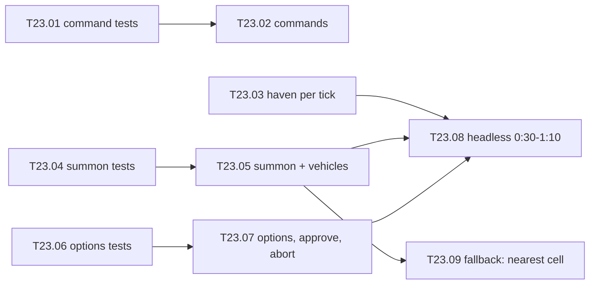

# TASK-23 — Safety ops in the Hab Core: commands, haven per tick, summon and rendezvous, contingency options, abort

| Field | Value |
| --- | --- |
| Objective | Command validation and dispatch; time to haven for each crew member every tick with `HAVEN_TIME_EXCEEDED`; `SUMMON_VEHICLE` with rendezvous, vehicle motion and sheltering; contingency options on an alert, `APPROVE_OPTION` and `ABORT` with plan revision |
| Requirements | FR-31, FR-39, FR-40, FR-44, NFR-06, NFR-12 |
| Lane / owner role | hab-core — R4 Hab Core: Sadman Shaharier Mahim (commands, summon, options); compute — R2: Anjim Hossain (haven per tick) |
| Milestone | M3 (killer demo steps 0:30–1:10 headless, 10 Nov) |
| Window | pre-event-if-permitted |
| Effort (doc 06) | 6–10 h (Sadman 3–5, Anjim 3–5) |
| Done when (doc 06) | Killer demo steps 0:30–1:10 work headless |
| Main risk → fallback | Exact rendezvous too slow or fragile → vehicle drives to the crew's nearest vehicle-passable cell (T23.09; 06 §D.4 cut 6) |
| Spec sections | [02 §E.4](../specs/02_Technical_Requirements_Document.md#e4-authentication-and-roles) · [02 §E.6](../specs/02_Technical_Requirements_Document.md#e6-websocket-protocol-ws) · [02 §D.8](../specs/02_Technical_Requirements_Document.md#d8-time-to-safe-haven-fr-39) · [02 §D.10](../specs/02_Technical_Requirements_Document.md#d10-rendezvous-fr-40) · [02 §D.15](../specs/02_Technical_Requirements_Document.md#d15-contingency-options-fr-44) · [03 §E.5](../specs/03_App_Flow_and_Diagrams.md#e5-sequence--storm-alert-to-shelter-v2) · [03 §E.9](../specs/03_App_Flow_and_Diagrams.md#e9-state--pressurized-rover-v2) · [01 §E.1](../specs/01_Product_Requirements_Document.md#e1-killer-demo--storm-at-sol-4190-target-90-s-of-the-240-s-video) · [01 FR-39](../specs/01_Product_Requirements_Document.md#fr-39--time-to-safe-haven-t0t1-m) · [01 FR-40](../specs/01_Product_Requirements_Document.md#fr-40--pressurized-rover-summon-and-rendezvous-t1-m) · [01 FR-44](../specs/01_Product_Requirements_Document.md#fr-44--contingency-re-plan-t1-m) |

> **Protocol v0 update, 7 Nov 2026 (R4, Sadman Shaharier Mahim).** Decided by the product & systems lead; build on it without waiting for a review, and adapt existing work to it:
>
> 1. Every LogEvent kind has a fixed `data` shape: the table in [05 LogEvent](../specs/05_Backend_and_Database_Schema.md#logevent-one-line-of-sessionjsonl) (T20.10) and `LogEventData` in `packages/protocol/src/runtime.ts` (T20.11).
> 2. On reconnect the Hab Core sends a fresh `SNAPSHOT`, then the missed `EVENT`s ([02 §E.6](../specs/02_Technical_Requirements_Document.md#e6-websocket-protocol-ws)).
> 3. A repeated `command_id` from the same client that was accepted is answered with the first `COMMAND_RESULT` and not run again ([05 Command](../specs/05_Backend_and_Database_Schema.md#command)).
> 4. `plan_hash` and `log_hash` use RFC 8785 canonical JSON ([05 PlanExport](../specs/05_Backend_and_Database_Schema.md#planexport)).

## Inputs this task consumes

| Input | Kind | Owner | Dependency |
| --- | --- | --- | --- |
| Engine module stubs (`haven.ts`, `vehicles.ts`, `contingencyOps.ts`) and the session API | contract | T22.01 | soft (T23.03, T23.05, T23.07) |
| Haven, rendezvous and contingency functions | upstream output | T05b.04, T05b.07, T05b.19 | hard (T23.03, T23.05, T23.07) |
| Session manager that applies commands | upstream output | T22.12 | hard (T23.08) |
| Real sol-4190 scenario | upstream output | T21.08 | hard (T23.08) |

## Outputs this task provides

| Output | Path | Consumers |
| --- | --- | --- |
| Command validation and dispatch | `apps/hab-core/src/commands.ts` | T26.*, T29.02, T31.04, all clients |
| Haven per tick and its alert | `apps/hab-core/src/engine/haven.ts` | T24.*, T25.* |
| Summon, rendezvous, vehicle motion | `apps/hab-core/src/engine/vehicles.ts` | T24.05, T25.04, T29.03 |
| Options, approval, abort and plan revision | `apps/hab-core/src/engine/contingencyOps.ts` | T24.06, T25.04, T31.04 |

## Subtasks

### T23.01 — Tests: command validation and rejections

- **Owner:** Sadman Shaharier Mahim (R4 Hab Core)
- **Type:** test
- **Tag:** agent-ready · core
- **Window:** pre-event-if-permitted
- **Estimate:** 1 h
- **Owns (writes):** `apps/hab-core/tests/commands.test.ts`
- **Reads:** [02 §E.4](../specs/02_Technical_Requirements_Document.md#e4-authentication-and-roles), [02 §E.6](../specs/02_Technical_Requirements_Document.md#e6-websocket-protocol-ws), `packages/protocol/src/ws.ts`
- **Depends on:** T22.01 (soft: engine state), T20.01 (soft: permissions)
- **Parallel with:** T23.04
- **Steps:**
  1. Keep the existing `it.todo` cases and make them real.
  2. One case per reject code: `FORBIDDEN_ROLE` (role lacks the command; EVA "self" rules), `NO_LINK` (suit unlinked), `INVALID` (bad args), `BUSY` (state forbids it).
  3. A rejected command changes nothing and logs `COMMAND_REJECTED`; an accepted one returns `event_seq`.
  4. A repeated `command_id` from the same client that was accepted gets the first `COMMAND_RESULT` again and logs nothing; one that was rejected runs normally (05 Command, decided 2026-11-07).
- **Acceptance:**
  - Serves: FR-31 · [02 §E.4](../specs/02_Technical_Requirements_Document.md#e4-authentication-and-roles)
  - Each rule above is one named test.
- **Verify:** `npm --workspace @marswalk/hab-core test -- commands` fails before T23.02 and passes after.
- **Agent brief:** Turn the `commands.test.ts` todos into tests from 02 §E.4/§E.6. FR-50 command cases live in `stopTasks.test.ts` (T31.03).
- **Conflict notes:** Pair T23.01 → T23.02.

### T23.02 — Implement command validation and dispatch

- **Owner:** Sadman Shaharier Mahim (R4 Hab Core)
- **Type:** implement
- **Tag:** agent-ready · core
- **Window:** pre-event-if-permitted
- **Estimate:** 1.5–2 h
- **Owns (writes):** `apps/hab-core/src/commands.ts`
- **Reads:** `apps/hab-core/tests/commands.test.ts`, [02 §E.4](../specs/02_Technical_Requirements_Document.md#e4-authentication-and-roles), [05 Command](../specs/05_Backend_and_Database_Schema.md#command)
- **Depends on:** T23.01 (hard: tests first)
- **Parallel with:** T23.03
- **Steps:**
  1. Check role (`PERMISSIONS` plus "self" rules), link, args and state in that order.
  2. Handle the simple commands here (`LOAD_SCENARIO`, `SET_CLOCK`, `JUMP_NEXT_EVENT`, `START_EVA`, `PUBLISH_PLAN`, `ACK_ALERT`, `INJECT_EVENT`).
  3. Remember each accepted `(client_id, command_id)` with its result and set `command_ref` on the events it produces; rebuild the memory from `command_ref` on resume (05 Command, LogEvent).
  4. Delegate `SUMMON_VEHICLE` to `engine/vehicles.ts`, `APPROVE_OPTION` and `ABORT` to `engine/contingencyOps.ts`, `SEND_MESSAGE` to `engine/earth.ts`, `TASK_ROVER` to `rover.ts`, and the task commands to `engine/tasks.ts`.
- **Acceptance:**
  - Serves: FR-31, NFR-06 · [02 §E.4](../specs/02_Technical_Requirements_Document.md#e4-authentication-and-roles)
  - T23.01 passes; commands are never logged themselves, only their events (05 Command).
- **Verify:** `npm --workspace @marswalk/hab-core test -- commands`.
- **Agent brief:** Implement validation and a dispatch table; each delegated command stays in its owner's module.
- **Conflict notes:** Single owner. Delegated handlers belong to TASK-23 (vehicles, options), TASK-26 (Earth), TASK-29 (rover) and TASK-31 (tasks).

### T23.03 — Implement haven per tick and `HAVEN_TIME_EXCEEDED`

- **Owner:** Anjim Hossain (R2/R4 float, compute half of TASK-23)
- **Type:** implement
- **Tag:** agent-ready · core
- **Window:** pre-event-if-permitted
- **Estimate:** 1.5–2 h
- **Owns (writes):** `apps/hab-core/src/engine/haven.ts`, `apps/hab-core/tests/havenTick.test.ts`
- **Reads:** [02 §D.8](../specs/02_Technical_Requirements_Document.md#d8-time-to-safe-haven-fr-39), [05 Crew](../specs/05_Backend_and_Database_Schema.md#crew), `packages/compute/src/haven.ts`
- **Depends on:** T05b.04 (hard: haven fields), T22.01 (soft: stub)
- **Parallel with:** T23.05
- **Steps:**
  1. Write the tests first in the same branch: haven minutes, kind and target for each crew member each tick; the alert when haven exceeds the plan's haven rule.
  2. Use the live form of 02 §D.8 for the 1–2 crew positions; recompute the hab field only when data or limits change.
  3. Label haven `modelled` in the provenance map.
- **Acceptance:**
  - Serves: FR-39 · [02 §D.8](../specs/02_Technical_Requirements_Document.md#d8-time-to-safe-haven-fr-39)
  - The tests pass; the tick stays within the NFR-02 engine budget on the fake scenario.
- **Verify:** `npm --workspace @marswalk/hab-core test -- havenTick`.
- **Agent brief:** Call `@marswalk/compute` haven functions from the engine module; no science inline.
- **Conflict notes:** Single owner of both files.

### T23.04 — Tests: summon, rendezvous, vehicle motion and sheltering

- **Owner:** Sadman Shaharier Mahim (R4 Hab Core)
- **Type:** test
- **Tag:** agent-ready · core
- **Window:** pre-event-if-permitted
- **Estimate:** 1 h
- **Owns (writes):** `apps/hab-core/tests/summon.test.ts`
- **Reads:** [02 §D.10](../specs/02_Technical_Requirements_Document.md#d10-rendezvous-fr-40), [03 §E.9](../specs/03_App_Flow_and_Diagrams.md#e9-state--pressurized-rover-v2), [01 FR-40](../specs/01_Product_Requirements_Document.md#fr-40--pressurized-rover-summon-and-rendezvous-t1-m)
- **Depends on:** T22.02 (soft: fake scenario), T22.01 (soft: stubs)
- **Parallel with:** T23.01
- **Steps:**
  1. `SUMMON_VEHICLE` → `VEHICLE_DISPATCHED` with the rendezvous point and both ETAs.
  2. The vehicle follows its path; `VEHICLE_ARRIVED`, then `CREW_SHELTERED` when the crew reach it.
  3. No candidate → `NO_RENDEZVOUS` result and state unchanged; a second summon while en route → `BUSY`.
- **Acceptance:**
  - Serves: FR-40 · [02 §D.10](../specs/02_Technical_Requirements_Document.md#d10-rendezvous-fr-40)
  - Each rule above is one named test on the fake scenario.
- **Verify:** `PENDING_RED=1 npm --workspace @marswalk/hab-core test -- summon` fails before T23.05 and passes after (without `PENDING_RED` the suite skips itself while `vehicles.ts` is the stub, so `make test` stays green).
- **Agent brief:** Write summon tests following the 03 §E.9 vehicle state machine.
- **Conflict notes:** Pair T23.04 → T23.05.

### T23.05 — Implement summon, rendezvous dispatch and vehicle motion

- **Owner:** Sadman Shaharier Mahim (R4 Hab Core)
- **Type:** implement
- **Tag:** agent-ready · core
- **Window:** pre-event-if-permitted
- **Estimate:** 1.5–2 h
- **Owns (writes):** `apps/hab-core/src/engine/vehicles.ts`
- **Reads:** `apps/hab-core/tests/summon.test.ts`, `packages/compute/src/rendezvous.ts`, [03 §E.9](../specs/03_App_Flow_and_Diagrams.md#e9-state--pressurized-rover-v2)
- **Depends on:** T23.04 (hard: tests first), T05b.07 (hard: rendezvous), T22.01 (soft: stub)
- **Parallel with:** T23.03
- **Steps:**
  1. Handle `SUMMON_VEHICLE`: compute the rendezvous, log `VEHICLE_DISPATCHED`.
  2. Move vehicles along their paths at the ParamSet speed each tick; emit arrival and sheltering events.
  3. TASK-29 reuses the motion code for the utility rover through an exported helper.
- **Acceptance:**
  - Serves: FR-40, NFR-06
  - T23.04 passes.
- **Verify:** `npm --workspace @marswalk/hab-core test -- summon`.
- **Agent brief:** Implement the vehicle module until the tests pass.
- **Conflict notes:** Single owner; `engine/rovers.ts` (T29.03) imports the motion helper and never edits this file.

### T23.06 — Tests: contingency options, approval and abort

- **Owner:** Sadman Shaharier Mahim (R4 Hab Core)
- **Type:** test
- **Tag:** agent-ready · core
- **Window:** pre-event-if-permitted
- **Estimate:** 1 h
- **Owns (writes):** `apps/hab-core/tests/contingencyOps.test.ts`
- **Reads:** [02 §D.15](../specs/02_Technical_Requirements_Document.md#d15-contingency-options-fr-44), [03 §E.5](../specs/03_App_Flow_and_Diagrams.md#e5-sequence--storm-alert-to-shelter-v2), [03 §E.7](../specs/03_App_Flow_and_Diagrams.md#e7-state--alert-lifecycle-v2)
- **Depends on:** T22.02 (soft: fake scenario), T22.01 (soft: stubs)
- **Parallel with:** T23.04
- **Steps:**
  1. A `RADIATION_ALERT` produces `OPTIONS_PROPOSED` with ranked options for each crew member on alert.
  2. `APPROVE_OPTION` (ops) → `PLAN_REVISED` with a new `plan_revision` and the dropped stops.
  3. `ABORT` (EVA self or ops) → abort-to-haven revision; approving a stale option → `INVALID`.
- **Acceptance:**
  - Serves: FR-44 · [02 §D.15](../specs/02_Technical_Requirements_Document.md#d15-contingency-options-fr-44)
  - Each rule above is one named test.
- **Verify:** `PENDING_RED=1 npm --workspace @marswalk/hab-core test -- contingencyOps` fails before T23.07 and passes after (without `PENDING_RED` the suite skips itself while `contingencyOps.ts` is the stub).
- **Agent brief:** Write option and approval tests following 03 §E.5.
- **Conflict notes:** Pair T23.06 → T23.07.

### T23.07 — Implement contingency options, `APPROVE_OPTION` and `ABORT`

- **Owner:** Sadman Shaharier Mahim (R4 Hab Core)
- **Type:** implement
- **Tag:** agent-ready · core
- **Window:** pre-event-if-permitted
- **Estimate:** 1.5–2 h
- **Owns (writes):** `apps/hab-core/src/engine/contingencyOps.ts`
- **Reads:** `apps/hab-core/tests/contingencyOps.test.ts`, `packages/compute/src/contingency.ts`
- **Depends on:** T23.06 (hard: tests first), T05b.19 (hard: ranking), T22.01 (soft: stub)
- **Parallel with:** T23.05
- **Steps:**
  1. On a new warning, build options with `@marswalk/compute` and log `OPTIONS_PROPOSED`.
  2. Approval and abort revise the plan and log `PLAN_REVISED`; `engine/tasks.ts` (T31.04) reacts to it for dropped stops. *(2026-11-07)* `PLAN_REVISED` carries the revised `waypoints` and `legs` (05 "LogEvent `data` by kind"): drop the option's `stops_dropped`, and build the new leg from the option's route.
- **Acceptance:**
  - Serves: FR-44, NFR-06
  - T23.06 passes.
- **Verify:** `npm --workspace @marswalk/hab-core test -- contingencyOps`.
- **Agent brief:** Implement the options module until the tests pass.
- **Decisions (Proposed 2026-11-08 — TODO(decision)):**
  1. `contingencyTick`: evaluated for active un-cleared `warning` alerts where options do not already stand in `state.options` and crew subjects are not already en route to a haven (`TO_HAVEN`), `SHELTERED`, or `IN_HAB`.
  2. `APPROVE_OPTION`: if approving a `VEHICLE_RENDEZVOUS` option, emits `VEHICLE_DISPATCHED` first for the vehicle and rendezvous point, followed immediately by `PLAN_REVISED`.
  3. `handleAbort`: requires non-empty `args.crew`, checks that EVA roles can only abort for themselves (`FORBIDDEN_ROLE`), finds matching `ABORT_TO_HAB` option, and logs `PLAN_REVISED` without dispatching a vehicle.
  4. Plan revision (`buildPlanRevision`): retains all legs between consecutive kept waypoints; the new return leg connects the last kept waypoint to start waypoint `wp-0` using `option.path_preview`.
- **Conflict notes:** Single owner.

### T23.08 — Verify: killer demo steps 0:30–1:10 run headless (M3)

- **Owner:** Sadman Shaharier Mahim (R4 Hab Core)
- **Type:** verify
- **Tag:** agent-ready · core
- **Window:** pre-event-if-permitted
- **Estimate:** 0.5–1 h
- **Owns (writes):** `apps/hab-core/tests/killerDemo.test.ts`, `docs/ops/verification-log.md` (append-only)
- **Reads:** [01 §E.1](../specs/01_Product_Requirements_Document.md#e1-killer-demo--storm-at-sol-4190-target-90-s-of-the-240-s-video), [03 §C.6](../specs/03_App_Flow_and_Diagrams.md#c6-killer-demo-journey--storm-at-sol-4190-v2-01-e1)
- **Depends on:** T23.03 (hard), T23.05 (hard), T23.07 (hard), T22.12 (hard: session), T21.08 (hard: real scenario)
- **Parallel with:** T22.14
- **Steps:**
  1. A scripted headless run of the real scenario that issues the demo's commands at the 01 §E.1 beats (summon, approve).
  2. Assert the event sequence 0:30–1:10: alert, options, summon accepted, vehicle arrives, crew sheltered.
  3. Record the run's `log_hash` in the verification log.
- **Acceptance:**
  - Serves: FR-38, FR-40, FR-44 · [06 §C.2](../specs/06_High_Level_Implementation_Plan.md#c2-new-in-v2-surface-ops-tier-1-unless-marked) TASK-23 done-when
  - The test passes headless; the event order matches 01 §E.1.
- **Verify:** `npm --workspace @marswalk/hab-core test -- killerDemo` (skips without the real scenario).
- **Agent brief:** Script the demo's commands and assert the event order; never change the scenario to make it pass.
- **Conflict notes:** New test file; append-only log.

### T23.09 — Fallback — start only if exact rendezvous fails by M3 or cut 6 is called: drive to the nearest vehicle-passable cell

- **Owner:** Sadman Shaharier Mahim (R4 Hab Core)
- **Type:** fallback
- **Tag:** agent-ready · core
- **Window:** pre-event-if-permitted
- **Estimate:** 0.5–1 h
- **Owns (writes):** `apps/hab-core/src/engine/vehicles.ts` (replaces T23.05)
- **Reads:** [06 §D.4](../specs/06_High_Level_Implementation_Plan.md#d4-cut-list-cut-in-this-order-when-behind) item 6, [06 §C.2](../specs/06_High_Level_Implementation_Plan.md#c2-new-in-v2-surface-ops-tier-1-unless-marked) TASK-23 fallback
- **Depends on:** T23.05 (hard: replaces its rendezvous call)
- **Parallel with:** T23.08
- **Steps:**
  1. Replace the rendezvous call with the crew's nearest vehicle-passable cell; keep the event shapes.
  2. Label the simpler rule in Sources & methods.
- **Acceptance:**
  - Serves: FR-40 · [06 §D.4](../specs/06_High_Level_Implementation_Plan.md#d4-cut-list-cut-in-this-order-when-behind)
  - T23.04 passes apart from its optimality case, which is marked skipped with the reason.
- **Verify:** `npm --workspace @marswalk/hab-core test -- summon`.
- **Agent brief:** Only on cut 6: simplify the meeting point; the protocol does not change.
- **Conflict notes:** Replaces part of T23.05's file; never at the same time.

## Internal dependency graph

## Definition of done (task level)

- 06 §C.2 done-when: killer demo steps 0:30–1:10 work headless (T23.08).
- Haven is shown with its `modelled` label; every rejection has a reason code.
- [06 §D.7](../specs/06_High_Level_Implementation_Plan.md#d7-definition-of-done-per-feature): tests committed; AI use logged.

## Spec questions

1. **"Self" for `ABORT`.** 02 §E.4 lets an EVA role abort for itself; whether an abort by EV1 also revises EV2's plan is not stated. `TODO(decision)` in T23.07.
2. **Stale options.** 02 §D.15 does not say what happens when the situation changes after options were proposed; T23.06 rejects approval of an option whose alert has cleared (`INVALID`), proposed here.
