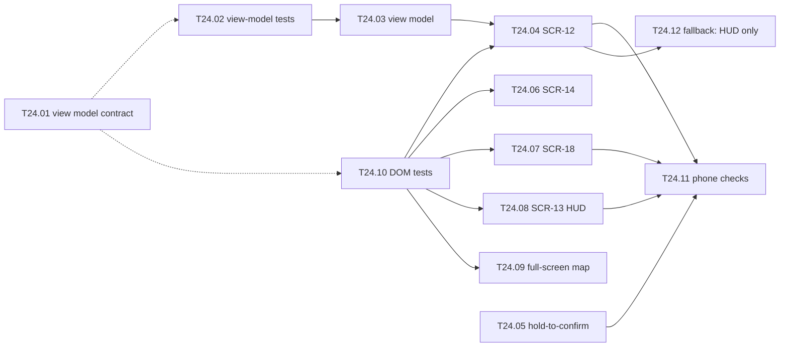

# TASK-24 — EVA client and HUD: SCR-12 tablet, SCR-13 HUD, SCR-14 options sheet, SCR-18 link lost, full-screen map

| Field | Value |
| --- | --- |
| Objective | The suit tablet (SCR-12) with fixed geography, hold-to-confirm actions and the full-screen map; the HUD (SCR-13); the EVA options sheet (SCR-14); the hab-link-lost overlay with cached, stale-labelled values (SCR-18) |
| Requirements | FR-32, FR-33, FR-39, FR-40, FR-44, NFR-03, NFR-04, NFR-05, NFR-13 |
| Lane / owner role | frontend — R5 EVA & Ops UI: Ridita Alam (Saba Atharique supports on the shared map) |
| Milestone | M2 (screens on mock fixtures, 7–9 Nov) → M3 (connected to the Hab Core, 10 Nov) → M4 (dry run, 11 Nov) |
| Window | pre-event-if-permitted (T24.01 is pre-event-allowed) |
| Effort (doc 06) | 11–16 h (includes the full-screen map, +3–4 h added 5 Nov) |
| Done when (doc 06) | 3-s glance test passes; actions ≤ 2 taps + confirm; link-lost state |
| Main risk → fallback | Tablet layout slips → HUD only, no map (T24.12) |
| Spec sections | [01 FR-32](../specs/01_Product_Requirements_Document.md#fr-32--eva-client-suit-tablet-t1-m) · [01 FR-33](../specs/01_Product_Requirements_Document.md#fr-33--hud-mode-t1-m) · [03 SCR-12](../specs/03_App_Flow_and_Diagrams.md#scr-12--eva-tablet-v2) · [03 SCR-13](../specs/03_App_Flow_and_Diagrams.md#scr-13--hud-v2) · [03 SCR-14](../specs/03_App_Flow_and_Diagrams.md#scr-14--options-sheet-eva--options-panel-ops-v2) · [03 SCR-18](../specs/03_App_Flow_and_Diagrams.md#scr-18--hab-link-lost--connecting-v2-overlay) · [04 §A.3](../specs/04_Design_Brief.md#a3-mission-critical-principles-non-negotiable) · [04 §D.3](../specs/04_Design_Brief.md#d3-hold-to-confirm-critical-actions) · [04 §E.5](../specs/04_Design_Brief.md#e5-scr-12-eva-tablet-ops-phonetablet-portrait--360-px) · [04 §E.6](../specs/04_Design_Brief.md#e6-scr-13-hud-black-landscape) · [04 §E.7](../specs/04_Design_Brief.md#e7-scr-14-alert-options-sheet-eva) · [Mockup handoff](../design/mockup-handoff.md) |

> **Protocol v0 update, 7 Nov 2026 (R4, Sadman Shaharier Mahim).** Decided by the product & systems lead; build on it without waiting for a review, and adapt existing work to it:
>
> 1. Every LogEvent kind has a fixed `data` shape: the table in [05 LogEvent](../specs/05_Backend_and_Database_Schema.md#logevent-one-line-of-sessionjsonl) (T20.10) and `LogEventData` in `packages/protocol/src/runtime.ts` (T20.11).
> 2. On reconnect the Hab Core sends a fresh `SNAPSHOT`, then the missed `EVENT`s ([02 §E.6](../specs/02_Technical_Requirements_Document.md#e6-websocket-protocol-ws)).
> 3. A repeated `command_id` from the same client that was accepted is answered with the first `COMMAND_RESULT` and not run again ([05 Command](../specs/05_Backend_and_Database_Schema.md#command)).
> 4. `plan_hash` and `log_hash` use RFC 8785 canonical JSON ([05 PlanExport](../specs/05_Backend_and_Database_Schema.md#planexport)).

## Inputs this task consumes

| Input | Kind | Owner | Dependency |
| --- | --- | --- | --- |
| Hab Core client store | upstream output | T20.06 | hard (T24.03) |
| Mock WebSocket sequences | fixture | T20.02 | soft (T24.02) |
| Design tokens and status classes (C12) incl. HUD tokens | contract | T13.01, T13.12 | soft (T24.04, T24.08) |
| Map module and shared map controls | upstream output | T07.06, T07.17 | hard (T24.09) |
| Stop task list component | upstream output | T31.05 | soft (T24.04) |
| Haven per tick, summon and options in the Hab Core | upstream output | T23.03, T23.05, T23.07 | hard (T24.11) |

## Outputs this task provides

| Output | Path | Consumers |
| --- | --- | --- |
| EVA view model | `apps/web/src/ui/eva/viewModel.ts` | SCR-12, SCR-13, T31.05 |
| Hold-to-confirm control | `apps/web/src/ui/eva/HoldToConfirm.tsx` | T24.04, T25.04 |
| SCR-12, SCR-13, SCR-14, SCR-18 | `apps/web/src/ui/screens/scr12EvaTablet.tsx`, `scr13Hud.tsx`, `scr14Options.tsx`, `scr18HabLinkLost.tsx` | M3, M4, TASK-15 usability test |
| Full-screen EVA map | `apps/web/src/ui/map/FullScreenMap.tsx` | SCR-12 |

## Subtasks

### T24.01 — Freeze the EVA view model and component props

- **Owner:** Ridita Alam (R5 EVA & Ops UI)
- **Type:** contract
- **Tag:** agent-ready · core
- **Window:** pre-event-allowed
- **Estimate:** 1 h
- **Owns (writes):** `apps/web/src/ui/eva/viewModel.ts` (stub → T24.03)
- **Reads:** [03 SCR-12](../specs/03_App_Flow_and_Diagrams.md#scr-12--eva-tablet-v2), [03 SCR-13](../specs/03_App_Flow_and_Diagrams.md#scr-13--hud-v2), [Mockup handoff component inventory](../design/mockup-handoff.md#component-inventory), `apps/web/src/net/habClient.ts`
- **Depends on:** T20.01 (soft: protocol v0)
- **Parallel with:** T20.02
- **Steps:**
  1. Selectors from the client store to what SCR-12 and SCR-13 show: HAVEN (minutes, kind), O₂, next stop (name, bearing, distance, ETA), alert slot, EVA time, dose, link state with age.
  2. Every value carries `{v, unit, prov, src}` so the screens can set `data-provenance` (FR-15).
  3. Throwing stubs only.
- **Acceptance:**
  - Serves: FR-32, FR-33, NFR-05 · [03 SCR-12](../specs/03_App_Flow_and_Diagrams.md#scr-12--eva-tablet-v2)
  - The screens can be written against the types alone.
- **Verify:** `make typecheck`.
- **Agent brief:** Define typed selectors for the EVA screens; no behaviour.
- **Conflict notes:** T24.03 takes over the file after this merges.

### T24.02 — Tests: EVA view model on the mock fixtures

- **Owner:** Sadman Shaharier Mahim (product & systems lead · R4 Hab Core) — taken over from Ridita Alam on 10 Nov to unblock the live session while her agent is out for the day (product lead's call; Ridita informed on the PR; the human-required checks stay with her)
- **Type:** test
- **Tag:** agent-ready · core
- **Window:** pre-event-if-permitted
- **Estimate:** 1 h
- **Owns (writes):** `apps/web/tests/ui/evaViewModel.test.ts`
- **Reads:** `apps/web/tests/fixtures/ws/`, `apps/web/src/ui/eva/viewModel.ts`
- **Depends on:** T24.01 (soft: stub), T20.02 (soft: fixtures)
- **Parallel with:** T24.10
- **Steps:**
  1. Each demo beat in the fixtures gives the expected HAVEN kind, alert slot content and link state.
  2. Stale values carry their age after link loss; every value has a provenance class.
- **Acceptance:**
  - Serves: FR-32, NFR-05
  - Each beat is one named test; expected values come from the fixture files.
- **Verify:** `npm --workspace @marswalk/web test -- evaViewModel` fails before T24.03 and passes after.
- **Agent brief:** Test the selectors against the T20.02 fixtures.
- **Conflict notes:** Pair T24.02 → T24.03.

### T24.03 — Implement the EVA view model

- **Owner:** Sadman Shaharier Mahim (product & systems lead · R4 Hab Core) — taken over from Ridita Alam on 10 Nov to unblock the live session while her agent is out for the day (product lead's call; Ridita informed on the PR; the human-required checks stay with her)
- **Type:** implement
- **Tag:** agent-ready · core
- **Window:** pre-event-if-permitted
- **Estimate:** 1–1.5 h
- **Owns (writes):** `apps/web/src/ui/eva/viewModel.ts`
- **Reads:** `apps/web/tests/ui/evaViewModel.test.ts`
- **Depends on:** T24.02 (hard: tests first), T20.06 (hard: client store), T24.01 (soft: stub)
- **Parallel with:** T24.05
- **Steps:**
  1. Implement the selectors over the client store; no computation of science values (they come from the Hab Core).
- **Acceptance:**
  - Serves: FR-32, NFR-05
  - T24.02 passes.
- **Verify:** `npm --workspace @marswalk/web test -- evaViewModel`.
- **Agent brief:** Implement selectors only; formatting is allowed, computing new numbers is not.
- **Conflict notes:** Single owner.

### T24.04 — Implement SCR-12 EVA tablet layout with fixed geography

- **Owner:** Sadman Shaharier Mahim (product & systems lead · R4 Hab Core) — taken over from Ridita Alam on 10 Nov to unblock the live session while her agent is out for the day (product lead's call; Ridita informed on the PR; the human-required checks stay with her)
- **Type:** implement
- **Tag:** agent-ready · core
- **Window:** pre-event-if-permitted
- **Estimate:** 2–3 h
- **Owns (writes):** `apps/web/src/ui/screens/scr12EvaTablet.tsx`
- **Reads:** [04 §E.5](../specs/04_Design_Brief.md#e5-scr-12-eva-tablet-ops-phonetablet-portrait--360-px), [04 §A.3](../specs/04_Design_Brief.md#a3-mission-critical-principles-non-negotiable), [Mockup handoff §E.5](../design/mockup-handoff.md#e5-scr-12-eva-tablet-ops-phonetablet-portrait-or-landscape-short-side--360-px), `docs/design/prototype/`, `apps/web/tests/ui/eva.test.ts`
- **Depends on:** T24.10 (hard: DOM tests first), T24.03 (hard: view model), T13.01 (soft: tokens), T31.05 (soft: task list component)
- **Parallel with:** T24.08
- **Steps:**
  1. Alert slot, HAVEN and O₂ cards, NEXT card (with the task list or count, FR-50), mini-map, metadata strip, action row (SUMMON ROVER, ABORT, TASK ROVER, HUD), as 04 §E.5 draws them; nothing moves between states.
  2. Every status has colour, shape, word and a fixed position; no brand orange (OPS mode).
  3. Touch targets ≥ 56 px; portrait ≥ 360 px; the landscape variant follows the mockup handoff.
- **Acceptance:**
  - Serves: FR-32, NFR-04, NFR-05 · [04 §E.5](../specs/04_Design_Brief.md#e5-scr-12-eva-tablet-ops-phonetablet-portrait--360-px)
  - The SCR-12 cases of T24.10 pass; `/impeccable` critique shows no 04 violation.
- **Verify:** `npm --workspace @marswalk/web test -- eva`; manual check on a 360 px phone.
- **Agent brief:** Build SCR-12 from 04 §E.5 and the prototype. 04 wins over any design default. Use semantic tokens only.
- **Conflict notes:** Single owner; the task list (T31.05) and the full-screen map (T24.09) are separate components it mounts.

### T24.05 — Implement hold-to-confirm and wire SUMMON, ABORT and TASK ROVER

- **Owner:** Sadman Shaharier Mahim (product & systems lead · R4 Hab Core) — taken over from Ridita Alam on 10 Nov to unblock the live session while her agent is out for the day (product lead's call; Ridita informed on the PR; the human-required checks stay with her)
- **Type:** implement
- **Tag:** agent-ready · core
- **Window:** pre-event-if-permitted
- **Estimate:** 1–1.5 h
- **Owns (writes):** `apps/web/src/ui/eva/HoldToConfirm.tsx`
- **Reads:** [04 §D.3](../specs/04_Design_Brief.md#d3-hold-to-confirm-critical-actions), [01 FR-32](../specs/01_Product_Requirements_Document.md#fr-32--eva-client-suit-tablet-t1-m), `apps/web/src/net/habClient.ts`
- **Depends on:** T24.01 (soft: props), T20.06 (hard: commands are sent through the client)
- **Parallel with:** T24.03
- **Steps:**
  1. A hold-to-confirm button as 04 §D.3 defines it (hold duration from 04, keyboard equivalent).
  2. SUMMON and ABORT use it; TASK ROVER opens SCR-15 (T29.04); each primary action is ≤ 2 taps + confirm.
  3. Unlinked: the command queues and the metadata strip says "not synced".
- **Acceptance:**
  - Serves: FR-32, FR-40, FR-44 · [04 §D.3](../specs/04_Design_Brief.md#d3-hold-to-confirm-critical-actions)
  - The hold-to-confirm cases of T24.10 pass.
- **Verify:** `npm --workspace @marswalk/web test -- eva`.
- **Agent brief:** Implement the control exactly as 04 §D.3; durations come from 04, not from code defaults.
- **Conflict notes:** Single owner; TASK-25 imports it for `APPROVE_OPTION`.

### T24.06 — Implement SCR-14 options sheet (EVA)

- **Owner:** Sadman Shaharier Mahim (product & systems lead · R4 Hab Core) — taken over from Ridita Alam on 10 Nov to unblock the live session while her agent is out for the day (product lead's call; Ridita informed on the PR; the human-required checks stay with her)
- **Type:** implement
- **Tag:** agent-ready · core
- **Window:** pre-event-if-permitted
- **Estimate:** 1–1.5 h
- **Owns (writes):** `apps/web/src/ui/screens/scr14Options.tsx`
- **Reads:** [03 SCR-14](../specs/03_App_Flow_and_Diagrams.md#scr-14--options-sheet-eva--options-panel-ops-v2), [04 §E.7](../specs/04_Design_Brief.md#e7-scr-14-alert-options-sheet-eva), [Mockup handoff SCR-14](../design/mockup-handoff.md#scr-14-options-sheet), [05 ContingencyOption](../specs/05_Backend_and_Database_Schema.md#contingencyoption)
- **Depends on:** T24.03 (hard: view model), T24.10 (hard: DOM tests first)
- **Parallel with:** T24.07
- **Steps:**
  1. Ranked options with ETA to shelter, expected dose, stops dropped and violations, each value labelled.
  2. The component takes a `variant` (`eva` | `ops`); the ops panel (T25.04) mounts it with `ops`.
- **Acceptance:**
  - Serves: FR-44, NFR-05 · [04 §E.7](../specs/04_Design_Brief.md#e7-scr-14-alert-options-sheet-eva)
  - The SCR-14 cases of T24.10 pass.
- **Verify:** `npm --workspace @marswalk/web test -- eva`.
- **Agent brief:** Build the options sheet from 04 §E.7; do not reorder options (the Hab Core ranks them).
- **Conflict notes:** Single owner; TASK-25 only mounts it.

### T24.07 — Implement SCR-18 hab-link-lost overlay with cached, stale-labelled values

- **Owner:** Sadman Shaharier Mahim (product & systems lead · R4 Hab Core) — taken over from Ridita Alam on 10 Nov to unblock the live session while her agent is out for the day (product lead's call; Ridita informed on the PR; the human-required checks stay with her)
- **Type:** implement
- **Tag:** agent-ready · core
- **Window:** pre-event-if-permitted
- **Estimate:** 1 h
- **Owns (writes):** `apps/web/src/ui/screens/scr18HabLinkLost.tsx`
- **Reads:** [03 SCR-18](../specs/03_App_Flow_and_Diagrams.md#scr-18--hab-link-lost--connecting-v2-overlay), [03 §C.8](../specs/03_App_Flow_and_Diagrams.md#c8-hab-server-lost-mid-eva), [01 FR-32](../specs/01_Product_Requirements_Document.md#fr-32--eva-client-suit-tablet-t1-m)
- **Depends on:** T24.03 (hard: view model), T24.10 (hard: DOM tests first)
- **Parallel with:** T24.06
- **Steps:**
  1. "HAB LINK LOST" after the client's link-lost flag; the cached plan and last margins stay visible, labelled stale with their age.
  2. Ops variant: crew cards dashed and greyed (the ops console mounts it).
- **Acceptance:**
  - Serves: FR-32, NFR-13 · [03 SCR-18](../specs/03_App_Flow_and_Diagrams.md#scr-18--hab-link-lost--connecting-v2-overlay)
  - The SCR-18 cases of T24.10 pass.
- **Verify:** `npm --workspace @marswalk/web test -- eva`; manual Wi-Fi toggle on a phone.
- **Agent brief:** Build the overlay from 03 SCR-18; never blank a value, show it stale.
- **Conflict notes:** Single owner.

### T24.08 — Implement SCR-13 HUD

- **Owner:** Sadman Shaharier Mahim (product & systems lead · R4 Hab Core) — taken over from Ridita Alam on 10 Nov to unblock the live session while her agent is out for the day (product lead's call; Ridita informed on the PR; the human-required checks stay with her)
- **Type:** implement
- **Tag:** agent-ready · core
- **Window:** pre-event-if-permitted
- **Estimate:** 1.5–2 h
- **Owns (writes):** `apps/web/src/ui/screens/scr13Hud.tsx`
- **Reads:** [04 §E.6](../specs/04_Design_Brief.md#e6-scr-13-hud-black-landscape), [01 FR-33](../specs/01_Product_Requirements_Document.md#fr-33--hud-mode-t1-m), [03 SCR-13](../specs/03_App_Flow_and_Diagrams.md#scr-13--hud-v2)
- **Depends on:** T24.03 (hard: view model), T24.10 (hard: DOM tests first), T13.12 (soft: HUD tokens)
- **Parallel with:** T24.04
- **Steps:**
  1. Black, landscape: bearing to next stop, distance, time to haven, O₂ margin, one alert line (the task count is U-54).
  2. Contrast ≥ 7 : 1; provenance as glyphs with `data-provenance` kept on each value.
- **Acceptance:**
  - Serves: FR-33, NFR-04 · [04 §E.6](../specs/04_Design_Brief.md#e6-scr-13-hud-black-landscape)
  - The HUD cases of T24.10 pass, including the contrast check.
- **Verify:** `npm --workspace @marswalk/web test -- eva`; the prototype contrast script on the built page.
- **Agent brief:** Build the HUD from 04 §E.6; no map unless requested.
- **Conflict notes:** Single owner.

### T24.09 — Implement the full-screen EVA map with its controls

- **Owner:** Sadman Shaharier Mahim (product & systems lead · R4 Hab Core); Saba Atharique (R3) reviews the map code — taken over from Ridita Alam on 10 Nov to unblock the live session while her agent is out for the day (product lead's call; Ridita informed on the PR; the human-required checks stay with her)
- **Type:** implement
- **Tag:** agent-ready · core
- **Window:** pre-event-if-permitted
- **Estimate:** 2–3 h
- **Owns (writes):** `apps/web/src/ui/map/FullScreenMap.tsx`
- **Reads:** [04 §E.5](../specs/04_Design_Brief.md#e5-scr-12-eva-tablet-ops-phonetablet-portrait--360-px) full-screen map, [Mockup handoff stop task list and full-screen map](../design/mockup-handoff.md#stop-task-list-and-full-screen-map-fr-50-g-30-to-g-43), `apps/web/src/ui/map/MapControls.tsx`, `apps/web/tests/ui/map/fullScreenMap.test.ts`
- **Depends on:** T24.10 (hard: DOM tests first), T07.06 (hard: map module), T07.17 (hard: shared map controls), T31.01 (soft: stub created on 6 Nov)
- **Parallel with:** T24.07
- **Steps:**
  1. Opens over the body from the mini-map or FULL; the alert slot, metadata strip and action row stay; HAVEN and O₂ stay visible (portrait row; landscape stacked at the left, U-60).
  2. Controls are labelled buttons (+, −, FIT, FOLLOW, LAYERS, CLOSE) from `MapControls` in its `eva-full` variant.
  3. At most two scientific layers; a third turns the oldest off and says so; a warning closes the map.
- **Acceptance:**
  - Serves: FR-32 · [04 §E.5](../specs/04_Design_Brief.md#e5-scr-12-eva-tablet-ops-phonetablet-portrait--360-px)
  - The full-screen map cases pass; positions stay in working-projection metres (no EPSG:3857, no `ol/sphere`).
- **Verify:** `npm --workspace @marswalk/web test -- fullScreenMap`.
- **Agent brief:** Build the full-screen map on the shared map module; do not fork the map code.
- **Conflict notes:** Single owner of `FullScreenMap.tsx`; `MapControls.tsx` belongs to T07.17 and gets its `eva-full` variant there.

### T24.10 — Tests: EVA DOM tests (fixed geography, targets, hold-to-confirm, HUD, link lost, full-screen map)

- **Owner:** Sadman Shaharier Mahim (product & systems lead · R4 Hab Core) — taken over from Ridita Alam on 10 Nov to unblock the live session while her agent is out for the day (product lead's call; Ridita informed on the PR; the human-required checks stay with her)
- **Type:** test
- **Tag:** agent-ready · core
- **Window:** pre-event-if-permitted
- **Estimate:** 1.5–2 h
- **Owns (writes):** `apps/web/tests/ui/eva.test.ts`, `apps/web/tests/ui/map/fullScreenMap.test.ts`
- **Reads:** [04 §A.3](../specs/04_Design_Brief.md#a3-mission-critical-principles-non-negotiable), [04 §D.3](../specs/04_Design_Brief.md#d3-hold-to-confirm-critical-actions), [04 §E.5](../specs/04_Design_Brief.md#e5-scr-12-eva-tablet-ops-phonetablet-portrait--360-px), [04 §E.6](../specs/04_Design_Brief.md#e6-scr-13-hud-black-landscape), `apps/web/tests/fixtures/ws/`
- **Depends on:** T24.01 (soft: props), T20.02 (soft: fixtures), T14.01 (soft: DOM test environment)
- **Parallel with:** T24.02
- **Steps:**
  1. Keep the `fullScreenMap.test.ts` todos and make them real.
  2. SCR-12: the alert slot, HAVEN, O₂ and the action row have the same bounding boxes in every fixture state; every control ≥ 56 px; every status has colour, shape and word.
  3. Hold-to-confirm: a short press does nothing; a full hold sends one command.
  4. HUD: five values, contrast ≥ 7 : 1; SCR-18: values stay with a stale label.
- **Acceptance:**
  - Serves: FR-32, FR-33, NFR-04 · [04 §A.3](../specs/04_Design_Brief.md#a3-mission-critical-principles-non-negotiable)
  - Each rule above is one named test; they fail against the stubs.
- **Verify:** `npm --workspace @marswalk/web test -- eva fullScreenMap`.
- **Agent brief:** Write DOM tests from 04 that the screens must satisfy; layout positions are compared across states, not to pixel values.
- **Conflict notes:** Pairs T24.10 → T24.04, T24.05–T24.09.

### T24.11 — Verify on phones: ≤ 2 taps + confirm, link-lost, glance check, device matrix (M3–M4)

- **Owner:** Ridita Alam (R5 EVA & Ops UI)
- **Type:** verify
- **Tag:** human-required · core
- **Window:** pre-event-if-permitted
- **Estimate:** 1 h
- **Owns (writes):** `docs/ops/verification-log.md` (append-only)
- **Reads:** [06 §C.2](../specs/06_High_Level_Implementation_Plan.md#c2-new-in-v2-surface-ops-tier-1-unless-marked) TASK-24 done-when, [02 §F](../specs/02_Technical_Requirements_Document.md#f-nonfunctional-requirements-and-validation) NFR-03
- **Depends on:** T24.04 (hard), T24.05 (hard), T24.07 (hard), T24.08 (hard), T23.07 (hard: real options from the Hab Core)
- **Parallel with:** T25.08
- **Steps:**
  1. On an Android phone and an iOS phone over the router: count taps for SUMMON, ABORT and TASK ROVER; toggle Wi-Fi and check SCR-18.
  2. A team-internal 3-s glance check of the HUD (the formal test with outside users is TASK-15).
  3. Record results per device.
- **Acceptance:**
  - Serves: FR-32, FR-33, NFR-03 · [06 §C.2](../specs/06_High_Level_Implementation_Plan.md#c2-new-in-v2-surface-ops-tier-1-unless-marked)
  - Each action is ≤ 2 taps + confirm on both phones; link-lost shows stale values.
- **Verify:** Manual: the T24.11 section of the verification log.
- **Agent brief:** Humans test on phones; an agent may format the notes.
- **Conflict notes:** Append-only log.

### T24.12 — Fallback — start only if SCR-12 is not usable by M3b: HUD only, no map

- **Owner:** Ridita Alam (R5 EVA & Ops UI)
- **Type:** fallback
- **Tag:** agent-ready · core
- **Window:** pre-event-if-permitted
- **Estimate:** 0.5–1 h
- **Owns (writes):** `apps/web/src/ui/screens/scr12EvaTablet.tsx` (replaces T24.04)
- **Reads:** [06 §C.2](../specs/06_High_Level_Implementation_Plan.md#c2-new-in-v2-surface-ops-tier-1-unless-marked) TASK-24 fallback
- **Depends on:** T24.04 (hard: replaces it)
- **Parallel with:** T24.11
- **Steps:**
  1. The EVA route shows the HUD values plus the action row; no map.
- **Acceptance:**
  - Serves: FR-32, FR-33
  - The demo's EVA beats still work; HUD and actions pass their T24.10 cases.
- **Verify:** `npm --workspace @marswalk/web test -- eva`.
- **Agent brief:** Only if SCR-12 is not usable at M3b.
- **Conflict notes:** Replaces T24.04's file; never at the same time.

## Internal dependency graph

## Definition of done (task level)

- 06 §C.2 done-when: actions ≤ 2 taps + confirm and the link-lost state on phones (T24.11); the 3-s glance test with outside users passes in TASK-15.
- 04 §A.3 holds: fixed geography, status = colour + shape + word + position, no brand orange in OPS or HUD, ≥ 56 px targets.
- Every number has `data-provenance` (checked by T12.07).

## Spec questions

1. **Task count on the HUD** (U-54): sixth value or STOP sub-label. Decision before T24.08.
2. **TASKS button and list placement on a phone in landscape** (U-51) and **collapse rules during an alert** (U-59): decide before T24.04. *Decided: FD-024 and FD-032 (12 Nov 2026, Proposed); built and checked in the browser round of 12 Nov (package 17)* — the TASKS n/m button sits in the NEXT card header, the list takes the map column on a phone in landscape and the NEXT position on tablets and in portrait, and the list collapses to a non-interactive count while the options sheet is open or a warning is unacknowledged.
3. **Landscape full-screen map card size** (U-60): 40/48 px against the 56 px rule; decided by usability test UT-9 (TASK-15).
