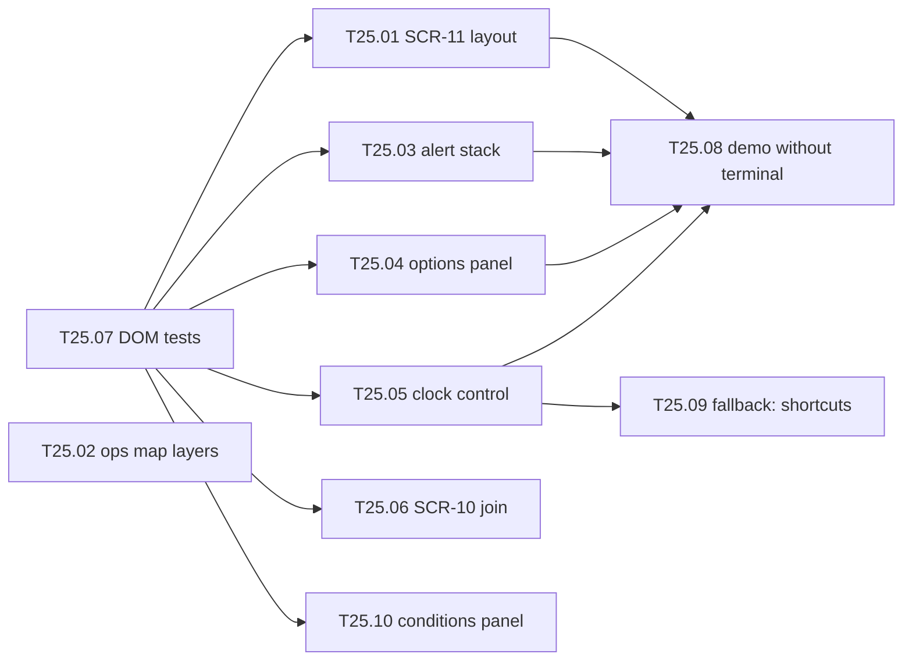

# TASK-25 — Ops console: SCR-11 with the shared map, alerts, options approval, clock control, SCR-10 join

| Field | Value |
| --- | --- |
| Objective | The ops console that runs the whole demo without a terminal: crew and vehicle cards, the shared map with crew, vehicles, coverage and haven bands, the alert stack with acknowledgement, the options panel with `APPROVE_OPTION`, clock control and scenario load, and the SCR-10 join page |
| Requirements | FR-30, FR-31, FR-34, FR-36, FR-44, NFR-04, NFR-05 |
| Lane / owner role | frontend — R5 EVA & Ops UI: Ridita Alam; R3: Saba Atharique (map layers) |
| Milestone | M2 (on mock fixtures, 8–9 Nov) → M3 (connected, 10 Nov) → M4 (dry run, 11 Nov) |
| Window | pre-event-if-permitted |
| Effort (doc 06) | 8–12 h |
| Done when (doc 06) | Ops can run the whole demo without a terminal |
| Main risk → fallback | Clock-control UI slips → keyboard shortcuts (T25.09) |
| Spec sections | [03 SCR-10](../specs/03_App_Flow_and_Diagrams.md#scr-10--join--role-select-v2) · [03 SCR-11](../specs/03_App_Flow_and_Diagrams.md#scr-11--ops-console-v2) · [03 SCR-14](../specs/03_App_Flow_and_Diagrams.md#scr-14--options-sheet-eva--options-panel-ops-v2) · [04 §E.2](../specs/04_Design_Brief.md#e2-scr-10-join--role-select-brief) · [04 §E.4](../specs/04_Design_Brief.md#e4-scr-11-ops-console-ops--1280-px-projector) · [04 §D.2](../specs/04_Design_Brief.md#d2-alert-system) · [04 §E.10](../specs/04_Design_Brief.md#e10-specimen-card-scr-06-poi-detail-crew-and-vehicle-cards) · [01 FR-34](../specs/01_Product_Requirements_Document.md#fr-34--mission-clock-and-scenario-replay-t1-m) · [01 FR-36](../specs/01_Product_Requirements_Document.md#fr-36--conditions-feed-t1-m) · [Mockup handoff](../design/mockup-handoff.md) |

> **Protocol v0 update, 7 Nov 2026 (R4, Sadman Shaharier Mahim).** Decided by the product & systems lead; build on it without waiting for a review, and adapt existing work to it:
>
> 1. Every LogEvent kind has a fixed `data` shape: the table in [05 LogEvent](../specs/05_Backend_and_Database_Schema.md#logevent-one-line-of-sessionjsonl) (T20.10) and `LogEventData` in `packages/protocol/src/runtime.ts` (T20.11).
> 2. On reconnect the Hab Core sends a fresh `SNAPSHOT`, then the missed `EVENT`s ([02 §E.6](../specs/02_Technical_Requirements_Document.md#e6-websocket-protocol-ws)).
> 3. A repeated `command_id` from the same client that was accepted is answered with the first `COMMAND_RESULT` and not run again ([05 Command](../specs/05_Backend_and_Database_Schema.md#command)).
> 4. `plan_hash` and `log_hash` use RFC 8785 canonical JSON ([05 PlanExport](../specs/05_Backend_and_Database_Schema.md#planexport)).

## Inputs this task consumes

| Input | Kind | Owner | Dependency |
| --- | --- | --- | --- |
| Hab Core client store | upstream output | T20.06 | hard (T25.01) |
| Mock WebSocket sequences | fixture | T20.02 | soft (T25.07) |
| Map module and shared map controls | upstream output | T07.06, T07.17 | hard (T25.02) |
| Options sheet component and hold-to-confirm | upstream output | T24.06, T24.05 | hard (T25.04) |
| Task progress component | upstream output | T31.06 | soft (T25.01) |
| Join QR endpoint | upstream output | T28.02 | soft (T25.06) |

## Outputs this task provides

| Output | Path | Consumers |
| --- | --- | --- |
| SCR-11 ops console | `apps/web/src/ui/screens/scr11OpsConsole.tsx` | M3, M4, demo video |
| Ops map layers (crew, vehicles, coverage, haven bands) | `apps/web/src/ui/map/opsLayers.ts` | SCR-11, T29.04 |
| Alert stack, options panel, clock control | `apps/web/src/ui/ops/` | SCR-11 |
| SCR-10 join page | `apps/web/src/ui/screens/scr10Join.tsx` | every device joining |

## Subtasks

### T25.01 — Implement the SCR-11 layout: crew and vehicle cards, metadata strip, slots

- **Owner:** Sadman Shaharier Mahim (product & systems lead · R4 Hab Core) — taken over from Ridita Alam on 10 Nov to unblock the live session while her agent is out for the day (product lead's call; Ridita informed on the PR; the human-required checks stay with her)
- **Type:** implement
- **Tag:** agent-ready · core
- **Window:** pre-event-if-permitted
- **Estimate:** 2–3 h
- **Owns (writes):** `apps/web/src/ui/screens/scr11OpsConsole.tsx`
- **Reads:** [04 §E.4](../specs/04_Design_Brief.md#e4-scr-11-ops-console-ops--1280-px-projector), [04 §E.10](../specs/04_Design_Brief.md#e10-specimen-card-scr-06-poi-detail-crew-and-vehicle-cards), [03 SCR-11](../specs/03_App_Flow_and_Diagrams.md#scr-11--ops-console-v2), `docs/design/prototype/`, `apps/web/tests/ui/ops.test.ts`
- **Depends on:** T25.07 (hard: DOM tests first), T20.06 (hard: client store), T13.01 (soft: tokens), T31.06 (soft: task progress)
- **Parallel with:** T25.02
- **Steps:**
  1. Crew cards (ID, activity, haven, O₂, dose, link, task progress), vehicle cards, metadata strip, slots for the map, alert stack, options panel, clock control and event log (TASK-27).
  2. Unlinked crew: dashed, grey, with age (SCR-18 ops variant).
  3. ≥ 1280 px, projector-readable; keyboard reachable (NFR-04).
- **Acceptance:**
  - Serves: FR-30, FR-31, NFR-04, NFR-05 · [04 §E.4](../specs/04_Design_Brief.md#e4-scr-11-ops-console-ops--1280-px-projector)
  - The layout cases of T25.07 pass.
- **Verify:** `npm --workspace @marswalk/web test -- ops`.
- **Agent brief:** Build SCR-11 from 04 §E.4 and the prototype; mount the sub-components in their slots.
- **Conflict notes:** Single owner; sub-components belong to their own subtasks.

### T25.02 — Implement the ops map layers: crew, vehicles, coverage, haven bands

- **Owner:** Saba Atharique (R3 Map & Planner UI)
- **Type:** implement
- **Tag:** agent-ready · core
- **Window:** pre-event-if-permitted
- **Estimate:** 2–3 h
- **Owns (writes):** `apps/web/src/ui/map/opsLayers.ts`
- **Reads:** [04 §E.4](../specs/04_Design_Brief.md#e4-scr-11-ops-console-ops--1280-px-projector), [02 §C.1](../specs/02_Technical_Requirements_Document.md#c1-coordinate-reference-conventions-applies-to-every-layer), `apps/web/src/ui/map/MapControls.tsx`
- **Depends on:** T07.06 (hard: map module), T07.17 (hard: shared controls), T20.06 (hard: client store)
- **Parallel with:** T25.01
- **Steps:**
  1. Crew markers with path trails, vehicle markers with planned paths, the `comm_hab` coverage layer and relay coverage, haven bands.
  2. Ops toggles for slope and thermal inertia (handoff DV-14); + / − / FIT from `MapControls`.
  3. Positions in working-projection metres only.
- **Acceptance:**
  - Serves: FR-30, FR-39, FR-42 · [04 §E.4](../specs/04_Design_Brief.md#e4-scr-11-ops-console-ops--1280-px-projector)
  - Layers render on the mock fixtures; no EPSG:3857 path and no `ol/sphere` (the T02.02 guard test still passes).
- **Verify:** `npm --workspace @marswalk/web test`; manual check on the fixtures.
- **Agent brief:** Add vector layers to the shared map module; never fork the map.
- **Conflict notes:** Single owner; TASK-29 adds the rover target picker through its own module.

### T25.03 — Implement the alert stack with acknowledgement

- **Owner:** Sadman Shaharier Mahim (product & systems lead · R4 Hab Core) — taken over from Ridita Alam on 10 Nov to unblock the live session while her agent is out for the day (product lead's call; Ridita informed on the PR; the human-required checks stay with her)
- **Type:** implement
- **Tag:** agent-ready · core
- **Window:** pre-event-if-permitted
- **Estimate:** 1–1.5 h
- **Owns (writes):** `apps/web/src/ui/ops/AlertStack.tsx`
- **Reads:** [04 §D.2](../specs/04_Design_Brief.md#d2-alert-system), [03 §E.7](../specs/03_App_Flow_and_Diagrams.md#e7-state--alert-lifecycle-v2)
- **Depends on:** T25.07 (hard: DOM tests first), T20.06 (hard: client store)
- **Parallel with:** T25.05
- **Steps:**
  1. Warning, caution, advisory in the 04 §D.2 hierarchy; latched warnings until acknowledged and cleared.
  2. `ACK_ALERT` per alert; acknowledged state shown with the role that acknowledged it.
- **Acceptance:**
  - Serves: FR-31, FR-37, FR-38 · [04 §D.2](../specs/04_Design_Brief.md#d2-alert-system)
  - The alert cases of T25.07 pass.
- **Verify:** `npm --workspace @marswalk/web test -- ops`.
- **Agent brief:** Build the alert stack from 04 §D.2 and the 03 §E.7 lifecycle.
- **Conflict notes:** Single owner.

### T25.04 — Implement the ops options panel with `APPROVE_OPTION`

- **Owner:** Sadman Shaharier Mahim (product & systems lead · R4 Hab Core) — taken over from Ridita Alam on 10 Nov to unblock the live session while her agent is out for the day (product lead's call; Ridita informed on the PR; the human-required checks stay with her)
- **Type:** implement
- **Tag:** agent-ready · core
- **Window:** pre-event-if-permitted
- **Estimate:** 1 h
- **Owns (writes):** `apps/web/src/ui/ops/OptionsPanel.tsx`
- **Reads:** [03 SCR-14](../specs/03_App_Flow_and_Diagrams.md#scr-14--options-sheet-eva--options-panel-ops-v2), `apps/web/src/ui/screens/scr14Options.tsx`, `apps/web/src/ui/eva/HoldToConfirm.tsx`
- **Depends on:** T24.06 (hard: options component), T24.05 (hard: hold-to-confirm), T25.07 (hard: DOM tests first)
- **Parallel with:** T25.03
- **Steps:**
  1. Mount SCR-14 in its `ops` variant beside the map; approving an option uses hold-to-confirm and sends `APPROVE_OPTION`.
  2. Show the option's path preview on the map.
- **Acceptance:**
  - Serves: FR-44 · [03 SCR-14](../specs/03_App_Flow_and_Diagrams.md#scr-14--options-sheet-eva--options-panel-ops-v2)
  - The options cases of T25.07 pass.
- **Verify:** `npm --workspace @marswalk/web test -- ops`.
- **Agent brief:** Wrap the shared options component for ops; do not duplicate it.
- **Conflict notes:** Single owner.

### T25.05 — Implement clock control and scenario load

- **Owner:** Sadman Shaharier Mahim (product & systems lead · R4 Hab Core) — taken over from Ridita Alam on 10 Nov to unblock the live session while her agent is out for the day (product lead's call; Ridita informed on the PR; the human-required checks stay with her)
- **Type:** implement
- **Tag:** agent-ready · core
- **Window:** pre-event-if-permitted
- **Estimate:** 1–1.5 h
- **Owns (writes):** `apps/web/src/ui/ops/ClockControl.tsx`
- **Reads:** [01 FR-34](../specs/01_Product_Requirements_Document.md#fr-34--mission-clock-and-scenario-replay-t1-m), [02 §D.14](../specs/02_Technical_Requirements_Document.md#d14-simulation-engine-fr-34-fr-35), [04 §E.4](../specs/04_Design_Brief.md#e4-scr-11-ops-console-ops--1280-px-projector)
- **Depends on:** T25.07 (hard: DOM tests first), T20.06 (hard: client store)
- **Parallel with:** T25.03
- **Steps:**
  1. Speed 1×, 10×, 60×; pause; jump to next event; load scenario; start EVA.
  2. The sim time and LTST stay in the metadata strip with their provenance.
- **Acceptance:**
  - Serves: FR-34 · [02 §D.14](../specs/02_Technical_Requirements_Document.md#d14-simulation-engine-fr-34-fr-35)
  - The clock cases of T25.07 pass.
- **Verify:** `npm --workspace @marswalk/web test -- ops`.
- **Agent brief:** Build the clock controls; each sends one command.
- **Conflict notes:** Single owner.

### T25.06 — Implement SCR-10 join / role select

- **Owner:** Sadman Shaharier Mahim (product & systems lead · R4 Hab Core) — taken over from Ridita Alam on 10 Nov to unblock the live session while her agent is out for the day (product lead's call; Ridita informed on the PR; the human-required checks stay with her)
- **Type:** implement
- **Tag:** agent-ready · core
- **Window:** pre-event-if-permitted
- **Estimate:** 1 h
- **Owns (writes):** `apps/web/src/ui/screens/scr10Join.tsx`
- **Reads:** [03 SCR-10](../specs/03_App_Flow_and_Diagrams.md#scr-10--join--role-select-v2), [04 §E.2](../specs/04_Design_Brief.md#e2-scr-10-join--role-select-brief), [01 FR-31](../specs/01_Product_Requirements_Document.md#fr-31--client-roles-t1-m)
- **Depends on:** T25.07 (hard: DOM tests first), T20.06 (hard: client store), T28.02 (soft: QR endpoint)
- **Parallel with:** T25.05
- **Steps:**
  1. Role buttons (planner, ops, EV1, EV2, earth) with "role taken" and "Hab Core unreachable" states.
  2. The join QR image from `/api/join-qr`; BRIEF mode.
- **Acceptance:**
  - Serves: FR-31 · [03 SCR-10](../specs/03_App_Flow_and_Diagrams.md#scr-10--join--role-select-v2)
  - The join cases of T25.07 pass.
- **Verify:** `npm --workspace @marswalk/web test -- ops`.
- **Agent brief:** Build SCR-10 from 03 and 04 §E.2.
- **Conflict notes:** Single owner.

### T25.07 — Tests: ops and join DOM tests

- **Owner:** Sadman Shaharier Mahim (product & systems lead · R4 Hab Core) — taken over from Ridita Alam on 10 Nov to unblock the live session while her agent is out for the day (product lead's call; Ridita informed on the PR; the human-required checks stay with her)
- **Type:** test
- **Tag:** agent-ready · core
- **Window:** pre-event-if-permitted
- **Estimate:** 1–1.5 h
- **Owns (writes):** `apps/web/tests/ui/ops.test.ts`
- **Reads:** [04 §D.2](../specs/04_Design_Brief.md#d2-alert-system), [04 §E.4](../specs/04_Design_Brief.md#e4-scr-11-ops-console-ops--1280-px-projector), `apps/web/tests/fixtures/ws/`
- **Depends on:** T20.02 (soft: fixtures), T14.01 (soft: DOM test environment)
- **Parallel with:** T24.10
- **Steps:**
  1. Layout: slots present; crew cards show every value with `data-provenance`; unlinked crew dashed with age.
  2. Alerts: hierarchy, latching, acknowledgement; options: approve sends one `APPROVE_OPTION` after a full hold.
  3. Clock: each control sends one command; join: role-taken and unreachable states.
  4. Keyboard: every control reachable in a sensible order (NFR-04).
- **Acceptance:**
  - Serves: FR-31, FR-34, FR-44, NFR-04 · [04 §E.4](../specs/04_Design_Brief.md#e4-scr-11-ops-console-ops--1280-px-projector)
  - Each rule above is one named test; they fail against the stubs.
- **Verify:** `npm --workspace @marswalk/web test -- ops`.
- **Agent brief:** Write DOM tests for the ops console from 04 and 03, fed by the T20.02 fixtures.
- **Conflict notes:** Pairs T25.07 → T25.01, T25.03–T25.06.

### T25.08 — Verify: ops runs the whole demo without a terminal (M3b–M4)

- **Owner:** Ridita Alam (R5 EVA & Ops UI)
- **Type:** verify
- **Tag:** human-required · core
- **Window:** pre-event-if-permitted
- **Estimate:** 0.5–1 h
- **Owns (writes):** `docs/ops/verification-log.md` (append-only)
- **Reads:** [01 §E.1](../specs/01_Product_Requirements_Document.md#e1-killer-demo--storm-at-sol-4190-target-90-s-of-the-240-s-video), [06 §C.2](../specs/06_High_Level_Implementation_Plan.md#c2-new-in-v2-surface-ops-tier-1-unless-marked) TASK-25 done-when
- **Depends on:** T25.01 (hard), T25.03 (hard), T25.04 (hard), T25.05 (hard), T23.08 (hard: the demo works headless)
- **Parallel with:** T24.11
- **Steps:**
  1. Run the killer demo from SCR-11 only: load, start, speed, acknowledge, approve, end; no terminal and no devtools.
  2. Record every place a terminal or a workaround was needed.
- **Acceptance:**
  - Serves: FR-30, FR-34 · [06 §C.2](../specs/06_High_Level_Implementation_Plan.md#c2-new-in-v2-surface-ops-tier-1-unless-marked)
  - The demo runs end to end from the console; any workaround is listed as an issue for the next day.
- **Verify:** Manual: the T25.08 section of the verification log.
- **Agent brief:** Humans run it; an agent may format the notes.
- **Conflict notes:** Append-only log.

### T25.09 — Fallback — start only if clock control is not ready by M3: keyboard shortcuts

- **Owner:** Ridita Alam (R5 EVA & Ops UI)
- **Type:** fallback
- **Tag:** agent-ready · core
- **Window:** pre-event-if-permitted
- **Estimate:** 0.5 h
- **Owns (writes):** `apps/web/src/ui/ops/ClockControl.tsx` (replaces T25.05)
- **Reads:** [06 §C.2](../specs/06_High_Level_Implementation_Plan.md#c2-new-in-v2-surface-ops-tier-1-unless-marked) TASK-25 fallback
- **Depends on:** T25.05 (hard: replaces it)
- **Parallel with:** T25.08
- **Steps:**
  1. Keyboard shortcuts for speed, pause, jump and start, listed on screen.
- **Acceptance:**
  - Serves: FR-34
  - The demo's clock steps work from the keyboard.
- **Verify:** Manual run of the clock steps.
- **Agent brief:** Only if the clock UI slips.
- **Conflict notes:** Replaces T25.05's file; never at the same time.

### T25.10 — Implement the ops conditions panel and the EVA conditions strip values (FR-36)

- **Owner:** Sadman Shaharier Mahim (product & systems lead · R4 Hab Core) — taken over from Ridita Alam on 10 Nov to unblock the live session while her agent is out for the day (product lead's call; Ridita informed on the PR; the human-required checks stay with her)
- **Type:** implement
- **Tag:** agent-ready · core
- **Window:** pre-event-if-permitted
- **Estimate:** 1 h
- **Owns (writes):** `apps/web/src/ui/ops/ConditionsPanel.tsx`
- **Reads:** [01 FR-36](../specs/01_Product_Requirements_Document.md#fr-36--conditions-feed-t1-m), [04 §E.4](../specs/04_Design_Brief.md#e4-scr-11-ops-console-ops--1280-px-projector), [04 §E.5](../specs/04_Design_Brief.md#e5-scr-12-eva-tablet-ops-phonetablet-portrait--360-px)
- **Depends on:** T25.07 (hard: DOM tests first), T22.16 (hard: conditions in state), T20.06 (hard: client store)
- **Parallel with:** T25.05
- **Steps:**
  1. A conditions panel on ops and a compact variant for the EVA metadata strip (SCR-12 mounts it): LTST, sun elevation, background and event dose rate, Earth link status, each labelled.
- **Acceptance:**
  - Serves: FR-36, NFR-05
  - Every value has `data-provenance`; nothing says "live".
- **Verify:** `npm --workspace @marswalk/web test -- ops`.
- **Agent brief:** Show the conditions from the client store; compute nothing.
- **Conflict notes:** Single owner; SCR-11 and SCR-12 mount it.

## Internal dependency graph

## Definition of done (task level)

- 06 §C.2 done-when: ops can run the whole demo without a terminal (T25.08).
- 04 §A.3 holds in OPS mode; every number has `data-provenance` (T12.07).
- Keyboard reachable (NFR-04).

## Spec questions

1. **Conditions feed (FR-36).** 01 FR-36 lists the conditions; their exact place on SCR-11 and in the SCR-12 strip is not fixed in 04 §E.4–§E.5. `TODO(decision)` in T25.10.
2. **Ops-added tasks during an alert** (U-46): whether the "+ TASK" control is disabled while a warning is latched. Decided in TASK-31.
