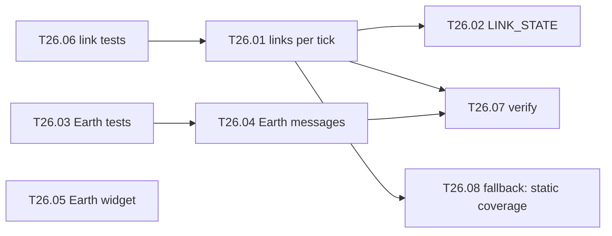

# TASK-26 — Links: surface link graph and `LINK_STATE`, comm-shadow warnings, Earth link widget and delayed queue

| Field | Value |
| --- | --- |
| Objective | The surface radio link graph every tick with `LINK_LOST`/`LINK_RESTORED` and the per-suit `LINK_STATE` message; `COMM_SHADOW` warnings on the remaining route; Earth messages and forecasts delivered by the Earth link rule; an ops widget for light time, next pass and the queue |
| Requirements | FR-42, FR-43, FR-37, NFR-06 |
| Lane / owner role | compute — R2/R4: Anjim Hossain (Mishkat Ahmed Khan supports) |
| Milestone | M3 (9–11 Nov) |
| Window | pre-event-if-permitted |
| Effort (doc 06) | 4–6 h |
| Done when (doc 06) | Shadow on the demo route appears and clears; forecast arrives at the computed time |
| Main risk → fallback | Dynamic coverage too slow → static hab coverage and a fixed delay (T26.08; cut 5) |
| Spec sections | [02 §A.5](../specs/02_Technical_Requirements_Document.md#a5-network-model) · [02 §D.11](../specs/02_Technical_Requirements_Document.md#d11-line-of-sight-comm-coverage-fr-42) · [02 §D.12](../specs/02_Technical_Requirements_Document.md#d12-earth-link-model-fr-43) · [02 §D.13](../specs/02_Technical_Requirements_Document.md#d13-space-weather-event-model-fr-37-fr-38) · [02 §E.6](../specs/02_Technical_Requirements_Document.md#e6-websocket-protocol-ws) · [03 §E.10](../specs/03_App_Flow_and_Diagrams.md#e10-state--surface-link-per-crew-v2) · [05 EarthMessage](../specs/05_Backend_and_Database_Schema.md#earthmessage) · [01 FR-42](../specs/01_Product_Requirements_Document.md#fr-42--comm-coverage-and-comm-shadows-t1-m) · [01 FR-43](../specs/01_Product_Requirements_Document.md#fr-43--earth-link-model-t1-m) |

## Inputs this task consumes

| Input | Kind | Owner | Dependency |
| --- | --- | --- | --- |
| Engine stubs `engine/links.ts`, `engine/earth.ts` | contract | T22.01 | soft (T26.01, T26.04) |
| Link graph, viewshed and Earth delivery functions | upstream output | T05b.09, T05b.11, T05b.13 | hard (T26.01, T26.04) |
| Server (to send `LINK_STATE`) | upstream output | T20.04 | hard (T26.02) |
| Real Earth-link table and DONKI events | upstream output | T21.04, T21.05 | hard (T26.07) |

## Outputs this task provides

| Output | Path | Consumers |
| --- | --- | --- |
| Link states, link events, comm-shadow warnings | `apps/hab-core/src/engine/links.ts` | T24.07, T25.01, T29.06 |
| Earth messages and forecasts | `apps/hab-core/src/engine/earth.ts` | T25.01, T26.05 |
| Earth link widget | `apps/web/src/ui/ops/EarthLinkWidget.tsx` | SCR-11 |

## Subtasks

### T26.01 — Implement the link graph per tick, link events and `COMM_SHADOW` on the remaining route

- **Owner:** Anjim Hossain (R2/R4 float)
- **Type:** implement
- **Tag:** agent-ready · core
- **Window:** pre-event-if-permitted
- **Estimate:** 1.5–2 h
- **Owns (writes):** `apps/hab-core/src/engine/links.ts`
- **Reads:** `apps/hab-core/tests/links.test.ts`, [02 §D.11](../specs/02_Technical_Requirements_Document.md#d11-line-of-sight-comm-coverage-fr-42), [03 §E.10](../specs/03_App_Flow_and_Diagrams.md#e10-state--surface-link-per-crew-v2)
- **Depends on:** T26.06 (hard: tests first), T05b.11 (hard: link graph), T22.01 (soft: stub)
- **Parallel with:** T26.04
- **Steps:**
  1. Each tick: link states for suits and rovers from `@marswalk/compute`; `LINK_LOST` and `LINK_RESTORED` on change.
  2. `COMM_SHADOW` warning when a segment of the remaining route has no coverage (static `comm_hab` plus parked relays).
  3. Mark unlinked crew `stale` so ops shows the badge.
- **Acceptance:**
  - Serves: FR-42 · [02 §D.11](../specs/02_Technical_Requirements_Document.md#d11-line-of-sight-comm-coverage-fr-42)
  - The link cases of T26.06 pass.
- **Verify:** `npm --workspace @marswalk/hab-core test -- links`.
- **Agent brief:** Implement the links module; coverage comes from compute and the pipeline grid.
- **Conflict notes:** Single owner.

### T26.02 — follow-up: send `LINK_STATE` to the suit's device; queue its commands while unlinked

- **Owner:** Anjim Hossain (R2/R4 float)
- **Type:** implement
- **Tag:** agent-ready · core
- **Window:** pre-event-if-permitted
- **Estimate:** 0.5–1 h
- **Owns (writes):** `apps/hab-core/src/server.ts` (after T20.04)
- **Reads:** [02 §A.5](../specs/02_Technical_Requirements_Document.md#a5-network-model), [02 §E.6](../specs/02_Technical_Requirements_Document.md#e6-websocket-protocol-ws)
- **Depends on:** T20.04 (hard: owner of `server.ts`), T26.01 (hard: link events)
- **Parallel with:** T26.05
- **Steps:**
  1. Send `LINK_STATE` once to the affected suit's connections when its link changes.
  2. The suit's commands return `NO_LINK` while unlinked (checked in `commands.ts`); the client resends on `linked=true`.
- **Acceptance:**
  - Serves: FR-42, FR-32
  - A server test shows the message reaches only that suit's clients.
- **Verify:** `npm --workspace @marswalk/hab-core test -- server`.
- **Agent brief:** Add the one message type to the server; nothing else in the file changes.
- **Conflict notes:** Edits `server.ts` after its owner; one follow-up at a time (T27.01 and T28.02 also follow up on it).

### T26.03 — Tests: Earth messages, forecasts and blackout in the engine

- **Owner:** Anjim Hossain (R2/R4 float)
- **Type:** test
- **Tag:** agent-ready · core
- **Window:** pre-event-if-permitted
- **Estimate:** 0.5–1 h
- **Owns (writes):** `apps/hab-core/tests/earth.test.ts`
- **Reads:** [02 §D.12](../specs/02_Technical_Requirements_Document.md#d12-earth-link-model-fr-43), [05 EarthMessage](../specs/05_Backend_and_Database_Schema.md#earthmessage)
- **Depends on:** T22.02 (soft: fake scenario)
- **Parallel with:** T26.06
- **Steps:**
  1. `SEND_MESSAGE` to Earth → `EARTH_MSG_QUEUED` then `EARTH_MSG_DELIVERED` at the rule's time.
  2. A scenario `EARTH_MESSAGE` (forecast) is delivered to Mars at the rule's time.
  3. Blackout holds delivery.
- **Acceptance:**
  - Serves: FR-43, FR-37
  - Each rule above is one named test on the fake scenario.
- **Verify:** `npm --workspace @marswalk/hab-core test -- earth` fails before T26.04 and passes after.
- **Agent brief:** Write Earth message tests; times come from the compute rule, not typed in.
- **Conflict notes:** Pair T26.03 → T26.04.

### T26.04 — Implement Earth messages and forecasts in the engine

- **Owner:** Anjim Hossain (R2/R4 float)
- **Type:** implement
- **Tag:** agent-ready · core
- **Window:** pre-event-if-permitted
- **Estimate:** 1 h
- **Owns (writes):** `apps/hab-core/src/engine/earth.ts`
- **Reads:** `apps/hab-core/tests/earth.test.ts`, `packages/compute/src/earthLink.ts`
- **Depends on:** T26.03 (hard: tests first), T05b.13 (hard: delivery rule), T22.01 (soft: stub)
- **Parallel with:** T26.01
- **Steps:**
  1. Queue and deliver messages by the rule; scenario forecasts arrive as `EARTH_MSG_DELIVERED`; earth role messages are delayed.
- **Acceptance:**
  - Serves: FR-43
  - T26.03 passes.
- **Verify:** `npm --workspace @marswalk/hab-core test -- earth`.
- **Agent brief:** Implement the Earth module using compute's rule.
- **Conflict notes:** Single owner.

### T26.05 — Implement the Earth link widget on ops

- **Owner:** Anjim Hossain (R2/R4 float); Ridita Alam (R5) reviews the UI
- **Type:** implement
- **Tag:** agent-ready · core
- **Window:** pre-event-if-permitted
- **Estimate:** 1 h
- **Owns (writes):** `apps/web/src/ui/ops/EarthLinkWidget.tsx`
- **Reads:** [04 §E.4](../specs/04_Design_Brief.md#e4-scr-11-ops-console-ops--1280-px-projector), [01 FR-43](../specs/01_Product_Requirements_Document.md#fr-43--earth-link-model-t1-m)
- **Depends on:** T20.06 (hard: client store)
- **Parallel with:** T26.02
- **Steps:**
  1. Light time, next pass, blackout and the message queue, each value labelled `derived` or `simulated`.
- **Acceptance:**
  - Serves: FR-43, NFR-05
  - Every value has `data-provenance`; nothing is called "live".
- **Verify:** `npm --workspace @marswalk/web test`.
- **Agent brief:** Show the Earth link from the client store; compute nothing.
- **Conflict notes:** SCR-11 (T25.01) mounts it.

### T26.06 — Tests: link graph per tick and comm-shadow warnings

- **Owner:** Anjim Hossain (R2/R4 float)
- **Type:** test
- **Tag:** agent-ready · core
- **Window:** pre-event-if-permitted
- **Estimate:** 0.5–1 h
- **Owns (writes):** `apps/hab-core/tests/links.test.ts`
- **Reads:** [02 §D.11](../specs/02_Technical_Requirements_Document.md#d11-line-of-sight-comm-coverage-fr-42), [03 §E.10](../specs/03_App_Flow_and_Diagrams.md#e10-state--surface-link-per-crew-v2)
- **Depends on:** T22.02 (soft: fake scenario)
- **Parallel with:** T26.03
- **Steps:**
  1. A crew member walking behind the fake scenario's wall loses the link once and regains it once.
  2. `COMM_SHADOW` appears for a route through the shadow and clears when a relay covers it.
- **Acceptance:**
  - Serves: FR-42
  - Each rule above is one named test.
- **Verify:** `npm --workspace @marswalk/hab-core test -- links` fails before T26.01 and passes after.
- **Agent brief:** Write link tests on the fake scenario.
- **Conflict notes:** Pair T26.06 → T26.01.

### T26.07 — Verify: the demo shadow appears and clears; the forecast arrives at the computed time

- **Owner:** Anjim Hossain (R2/R4 float)
- **Type:** verify
- **Tag:** agent-ready · core
- **Window:** pre-event-if-permitted
- **Estimate:** 0.5–1 h
- **Owns (writes):** `docs/ops/verification-log.md` (append-only)
- **Reads:** [06 §C.2](../specs/06_High_Level_Implementation_Plan.md#c2-new-in-v2-surface-ops-tier-1-unless-marked) TASK-26 done-when
- **Depends on:** T26.01 (hard), T26.04 (hard), T21.08 (hard: real scenario)
- **Parallel with:** T29.06
- **Steps:**
  1. Headless replay of the real scenario: record when the shadow appears and clears.
  2. Compare the forecast's delivery time with the time the rule gives for the scenario's issue time.
- **Acceptance:**
  - Serves: FR-42, FR-43
  - Both checks recorded with pass or fail.
- **Verify:** Manual: the T26.07 section of the verification log.
- **Agent brief:** Run and record.
- **Conflict notes:** Append-only log.

### T26.08 — Fallback — start only if cut 5 is called: static hab coverage and a fixed delay

- **Owner:** Anjim Hossain (R2/R4 float)
- **Type:** fallback
- **Tag:** agent-ready · core
- **Window:** pre-event-if-permitted
- **Estimate:** 0.5–1 h
- **Owns (writes):** `apps/hab-core/src/engine/links.ts` (replaces T26.01)
- **Reads:** [06 §D.4](../specs/06_High_Level_Implementation_Plan.md#d4-cut-list-cut-in-this-order-when-behind) item 5, [06 §C.2](../specs/06_High_Level_Implementation_Plan.md#c2-new-in-v2-surface-ops-tier-1-unless-marked) TASK-26 fallback
- **Depends on:** T26.01 (hard: replaces it)
- **Parallel with:** T26.07
- **Steps:**
  1. Coverage from the static `comm_hab` grid only; Earth delivery with the table's light time and no pass wait, labelled.
- **Acceptance:**
  - Serves: FR-42, FR-43
  - The shadow still appears on the demo route; the simplification is labelled.
- **Verify:** `npm --workspace @marswalk/hab-core test -- links`.
- **Agent brief:** Only on cut 5.
- **Conflict notes:** Replaces T26.01's file; never at the same time.

## Internal dependency graph

## Definition of done (task level)

- 06 §C.2 done-when: the demo shadow appears and clears; the forecast arrives at the computed time (T26.07).
- Coverage is labelled `derived` with "radio propagation not modelled beyond line of sight".

## Spec questions

1. **Earth-to-Mars forecast source.** The scenario's `EARTH_MESSAGE` events carry `sent_earth_utc`; the forecast text and issue time come from DONKI records (T21.05). Confirm the forecast is a scenario event and not generated by the engine.
