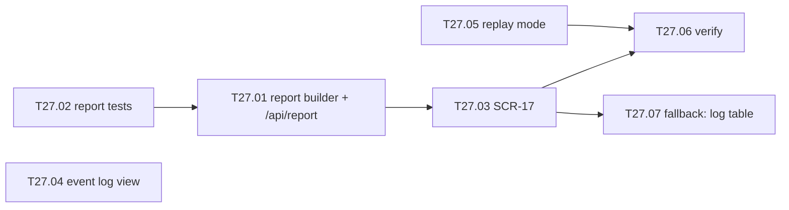

# TASK-27 — Event log view, post-EVA report, replay mode for GitHub Pages

| Field | Value |
| --- | --- |
| Objective | An ops view of the event log; the post-EVA report built from the log (`GET /api/report`, SCR-17, ≤ 2 printed pages); a replay mode that plays a recorded log in the browser with no Hab Core, for the public GitHub Pages link |
| Requirements | FR-46, FR-50, FR-34, NFR-06 |
| Lane / owner role | frontend — R5: Ridita Alam (report, log view); R3: Saba Atharique (replay mode) |
| Milestone | Report view on 11 Nov (06 §F); the rest at the event (M7) |
| Window | event-only (T27.01, T27.02 and T27.04 are pre-event-if-permitted) |
| Effort (doc 06) | 4–6 h (Ridita and Saba share it; TASK-27 is an event task in 06 §A.2) |
| Done when (doc 06) | Report ≤ 2 pages; Pages link replays the recorded log |
| Main risk → fallback | Report layout slips → report = printed log table (T27.07) |
| Spec sections | [01 FR-46](../specs/01_Product_Requirements_Document.md#fr-46--event-log-and-post-eva-report-t1-m) · [03 SCR-17](../specs/03_App_Flow_and_Diagrams.md#scr-17--post-eva-report-v2) · [04 §E.8](../specs/04_Design_Brief.md#e8-scr-08-briefing-card-and-scr-17-post-eva-report-print) · [05 PostEvaReport](../specs/05_Backend_and_Database_Schema.md#postevareport) · [02 §E.5](../specs/02_Technical_Requirements_Document.md#e5-hab-core-http-endpoints) |

> **Protocol v0 update, 7 Nov 2026 (R4, Sadman Shaharier Mahim).** Decided by the product & systems lead; build on it without waiting for a review, and adapt existing work to it:
>
> 1. Every LogEvent kind has a fixed `data` shape: the table in [05 LogEvent](../specs/05_Backend_and_Database_Schema.md#logevent-one-line-of-sessionjsonl) (T20.10) and `LogEventData` in `packages/protocol/src/runtime.ts` (T20.11).
> 2. On reconnect the Hab Core sends a fresh `SNAPSHOT`, then the missed `EVENT`s ([02 §E.6](../specs/02_Technical_Requirements_Document.md#e6-websocket-protocol-ws)).
> 3. A repeated `command_id` from the same client that was accepted is answered with the first `COMMAND_RESULT` and not run again ([05 Command](../specs/05_Backend_and_Database_Schema.md#command)).
> 4. `plan_hash` and `log_hash` use RFC 8785 canonical JSON ([05 PlanExport](../specs/05_Backend_and_Database_Schema.md#planexport)).

## Inputs this task consumes

| Input | Kind | Owner | Dependency |
| --- | --- | --- | --- |
| Event log and `log_hash` | upstream output | T22.07 | hard (T27.01) |
| Server | upstream output | T20.04 | hard (T27.01) |
| Task engine (for task counts) | upstream output | T31.04 | hard (T27.02) |
| Client store | upstream output | T20.06 | hard (T27.04, T27.05) |
| A recorded demo log | upstream output | T22.14 | hard (T27.05) |

## Outputs this task provides

| Output | Path | Consumers |
| --- | --- | --- |
| Report builder and `/api/report` | `apps/hab-core/src/report.ts` | SCR-17, T31.08 |
| SCR-17 post-EVA report | `apps/web/src/ui/screens/scr17PostEvaReport.tsx` | demo video, judges |
| Event log view | `apps/web/src/ui/ops/EventLog.tsx` | SCR-11 |
| Replay mode | `apps/web/src/net/replaySource.ts` | GitHub Pages link (T16.07) |

## Subtasks

### T27.01 — follow-up: report builder and `GET /api/report`

- **Owner:** Sadman Shaharier Mahim (product & systems lead · R4 Hab Core); Ridita Alam (R5) reviews the UI side — taken over from Ridita Alam on 10 Nov to unblock the live session while her agent is out for the day (product lead's call; Ridita informed on the PR; the human-required checks stay with her)
- **Type:** implement
- **Tag:** agent-ready · core
- **Window:** pre-event-if-permitted
- **Estimate:** 1–1.5 h
- **Owns (writes):** `apps/hab-core/src/report.ts`, `apps/hab-core/src/server.ts` (after T20.04)
- **Reads:** [05 PostEvaReport](../specs/05_Backend_and_Database_Schema.md#postevareport), [01 FR-46](../specs/01_Product_Requirements_Document.md#fr-46--event-log-and-post-eva-report-t1-m), `apps/hab-core/tests/report.test.ts`
- **Depends on:** T27.02 (hard: tests first), T20.04 (hard: owner of `server.ts`), T22.07 (hard: log)
- **Parallel with:** T27.04
- **Steps:**
  1. Build the 05 report from the log on demand: planned vs actual per stop, alerts with response times, dose received vs unsheltered vs planned background, stops completed or dropped, stop tasks per stop, plan revisions, provenance summary, `log_hash`, disclaimer.
  2. Add the `/api/report` route to the server.
- **Acceptance:**
  - Serves: FR-46, FR-50 · [05 PostEvaReport](../specs/05_Backend_and_Database_Schema.md#postevareport)
  - T27.02 passes.
- **Verify:** `npm --workspace @marswalk/hab-core test -- report`.
- **Agent brief:** Every report value is reduced from the log; nothing is recomputed.
- **Conflict notes:** Edits `server.ts` after its owner; one follow-up at a time.

### T27.02 — Tests: report values equal the counts reduced from the log

- **Owner:** Sadman Shaharier Mahim (product & systems lead · R4 Hab Core) — taken over from Ridita Alam on 10 Nov to unblock the live session while her agent is out for the day (product lead's call; Ridita informed on the PR; the human-required checks stay with her)
- **Type:** test
- **Tag:** agent-ready · core
- **Window:** pre-event-if-permitted
- **Estimate:** 0.5–1 h
- **Owns (writes):** `apps/hab-core/tests/report.test.ts`
- **Reads:** [05 PostEvaReport](../specs/05_Backend_and_Database_Schema.md#postevareport), `apps/hab-core/tests/fixtures/fake-scenario/`
- **Depends on:** T22.02 (soft: fake scenario)
- **Parallel with:** T27.04
- **Steps:**
  1. After a fake-scenario run, each report count (stops, alerts, tasks done/skipped/dropped) equals a count over the log lines.
- **Acceptance:**
  - Serves: FR-46, FR-50
  - Each count is one named test.
- **Verify:** `npm --workspace @marswalk/hab-core test -- report` fails before T27.01 and passes after.
- **Agent brief:** Write report tests that count log lines independently of the builder.
- **Conflict notes:** Pair T27.02 → T27.01.

### T27.03 — Implement SCR-17 post-EVA report (print, ≤ 2 pages)

- **Owner:** Sadman Shaharier Mahim (product & systems lead · R4 Hab Core) — taken over from Ridita Alam on 10 Nov to unblock the live session while her agent is out for the day (product lead's call; Ridita informed on the PR; the human-required checks stay with her)
- **Type:** implement
- **Tag:** agent-ready · core
- **Window:** event-only
- **Estimate:** 1.5–2 h
- **Owns (writes):** `apps/web/src/ui/screens/scr17PostEvaReport.tsx`, `apps/web/src/ui/report/reportAdapter.ts`, `apps/web/tests/ui/postEvaReport.test.ts`
- **Reads:** [03 SCR-17](../specs/03_App_Flow_and_Diagrams.md#scr-17--post-eva-report-v2), [04 §E.8](../specs/04_Design_Brief.md#e8-scr-08-briefing-card-and-scr-17-post-eva-report-print), `docs/design/prototype/`
- **Depends on:** T27.01 (hard: report data)
- **Parallel with:** T27.05
- **Steps:**
  1. PRINT mode, two pages at most, every value labelled; the `log_hash` and the disclaimer on the page.
- **Acceptance:**
  - Serves: FR-46 · [04 §E.8](../specs/04_Design_Brief.md#e8-scr-08-briefing-card-and-scr-17-post-eva-report-print)
  - Chrome print preview shows ≤ 2 pages.
- **Verify:** Manual print preview; `npm --workspace @marswalk/web test`.
- **Agent brief:** Build SCR-17 from 04 §E.8 and the prototype.
- **Conflict notes:** Single owner.

### T27.04 — Implement the event log view on ops

- **Owner:** Sadman Shaharier Mahim (product & systems lead · R4 Hab Core) — taken over from Ridita Alam on 11 Nov to fix the 11 Nov audit findings (product lead's call; Ridita informed on the PR)
- **Type:** implement
- **Tag:** agent-ready · core
- **Window:** pre-event-if-permitted
- **Estimate:** 0.5–1 h
- **Owns (writes):** `apps/web/src/ui/ops/EventLog.tsx`
- **Reads:** [05 LogEvent](../specs/05_Backend_and_Database_Schema.md#logevent-one-line-of-sessionjsonl), [04 §E.4](../specs/04_Design_Brief.md#e4-scr-11-ops-console-ops--1280-px-projector)
- **Depends on:** T20.06 (hard: client store)
- **Parallel with:** T27.02
- **Steps:**
  1. The latest events with sim time, kind, actor and provenance; filter by kind.
- **Acceptance:**
  - Serves: FR-46
  - Events appear in `seq` order with their sim time.
- **Verify:** `npm --workspace @marswalk/web test`.
- **Agent brief:** Show the log from the client store.
- **Conflict notes:** SCR-11 mounts it.

### T27.05 — Implement replay mode for GitHub Pages (`#/replay`, recorded log, no Hab Core)

- **Owner:** Saba Atharique (R3 Map & Planner UI)
- **Type:** implement
- **Tag:** agent-ready · core
- **Window:** event-only
- **Estimate:** 1.5–2 h
- **Owns (writes):** `apps/web/src/net/replaySource.ts`
- **Reads:** [01 FR-34](../specs/01_Product_Requirements_Document.md#fr-34--mission-clock-and-scenario-replay-t1-m), `apps/web/src/net/habClient.ts`, `apps/web/src/main.ts`
- **Depends on:** T20.06 (hard: client store interface), T22.14 (hard: recorded log)
- **Parallel with:** T27.03
- **Steps:**
  1. A message source with the same interface as the WebSocket client that plays a committed `session.jsonl` with its snapshot.
  2. `#/replay` opens ops with this source; the page says "replayed recording", never "live".
- **Acceptance:**
  - Serves: FR-34, FR-46
  - The Pages build replays the recorded log end to end with no Hab Core.
- **Verify:** `npm run build`; open the built page from a static server with no Hab Core.
- **Agent brief:** Implement a recorded-log source behind the client store's interface.
- **Conflict notes:** The route itself is registered by T07.03 (route registry).

### T27.06 — Verify: report ≤ 2 pages; the Pages link replays the recorded log

- **Owner:** Ridita Alam (R5 EVA & Ops UI), with Saba Atharique
- **Type:** verify
- **Tag:** human-required · core
- **Window:** event-only
- **Estimate:** 0.5 h
- **Owns (writes):** `docs/ops/verification-log.md` (append-only)
- **Reads:** [06 §C.2](../specs/06_High_Level_Implementation_Plan.md#c2-new-in-v2-surface-ops-tier-1-unless-marked) TASK-27 done-when
- **Depends on:** T27.03 (hard), T27.05 (hard), T16.07 (hard: hosting of the public link)
- **Parallel with:** T16.06
- **Steps:**
  1. Print the report; count pages. Open the public Pages link in a private window; replay to the end.
- **Acceptance:**
  - Serves: FR-46, FR-34
  - Both checks recorded with pass or fail.
- **Verify:** Manual: the T27.06 section.
- **Agent brief:** Humans check; record results only.
- **Conflict notes:** Append-only log.

### T27.07 — Fallback — start only if SCR-17 is not ready by M7: report = printed log table

- **Owner:** Ridita Alam (R5 EVA & Ops UI)
- **Type:** fallback
- **Tag:** agent-ready · core
- **Window:** event-only
- **Estimate:** 0.5 h
- **Owns (writes):** `apps/web/src/ui/screens/scr17PostEvaReport.tsx` (replaces T27.03)
- **Reads:** [06 §C.2](../specs/06_High_Level_Implementation_Plan.md#c2-new-in-v2-surface-ops-tier-1-unless-marked) TASK-27 fallback
- **Depends on:** T27.03 (hard: replaces it)
- **Parallel with:** T27.06
- **Steps:**
  1. Print the report data as a plain table with `log_hash` and the disclaimer.
- **Acceptance:**
  - Serves: FR-46
  - The table prints and every value is labelled.
- **Verify:** Manual print preview.
- **Agent brief:** Only if SCR-17 slips.
- **Conflict notes:** Replaces T27.03's file; never at the same time.

## Internal dependency graph

## Definition of done (task level)

- 06 §C.2 done-when: the report prints on ≤ 2 pages and the Pages link replays the recorded log (T27.06).
- Report counts equal the log (T27.02, used by T31.08).

## Spec questions

1. **When.** 06 §C.2 schedules TASK-27 at the event (E), but 06 §F lists "Report view" for R5 on Wed 11 Nov and TASK-31's done-when needs report counts before M4. This plan builds the report data and the log view before the event (T27.01, T27.02, T27.04) and keeps SCR-17 and replay mode at the event. Confirm.
