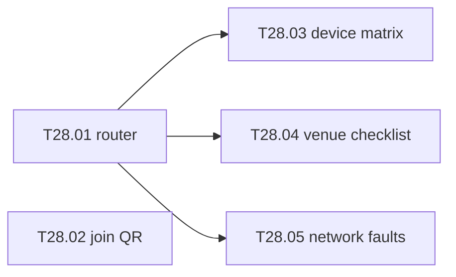

# TASK-28 — Network kit and rehearsal: router, static IP, QR join, device matrix, venue checklist

| Field | Value |
| --- | --- |
| Objective | A travel router set up for the habitat LAN with no WAN, a fixed address for the Hab Core laptop, a QR code to join, a tested device matrix and a venue checklist, plus the network fault checks that feed the M4 dry run |
| Requirements | NFR-01, NFR-03, NFR-08, NFR-12, NFR-13, FR-30, FR-31 |
| Lane / owner role | integration — Integration lead: Anjim Hossain |
| Milestone | M1 (router ready for the LAN spike, 7 Nov) → M4 (dry run, 11 Nov) |
| Window | pre-event-allowed (T28.02 is pre-event-if-permitted) |
| Effort (doc 06) | 3–4 h |
| Done when (doc 06) | M4 passes; checklist in `docs/ops/demo-kit.md` |
| Main risk → fallback | Router or venue Wi-Fi fails → single-laptop mode (T20.09) |
| Spec sections | [02 §A.5](../specs/02_Technical_Requirements_Document.md#a5-network-model) · [02 §E.5](../specs/02_Technical_Requirements_Document.md#e5-hab-core-http-endpoints) · [02 §F](../specs/02_Technical_Requirements_Document.md#f-nonfunctional-requirements-and-validation) · [02 §F.2](../specs/02_Technical_Requirements_Document.md#f2-test-plan-additions-v2) · [06 §B](../specs/06_High_Level_Implementation_Plan.md#b-milestones) · [06 §D.5](../specs/06_High_Level_Implementation_Plan.md#d5-data-and-service-fallbacks) |

## Inputs this task consumes

| Input | Kind | Owner | Dependency |
| --- | --- | --- | --- |
| A travel router owned or borrowed by the team (U-21) | decision | team | hard (T28.01) |
| Hab Core server | upstream output | T20.04 | hard (T28.02) |
| QR library through the dependency batch | upstream output | T14.01 | hard (T28.02) |
| Role views connected to the Hab Core | upstream output | T24.04, T25.01 | hard (T28.05) |

## Outputs this task provides

| Output | Path | Consumers |
| --- | --- | --- |
| Router and address setup | `docs/ops/demo-kit.md` | T20.08, every rehearsal |
| Join QR endpoint | `apps/hab-core/src/server.ts` (`/api/join-qr`) | T25.06 |
| Device matrix and fault-check results | `docs/ops/verification-log.md` | M4, M4b |

## Subtasks

### T28.01 — Set up the travel router: SSID, WPA2, no WAN, fixed address for the Hab Core laptop (U-21)

- **Owner:** Anjim Hossain (integration lead)
- **Type:** human
- **Tag:** human-required · core
- **Window:** pre-event-allowed
- **Estimate:** 0.5–1 h
- **Owns (writes):** `docs/ops/demo-kit.md`
- **Reads:** [02 §A.5](../specs/02_Technical_Requirements_Document.md#a5-network-model), [02 §E.4](../specs/02_Technical_Requirements_Document.md#e4-authentication-and-roles)
- **Depends on:** none
- **Parallel with:** T20.07
- **Steps:**
  1. Confirm who owns or lends the router (U-21); set an SSID and a WPA2 password; leave the WAN port unplugged.
  2. Reserve a fixed address for the Hab Core laptop; record the join URL.
  3. Write the setup in `docs/ops/demo-kit.md`; the Wi-Fi password is not written in the repo.
- **Acceptance:**
  - Serves: NFR-01, NFR-08 · [02 §A.5](../specs/02_Technical_Requirements_Document.md#a5-network-model)
  - A phone joins and opens the Hab Core's `/api/health` with no internet.
- **Verify:** Manual: `/api/health` from a phone on the router; `make docs-check`.
- **Agent brief:** A person sets up the router; an agent may draft the checklist structure.
- **Conflict notes:** New file; single owner.

### T28.02 — follow-up: join QR endpoint `/api/join-qr`

- **Owner:** Anjim Hossain (integration lead)
- **Type:** implement
- **Tag:** agent-ready · core
- **Window:** pre-event-if-permitted
- **Estimate:** 0.5–1 h
- **Owns (writes):** `apps/hab-core/src/server.ts` (after T20.04)
- **Reads:** [02 §E.5](../specs/02_Technical_Requirements_Document.md#e5-hab-core-http-endpoints)
- **Depends on:** T20.04 (hard: owner of `server.ts`), T14.01 (hard: QR library)
- **Parallel with:** T28.03
- **Steps:**
  1. `GET /api/join-qr?role=` returns an SVG QR code for the join URL on the Hab Core's LAN address; generated locally, no external service.
- **Acceptance:**
  - Serves: FR-31, NFR-01 · [02 §E.5](../specs/02_Technical_Requirements_Document.md#e5-hab-core-http-endpoints)
  - A phone camera opens the right role view from the QR on the ops screen.
- **Verify:** `npm --workspace @marswalk/hab-core test -- server`; manual scan.
- **Agent brief:** Add one endpoint; the QR library comes from the dependency batch.
- **Conflict notes:** Edits `server.ts` after its owner; one follow-up at a time.

### T28.03 — Device matrix: Android Chrome, iOS Safari, laptops

- **Owner:** Anjim Hossain (integration lead)
- **Type:** verify
- **Tag:** human-required · core
- **Window:** pre-event-allowed
- **Estimate:** 0.5–1 h
- **Owns (writes):** `docs/ops/verification-log.md` (append-only)
- **Reads:** [02 §F](../specs/02_Technical_Requirements_Document.md#f-nonfunctional-requirements-and-validation) NFR-03
- **Depends on:** T28.01 (hard: router), T24.04 (hard: EVA view), T25.01 (hard: ops view)
- **Parallel with:** T24.11
- **Steps:**
  1. List the team's devices and browsers; open each role view on each; note layout or input problems.
  2. On each device, check that the live role views connect and show a SNAPSHOT in Safari and Firefox as well as Chrome (the CSP is `connect-src 'self'` without `ws:`, 02 §F NFR-08, changed 2026-11-12); record a browser that blocks the WebSocket.
- **Acceptance:**
  - Serves: NFR-03
  - Each device has a row with pass or the problem found.
- **Verify:** Manual: the T28.03 section.
- **Agent brief:** Humans test; an agent may format the table.
- **Conflict notes:** Append-only log.

### T28.04 — follow-up: write the venue checklist and pack list

- **Owner:** Anjim Hossain (integration lead); Sadman Shaharier Mahim (R6) reviews for the demo story
- **Type:** human
- **Tag:** human-required · core
- **Window:** pre-event-allowed
- **Estimate:** 0.5 h
- **Owns (writes):** `docs/ops/demo-kit.md` (after T28.01)
- **Reads:** [06 §B](../specs/06_High_Level_Implementation_Plan.md#b-milestones) M4b, [06 §D.6](../specs/06_High_Level_Implementation_Plan.md#d6-demo-freeze-criteria-day-2-0600)
- **Depends on:** T28.01 (hard: owner of the file)
- **Parallel with:** T28.03
- **Steps:**
  1. Pack list (router, power, cables, phones, chargers), setup order, and the fallback order (single-laptop mode, recorded video).
- **Acceptance:**
  - Serves: NFR-01 · [06 §B](../specs/06_High_Level_Implementation_Plan.md#b-milestones)
  - A teammate can set up the kit from the checklist alone.
- **Verify:** Manual dry setup by someone other than the author.
- **Agent brief:** Draft from 06 §B and §D.6; a person checks it against the real kit.
- **Conflict notes:** Edits after T28.01 in the same file (follow-up by the same owner).

### T28.05 — Verify network faults: Wi-Fi toggle, Hab Core kill and restart, single-laptop mode

- **Owner:** Anjim Hossain (integration lead)
- **Type:** verify
- **Tag:** human-required · core
- **Window:** pre-event-if-permitted
- **Estimate:** 1 h
- **Owns (writes):** `docs/ops/verification-log.md` (append-only)
- **Reads:** [02 §F.2](../specs/02_Technical_Requirements_Document.md#f2-test-plan-additions-v2) Network, [02 §F](../specs/02_Technical_Requirements_Document.md#f-nonfunctional-requirements-and-validation) NFR-10, NFR-13
- **Depends on:** T28.01 (hard), T22.12 (hard: resume from disk), T24.07 (hard: link-lost view)
- **Parallel with:** T25.08
- **Steps:**
  1. Toggle a phone's Wi-Fi mid-scenario: correct state within 2 s of reconnect (NFR-13).
  2. Kill and restart the Hab Core: clients degrade to SCR-18 and the session resumes (NFR-10).
  3. Run the demo once in single-laptop mode.
- **Acceptance:**
  - Serves: NFR-10, NFR-13 · [02 §F.2](../specs/02_Technical_Requirements_Document.md#f2-test-plan-additions-v2)
  - Each check recorded with measured times and pass or fail.
- **Verify:** Manual: the T28.05 section.
- **Agent brief:** Humans run the faults; never adjust times.
- **Conflict notes:** Append-only log.

## Internal dependency graph

## Definition of done (task level)

- 06 §C.2 done-when: M4 passes and the checklist is in `docs/ops/demo-kit.md`.
- No internet needed for any role view (NFR-01); no secret is committed.

## Spec questions

1. **Router owner** (U-21): who owns or lends the travel router, decided at the kickoff.
