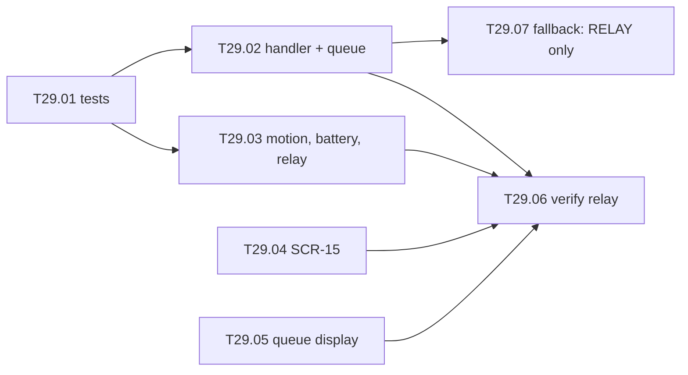

# TASK-29 — Robotic rover tasking: SCOUT, CARRY, RELAY, RETURN

| Field | Value |
| --- | --- |
| Objective | Goal-level tasking of the utility rover from EVA and ops: the rover routes itself, battery is its consumable, tasks queue with ETA, and a RELAY task parked on a ridge closes the demo's comm shadow |
| Requirements | FR-41, FR-42, NFR-06 |
| Lane / owner role | compute — R2: Mishkat Ahmed Khan (handler, routing, relay coverage, engine module); frontend — R3: Saba Atharique (SCR-15, queue display) |
| Milestone | M3 (9–10 Nov; moved to Tier 1 on 5 Nov) |
| Window | pre-event-if-permitted |
| Effort (doc 06) | 4–8 h (Mishkat 2–4, Saba 2–4) |
| Done when (doc 06) | RELAY closes the demo shadow; queue shows ETA and battery |
| Main risk → fallback | Too little time → RELAY only (T29.07; 06 §D.4 cut 2) |
| Spec sections | [01 FR-41](../specs/01_Product_Requirements_Document.md#fr-41--robotic-rover-tasking-t1-m) · [01 FR-42](../specs/01_Product_Requirements_Document.md#fr-42--comm-coverage-and-comm-shadows-t1-m) · [02 §D.9](../specs/02_Technical_Requirements_Document.md#d9-crew-and-vehicle-parameter-sets-fr-40-fr-41--assumed-unless-cited-shown-in-the-ui-05-paramset) · [02 §D.11](../specs/02_Technical_Requirements_Document.md#d11-line-of-sight-comm-coverage-fr-42) · [02 §E.4](../specs/02_Technical_Requirements_Document.md#e4-authentication-and-roles) · [03 SCR-15](../specs/03_App_Flow_and_Diagrams.md#scr-15--rover-tasking-v2-t1-since-2026-11-05) · [03 §C.7](../specs/03_App_Flow_and_Diagrams.md#c7-rover-tasking) · [05 Vehicle](../specs/05_Backend_and_Database_Schema.md#vehicle) |

> **Protocol v0 update, 7 Nov 2026 (R4, Sadman Shaharier Mahim).** Decided by the product & systems lead; build on it without waiting for a review, and adapt existing work to it:
>
> 1. Every LogEvent kind has a fixed `data` shape: the table in [05 LogEvent](../specs/05_Backend_and_Database_Schema.md#logevent-one-line-of-sessionjsonl) (T20.10) and `LogEventData` in `packages/protocol/src/runtime.ts` (T20.11).
> 2. On reconnect the Hab Core sends a fresh `SNAPSHOT`, then the missed `EVENT`s ([02 §E.6](../specs/02_Technical_Requirements_Document.md#e6-websocket-protocol-ws)).
> 3. A repeated `command_id` from the same client that was accepted is answered with the first `COMMAND_RESULT` and not run again ([05 Command](../specs/05_Backend_and_Database_Schema.md#command)).
> 4. `plan_hash` and `log_hash` use RFC 8785 canonical JSON ([05 PlanExport](../specs/05_Backend_and_Database_Schema.md#planexport)).
> 5. **TASK-29 (Mishkat, Saba):** `TaskRoverArgs` is final as `{vehicle_id, task, target?, item?}`; `item` (CARRY only) is a free-text label, not a fixed list, because FR-41 names no items. An accepted task logs `VEHICLE_DISPATCHED` with the same `data` shape as a summon (see the 05 table). The T20.01 confirmation step is closed.

## Inputs this task consumes

| Input | Kind | Owner | Dependency |
| --- | --- | --- | --- |
| `TaskRoverArgs` and `RoverTaskKind` in protocol v0 | contract | T20.01 | soft (T29.01) |
| Engine stub `engine/rovers.ts`; vehicle motion helper | upstream output | T22.01, T23.05 | soft (T29.03), hard (T29.03) |
| Route search and viewshed | upstream output | T05.18, T05b.09, T05b.11 | hard (T29.02, T29.03) |
| Command dispatch to `rover.ts` | upstream output | T23.02 | hard (T29.02) |
| Link graph in the engine | upstream output | T26.01 | hard (T29.06) |
| Ops map layers | upstream output | T25.02 | hard (T29.04) |

## Outputs this task provides

| Output | Path | Consumers |
| --- | --- | --- |
| `TASK_ROVER` handler and queue | `apps/hab-core/src/rover.ts` | SCR-15, SCR-11 |
| Rover motion, battery and relay node | `apps/hab-core/src/engine/rovers.ts` | T26.01 (relay in the link graph) |
| SCR-15 tasking view and rover queue | `apps/web/src/ui/screens/scr15RoverTask.tsx`, `apps/web/src/ui/ops/RoverQueue.tsx` | SCR-11, SCR-12 |

## Subtasks

### T29.01 — Tests: `TASK_ROVER` handler, queue, battery and relay

- **Owner:** Mishkat Ahmed Khan (R2 Compute lead)
- **Type:** test
- **Tag:** agent-ready · core
- **Window:** pre-event-if-permitted
- **Estimate:** 1 h
- **Owns (writes):** `apps/hab-core/tests/rover.test.ts`
- **Reads:** [01 FR-41](../specs/01_Product_Requirements_Document.md#fr-41--robotic-rover-tasking-t1-m), [02 §D.9](../specs/02_Technical_Requirements_Document.md#d9-crew-and-vehicle-parameter-sets-fr-40-fr-41--assumed-unless-cited-shown-in-the-ui-05-paramset), `scenarios/storm-sol4190/param_sets/ur1-assumed.json`
- **Depends on:** T22.02 (soft: fake scenario), T20.01 (soft: args type)
- **Parallel with:** T26.06
- **Steps:**
  1. Turn the existing `it.todo` cases into tests: target required except for RETURN; pressurized rover or unknown id INVALID; unreachable target INVALID; roles.
  2. Queue order, ETA and battery after each task (energy form from 02 §D.9 with ParamSet values).
  3. "RELAY closes the demo comm shadow" on the fake scenario's wall.
- **Acceptance:**
  - Serves: FR-41, FR-42 · [01 FR-41](../specs/01_Product_Requirements_Document.md#fr-41--robotic-rover-tasking-t1-m)
  - Each rule above is one named test; the event kind for an accepted task stays `TODO(verify)` until T20.01 settles it.
- **Verify:** `npm --workspace @marswalk/hab-core test -- rover` fails before T29.02/T29.03 and passes after.
- **Agent brief:** Make the rover todos real; battery expected values follow from the ParamSet inside the test.
- **Conflict notes:** Pairs T29.01 → T29.02, T29.03.

### T29.02 — Implement the `TASK_ROVER` handler and queue

- **Owner:** Mishkat Ahmed Khan (R2 Compute lead)
- **Type:** implement
- **Tag:** agent-ready · core
- **Window:** pre-event-if-permitted
- **Estimate:** 1–1.5 h
- **Owns (writes):** `apps/hab-core/src/rover.ts`
- **Reads:** `apps/hab-core/tests/rover.test.ts`, `packages/compute/src/route.ts`
- **Depends on:** T29.01 (hard: tests first), T23.02 (hard: dispatch), T05.18 (hard: route search)
- **Parallel with:** T29.03
- **Steps:**
  1. Validate args; route with the utility-rover ParamSet; queue the task with its ETA and the battery it will use.
  2. Log one event per accepted task (kind per T20.01).
- **Acceptance:**
  - Serves: FR-41
  - The handler cases of T29.01 pass.
- **Verify:** `npm --workspace @marswalk/hab-core test -- rover`.
- **Agent brief:** Implement the handler; routing reuses `route.ts`, no new compute module.
- **Conflict notes:** Single owner.

### T29.03 — Implement rover motion, battery and the relay node

- **Owner:** Mishkat Ahmed Khan (R2 Compute lead)
- **Type:** implement
- **Tag:** agent-ready · core
- **Window:** pre-event-if-permitted
- **Estimate:** 1–1.5 h
- **Owns (writes):** `apps/hab-core/src/engine/rovers.ts`
- **Reads:** `apps/hab-core/tests/rover.test.ts`, `apps/hab-core/src/engine/vehicles.ts`, `packages/compute/src/viewshed.ts`, `packages/compute/src/linkGraph.ts`
- **Depends on:** T29.01 (hard: tests first), T23.05 (hard: motion helper), T05b.11 (hard: link graph), T22.01 (soft: stub)
- **Parallel with:** T29.02
- **Steps:**
  1. Move the rover with the shared motion helper; subtract battery by the 02 §D.9 energy form.
  2. A parked RELAY rover is a link-graph node with its antenna height; its 20 m viewshed adds coverage.
- **Acceptance:**
  - Serves: FR-41, FR-42
  - The motion, battery and relay cases of T29.01 pass.
- **Verify:** `npm --workspace @marswalk/hab-core test -- rover`.
- **Agent brief:** Implement the rover module; never edit `vehicles.ts` or `tick.ts`.
- **Conflict notes:** Single owner.

### T29.04 — Implement SCR-15 rover tasking on the map

- **Owner:** Saba Atharique (R3 Map & Planner UI)
- **Type:** implement
- **Tag:** agent-ready · core
- **Window:** pre-event-if-permitted
- **Estimate:** 1–2 h
- **Owns (writes):** `apps/web/src/ui/screens/scr15RoverTask.tsx`
- **Reads:** [03 SCR-15](../specs/03_App_Flow_and_Diagrams.md#scr-15--rover-tasking-v2-t1-since-2026-11-05), [03 §C.7](../specs/03_App_Flow_and_Diagrams.md#c7-rover-tasking), `apps/web/src/ui/map/opsLayers.ts`
- **Depends on:** T25.02 (hard: ops map layers), T20.06 (hard: client store)
- **Parallel with:** T29.05
- **Steps:**
  1. Choose SCOUT, CARRY, RELAY or RETURN; pick the target on the map; confirm.
  2. States from the mockup: choosing, placing, queued, failed with the reason code.
  3. Entry points: the TASK ROVER button on SCR-12 and the vehicle card on SCR-11 open this view.
- **Acceptance:**
  - Serves: FR-41 · [03 SCR-15](../specs/03_App_Flow_and_Diagrams.md#scr-15--rover-tasking-v2-t1-since-2026-11-05)
  - A RELAY task can be placed in ≤ 2 taps + confirm from the EVA tablet.
- **Verify:** `npm --workspace @marswalk/web test`; manual on the mock fixtures.
- **Agent brief:** Build SCR-15 on the shared map; positions in working-projection metres.
- **Conflict notes:** Single owner; SCR-12 and SCR-11 own their entry buttons.

### T29.05 — Implement the rover queue display (ETA and battery)

- **Owner:** Saba Atharique (R3 Map & Planner UI)
- **Type:** implement
- **Tag:** agent-ready · core
- **Window:** pre-event-if-permitted
- **Estimate:** 0.5–1 h
- **Owns (writes):** `apps/web/src/ui/ops/RoverQueue.tsx`
- **Reads:** [05 Vehicle](../specs/05_Backend_and_Database_Schema.md#vehicle), [04 §E.10](../specs/04_Design_Brief.md#e10-specimen-card-scr-06-poi-detail-crew-and-vehicle-cards)
- **Depends on:** T20.06 (hard: client store)
- **Parallel with:** T29.04
- **Steps:**
  1. The queued tasks with ETA and battery, each labelled `simulated` or `modelled`.
- **Acceptance:**
  - Serves: FR-41, NFR-05
  - Every value has `data-provenance`.
- **Verify:** `npm --workspace @marswalk/web test`.
- **Agent brief:** Show the queue from the client store; compute nothing.
- **Conflict notes:** SCR-11 mounts it on the utility-rover card.

### T29.06 — Verify: RELAY closes the demo shadow; queue shows ETA and battery

- **Owner:** Mishkat Ahmed Khan (R2 Compute lead), with Saba Atharique
- **Type:** verify
- **Tag:** agent-ready · core
- **Window:** pre-event-if-permitted
- **Estimate:** 0.5–1 h
- **Owns (writes):** `docs/ops/verification-log.md` (append-only)
- **Reads:** [06 §C.2](../specs/06_High_Level_Implementation_Plan.md#c2-new-in-v2-surface-ops-tier-1-unless-marked) TASK-29 done-when, [01 §E.1](../specs/01_Product_Requirements_Document.md#e1-killer-demo--storm-at-sol-4190-target-90-s-of-the-240-s-video)
- **Depends on:** T29.02 (hard), T29.03 (hard), T29.04 (hard), T29.05 (hard), T26.01 (hard: comm shadow in the engine), T21.08 (hard: real scenario)
- **Parallel with:** T26.07
- **Steps:**
  1. On the real scenario, place RELAY on the ridge from the demo plan; `COMM_SHADOW` on the remaining route clears and the warning updates.
  2. The queue shows ETA and battery on ops.
- **Acceptance:**
  - Serves: FR-41, FR-42 · [01 FR-41](../specs/01_Product_Requirements_Document.md#fr-41--robotic-rover-tasking-t1-m) acceptance
  - Both checks recorded with pass or fail.
- **Verify:** Manual and headless: the T29.06 section of the verification log.
- **Agent brief:** Run and record; do not move the relay point to force a pass.
- **Conflict notes:** Append-only log.

### T29.07 — Fallback — start only if cut 2 is called: RELAY only

- **Owner:** Mishkat Ahmed Khan (R2 Compute lead)
- **Type:** fallback
- **Tag:** agent-ready · core
- **Window:** pre-event-if-permitted
- **Estimate:** 0.5 h
- **Owns (writes):** `apps/hab-core/src/rover.ts` (replaces T29.02)
- **Reads:** [06 §D.4](../specs/06_High_Level_Implementation_Plan.md#d4-cut-list-cut-in-this-order-when-behind) item 2
- **Depends on:** T29.02 (hard: replaces it)
- **Parallel with:** T29.06
- **Steps:**
  1. Accept RELAY only; other kinds return `INVALID` with "not in this build".
  2. SCR-15 shows only RELAY.
- **Acceptance:**
  - Serves: FR-41
  - The relay moment still works (T29.06 step 1).
- **Verify:** `npm --workspace @marswalk/hab-core test -- rover`.
- **Agent brief:** Only on cut 2; keep the relay moment.
- **Conflict notes:** Replaces T29.02's file; never at the same time.

## Internal dependency graph

## Definition of done (task level)

- 06 §C.2 done-when: RELAY closes the demo shadow and the queue shows ETA and battery (T29.06).
- No new compute module (handoff §F.1 item 6): routing, viewshed and link graph are reused.

## Spec questions

1. **Accepted-task event kind.** 05 LogEvent has no rover-specific kind; `VEHICLE_DISPATCHED` is the closest. `TODO(verify)` until T20.01.
2. **CARRY items.** FR-41 names no item list. `TODO(decision)`.
3. **Rover relay in the 240-s video.** Adding the relay beat to 01 §E.1 and the demo script is the product & systems lead's call (session handoff §F.4).
