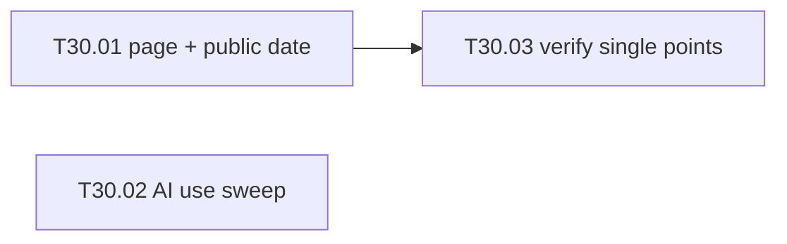

# TASK-30 — Score-sheet single points: challenge named, repo public, page drafted, AI use current

| Field | Value |
| --- | --- |
| Objective | Secure the three single points on the organizer's score sheet on day one of the build and keep them true: the challenge is named, the repository is public, the project page is drafted; `docs/AI_USE.md` stays current |
| Requirements | NFR-07 |
| Lane / owner role | story — R6: Obidit Islam (submission and project page) |
| Milestone | M0 (5–6 Nov), then continuous to M8 |
| Window | pre-event-allowed |
| Effort (doc 06) | 1–2 h |
| Done when (doc 06) | All three single points verifiable |
| Main risk → fallback | — |
| Spec sections | [06 §C.2](../specs/06_High_Level_Implementation_Plan.md#c2-new-in-v2-surface-ops-tier-1-unless-marked) · [06 §D.4](../specs/06_High_Level_Implementation_Plan.md#d4-cut-list-cut-in-this-order-when-behind) never-cut list · [02 §F](../specs/02_Technical_Requirements_Document.md#f-nonfunctional-requirements-and-validation) NFR-07 · [Submission checklist](../ops/submission-checklist.md) · [AI use](../AI_USE.md) |

## Inputs this task consumes

| Input | Kind | Owner | Dependency |
| --- | --- | --- | --- |
| Product name (working title until D-08) | decision | T16.01 | soft (T30.01) |
| Submission checklist | upstream output | T16.06 | soft (T30.03) |

## Outputs this task provides

| Output | Path | Consumers |
| --- | --- | --- |
| The three single points, with evidence | `docs/ops/submission-checklist.md` (score-sheet section) | T16.06 |
| AI-use log kept current | `docs/AI_USE.md` | judges |

## Subtasks

### T30.01 — Name the challenge on the project page and in the README; draft the page; decide when the repo goes public

- **Owner:** Obidit Islam (team lead, submission)
- **Type:** human
- **Tag:** human-required · core
- **Window:** pre-event-allowed
- **Estimate:** 0.5–1 h
- **Owns (writes):** none — the project page lives on the NASA Space Apps site; the README challenge line belongs to T16.03 and is checked there
- **Reads:** [06 §C.2](../specs/06_High_Level_Implementation_Plan.md#c2-new-in-v2-surface-ops-tier-1-unless-marked) TASK-30, [ops/rules.md](../ops/rules.md), [docs/reference](../reference/)
- **Depends on:** none
- **Parallel with:** T00.06
- **Steps:**
  1. Draft the project page with the exact challenge name "Interplanetary Survival Guide: Martian Map".
  2. Decide with the team when the repository becomes public (it is private on 6 Nov; the score sheet needs it public). `TODO(decision)`.
- **Acceptance:**
  - Serves: NFR-07 · [06 §C.2](../specs/06_High_Level_Implementation_Plan.md#c2-new-in-v2-surface-ops-tier-1-unless-marked)
  - The page draft exists and names the challenge; the public date is recorded.
- **Verify:** Manual: the page draft opened by a second team member.
- **Agent brief:** A person edits the page; an agent may draft text from 01 §A without new numbers.
- **Conflict notes:** No repo file of its own.

### T30.02 — Keep `docs/AI_USE.md` current (weekly sweep)

- **Owner:** Obidit Islam (team lead, submission)
- **Type:** human
- **Tag:** human-required · core
- **Window:** pre-event-allowed
- **Estimate:** 0.5 h
- **Owns (writes):** `docs/AI_USE.md` (append-only)
- **Reads:** `git log`, [AI use](../AI_USE.md)
- **Depends on:** none
- **Parallel with:** T30.01
- **Steps:**
  1. On 9 Nov, 11 Nov and Day 2 morning, compare `git log` with the log table; ask the author to add any missing row.
  2. Fill the Human review column where reviews happened.
- **Acceptance:**
  - Serves: NFR-07
  - Every AI-assisted commit has a row.
- **Verify:** Manual comparison noted in the PR.
- **Agent brief:** An agent may list commits whose message mentions AI and have no row.
- **Conflict notes:** Log table is append-only (map §c.2); header and Tools sections belong to T16.04.

### T30.03 — Verify the three single points and record the evidence

- **Owner:** Obidit Islam (team lead, submission)
- **Type:** verify
- **Tag:** human-required · core
- **Window:** pre-event-allowed
- **Estimate:** 0.5 h
- **Owns (writes):** `docs/ops/verification-log.md` (append-only)
- **Reads:** [Submission checklist](../ops/submission-checklist.md), [02 §F](../specs/02_Technical_Requirements_Document.md#f-nonfunctional-requirements-and-validation) NFR-07
- **Depends on:** T30.01 (hard: page and public date), T16.06 (soft: checklist)
- **Parallel with:** T16.05
- **Steps:**
  1. Check each point in a private window: challenge named, repo public, page complete; check DONKI/CCMC, NAIF and ESA SPICE credits (NFR-07).
- **Acceptance:**
  - Serves: NFR-07 · [06 §C.2](../specs/06_High_Level_Implementation_Plan.md#c2-new-in-v2-surface-ops-tier-1-unless-marked) TASK-30 done-when
  - Each point has a link or screenshot as evidence.
- **Verify:** Manual: the T30.03 section.
- **Agent brief:** Humans check; an agent may format the evidence.
- **Conflict notes:** Append-only log.

## Internal dependency graph

## Definition of done (task level)

- 06 §C.2 done-when: all three single points verifiable (T30.03).
- The AI-use log has a row for every AI-assisted change.

## Spec questions

1. **Public date.** The repo is private; the single point needs it public. When to flip it (day one of the build, as 06 says, or after a secrets check) is `TODO(decision)` in T30.01.
