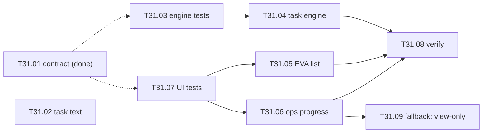

# TASK-31 — Stop task list (FR-50): protocol, engine, EVA list, ops progress, task text

| Field | Value |
| --- | --- |
| Objective | 1–4 tasks per stop, ticked or skipped on the EVA tablet with a 5-s undo, logged and broadcast so ops, the HUD count, the briefing card and the post-EVA report agree; ops can add a task; open tasks at dropped stops become DROPPED; the simulated crew member completes tasks at dwell end |
| Requirements | FR-50, FR-14, FR-46, NFR-06, NFR-12 |
| Lane / owner role | hab-core — R4: Anjim Hossain (engine); frontend — R5: Ridita Alam (UI); story — R6: Sadman Shaharier Mahim (task text) |
| Milestone | M1 (contract, done 6 Nov) → M3 (engine and UI, 8–10 Nov) |
| Window | pre-event-if-permitted (T31.01 and T31.02 are pre-event-allowed) |
| Effort (doc 06) | 6–9 h (Ridita 3–4, Anjim 2–3, Sadman 1–2) |
| Done when (doc 06) | Tap on tablet shows on ops ≤ 500 ms; abort drops open tasks; report counts match the log |
| Main risk → fallback | Time runs short → ops view-only, no `ADD_STOP_TASK` (T31.09) |
| Spec sections | [01 FR-50](../specs/01_Product_Requirements_Document.md#fr-50--stop-task-list-on-the-eva-tablet-synced-to-ops-t1-m) · [05 StopTask](../specs/05_Backend_and_Database_Schema.md#stoptask-fr-50-added-2026-11-05) · [05 Scenario](../specs/05_Backend_and_Database_Schema.md#scenario) · [02 §E.4](../specs/02_Technical_Requirements_Document.md#e4-authentication-and-roles) · [02 §E.6](../specs/02_Technical_Requirements_Document.md#e6-websocket-protocol-ws) · [04 §E.5](../specs/04_Design_Brief.md#e5-scr-12-eva-tablet-ops-phonetablet-portrait--360-px) · [Mockup handoff](../design/mockup-handoff.md#stop-task-list-and-full-screen-map-fr-50-g-30-to-g-43) |

> **Protocol v0 update, 7 Nov 2026 (R4, Sadman Shaharier Mahim).** Decided by the product & systems lead; build on it without waiting for a review, and adapt existing work to it:
>
> 1. Every LogEvent kind has a fixed `data` shape: the table in [05 LogEvent](../specs/05_Backend_and_Database_Schema.md#logevent-one-line-of-sessionjsonl) (T20.10) and `LogEventData` in `packages/protocol/src/runtime.ts` (T20.11).
> 2. On reconnect the Hab Core sends a fresh `SNAPSHOT`, then the missed `EVENT`s ([02 §E.6](../specs/02_Technical_Requirements_Document.md#e6-websocket-protocol-ws)).
> 3. A repeated `command_id` from the same client that was accepted is answered with the first `COMMAND_RESULT` and not run again ([05 Command](../specs/05_Backend_and_Database_Schema.md#command)).
> 4. `plan_hash` and `log_hash` use RFC 8785 canonical JSON ([05 PlanExport](../specs/05_Backend_and_Database_Schema.md#planexport)).

## Inputs this task consumes

| Input | Kind | Owner | Dependency |
| --- | --- | --- | --- |
| Engine module stub `engine/tasks.ts` and the reducer delegation | contract | T22.01 | soft (T31.04) |
| Command dispatch to `engine/tasks.ts` | upstream output | T23.02 | hard (T31.04) |
| Plan revision events (abort, approve) | upstream output | T23.07 | hard (T31.08) |
| EVA view model and SCR-12 slot | upstream output | T24.03 | hard (T31.05) |
| Report task counts | upstream output | T27.01 | hard (T31.08) |

## Outputs this task provides

| Output | Path | Consumers |
| --- | --- | --- |
| FR-50 types, scenario schema field, UI stubs | `packages/protocol/src/`, `schemas/scenario.schema.json`, `apps/web/src/ui/` | T20.01, T21.08, T24.*, T25.* |
| Task text per stop | `scenarios/storm-sol4190/stop_tasks.json` | T21.08, T11.08 |
| Task engine | `apps/hab-core/src/engine/tasks.ts` | T22.06, T27.01 |
| EVA list and ops progress components | `apps/web/src/ui/screens/scr12/`, `apps/web/src/ui/ops/` | T24.04, T25.01 |

## Subtasks

### T31.01 — Contract: FR-50 types, scenario schema field and the 6 Nov UI stubs

- **Owner:** Sadman Shaharier Mahim (R4 Hab Core) — written in the 6 Nov Claude Code session (commits `28ff78e`, `099dc17`, `d43d5b1`, `d39aa0f`)
- **Type:** contract
- **Tag:** agent-ready · core
- **Window:** pre-event-allowed
- **Estimate:** 1–1.5 h
- **Owns (writes):** `packages/protocol/src/runtime.ts` (stub → T20.01), `packages/protocol/src/ws.ts` (stub → T20.01), `schemas/scenario.schema.json`, `apps/web/src/ui/screens/scr12/StopTaskList.tsx` (stub → T31.05), `apps/web/src/ui/ops/TaskProgress.tsx` (stub → T31.06), `apps/web/src/ui/map/MapControls.tsx` (stub → T07.17), `apps/web/src/ui/map/FullScreenMap.tsx` (stub → T24.09)
- **Reads:** [05 StopTask](../specs/05_Backend_and_Database_Schema.md#stoptask-fr-50-added-2026-11-05), [02 §E.4](../specs/02_Technical_Requirements_Document.md#e4-authentication-and-roles), [02 §E.6](../specs/02_Technical_Requirements_Document.md#e6-websocket-protocol-ws), [Session handoff §F.1](../ops/session-handoff-2026-11-06.md#f1-first-stubs-for-the-56-nov-additions-before-the-7-nov-protocol-freeze)
- **Depends on:** none
- **Parallel with:** T20.01
- **Steps:**
  1. `StopTask`, `StopTaskSeed`, task commands and events, `SNAPSHOT.tasks`, permissions (02 §E.4).
  2. `stop_tasks` in `scenario.schema.json` (authored fields, text ≤ 60 characters; `stop_id` is the stop Waypoint id, U-61).
  3. Empty React components with props from the mockup handoff inventory, and `it.todo` tests.
- **Acceptance:**
  - Serves: FR-50 · [05 StopTask](../specs/05_Backend_and_Database_Schema.md#stoptask-fr-50-added-2026-11-05)
  - `make typecheck`, `make test-web` and `npm run build` pass (done 6 Nov).
- **Verify:** `make typecheck test-web`.
- **Agent brief:** Done. Recorded so the owners of the stubbed files soft-depend on it.
- **Conflict notes:** The protocol files now belong to T20.01; later FR-50 type changes are `contract-change:` subtasks there.

### T31.02 — Write the task text for each stop of the demo plan (U-58)

- **Owner:** Sadman Shaharier Mahim (R6 task content)
- **Type:** human
- **Tag:** human-required · core
- **Window:** pre-event-allowed
- **Estimate:** 1–1.5 h
- **Owns (writes):** `scenarios/storm-sol4190/stop_tasks.json`
- **Reads:** [01 FR-50](../specs/01_Product_Requirements_Document.md#fr-50--stop-task-list-on-the-eva-tablet-synced-to-ops-t1-m), [01 FR-45](../specs/01_Product_Requirements_Document.md#fr-45--exploration-zone-layer-t0-m), [05 StopTask](../specs/05_Backend_and_Database_Schema.md#stoptask-fr-50-added-2026-11-05), `apps/web/src/ui/demoPlan.json`, POI records from TASK-04
- **Depends on:** T07.14 (hard: the demo plan's stops), T04.04 (hard: POI objectives)
- **Parallel with:** T21.07
- **Steps:**
  1. 1–4 tasks per stop: kind (`observe`, `image`, `sample`, `measure`, `deploy`, `other`), imperative text ≤ 60 characters, crew (`EV1`, `EV2` or either).
  2. Write each task from the POI's objective; any number in the text cites its source.
  3. Record U-58 (who writes the text and where) and the per-crew model (U-52) in the file's README.
- **Acceptance:**
  - Serves: FR-50, FR-45 · [05 StopTask](../specs/05_Backend_and_Database_Schema.md#stoptask-fr-50-added-2026-11-05) · U-58
  - The file validates against the `stop_tasks` part of `scenario.schema.json`; every `stop_id` is a demo-plan Waypoint id.
- **Verify:** Schema check with `jsonschema`; a second person reads every task against its POI.
- **Agent brief:** The product & systems lead writes the text; an agent may check lengths and ids. No AI-generated numbers in task text.
- **Conflict notes:** New file; T21.08 copies it into `scenario.json`.

### T31.03 — Tests: stop task commands, events and engine behaviour

- **Owner:** Anjim Hossain (R2/R4 float, TASK-31 engine)
- **Type:** test
- **Tag:** agent-ready · core
- **Window:** pre-event-if-permitted
- **Estimate:** 1 h
- **Owns (writes):** `apps/hab-core/tests/stopTasks.test.ts`
- **Reads:** [01 FR-50](../specs/01_Product_Requirements_Document.md#fr-50--stop-task-list-on-the-eva-tablet-synced-to-ops-t1-m), [02 §E.4](../specs/02_Technical_Requirements_Document.md#e4-authentication-and-roles), `apps/hab-core/tests/fixtures/fake-scenario/`
- **Depends on:** T22.02 (soft: fake scenario), T31.01 (soft: types)
- **Parallel with:** T31.07
- **Steps:**
  1. Turn the existing `it.todo` cases into tests (permissions, validation, events, seeding, DROPPED on revision, auto-complete at dwell end, determinism, report counts).
  2. Leave the cases tied to open decisions (U-46, U-52, U-56, undo) as `it.todo` until decided (BD-05, BD-59: now real tests).
- **Acceptance:**
  - Serves: FR-50, NFR-06 · [01 FR-50](../specs/01_Product_Requirements_Document.md#fr-50--stop-task-list-on-the-eva-tablet-synced-to-ops-t1-m)
  - Every FR-50 acceptance criterion has at least one test.
- **Verify:** `npm --workspace @marswalk/hab-core test -- stopTasks` fails before T31.04 and passes after.
- **Agent brief:** Make the stop-task todos real on the fake scenario.
- **Conflict notes:** Pair T31.03 → T31.04.

### T31.04 — Implement the task engine: commands, seeding, DROPPED on revision, auto-complete

- **Owner:** Anjim Hossain (R2/R4 float, TASK-31 engine)
- **Type:** implement
- **Tag:** agent-ready · core
- **Window:** pre-event-if-permitted
- **Estimate:** 1.5–2 h
- **Owns (writes):** `apps/hab-core/src/engine/tasks.ts`
- **Reads:** `apps/hab-core/tests/stopTasks.test.ts`, [05 StopTask](../specs/05_Backend_and_Database_Schema.md#stoptask-fr-50-added-2026-11-05)
- **Depends on:** T31.03 (hard: tests first), T23.02 (hard: dispatch), T22.01 (soft: stub)
- **Parallel with:** T31.05
- **Steps:**
  1. Seed `TASK_ADDED` events from `stop_tasks` at session load; handle `UPDATE_STOP_TASK` ("own tasks" check) and `ADD_STOP_TASK`.
  2. On `PLAN_REVISED`, emit `TASK_DROPPED` for open tasks at dropped stops (actor `system`).
  3. At the end of each dwell, the simulated crew member's open tasks become DONE (deterministic).
  4. Provide the reducer case for `TASK_*` events.
- **Acceptance:**
  - Serves: FR-50, NFR-06
  - T31.03 passes apart from the decision-bound todos.
- **Verify:** `npm --workspace @marswalk/hab-core test -- stopTasks`.
- **Agent brief:** Implement the task module; it never edits `tick.ts`. Two small additions outside `tasks.ts` were made with the product lead's authorisation on 11 Nov (PR #194 review): `commands.ts` appends the `TASK_DROPPED` events after every accepted `PLAN_REVISED` (`withTaskDrops`), and the reducer state gains the engine-only `task_plan_rev` for the undo staleness rule (spec change #202).
- **Conflict notes:** Single owner of `tasks.ts`; `commands.ts` (T23.02) and `reducer.ts` (T22.06) carry the two additions above.

### T31.05 — Implement the EVA task list and TASKS button

- **Owner:** Sadman Shaharier Mahim (product & systems lead · R4 Hab Core) — taken over from Ridita Alam on 10 Nov to unblock the live session while her agent is out for the day (product lead's call; Ridita informed on the PR; the human-required checks stay with her)
- **Type:** implement
- **Tag:** agent-ready · core
- **Window:** pre-event-if-permitted
- **Estimate:** 1.5–2 h
- **Owns (writes):** `apps/web/src/ui/screens/scr12/StopTaskList.tsx`, `apps/web/src/ui/screens/scr12/TasksButton.tsx`
- **Reads:** [04 §E.5](../specs/04_Design_Brief.md#e5-scr-12-eva-tablet-ops-phonetablet-portrait--360-px) stop task list, [Mockup handoff G-30–G-43](../design/mockup-handoff.md#stop-task-list-and-full-screen-map-fr-50-g-30-to-g-43), `apps/web/tests/ui/stopTasks.test.ts`
- **Depends on:** T31.07 (hard: tests first), T24.03 (hard: view model), T31.01 (soft: stub)
- **Parallel with:** T31.06
- **Steps:**
  1. Rows ≥ 56 px: neutral square check box, text, SKIP with reason; the drawn check mark for DONE (G-32); `⊘` for skipped or dropped, with the word.
  2. One tap ticks; 5-s undo; "not synced" while queued; "added by ops" tag; collapse to a count during an alert.
  3. TASKS button with icon, word and count (U-51 placement).
- **Acceptance:**
  - Serves: FR-50, NFR-04 · [04 §E.5](../specs/04_Design_Brief.md#e5-scr-12-eva-tablet-ops-phonetablet-portrait--360-px)
  - The EVA cases of T31.07 pass; no status colour on task rows.
- **Verify:** `npm --workspace @marswalk/web test -- stopTasks`.
- **Agent brief:** Build the list from 04 §E.5 and the handoff; task progress is not a safety status.
- **Conflict notes:** SCR-12 (T24.04) mounts these components and owns its layout.

### T31.06 — Implement ops task progress and the add-task popover

- **Owner:** Sadman Shaharier Mahim (product & systems lead · R4 Hab Core) — taken over from Ridita Alam on 10 Nov to unblock the live session while her agent is out for the day (product lead's call; Ridita informed on the PR; the human-required checks stay with her)
- **Type:** implement
- **Tag:** agent-ready · core
- **Window:** pre-event-if-permitted
- **Estimate:** 1 h
- **Owns (writes):** `apps/web/src/ui/ops/TaskProgress.tsx`, `apps/web/src/ui/ops/AddTaskPopover.tsx`
- **Reads:** [Mockup handoff component inventory](../design/mockup-handoff.md#component-inventory), `apps/web/tests/ui/stopTasks.test.ts`
- **Depends on:** T31.07 (hard: tests first), T20.06 (hard: client store), T31.01 (soft: stub)
- **Parallel with:** T31.05
- **Steps:**
  1. "STOP n done/total · TOTAL done/total" computed from the task list (U-53), with a `simulated` chip.
  2. "+ TASK" opens the popover: crew, stop (current or next), kind, text ≤ 60 characters; disabled when the stop has the maximum.
- **Acceptance:**
  - Serves: FR-50
  - The ops cases of T31.07 pass.
- **Verify:** `npm --workspace @marswalk/web test -- stopTasks`.
- **Agent brief:** Build the two ops components; counts are computed from the list, never looked up.
- **Conflict notes:** SCR-11 (T25.01) mounts them.

### T31.07 — Tests: EVA list and ops progress DOM tests

- **Owner:** Sadman Shaharier Mahim (product & systems lead · R4 Hab Core) — taken over from Ridita Alam on 10 Nov to unblock the live session while her agent is out for the day (product lead's call; Ridita informed on the PR; the human-required checks stay with her)
- **Type:** test
- **Tag:** agent-ready · core
- **Window:** pre-event-if-permitted
- **Estimate:** 1 h
- **Owns (writes):** `apps/web/tests/ui/stopTasks.test.ts`
- **Reads:** [04 §E.5](../specs/04_Design_Brief.md#e5-scr-12-eva-tablet-ops-phonetablet-portrait--360-px), `apps/web/tests/fixtures/ws/`
- **Depends on:** T31.01 (soft: props), T20.02 (soft: fixtures), T14.01 (soft: DOM test environment)
- **Parallel with:** T31.03
- **Steps:**
  1. Turn the existing `it.todo` cases into tests; leave U-53 and U-59 cases as todos until decided.
- **Acceptance:**
  - Serves: FR-50, NFR-04
  - Each rule of 04 §E.5's task list paragraph has a named test.
- **Verify:** `npm --workspace @marswalk/web test -- stopTasks`.
- **Agent brief:** Make the UI stop-task todos real.
- **Conflict notes:** Pairs T31.07 → T31.05, T31.06.

### T31.08 — Verify: tap on tablet shows on ops ≤ 500 ms; abort drops open tasks; report counts match the log

- **Owner:** Anjim Hossain (R2/R4 float, integration lead)
- **Type:** verify
- **Tag:** human-required · core
- **Window:** pre-event-if-permitted
- **Estimate:** 0.5–1 h
- **Owns (writes):** `docs/ops/verification-log.md` (append-only)
- **Reads:** [01 FR-50](../specs/01_Product_Requirements_Document.md#fr-50--stop-task-list-on-the-eva-tablet-synced-to-ops-t1-m) acceptance criteria
- **Depends on:** T31.04 (hard), T31.05 (hard), T31.06 (hard), T23.07 (hard: abort), T27.01 (hard: report counts), T20.08 (hard: LAN latency method)
- **Parallel with:** T25.08
- **Steps:**
  1. Record a tap on the phone and the ops screen in one video; measure the delay frame by frame.
  2. Abort during the demo: every device shows the remaining stops' open tasks as DROPPED.
  3. Compare the report's task counts with the counts reduced from `session.jsonl`.
- **Acceptance:**
  - Serves: FR-50, NFR-12 · [06 §C.2](../specs/06_High_Level_Implementation_Plan.md#c2-new-in-v2-surface-ops-tier-1-unless-marked) TASK-31 done-when
  - The three checks are recorded with measured values and pass or fail.
- **Verify:** Manual: the T31.08 section of the verification log.
- **Agent brief:** Humans run it; never adjust measured times.
- **Conflict notes:** Append-only log.

### T31.09 — Fallback — start only if TASK-31 runs late at M3: ops view-only, no `ADD_STOP_TASK`

- **Owner:** Ridita Alam (R5 EVA & Ops UI)
- **Type:** fallback
- **Tag:** agent-ready · core
- **Window:** pre-event-if-permitted
- **Estimate:** 0.5 h
- **Owns (writes):** `apps/web/src/ui/ops/AddTaskPopover.tsx` (replaces T31.06)
- **Reads:** [06 §C.2](../specs/06_High_Level_Implementation_Plan.md#c2-new-in-v2-surface-ops-tier-1-unless-marked) TASK-31 fallback
- **Depends on:** T31.06 (hard: replaces it)
- **Parallel with:** T31.08
- **Steps:**
  1. Remove the "+ TASK" control; ops shows progress only.
- **Acceptance:**
  - Serves: FR-50
  - EVA ticking still syncs to ops.
- **Verify:** `npm --workspace @marswalk/web test -- stopTasks`.
- **Agent brief:** Only if TASK-31 is late.
- **Conflict notes:** Replaces part of T31.06's output; never at the same time.

## Internal dependency graph

## Definition of done (task level)

- 06 §C.2 done-when: ≤ 500 ms tablet → ops, abort drops open tasks, report counts match the log (T31.08).
- Task controls never move the alert slot, HAVEN, O₂ or the action row (T24.10, T31.07).
- Task text is team-authored, ≤ 60 characters, and cites any number.

## Spec questions

1. **U-46** ops adding tasks during an alert; **U-52** per-crew task model; **U-56** current-stop tasks on abort; **U-58** who writes the text and where (this plan proposes `stop_tasks.json`, copied into `scenario.json`).
2. **Undo.** *Decided 11 Nov 2026 by the product & systems lead (spec change #202, Proposed):* the undo is server-side, `UPDATE_STOP_TASK` with state `TODO` and `undo: true` (01 FR-50 Undo, 02 §E.6, 05 StopTask). Tests: T31.03 (`stopTasks.test.ts`).
3. **Skip reason** (U-55). *Decided: FD-028 and FD-262 (12 Nov 2026, Proposed); built in the browser round of 12 Nov (package 17)* — one tap on SKIP records `other` and the 5-s undo strip holds one REASON control cycling time, terrain, alert, other. The revision is a second `UPDATE_STOP_TASK {state: "SKIPPED", reason}` on the same task, so the Hab Core must accept `SKIPPED → SKIPPED`: until it does, the command is refused and the refusal is shown (need N-29; the harness check stays `test.fixme('needs N-29')`).
