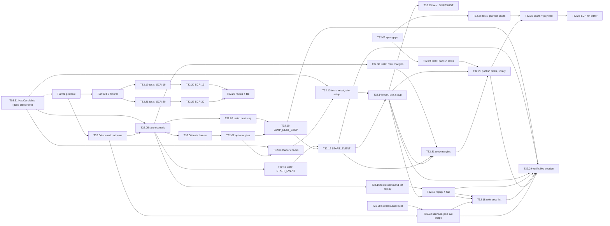

# TASK-32 — Live operations session: presenter panel, event on demand, mission setup, stop task library

| Field | Value |
| --- | --- |
| Objective | Turn the scripted demo into a session a presenter drives: a `presenter` role and panel (SCR-19) with Next stop, Start storm, clock speed and Reset; the Hab Core commands behind them (`JUMP_NEXT_STOP`, `START_EVENT`, `RESET_SESSION`) and the two ops-only setup commands (`SELECT_HAB_SITE`, `SET_MISSION_SETUP`) with the mission setup screen (SCR-20); `scenario.json` reshaped to mission setup + event library + task library; headless replay of a recorded command list; planner-side editing of the per-POI suggested tasks (FR-54). Deliverable (06 §C.2, "Live operations session"): a recorded command list replays headless to the same log hash twice, and Next stop leaves the crew at the next stop with the same O₂ and dose as a walked run. Added the same day by the product lead: three per-crew values the EVA tablet and HUD show (O₂ time left, bearing and distance to the next stop, ETA to the next stop), computed by the engine and sent in the SNAPSHOT (T32.01, T32.30, T32.31) |
| Requirements | FR-51, FR-52, FR-53, FR-54 (01 §D); also FR-31, FR-32, FR-33, FR-34, FR-35, FR-39, FR-50, NFR-05, NFR-06, NFR-10, NFR-14. Decisions U-62, U-63, U-64 (01 §G) and U-65 (06) |
| Lane / owner role | hab-core — R4 Hab Core: Sadman Shaharier Mahim, who is also the owner of every UI subtask here (SCR-19, the Hab Core work and the planner task editing are his by 06 §C.2; SCR-20 is registered to him instead of the Proposed R5 owner, see T32.21 and T32.22) |
| Milestone | M4 (offline dry run 11 Nov) for the Hab Core, protocol, replay, SCR-19 and SCR-20, as for T03.31–T03.35; M4b for the planner task editing, which waits for the planner subtasks of PRs #168–#174. 06 §C.2 gives no "When" for these packages (`TODO(decision)`), so the milestones are board placements, not commitments; the team lead signs them off on the registering PR (U-65) |
| Window | pre-event-allowed for contract, spec-change, fixture and data subtasks; pre-event-if-permitted for code (Track P recorded 2026-11-04) |
| Effort (doc 06) | `TODO(decision)`: 06 §C.2 gives none for this package. The subtask estimates are planning guesses by analogy with subtasks of the same type in TASK-22 and TASK-23, as in [map v2 open point 1](_coordination.md#v2-open-points-2026-11-06) |
| Done when (doc 06) | A recorded command list replays headless to the same log hash twice; Next stop leaves the crew at the next stop with the same O₂ and dose as a walked run; the loader validates the new scenario shape; choosing the other candidate changes the haven field, the comm layer and the planner start; adding a library POI shows its tasks and an edit reaches the EVA tablet after publishing (06 §C.2) |
| Main risk → fallback | Time runs short → 06 §C.2 names these fallbacks, none registered as a subtask yet: keep SET_CLOCK and JUMP_NEXT_EVENT as the only presenter buttons; keep the fixed timeline as one `event_library` entry started by the loader; tasks come from the library unedited and ops adds by hand (FR-50); the candidate is fixed to the rank-1 site |
| Spec sections | [01 FR-51](../specs/01_Product_Requirements_Document.md#fr-51--live-session-and-presenter-panel-t1-m) · [01 FR-52](../specs/01_Product_Requirements_Document.md#fr-52--event-on-demand-the-storm-t1-m) · [01 FR-53](../specs/01_Product_Requirements_Document.md#fr-53--mission-site-selection-at-setup-t1-m) · [01 FR-54](../specs/01_Product_Requirements_Document.md#fr-54--stop-task-library-t1-m) · [02 §D.17](../specs/02_Technical_Requirements_Document.md#d17-live-session-next-stop-event-on-demand-reset-fr-51-fr-52-fr-53-added-2026-11-10-proposed) · [02 §E.4](../specs/02_Technical_Requirements_Document.md#e4-authentication-and-roles) · [02 §E.5](../specs/02_Technical_Requirements_Document.md#e5-hab-core-http-endpoints) · [02 §E.7](../specs/02_Technical_Requirements_Document.md#e7-scenario-file-scenariosidscenariojson) · [03 SCR-19](../specs/03_App_Flow_and_Diagrams.md#scr-19--presenter-panel-live-session-2026-11-10-proposed) · [03 SCR-20](../specs/03_App_Flow_and_Diagrams.md#scr-20--mission-setup-live-session-2026-11-10-proposed) · [03 §C.9](../specs/03_App_Flow_and_Diagrams.md#c9-live-session-journey-2026-11-10-proposed-01-fr-51fr-54) · [05 Scenario](../specs/05_Backend_and_Database_Schema.md#scenario) · [05 Session](../specs/05_Backend_and_Database_Schema.md#session) · [05 Command](../specs/05_Backend_and_Database_Schema.md#command) · [05 LogEvent](../specs/05_Backend_and_Database_Schema.md#logevent-one-line-of-sessionjsonl) · [06 §C.2](../specs/06_High_Level_Implementation_Plan.md#c2-new-in-v2-surface-ops-tier-1-unless-marked) |

> **Registered 2026-11-10 by a `coord:` change** (product & systems lead Sadman Shaharier Mahim; follows the merged spec change #176). Everything in the specs this task builds on is **Proposed**; command and event names are Proposed. T03.31–T03.35 (candidate hab sites, owner Obidit Islam) were registered earlier and are not repeated here.
>
> **Why a new task file.** The work spans the protocol, the scenario schema, the loader, the session and command code, the replay CLI, two new screens and the planner, all owned by one person and all following up on paths other subtasks own (map §c.1 rule 3). One file keeps the follow-ups in one dependency order, gives the package the single milestone and done-when that 06 §C.2 gives it, and avoids scattering a few subtasks across TASK-20…25. Every path an existing subtask owns is edited only as `(after Txx.yy)` with a hard dependency on that owner; where several T32 subtasks edit one path they depend on each other in a chain, so two never edit it at once.

## Inputs this task consumes

| Input | Kind | Owner | Dependency |
| --- | --- | --- | --- |
| Protocol v0 (`runtime.ts`, `ws.ts`, `PERMISSIONS`) and its `LogEventData` types | contract | T20.01, T20.11 | hard (T32.01) |
| `HabCandidate` type, manifest `hab_candidates`, the two candidate records and their grids | contract / upstream output | T03.31, T03.32, T03.34 | hard (T32.01, T32.22; T32.29 for the real site) |
| Scenario schema with the FR-50 `stop_tasks` field | contract | T31.01 | hard (T32.04) |
| Reducer, loader, session manager, command dispatch, tick, alerts, vehicles, options, task engine | upstream output | T22.06, T22.11, T22.12, T23.02, T22.09, T22.10, T23.05, T23.07, T31.04 | hard (T32.01, T32.07, T32.10, T32.12, T32.14, T32.25) |
| Headless replay and the CLI | upstream output | T22.13 | hard (T32.07, T32.17) |
| Server and client reconnect code | upstream output | T20.04, T20.03, T20.06, T20.05 | hard (T32.15) |
| Real `scenario.json`, `plan.json`, tables and the demo numbers | upstream output | T21.08, T21.12, T21.15 | hard (T32.32, T32.18, T32.29) |
| Planner shell, site loader, plan store, plan panel, route registry, publish path | upstream output | T02.01–T02.03, T07.01–T07.03, T08.01, T08.03, T08.04, T11.07, T29.05 (Saba Atharique; PRs #168–#174) | hard (T32.23, T32.26–T32.28) |
| Ops join screen | upstream output | T25.06 | hard (T32.23) |

## Outputs this task provides

| Output | Path | Consumers |
| --- | --- | --- |
| Live-session protocol: `presenter`, five commands, five log events, Session and library types | `packages/protocol/src/runtime.ts`, `packages/protocol/src/ws.ts` | All role views, T32.32 |
| Reshaped scenario schema and fixture | `schemas/scenario.schema.json`, `apps/hab-core/tests/fixtures/fake-scenario/` | T32.32 |
| Per-crew O₂ time left, next-stop bearing, distance and ETA in the SNAPSHOT | `apps/hab-core/src/engine/crewMargins.ts`, `packages/protocol/src/runtime.ts` | EVA tablet and HUD (T24.03, T24.04, T24.08) |
| `scenario.json` in the live shape | `scenarios/storm-sol4190/scenario.json` | T32.18, T32.29, T22.14 |
| Presenter commands, event on demand, reset and setup commands | `apps/hab-core/src/engine/nextStop.ts`, `liveEvents.ts`, `liveSetup.ts`, `commands.ts`, `session.ts` | SCR-19, SCR-20, T22.14, T23.08, T26.04, T22.16 |
| Replay of a recorded command list and the reference list | `apps/hab-core/src/replay.ts`, `apps/hab-core/src/cli.ts`, `scenarios/storm-sol4190/reference_commands.json` | T22.14, T23.08, CI, video fallback |
| SCR-19 presenter panel, SCR-20 mission setup, routes | `apps/web/src/ui/screens/scr19Presenter.tsx`, `scr20MissionSetup.tsx`, `apps/web/src/main.ts` | Dry runs, T17.02 |
| Planner stop-task drafts, editor and publish payload | `apps/web/src/state/stopTaskDraft.ts`, `apps/web/src/ui/plan/StopTaskEditor.tsx`, `apps/web/src/ui/briefing/publishPlan.ts` | FR-54 acceptance |

## Subtasks

### T32.01 — contract-change: live-session protocol — `presenter` role, five commands, five log events, Session and library types (C13)

- **Owner:** Sadman Shaharier Mahim (product & systems lead · R4 Hab Core); Mishkat Ahmed Khan (R2) reviews, as 06 §A.1 pairs R2 and R4 on `packages/protocol`
- **Type:** contract
- **Tag:** agent-ready · core
- **Window:** pre-event-allowed
- **Estimate:** 2–3 h
- **Owns (writes):** `packages/protocol/src/runtime.ts` (after T20.01), `packages/protocol/src/ws.ts` (after T20.01), `apps/hab-core/src/engine/reducer.ts` (after T22.06)
- **Reads:** [02 §E.4](../specs/02_Technical_Requirements_Document.md#e4-authentication-and-roles) (presenter column), [02 §D.17](../specs/02_Technical_Requirements_Document.md#d17-live-session-next-stop-event-on-demand-reset-fr-51-fr-52-fr-53-added-2026-11-10-proposed), [05 Command](../specs/05_Backend_and_Database_Schema.md#command), [05 LogEvent](../specs/05_Backend_and_Database_Schema.md#logevent-one-line-of-sessionjsonl), [05 Session](../specs/05_Backend_and_Database_Schema.md#session), [05 Scenario](../specs/05_Backend_and_Database_Schema.md#scenario), [05 EventLibraryEntry](../specs/05_Backend_and_Database_Schema.md#eventlibraryentry-2026-11-10-proposed), [05 TaskLibraryEntry](../specs/05_Backend_and_Database_Schema.md#tasklibraryentry-2026-11-10-proposed), `packages/protocol/src/schema.ts` (HabCandidate, T03.31), [01 FR-32](../specs/01_Product_Requirements_Document.md#fr-32--eva-client-suit-tablet-t1-m), [01 FR-33](../specs/01_Product_Requirements_Document.md#fr-33--hud-mode-t1-m), [05 Crew](../specs/05_Backend_and_Database_Schema.md#crew), `packages/compute/src/consumables.ts`
- **Depends on:** T20.01 (hard: owner of runtime.ts and ws.ts), T20.11 (hard: the previous contract-change on the same files), T22.06 (hard: owner of reducer.ts), T03.31 (soft: the HabCandidate type is read from schema.ts, merged first in practice), T32.02 (soft: spec gaps this subtask marks as TODO(decision))
- **Parallel with:** T32.02
- **Steps:**
  1. `runtime.ts`: add `"presenter"` to `Role`; add the five command kinds (`JUMP_NEXT_STOP`, `START_EVENT`, `RESET_SESSION`, `SELECT_HAB_SITE`, `SET_MISSION_SETUP`) to `CommandKind` and the five log kinds (`CLOCK_JUMPED`, `EVENT_STARTED`, `SESSION_RESET`, `SITE_SELECTED`, `MISSION_SETUP_SET`) to `LogEventKind`, each with a `LogEventData` entry whose field names are copied from the 05 LogEvent table. `SESSION_LOADED.plan_hash` is typed `string | null` (a plan-less session has no plan to hash; 05 makes it required: T32.02) and `MISSION_SETUP_SET` carries `vehicle_param_set` as well, because `SET_MISSION_SETUP` takes it (05 omits it: T32.02). `CLOCK_JUMPED.ended_by` takes the five values of 02 §D.17 (`arrival | alert | plan_revised | eva_ended | sheltered`); 05 lists two, which is a spec gap raised in T32.02.
  2. `Session`: add `hab_candidate_id`, `mission_setup` and `started_events` (05 Session). Type them as optional for now so older snapshots and the F7 fixtures still typecheck; tightening them is `TODO(decision)` after T32.07.
  3. `Scenario`: add `mission_setup`, `event_library`, `task_library?` and the `MissionSetup`, `EventLibraryEntry` and `TaskLibraryEntry` types with the 05 field names. Leave `plan` and `events` required in this subtask: T32.07 makes them optional together with the null checks, so `main` stays green.
  4. `ws.ts` `PERMISSIONS`: add the `presenter` row (`LOAD_SCENARIO`, `SET_CLOCK`, `JUMP_NEXT_EVENT`, `JUMP_NEXT_STOP`, `START_EVENT`, `RESET_SESSION`); add `SELECT_HAB_SITE` and `SET_MISSION_SETUP` to `ops` only. Check every role and command against the 02 §E.4 table row by row; presenter has no `APPROVE_OPTION`, `ABORT`, `SUMMON_VEHICLE`, `START_EVA`, `PUBLISH_PLAN`. `server.ts` `isRole` reads `PERMISSIONS`, so it accepts the new role without an edit.
  5. `reducer.ts`: add the five cases so `reduce` stays exhaustive and typechecks: `SITE_SELECTED` sets `session.hab_candidate_id`, `MISSION_SETUP_SET` merges the settings, `EVENT_STARTED` appends to `started_events`; `CLOCK_JUMPED` and `SESSION_RESET` change nothing beyond `last_seq` and `sim_time`. Pure, no I/O.
  6. `Crew` (SNAPSHOT and STATE_DELTA): add three per-crew fields for the EVA tablet and HUD, **Proposed names, final names `TODO(decision)`**: `o2_remaining_min` (minutes of O₂ left at the current activity; the name matches 05 `CONSUMABLES_LOW` and `LogEventData`), `next_stop_bearing_deg` and `next_stop_distance_m` (to the next stop; the compass convention is part of the decision), `next_stop_eta_s` (to reach it). Type them as optional and nullable (null when there is no plan or no stop left) so older snapshots and the F7 fixtures still typecheck. The engine computes them (T32.31, from `o2RemainingS` in `packages/compute` and the crew's motion); no view computes or defaults them. Provenance, Proposed: `simulated` for the O₂ time, `derived` for bearing and distance, `modelled` for the ETA (as `eta_s` in 05 Vehicle and the option ETAs), in the SNAPSHOT provenance map. `o2_remaining_min` is the name 05 already uses for the same quantity in `CONSUMABLES_LOW`. 01 FR-32 and FR-33 name the values; neither 05 Crew nor 02 §E.6 lists these fields, so a follow-up spec-change is needed (T32.02, open point 20).
  7. State the protocol change in the PR description as additive (C13 v0 → v0.1) and list the consumer subtasks to rebase (§d change process): T32.03, T32.04, T32.07 and later.
- **Acceptance:**
  - Serves: FR-51, FR-52, FR-53, FR-31, FR-32, FR-33, FR-35 · [02 §E.4](../specs/02_Technical_Requirements_Document.md#e4-authentication-and-roles)
  - `make typecheck test-web` passes; every added name is copied from 02 or 05 (the three crew fields are Proposed and marked `TODO(decision)`); `PERMISSIONS` matches 02 §E.4 for the presenter and the two ops-only rows (the role matrix test is T32.13).
  - Gaps in the specs are `TODO(decision)` in the file, not resolved silently.
- **Verify:** `make typecheck` · `npm --workspace @marswalk/hab-core test` · a second person (Mishkat) reviews the field-by-field list in the PR.
- **Agent brief:** Add the live-session types, the three per-crew EVA/HUD fields, the `presenter` permissions and the five reducer cases, following 02 §D.17, §E.4 and 05 exactly. Types and one pure reducer change only; no command handling.
- **Conflict notes:** One open contract-change on C13 at a time (§d); T20.11 is merged. `schema.ts` is read-only here (T03.31 owns the HabCandidate edit). `reducer.ts` is edited again by T32.07 (chain).

### T32.02 — spec-change: record the live-session gaps — planner task-library transport, `PUBLISH_PLAN` task payload, `ended_by` values, command-list export, 06 §C.2 owners

- **Owner:** Sadman Shaharier Mahim (product & systems lead · R4 Hab Core)
- **Type:** contract
- **Tag:** human-required · core
- **Window:** pre-event-allowed
- **Estimate:** 1–1.5 h
- **Owns (writes):** `docs/specs/02_Technical_Requirements_Document.md` (spec-change), `docs/specs/05_Backend_and_Database_Schema.md` (spec-change), `docs/specs/06_High_Level_Implementation_Plan.md` (spec-change)
- **Reads:** the spec sections in the Steps, [map open points](_coordination.md#open-points), the Spec questions of this file
- **Depends on:** none
- **Parallel with:** T32.01
- **Steps:**
  1. Decide how the planner receives `task_library` (and with it nothing else the Session does not already carry): 02 §E.5, §E.6 and the 05 Snapshot list no field or endpoint for it. Record the decision (for example a `SNAPSHOT` field for the planner role, or a `GET` endpoint) in 02 §E.5 or §E.6 and 05. `TODO(decision)`: product & systems lead.
  2. Name the `PUBLISH_PLAN` argument that carries the edited tasks beside `plan` (01 FR-54 says "beside `plan`" and the shape of `stop_tasks`; no spec names the argument) and say that the Hab Core seeds `TASK_ADDED` events from it at publish.
  3. Align 05 `CLOCK_JUMPED.ended_by` (`arrival | alert`) with 02 §D.17 (five values).
  4. Resolve the wording gap in 02 §D.17: it says a live session can export its command list "from its log", while 05 says commands are never logged. Either define the reconstruction from events (and its limits) or log what the export needs.
  5. Fix the file name and flag of the recorded command list (02 §D.17 `TODO(verify)`).
  6. 06 §C.2: set the owner of the ops setup screen to Sadman Shaharier Mahim (product lead's call, 10 Nov; Ridita Alam informed on the PR) instead of the Proposed R5; update U-65's status to registered.
  7. Add the three per-crew fields of T32.01 (`o2_remaining_min`, bearing and distance to the next stop, ETA to the next stop) to 05 Crew and the 02 §E.6 example, with their final names, units, bearing convention and provenance (`TODO(decision)`: product & systems lead). T32.30 picks the next stop per crew member, while 02 §D.17 uses one next stop for the whole crew (the stop not every crew member has reached): say which one the HUD shows.
  8. 05 LogEvent `SESSION_LOADED` requires `plan_hash`, but a plan-less session has none (`session.ts` reads `plan.plan_hash` today): make it nullable or absent.
  9. 05 LogEvent `MISSION_SETUP_SET` lists `crew_count, vehicle_available, solar_phase, max_haven_min` but `SET_MISSION_SETUP` also takes `vehicle_param_set` (02 §D.17): add it.
  10. Keep every Proposed or Confirmed label as it is; change no number and no id.
- **Acceptance:**
  - Serves: FR-51, FR-54, FR-53, FR-32, FR-33, U-65 · [06 §C.2](../specs/06_High_Level_Implementation_Plan.md#c2-new-in-v2-surface-ops-tier-1-unless-marked)
  - Each gap in steps 1 to 9 is decided in the spec or left as a visible `TODO(decision)`; `make lint docs-check` passes.
- **Verify:** `make lint docs-check`
- **Agent brief:** Draft the edits of steps 1 to 9 for the product lead to approve; do not choose a transport yourself.
- **Conflict notes:** One open spec-change PR at a time (map §c.2). The only subtask that edits 02, 05 and 06 in this plan.

### T32.03 — follow-up: F7 fixtures for the live-session beats

- **Owner:** Sadman Shaharier Mahim (product & systems lead · R4 Hab Core)
- **Type:** fixture
- **Tag:** agent-ready · core
- **Window:** pre-event-allowed
- **Estimate:** 1 h
- **Owns (writes):** `apps/web/tests/fixtures/ws/` (after T20.02)
- **Reads:** `apps/web/tests/fixtures/README.md`, [02 §D.17](../specs/02_Technical_Requirements_Document.md#d17-live-session-next-stop-event-on-demand-reset-fr-51-fr-52-fr-53-added-2026-11-10-proposed), [02 §E.6](../specs/02_Technical_Requirements_Document.md#e6-websocket-protocol-ws), [05 LogEvent](../specs/05_Backend_and_Database_Schema.md#logevent-one-line-of-sessionjsonl), `packages/protocol/src/runtime.ts`
- **Depends on:** T32.01 (hard: the new types), T20.02 (hard: owner), T20.11 (hard: the previous follower of this folder)
- **Parallel with:** T32.04
- **Steps:**
  1. Add beat files for: a `SNAPSHOT` in `LOADED` with `hab_candidate_id`, `mission_setup` and no plan; `SITE_SELECTED` and `MISSION_SETUP_SET` events; a presenter `JUMP_NEXT_STOP` with `CLOCK_JUMPED` (`ended_by` arrival, then alert); `EVENT_STARTED` for the storm; `SESSION_RESET` followed by a fresh `SNAPSHOT`; `COMMAND_RESULT` rejections `FORBIDDEN_ROLE` (presenter sends `ABORT`) and `BUSY` (Next stop while an alert is latched).
  2. Values come from the 02 §D.17 payload shapes or typed placeholders; list the source of each in the folder README (map §e value rule).
  3. Extend the fixture test so every new event has the keys of its `LogEventData` entry.
- **Acceptance:**
  - Serves: FR-51, FR-52, FR-53
  - The fixture test passes with the new beats; no value pretends to be real data.
- **Verify:** `npm --workspace @marswalk/web test -- fixtures`
- **Agent brief:** Add the live-session message sequences to F7 with typed or spec-sourced values only.
- **Conflict notes:** Follows T20.02 and T20.11; no other T32 subtask edits this folder.

### T32.04 — contract-change: scenario schema v2 — `mission_setup`, `event_library`, `task_library`; `plan` and `events` optional

- **Owner:** Sadman Shaharier Mahim (product & systems lead · R4 Hab Core)
- **Type:** contract
- **Tag:** agent-ready · core
- **Window:** pre-event-allowed
- **Estimate:** 1–1.5 h
- **Owns (writes):** `schemas/scenario.schema.json` (after T31.01)
- **Reads:** [05 Scenario](../specs/05_Backend_and_Database_Schema.md#scenario), [05 EventLibraryEntry](../specs/05_Backend_and_Database_Schema.md#eventlibraryentry-2026-11-10-proposed), [05 TaskLibraryEntry](../specs/05_Backend_and_Database_Schema.md#tasklibraryentry-2026-11-10-proposed), [02 §E.7](../specs/02_Technical_Requirements_Document.md#e7-scenario-file-scenariosidscenariojson), `packages/protocol/src/runtime.ts`
- **Depends on:** T32.01 (hard: the types the schema mirrors), T31.01 (hard: owner)
- **Parallel with:** T32.03
- **Steps:**
  1. Add `mission_setup` (required; optional keys `hab_candidate_id`, `crew_count`, `vehicle_available`, `vehicle_param_set`, `solar_phase`, `max_haven_min`, ranges as 02 §E.3) and `event_library` (required, at least one entry; `event_id`, `title`, `kind` `SPACE_WEATHER`, `dose_series`, `series_start_utc`, `label`, `source_id`, `provenance`, optional `inputs` with `t_offset_s` ≥ 0).
  2. Add `task_library` (optional; `library_task_id`, `poi_id`, `crew_id` or null, `kind` as StopTask, `text` ≤ 60 characters, `source_id`).
  3. Make `plan` and `events` optional; keep `stop_tasks` but require `plan` when it is present (05: the field is for the reference run only).
  4. The cross-field rules (crew count equals `crew[]`, `vehicle_available` needs `vehicle_param_set`, ids and sample times resolve, 1–4 tasks per POI) belong to the loader (T32.08); say so in a schema `$comment`.
- **Acceptance:**
  - Serves: FR-52, FR-53, FR-54, U-64 · [05 Scenario](../specs/05_Backend_and_Database_Schema.md#scenario)
  - A scenario with no `plan` and no `events` validates; one with `stop_tasks` and no `plan` does not; field names are copied from 05.
- **Verify:** `python3 -m json.tool schemas/scenario.schema.json` · `npm --workspace @marswalk/hab-core test -- fixture`
- **Agent brief:** Extend the scenario schema with the 05 live-session fields; change no existing field's meaning.
- **Conflict notes:** The new required fields make the fake scenario invalid until T32.05 regenerates it: merge T32.04 and T32.05 back to back (map §h.3). If `scenarios/storm-sol4190/scenario.json` exists when this lands, the new required fields invalidate it until T32.32 reshapes it: merge T32.04, T32.05 and T32.32 back to back. The site-manifest schema is not touched: T03.31 already adds `hab_candidates`.

### T32.05 — follow-up: fake scenario in the live shape, a plan-less variant and a two-candidate site

- **Owner:** Sadman Shaharier Mahim (product & systems lead · R4 Hab Core)
- **Type:** fixture
- **Tag:** agent-ready · core
- **Window:** pre-event-allowed
- **Estimate:** 1.5–2 h
- **Owns (writes):** `apps/hab-core/tests/fixtures/fake-scenario/` (after T22.02)
- **Reads:** the folder's `README.md` and generator, [05 Scenario](../specs/05_Backend_and_Database_Schema.md#scenario), `schemas/scenario.schema.json`, `data/sites/mock_site/`, [map §e](_coordination.md#e-fixtures-and-mocks) fixture value rule
- **Depends on:** T32.04 (hard: the schema), T22.02 (hard: owner), T22.17 (hard: the previous follower), T03.31 (hard: HabCandidate shape for the two-candidate manifest)
- **Parallel with:** T32.06
- **Steps:**
  1. Extend the generator: `mission_setup` (`crew_count` equal to the two crew, `vehicle_available` true with the fixture's ParamSet, other keys declared placeholders), an `event_library` with one entry that replays the fixture's synthetic step series (its `series_start_utc` a sample time of that series), and a `task_library` for the fixture plan's POIs.
  2. Add a plan-less variant (no `plan`, `events` or `stop_tasks`) for the sessions that start in `LOADED` and receive `PUBLISH_PLAN`.
  3. Add a small two-candidate site folder generated by a committed script from the mock site's grid (a second mast), for `SELECT_HAB_SITE` tests. Whether the F4 mock site itself gets candidates is `TODO(decision)` (map v2 open point 11); this folder avoids waiting for it.
  4. Label every synthetic value in the README; nothing pretends to be the real storm.
- **Acceptance:**
  - Serves: FR-52, FR-53, FR-54, NFR-06
  - `fixture.test.ts` validates both variants; regenerating twice gives identical bytes; the demo never loads these files.
- **Verify:** `npm --workspace @marswalk/hab-core test -- fixture`
- **Agent brief:** Regenerate the fake scenario in the reshaped form with declared synthetic values and add the plan-less variant and a two-candidate site.
- **Conflict notes:** Follows T22.02 and T22.17. Merge back to back with T32.04.

### T32.06 — Tests: reshaped loader and plan-less session

- **Owner:** Sadman Shaharier Mahim (product & systems lead · R4 Hab Core)
- **Type:** test
- **Tag:** agent-ready · core
- **Window:** pre-event-if-permitted
- **Estimate:** 1.5–2 h
- **Owns (writes):** `apps/hab-core/tests/scenarioLive.test.ts`
- **Reads:** `apps/hab-core/tests/scenario.test.ts` (style), [05 Scenario](../specs/05_Backend_and_Database_Schema.md#scenario), [05 §E.3](../specs/05_Backend_and_Database_Schema.md#e3-referential-integrity-validated-by-the-validate-manifest-command-and-at-app-boot-in-dev-builds) and the 2026-11-10 loader rule, the fixtures of T32.05
- **Depends on:** T32.05 (hard: fixtures), T32.04 (hard: schema), T32.01 (hard: types)
- **Parallel with:** T32.09
- **Steps:**
  1. Loader, one named case each: a scenario with no `plan` and no `events` loads; `stop_tasks` without `plan` is rejected; `mission_setup.crew_count` differs from `crew[]`; `vehicle_available` without `vehicle_param_set`; `hab_candidate_id` not in the Site's `hab_candidates`, and omitted when the Site has none; an `event_library` `dose_series` that is not a key in `tables`; a `series_start_utc` that is not a sample time of that series; a `task_library` `poi_id` that is not a POI of the Site; more than four or zero entries for one POI; text over 60 characters; a missing `source_id` where the text states a number.
  2. Session: a plan-less scenario starts in `LOADED` with no plan, the crew at the chosen candidate's start (or the site's `default_start` with no candidates), `START_EVA` is rejected until a plan is published, `PUBLISH_PLAN` then starts a normal run, and snapshots carry `plan: null` before it.
  3. The reference scenario (with `plan`) loads and replays exactly as before; the existing `scenario.test.ts` cases still pass.
- **Acceptance:**
  - Serves: FR-52, FR-53, FR-54, NFR-06, NFR-10 · [05 Scenario](../specs/05_Backend_and_Database_Schema.md#scenario)
  - Each rule is one named test, red before T32.07 and T32.08 and green after.
- **Verify:** `npm --workspace @marswalk/hab-core test -- scenarioLive`
- **Agent brief:** Write the loader and plan-less session tests from 05 Scenario and the 2026-11-10 loader rule; use only the T32.05 fixtures.
- **Conflict notes:** New file. Pair T32.06 → T32.07 and T32.08 (map §h.3).

### T32.07 — follow-up: optional `plan` and `events` across the loader and the engine

- **Owner:** Sadman Shaharier Mahim (product & systems lead · R4 Hab Core)
- **Type:** implement
- **Tag:** agent-ready · core
- **Window:** pre-event-if-permitted
- **Estimate:** 2.5–3 h
- **Owns (writes):** `packages/protocol/src/runtime.ts` (after T20.01), `packages/protocol/src/ws.ts` (after T20.01), `apps/hab-core/src/scenario.ts` (after T22.11), `apps/hab-core/src/session.ts` (after T22.12), `apps/hab-core/src/replay.ts` (after T22.13), `apps/hab-core/src/engine/reducer.ts` (after T22.06), `apps/hab-core/src/engine/tick.ts` (after T22.09), `apps/hab-core/src/engine/vehicles.ts` (after T23.05), `apps/hab-core/src/engine/contingencyOps.ts` (after T23.07)
- **Reads:** `apps/hab-core/tests/scenarioLive.test.ts`, [05 Scenario](../specs/05_Backend_and_Database_Schema.md#scenario), [05 Session](../specs/05_Backend_and_Database_Schema.md#session), [02 §E.7](../specs/02_Technical_Requirements_Document.md#e7-scenario-file-scenariosidscenariojson)
- **Depends on:** T32.06 (hard: tests first), T32.01 (hard: previous edit of runtime.ts, ws.ts and reducer.ts), T20.01 (hard: owner of runtime.ts and ws.ts), T22.11 (hard: owner), T22.12 (hard: owner), T22.13 (hard: owner; in progress), T22.06 (hard: owner), T22.09 (hard: owner), T23.05 (hard: owner), T23.07 (hard: owner; in progress)
- **Parallel with:** none
- **Steps:**
  1. Types: `Scenario.plan?` and `Scenario.events?` optional, `Snapshot.plan` and `EngineState.plan` nullable. This is the edit T32.01 deferred so that `main` stays green.
  2. Loader: skip the plan checks when `plan` is absent; `stop_tasks` still requires a plan; read `events` as an empty list when absent.
  3. Engine null checks, no behaviour change when a plan exists: `initialState` puts the crew at the chosen candidate's `default_start` (or the site's) when there is no plan and fills the Session live fields; `tick.ts` does not move crew without a plan; `vehicles.ts` and `contingencyOps.ts` read the current plan from state; `session.ts` bounds `JUMP_NEXT_EVENT` from the plan only when present and writes `SESSION_LOADED.plan_hash` as null without a plan (per T32.01; the 05 wording is gap 8 of T32.02); `replay.ts` stops with a clear message when a scenario has no plan and no command list yet (T32.17 adds the list).
  4. Tighten the optional Session fields of T32.01 if the tests allow; otherwise leave the `TODO(decision)`.
- **Acceptance:**
  - Serves: FR-53, FR-54, NFR-06, NFR-10
  - The plan-less tests of T32.06 pass; every existing Hab Core test passes unchanged and the replay hash of a scenario that carries a plan is unchanged. The storm semantics change only in T32.12, which restates the reference-run acceptance.
- **Verify:** `npm --workspace @marswalk/hab-core test` · `make typecheck`
- **Agent brief:** Make `plan` optional end to end with null checks only; the reference scenario's behaviour and hash must not change.
- **Conflict notes:** Touches nine paths owned by others, each as a small follow-up; if it grows past 3 h split by file group, but the type change and its null checks must merge together to keep `make typecheck` green. T23.07 and T22.13 are still in progress; rebase on them. T32.08 follows on `scenario.ts`.

### T32.08 — follow-up: loader checks for `mission_setup`, `event_library` and `task_library`

- **Owner:** Sadman Shaharier Mahim (product & systems lead · R4 Hab Core)
- **Type:** implement
- **Tag:** agent-ready · core
- **Window:** pre-event-if-permitted
- **Estimate:** 1.5–2 h
- **Owns (writes):** `apps/hab-core/src/scenario.ts` (after T22.11)
- **Reads:** `apps/hab-core/tests/scenarioLive.test.ts`, [05 Scenario](../specs/05_Backend_and_Database_Schema.md#scenario), [05 §E.3](../specs/05_Backend_and_Database_Schema.md#e3-referential-integrity-validated-by-the-validate-manifest-command-and-at-app-boot-in-dev-builds), `data/sites/mock_site/site-manifest.json`
- **Depends on:** T32.07 (hard: previous edit of scenario.ts), T32.06 (hard: tests first), T22.11 (hard: owner), T03.31 (hard: `hab_candidates` field names the loader reads)
- **Parallel with:** none
- **Steps:**
  1. `mission_setup`: `crew_count` equals the length of `crew[]`; `vehicle_available: true` needs `vehicle_param_set` (and the ParamSet must be listed); `hab_candidate_id` must be a `candidate_id` of the Site's `hab_candidates` read from the manifest, and may be omitted only when the manifest has none; other keys within the 02 §E.3 ranges.
  2. `event_library`: unique `event_id`; `dose_series` resolves in `tables`; `series_start_utc` is a sample time of that series; input offsets are non-negative.
  3. `task_library`: each `poi_id` resolves to a POI of the Site (`vectors/pois.geojson`); 1–4 entries per POI; text at most 60 characters; `source_id` required when the text states a number (a digit test; `TODO(decision)` if the team wants a stricter rule).
  4. Expose the validated libraries on `LoadedScenario`, and `loadCandidateComm(site, candidate_id)`, which reads one candidate's `comm_hab` grid and mast through the existing `loadSite` checks, for `SELECT_HAB_SITE` (T32.14).
- **Acceptance:**
  - Serves: FR-52, FR-53, FR-54 · [05 §E.3](../specs/05_Backend_and_Database_Schema.md#e3-referential-integrity-validated-by-the-validate-manifest-command-and-at-app-boot-in-dev-builds)
  - The loader tests of T32.06 pass; each rejection has a named reason.
- **Verify:** `npm --workspace @marswalk/hab-core test -- scenarioLive scenario`
- **Agent brief:** Add the 05 loader rules for the three new blocks and the candidate grid loader; reuse the existing check style and reason codes.
- **Conflict notes:** Follows T32.07 on the same file. A real site with candidates exists only after T03.34; use the T32.05 two-candidate site until then.

### T32.09 — Tests: `JUMP_NEXT_STOP` (Next stop)

- **Owner:** Sadman Shaharier Mahim (product & systems lead · R4 Hab Core)
- **Type:** test
- **Tag:** agent-ready · core
- **Window:** pre-event-if-permitted
- **Estimate:** 1.5–2 h
- **Owns (writes):** `apps/hab-core/tests/nextStop.test.ts`
- **Reads:** [02 §D.17](../specs/02_Technical_Requirements_Document.md#d17-live-session-next-stop-event-on-demand-reset-fr-51-fr-52-fr-53-added-2026-11-10-proposed), [01 FR-51](../specs/01_Product_Requirements_Document.md#fr-51--live-session-and-presenter-panel-t1-m), `apps/hab-core/tests/sessionTick.test.ts` (style), the fake scenario
- **Depends on:** T32.05 (hard: fixtures), T32.01 (hard: types and permissions), T22.12 (hard: session), T22.09 (hard: tick events), T22.10 (hard: alerts), T23.05 (hard: sheltering events), T23.07 (soft: plan revision and abort)
- **Parallel with:** T32.06
- **Steps:**
  1. After Next stop the crew are at the next planned stop (`ARRIVED_STOP` logged for each); the next stop is the lowest-index stop not yet reached by every crew member on EVA.
  2. Equivalence: O₂ and event dose of every crew member equal those of a run that walked the same sim time at 60× (the hand check of 01 FR-51, automated on the fake scenario); events raised on the way are logged at their own sim seconds; clock speed and pause are unchanged afterwards.
  3. `CLOCK_JUMPED {reason: "next_stop", from_sim_time, to_sim_time, stop_id, ended_by}` with `ended_by` `arrival`, `alert` (first warning-level `ALERT_RAISED`), `plan_revised`, `eva_ended` and `sheltered`, one case each (`it.todo` for the two that need T23.07 if it has not merged).
  4. Rejections: `INVALID` with no EVA running or no stop left; `BUSY` while a warning-level alert is latched (U-63); `FORBIDDEN_ROLE` logged for every role but `presenter`.
  5. Determinism: the same command list gives the same `log_hash` twice.
- **Acceptance:**
  - Serves: FR-51, NFR-06, U-63 · [02 §D.17](../specs/02_Technical_Requirements_Document.md#d17-live-session-next-stop-event-on-demand-reset-fr-51-fr-52-fr-53-added-2026-11-10-proposed)
  - Each rule is one named test, red before T32.10 and green after.
- **Verify:** `npm --workspace @marswalk/hab-core test -- nextStop`
- **Agent brief:** Write the Next stop tests from 02 §D.17 on the fake scenario; do not weaken a rule to make it pass.
- **Conflict notes:** New file. Pair T32.09 → T32.10 (map §h.3).

### T32.10 — follow-up: implement `JUMP_NEXT_STOP` (fast-forward to the next stop)

- **Owner:** Sadman Shaharier Mahim (product & systems lead · R4 Hab Core)
- **Type:** implement
- **Tag:** agent-ready · core
- **Window:** pre-event-if-permitted
- **Estimate:** 2–3 h
- **Owns (writes):** `apps/hab-core/src/engine/nextStop.ts`, `apps/hab-core/src/commands.ts` (after T23.02), `apps/hab-core/src/session.ts` (after T22.12)
- **Reads:** `apps/hab-core/tests/nextStop.test.ts`, [02 §D.17](../specs/02_Technical_Requirements_Document.md#d17-live-session-next-stop-event-on-demand-reset-fr-51-fr-52-fr-53-added-2026-11-10-proposed), [02 §D.14](../specs/02_Technical_Requirements_Document.md#d14-simulation-engine-fr-34-fr-35), `apps/hab-core/src/engine/clock.ts`
- **Depends on:** T32.09 (hard: tests first), T32.07 (hard: previous edit of session.ts), T32.08 (hard: loader merged first), T23.02 (hard: owner), T22.12 (hard: owner)
- **Parallel with:** none
- **Steps:**
  1. `nextStop.ts`: `nextStopTarget(state)` (lowest-index stop not reached by every crew member on EVA) and the end conditions of 02 §D.17.
  2. `commands.ts`: validate in the role → link → args → state order (presenter only; `INVALID` without a running EVA or a remaining stop; `BUSY` while a warning-level alert is latched) and return a session effect, as `JUMP_NEXT_EVENT` does.
  3. `session.ts`: run the existing 1-s ticks without waiting for wall-clock time until the target arrives or a stop event occurs (`ALERT_RAISED` at warning level, `PLAN_REVISED`, `EVA_ENDED`, `CREW_SHELTERED`), bounded by the plan's maximum EVA duration; append the tick events at their own sim seconds; then append `CLOCK_JUMPED`. Where `CLOCK_JUMPED` sits relative to the events of the jump is not in 02 or 05: place it after them, since `to_sim_time` is known only then (`TODO(verify)`).
  4. Clock speed and pause stay as they were; no `Date.now()` anywhere in the engine (NFR-06).
- **Acceptance:**
  - Serves: FR-51, NFR-06, U-63 · [02 §D.17](../specs/02_Technical_Requirements_Document.md#d17-live-session-next-stop-event-on-demand-reset-fr-51-fr-52-fr-53-added-2026-11-10-proposed)
  - T32.09 passes; the NFR-06 wall-clock scan of `src/engine/` still passes.
- **Verify:** `npm --workspace @marswalk/hab-core test -- nextStop clock engine`
- **Agent brief:** Implement the fast-forward by reusing the session's tick loop; never move crew by any other route.
- **Conflict notes:** Edits `commands.ts` and `session.ts` before T32.12, T32.14 and T32.25 (chain). U-63 (stop at the first warning) is `TODO(decision)` in 01; if the lead changes it, only the end condition changes.

### T32.11 — Tests: `START_EVENT` and the time-shifted storm

- **Owner:** Sadman Shaharier Mahim (product & systems lead · R4 Hab Core)
- **Type:** test
- **Tag:** agent-ready · core
- **Window:** pre-event-if-permitted
- **Estimate:** 1.5–2 h
- **Owns (writes):** `apps/hab-core/tests/liveEvents.test.ts`
- **Reads:** [02 §D.17](../specs/02_Technical_Requirements_Document.md#d17-live-session-next-stop-event-on-demand-reset-fr-51-fr-52-fr-53-added-2026-11-10-proposed), [02 §D.13](../specs/02_Technical_Requirements_Document.md#d13-space-weather-event-model-fr-37-fr-38), [01 FR-52](../specs/01_Product_Requirements_Document.md#fr-52--event-on-demand-the-storm-t1-m), [05 EventLibraryEntry](../specs/05_Backend_and_Database_Schema.md#eventlibraryentry-2026-11-10-proposed), `apps/hab-core/tests/tick.test.ts` (style)
- **Depends on:** T32.05 (hard: fixtures), T32.01 (hard: types), T22.09 (hard: tick), T22.10 (hard: alerts), T05b.15 (hard: event dose integral)
- **Parallel with:** T32.13
- **Steps:**
  1. Before the press the dose rate is `DoseSeries.background_rate`; no alert fires.
  2. Pressing at two different sim times gives the same curve shape, shifted, with the same integral (01 FR-52).
  3. At sim time `t ≥ t0` the rate is the series at `series_start_utc + (t − t0)`; the alert fires at the first sample above the threshold, measured from the press (FR-38).
  4. `EVENT_STARTED {event_id, t0_sim_time, series_start_utc, source_id}` is logged; a second press is `BUSY`; an unknown `event_id` is `INVALID`; only `presenter` may send it (`FORBIDDEN_ROLE` otherwise); `RESET_SESSION` makes the event available again (checked in T32.13).
  5. The library event's scheduled inputs are timed at `t0 + t_offset_s`; Sun, LTST, light time and the relay pass are read at the current sim time, not shifted.
  6. Determinism: the same press time gives the same `log_hash` twice.
- **Acceptance:**
  - Serves: FR-52, FR-38, NFR-06 · [02 §D.17](../specs/02_Technical_Requirements_Document.md#d17-live-session-next-stop-event-on-demand-reset-fr-51-fr-52-fr-53-added-2026-11-10-proposed)
  - Each rule is one named test, red before T32.12 and green after.
- **Verify:** `npm --workspace @marswalk/hab-core test -- liveEvents`
- **Agent brief:** Write the Start storm tests from 02 §D.17 and 01 FR-52 on the fake scenario's synthetic series.
- **Conflict notes:** New file. Pair T32.11 → T32.12 (map §h.3).

### T32.12 — follow-up: implement `START_EVENT` (event on demand, time-shifted dose series)

- **Owner:** Sadman Shaharier Mahim (product & systems lead · R4 Hab Core)
- **Type:** implement
- **Tag:** agent-ready · core
- **Window:** pre-event-if-permitted
- **Estimate:** 2.5–3 h
- **Owns (writes):** `apps/hab-core/src/engine/liveEvents.ts`, `apps/hab-core/src/commands.ts` (after T23.02), `apps/hab-core/src/engine/tick.ts` (after T22.09), `apps/hab-core/src/engine/alerts.ts` (after T22.10), `apps/hab-core/tests/engine.test.ts` (after T22.05), `apps/hab-core/tests/tick.test.ts` (after T22.08), `apps/hab-core/tests/commands.test.ts` (after T23.01), `apps/hab-core/tests/contingencyOps.test.ts` (after T23.06), `apps/hab-core/tests/report.test.ts` (after T27.02), `apps/hab-core/tests/contingencyOpsReal.test.ts`, `apps/hab-core/tests/replay.test.ts`, `apps/hab-core/tests/session.test.ts`
- **Reads:** `apps/hab-core/tests/liveEvents.test.ts`, [02 §D.17](../specs/02_Technical_Requirements_Document.md#d17-live-session-next-stop-event-on-demand-reset-fr-51-fr-52-fr-53-added-2026-11-10-proposed), [02 §D.13](../specs/02_Technical_Requirements_Document.md#d13-space-weather-event-model-fr-37-fr-38), [05 EventLibraryEntry](../specs/05_Backend_and_Database_Schema.md#eventlibraryentry-2026-11-10-proposed), `packages/compute/src/eventDose.ts`
- **Depends on:** T32.11 (hard: tests first), T32.10 (hard: previous edit of commands.ts), T32.07 (hard: previous edit of tick.ts), T23.02 (hard: owner), T22.09 (hard: owner), T22.10 (hard: owner), T22.05 (hard: owner of engine.test.ts), T22.08 (hard: owner of tick.test.ts), T23.01 (hard: owner of commands.test.ts), T23.06 (hard: owner of contingencyOps.test.ts), T27.02 (hard: owner of report.test.ts)
- **Parallel with:** none
- **Steps:**
  1. `liveEvents.ts`: `startEvent(state, scenario, command)` (presenter only; `INVALID` for an unknown id, `BUSY` if started; logs `EVENT_STARTED`), `seriesUtc(state, entry, simTime)` returning `series_start_utc + (t − t0)` or null before the press, and `inputTime(entry, input)` = `t0 + t_offset_s`.
  2. `tick.ts` and `alerts.ts`: read the dose rate and the trigger state from the compute functions at the mapped time instead of the sim UTC; before the press use the background rate. Provenance of the displayed rate stays `replayed`; the time shift is logged by `EVENT_STARTED`.
  3. Export `seriesUtc` and `inputTime` for the conditions feed (T22.16) and the Earth messages (T26.04); firing the library's scheduled inputs belongs to T26.04 (record the hand-off in the file header).
  4. No `Date.now()`; sim time only (NFR-06).
  5. Existing tests that expect the table-time storm break, because before a press the rate is now the background rate (02 §D.17) and the scenarios carry no storm until `START_EVENT`. Update them in this PR: each issues `START_EVENT {storm}` at the sim time that keeps the series at its recorded UTC (U-62), so its event order and numbers stay as they were. The files are `engine.test.ts`, `tick.test.ts`, `commands.test.ts`, `contingencyOps.test.ts`, `report.test.ts` (an edit of the test only; its owner is unchanged), and `contingencyOpsReal.test.ts`, `replay.test.ts`, `session.test.ts`, which no subtask owned before and which this subtask now owns.
- **Acceptance:**
  - Serves: FR-52, FR-38, NFR-06 · [02 §D.17](../specs/02_Technical_Requirements_Document.md#d17-live-session-next-stop-event-on-demand-reset-fr-51-fr-52-fr-53-added-2026-11-10-proposed)
  - T32.11 passes; with the storm pressed at the UTC-preserving time (U-62) the updated existing tests pass with their original event order and numbers, and the reference command list (T32.18) pressed at that time reproduces the pre-change event order and numbers. Without a press a session has background dose only.
- **Verify:** `npm --workspace @marswalk/hab-core test -- liveEvents tick alerts engine`
- **Agent brief:** Add the time-shifted event lookup behind one helper and use it in tick and alerts; do not add a second dose model.
- **Conflict notes:** Follows T32.10 on `commands.ts`. If the test updates push it past 3 h, split them into a `follow-up:` subtask that lands in the same merge. The conditions feed (`engine/conditions.ts`, T22.16, not started) and `engine/earth.ts` (T26.04) must call the same helpers; see open point 14.

### T32.13 — Tests: `RESET_SESSION`, `SELECT_HAB_SITE`, `SET_MISSION_SETUP` and the role matrix

- **Owner:** Sadman Shaharier Mahim (product & systems lead · R4 Hab Core)
- **Type:** test
- **Tag:** agent-ready · core
- **Window:** pre-event-if-permitted
- **Estimate:** 2–2.5 h
- **Owns (writes):** `apps/hab-core/tests/liveSetup.test.ts`
- **Reads:** [02 §D.17](../specs/02_Technical_Requirements_Document.md#d17-live-session-next-stop-event-on-demand-reset-fr-51-fr-52-fr-53-added-2026-11-10-proposed), [02 §E.4](../specs/02_Technical_Requirements_Document.md#e4-authentication-and-roles), [01 FR-53](../specs/01_Product_Requirements_Document.md#fr-53--mission-site-selection-at-setup-t1-m), `apps/hab-core/tests/commands.test.ts` (style)
- **Depends on:** T32.05 (hard: two-candidate site), T03.31 (hard: HabCandidate shape), T32.01 (hard: permissions), T32.07 (hard: plan-less session), T32.08 (hard: candidate loader), T32.11 (soft: shares the event fixtures)
- **Parallel with:** T32.11
- **Steps:**
  1. `RESET_SESSION`: `SESSION_RESET {session_id, next_session_id}` is the last line of the old log; a new session `s-<n+1>` of the same scenario and seed is `LOADED` at the scenario start with the scenario's mission-setup defaults and library events available again; the old log stays on disk; the accepted-command memory starts empty.
  2. `SELECT_HAB_SITE {candidate_id}`: ops only; allowed in `LOADED` and before a plan is published, otherwise `BUSY`; unknown id is `INVALID`; logs `SITE_SELECTED`; the chosen candidate's `comm_hab` grid and mast are in use and the haven fields differ between the two candidates; a headless run of each candidate is deterministic.
  3. `SET_MISSION_SETUP`: ops only; allowed in `LOADED`; `INVALID` when `crew_count` differs from `crew[]` or `vehicle_available` is true without a `vehicle_param_set`; ranges as 02 §E.3; logs `MISSION_SETUP_SET`; after a plan is published its values win and a later call does not change them.
  4. Role matrix (02 §E.4, FR-31): every one of the five commands from every role; the ops-only and presenter-only rows are enforced with `FORBIDDEN_ROLE` logged as `COMMAND_REJECTED`; a presenter cannot send `APPROVE_OPTION`, `ABORT`, `SUMMON_VEHICLE` or `START_EVA`.
- **Acceptance:**
  - Serves: FR-51, FR-53, FR-31, NFR-06 · [02 §E.4](../specs/02_Technical_Requirements_Document.md#e4-authentication-and-roles)
  - Each rule is one named test, red before T32.14 and green after.
- **Verify:** `npm --workspace @marswalk/hab-core test -- liveSetup`
- **Agent brief:** Write the reset, site and setup tests plus the full role matrix from 02 §D.17 and §E.4.
- **Conflict notes:** New file. Pair T32.13 → T32.14 (map §h.3).

### T32.14 — follow-up: implement `RESET_SESSION`, `SELECT_HAB_SITE` and `SET_MISSION_SETUP`

- **Owner:** Sadman Shaharier Mahim (product & systems lead · R4 Hab Core)
- **Type:** implement
- **Tag:** agent-ready · core
- **Window:** pre-event-if-permitted
- **Estimate:** 2.5–3 h
- **Owns (writes):** `apps/hab-core/src/engine/liveSetup.ts`, `apps/hab-core/src/commands.ts` (after T23.02), `apps/hab-core/src/session.ts` (after T22.12)
- **Reads:** `apps/hab-core/tests/liveSetup.test.ts`, [02 §D.17](../specs/02_Technical_Requirements_Document.md#d17-live-session-next-stop-event-on-demand-reset-fr-51-fr-52-fr-53-added-2026-11-10-proposed), `apps/hab-core/src/engine/haven.ts`, [05 Session](../specs/05_Backend_and_Database_Schema.md#session)
- **Depends on:** T32.13 (hard: tests first), T32.12 (hard: previous edit of commands.ts), T32.10 (hard: previous edit of session.ts), T32.08 (hard: candidate loader), T23.02 (hard: owner), T22.12 (hard: owner), T23.03 (hard: haven fields per tick)
- **Parallel with:** none
- **Steps:**
  1. `liveSetup.ts`: validators and event builders for `SELECT_HAB_SITE` and `SET_MISSION_SETUP` (ops only, `LOADED` only, args and ranges as the tests) and the reset effect.
  2. `session.ts`: `RESET_SESSION` appends `SESSION_RESET` to the current log, then starts `s-<n+1>` of the same scenario and seed in `LOADED`, as `LOAD_SCENARIO` does, and clears the accepted-command memory; `SELECT_HAB_SITE` swaps the session's comm grid and hab mast for the candidate's and recomputes the haven fields (NFR-02: full-grid haven field ≤ 2 s; the timing is checked in T32.29). The haven code reads the chosen candidate from the session; if T23.03 caches fields, clear the cache through the function it exports (agree the name in T23.03's PR).
  3. `commands.ts`: dispatch the three commands with the permission and state checks of 02 §D.17.
- **Acceptance:**
  - Serves: FR-51, FR-53, FR-39, NFR-06 · [02 §D.17](../specs/02_Technical_Requirements_Document.md#d17-live-session-next-stop-event-on-demand-reset-fr-51-fr-52-fr-53-added-2026-11-10-proposed)
  - T32.13 passes; the earlier log of a reset session is untouched on disk.
- **Verify:** `npm --workspace @marswalk/hab-core test -- liveSetup commands`
- **Agent brief:** Implement the three commands behind the tests; reuse the load path for the reset and the loader helper for the candidate grid.
- **Conflict notes:** Follows T32.12 and T32.10 (chain). `engine/haven.ts` is T23.03's; do not edit it here.

### T32.15 — follow-up: server sends a fresh `SNAPSHOT` to every client after the session is replaced

- **Owner:** Sadman Shaharier Mahim (product & systems lead · R4 Hab Core)
- **Type:** implement
- **Tag:** agent-ready · core
- **Window:** pre-event-if-permitted
- **Estimate:** 1.5–2 h
- **Owns (writes):** `apps/hab-core/src/server.ts` (after T20.04), `apps/hab-core/tests/server.test.ts` (after T20.03), `apps/web/src/net/habClient.ts` (after T20.06), `apps/web/tests/net/habClient.test.ts` (after T20.05)
- **Reads:** [02 §D.17](../specs/02_Technical_Requirements_Document.md#d17-live-session-next-stop-event-on-demand-reset-fr-51-fr-52-fr-53-added-2026-11-10-proposed) (`RESET_SESSION`: clients stay connected and receive a fresh `SNAPSHOT`), [02 §E.6](../specs/02_Technical_Requirements_Document.md#e6-websocket-protocol-ws)
- **Depends on:** T32.14 (hard: the reset), T20.04 (hard: owner), T20.03 (hard: owner), T20.06 (hard: owner), T20.05 (hard: owner), T20.12 (hard: previous follower of the server files), T20.13 (hard: previous follower of the client files)
- **Parallel with:** T32.16
- **Steps:**
  1. Tests first in the same branch: after `RESET_SESSION` (and `LOAD_SCENARIO` of another scenario) every connected client receives a `SNAPSHOT` of the new session; the client store replaces its state and clears its event feed when the `session_id` changes, and keeps it on an ordinary reconnect.
  2. `server.ts`: after a command whose outcome replaces the session, send each client a fresh `SNAPSHOT` instead of the old session's events.
  3. `habClient.ts`: treat a `SNAPSHOT` with a different `session_id` as a new session (reset the feed and `last_seq`).
- **Acceptance:**
  - Serves: FR-51, FR-31, NFR-13
  - The new server and client tests pass; the NFR-13 reconnect cases (T20.03, T20.05) still pass.
- **Verify:** `npm --workspace @marswalk/hab-core test -- server` · `npm --workspace @marswalk/web test -- habClient`
- **Agent brief:** Make a session replacement visible to connected clients with one fresh snapshot; keep reconnect behaviour as it is.
- **Conflict notes:** Tests and code land in one PR, as T22.11 did. `server.ts` and `habClient.ts` have other followers (T26.02, T27.01, T28.02); one at a time.

### T32.16 — Tests: headless replay of a recorded command list

- **Owner:** Sadman Shaharier Mahim (product & systems lead · R4 Hab Core)
- **Type:** test
- **Tag:** agent-ready · core
- **Window:** pre-event-if-permitted
- **Estimate:** 1–1.5 h
- **Owns (writes):** `apps/hab-core/tests/replayCommands.test.ts`
- **Reads:** [02 §D.17](../specs/02_Technical_Requirements_Document.md#d17-live-session-next-stop-event-on-demand-reset-fr-51-fr-52-fr-53-added-2026-11-10-proposed) (Headless run), [02 §F](../specs/02_Technical_Requirements_Document.md#f-nonfunctional-requirements-and-validation) NFR-14, `apps/hab-core/tests/replay.test.ts` (style)
- **Depends on:** T32.05 (hard: fixtures), T32.01 (hard: types), T22.13 (hard: replay exists)
- **Parallel with:** T32.15
- **Steps:**
  1. A command list `{sim_time, role, kind, args}` is applied in list order, not sorted by `sim_time`; a command at sim second `t` is applied before the tick at `t`.
  2. The same list, scenario and seed give the same `log_hash` twice (NFR-06, NFR-14).
  3. A list covers one session: a live run containing `RESET_SESSION` exports as one list per session, split at the reset; each list replays to the hash of its own session log.
  4. A rejected command in the list is logged as `COMMAND_REJECTED` and does not stop the run; an unknown kind is an error before the run.
  5. A plan-less scenario replays when the list starts with `PUBLISH_PLAN`.
  6. Export: `exportCommandList` rebuilt from a live session's log replays to the same hash, within the limits T32.02 records (`TODO(verify)`).
- **Acceptance:**
  - Serves: NFR-14, NFR-06, FR-51 · [02 §D.17](../specs/02_Technical_Requirements_Document.md#d17-live-session-next-stop-event-on-demand-reset-fr-51-fr-52-fr-53-added-2026-11-10-proposed)
  - Each rule is one named test, red before T32.17 and green after.
- **Verify:** `npm --workspace @marswalk/hab-core test -- replayCommands`
- **Agent brief:** Write the recorded-list replay tests from 02 §D.17 on the fake scenario.
- **Conflict notes:** New file. Pair T32.16 → T32.17 (map §h.3).

### T32.17 — follow-up: replay and CLI apply a recorded command list; export from the log

- **Owner:** Sadman Shaharier Mahim (product & systems lead · R4 Hab Core)
- **Type:** implement
- **Tag:** agent-ready · core
- **Window:** pre-event-if-permitted
- **Estimate:** 1.5–2 h
- **Owns (writes):** `apps/hab-core/src/replay.ts` (after T22.13), `apps/hab-core/src/cli.ts` (after T22.13)
- **Reads:** `apps/hab-core/tests/replayCommands.test.ts`, [02 §D.17](../specs/02_Technical_Requirements_Document.md#d17-live-session-next-stop-event-on-demand-reset-fr-51-fr-52-fr-53-added-2026-11-10-proposed), `CLAUDE.md` §4 commands
- **Depends on:** T32.16 (hard: tests first), T32.07 (hard: previous edit of replay.ts), T32.14 (hard: the commands a list uses), T22.13 (hard: owner; in progress)
- **Parallel with:** none
- **Steps:**
  1. `replayHeadless(scenarioDir, seed, { commands })`: apply the list in order before the tick at each command's sim second, run 1-s steps until the session ends or the plan's maximum EVA duration passes, and print `log_hash`. Without a list the behaviour and hash are unchanged.
  2. `cli.ts`: a `--commands <file>` option on `replay` (name `TODO(verify)` until T32.02 fixes it), documented in the file header; `make replay` and `npm run hab:replay -- <scenario>` keep working (the root `package.json` and `Makefile` belong to T14.01 and are not edited).
  3. `exportCommandList(sessionDir)`: rebuild the list from the log's events and their `command_ref`, split at `SESSION_RESET`, per the T32.02 decision.
- **Acceptance:**
  - Serves: NFR-14, NFR-06, FR-51
  - T32.16 passes; `make replay` still prints the same hash for the reference scenario.
- **Verify:** `npm --workspace @marswalk/hab-core test -- replayCommands replay` · `make replay` twice
- **Agent brief:** Add list-driven replay and the export; keep the no-list path byte-identical.
- **Conflict notes:** Follows T32.07 on `replay.ts`; T22.14 and T23.08 now depend on this subtask.

### T32.18 — Write the reference command list for the 01 §E.1 reference run (U-62)

- **Owner:** Sadman Shaharier Mahim (product & systems lead · R4 Hab Core)
- **Type:** implement
- **Tag:** human-required · core
- **Window:** pre-event-allowed
- **Estimate:** 1–1.5 h
- **Owns (writes):** `scenarios/storm-sol4190/reference_commands.json`
- **Reads:** [01 §E.1](../specs/01_Product_Requirements_Document.md#e1-killer-demo--storm-at-sol-4190-target-90-s-of-the-240-s-video), `docs/ops/demo-script.md`, `apps/hab-core/scripts/demo-numbers.ts` output, [02 §D.17](../specs/02_Technical_Requirements_Document.md#d17-live-session-next-stop-event-on-demand-reset-fr-51-fr-52-fr-53-added-2026-11-10-proposed)
- **Depends on:** T32.17 (hard: list replay), T32.32 (hard: the reshaped real scenario with its `event_library`), T21.15 (hard: the printed numbers for the press time), T21.09 (soft: final numbers in 01 §E.1)
- **Parallel with:** none
- **Steps:**
  1. Decide the press time of Start storm (U-62, product & systems lead): the sim time that keeps the series at its recorded UTC, or another time with the numbers re-derived by T21.15.
  2. Write the list for the reference run: `START_EVA`, `SET_CLOCK`, `JUMP_NEXT_STOP` as needed, `START_EVENT {storm}`, then the crew commands of the 01 §E.1 beats (summon, approve). Every `sim_time` is copied from a first replay's log or from the `demo-numbers` output, never typed from memory; record the source in the file's header comment field.
  3. Name the file as T32.02 decides; `reference_commands.json` is Proposed (`TODO(verify)`).
- **Acceptance:**
  - Serves: FR-51, FR-52, NFR-14, U-62 · [01 §E.1](../specs/01_Product_Requirements_Document.md#e1-killer-demo--storm-at-sol-4190-target-90-s-of-the-240-s-video)
  - The list replays to the same hash twice and reproduces the 0:30–1:10 event order (T23.08 asserts it).
- **Verify:** `npm run -s hab:replay -- scenarios/storm-sol4190 --commands scenarios/storm-sol4190/reference_commands.json` twice (flag per T32.17)
- **Agent brief:** Assemble the reference list from the logged and printed times; do not invent a time.
- **Conflict notes:** New file in a folder whose README is T21.01's; mention it there only through a follow-up if the layout table needs it.

### T32.19 — Tests: SCR-19 presenter panel

- **Owner:** Sadman Shaharier Mahim (product & systems lead · R4 Hab Core)
- **Type:** test
- **Tag:** agent-ready · core
- **Window:** pre-event-if-permitted
- **Estimate:** 1.5–2 h
- **Owns (writes):** `apps/web/tests/ui/presenter.test.ts`
- **Reads:** [03 SCR-19](../specs/03_App_Flow_and_Diagrams.md#scr-19--presenter-panel-live-session-2026-11-10-proposed), [01 FR-51](../specs/01_Product_Requirements_Document.md#fr-51--live-session-and-presenter-panel-t1-m), [04 §A.3](../specs/04_Design_Brief.md#a3-mission-critical-principles-non-negotiable), `apps/web/tests/ui/domHarness.ts`, `apps/web/tests/ui/fixtureStore.ts`, `apps/web/tests/ui/ops.test.ts` (style)
- **Depends on:** T32.03 (hard: fixtures), T32.01 (hard: types), T20.06 (hard: client store)
- **Parallel with:** T32.21
- **Steps:**
  1. Each button sends its command through the client and nothing is applied locally: Next stop (`JUMP_NEXT_STOP`, labelled with the stop it goes to), Start storm (`START_EVENT {storm}`, disabled once started), speed 1× / 10× / 60× and pause (`SET_CLOCK`), Reset session (confirm step first, `RESET_SESSION`).
  2. While advancing, "Advancing to stop N" shows with the sim time and Next stop cannot be pressed twice.
  3. A rejected command shows its reason (`BUSY`, `INVALID`, `FORBIDDEN_ROLE`) in the last-results list.
  4. No Approve, Abort or Summon control exists; no status colour class on buttons or labels and no brand orange (04 §A.3); the clock is labelled `simulated` with its source id (`data-provenance`, NFR-05).
  5. The states of SCR-19 (no session, loaded, running, advancing, storm running, paused, ended, rejected) each render; join QR codes are present.
  6. The other primary actions of 03 SCR-19 send their commands: Load scenario (`LOAD_SCENARIO {scenario_id}`) and Jump to next event (`JUMP_NEXT_EVENT`), each shown only in the states where the Hab Core accepts it.
  7. SCR-10 offers a Presenter tile that joins as `presenter` (the tile itself is T32.23).
- **Acceptance:**
  - Serves: FR-51, FR-52, FR-34, NFR-05, SCR-19 · [03 SCR-19](../specs/03_App_Flow_and_Diagrams.md#scr-19--presenter-panel-live-session-2026-11-10-proposed)
  - Each rule is one named test, red before T32.20 and T32.23 and green after.
- **Verify:** `npm --workspace @marswalk/web test -- presenter`
- **Agent brief:** Write DOM tests for SCR-19 from 03 and 01 FR-51 on the F7 fixtures.
- **Conflict notes:** New file. Pair T32.19 → T32.20 (map §h.3).

### T32.20 — Implement SCR-19 presenter panel

- **Owner:** Sadman Shaharier Mahim (product & systems lead · R4 Hab Core)
- **Type:** implement
- **Tag:** agent-ready · core
- **Window:** pre-event-if-permitted
- **Estimate:** 2–3 h
- **Owns (writes):** `apps/web/src/ui/screens/scr19Presenter.tsx`
- **Reads:** `apps/web/tests/ui/presenter.test.ts`, [03 SCR-19](../specs/03_App_Flow_and_Diagrams.md#scr-19--presenter-panel-live-session-2026-11-10-proposed), [04 §A.3](../specs/04_Design_Brief.md#a3-mission-critical-principles-non-negotiable), `apps/web/src/ui/styles/tokens.css`, `apps/web/src/ui/ops/ClockControl.tsx`, `apps/web/src/net/habClient.ts`
- **Depends on:** T32.19 (hard: DOM tests first), T20.06 (hard: client), T13.01 (soft: tokens), T25.05 (soft: clock control to reuse), T28.02 (soft: join QR endpoint)
- **Parallel with:** T32.22
- **Steps:**
  1. Build the panel in mode OPS with neutral chrome: session strip (scenario, chosen hab site, sim time, speed, status), the four actions, last command results, join QR codes.
  2. Send every press as a command through the client; show the pending state until the `COMMAND_RESULT`; never change state locally.
  3. Use no status colours for non-status and no brand orange; the clock carries `data-provenance="simulated"` and a source id.
- **Acceptance:**
  - Serves: FR-51, FR-52, NFR-04, NFR-05, SCR-19 · [03 SCR-19](../specs/03_App_Flow_and_Diagrams.md#scr-19--presenter-panel-live-session-2026-11-10-proposed)
  - T32.19 passes except the route and tile cases (T32.23); keyboard reachable.
- **Verify:** `npm --workspace @marswalk/web test -- presenter` · `make typecheck`
- **Agent brief:** Build SCR-19 from the 03 table; reuse the tokens and the client, add no colour of your own.
- **Conflict notes:** New files only; the route is registered by T32.23.

### T32.21 — Tests: SCR-20 mission setup

- **Owner:** Sadman Shaharier Mahim (product & systems lead · R4 Hab Core) — registered to Sadman instead of the Proposed R5 owner in 06 §C.2 (product lead's call, 10 Nov; Ridita informed on the PR)
- **Type:** test
- **Tag:** agent-ready · core
- **Window:** pre-event-if-permitted
- **Estimate:** 1.5–2 h
- **Owns (writes):** `apps/web/tests/ui/setup.test.ts`
- **Reads:** [03 SCR-20](../specs/03_App_Flow_and_Diagrams.md#scr-20--mission-setup-live-session-2026-11-10-proposed), [01 FR-53](../specs/01_Product_Requirements_Document.md#fr-53--mission-site-selection-at-setup-t1-m), [05 HabCandidate](../specs/05_Backend_and_Database_Schema.md#habcandidate-2026-11-10-proposed), `apps/web/tests/ui/domHarness.ts`, `apps/web/tests/ui/fixtureStore.ts`
- **Depends on:** T03.31 (hard: HabCandidate types and manifest field), T32.01 (hard: commands and Session fields), T32.03 (hard: fixtures), T03.32 (soft: the candidate records), T03.33 (soft: candidate manifest shape in tests), T07.02 (soft: site loader)
- **Parallel with:** T32.19
- **Steps:**
  1. The cards come from the manifest's `hab_candidates` (label, position, note, small comm-coverage preview from the candidate's grid); the UI holds no site position of its own (01 FR-53 acceptance).
  2. With no candidates in the manifest the single default site shows as fixed.
  3. Selecting a card sends `SELECT_HAB_SITE`; a setting sends `SET_MISSION_SETUP`; the "Defaults are assumptions" badge and the "prepared on Earth, pre-checked" caption show.
  4. States: Loading, Ready, Computing haven fields (non-blocking after a change), Locked once a plan is published, Command rejected with its reason.
  5. Ops only: other roles see no setup controls. Continue to the planner navigates to `#/planner`.
- **Acceptance:**
  - Serves: FR-53, FR-30, SCR-20 · [03 SCR-20](../specs/03_App_Flow_and_Diagrams.md#scr-20--mission-setup-live-session-2026-11-10-proposed)
  - Each rule is one named test, red before T32.22 and green after.
- **Verify:** `npm --workspace @marswalk/web test -- setup`
- **Agent brief:** Write DOM tests for SCR-20 from 03 and 01 FR-53 on the F7 fixtures and a two-candidate manifest.
- **Conflict notes:** New file. Pair T32.21 → T32.22 (map §h.3).

### T32.22 — Implement SCR-20 mission setup

- **Owner:** Sadman Shaharier Mahim (product & systems lead · R4 Hab Core) — registered to Sadman instead of the Proposed R5 owner in 06 §C.2 (product lead's call, 10 Nov; Ridita informed on the PR)
- **Type:** implement
- **Tag:** agent-ready · core
- **Window:** pre-event-if-permitted
- **Estimate:** 2.5–3 h
- **Owns (writes):** `apps/web/src/ui/screens/scr20MissionSetup.tsx`, `apps/web/src/ui/setup/commPreview.ts`
- **Reads:** `apps/web/tests/ui/setup.test.ts`, [03 SCR-20](../specs/03_App_Flow_and_Diagrams.md#scr-20--mission-setup-live-session-2026-11-10-proposed), [04 §A.3](../specs/04_Design_Brief.md#a3-mission-critical-principles-non-negotiable), `apps/web/src/boot/loadSite.ts`, `data/sites/gale_boxwork/site-manifest.json`
- **Depends on:** T32.21 (hard: DOM tests first), T03.31 (hard: field names), T03.32 (hard: the candidate records), T03.34 (hard: real per-candidate grids and manifest), T03.33 (soft: candidate manifest tests), T20.06 (hard: client), T07.02 (soft: site loader)
- **Parallel with:** T32.20
- **Steps:**
  1. Candidate cards from `hab_candidates`; `commPreview.ts` draws a small coverage preview from the candidate's precomputed `comm_hab` grid asset (a u8 grid on the Hab Core's static route), with its source note and a provenance label.
  2. Mission settings (crew count, vehicle available, solar phase, safety limits) with the "Defaults are assumptions" badge, as SCR-04; send `SET_MISSION_SETUP` on change.
  3. Select a candidate → `SELECT_HAB_SITE`; show "computing haven fields" without blocking; lock after a plan is published; Continue to planner.
  4. Ops only; list only, no free placement (01 §C.4).
- **Acceptance:**
  - Serves: FR-53, FR-30, NFR-05, SCR-20 · [03 SCR-20](../specs/03_App_Flow_and_Diagrams.md#scr-20--mission-setup-live-session-2026-11-10-proposed)
  - T32.21 passes; choosing the other candidate changes the comm layer, the haven field and the planner start on the dry-run laptop (checked in T32.29).
- **Verify:** `npm --workspace @marswalk/web test -- setup` · `make typecheck`
- **Agent brief:** Build SCR-20 from the 03 table; read every site fact from the manifest.
- **Conflict notes:** New files only; the route is registered by T32.23. A link from the ops console (03 SCR-11) to SCR-20 is not registered (open point 17).

### T32.23 — follow-up: register `#/presenter` and `#/setup`; Presenter tile on SCR-10

- **Owner:** Sadman Shaharier Mahim (product & systems lead · R4 Hab Core)
- **Type:** implement
- **Tag:** agent-ready · core
- **Window:** pre-event-if-permitted
- **Estimate:** 1–1.5 h
- **Owns (writes):** `apps/web/src/ui/router.ts` (after T07.03), `apps/web/src/main.ts` (after T07.03), `apps/web/src/ui/screens/scr10Join.tsx` (after T25.06)
- **Reads:** [03 §A](../specs/03_App_Flow_and_Diagrams.md#a-information-architecture), `apps/web/tests/ui/presenter.test.ts`, `apps/web/tests/ui/setup.test.ts`
- **Depends on:** T07.03 (hard: owner of the route registry), T25.06 (hard: owner of SCR-10), T32.20 (hard: SCR-19), T32.22 (hard: SCR-20)
- **Parallel with:** none
- **Steps:**
  1. Add `#/presenter` (SCR-19, mode OPS) and `#/setup` (SCR-20, mode OPS) to the route registry and the `main.ts` header comment; `#/setup` is reachable by the `ops` role only.
  2. SCR-10: a Presenter tile that joins as `presenter` and opens `#/presenter`.
- **Acceptance:**
  - Serves: SCR-19, SCR-20, FR-51, FR-53 · [03 §A](../specs/03_App_Flow_and_Diagrams.md#a-information-architecture)
  - The route and tile cases of `presenter.test.ts` and `setup.test.ts` pass; the existing routes are unchanged.
- **Verify:** `npm --workspace @marswalk/web test -- presenter setup join` · open `#/presenter` and `#/setup` in the dev build
- **Agent brief:** Register two routes and one tile; touch nothing else in the registry.
- **Conflict notes:** `router.ts` and `main.ts` belong to T07.03, which has not landed; wait for it. Screens never edit the registry except through a follow-up like this one.

### T32.24 — Tests: `PUBLISH_PLAN` carries `stop_tasks`; the planner receives the task library

- **Owner:** Sadman Shaharier Mahim (product & systems lead · R4 Hab Core)
- **Type:** test
- **Tag:** agent-ready · core
- **Window:** pre-event-if-permitted
- **Estimate:** 1–1.5 h
- **Owns (writes):** `apps/hab-core/tests/publishTasks.test.ts`
- **Reads:** [01 FR-54](../specs/01_Product_Requirements_Document.md#fr-54--stop-task-library-t1-m), [05 Scenario](../specs/05_Backend_and_Database_Schema.md#scenario), [05 StopTask](../specs/05_Backend_and_Database_Schema.md#stoptask-fr-50-added-2026-11-05), `apps/hab-core/tests/stopTasks.test.ts` (style)
- **Depends on:** T32.02 (hard: the transport and argument decisions), T32.05 (hard: fixtures), T32.01 (hard: types), T31.03 (soft: the existing task tests)
- **Parallel with:** T32.26
- **Steps:**
  1. `PUBLISH_PLAN` with `stop_tasks` seeds `TASK_ADDED` events at publish; the tasks keep their authored fields; `plan_hash` is unchanged by them.
  2. Rejections: a `stop_id` that is not a stop Waypoint of the published plan; fewer than one or more than four tasks for a stop; text over 60 characters.
  3. A plan without tasks publishes as before; a free-placed stop (no POI) can still get tasks by hand with `ADD_STOP_TASK`.
  4. Abort drops the open tasks of the published plan as in FR-50.
  5. The planner receives the scenario's `task_library` by the transport T32.02 decides; other roles are not required to.
- **Acceptance:**
  - Serves: FR-54, FR-50, NFR-06 · [01 FR-54](../specs/01_Product_Requirements_Document.md#fr-54--stop-task-library-t1-m)
  - Each rule is one named test, red before T32.25 and green after.
- **Verify:** `npm --workspace @marswalk/hab-core test -- publishTasks`
- **Agent brief:** Write the publish-with-tasks and library-delivery tests from 01 FR-54 and the T32.02 decisions.
- **Conflict notes:** New file. Pair T32.24 → T32.25 (map §h.3).

### T32.25 — follow-up: Hab Core seeds published tasks and delivers the task library to the planner

- **Owner:** Sadman Shaharier Mahim (product & systems lead · R4 Hab Core)
- **Type:** implement
- **Tag:** agent-ready · core
- **Window:** pre-event-if-permitted
- **Estimate:** 2–3 h
- **Owns (writes):** `packages/protocol/src/runtime.ts` (after T20.01), `packages/protocol/src/ws.ts` (after T20.01), `apps/hab-core/src/commands.ts` (after T23.02), `apps/hab-core/src/engine/tasks.ts` (after T31.04), `apps/hab-core/src/session.ts` (after T22.12)
- **Reads:** `apps/hab-core/tests/publishTasks.test.ts`, [01 FR-54](../specs/01_Product_Requirements_Document.md#fr-54--stop-task-library-t1-m), the T32.02 decisions in 02 §E.5, §E.6 and 05
- **Depends on:** T32.24 (hard: tests first), T32.02 (hard: decisions), T32.14 (hard: previous edit of commands.ts), T32.31 (hard: previous edit of session.ts), T32.07 (hard: previous edit of runtime.ts and ws.ts), T31.04 (hard: owner of tasks.ts), T23.02 (hard: owner), T22.12 (hard: owner), T20.01 (hard: owner)
- **Parallel with:** none
- **Steps:**
  1. Protocol: the `PUBLISH_PLAN` argument for the tasks and the planner-side library field or endpoint, exactly as T32.02 records them.
  2. `commands.ts` and `tasks.ts`: validate the tasks against the published plan (the FR-50 rules) and seed `TASK_ADDED` events from them at publish, using the existing `seedTasks` path.
  3. `session.ts`: expose the loaded `task_library` to the planner by the decided transport.
- **Acceptance:**
  - Serves: FR-54, FR-50, NFR-06, U-64
  - T32.24 passes; the FR-50 tests (T31.03) still pass.
- **Verify:** `npm --workspace @marswalk/hab-core test -- publishTasks stopTasks commands` · `make typecheck`
- **Agent brief:** Implement the publish-with-tasks path and the library delivery exactly as the T32.02 decisions say; reuse `seedTasks`.
- **Conflict notes:** Last of the `commands.ts` and `session.ts` chain (after T32.14 and T32.31). `engine/tasks.ts` belongs to T31.04 (Anjim Hossain): ask for his review of the diff.

### T32.26 — Tests: planner stop-task drafts, publish payload and the SCR-04 editor

- **Owner:** Sadman Shaharier Mahim (product & systems lead · R4 Hab Core)
- **Type:** test
- **Tag:** agent-ready · core
- **Window:** pre-event-if-permitted
- **Estimate:** 1.5–2 h
- **Owns (writes):** `apps/web/tests/state/stopTaskDraft.test.ts`, `apps/web/tests/ui/stopTaskEditor.test.ts`
- **Reads:** [01 FR-54](../specs/01_Product_Requirements_Document.md#fr-54--stop-task-library-t1-m), [03 SCR-04](../specs/03_App_Flow_and_Diagrams.md#scr-04--plan-panel), [03 SCR-06](../specs/03_App_Flow_and_Diagrams.md#scr-06--poi-detail-panel), `apps/web/tests/state/planStore.test.ts`, `apps/web/tests/ui/stopTasks.test.ts` (style)
- **Depends on:** T32.02 (hard: transport and argument decisions), T32.01 (hard: types), T02.01 (hard: planner tile-grid contract, PR #168–#174), T02.02 (hard: projection module, PR #168–#174), T02.03 (hard: spike page, PR #168–#174), T07.01 (hard: UI context, PR #168–#174), T07.02 (hard: site loader, PR #168–#174), T08.01 (hard: plan-store interfaces, PR #168–#174), T29.05 (hard: rover queue display, PR #168–#174)
- **Parallel with:** T32.24
- **Steps:**
  1. Adding a library POI as a stop copies its suggested tasks (1–4) as that stop's draft tasks; a free-placed stop has none; removing the stop drops its drafts.
  2. The planner edits, adds and deletes drafts within 1–4 per stop and 60 characters per text; invalid edits show the SCR-04 inline error and keep the last valid value.
  3. The publish payload carries the drafts beside `plan` (argument per T32.02); `plan_hash` of the plan is unchanged by task edits.
  4. The editor is keyboard reachable and carries `data-provenance="assumed"` on authored text with its source id.
- **Acceptance:**
  - Serves: FR-54, NFR-04, NFR-05 · [01 FR-54](../specs/01_Product_Requirements_Document.md#fr-54--stop-task-library-t1-m)
  - Each rule is one named test, red before T32.27 and T32.28 and green after.
- **Verify:** `npm --workspace @marswalk/web test -- stopTaskDraft stopTaskEditor`
- **Agent brief:** Write the planner-side FR-54 tests against the plan-store events of C11; do not edit the plan store.
- **Conflict notes:** New files. Waits for the open planner PRs of Saba Atharique (#168–#174). Pair T32.26 → T32.27, T32.28 (map §h.3).

### T32.27 — follow-up: planner stop-task drafts and the publish payload

- **Owner:** Sadman Shaharier Mahim (product & systems lead · R4 Hab Core)
- **Type:** implement
- **Tag:** agent-ready · core
- **Window:** pre-event-if-permitted
- **Estimate:** 1.5–2 h
- **Owns (writes):** `apps/web/src/state/stopTaskDraft.ts`, `apps/web/src/ui/briefing/publishPlan.ts` (after T11.07)
- **Reads:** `apps/web/tests/state/stopTaskDraft.test.ts`, `apps/web/src/state/planStore.ts` (C11 events), [01 FR-54](../specs/01_Product_Requirements_Document.md#fr-54--stop-task-library-t1-m), the T32.02 decisions
- **Depends on:** T32.26 (hard: tests first), T32.25 (hard: the library reaches the planner), T11.07 (hard: owner of publishPlan.ts), T08.03 (hard: plan store implementation)
- **Parallel with:** T32.28
- **Steps:**
  1. `stopTaskDraft.ts`: a module that subscribes to the plan store's waypoint events (C11), copies a POI's library entries into drafts when a stop is added, drops them when it is removed, and offers edit, add and delete with the FR-50 limits. It reads the plan store; it does not edit it.
  2. `publishPlan.ts`: include the drafts beside `plan` in the `PUBLISH_PLAN` command.
- **Acceptance:**
  - Serves: FR-54, FR-50
  - The state tests of T32.26 pass.
- **Verify:** `npm --workspace @marswalk/web test -- stopTaskDraft` · `make typecheck`
- **Agent brief:** Add the draft module and send the drafts with the published plan; leave the plan store as it is.
- **Conflict notes:** `publishPlan.ts` belongs to T11.07 (Saba Atharique); this follow-up waits for it.

### T32.28 — follow-up: SCR-04 stop-task editor

- **Owner:** Sadman Shaharier Mahim (product & systems lead · R4 Hab Core)
- **Type:** implement
- **Tag:** agent-ready · core
- **Window:** pre-event-if-permitted
- **Estimate:** 1.5–2 h
- **Owns (writes):** `apps/web/src/ui/plan/StopTaskEditor.tsx`, `apps/web/src/ui/screens/scr04PlanPanel.tsx` (after T08.04)
- **Reads:** `apps/web/tests/ui/stopTaskEditor.test.ts`, [03 SCR-04](../specs/03_App_Flow_and_Diagrams.md#scr-04--plan-panel), [04 §A.3](../specs/04_Design_Brief.md#a3-mission-critical-principles-non-negotiable), `apps/web/src/state/stopTaskDraft.ts`
- **Depends on:** T32.26 (hard: DOM tests first), T32.27 (hard: draft module), T08.04 (hard: owner of the plan panel), T08.12 (hard: previous follower of scr04PlanPanel.tsx)
- **Parallel with:** none
- **Steps:**
  1. `StopTaskEditor.tsx`: the per-stop list of suggested tasks with edit, add and delete, the 1–4 and 60-character limits and inline errors, in the SCR-04 style.
  2. `scr04PlanPanel.tsx`: mount the editor under each stop of the stops list.
- **Acceptance:**
  - Serves: FR-54, NFR-04, NFR-05
  - The editor tests of T32.26 pass; the existing SCR-04 tests are unchanged.
- **Verify:** `npm --workspace @marswalk/web test -- stopTaskEditor plan` · `make typecheck`
- **Agent brief:** Add the editor component and mount it in SCR-04; change nothing else in the panel.
- **Conflict notes:** `scr04PlanPanel.tsx` belongs to T08.04 (Saba Atharique); one follower at a time.

### T32.29 — Verify: a full live session headless — next stop ×N, start storm, shelter, reset, replay hash identical

- **Owner:** Sadman Shaharier Mahim (product & systems lead · R4 Hab Core)
- **Type:** verify
- **Tag:** agent-ready · core
- **Window:** pre-event-if-permitted
- **Estimate:** 1–1.5 h
- **Owns (writes):** `apps/hab-core/tests/liveSession.test.ts`, `docs/ops/verification-log.md` (append-only)
- **Reads:** [06 §C.2](../specs/06_High_Level_Implementation_Plan.md#c2-new-in-v2-surface-ops-tier-1-unless-marked) done-when, [01 §E.1](../specs/01_Product_Requirements_Document.md#e1-killer-demo--storm-at-sol-4190-target-90-s-of-the-240-s-video), `scenarios/storm-sol4190/reference_commands.json`
- **Depends on:** T32.18 (hard: the reference list), T32.17 (hard: list replay), T32.10 (hard: Next stop), T32.12 (hard: Start storm), T32.14 (hard: reset and setup), T32.25 (hard: published tasks), T32.08 (hard: loader), T32.32 (hard: the reshaped real scenario), T21.08 (hard: the real scenario), T03.35 (hard: the real candidates verified)
- **Parallel with:** T22.14
- **Steps:**
  1. A scripted headless session on the real scenario: `SELECT_HAB_SITE` (the second candidate), `SET_MISSION_SETUP`, `PUBLISH_PLAN` with tasks, `START_EVA`, `JUMP_NEXT_STOP` until the last stop, `START_EVENT {storm}`, the alert, options, summon and approve, `CREW_SHELTERED`, then `RESET_SESSION` and a second short session.
  2. Export the command list of each session; replay each twice; the hashes equal the live run's and each other (records both sessions' hashes).
  3. Time `SELECT_HAB_SITE` on the real grid on the weakest laptop against the NFR-02 target of 2 s for the haven field; record the value.
  4. Check that `earth_link.json` covers the whole sim day of the session (01 FR-52 `TODO(verify)`); record the first and last rows used.
  5. Append a section to the verification log with the hashes, the timing and pass or fail.
- **Acceptance:**
  - Serves: FR-51, FR-52, FR-53, NFR-06, NFR-14 · [06 §C.2](../specs/06_High_Level_Implementation_Plan.md#c2-new-in-v2-surface-ops-tier-1-unless-marked) TASK-32 done-when
  - A recorded command list replays headless to the same log hash twice, per session; Next stop leaves the crew at the next stop with the same O₂ and dose as a walked run (T32.09 on the real scenario).
- **Verify:** `npm --workspace @marswalk/hab-core test -- liveSession` (skips without the real scenario) · manual: the T32.29 section of the verification log
- **Agent brief:** Script the session and record the measured values; never adjust a hash or a timing.
- **Conflict notes:** New test file; append-only log. Runs beside T22.14 and T23.08, which now depend on T32.17 and T32.18.

### T32.30 — Tests: per-crew O₂ time left, bearing, distance and ETA to the next stop

- **Owner:** Sadman Shaharier Mahim (product & systems lead · R4 Hab Core)
- **Type:** test
- **Tag:** agent-ready · core
- **Window:** pre-event-if-permitted
- **Estimate:** 1–1.5 h
- **Owns (writes):** `apps/hab-core/tests/crewMargins.test.ts`
- **Reads:** [01 FR-32](../specs/01_Product_Requirements_Document.md#fr-32--eva-client-suit-tablet-t1-m), [01 FR-33](../specs/01_Product_Requirements_Document.md#fr-33--hud-mode-t1-m), [01 FR-35](../specs/01_Product_Requirements_Document.md#fr-35--crew-progress-and-suit-consumables-t1-m), `packages/compute/src/consumables.ts`, `apps/hab-core/tests/tick.test.ts` (style)
- **Depends on:** T32.05 (hard: fixtures), T32.01 (hard: the three crew fields), T22.09 (hard: tick and motion), T05b.17 (hard: `o2RemainingS`)
- **Parallel with:** T32.09
- **Steps:**
  1. `o2_remaining_min` equals `o2RemainingS(o2_frac, activity, suit) / 60` for walking and for resting, for each crew member's own suit ParamSet; the test calls the compute function for its expected value and types no constant.
  2. Bearing and distance point from the crew position to the next stop (the lowest-index stop not yet reached by that crew member) and follow the convention T32.02 records; both are null after the last stop and in a session with no plan.
  3. `next_stop_eta_s` equals the walking time left to the next stop at the engine's leg speed (`TODO(decision)`: whether dwell at the current stop is included; the test names the choice).
  4. The values change tick by tick during a walk, appear in `STATE_DELTA` only when changed, and are identical in two runs (NFR-06); after `JUMP_NEXT_STOP` they equal those of a run walked at 60×.
- **Acceptance:**
  - Serves: FR-32, FR-33, FR-35, NFR-05, NFR-06 · [01 FR-33](../specs/01_Product_Requirements_Document.md#fr-33--hud-mode-t1-m)
  - Each rule is one named test, red before T32.31 and green after; no number in the tests comes from the model.
- **Verify:** `npm --workspace @marswalk/hab-core test -- crewMargins`
- **Agent brief:** Write the crew margin tests on the fake scenario, taking every expected value from `packages/compute` or from the fixture's declared shape.
- **Conflict notes:** New file. Pair T32.30 → T32.31 (map §h.3).

### T32.31 — follow-up: implement per-crew O₂ time left, bearing, distance and ETA to the next stop

- **Owner:** Sadman Shaharier Mahim (product & systems lead · R4 Hab Core)
- **Type:** implement
- **Tag:** agent-ready · core
- **Window:** pre-event-if-permitted
- **Estimate:** 1.5–2 h
- **Owns (writes):** `apps/hab-core/src/engine/crewMargins.ts`, `apps/hab-core/src/engine/tick.ts` (after T22.09), `apps/hab-core/src/session.ts` (after T22.12)
- **Reads:** `apps/hab-core/tests/crewMargins.test.ts`, `packages/compute/src/consumables.ts`, [02 §D.14](../specs/02_Technical_Requirements_Document.md#d14-simulation-engine-fr-34-fr-35), [02 §C.1](../specs/02_Technical_Requirements_Document.md#c1-coordinate-reference-conventions-applies-to-every-layer)
- **Depends on:** T32.30 (hard: tests first), T32.12 (hard: previous edit of tick.ts), T32.14 (hard: previous edit of session.ts), T22.09 (hard: owner), T22.12 (hard: owner), T05b.17 (hard: `o2RemainingS`)
- **Parallel with:** none
- **Steps:**
  1. `crewMargins.ts`: for each crew member, `o2_remaining_min` from `o2RemainingS` (compute) and the current activity, and bearing, distance and ETA to the next stop from the crew position, the plan's route and the engine's leg speed. Projected metres only, never `ol/sphere` or Earth-radius maths (02 §C.1).
  2. `tick.ts`: call it after crew motion, consumables and dose; add the fields to the coalesced delta fields.
  3. `session.ts`: add the fields to the SNAPSHOT provenance map (`simulated` for the O₂ time, `derived` for bearing and distance and `modelled` for the ETA, as T32.01 proposes).
  4. If a bearing or distance helper is judged to be science rather than geometry, move it into `packages/compute` through a compute subtask; this subtask does not edit that package.
- **Acceptance:**
  - Serves: FR-32, FR-33, FR-35, NFR-05, NFR-06
  - T32.30 passes; no view computes these values; the reference scenario's log hash is unchanged (the fields are state, not events).
- **Verify:** `npm --workspace @marswalk/hab-core test -- crewMargins tick engine`
- **Agent brief:** Compute the three crew values in the engine from the compute functions and the crew's motion; send them in the SNAPSHOT.
- **Conflict notes:** Follows T32.12 on `tick.ts` and T32.14 on `session.ts` (chains); T32.25 follows this subtask on `session.ts`, so the HUD values never wait for the T32.02 decisions. The EVA and HUD views that show these values (T24.03, T24.04, T24.08, owner Ridita Alam) are not edited here; an owner change or edit of those subtasks goes in a separate PR.

### T32.32 — follow-up: `scenario.json` in the live shape — `mission_setup`, `event_library`, `task_library`

- **Owner:** Sadman Shaharier Mahim (product & systems lead · R4 Hab Core)
- **Type:** implement
- **Tag:** agent-ready · core
- **Window:** pre-event-allowed
- **Estimate:** 1.5–2.5 h
- **Owns (writes):** `pipeline/src/marswalk_pipeline/scenario_build.py` (after T21.08), `scenarios/storm-sol4190/scenario.json` (after T21.08)
- **Reads:** [05 Scenario](../specs/05_Backend_and_Database_Schema.md#scenario), [05 EventLibraryEntry](../specs/05_Backend_and_Database_Schema.md#eventlibraryentry-2026-11-10-proposed), [05 TaskLibraryEntry](../specs/05_Backend_and_Database_Schema.md#tasklibraryentry-2026-11-10-proposed), `schemas/scenario.schema.json`, `scenarios/storm-sol4190/plan.json`, `scenarios/storm-sol4190/dose_series.json`, `scenarios/storm-sol4190/stop_tasks.json`, `pipeline/sites/gale_boxwork/hab_candidates.json`
- **Depends on:** T21.08 (hard: owner of the scenario builder and file; stays M2), T32.04 (hard: scenario schema v2), T32.08 (soft: the loader that checks it), T31.02 (soft: stop task text), T03.32 (soft: candidate ids for `mission_setup`)
- **Parallel with:** T32.18
- **Steps:**
  1. Add `mission_setup` to the built file: `hab_candidate_id` the rank-1 candidate of `hab_candidates.json`, `crew_count` equal to the crew written, the other keys the planner defaults; none typed by the model.
  2. Add an `event_library` with one `storm` entry: the DONKI records and Earth messages that belong to the storm move out of `events` into `inputs` as offsets from `series_start_utc`; `label` `replayed — Curiosity RAD measurements`, `source_id` `rad-sol4190`, provenance `replayed`. `events` keeps any input not tied to the storm; the reference `plan` and `stop_tasks` stay.
  3. Add a `task_library` re-keyed from `stop_tasks.json` (keyed there by `stop_id` `wp-1…wp-3`) to `poi_id` through the demo plan's Waypoint `poi_id`, 1–4 entries per POI.
  4. `series_start_utc`: the sample time where the pre-onset rise begins, chosen by `scenario_build.py` by a stated rule and printed (05 `TODO(verify)`); the rule needs the product lead's approval.
  5. Validate against `schemas/scenario.schema.json` and the loader (T32.08).
- **Acceptance:**
  - Serves: FR-52, FR-54, NFR-06 · [05 Scenario](../specs/05_Backend_and_Database_Schema.md#scenario)
  - The file validates against the v2 schema and the loader accepts it; the reference command list (T32.18), pressed at the UTC-preserving time (U-62), reproduces the pre-change event order and numbers or T21.15 re-derives them.
- **Verify:** `npm run -s hab:replay -- scenarios/storm-sol4190 --commands scenarios/storm-sol4190/reference_commands.json` loads it (after T32.17 and T32.18); schema check with `jsonschema`.
- **Agent brief:** Reshape the built scenario into mission setup, event library and task library from the existing tables and records. Do not hand-edit numbers into it.
- **Conflict notes:** Follows T21.08, which keeps its original steps and its M2 date; T32.04 makes the new fields required, so if the file exists when T32.04 lands, merge T32.04 and this subtask back to back. Single follower of `scenario_build.py` in this plan.

## Internal dependency graph

## Definition of done (task level)

- 06 §C.2 done-when for each of its five live-session packages (see the header table): a recorded command list replays headless to the same log hash twice, Next stop equals a walked run, the loader validates the new shape, choosing the other candidate changes the haven field, the comm layer and the planner start, and a library POI shows its tasks and reaches the EVA tablet after publishing (T32.29 and the unit tests).
- A command from any role the 02 §E.4 table does not allow is rejected with `FORBIDDEN_ROLE` and logged (T32.13).
- No `Date.now()` in `apps/hab-core/src/engine`; same scenario, seed, data version and command list give the same log hash (NFR-06).
- SCR-19 and SCR-20 use no status colours for non-status and no brand orange; every displayed value carries `data-provenance` and a source id; the storm curve is labelled `replayed — Curiosity RAD measurements` (FR-52, NFR-05).
- `make lint typecheck test docs-check` passes; every AI-assisted PR adds its `docs/AI_USE.md` row.

## Spec questions

1. **Task library transport (T32.02).** 02 §E.5, §E.6 and the 05 Snapshot give the planner no way to receive `task_library`; the decision is the product lead's (`TODO(decision)`). T32.25 and T32.27 wait for it.
2. **`ended_by` values.** 05 `CLOCK_JUMPED` lists `arrival | alert`; 02 §D.17 lists five. T32.01 follows 02; T32.02 aligns 05.
3. **Command list "from its log".** 02 §D.17 says a live session can export its list from its log; 05 says commands are not logged. The export (T32.17) is a reconstruction from events; its limits are `TODO(verify)` until T32.02 decides.
4. **Position of `CLOCK_JUMPED`** among the events of the jump is not specified (T32.10 places it after them, `TODO(verify)`).
5. **`series_start_utc`** is a sample time chosen from the dose series (05 `TODO(verify)`); the rule is part of T32.32 and needs the lead's approval.
6. **U-62 and U-63** (01 §G) decide the press time of the reference run (T32.18) and whether Next stop stops at the first warning (T32.10).
7. **Simulated library inputs** have no recorded time; how their `t_offset_s` is set is `TODO(decision)` in 05 and belongs to T26.04.
8. **Two-candidate mock.** Whether the F4 mock site (T03.02) gains candidates is `TODO(decision)` (map v2 open point 11); T32.05 builds a two-candidate site under the Hab Core fixtures meanwhile.
9. **Crew HUD fields (2026-11-10).** 05 Crew and 02 §E.6 do not list `o2_remaining_min` (the name 05 already uses in `CONSUMABLES_LOW`), `next_stop_bearing_deg`, `next_stop_distance_m` and `next_stop_eta_s` (Proposed names, `TODO(decision)`), though 01 FR-32 and FR-33 name the values. Straight-line or along-route distance, the bearing convention, whether the ETA includes dwell, whether the HUD's next stop is per crew member or the one crew target of 02 §D.17, and their provenance classes (Proposed: ETA `modelled`) are `TODO(decision)` for the product lead; T32.02 writes them back into 05 and 02.
