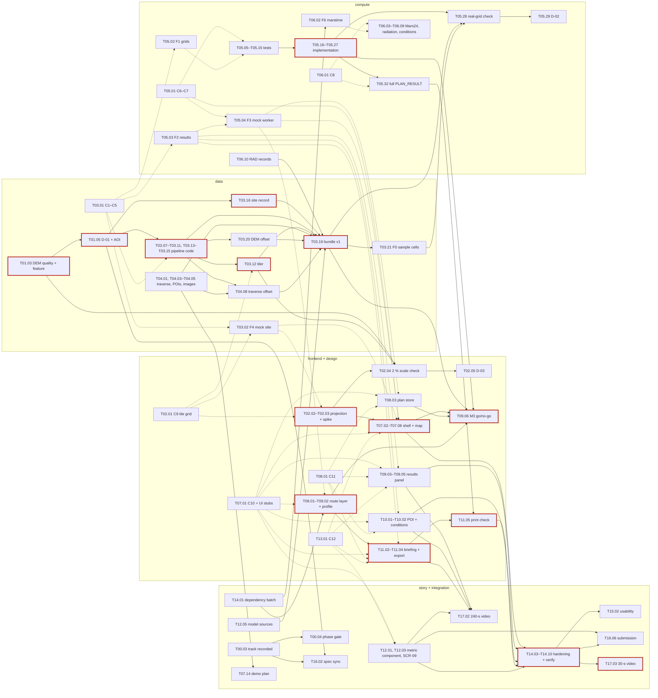

# Coordination map — atomized task plans

| | |
| --- | --- |
| **Owner** | Delivery — mirrors [06](../specs/06_High_Level_Implementation_Plan.md), which owns order, dependencies and cut decisions |
| **Date** | 2026-11-03 |
| **Status** | Approved 2026-11-03 and frozen; amended the same day by one `coord:` change after Phase 2 (3 subtasks added; edges, paths and open points synced with the task files). Change this file first (§h.5) |
| **Related** | [06 §C Work packages](../specs/06_High_Level_Implementation_Plan.md#c-work-packages) · [06 §D Delivery strategy](../specs/06_High_Level_Implementation_Plan.md#d-delivery-strategy) · [Docs index](../README.md) · [CLAUDE.md](../../CLAUDE.md) |

This file lets several people and AI agents work on the 19 work packages of 06 in parallel. It fixes subtask ids (§a), lanes (§b), who writes which file (§c), the interfaces that decouple lanes (§d), the fixtures that remove waiting (§e), the dependency graph (§f), what runs together per milestone (§g) and how branches and PRs work (§h). Task files `TASK-NN_<title>.md` expand each subtask listed here; they never add a subtask, path owner or cross-task dependency that is not in this file.

The specs are the source of truth. Nothing here changes a requirement, id, number or label; gaps found while building this map are in [Open points](#open-points).

## a. Subtask ids

### a.1 Scheme

- Format `T05.03` = TASK-05, subtask 03. Ids are stable once published: new subtasks get the next free number in their task; nothing is ever renumbered or reused.
- A contract subtask is `.01` in its owning task and is **blocking — do first**. One contract subtask may freeze several contract files (§d).
- Titles starting `contract-change:`, `spec-change:` or `follow-up:` mark subtasks that edit a path after its owner has merged (§c.1).

### a.2 Field vocabulary

| Field | Values |
| --- | --- |
| Type | `contract` · `fixture` · `test` · `implement` · `integrate` · `verify` · `human` · `fallback` |
| Tag (who) | `agent-ready` (clear spec and an automated or scripted check) · `human-required` (registration, contacting people, filming, user sessions, choosing the AOI, judging trade-offs, curating content) |
| Tag (cut) | `core` · `cut-2` … `cut-7` (06 §D.4 item that drops it) · `desirable` (= cut-1, TASK-18). Fallbacks are `core`: once triggered they are needed |
| Window | `pre-event-allowed` — data, design, docs, setup (06 §A Track S) · `pre-event-if-permitted` — application code allowed before 13 Nov only under Track P (TASK-02 spike, TASK-05 compute core) · `event-only` — all other application code |
| M | Milestone from [06 §B](../specs/06_High_Level_Implementation_Plan.md#b-milestones), Track S timing. Under Track P, TASK-02 and TASK-05 code moves to M0–M2 |

Window interpretations this map relies on (confirm with the TASK-00 answer; see [Open points](#open-points)):

- Contract subtasks edit only types, JSON Schemas and throwing stubs — the skeleton level `CLAUDE.md` §3 already allows — so they are `pre-event-allowed`.
- Pipeline code (TASK-03, TASK-04) produces "data preprocessing outputs" (06 §A Track S) and sits in M1 (5–10 Nov) on both tracks, so it is `pre-event-allowed` once TASK-00 resolves.
- Fixtures that are pure data (JSON, GeoJSON, tiny PNG/binary arrays from a generator script in `pipeline/`) are `pre-event-allowed`; TypeScript fixtures are code and follow the window of their task.

**Phase gate.** No `test` or `implement` subtask starts before T00.03 records the track (`CLAUDE.md` §3). This gate is global and is not drawn as an edge in §f.

### a.3 Register

The register publishes every id. Requirement ids are the ones the subtask serves; task files add spec section links.

#### TASK-00 — Resolve rules + register

| ID | Subtask | Lane | Type | Tag | Window | M | Reqs |
| --- | --- | --- | --- | --- | --- | --- | --- |
| T00.01 | Check the Space Apps rules page and Participants Guide for the pre-event code rule | story | human | human-required · core | pre-event-allowed | M0 | U-12 |
| T00.02 | Ask the Dhaka Local Lead; confirm every member is registered (NASA site + Bangladesh form) | story | human | human-required · core | pre-event-allowed | M0 | U-12 |
| T00.03 | Record the answer, registration status and Track S or P in `docs/ops/rules.md` | story | human | human-required · core | pre-event-allowed | M0 | U-12 |
| T00.04 | Update the phase-gate line in `CLAUDE.md` and `AGENTS.md` for the recorded track | integration | integrate | agent-ready · core | pre-event-allowed | M0 | U-12 |
| T00.05 | Fallback — start only if no answer by 4 Nov (U-12 due date): declare Track S | story | fallback | human-required · core | pre-event-allowed | M0 | U-12 |
| T00.06 | Record team roster and skills (U-13) and venue type (U-14) | story | human | human-required · core | pre-event-allowed | M0–M2 | U-13, U-14 |

#### TASK-01 — Feasibility: AOI, DEM quality, coverage checks

| ID | Subtask | Lane | Type | Tag | Window | M | Reqs |
| --- | --- | --- | --- | --- | --- | --- | --- |
| T01.01 | Download the 1 m Gale DEM; record its PDS3 label datum and no-data value | data | human | human-required · core | pre-event-allowed | M0 | FR-01–FR-03, U-02 |
| T01.02 | Propose AOI bounds from Curiosity's 2025 traverse, inside the DEM extent | data | human | human-required · core | pre-event-allowed | M0 | FR-01, U-01 |
| T01.03 | Judge DEM quality in the AOI from a hillshade; measure one reference feature | data | human | human-required · core | pre-event-allowed | M0 | FR-01, A-01, U-01, U-10 |
| T01.04 | Check THEMIS TI tile, colour HiRISE COG and CRISM coverage of the AOI by window reads | data | verify | agent-ready · core | pre-event-allowed | M0 | FR-02, FR-18, U-05, U-09 |
| T01.05 | Decide D-01; write the feasibility summary and ADR-001 | data | human | human-required · core | pre-event-allowed | M0 | D-01 |
| T01.06 | Fallback — start only if T01.05 finds the AOI DEM is not HiRISE-quality: spec-change to Jezero and re-plan | data | fallback | human-required · core | pre-event-allowed | M0 | D-01 |

#### TASK-02 — Spike: OpenLayers custom Mars projection + custom tile grid

| ID | Subtask | Lane | Type | Tag | Window | M | Reqs |
| --- | --- | --- | --- | --- | --- | --- | --- |
| T02.01 | Write the tile-grid and tile-encoding contract v1 | frontend | contract | agent-ready · core | pre-event-allowed | M0 | FR-01, FR-02, D-03 |
| T02.02 | Implement the Mars projection module with a web CRS-guard test | frontend | implement | agent-ready · core | pre-event-if-permitted | M0 | FR-01, D-03 |
| T02.03 | Build the spike page: mock-site tiles in the Mars projection with a metric scale bar | frontend | implement | agent-ready · core | pre-event-if-permitted | M0 | FR-01, D-03 |
| T02.04 | Verify the scale bar against a DEM-measured feature within 2 % on real AOI tiles | frontend | verify | human-required · core | pre-event-if-permitted | M1 | FR-01 |
| T02.05 | Record the spike outcome in ADR-003 (D-03) | frontend | human | human-required · core | pre-event-allowed | M1 | D-03 |
| T02.06 | Fallback — start only if the spike fails within 2 h: ImageStatic layer factory in the Mars projection | frontend | fallback | agent-ready · core | pre-event-if-permitted | M0–M1 | FR-01, FR-02, D-03 |

#### TASK-03 — Preprocessing pipeline

| ID | Subtask | Lane | Type | Tag | Window | M | Reqs |
| --- | --- | --- | --- | --- | --- | --- | --- |
| T03.01 | Freeze data contracts v1: 05 entity mirror, grid binary layout, site-config input layout | data | contract | agent-ready · core | pre-event-allowed | M0 | FR-01, FR-03, FR-07, FR-15, NFR-06 |
| T03.02 | Fixture: mock site bundle (manifest, placeholder tiles, tiny grid, sample POI and traverse GeoJSON) | data | fixture | agent-ready · core | pre-event-allowed | M0 | FR-01–FR-04, FR-17 |
| T03.03 | Tests: projection and raster handling (02 §C.1, §C.4) | data | test | agent-ready · core | pre-event-allowed | M1 | FR-01–FR-03 |
| T03.04 | Tests: slope, hillshade, aggregation and hazard flags | data | test | agent-ready · core | pre-event-allowed | M1 | FR-02, FR-07, FR-10 |
| T03.05 | Tests: routing-grid encoding | data | test | agent-ready · core | pre-event-allowed | M1 | FR-03, FR-07 |
| T03.06 | Tests: manifest integrity, sampled values, bundle size | data | test | agent-ready · core | pre-event-allowed | M1 | FR-01, FR-15, NFR-06, NFR-09 |
| T03.07 | Implement config (working projection for the AOI) and source acquisition | data | implement | agent-ready · core | pre-event-allowed | M1 | FR-01–FR-03, NFR-06 |
| T03.08 | Implement clip/reproject and DEM no-data → NaN | data | implement | agent-ready · core | pre-event-allowed | M1 | FR-01–FR-03 |
| T03.09 | Implement Horn slope, hillshade and p90/max aggregation | data | implement | agent-ready · core | pre-event-allowed | M1 | FR-02, FR-07 |
| T03.10 | Implement the hazard-flag bitfield | data | implement | agent-ready · core | pre-event-allowed | M1 | FR-07, FR-10, FR-16 |
| T03.11 | Implement the routing-grid writer (u8 slope encoding, little-endian arrays, TI sidecar) | data | implement | agent-ready · core | pre-event-allowed | M1 | FR-03, FR-07 |
| T03.12 | Implement tile rendering per the tile-grid contract | data | implement | agent-ready · core | pre-event-allowed | M1 | FR-01, FR-02 |
| T03.13 | Implement the manifest writer from site-config records and assets | data | implement | agent-ready · core | pre-event-allowed | M1 | FR-01, FR-15, NFR-06 |
| T03.14 | Implement `validate-manifest` | data | implement | agent-ready · core | pre-event-allowed | M1 | FR-16, NFR-06, NFR-10 |
| T03.15 | Implement the pipeline entry point (`python -m marswalk_pipeline`) | data | implement | agent-ready · core | pre-event-allowed | M1 | FR-01 |
| T03.16 | Write the site record (AOI, default start, data version) | data | human | human-required · core | pre-event-allowed | M1 | FR-01, FR-06 |
| T03.17 | Write DataSource and Layer records for the DEM, ortho and THEMIS layers | data | implement | agent-ready · core | pre-event-allowed | M1 | FR-02, FR-15, NFR-07 |
| T03.18 | Digitise HARD_HAZARD features and LOW_RES_DEM coverage | data | human | human-required · core | pre-event-allowed | M1 | FR-07, FR-10, U-10 |
| T03.19 | Run the pipeline; commit bundle v1 (manifest, vectors, lock file) | data | integrate | human-required · core | pre-event-allowed | M1 | FR-01–FR-03, FR-07, NFR-06, NFR-09 |
| T03.20 | Verify DEM hillshade vs ortho alignment; record the offset | data | verify | human-required · core | pre-event-allowed | M1 | FR-01, FR-17 |
| T03.21 | Fixture: real-grid sample cells from a `rasterio` readout | data | fixture | agent-ready · core | pre-event-allowed | M1 | FR-03 |
| T03.22 | Verify a clean-checkout re-run reproduces checksums; bundle ≤ 250 MB | data | verify | agent-ready · core | pre-event-allowed | M2 | NFR-06, NFR-09 |
| T03.23 | Fallback — start only if tiling is too slow: lower the max zoom | data | fallback | agent-ready · core | pre-event-allowed | M1 | FR-01, NFR-09 |
| T03.24 | Fallback — start only if the 5 m grid is too big or slow: 10 m cells | data | fallback | agent-ready · core | pre-event-allowed | M1 | FR-07, NFR-02 |
| T03.25 | Fallback — start only if T02 spike fails or cut 7 is called: one PNG per 2 m layer for ImageStatic | data | fallback | agent-ready · core | pre-event-allowed | M1 | FR-01, FR-02 |
| T03.26 | Fallback — start only if the colour COG misses the AOI: grayscale 25 cm window or cached Mars Trek HiRISE tiles | data | fallback | human-required · core | pre-event-allowed | M1 | FR-01 |
| T03.27 | Fallback — start only if quantitative TI misses the AOI: THEMIS Day IR 100 m (qualitative) | data | fallback | human-required · core | pre-event-allowed | M1 | FR-02 |

#### TASK-04 — Vectors, POIs and images

| ID | Subtask | Lane | Type | Tag | Window | M | Reqs |
| --- | --- | --- | --- | --- | --- | --- | --- |
| T04.01 | Choose and cache the traverse source (U-04); write its DataSource and Layer records | data | human | human-required · core | pre-event-allowed | M1 | FR-17, U-04 |
| T04.02 | Tests: traverse and POI packaging | data | test | agent-ready · core | pre-event-allowed | M1 | FR-04, FR-17 |
| T04.03 | Implement traverse and POI packaging | data | implement | agent-ready · core | pre-event-allowed | M1 | FR-04, FR-17 |
| T04.04 | Curate POIs 1–4 with images, credits and position sources; write the POI layer record | story | human | human-required · core | pre-event-allowed | M1 | FR-04 |
| T04.05 | Curate POIs 5–8 (at least one, to reach the 5-POI minimum) | story | human | human-required · core | pre-event-allowed | M1 | FR-04 |
| T04.06 | Write the dataset and image credits list | story | human | human-required · core | pre-event-allowed | M1 | FR-04, NFR-07 |
| T04.07 | Resolve U-03: TI "loose fines" threshold from the AOI histogram and literature | data | human | human-required · cut-4 | pre-event-allowed | M1 | FR-10, U-03 |
| T04.08 | Verify traverse alignment with HiRISE tracks at the checkpoints; record the offset | data | verify | human-required · core | pre-event-allowed | M1 | FR-17 |
| T04.09 | Fallback — start only if PLACES parsing is too slow: MMGIS JSON cached once, labelled unofficial | data | fallback | human-required · core | pre-event-allowed | M1 | FR-17 |

#### TASK-05 — Compute core

| ID | Subtask | Lane | Type | Tag | Window | M | Reqs |
| --- | --- | --- | --- | --- | --- | --- | --- |
| T05.01 | Freeze compute contracts v1: worker protocol and compute module layout | compute | contract | agent-ready · core | pre-event-allowed | M0 | FR-03, FR-06, FR-07, NFR-06 |
| T05.02 | Fixture: synthetic routing grids | compute | fixture | agent-ready · core | pre-event-if-permitted | M0 | FR-07 |
| T05.03 | Fixture: canned PLAN_RESULT messages (OK, PARTIAL, OVER_LIMITS) | compute | fixture | agent-ready · core | pre-event-allowed | M0 | FR-07–FR-12 |
| T05.04 | Fixture: mock worker answering from the canned fixtures | compute | fixture | agent-ready · core | pre-event-if-permitted | M0 | FR-03, FR-07 |
| T05.05 | Tests: grid loader and addressing | compute | test | agent-ready · core | pre-event-if-permitted | M3 | FR-03, FR-07 |
| T05.06 | Tests: point and profile sampling | compute | test | agent-ready · core | pre-event-if-permitted | M3 | FR-03, FR-08 |
| T05.07 | Tests: A* core (gap, re-sample, determinism, TIMEOUT) | compute | test | agent-ready · cut-6 | pre-event-if-permitted | M3 | FR-07, NFR-06 |
| T05.08 | Tests: no-route reasons and nearest reachable cell | compute | test | agent-ready · cut-6 | pre-event-if-permitted | M4 | FR-07 |
| T05.09 | Tests: snapping | compute | test | agent-ready · core | pre-event-if-permitted | M4 | FR-06 |
| T05.10 | Tests: leg assembly (metrics, simplification, profile) | compute | test | agent-ready · core | pre-event-if-permitted | M3 | FR-07, FR-08 |
| T05.11 | Tests: walking-time model | compute | test | agent-ready · core | pre-event-if-permitted | M3 | FR-09 |
| T05.12 | Tests: walkback | compute | test | agent-ready · core | pre-event-if-permitted | M4 | FR-09 |
| T05.13 | Tests: warnings and plan status | compute | test | agent-ready · core | pre-event-if-permitted | M4 | FR-10, FR-16 |
| T05.14 | Tests: input validation (02 §E.3) | compute | test | agent-ready · core | pre-event-if-permitted | M4 | FR-05 |
| T05.15 | Tests: worker handler and cancellation | compute | test | agent-ready · core | pre-event-if-permitted | M3 | FR-07, NFR-02, NFR-06, NFR-10 |
| T05.16 | Implement the grid loader | compute | implement | agent-ready · core | pre-event-if-permitted | M3 | FR-03, FR-07 |
| T05.17 | Implement point and profile sampling | compute | implement | agent-ready · core | pre-event-if-permitted | M3 | FR-03, FR-08 |
| T05.18 | Implement the A* least-time search | compute | implement | agent-ready · cut-6 | pre-event-if-permitted | M3 | FR-07, NFR-02, NFR-06 |
| T05.19 | Implement no-route reasons and nearest reachable cell | compute | implement | agent-ready · cut-6 | pre-event-if-permitted | M4 | FR-07 |
| T05.20 | Implement snapping | compute | implement | agent-ready · core | pre-event-if-permitted | M4 | FR-06 |
| T05.21 | Implement leg assembly | compute | implement | agent-ready · core | pre-event-if-permitted | M3 | FR-07, FR-08 |
| T05.22 | Implement the walking-time model | compute | implement | agent-ready · core | pre-event-if-permitted | M3 | FR-09 |
| T05.23 | Implement walkback | compute | implement | agent-ready · core | pre-event-if-permitted | M4 | FR-09 |
| T05.24 | Implement warnings and plan status | compute | implement | agent-ready · core | pre-event-if-permitted | M4 | FR-10, FR-16 |
| T05.25 | Implement input validation | compute | implement | agent-ready · core | pre-event-if-permitted | M4 | FR-05 |
| T05.26 | Implement the worker handler, minimum slice: SAMPLE_POINT and legs-only PLAN_RESULT | compute | implement | agent-ready · core | pre-event-if-permitted | M3 | FR-03, FR-07, FR-08 |
| T05.27 | Implement the worker entry: grid initialisation, latest-revision cancellation | compute | implement | agent-ready · core | pre-event-if-permitted | M3 | NFR-02, NFR-10 |
| T05.28 | Verify on the real grid: 10 sampled cells; 20 pairs p50/p95; 3-stop loop ≤ 2 s | compute | verify | agent-ready · core | pre-event-if-permitted | M4 | FR-03, FR-07, NFR-02 |
| T05.29 | Record D-02 from the benchmark in ADR-002 | compute | human | human-required · core | pre-event-allowed | M4 | D-02 |
| T05.30 | Fallback — start only if T09.06 says no-go: manual polyline validation (compute side) | compute | fallback | agent-ready · core | pre-event-if-permitted | M3 | FR-07, FR-08, FR-10 |
| T05.31 | Fallback — start only if T05.29 records p95 > 2 s: FastAPI `/route` with a scikit-image least-cost path | compute | fallback | agent-ready · core | pre-event-if-permitted | M4 | FR-07, NFR-02 |
| T05.32 | follow-up: complete PLAN_RESULT assembly (totals, timeline, warnings, status, conditions) | compute | implement | agent-ready · core | pre-event-if-permitted | M4 | FR-07–FR-12 |

#### TASK-06 — Mars24 solar functions + radiation estimate

| ID | Subtask | Lane | Type | Tag | Window | M | Reqs |
| --- | --- | --- | --- | --- | --- | --- | --- |
| T06.01 | Freeze the conditions interface; move the solar functions to `sun.ts` | compute | contract | agent-ready · core | pre-event-allowed | M0 | FR-11, FR-12 |
| T06.02 | Fixture: Mars24 reference values generated with `marstime` | compute | fixture | agent-ready · core | pre-event-allowed | M1 | FR-11 |
| T06.03 | Tests: Mars24 time and sun functions vs `marstime` | compute | test | agent-ready · cut-5 | event-only | M4 | FR-11 |
| T06.04 | Tests: radiation estimate | compute | test | agent-ready · core | event-only | M4 | FR-12 |
| T06.05 | Tests: conditions assembly | compute | test | agent-ready · core | event-only | M4 | FR-10, FR-11, FR-12 |
| T06.06 | Implement the Mars24 time functions (MSD, L_s, LTST, east → west longitude) | compute | implement | agent-ready · cut-5 | event-only | M4 | FR-11 |
| T06.07 | Implement solar position and flat-horizon sunrise/sunset | compute | implement | agent-ready · cut-5 | event-only | M4 | FR-11 |
| T06.08 | Implement the radiation estimate | compute | implement | agent-ready · core | event-only | M4 | FR-12 |
| T06.09 | Implement conditions assembly (timeline LTST, sun elevation, radiation) | compute | implement | agent-ready · core | event-only | M4 | FR-10, FR-11, FR-12 |
| T06.10 | Write the RAD EnvConstant and DataSource records (05 §C values verbatim) | compute | implement | agent-ready · core | pre-event-allowed | M1 | FR-12, FR-15 |
| T06.11 | Fallback — start only if Mars24 tests fail or cut 5 is called: precomputed sun table for the demo dates | compute | fallback | agent-ready · core | event-only | M4 | FR-11 |

#### TASK-07 — App shell + map workspace + layers panel + inspector

| ID | Subtask | Lane | Type | Tag | Window | M | Reqs |
| --- | --- | --- | --- | --- | --- | --- | --- |
| T07.01 | Freeze UI contracts v1: app context, screen interface, map handle, layer order, provenance attributes; create UI module stubs | frontend | contract | agent-ready · core | pre-event-allowed | M2 | FR-01–FR-03, FR-15, FR-17, NFR-05 |
| T07.02 | Implement site loading (manifest fetch, `?site=` override, lookup maps) | frontend | implement | agent-ready · core | event-only | M3 | FR-01, FR-16 |
| T07.03 | Implement the app shell: hash router, boot sequence, CSP meta tag | frontend | implement | agent-ready · core | event-only | M3 | FR-01, FR-16, NFR-01, NFR-08 |
| T07.04 | Implement the worker client (request ids, latest revision, crash → retry) | frontend | implement | agent-ready · core | event-only | M3 | FR-03, FR-07, NFR-10 |
| T07.05 | Implement SCR-01 Mission Briefing | frontend | implement | agent-ready · core | event-only | M3 | FR-01, FR-15, SCR-01 |
| T07.06 | Implement the map: view, metric scale bar, north arrow, coordinate readout | frontend | implement | agent-ready · core | event-only | M3 | FR-01, SCR-02 |
| T07.07 | Implement tiled raster layers with slope classes that follow the current limits | frontend | implement | agent-ready · cut-7 | event-only | M3 | FR-01, FR-02 |
| T07.08 | Implement the SCR-02 workspace layout (top bar, drawers, toolbar, responsive) | frontend | implement | agent-ready · core | event-only | M3 | FR-01, FR-16, NFR-03, SCR-02 |
| T07.09 | Implement SCR-03 Layers panel | frontend | implement | agent-ready · core | event-only | M4 | FR-02, FR-15, FR-16, FR-17, SCR-03 |
| T07.10 | Implement the Curiosity traverse layer | frontend | implement | agent-ready · core | event-only | M4 | FR-17 |
| T07.11 | Implement the POI layer and POI selection | frontend | implement | agent-ready · core | event-only | M4 | FR-04 |
| T07.12 | Implement the point-inspector popover | frontend | implement | agent-ready · core | event-only | M4 | FR-03 |
| T07.13 | Implement `?debug=1` diagnostics | frontend | implement | agent-ready · core | event-only | M4 | NFR-11 |
| T07.14 | Author the demo plan (three POI stops) | story | human | human-required · core | pre-event-allowed | M2 | FR-06, SCR-01 |
| T07.15 | Verify SCR-01, SCR-02, SCR-03: toggles ≤ 300 ms, inspector values match the grid | frontend | verify | human-required · core | event-only | M4 | FR-02, FR-03, SCR-01, SCR-02, SCR-03 |
| T07.16 | Fallback — start only if projection issues persist or cut 7 is called: ImageStatic layers | frontend | fallback | agent-ready · core | event-only | M3 | FR-01, FR-02 |

#### TASK-08 — Plan panel + waypoint editing

| ID | Subtask | Lane | Type | Tag | Window | M | Reqs |
| --- | --- | --- | --- | --- | --- | --- | --- |
| T08.01 | Freeze the plan-store contract v1 (state, status, actions, selection) | frontend | contract | agent-ready · core | pre-event-allowed | M2 | FR-05, FR-06 |
| T08.02 | Tests: plan store (revisions, undo, debounce, stale results) | frontend | test | agent-ready · core | event-only | M3 | FR-05, FR-06 |
| T08.03 | Implement the plan store | frontend | implement | agent-ready · core | event-only | M3 | FR-05, FR-06 |
| T08.04 | Implement the SCR-04 panel and mission-inputs form | frontend | implement | agent-ready · core | event-only | M4 | FR-05, SCR-04 |
| T08.05 | Implement the stops list (reorder buttons, delete, undo) | frontend | implement | agent-ready · core | event-only | M4 | FR-06, FR-09, SCR-04 |
| T08.06 | Implement waypoint markers and placement validation with a snap offer | frontend | implement | agent-ready · core | event-only | M3 | FR-06 |
| T08.07 | Implement Add-stop mode (free placement, `A`, crosshair `Enter`) | frontend | implement | agent-ready · cut-3 | event-only | M3 | FR-06, NFR-04 |
| T08.08 | Implement desktop drag: waypoints on the map, rows in the stops list | frontend | implement | agent-ready · core | event-only | M4 | FR-06 |
| T08.09 | Implement tablet touch: long-press placement and drag | frontend | implement | agent-ready · cut-2 | event-only | M4 | FR-06, NFR-03 |
| T08.10 | Fallback — start only if T08.08 is not working at the Day 1 17:30 checkpoint: buttons-only stop move | frontend | fallback | agent-ready · core | event-only | M4 | FR-06 |
| T08.11 | Verify the 02 §E.3 rules and SCR-04 states in the UI | frontend | verify | human-required · core | event-only | M4 | FR-05, FR-06, SCR-04 |

#### TASK-09 — Results panel + profile

| ID | Subtask | Lane | Type | Tag | Window | M | Reqs |
| --- | --- | --- | --- | --- | --- | --- | --- |
| T09.01 | Implement the route layer (cased legs, dashed NO_ROUTE line, hazard hatch) | frontend | implement | agent-ready · core | event-only | M3 | FR-07, FR-10 |
| T09.02 | Implement the elevation/slope profile chart | frontend | implement | agent-ready · core | event-only | M3 | FR-08 |
| T09.03 | Implement SCR-05: status banner and metrics row | frontend | implement | agent-ready · core | event-only | M4 | FR-07, FR-09, FR-12, SCR-05 |
| T09.04 | Implement the warnings list with click-to-zoom | frontend | implement | agent-ready · core | event-only | M4 | FR-10 |
| T09.05 | Implement profile ↔ map linking (06 fallback: ship the profile without it) | frontend | implement | agent-ready · core | event-only | M4 | FR-08 |
| T09.06 | Run the M3 walking-skeleton check; decide auto-routing go/no-go in ADR-004 | integration | integrate | human-required · core | event-only | M3 | FR-07, FR-08, D-04 |
| T09.07 | Verify SCR-05 states against the OK, PARTIAL and OVER_LIMITS fixtures | frontend | verify | human-required · core | event-only | M4 | FR-07–FR-10, SCR-05 |
| T09.08 | Fallback — start only if T09.06 says no-go: draw legs by hand on the map | frontend | fallback | agent-ready · core | event-only | M3 | FR-07 |

#### TASK-10 — POI detail + Conditions panel

| ID | Subtask | Lane | Type | Tag | Window | M | Reqs |
| --- | --- | --- | --- | --- | --- | --- | --- |
| T10.01 | Implement SCR-06 POI Detail | frontend | implement | agent-ready · core | event-only | M4 | FR-04, SCR-06 |
| T10.02 | Implement SCR-07 Conditions | frontend | implement | agent-ready · core | event-only | M4 | FR-11, FR-12, FR-13, SCR-07 |
| T10.03 | Verify POI images with credits and the daylight warning for a pre-dawn start | frontend | verify | human-required · core | event-only | M4 | FR-04, FR-11, FR-12, SCR-06, SCR-07 |

#### TASK-11 — Briefing card + JSON export

| ID | Subtask | Lane | Type | Tag | Window | M | Reqs |
| --- | --- | --- | --- | --- | --- | --- | --- |
| T11.01 | Tests: plan hash and export (canonical JSON, schema-valid, reproducible) | frontend | test | agent-ready · core | event-only | M4 | FR-14, NFR-06 |
| T11.02 | Implement the plan hash and PlanExport assembly | frontend | implement | agent-ready · core | event-only | M4 | FR-14, NFR-06 |
| T11.03 | Implement the SCR-08 layout and print CSS | design | implement | agent-ready · core | event-only | M4 | FR-14, FR-15, SCR-08 |
| T11.04 | Implement the route map snapshot | frontend | implement | agent-ready · core | event-only | M4 | FR-14 |
| T11.05 | Verify one-page print in Chrome and plan_hash reproduction | design | verify | human-required · core | event-only | M4 | FR-14, SCR-08 |
| T11.06 | Fallback — start only if the map snapshot cannot be made to work: static AOI thumbnail with the route as SVG | frontend | fallback | agent-ready · core | event-only | M4 | FR-14 |

#### TASK-12 — Sources & Methods + provenance attributes

| ID | Subtask | Lane | Type | Tag | Window | M | Reqs |
| --- | --- | --- | --- | --- | --- | --- | --- |
| T12.01 | Implement the metric and provenance-chip component | story | implement | agent-ready · core | event-only | M3 | FR-15, NFR-05 |
| T12.02 | Tests: DOM provenance check across screens | story | test | agent-ready · core | event-only | M4 | FR-15, NFR-05 |
| T12.03 | Implement SCR-09 Sources & Methods | story | implement | agent-ready · core | event-only | M4 | FR-15, SCR-09 |
| T12.04 | Write the methods, models and limitations content from 02 §C–§D | story | implement | agent-ready · core | pre-event-allowed | M2 | FR-15 |
| T12.05 | Write DataSource records for the models (Tobler, Apollo 17, Mars24) | story | implement | agent-ready · core | pre-event-allowed | M1 | FR-15, NFR-07 |
| T12.06 | Verify no unlabelled metric on the demo path and every credited source in SCR-09 | story | verify | agent-ready · core | event-only | M5 | FR-15, NFR-05, SCR-09 |

#### TASK-13 — Visual system + accessibility

| ID | Subtask | Lane | Type | Tag | Window | M | Reqs |
| --- | --- | --- | --- | --- | --- | --- | --- |
| T13.01 | Freeze CSS token and status-class names v1 against 04 §C | design | contract | agent-ready · core | pre-event-allowed | M2 | NFR-04 |
| T13.02 | Self-host Inter and IBM Plex Mono; verify their licences | design | implement | agent-ready · core | pre-event-allowed | M2 | NFR-01, NFR-07 |
| T13.03 | Sketch SCR-02 and SCR-08 wireframes on paper (04 §F) | design | human | human-required · core | pre-event-allowed | M2 | SCR-02, SCR-08 |
| T13.04 | Implement base styles: typography, focus ring, reduced motion | design | implement | agent-ready · core | event-only | M5 | NFR-04 |
| T13.05 | Implement status icons and patterns | design | implement | agent-ready · core | event-only | M4 | NFR-04, FR-08, FR-10 |
| T13.06 | Implement keyboard map controls (04 §E) | design | implement | agent-ready · core | event-only | M5 | NFR-04 |
| T13.07 | follow-up: first-run coach marks | design | implement | agent-ready · cut-2 | event-only | M5 | — |
| T13.08 | Implement the light theme (U-08) | design | implement | agent-ready · cut-2 | event-only | M5 | NFR-04, U-08 |
| T13.09 | Verify the axe scan: 0 serious issues | design | verify | agent-ready · core | event-only | M5 | NFR-04 |
| T13.10 | Verify a keyboard-only run of the core scenario | design | verify | human-required · core | event-only | M5 | NFR-04 |
| T13.11 | Self-host the outline icon set and verify its licence | design | implement | agent-ready · core | pre-event-allowed | M2 | NFR-01, NFR-07 |

#### TASK-14 — Integration + offline hardening + fault tests

| ID | Subtask | Lane | Type | Tag | Window | M | Reqs |
| --- | --- | --- | --- | --- | --- | --- | --- |
| T14.01 | Integrate dependencies and build wiring (one dependency batch, `make data`) | integration | integrate | agent-ready · core | pre-event-allowed | M2 | NFR-01, NFR-07, NFR-09 |
| T14.02 | Integrate CI and the PR template (subtask id, `check_tasks.py`) | integration | integrate | agent-ready · core | pre-event-allowed | M2 | — |
| T14.03 | Implement boot validation (schema major version, dev-build SHA-256) | integration | implement | agent-ready · core | event-only | M5 | FR-16, NFR-10 |
| T14.04 | Implement SCR-00 Boot error | integration | implement | agent-ready · core | event-only | M5 | FR-16, NFR-10, SCR-00 |
| T14.05 | Tests: fault injection (02 §F.1 Recovery) | integration | test | agent-ready · core | event-only | M5 | FR-16, NFR-10 |
| T14.06 | Verify two clean offline rehearsals of the core scenario | integration | verify | human-required · core | event-only | M5 | FR-16, NFR-01 |
| T14.07 | Verify NFR-02 timings on the weakest team laptop | integration | verify | human-required · core | event-only | M5 | NFR-02 |
| T14.08 | Verify the browser/device matrix and cross-browser determinism | integration | verify | human-required · core | event-only | M5 | NFR-03, NFR-06 |
| T14.09 | Verify release checks: CSP, network log, bundle sizes, `?debug=1` | integration | verify | agent-ready · core | event-only | M5 | NFR-08, NFR-09, NFR-11 |
| T14.10 | Verify SCR-00 and worker-crash recovery by hand | integration | verify | human-required · core | event-only | M5 | NFR-10, SCR-00 |
| T14.11 | follow-up: refresh the `CLAUDE.md` command rows after the pipeline entry point lands | integration | integrate | agent-ready · core | pre-event-allowed | M2 | — |

#### TASK-15 — Usability test

| ID | Subtask | Lane | Type | Tag | Window | M | Reqs |
| --- | --- | --- | --- | --- | --- | --- | --- |
| T15.01 | Write the usability-test script (3 non-team users, briefing in ≤ 5 min) | design | human | human-required · core | pre-event-allowed | M2 | PRD §B |
| T15.02 | Run three sessions; record times and issues | design | verify | human-required · core | event-only | M5 | PRD §B |
| T15.03 | Triage the findings into follow-up subtasks | design | human | human-required · core | event-only | M5 | PRD §B |

#### TASK-16 — Submission package

| ID | Subtask | Lane | Type | Tag | Window | M | Reqs |
| --- | --- | --- | --- | --- | --- | --- | --- |
| T16.01 | Decide the final product name (D-08); record ADR-008 | story | human | human-required · core | pre-event-allowed | M2 | D-08 |
| T16.02 | spec-change: sync spec status rows and the docs index with the M0–M1 outcomes | integration | integrate | agent-ready · core | pre-event-allowed | M2 | D-01, D-03, U-01–U-05, U-09, U-10, U-12–U-14 |
| T16.03 | Finalize the README: run instructions, data credits, licence | story | implement | agent-ready · core | pre-event-allowed | M6 | NFR-07 |
| T16.04 | Complete the AI-use disclosure | story | human | human-required · core | pre-event-allowed | M6 | — |
| T16.05 | Verify every dataset and image is credited in SCR-09 and the README | story | verify | agent-ready · core | pre-event-allowed | M6 | FR-15, NFR-07 |
| T16.06 | Fill the NASA project page fields; complete the submission checklist | story | human | human-required · core | event-only | M6 | NFR-07 |
| T16.07 | Decide site-bundle hosting and the public link; test the link in a private window | story | human | human-required · core | pre-event-allowed | M2–M6 | NFR-07 |

#### TASK-17 — Videos

| ID | Subtask | Lane | Type | Tag | Window | M | Reqs |
| --- | --- | --- | --- | --- | --- | --- | --- |
| T17.01 | Draft the 240-s and 30-s demo scripts | story | human | human-required · core | pre-event-allowed | M2 | — |
| T17.02 | Record and submit the 240-s video by Day 1 18:30 (dry-run capture first) | story | human | human-required · core | event-only | M4 | — |
| T17.03 | Record and upload the 30-s video by Day 2 09:00 | story | human | human-required · core | event-only | M6 | — |
| T17.04 | Fallback — start only if the live demo fails on camera: cut the 240-s video from the dry-run capture | story | fallback | human-required · core | event-only | M4 | — |

#### TASK-18 — Desirables (only after the freeze criteria are met early)

| ID | Subtask | Lane | Type | Tag | Window | M | Reqs |
| --- | --- | --- | --- | --- | --- | --- | --- |
| T18.01 | follow-up: CRISM layer and bundle re-release (only if T01.04 finds MTRDR coverage) | data | implement | agent-ready · desirable | event-only | M5–M6 | FR-18 |
| T18.02 | Build REMS L_s-bin temperature and pressure context from named RDR files | data | implement | agent-ready · desirable | event-only | M5–M6 | FR-13 |
| T18.03 | follow-up: seasonal-weather section in SCR-07 | frontend | implement | agent-ready · desirable | event-only | M5–M6 | FR-13, SCR-07 |
| T18.04 | Tests: illustrative O₂ estimate (02 §D.6) | compute | test | agent-ready · desirable | event-only | M5–M6 | FR-19 |
| T18.05 | Implement the illustrative O₂ estimate | compute | implement | agent-ready · desirable | event-only | M5–M6 | FR-19 |
| T18.06 | follow-up: show the O₂ estimate labelled "illustrative" | frontend | implement | agent-ready · desirable | event-only | M5–M6 | FR-19 |
| T18.07 | follow-up: save and restore the last plan in browser storage | frontend | implement | agent-ready · desirable | event-only | M5–M6 | FR-20 |
| T18.08 | Cache the CRISM and REMS source files before 13 Nov | data | human | human-required · desirable | pre-event-allowed | M1–M2 | FR-13, FR-18 |

FR-21 (space weather, 3D view, multi-site, AI narration) is post-MVP and has no subtask ([01 §C.3](../specs/01_Product_Requirements_Document.md#c3-post-mvp)).

## b. Lanes

Role names from [06 §A](../specs/06_High_Level_Implementation_Plan.md#a-planning-assumptions). The role owns the lane: it reviews and merges the lane's PRs, whoever (person or agent) does the work.

| Lane | Owner role | Scope |
| --- | --- | --- |
| `data` | Data/GIS lead | TASK-01, TASK-03, data side of TASK-04 and TASK-18; site-config records |
| `compute` | Compute engineer | TASK-05, TASK-06, compute side of TASK-18 |
| `frontend` | Frontend engineer | TASK-02, TASK-07–TASK-11 screens and map modules |
| `design` | Design & story lead | TASK-13, TASK-15, SCR-08 layout and print |
| `story` | Design & story lead | TASK-00, TASK-12, TASK-16, TASK-17, POI curation, demo plan |
| `integration` | Compute engineer (06 §C names Compute as TASK-14 owner) | Shared files, dependency batch, CI, walking-skeleton check, spec sync, offline hardening |

06 §C names "Story lead" and "Design lead" separately; 06 §A has one "Design & story lead", so both lanes map to that role. Each person's names go in `docs/ops/team.md` (T00.06).

## c. Path ownership

### c.1 Rules

1. **One owner per path.** The owner is the only subtask that writes the path's content. A row ending in `/` covers every file inside unless a more specific row exists.
2. **Stubs.** A contract subtask may create a throwing stub, or change a stub signature, in a path owned by someone else. It writes `path (stub → Txx.yy)` in its *Owns* field; the owner soft-depends on it and takes over after it merges.
3. **Writers after the owner.** Only a `fallback` subtask (`path (replaces Txx.yy)`) or a subtask titled `contract-change:`, `spec-change:` or `follow-up:` (`path (after Txx.yy)`, with a hard dependency on that owner) may write an owned path later. Never two at once.
4. **Append-only paths** follow the rule in their row: add lines or files only at the stated place; never edit, reorder or delete other subtasks' content. On a rebase conflict keep both sides.
5. **Unlisted paths are read-only** for this plan. Writing one needs a new subtask and an edit to this table first (§h).
6. Every subtask also appends one row to the `docs/AI_USE.md` log when AI helped (row c.6).
7. A module owns its sibling stylesheet with the same base name (`metric.ts` → `metric.css`), as the screens do; no separate row is needed.

### c.2 Docs

| Path | Owner | Rule |
| --- | --- | --- |
| `docs/tasks/_coordination.md`, `docs/tasks/TASK-*.md` | this plan | Change-process only (§h); T15.03 and later triage may append subtasks at the end of a task file |
| `docs/tasks/README.md` | this plan | Claims: one PR edits only the *Claimed by* cell of one row |
| `docs/specs/**` | — | `spec-change:` subtasks only: T16.02, T01.06 (fallback). One open spec-change PR at a time |
| `docs/README.md` | T16.02 | — |
| `docs/contracts/tile-grid.md` | T02.01 | Contract (§d) |
| `docs/ops/rules.md` | T00.03 | — |
| `docs/ops/team.md` | T00.06 | — |
| `docs/ops/feasibility.md` | T01.05 | — |
| `docs/ops/feasibility/dem-label.md` | T01.01 | — |
| `docs/ops/feasibility/aoi.md` | T01.02 | — |
| `docs/ops/feasibility/dem-quality.md` | T01.03 | — |
| `docs/ops/feasibility/coverage.md` | T01.04 | — |
| `docs/ops/credits.md` | T04.06 | — |
| `docs/ops/ti-threshold.md` | T04.07 | — |
| `docs/ops/usability-script.md` | T15.01 | — |
| `docs/ops/demo-script.md` | T17.01 | — |
| `docs/ops/submission-checklist.md` | T16.06 | — |
| `docs/ops/hosting.md` | T16.07 | — |
| `docs/ops/verification-log.md` | every `verify` subtask | Append-only: one `## Txx.yy — <title>` section per verify subtask, at the end; video links from T17.02/T17.03 go here too |
| `docs/decisions/ADR-001-site-selection.md` | T01.05 | — |
| `docs/decisions/ADR-002-static-app-no-backend.md` | T05.29 | — |
| `docs/decisions/ADR-003-openlayers-mars-projection.md` | T02.05 | — |
| `docs/decisions/ADR-004-least-time-routing.md` | T09.06 | — |
| `docs/decisions/ADR-008-product-name.md` | T16.01 | New; mirrors D-08 |
| `docs/design/wireframes/` | T13.03 | — |
| `docs/AI_USE.md` | T16.04 (header, Tools, Prompts location) | Log table append-only for every subtask: one row per PR, at the end |
| `README.md` | T16.03 | — |
| `CLAUDE.md`, `AGENTS.md` | T00.04 | T14.11 follows up on the `CLAUDE.md` §4 command rows |

### c.3 Pipeline

| Path | Owner | Rule |
| --- | --- | --- |
| `pipeline/sites/README.md` | T03.01 | Contract (§d, C5) |
| `pipeline/sites/gale_boxwork/site.json` | T03.16 | — |
| `pipeline/sites/gale_boxwork/sources/` | T03.17 (DEM, ortho, THEMIS), T04.01 (traverse), T06.10 (RAD), T12.05 (models), T18.01 (CRISM), T18.02 (REMS) | Append-only by file: one `<source_id>.json` per record, owned by its creator |
| `pipeline/sites/gale_boxwork/layers/` | T03.17 (ortho, hillshade, elevation, slope, thermal inertia, hazard flags), T04.01 (traverse), T04.04 (POIs), T18.01 (CRISM) | Append-only by file: one `<layer_id>.json` per record |
| `pipeline/sites/gale_boxwork/env_constants/` | T06.10 | Append-only by file |
| `pipeline/sites/gale_boxwork/known_offsets/` | T03.20 (`elevation.json`), T04.08 (`traverse.json`) | Append-only by file |
| `pipeline/sites/gale_boxwork/pois/` | T04.04 (POIs 1–4), T04.05 (POIs 5–8) | Append-only by file: one `<poi_id>.json` per POI |
| `pipeline/sites/gale_boxwork/hazards.geojson`, `pipeline/sites/gale_boxwork/low_res_dem.geojson` | T03.18 | — |
| `pipeline/sites/gale_boxwork/ti_threshold.json` | T04.07 | — |
| `pipeline/src/marswalk_pipeline/config.py`, `acquire.py` | T03.07 | — |
| `pipeline/src/marswalk_pipeline/clip_reproject.py` | T03.08 | — |
| `pipeline/src/marswalk_pipeline/derive.py` | T03.09 | T03.01 moves the `hazard_flags` stub out (stub → T03.10) |
| `pipeline/src/marswalk_pipeline/flags.py` | T03.10 | New; stub by T03.01 |
| `pipeline/src/marswalk_pipeline/grid.py` | T03.11 | — |
| `pipeline/src/marswalk_pipeline/tiles.py` | T03.12 | — |
| `pipeline/src/marswalk_pipeline/manifest.py` | T03.13 | — |
| `pipeline/src/marswalk_pipeline/validate_manifest.py` | T03.14 | — |
| `pipeline/src/marswalk_pipeline/__main__.py` | T03.15 | New |
| `pipeline/src/marswalk_pipeline/vectors.py` | T04.03 | — |
| `pipeline/src/marswalk_pipeline/static_images.py` | T03.25 | New; fallback |
| `pipeline/src/marswalk_pipeline/sun_table.py` | T06.11 | New; fallback |
| `pipeline/src/marswalk_pipeline/crism.py` | T18.01 | New; desirable |
| `pipeline/src/marswalk_pipeline/rems.py` | T18.02 | New; desirable |
| `pipeline/src/marswalk_pipeline/__init__.py` | — | Read-only |
| `pipeline/tests/test_clip_reproject.py` | T03.03 | — |
| `pipeline/tests/test_derive.py` | T03.04 | Covers `derive.py` and `flags.py` |
| `pipeline/tests/test_grid.py` | T03.05 | — |
| `pipeline/tests/test_manifest.py` | T03.06 | — |
| `pipeline/tests/test_vectors.py` | T04.02 | New |
| `pipeline/tests/fixtures/make_mock_site.py` | T03.02 | New |
| `pipeline/tests/fixtures/make_sample_cells.py` | T03.21 | New |
| `pipeline/tests/fixtures/make_mars24_reference.py` | T06.02 | New |
| `pipeline/sources.lock.json` | T03.19 | Written by the pipeline run |
| `pipeline/work/` | — | Git-ignored local workspace; never committed |
| `server/` | T05.31 | New; fallback only |

### c.4 Web app

| Path | Owner | Rule |
| --- | --- | --- |
| `web/src/types/schema.ts` | T03.01 | Contract (§d, C1) |
| `web/src/compute/protocol.ts` | T05.01 | Contract (§d, C6) |
| `web/src/compute/grid.ts` | T05.16 | — |
| `web/src/compute/sampling.ts` | T05.17 | Stub edit by T05.01 (inputs for lat/lon) |
| `web/src/compute/route.ts` | T05.18 | T05.01 moves `snapToPassable` and `toLeg` out (stub → T05.18) |
| `web/src/compute/noRoute.ts` | T05.19 | New; stub by T05.01 |
| `web/src/compute/snap.ts` | T05.20 | New; stub by T05.01 |
| `web/src/compute/leg.ts` | T05.21 | New; stub by T05.01 |
| `web/src/compute/timeModel.ts` | T05.22 | — |
| `web/src/compute/walkback.ts` | T05.23 | — |
| `web/src/compute/warnings.ts` | T05.24 | Stub edit by T05.01 (access to grid flags) |
| `web/src/compute/validate.ts` | T05.25 | New; stub by T05.01; also imported by the UI (T08.04) |
| `web/src/compute/handler.ts` | T05.26 | New; stub by T05.01 (moves `handleMessage` out of `worker.ts`); T05.32 completes it (after T05.26) |
| `web/src/compute/worker.ts` | T05.27 | Stub edit by T05.01 |
| `web/src/compute/manualLeg.ts` | T05.30 | New; fallback |
| `web/src/compute/sunTable.json` | T06.11 | New; fallback (cut 5) |
| `web/src/compute/mars24.ts` | T06.06 | T06.01 moves the solar functions out (stub → T06.06) |
| `web/src/compute/sun.ts` | T06.07 | New; stub by T06.01 |
| `web/src/compute/radiation.ts` | T06.08 | — |
| `web/src/compute/conditions.ts` | T06.09 | New; stub by T06.01 (contract C8); T06.11 may replace it |
| `web/src/compute/consumables.ts` | T18.05 | New; desirable |
| `web/src/state/planStore.ts` | T08.03 | Interfaces frozen by T08.01 (stub → T08.03, contract C11); T18.07 follows up |
| `web/src/state/persist.ts` | T18.07 | New; desirable |
| `web/src/ui/context.ts` | T07.01 | New; contract C10 |
| `web/src/boot/loadSite.ts` | T07.02 | New; stub by T07.01 |
| `web/src/boot/validateSite.ts` | T14.03 | New; stub by T07.01 |
| `web/src/ui/router.ts`, `web/src/main.ts`, `web/index.html` | T07.03 | Route registry: all four hash routes registered by T07.03; screens never edit it |
| `web/src/ui/workerClient.ts` | T07.04 | New; stub by T07.01 |
| `web/src/ui/debug.ts` | T07.13 | New; stub by T07.01 |
| `web/src/ui/demoPlan.json` | T07.14 | New |
| `web/src/ui/screens/scr00BootError.ts` (+ `.css`) | T14.04 | — |
| `web/src/ui/screens/scr01MissionBriefing.ts` (+ `.css`) | T07.05 | — |
| `web/src/ui/screens/scr02MapWorkspace.ts` (+ `.css`) | T07.08 | T13.07 follows up (coach marks) |
| `web/src/ui/screens/scr03LayersPanel.ts` (+ `.css`) | T07.09 | — |
| `web/src/ui/screens/scr04PlanPanel.ts` (+ `.css`) | T08.04 | — |
| `web/src/ui/screens/scr05RouteResults.ts` (+ `.css`) | T09.03 | T18.06 follows up |
| `web/src/ui/screens/scr06PoiDetail.ts` (+ `.css`) | T10.01 | — |
| `web/src/ui/screens/scr07Conditions.ts` (+ `.css`) | T10.02 | T18.03 follows up |
| `web/src/ui/screens/scr08BriefingCard.ts` (+ `.css`) | T11.03 | T18.06 follows up |
| `web/src/ui/screens/scr09SourcesMethods.ts` (+ `.css`) | T12.03 | — |
| `web/src/ui/map/projection.ts` | T02.02 | New |
| `web/src/ui/map/imageStatic.ts` | T02.06 | New; fallback |
| `web/src/ui/map/createMap.ts` | T07.06 | New; stub by T07.01 |
| `web/src/ui/map/rasterLayers.ts` | T07.07 | New; stub by T07.01; T07.16 may replace it |
| `web/src/ui/map/traverseLayer.ts` | T07.10 | New; stub by T07.01 |
| `web/src/ui/map/poiLayer.ts` | T07.11 | New; stub by T07.01 |
| `web/src/ui/map/inspector.ts` | T07.12 | New; stub by T07.01 |
| `web/src/ui/map/waypointLayer.ts` | T08.06 | New; stub by T07.01 |
| `web/src/ui/map/addStopMode.ts` | T08.07 | New; stub by T07.01 |
| `web/src/ui/map/waypointDrag.ts` | T08.08 | New; stub by T07.01; T08.10 may replace it |
| `web/src/ui/map/touchInput.ts` | T08.09 | New; stub by T07.01 |
| `web/src/ui/map/routeLayer.ts` | T09.01 | New; stub by T07.01 |
| `web/src/ui/map/drawLegs.ts` | T09.08 | New; fallback |
| `web/src/ui/map/keyboard.ts` | T13.06 | New; stub by T07.01 |
| `web/src/ui/plan/stopsList.ts` | T08.05 | New; stub by T07.01 |
| `web/src/ui/results/profileChart.ts` | T09.02 | New; stub by T07.01 (SCR-05 and SCR-08 both use it) |
| `web/src/ui/results/warningsList.ts` | T09.04 | New; stub by T07.01 |
| `web/src/ui/results/profileLink.ts` | T09.05 | New; stub by T07.01 |
| `web/src/ui/briefing/mapSnapshot.ts` | T11.04 | New; stub by T07.01; T11.06 may replace it |
| `web/src/export/planExport.ts` | T11.02 | New; stub by T07.01 |
| `web/src/ui/components/metric.ts` | T12.01 | New; stub by T07.01 |
| `web/src/ui/components/statusIcon.ts` | T13.05 | New; stub by T07.01 |
| `web/src/ui/coachMarks.ts` | T13.07 | New; desirable path for cut 2 |
| `web/src/ui/content/methods.json` | T12.04 | New |
| `web/src/ui/styles/tokens.css` | T13.01 | Contract C12; after T13.01, append-only: add new custom properties at the end of the matching block with a 04 §C reference; renames need a contract-change |
| `web/src/ui/styles/base.css` | T13.04 | New; stub by T13.01 (imported from `tokens.css`) |
| `web/src/ui/styles/patterns.css` | T13.05 | New; stub by T13.01 |
| `web/src/ui/styles/light.css` | T13.08 | New; stub by T13.01 |
| `web/public/fonts/` | T13.02 | New |
| `web/public/icons/` | T13.11 | New |
| `web/public/sites/mock_site/` | T03.02 | Fixture F4; needs the `.gitignore` negation (c.6) |
| `web/public/sites/gale_boxwork/README.md` | T03.01 | Static-asset layout doc |
| `web/public/sites/gale_boxwork/` (everything else) | T03.19 | Generated by the pipeline run; binaries stay git-ignored; T18.01 follows up |
| `web/spike/` | T02.03 | New; throwaway spike page |

### c.5 Web tests and fixtures

| Path | Owner | Rule |
| --- | --- | --- |
| `web/tests/compute/grid.test.ts` | T05.05 | — |
| `web/tests/compute/sampling.test.ts` | T05.06 | — |
| `web/tests/compute/route.test.ts` | T05.07 | Moves the `snapToPassable` todos to `snap.test.ts` |
| `web/tests/compute/noRoute.test.ts` | T05.08 | New |
| `web/tests/compute/snap.test.ts` | T05.09 | New |
| `web/tests/compute/leg.test.ts` | T05.10 | New |
| `web/tests/compute/timeModel.test.ts` | T05.11 | — |
| `web/tests/compute/walkback.test.ts` | T05.12 | — |
| `web/tests/compute/warnings.test.ts` | T05.13 | — |
| `web/tests/compute/validate.test.ts` | T05.14 | New |
| `web/tests/compute/worker.test.ts` | T05.15 | New |
| `web/tests/compute/realGrid.test.ts` | T05.28 | New; skips when the real bundle is absent |
| `web/tests/compute/mars24.test.ts`, `web/tests/compute/sun.test.ts` | T06.03 | `sun.test.ts` is new |
| `web/tests/compute/radiation.test.ts` | T06.04 | — |
| `web/tests/compute/conditions.test.ts` | T06.05 | New |
| `web/tests/compute/consumables.test.ts` | T18.04 | New; desirable |
| `web/tests/state/planStore.test.ts` | T08.02 | New |
| `web/tests/export/planExport.test.ts` | T11.01 | New |
| `web/tests/ui/projection.test.ts` | T02.02 | New |
| `web/tests/ui/provenance.test.ts` | T12.02 | New |
| `web/tests/integration/faults.test.ts` | T14.05 | New |
| `web/tests/fixtures/grids.ts` | T05.02 | Fixture F1 |
| `web/tests/fixtures/plan-results/` | T05.03 | Fixture F2 |
| `web/tests/fixtures/mockWorker.ts` | T05.04 | Fixture F3 |
| `web/tests/fixtures/real/sample_cells.json` | T03.21 | Fixture F5 |
| `web/tests/fixtures/mars24-reference.json` | T06.02 | Fixture F6 |
| `web/tests/fixtures/README.md` | every fixture subtask | Append-only: one `## Fn — <name>` section per fixture with its value sources (§e) |

### c.6 Shared and build files

| Path | Owner | Rule |
| --- | --- | --- |
| `package.json`, `package-lock.json`, `web/package.json` | T14.01 | Single integration owner: every planned dependency lands in one batch; a later need is a new integration subtask |
| `pipeline/pyproject.toml`, `pipeline/environment.yml` | T14.01 | Same |
| `Makefile` | T14.01 | Same (wires `make data` to `python -m marswalk_pipeline`) |
| `web/vite.config.ts`, `web/tsconfig.json` | T14.01 | Same; DOM tests choose their environment per file, so no config edit is expected |
| `.github/` | T14.02 | — |
| `.gitignore` | — | Append-only: add lines at the end under `# Txx.yy`; never edit existing lines (T03.02 adds the `mock_site` negation) |
| `docs/AI_USE.md` log | every subtask | See c.2 |
| `scripts/check_tasks.py` | this plan | Phase 3 of the planning task |
| `scripts/check_links.py`, `LICENSE`, `.editorconfig`, `.gitattributes`, `.markdownlint.jsonc`, `.claude/`, `.specify/` | — | Read-only |

## d. Contracts registry

Lanes code against these interfaces, not against each other's implementations. All start at **v1**.

| ID | Contract | Path(s) | Owner | Freeze | Main consumers | Decisions the owner must record |
| --- | --- | --- | --- | --- | --- | --- |
| C1 | TypeScript mirror of every 05 entity | `web/src/types/schema.ts` | T03.01 | End of M0 (5 Nov) | All web subtasks | Required vs optional PlanResult/Leg/Warning fields (existing `TODO(decision)`), including whether `conditions`, `radiation` and `stops_timeline` may be absent for the M3 slice |
| C2 | Site-manifest JSON Schema | `schemas/site-manifest.schema.json` | T03.01 | End of M0 | T03.13, T03.14, T03.02, T07.02, T14.03 | Legend structure (05 leaves it open) |
| C3 | Plan-export JSON Schema | `schemas/plan-export.schema.json` | T03.01 | End of M0 | T11.01, T11.02, T05.03 | U-11 (store profile arrays in the export) |
| C4 | Routing-grid binary layout | Spec: 05 §C RoutingGrid and Flag bits, 05 §E.1. Mirrors: `pipeline/src/marswalk_pipeline/config.py` constants, `FLAG_BITS` in `schema.ts`, `LoadedGrid` in `web/src/compute/grid.ts` | T03.01 (freeze by review; no write to `config.py` or `grid.ts`) | End of M0 | T03.10, T03.11, T03.02, T05.02, T05.16 | Code never hard-codes 5 m: it reads `cell_m` (T03.24 fallback) |
| C5 | Site-config input layout (one JSON file per DataSource, Layer, EnvConstant, POI, offset) | `pipeline/sites/README.md` | T03.01 | End of M0 | T03.13, T03.16, T03.17, T04.*, T06.10, T12.05 | Layer ids; where the TI threshold lives (05 has no field) |
| C6 | Worker message protocol (02 §E.2) | `web/src/compute/protocol.ts` | T05.01 | End of M0 (Track P) or M2 (Track S) | T05.04, T05.15, T05.26, T05.27, T07.04, T08.03 | How the worker receives the grid (02 §E.2 defines no load message); cancellation mechanism (02 §E.2 needs the search to yield) |
| C7 | Compute module layout and exported signatures | Stubs in `web/src/compute/` (`noRoute.ts`, `snap.ts`, `leg.ts`, `validate.ts`, `handler.ts`) | T05.01 | Same as C6 | Compute lane; T08.04 (`validate.ts`) | Projection maths in the worker (proj4 or hand-written eqc, 02 §B) |
| C8 | Conditions interface (timeline LTST, sun elevation, conditions, radiation) | `web/src/compute/conditions.ts`, `web/src/compute/sun.ts` stubs | T06.01 | M2 | T05.32, T06.05, T06.09, T06.11 | — |
| C9 | Tile grid and tile pixel encoding | `docs/contracts/tile-grid.md` | T02.01 | v1 at M0; v1.1 after T02.04 if the spike changes it; frozen end of M1 (10 Nov) | T02.02, T02.03, T03.02, T03.12, T07.07 | z/x/y addressing and y direction (`TODO(verify)` in the spike); data-encoded slope tiles, because 04 §C.1 slope classes follow the current limits |
| C10 | UI app context: screen renderer signature, worker-client interface, map handle, fixed layer order, provenance attribute names; UI module stubs | `web/src/ui/context.ts` + stubs listed in c.4 | T07.01 | M2 | All frontend, design and story code | Where traverse and waypoints sit in the FR-02 layer order; attribute name for the source id (NFR-05) |
| C11 | Plan-store state and events | Interfaces in `web/src/state/planStore.ts` | T08.01 | M2 | T07.04, T08.*, T09.*, T10.*, T11.*, T13.06 | Selection and hover shape for map ↔ list ↔ profile linking |
| C12 | CSS token names and status classes | `web/src/ui/styles/tokens.css` | T13.01 | M2 | All UI CSS | Pattern class names for ok / caution / blocked / unknown |

**Change process.**

1. Append `Txx.yy — contract-change: <what>` to the owning task (Type `contract`).
2. If the contract mirrors a spec (05, 02 §E), the spec changes first, through a `spec-change:` subtask.
3. List every consumer subtask and path to update, from the *Main consumers* column and §c.
4. Bump the version here: v1.1 for additive changes, v2 for breaking ones. Fixtures built for the old version (§e) are updated in the same PR or by listed `follow-up:` subtasks.
5. One open contract-change per contract at a time; consumers rebase after it merges.

## e. Fixtures and mocks

These let consumers start before the real upstream output exists.

| ID | Fixture | Path | Owner | Matches | Window | Consumers |
| --- | --- | --- | --- | --- | --- | --- |
| F1 | Synthetic routing grids: 10° plane, wall with one gap, uniform 20° ramp, NaN island, hazard wall, variant without TI (02 §D.2 validation cases) | `web/tests/fixtures/grids.ts` | T05.02 | C1, C4 v1 | pre-event-if-permitted | T05.05–T05.15, T05.30 |
| F2 | Canned PLAN_RESULT messages: OK, PARTIAL (NO_ROUTE leg), OVER_LIMITS | `web/tests/fixtures/plan-results/{ok,partial,over-limits}.json` | T05.03 | C1, C6 v1 | pre-event-allowed | T05.04, T09.*, T10.*, T11.*, T12.02 |
| F3 | Mock worker: answers SAMPLE_POINT and COMPUTE_PLAN from F2, selectable in dev builds | `web/tests/fixtures/mockWorker.ts` | T05.04 | C6 v1 + F2 | pre-event-if-permitted | T07.04, T07.12, T08.*, T09.* |
| F4 | Mock site bundle `mock_site`: manifest, placeholder tiles, tiny grid, sample POI and traverse GeoJSON | `web/public/sites/mock_site/` (generator `pipeline/tests/fixtures/make_mock_site.py`) | T03.02 | C1, C2, C4, C9 v1 | pre-event-allowed | T02.03, T07.*, T08.06, T10.01, T14.05 |
| F5 | Real-grid sample cells (10 cells read with `rasterio`) | `web/tests/fixtures/real/sample_cells.json` (generator `pipeline/tests/fixtures/make_sample_cells.py`) | T03.21 | C4 + bundle v1 `data_version` | pre-event-allowed | T05.28, T07.15 |
| F6 | Mars24 reference values from `marstime` (≥ 3 timestamps at the site) | `web/tests/fixtures/mars24-reference.json` (generator `pipeline/tests/fixtures/make_mars24_reference.py`) | T06.02 | C8 | pre-event-allowed | T06.03 |

**Fixture value rule** (`CLAUDE.md` §2, ADR-006: no LLM-generated numbers in code, data or docs). Fixtures are synthetic test inputs, never science. Every value is either:

1. copied verbatim from a spec example, with the section cited (02 §E.2 PLAN_RESULT, 05 §F.1 manifest, 05 §F.2 POI, 05 §F.3 plan export);
2. a spec range limit or default (02 §E.3, 05 §C) — e.g. the OVER_LIMITS fixture keeps the 05 §F.3 result and sets `walkback_limit_km` to the 02 §E.3 minimum, 0.5, so its `max_walkback_km` of 3.06 exceeds it;
3. produced by a committed deterministic generator; or
4. a typed placeholder (`0`, `""`, `[]`, `null`) or a declared synthetic shape parameter (grid size, ramp angle taken from the spec case).

Expected test outputs come only from spec reference values. Each fixture's `README.md` section lists the source of every non-placeholder value. Mock data never ships as real data: it lives under `site_id` `mock_site`, and the demo never loads it.

## f. Dependency graph

Nodes are contracts, fixtures, decisions and groups of subtasks. Solid arrows are **hard** dependencies (the real output is needed); dotted arrows are **soft** (only a contract or fixture is needed — it must be merged, but nothing needs to be implemented). Red-outlined nodes are the critical path of [06 §D.1](../specs/06_High_Level_Implementation_Plan.md#d1-critical-path): TASK-01 → TASK-03 → TASK-05 / TASK-07 → TASK-09 → TASK-11 → TASK-14 → TASK-17, and TASK-01 → TASK-02 → TASK-07. Intra-task edges and the global phase gate (§a.2) are left to the task files.

**Cross-task hard dependencies** (each is unavoidable; the reason is in the task file):

| From → To | Why the real output is needed |
| --- | --- |
| T01.05 → T03.07, T03.16 | The working projection and the site record need the chosen AOI and site |
| T01.03 → T02.04 | The 2 % check needs the DEM-measured reference feature |
| T03.12 → T02.04 | The 2 % check runs on real AOI tiles |
| T03.08 → T04.07, T04.08 | The TI histogram and the alignment check need the clipped AOI rasters |
| T04.01, T04.03–T04.05, T04.08 → T03.19 | Manifest checksums must cover the vectors and images (05 §E.3) |
| T06.10, T12.05 → T03.19 | The manifest carries the EnvConstants and model DataSources |
| T04.04 → T07.14 | The demo plan references curated POI ids |
| T03.19, T03.21 → T05.28 | The benchmark and the rasterio comparison run on the real grid |
| T02.02 → T07.06 | The map is built on the projection module |
| T03.19, T05.16–T05.18, T05.21, T05.22, T05.26, T05.27, T07.02–T07.08, T08.03, T09.01–T09.02 → T09.06 | The M3 check is the real end-to-end slice (only the M3 compute subset of §g) |
| T09.06 → T05.30, T09.08 | The fallbacks start only on a no-go |
| T09.01–T09.02 → T11.03 | The briefing card renders the real profile (06: TASK-11 after TASK-09) |
| T05.32 → T11.05 | "Reloading the export reproduces identical metrics" needs the real worker |
| T06.09 → T10.03 | The pre-dawn daylight warning needs real conditions |
| T14.01 → T06.02, T09.02, T08.02, T11.01, T12.02, T13.09, T14.05, T03.14 | `marstime`, the chart library, the DOM test environment and the JSON-Schema validator arrive in the dependency batch (each choice is a `TODO(decision)` in T14.01) |
| Screens → T12.06, T13.09, T13.10, T14.03–T14.10 | Verification runs on the integrated app (06: TASK-14 after TASK-07…TASK-12) |
| T14.06 → T15.02 | 06: TASK-15 after TASK-14 |
| T12.03 → T16.03–T16.06 | 06: TASK-16 after TASK-12 |
| Demo path → T17.02; freeze → T17.03; freeze criteria → T18.* | 06 §B M4, M6 and TASK-18 gate |
| T00.03, T01.05 → T16.02 | The sync applies only recorded outcomes; D-03 joins only if ADR-003 already records it (under Track S the spike decides on Day 1) |
| T01.05 → T04.01, T04.04, T04.05 | The cached traverse range and the POIs depend on the chosen AOI and site |
| T01.04 → T03.17, T18.01, T18.08 | Source records and CRISM work need the coverage result |
| T02.06, T03.25 → T07.16 | The ImageStatic fallback builds on both |
| T03.19, T05.32, T08.04, T12.01 → T10.03 | The check needs real images, real `DARKNESS` warnings, the start-time input and labelled values |
| T07.06 → T11.04 | The snapshot needs a rendered map |
| T07.03 → T11.05 | The print check runs on the `#/briefing` route of the integrated app |
| T12.01 → T09.07 | SCR-05 values need provenance labels (FR-15) |
| T05.25 → T08.11 | The UI check needs the real validation rules |
| T05.32 → T14.05 | Two fault cases run the real worker |
| T03.19 → T12.06 | SCR-09 must list the real bundle's sources |
| T14.03–T14.10 → T16.06 | The page and checklist record the verified build |
| T16.01 → T17.02, T17.03 | The product name is said and shown on camera |
| T00.04, T03.15, T14.01 → T14.11 | Follow-up on `CLAUDE.md` once the pipeline entry and `make data` exist |
| T07.08 → T13.07; T03.19 → T18.01; T10.02 → T18.03; T09.03, T11.03 → T18.06; T08.03, T11.02 → T18.07 | `follow-up:` subtasks wait for the owner of the path they edit (§c.1 rule 3); T18.07 also stores the export T11.02 assembles |

## g. Parallel lanes board

Track S timing. Under **Track P**, the `pre-event-if-permitted` subtasks of TASK-02 and TASK-05 move into M0–M2 and M3 keeps only integration. A blank cell means the lane supports others or fixes follow-ups.

| Milestone | data | compute | frontend | design | story | integration |
| --- | --- | --- | --- | --- | --- | --- |
| **M0** 2–5 Nov | T01.01–T01.05, T03.01, T03.02 (T01.06 if triggered) | T05.01, T05.03, T06.01 | T02.01 | | T00.01–T00.03, T00.05 if triggered, T00.06 starts | T00.04 |
| **M1** 5–10 Nov | T03.03–T03.21, T04.01–T04.03, T04.07, T04.08 (T03.23–T03.27, T04.09 if triggered; T18.08 if TASK-18 is planned) | T06.02, T06.10 | | | T04.04–T04.06, T12.05 | T14.01 (pulled forward: T06.02 needs it in M1) |
| **M2** 10–12 Nov | T03.22 | | T07.01, T08.01 | T13.01–T13.03, T13.11, T15.01 | T00.06 (U-14 due 10 Nov), T07.14, T12.04, T16.01, T16.07 (decision), T17.01 | T14.02, T14.11, T16.02 |
| **M3** Day 1 → 12:30 | | T05.02, T05.04–T05.07, T05.10, T05.11, T05.15–T05.18, T05.21, T05.22, T05.26, T05.27 (T05.30 if no-go) | T02.02–T02.05 (T02.06 if triggered), T07.02–T07.08, T08.02, T08.03, T08.06, T08.07, T09.01, T09.02 (T07.16, T09.08 if triggered) | | T12.01 | T09.06 |
| **M4** Day 1 → 18:00 | | T05.08, T05.09, T05.12–T05.14, T05.19, T05.20, T05.23–T05.25, T05.28, T05.29, T05.32, T06.03–T06.09 (T05.31, T06.11 if triggered) | T07.09–T07.13, T07.15, T08.04, T08.05, T08.08–T08.11, T09.03–T09.05, T09.07, T10.01–T10.03, T11.01, T11.02, T11.04 (T11.06 if triggered) | T11.03, T11.05, T13.05 | T12.02, T12.03, T17.02 (18:30; T17.04 if triggered) | |
| **M5** Day 1 19:00 → Day 2 06:00 | `follow-up:` fixes; T18.01, T18.02 only if freeze criteria met early | `follow-up:` fixes; T18.04, T18.05 likewise | `follow-up:` fixes; T18.03, T18.06, T18.07 likewise | T13.04, T13.06–T13.10, T15.02, T15.03 | T12.06 | T14.03–T14.10 |
| **M6** Day 2 06:00 → 11:00 | Freeze | Freeze | Freeze | Freeze | T16.03–T16.07, T17.03 | Freeze |

Capacity: 06 assumes ≈ 70 person-hours at the event (A-07). Phase 3 sums the task-file estimates per lane and window; if event-only work exceeds that, the cut list (§h.6) applies from the top.

## h. Working conventions

### h.1 Branches, PRs and commits

- One subtask = one branch = one PR. Branch `t05.18-astar-core` (lower-case id + short slug); PR title starts with the id: `T05.18 Implement the A* least-time search`.
- Human subtasks whose *Owns* is `none` open no PR; the subtask that depends on them records their output.
- Commit trailers: `Subtask: T05.18` and `Refs: FR-07, NFR-02, NFR-06` (the subtask's requirement ids). Fill the PR template's traceability block.
- Rebase on `main` before merge; `make lint typecheck test docs-check` must pass. Shared files (c.6) change only in integration subtasks.
- Each PR appends one `docs/AI_USE.md` log row when AI helped (`CLAUDE.md` §2).

### h.2 Agents and worktrees

- One git worktree per agent: `git worktree add ../wt-t05.18 -b t05.18-astar-core main`.
- An agent receives the subtask's *Agent brief*, this file and its task file. It writes only its *Owns* paths and the append-only rows it is allowed; it never edits another task file or this map.
- Agents never invent URLs, dataset properties or numbers: unknowns become `TODO(verify)`, open choices `TODO(decision)` (`AGENTS.md`).

### h.3 Tests-first merge order

A `test` subtask's PR stays a draft until its paired `implement` subtask makes it pass. The implement branch is stacked on the test branch; the two merge back to back so `main` stays green. Each task file names its pairs (e.g. T05.07 → T05.18).

### h.4 Claiming

Claim a subtask before starting by putting your name or agent id in its *Claimed by* cell in `docs/tasks/README.md`, in a one-line PR. Clear the cell when you stop. If the team moves to GitHub issues, the issue title starts with the subtask id.

### h.5 Changing this map

After approval this file is frozen. A change (new subtask, new path, new cross-task edge, contract version) lands first as its own PR titled `coord: <change>`, then in the task files. New subtasks take the next free number in their task; ids are never reused. `scripts/check_tasks.py` must pass on every change.

### h.6 Cut list → subtasks ([06 §D.4](../specs/06_High_Level_Implementation_Plan.md#d4-cut-list-cut-in-this-order-when-behind))

| Cut | 06 item | Drop | Then |
| --- | --- | --- | --- |
| 1 | All desirables | T18.01–T18.07 | — |
| 2 | Coach marks, light theme, tablet drag | T13.07, T13.08, T08.09 | — |
| 3 | Free placement → POIs-only stops | T08.07 | Stops come from SCR-06 *Add as stop* (T10.01); the M3 check uses the demo plan (T07.14) |
| 4 | `LOW_TI` warnings → TI as a display layer only | T04.07 | No threshold file, so T03.10 sets no `LOW_TI` bits and the compute rules stay dormant |
| 5 | Live Mars24 → precomputed sun table | T06.03, T06.06, T06.07 | Start T06.11 |
| 6 | Auto-routing → manual polyline + validation | T05.07, T05.08, T05.18, T05.19 | Start T05.30 and T09.08 (06: implementable in < 2 h by reusing profile and warning code) |
| 7 | Tiled layers → ImageStatic | T07.07 | Start T07.16 with T03.25 and T02.06 |

Never cut: provenance labels (T12.01–T12.03, T12.06), the disclaimer (T07.05, T11.03), offline mode (T14.06), the briefing card (TASK-11).

### h.7 Fallbacks ([06 §C](../specs/06_High_Level_Implementation_Plan.md#c-work-packages), [§D.5](../specs/06_High_Level_Implementation_Plan.md#d5-data-and-service-fallbacks))

| Fallback | Start only if | Replaces |
| --- | --- | --- |
| T00.05 | No rules answer by 4 Nov | — (Track S applies) |
| T01.06 | T01.05 finds the AOI DEM is not HiRISE-quality | Gale site → Jezero M2020 TRN HiRISE DTM mosaic |
| T02.06 (+ T03.25, T07.16) | The spike fails within 2 h, or cut 7 | Tiled rendering of the 2 m layers |
| T03.23 | Tiling is too slow | Highest zoom level |
| T03.24 | The 5 m grid is too big, or routing is too slow | 5 m cells → 10 m |
| T03.26 | The colour HiRISE COG does not cover the AOI | Ortho source |
| T03.27 | Quantitative THEMIS TI does not cover the AOI | TI source |
| T04.09 | PDS PLACES parsing is too slow | Traverse source |
| T05.30 + T09.08 | T09.06 records no-go, or cut 6 | Auto-routing |
| T05.31 | T05.29 records browser p95 > 2 s after T03.24 | Browser router |
| T06.11 | Mars24 tests fail, or cut 5 | Live Mars24 |
| T08.10 | Drag does not work at the Day 1 17:30 checkpoint | Drag |
| T11.06 | The map snapshot cannot be made to work | Map snapshot |
| T17.04 | The live demo fails on camera | Live 240-s recording |

Fallbacks that only drop work are marked on the dropped subtask instead: profile ↔ map linking (T09.05), coach marks (T13.07), desirables (TASK-18). The Mars Rover Photos API row of 06 §D.5 needs no subtask: images are saved by hand from the start (T04.04, T04.05).

### h.8 Definition of done

Every subtask: its *Acceptance* and *Verify* pass; [06 §D.7](../specs/06_High_Level_Implementation_Plan.md#d7-definition-of-done-per-feature) holds where it applies (acceptance criteria met, unit test or manual test note, provenance label, keyboard reachable, works offline, sources listed in SCR-09); the AI-use row is added; `scripts/check_tasks.py` passes.

## Test-case allocation

Every test case named in [02 §D](../specs/02_Technical_Requirements_Document.md#d-core-processing-and-simulation-behavior) and [02 §F.1](../specs/02_Technical_Requirements_Document.md#f1-test-plan), plus the pitfalls of [02 §C.4](../specs/02_Technical_Requirements_Document.md#c4-mars-specific-pitfalls-to-test-explicitly), has exactly one `test` or `verify` subtask.

| Case | Source | Subtask |
| --- | --- | --- |
| Outside AOI → `OUTSIDE_AOI`; NaN cell → `NO_DATA` | 02 §D.1 | T05.06 |
| 10 sampled cells match the `rasterio` readout (elevation exact, slope ±0.1°) | 01 FR-03 | T05.28 |
| Route passes through the single gap in a wall | 02 §D.2 (1) | T05.07 |
| Uniform 20° ramp, 15° limit → `NO_ROUTE` / `DISCONNECTED_BY_SLOPE` | 02 §D.2 (2) | T05.08 |
| No returned step violates the hard limit when re-sampled | 02 §D.2 (3) | T05.07 |
| Identical output for repeated runs (tie-break by cell index) | 02 §D.2 (4) | T05.07 |
| `START_BLOCKED`, `END_BLOCKED`, `DISCONNECTED_BY_HAZARD`, `DISCONNECTED_BY_NODATA`; `nearest_reachable` | 02 §D.2 | T05.08 |
| `TIMEOUT` after 3 × 10⁶ node expansions | 02 §D.2 | T05.07 |
| Snap to the nearest passable cell within 50 m, else rejected | 02 §D.2 | T05.09 |
| Douglas–Peucker 2 m for display only; metrics on the unsimplified path | 02 §D.2 | T05.10 |
| Speed table (six rows) exact to 0.01 km/h | 02 §D.3, §F.1 Time model | T05.11 |
| 1 km flat → 18.18 min; 1 km at +10° → 1015.4 m, ≈ 34.2 min | 02 §D.3 | T05.11 |
| EVA timeline = start + Σ walk + Σ dwell | 02 §D.3 | T05.11 |
| Walkback on loop and one-way routes | 02 §D.3 | T05.12 |
| 7 h at solar max → 0.187 (0.152–0.222) mSv; solar min → 0.248–0.292 mSv | 02 §D.4, §F.1 Radiation | T06.04 |
| ≥ 3 timestamps vs `marstime`: 0.1° elevation, 1 min LTST | 02 §D.5, §F.1 Mars24 | T06.03 |
| 351.7 W → ≈ 1.03 L/min O₂ (illustrative) | 02 §D.6 | T18.04 |
| Any `NO_ROUTE` leg → `PARTIAL`, `totals` null | 02 §E.2 | T05.13 |
| Only the latest `plan_revision` is processed; cooperative cancel | 02 §E.2 | T05.15 |
| Ranges of 02 §E.3 → `INVALID_INPUT` | 02 §E.3 | T05.14 |
| Same plan twice → identical result | NFR-06 | T05.15 |
| Same plan twice → identical `plan_hash` | NFR-06 | T11.01 |
| Traverse on ortho at the checkpoints | 02 §F.1 Data alignment | T04.08 |
| DEM hillshade vs ortho edge alignment | 02 §F.1 Data alignment | T03.20 |
| Measured offsets present in manifest `known_offsets_m` | 02 §F.1 Data alignment | T03.19 |
| Lat/lon ↔ x/y round trip within 1 mm | 02 §F.1 Projection | T03.03 |
| Scale bar vs DEM-measured feature within 2 % | 02 §F.1 Projection | T02.04 |
| Synthetic planes 0°, 10°, 30° within ±0.05° (includes the 02 §C.2 L3 ramp) | 02 §F.1 Slope | T03.04 |
| NaN edges give NaN, not spikes | 02 §F.1 Slope | T03.04 |
| Real grid: 20 random pairs, p50/p95; 3-stop loop ≤ 2 s | 02 §F.1 Routing | T05.28 |
| Keyboard path through the core scenario | 02 §F.1 UI | T13.10 |
| Print preview fits one page | 02 §F.1 UI | T11.05 |
| Offline mode | 02 §F.1 UI | T14.06 |
| Missing TI layer; corrupted grid checksum; worker exception; impossible stop placement | 02 §F.1 Recovery | T14.05 |
| Mars24 longitude sign at Gale | 02 §C.4.1 | T06.03 |
| No EPSG:3857/WGS84 path in the pipeline | 02 §C.4.2 | T03.03 |
| No EPSG:3857 view or `ol/sphere` in the web app | 02 §C.4.2 | T02.02 |
| Row 0 = north after reprojection | 02 §C.4.3 | T03.03 |
| Grid addressing `i = floor((origin_y − y)/cell)` | 05 §E.1 | T05.05 |
| DEM no-data → NaN before slope | 02 §C.4.4 | T03.03 |

## Requirement coverage

| Req | Implemented by | Tested or verified by |
| --- | --- | --- |
| FR-01 | T02.02, T03.07–T03.13, T07.02, T07.03, T07.06 | T02.04, T07.15, T14.06 |
| FR-02 | T03.09, T03.12, T03.17, T07.07, T07.09 | T07.15 |
| FR-03 | T05.16, T05.17, T07.12 | T05.06, T05.28, T07.15 |
| FR-04 | T04.03–T04.05, T07.11, T10.01 | T04.02, T10.03 |
| FR-05 | T05.25, T08.04 | T05.14, T08.11 |
| FR-06 | T05.20, T08.03, T08.05–T08.08 | T05.09, T08.02, T08.11 |
| FR-07 | T05.18, T05.19, T05.21, T05.26, T09.01 | T05.07, T05.08, T05.28, T09.07 |
| FR-08 | T05.17, T05.21, T09.02, T09.05 | T05.10, T09.07 |
| FR-09 | T05.22, T05.23, T09.03 | T05.11, T05.12, T09.07 |
| FR-10 | T03.10, T05.24, T09.04 | T05.13, T09.07 |
| FR-11 | T06.06, T06.07, T06.09, T10.02 | T06.03, T06.05, T10.03 |
| FR-12 | T06.08, T06.09, T06.10, T10.02 | T06.04, T10.03 |
| FR-13 (S) | T18.02, T18.03 | T10.03 checks "Not included in this build" |
| FR-14 | T11.02–T11.04 | T11.01, T11.05 |
| FR-15 | T03.13, T12.01, T12.03, T12.04 | T12.02, T12.06, T16.05 |
| FR-16 | T03.14, T05.24, T07.09, T14.03, T14.04 | T14.05, T14.06, T14.10 |
| FR-17 | T04.03, T07.10 | T04.02, T04.08 |
| FR-18–FR-20 (S) | T18.01, T18.05, T18.06, T18.07 | T18.04 |
| NFR-01…NFR-11 | — | NFR-01 T14.06 · NFR-02 T05.28, T14.07 · NFR-03 T14.08 · NFR-04 T13.09, T13.10 · NFR-05 T12.06 · NFR-06 T03.22, T14.08 · NFR-07 T16.05 · NFR-08 T14.09 · NFR-09 T03.22, T14.09 · NFR-10 T14.10 · NFR-11 T14.09 |
| SCR-00…SCR-09 | SCR-00 T14.04 · SCR-01 T07.05 · SCR-02 T07.08 · SCR-03 T07.09 · SCR-04 T08.04, T08.05 · SCR-05 T09.03 · SCR-06 T10.01 · SCR-07 T10.02 · SCR-08 T11.03 · SCR-09 T12.03 | SCR-00 T14.10 · SCR-01–SCR-03 T07.15 · SCR-04 T08.11 · SCR-05 T09.07 · SCR-06, SCR-07 T10.03 · SCR-08 T11.05 · SCR-09 T12.06 |
| 05 entities | All 14 (Site, DataSource, Layer, Asset, RoutingGrid, POI, TraversePoint, EnvConstant, MissionScenario, Waypoint, PlanResult, Leg, Warning, PlanExport) are created by one contract subtask, T03.01 (C1–C3) | `make typecheck`; T03.06; T11.01 |

## Open points

Gaps and contradictions found while building this map. None is resolved here; each has an owner subtask.

1. **Window interpretations** (§a.2): contract subtasks and pipeline code treated as `pre-event-allowed` once TASK-00 resolves. Confirm with the rules answer — T00.03, `TODO(decision)`.
2. **TASK-06 timing.** 06 §D.2 says TASK-06 has no data dependency, but 06 §A Track P lists only TASK-02 and TASK-05, so TASK-06 stays `event-only` — `TODO(decision)`.
3. **M3 without TASK-06.** 06 §B M3 lists TASK-05/07/09 only, but 05 PlanResult has no *Req* column; T03.01 must decide whether `conditions`, `radiation` and `stops_timeline` may be absent in the M3 slice, or M3 hard-depends on TASK-06.
4. **Grid delivery to the worker.** 02 §E.2 defines `GRID_NOT_LOADED` but no message that delivers the grid — T05.01; a new message needs a `spec-change:` to 02 §E.2.
5. **Cancellation mechanism.** A check every 50,000 expansions (02 §E.2) only sees newer messages if the search yields to the worker's event loop; the stub `searchLeg` is synchronous — T05.01, `TODO(decision)`.
6. **Slope tile encoding.** 04 §C.1 and 05 §F.1 (`breaks_follow_scenario: true`) make slope classes follow the current limits, so slope tiles cannot be pre-coloured — T02.01, `TODO(decision)`; the spike checks it (`TODO(verify)`).
7. **Layer order.** FR-02 fixes six classes but not where the traverse and waypoints go — T07.01, `TODO(decision)`.
8. **Source-id attribute.** NFR-05 requires a source id on every value but names no attribute — T07.01, `TODO(decision)`.
9. **Alignment checkpoints.** FR-17 and 06 TASK-04 say ≥ 3; 01 §B and 02 §F.1 say 5 — T04.08 records both counts.
10. **TI threshold.** 02 assigns U-03 to TASK-04, 06 TASK-04 does not list it, and 05 has no manifest field for it — T04.07 keeps it in `ti_threshold.json` and the methods text.
11. **Duplicate test.** The pipeline stub `test_scale_bar_vs_dem_measured_feature_within_2_percent` duplicates the F.1 case allocated to T02.04 — T03.03 removes it.
12. **Solar-min source.** 05 gives the solar-min EnvConstant values and a note (Simonsen et al. 2024) but no `source_id` — T06.10, `TODO(verify)`.
13. **Bundle hosting.** Git LFS vs release asset (`docs/ops/feasibility.md`) decides whether a public link can show data (02 §B) — T16.07, `TODO(decision)`.
14. **D-09** (default slope, walkback and speed values; 01 §F.4 suggests the 11:30 mentor round) has no task in 06 — not planned.
15. **Demo plan location.** 03 SCR-01 "Open demo plan" has no defined data file — T07.14 proposes `web/src/ui/demoPlan.json`, `TODO(decision)`.
16. **Dependency choices** for T14.01: profile chart (02 §B: uPlot or Chart.js; plain SVG alternative), DOM test environment, axe tooling (NFR-04), JSON-Schema validator for `validate-manifest`, `marstime` version — `TODO(decision)`.
17. **Committed mock binaries.** `.gitignore` excludes `web/public/sites/*/tiles/` and `grid/`; whether a negation re-includes them for `mock_site` is `TODO(verify)` with `git check-ignore` in T03.02.
18. **Effort.** Atomized estimates will exceed some 06 ranges (e.g. TASK-05: 8–12 h); Phase 3 reports per-lane totals against the ≈ 70 event person-hours.
19. **SAMPLE_POINT has no slope limit.** Passability depends on the hard slope limit (02 §D.2), but the SAMPLE_POINT request (02 §E.2) carries none — T05.01; a fix needs a `spec-change:` to 02 §E.2.
20. **SAMPLE_RESULT nullability.** 02 §D.1 returns `null` values with `OUTSIDE_AOI` / `NO_DATA`; the skeleton types them as numbers — T05.01 (C6).
21. **Demo dose vs default EVA limit.** 01 §E step 8 expects 0.19 mSv for a 7 h EVA, but FR-05's default maximum is 6 h and the dose uses the planned EVA total (05 §F.3) — T07.14 and T17.01 must pick a scenario that matches; spec question for 01.
22. **Missing TI tiles vs `LOW_TI` bits.** FR-16 expects "unknown" sand warnings when the TI tiles are deleted, but the grid still carries `LOW_TI` bits and the worker cannot tell that a layer is missing — T05.01, T14.05.
23. **Moving a stop by keyboard.** Demo step 5 drags a stop; 04 §E gives no keyboard way to move one (NFR-04) — T08.08, T13.06, `TODO(decision)`.
24. **Light theme and toasts.** 04 §C.1 defines no light-theme values (T13.08, cut 2), and no subtask owns the toast that 03 §D uses — T07.01 decides the toast; the light theme needs a `spec-change:` to 04 if kept.
25. **REMS output path.** T18.02 has no bundle re-release unless CRISM triggers T18.01 — decide with TASK-18 if FR-13 is attempted.
26. **POI field names.** 01 FR-04 says `source_url` and makes image credit mandatory; 05 uses `image_source_url` and makes image fields conditional — the plan follows 05 (T04.04, T10.01).
